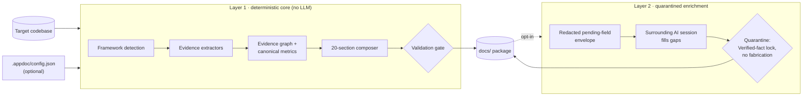
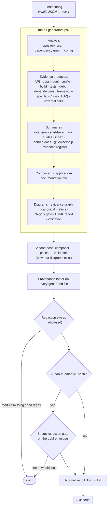
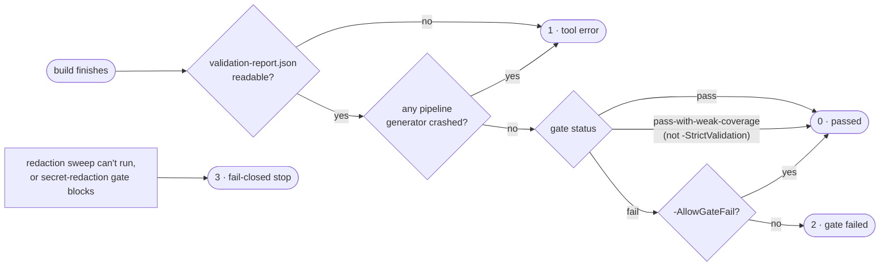
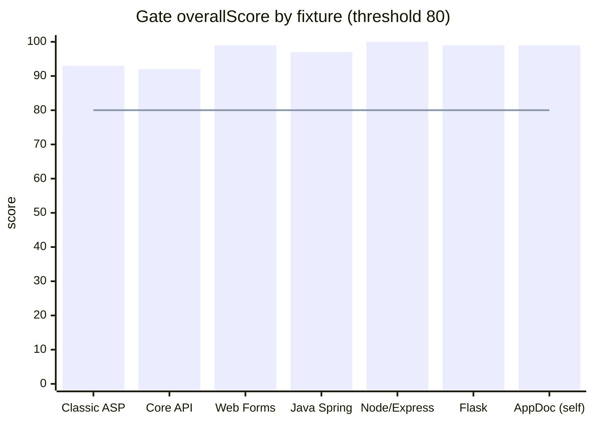
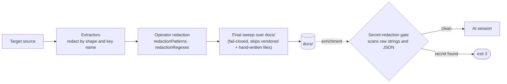
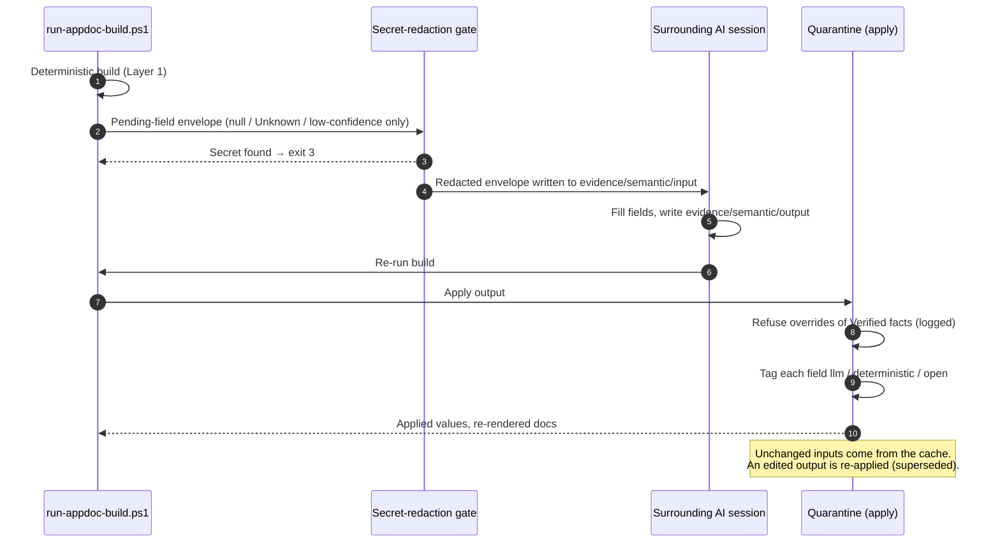
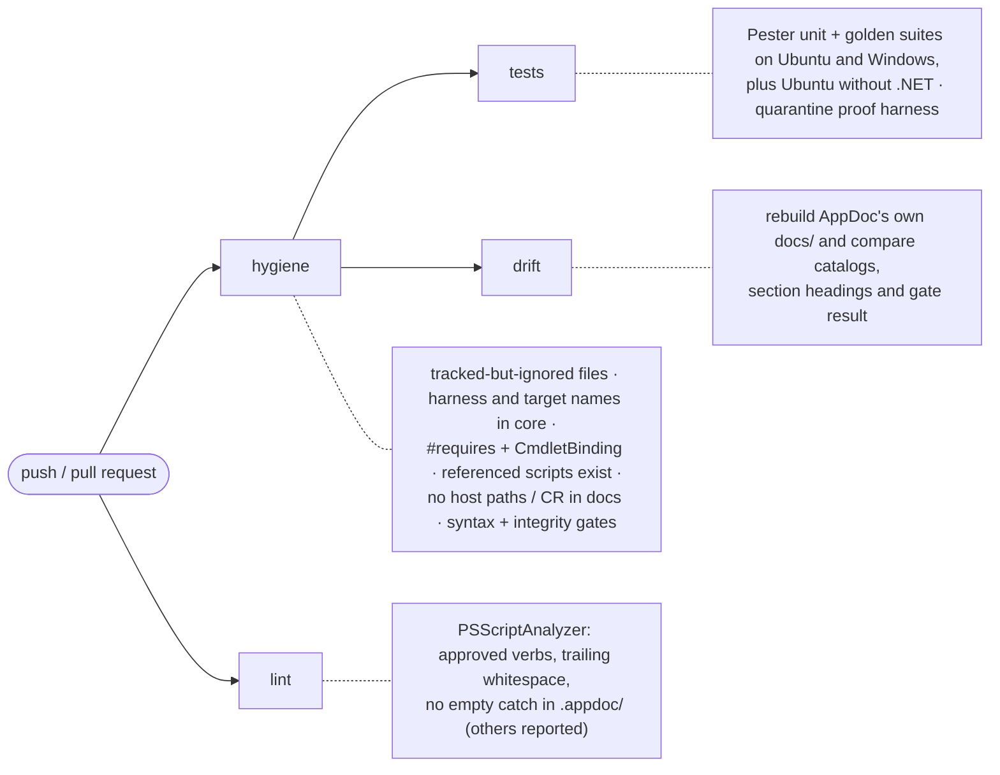

# AppDoc

**Deterministic, evidence-traceable documentation for legacy and unknown codebases.**


AppDoc scans a codebase and writes an onboarding documentation package for it:

- a 20-section master document;
- per-artifact catalogs;
- a machine-readable evidence layer;
- Mermaid architecture diagrams;
- a self-contained HTML report that works offline.

Every claim cites its source (`file:line`). Anything AppDoc can't ground is tagged `Unknown` rather than filled in.

There are two layers:

- **The core is deterministic.** One PowerShell command, no LLM, no network calls, no API key. A validation gate scores the output, and the build reports the result in its exit code.
- **AI enrichment is optional and quarantined.** The AI session that runs the skill can fill owner-knowledge gaps such as purpose and data flows, but only through a quarantine that fails closed. It never overrides a verified fact, and secrets never reach it.

> **Status:** 1.1.0 is on branch `remediation/skill-portability` and not yet tagged. See [CHANGELOG.md](CHANGELOG.md) for what changed and [ROADMAP.md](ROADMAP.md) for what's next. The open gaps are listed under [Known limitations](#known-limitations).

---

## Contents

- [How it works](#how-it-works)
- [Quick start](#quick-start)
- [Exit codes](#exit-codes)
- [What you get](#what-you-get)
- [Framework support](#framework-support)
- [Configuration](#configuration)
- [Security and secret handling](#security-and-secret-handling)
- [The enrichment layer](#the-enrichment-layer)
- [Verification and CI](#verification-and-ci)
- [Repository layout](#repository-layout)
- [Known limitations](#known-limitations)
- [Contributing](#contributing) · [License](#license)

---

## How it works

AppDoc is a **harness-agnostic skill**. [`SKILL.md`](SKILL.md) is the entry point, and any AI tool that can read it and run `pwsh` can drive AppDoc. [`references/`](references/) holds the detailed contracts. GitHub Copilot slash-command wrappers live in [`.github/prompts/`](.github/prompts/).



### The build pipeline

`run-appdoc-build.ps1` is the only supported entry point. It wraps the orchestrator and adds the steps that make the output safe to share:

1. loading the config;
2. a second composition pass;
3. the provenance footer;
4. the redaction sweep;
5. line-ending normalisation;
6. the exit code.



Every evidence producer runs **before** the steps that summarise evidence, so the overview and the master document see everything that was found. Each shared artifact (API inventory, data model, build cookbook) has **one owner per target**. On a Classic ASP target with `.asp`/`.inc` sources, the Classic ASP generators own it. On any other target, the generic generators do.

---

## Quick start

**Prerequisites**

- PowerShell **7.2+** (`pwsh`) on Windows or Linux. Windows PowerShell 5.1 is not supported.
- Optional: the .NET SDK. With it, C# is parsed with Roslyn; without it, AppDoc falls back to regex.
- Run AppDoc on a **scratch copy** of the target, so its committed `docs/` is never overwritten by accident.

```bash
# from the AppDoc repo root
pwsh -NoProfile -File ./.appdoc/scripts/powershell/run-appdoc-build.ps1 -Path <target-repo>
```

| Parameter | Default | Purpose |
|---|---|---|
| `-Path` | *(required)* | The target repository root. |
| `-QualityThreshold` | `80` | Minimum gate score (1–100). |
| `-StrictValidation` | off | Treat `pass-with-weak-coverage` as a failure. |
| `-SkipDiagrams` | off | Skip the C4 and flow diagrams (faster). |
| `-SkipSyntaxGate` | off | Skip the PowerShell syntax pre-check. |
| `-Profile` | `default` | Generation profile. |
| `-EnableSemanticEnrich` | off | Run the optional Layer 2 enrichment stage. |
| `-AllowGateFail` | off | For exploratory runs: log a failed gate but exit 0. Never use it in CI. |

To change where the output goes, set `outputDir` in the target's `.appdoc/config.json`. There is no command-line option for it.

## Exit codes

The build reports its outcome in the exit code ([ADR 0003](docs/adr/0003-sub-validator-failure-policy.md)). **Treat any non-zero code as "not done".**



| Code | Meaning |
|---|---|
| `0` | The gate passed. Without `-StrictValidation`, `pass-with-weak-coverage` also exits 0, as does any run with `-AllowGateFail`. |
| `1` | Tool error: bad path, missing module, invalid config JSON, a generator in the main pipeline crashed, or no validation report was produced. |
| `2` | The gate failed: the docs were written but are not trustworthy. |
| `3` | Fail-closed stop: the redaction sweep could not run, a `redactionRegexes` entry is invalid, or the secret-redaction gate blocked enrichment. |

A sub-validator that fails lowers the gate score. One that crashes forces the gate to `fail`. The gate result also depends on blocking **policy** checks (for example `provenance-missing`), so read `validation-report.json`, not just the score.

---

## What you get

Everything is written to the target's `docs/` folder, or the configured `outputDir`:

```text
docs/
├── application-documentation.md     # the 20-section master document
├── report.html                      # self-contained themed report (offline by default)
├── overview.md · start-here.md · task-guides.md · index.md
├── api-inventory.md (+ .appendix.md) · data-model.md · config-catalog.md
├── build-cookbook.md · test-catalog.md · debt-register.md · dependencies-catalog.md
├── extcalls.md · security.md · procdict.md          # where the framework supports them
├── git-ownership.md · source-docs.md · evidence-register.md · verification-appendix.md
├── pristine-report.md               # per-section source-groundedness
├── validation-report.json (+ .summary.md)   # the gate verdict
├── diagnostics-report.json          # warnings, generator failures, run metadata
├── diagrams/                        # Mermaid C4 context/container, data flow, lineage, sequences
└── evidence/                        # *.evidence.json per artifact, evidence graph, manifest
    └── semantic/                    # only when enrichment is enabled
```

<details>
<summary><b>The 20 sections of <code>application-documentation.md</code></b></summary>

| # | Section | # | Section |
|---|---|---|---|
| 1 | Application Index | 11 | Security and Operational Risks |
| 2 | Coverage and Executive Overview | 12 | Ownership and Maintenance |
| 3 | Architecture | 13 | Architecture and Data-Flow Diagrams |
| 4 | Functional Inventory | 14 | Glossary |
| 5 | Roles and Access Model | 15 | Evidence Register |
| 6 | UI Catalog | 16 | Open Questions and Documentation Gaps |
| 7 | Operational Workflows | 17 | Recommendations |
| 8 | Data and Integrations | 18 | Operations Runbook |
| 9 | External Call Register *(+ stored-procedure data dictionary)* | 19 | Verification Appendix |
| 10 | Troubleshooting Matrix | 20 | Provenance |

</details>

**Provenance and honesty**

- Every claim carries an epistemic tag: `Verified`, `Partly verified`, `Inferred`, `Unknown`, or `Operator-supplied` (for overlay content).
- Every generated file ends with a single `## Provenance` footer. JSON files carry a `provenance` object instead.
- Hand-written files are never stamped, normalised or rewritten. That covers `docs/adr/` and any file containing `<!-- appdoc:hand-authored -->`.
- Generated text is UTF-8 without a BOM, with LF line endings.
- Re-running on the same target gives the same content and the same gate result. Only timestamps change.

**Docs as code ([ADR 0002](docs/adr/0002-generated-docs-as-code.md)).** `docs/` is a stable, committed home. Generated files are overwritten in place, and hand-written material is preserved. AppDoc's own `docs/` folder is a dogfood run of AppDoc on itself, and CI checks it stays in sync with a fresh build.

---

## Framework support

Each framework class has a fixture and a golden regression suite in `tests/powershell/`.

| Framework class | Extraction | Golden suite |
|---|---|---|
| Classic ASP | Regex (Classic ASP extractors) | `test-golden-classic-asp.ps1` |
| ASP.NET Web Forms | Regex + C# | `test-golden-csharp-webforms.ps1` |
| C# ASP.NET Core | **AST (Roslyn)**, regex fallback without .NET | `test-golden-csharp-core-api.ps1` |
| Python Flask | Regex | `test-golden-python-flask.ps1` |
| Node / Express (TypeScript) | Regex | `test-golden-node-express.ps1` |
| Java Spring | Regex | `test-golden-java-spring.ps1` |

ASP.NET MVC 5 has also been tested on a real convention-routed target.

Gate scores on the fixtures at 1.1.0, with every fixture built twice and both runs identical:



A passing gate is a **floor, not a ceiling**. It proves the output is non-empty and grounded in the source, not that every extractor found the full surface. If a section looks thin, read the per-surface coverage metrics (for example `apiCoverage`).

Not yet supported: Django, Go, Ruby, Rust, and polyglot or microservice repos. Treat output for these as low-confidence until each has a fixture and a golden suite (see [ROADMAP.md](ROADMAP.md)). To request a framework, open an issue with the framework and version, a minimal sample project, and the routing, config and model patterns it uses.

---

## Configuration

Configuration is optional and lives in `<target>/.appdoc/config.json`. Without a config file, AppDoc uses its defaults. A config file that isn't valid JSON stops the build. The full reference is [`references/config-schema.md`](references/config-schema.md).

```json
{
  "schemaVersion": "appdoc-config/v1",
  "outputDir": "docs",
  "theme": "cmu",
  "redactionPatterns": ["svc-report-user"],
  "redactionRegexes": ["AKIA[0-9A-Z]{16}"],
  "opaqueTokenPattern": "@@APP_[A-Z0-9_]+@@",
  "overlays": { "Operational Workflows": ".appdoc/overlays/operational-workflows.md" },
  "ownership": { "showEmails": false },
  "pristineFloor": 80
}
```

| Key | What it does |
|---|---|
| `outputDir` | Output folder inside the target (default `docs`). Excluded from scanning. A path outside the target is ignored with a warning. |
| `theme` / `themeFile` | `cmu` (maroon/gold, the default), `navy-teal`, or your own theme JSON. An unknown name logs a warning; a missing `themeFile` is an error. |
| `assets` *(in the theme)* | `inline` (default) makes `report.html` fully offline, with Mermaid inlined and system fonts (about 3.5 MB). `cdn` makes a smaller file that needs internet. |
| `redactionPatterns` | Exact secret **values**, matched literally. |
| `redactionRegexes` | Regex patterns, case-insensitive. An invalid regex stops the build with exit 3. |
| `opaqueTokenPattern` | Placeholder tokens left verbatim in a pre-sanitised source, instead of being redacted. |
| `overlays` | Owner-written narrative per section. It is rendered as **Operator-supplied context** and never counted as `Verified`. The default location is `.appdoc/overlays/<section-slug>.md`. |
| `ownership.showEmails` | Show author emails in `git-ownership.md`. Off by default: names only, `.mailmap` honoured. |
| `pristineFloor`, `minCommitsForOwnership` | Thresholds for the pristine report and ownership rows. |

**Branding.** AppDoc is CMU-first: reports default to the CMU theme and mark. Another organisation can copy `.appdoc/templates/html/theme.json`, change its colours, fonts and `masthead`, set `masthead.logoSvg` to `none` or its own SVG, and point `themeFile` at it.

**Target narrative belongs to the target.** AppDoc ships no knowledge of any particular application. Workflow descriptions, business context and internal system names go in that target's overlay files ([ADR 0001](docs/adr/0001-redaction-externalize-per-target-secrets.md) amendment).

---

## Security and secret handling



- **Shape patterns only in the tool.** AppDoc recognises high-entropy, base64, named-key and URI-credential (`user:pass@`) shapes. It never contains a target's real secret values ([ADR 0001](docs/adr/0001-redaction-externalize-per-target-secrets.md)).
- **The secret's location is shown, never its value.** The key name and location appear in the docs; the value renders as `[REDACTED]`.
- **Per-target secrets come from the operator.** Supply them through `redactionPatterns` and `redactionRegexes` in the config, or through the `-RedactionPatterns` and `-RedactionRegexes` options of `generate-source-docs.ps1` and `run-appdoc-semantic-enrich.ps1`.
- **Fail-closed by default.** These conditions stop the build with exit 3 instead of continuing with weaker redaction:
  - the redaction module is missing;
  - a regex is invalid;
  - a known secret appears in the LLM envelope (including secrets that contain `"` or `\`).

---

## The enrichment layer

Enrichment is opt-in with `-EnableSemanticEnrich`. It fills owner-knowledge fields that parsing the source can't, using the **surrounding** AI session. AppDoc itself holds no API key and makes no LLM network calls.



- **A tiered Verified-fact lock.** The LLM may only fill `null`, `Unknown` or low-confidence fields, and can never override a source-grounded fact.
- **No fabrication.** Fields the LLM doesn't provide stay `Unknown`.
- **An input-hash cache.** Unchanged records are skipped, but an output file you corrected is always re-applied.

The contracts are in [`references/enrichment-contract.md`](references/enrichment-contract.md) and [`references/enrichment-operations.md`](references/enrichment-operations.md). The Copilot wrapper is `/appdoc.enrich`.

---

## Verification and CI



What each job checks:

- **Gate:** `validate-documentation.ps1` computes a composite score from 15 components and applies blocking policy checks.
- **Golden suites:** one per framework class, each locking extractor output to its committed baseline.
- **Unit tests:**
  - gate validator failures and build exit codes;
  - re-run determinism;
  - operator redaction and leak prevention for target-specific text;
  - provenance footer, git ownership, `outputDir`, themes;
  - module import (approved verbs).
- **Quarantine proof harness:** run as a plain script, not under Pester:
  ```bash
  pwsh -NoProfile -File tests/powershell/test-semantic-quarantine.ps1
  ```

---

## Repository layout

```text
SKILL.md                         # the skill contract (entry point for any AI harness)
references/                      # config schema, verification, enrichment contract + operations
.appdoc/scripts/powershell/      # run-appdoc-build.ps1, run-all-generators.ps1, generate-*, validate-*, ci-*
.appdoc/scripts/powershell/modules/   # AppDoc.*.psm1 shared modules (Config, Paths, Scope, SecretPolicy,
                                      #   SemanticRedaction, Provenance, ClassicAsp, EvidenceGraph, …)
.appdoc/templates/               # Markdown templates, HTML themes, vendored Mermaid (templates/html/vendor)
.github/prompts/                 # Copilot wrappers: /appdoc.begin, /appdoc.enrich, /appdoc.diagrams
.github/workflows/appdoc-ci.yml  # CI (hygiene, lint, tests, drift)
docs/                            # AppDoc's own generated docs (dogfood) + docs/adr/
tests/powershell/                # Pester suites, golden suites, quarantine harness
tests/fixtures/                  # one sample target per framework class
```

Coding conventions are in [`.github/copilot-instructions.md`](.github/copilot-instructions.md) and [`PSScriptAnalyzerSettings.psd1`](PSScriptAnalyzerSettings.psd1).

## Troubleshooting

- **Environment check:** `pwsh ./.appdoc/scripts/powershell/appdoc.diagnose.ps1 -RootPath <target> -Fix`
- **Non-zero exit:** see [Exit codes](#exit-codes). Start with `validation-report.json` (status, score, failed validators, `validatorInternalErrors`), then `diagnostics-report.json` (`metadata.scriptFailures`).
- **A thin section on a passing gate:** check that framework's coverage metric. The gate is a floor.
- **The report renders without diagrams when emailed:** make sure the theme uses `"assets": "inline"`, which is the default.

## Known limitations

These are open items from the 2026-10-23 review, tracked for 1.1.x / 1.2.0:

- If the C4 generator, the diagram suite or the HTML report crashes, the build still exits 0. Only crashes in the main generator pipeline give exit 1. Check `diagnostics-report.json` until this is fixed.
- Generated catalogs repeat their content exactly between runs, but their timestamps change.
- The `/appdoc.diagrams` Copilot prompt edits generated diagrams in place, so the next build overwrites those edits.
- Many internal error paths fall back to defaults or `Write-Verbose` instead of reporting a diagnostic.
- Pester has not yet been run against the 1.1.0 changes; the first CI run will be the first.

## Contributing

Fork the repo, create a branch, and open a pull request. CI must be green.

**The gate is how AppDoc stays accurate.** Never lower a threshold or relax a policy check to make output pass. When a stricter check turns something red, fix the cause.

## License

MIT. See [LICENSE](LICENSE) and [NOTICE](NOTICE) (vendored Mermaid). Copyright (c) 2026 Tim Niles.

For support, open an issue on GitHub.
