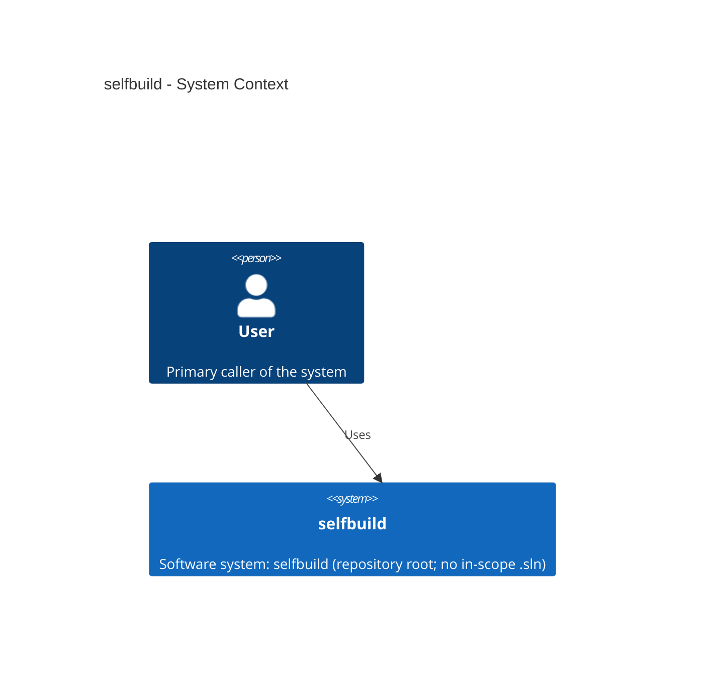

# Application Documentation

**Evidence date**: 10/23/2026 01:55:38  
**Framework**: ASP.NET Core, ASP.NET MVC 5, Flask, Spring Boot  
**Composed from**: 11 per-artifact files + machine evidence (deterministic, no LLM).

> **Handling note**: Secret material is redacted and shown as `[REDACTED]`. Connection strings below are shown in *shape only* (provider / catalog / source), never with live credentials.

**Epistemic status legend**: Verified — supported by a located source file + searchable value. Inferred — a reasonable interpretation not confirmed by a concrete file+line. Partly verified — a file reference exists but the confirmable line/value is absent. Unknown — the repository does not establish the claim. Operator-supplied — narrative the target's owner provided in an overlay file; not verified from source.

## Application Index

Auto-generated table of contents for this document, plus a quick cross-reference to the primary entry points extracted from the API inventory.

### Table of contents

1. [Application Index](#application-index)
2. [Coverage and Executive Overview](#coverage-and-executive-overview)
3. [Architecture](#architecture)
4. [Functional Inventory](#functional-inventory)
5. [Roles and Access Model](#roles-and-access-model)
6. [UI Catalog](#ui-catalog)
7. [Operational Workflows](#operational-workflows)
8. [Data and Integrations](#data-and-integrations)
9. [External Call Register](#external-call-register)
10. [Stored-procedure data dictionary](#stored-procedure-data-dictionary)
11. [Troubleshooting Matrix](#troubleshooting-matrix)
12. [Security and Operational Risks](#security-and-operational-risks)
13. [Ownership and Maintenance](#ownership-and-maintenance)
14. [Architecture and Data-Flow Diagrams](#architecture-and-data-flow-diagrams)
15. [Glossary](#glossary)
16. [Evidence Register](#evidence-register)
17. [Open Questions and Documentation Gaps](#open-questions-and-documentation-gaps)
18. [Recommendations](#recommendations)
19. [Operations Runbook](#operations-runbook)
20. [Verification Appendix](#verification-appendix)

### Quick cross-reference (primary entry points)

| # | Feature (Inferred) | Entry point | Method | Status |
|---|--------------------|-------------|--------|--------|
| — | none extracted | — | — | Unknown |

*Top 10 of 0 request-addressable entry points (see Functional Inventory for the capped detail table).*

## Coverage and Executive Overview

### What was inspected

The inspected unit is the application tree under the repository root: 0 request-addressable entry points and the data / integration surfaces the extractors detected for this framework (ASP.NET Core, ASP.NET MVC 5, Flask, Spring Boot). The System Overview narrative (overview.md) reports the following as the high-level shape:

*From System Overview:*

- This repository primarily defines tooling, automation, and configuration behavior rather than an exposed runtime API surface. (evidence: ev-0001, ev-0002, ev-0003, ev-0004) _(Inferred — overview narrative)_

### Purpose and users

| Aspect | Statement | Status |
|--------|-----------|--------|
| Purpose | Not established from source. AppDoc does not infer a system's business purpose from file or schema names; owner-required (an operator overlay can supply it). | Unknown |
| Primary users | Not established from source; owner-required. | Unknown |
| Interpretation basis | Only grounded inputs are used: the entry points (§4), the data objects (§8) and, where cited, the repository's own hand-authored docs. | N/A |

### System boundary

The boundary is stated as concrete, countable extents extracted from the machine evidence (not narrative):

| Boundary extent | Value | Status |
|-----------------|-------|--------|
| Request-addressable entry points (endpoints) | 0 | Verified |
| Database objects (models) | 0 | Verified |
| Distinct databases (connection strings) | 0 | Verified |
| SQL Server instances | 0 | Verified |
| Tables and views referenced | 0 | Verified |
| Stored procedures called | 0 | Verified |
| Test/failure-surface records | 0 | Verified |

Canonical count markers (for cross-artifact metric consistency):

| Metric | Value | Status |
|--------|-------|--------|
| API endpoints documented | 0 | Verified |
| Database object records (models) | 0 | Verified |

## Architecture

### 3.1 Components

Components are projected from two deterministic sources: the build-cookbook code inventory (file-type distribution) and the API inventory grouped by top-level subsystem directory.

**Code inventory (file types)** — status Verified:

*Not detected for this framework — classic-ASP-specific data point; not applicable to the detected framework. (the classic-ASP code-inventory (file-type distribution from .asp/.aspx/.inc scanning) does not apply to this framework)* — status: N/A (not applicable to the detected framework).

**Subsystems (entry points grouped by top-level directory)** — status Verified (counts) / Inferred (naming):

| Subsystem (dir) | Entry points | Status |
|-----------------|--------------|--------|

### 3.2 Architecture diagram

### 3.3 Authentication / Authorization

| Concern | Observed | Status |
|---------|----------|--------|
| Model | *Not detected for this framework — classic-ASP-specific data point; not applicable to the detected framework. (per-page session/cookie + ADO credential model does not apply to this framework)* | Unknown |
| Detail | Authentication and authorization behavior is summarized when explicit markers are extracted. For authoritative enforcement details, review controller attributes, middleware, and configuration policy in source. | Inferred |

## Functional Inventory

Each request-addressable entry point is one feature. The detail table is capped to the first 60 by subsystem order; the full set of 0 entry points lives in [API Inventory](api-inventory.md). Status: Verified for entry presence, Inferred for the feature purpose/name.

| ID | Feature (Inferred) | Entry point | Inputs (form/query fields) | Dependencies | Status |
|----|--------------------|-------------|-----------------------------|--------------|--------|
| — | none extracted | — | — | — | Unknown |

*Showing 0 of 0 total entry points.*

## Roles and Access Model

A deterministic scan locates the concrete role / privilege / authorization **tokens** in the classic-ASP source (grep-verifiable), with the first file:line where each was observed. The capability matrix below is **owner-required** — the authoritative role→capability mapping lives in database objects and is data-driven, so no cell is inferred beyond what a single token proves.

### 5.1 Observed role concepts

| Role / concept | Observed capability | Where observed (file:line) | Status |
|----------------|---------------------|----------------------------|--------|
*Not detected for this framework — classic-ASP-specific data point; not applicable to the detected framework. (the classic-ASP authorization-signal scan (session flags / access-check routines) does not apply to this framework)* — status: N/A (no role/authorization tokens located for this framework).

### Role-capability matrix

*Not detected for this framework — classic-ASP-specific data point; not applicable to the detected framework. (the classic-ASP role-capability matrix does not apply to this framework)* — status: N/A (owner-required for a framework-appropriate role matrix).

*Role model not detected for this framework — the classic-ASP role/privilege concepts are N/A; a framework-appropriate role matrix would be owner-required.*

## UI Catalog

Each entry point that carries form/query input fields is a screen. Controls (form/query fields) are Verified from the extraction; **States** (loading / empty / error / validated) are Unknown because the runtime was not observed. Capped to the first 40 screens with inputs; the full set is in [API Inventory](api-inventory.md).

| Screen (Inferred) | Entry point | Visible controls/data (fields) | States | Roles/evidence |
|-------------------|-------------|-------------------------------|--------|----------------|
| — | none with fields extracted | — | Unknown | Unknown |

*Showing 0 screens with extracted input fields.*

## Operational Workflows

> Workflows are projected only from grounded evidence: the entry-point areas a user moves through and, where present, the stored-procedure contracts documented in source. Workflow sequencing, business policy, authorization and escalation are not derivable from source and stay `Unknown` (owner-required) unless the repository's own docs state them or the operator supplies them as an overlay.

### 7.1 Entry-point areas

| Area | Entry points | Example | Status |
|------|--------------|---------|--------|
| — | 0 | none extracted | Unknown |

### 7.2 Procedure contracts behind operator actions

*Not detected for this framework — classic-ASP-specific data point; not applicable to the detected framework. (stored-procedure contract blocks are a classic-ASP data point; not applicable to the detected framework)*

### 7.3 Sequencing, policy, authorization and escalation

| Item | Established by source? | Status |
|------|------------------------|--------|
| Which steps make up each workflow, and in what order | No | Unknown |
| Who is authorized to perform each action | No | Unknown |
| Evidence the operator must retain | No | Unknown |
| Escalation path and thresholds | No | Unknown |

## Data and Integrations

The data layer and integration surfaces (databases, tables/views, stored procedures, and any detected data stores) are projected from the data-model evidence for this framework (ASP.NET Core, ASP.NET MVC 5, Flask, Spring Boot). **Sensitivity** is Inferred (not confirmed). The full register of detected external data integrations is in [External Call Register](#external-call-register).

### Databases (connection-string inventory) — status Verified (redacted)

| ID | Provider | Server | Database | Connection-string shape | Status |
|----|----------|--------|----------|-------------------------|--------|
| — | not detected | — | — | — | Unknown |

### Entities (tables/views, representative) — status Verified

| ID | DB | Object | Type | Sensitivity | Referenced from | Status |
|----|----|--------|------|-------------|-----------------|--------|
| — | not detected (no ADO tables/views) | — | — | n/a (ORM/EF Core surface) | — | Honest (framework) |

*This framework does not use ADO tables/views; its data surface is the ORM/EF Core entity model. Sensitivity Inferred.*

### Entities / domain model (representative) — status Inferred

Generic data-model records for this framework (ASP.NET Core, ASP.NET MVC 5, Flask, Spring Boot), projected from the data-model evidence (class / interface / struct). Representative sample, capped at 25 and deterministically sorted; **Sensitivity** is Inferred (not confirmed). The authoritative schema lives in the framework's data layer (ORM / entity model) and requires data-owner confirmation.

| # | Entity | Type | Fields | Source file | Status |
|---|--------|------|--------|-------------|--------|
| — | not detected | — | — | — | Unknown |

*Showing 0 of 0 domain-model entities (representative sample; deterministic). Sensitivity Inferred.*

## External Call Register

Deterministic register of every external call the application makes. The largest and most reliable section of this document.

### 9.1 Database connections

| ID | Provider | Server | Database | Connection-string shape | Files referencing | Status |
|----|----------|--------|----------|-------------------------|-------------------|--------|
| — | not detected | — | — | — | — | Unknown |

*Showing 0 of 0 connection strings.*

### 9.2 Stored-procedure register

| ID | Procedure | Call-site file(s) | Effect | Status |
|----|-----------|-------------------|--------|--------|
| — | not detected | — | Unknown | Unknown |

*Showing 0 of 0 stored procedures.*

### 9.3 Direct SQL tables / views

Referenced tables and views are the direct-SQL surface (see 8.2 for sensitivity). Representative set:

| ID | DB | Object | Type | Referenced from | Status |
|----|----|--------|------|-----------------|--------|
| — | not detected | — | — | — | Unknown |

*Showing 0 of 0 tables/views.*

### 9.4 HTTP / XML endpoints

*Not detected in this codebase.* No outbound HTTP/XML call sites were extracted in the available evidence for this framework. *Not detected for this framework — classic-ASP-specific data point; not applicable to the detected framework. (the classic-ASP outbound HTTP/XML register (ServerXMLHTTP / FreeThreadedDOMDocument call sites) does not apply to this framework)*

### 9.5 Email / COM / file-system boundaries

*Not detected in this codebase.* No email / COM / file-system boundaries were extracted in the available evidence for this framework. *Not detected for this framework — classic-ASP-specific data point; not applicable to the detected framework. (the classic-ASP send_mail / ADO / UNC boundary register does not apply to this framework)*

### 9.6 Failure / observability

From the test-catalog failure surface:

| Signal | Count | Files (sample) | Status |
|--------|-------|----------------|--------|
| Auto-refresh timers (auto-refresh) | 0 | see test-catalog | Verified |

## Stored-procedure data dictionary

*Not detected for this framework — classic-ASP-specific data point; not applicable to the detected framework. (the stored-procedure data dictionary is produced only for classic-ASP codebases from in-source contract blocks; this target has no classic-ASP signal, so no contract ladders were extracted)*

| Procedure | Parameters observed | Return / output | Source file (call site) | Status |
|-----------|--------------------|-----------------|-------------------------|--------|
| — | — | — | — | Unknown |

*Parameter/return details are Unknown where not present in the evidence.*

## Troubleshooting Matrix

Projected from the test-catalog known-failure-mode records. Each row is a real per-file failure pattern: **Symptom** = the observed failure pattern + file, **Evidence-supported check** = a grep-verifiable command referencing that file, **Known response / restriction** = the observed behavior, **Escalate-when** = Unknown (not extracted). Scratch / copy / old / test / bak files are excluded and identical rows are deduped.

| Symptom | Evidence-supported check (Inferred) | Known response / restriction (observed, Verified) | Escalate-when |
|---------|--------------------------------------|------------------------------------------------------|----------------|
| — | not detected | — | Unknown |

*Showing 0 of 0 distinct non-scratch failure-mode/timer records (identical rows deduped; full set in [test-catalog](test-catalog.md)).*

### Troubleshooting KB (cited from hand-authored docs — Inferred)

The following symptom→fix / incident entries come from the repo's hand-authored troubleshooting KB (documented, but a KB is not an authoritative policy — tagged Inferred):

- ## Troubleshooting  
  - Source: `README.md`:146 — `Inferred` (confidence: medium)

*§11 troubleshooting KB: `README.md`: 146. All claims are `Inferred` (each backed by a real hand-authored file:line; no fabrication).*

## Security and Operational Risks

Projected from the test-catalog security findings and the data-model connection-string inventory. Credential values are **redacted** (shown only as opaque sanitized tokens).

| Risk | Evidence | Status |
|------|----------|--------|
| Errors swallowed silently | *Not detected for this framework — classic-ASP-specific data point; not applicable to the detected framework. (the `On Error Resume Next` (VBScript) silent-swallowing pattern is classic-ASP-specific; not detected in this framework)* | N/A |
| Silent redirect on DB failure hides root cause | *Not detected for this framework — classic-ASP-specific data point; not applicable to the detected framework. (the `Response.Redirect`-after-query-failure pattern is classic-ASP-specific; not detected in this framework)* | N/A |
| ADO/recordset errors inspected at runtime | *Not detected for this framework — classic-ASP-specific data point; not applicable to the detected framework. (the `parseError` ADO error-inspection pattern is classic-ASP-specific; not detected in this framework)* | N/A |
| Hardcoded connection strings (credential-exposure) | *Not detected for this framework — classic-ASP-specific data point; not applicable to the detected framework. (the hardcoded ADO connection-string pattern is classic-ASP-specific; not detected in this framework)* | N/A |
| Multiple distinct SQL Server hosts referenced | *Not detected for this framework — classic-ASP-specific data point; not applicable to the detected framework. (the multi-host SQL Server instance inventory is classic-ASP-specific; not detected in this framework)* | N/A |

### Unknowns that must not be treated as controls

The following are **Unknown** — their absence from the repo does NOT mean they are absent in production, and they must not be read as security controls (or the lack thereof):

- Runtime authentication enforcement strength (Unknown)
- Input validation / injection protection beyond the observed usage (Unknown)
- Transport security (TLS/HTTPS) configuration (Unknown)
- Credential rotation / secrets-management practice (Unknown)

## Ownership and Maintenance

Ownership and maintenance information is **not extractable** from the codebase (no owners, no on-call, no SLO metadata in the evidence). Every cell below is Unknown / owner-required. This is an honest placeholder, not a fabrication.

| Aspect | Owner | Contact | SLO / target | Notes | Status |
|--------|-------|---------|--------------|-------|--------|
| Application ownership | Unknown | Unknown | Unknown | owner-required | Unknown |
| Help-desk operator team | Unknown | Unknown | Unknown | owner-required | Unknown |
| IT administrator team | Unknown | Unknown | Unknown | owner-required | Unknown |
| On-call / escalation | Unknown | Unknown | Unknown | owner-required | Unknown |
| Data/DBA owner | Unknown | Unknown | Unknown | owner-required | Unknown |
| SLO / availability target | Unknown | Unknown | Unknown | owner-required | Unknown |
| Change/release process | Unknown | Unknown | Unknown | owner-required | Unknown |

*This table is a structure placeholder. All cells are Unknown / owner-required — ownership data was not present in the inspected codebase.*

### Ownership (git-derived — last-change author / churn, Verified-git-history)

The target's git history is real and sufficient (53 commit(s)). Per-file ownership below is the **last-change author** with churn (instability = commit count); it is a deterministic projection of git log (plus CODEOWNERS when present), cited to docs/evidence/git-ownership.evidence.json. The table above remains a structure placeholder (application-level ownership stays owner-required unless a CODEOWNERS default declares it).

Declared owner (CODEOWNERS *): **Unknown (not declared)**  ·  top author: Tim Niles (53 commit(s)).

| File | Owner (last-change author) | Last change | Churn |
|------|----------------------------|-------------|-------|
| `README.md` | Tim Niles | 2026-10-23 | 14 |
| `.gitignore` | Tim Niles | 2026-10-23 | 9 |
| `.github/prompts/appdoc.begin.prompt.md` | Tim Niles | 2026-10-23 | 8 |
| `ROADMAP.md` | Tim Niles | 2026-10-23 | 8 |
| `.github/copilot-instructions.md` | Tim Niles | 2026-10-23 | 6 |
| `.github/prompts/appdoc.diagrams.prompt.md` | Tim Niles | 2026-02-26 | 6 |
| `.github/workflows/appdoc-ci.yml` | Tim Niles | 2026-10-23 | 6 |
| `references/config-schema.md` | Tim Niles | 2026-10-23 | 5 |
| `references/verification.md` | Tim Niles | 2026-10-23 | 4 |
| `SKILL.md` | Tim Niles | 2026-10-23 | 4 |
| `.github/prompts/appdoc.enrich.prompt.md` | Tim Niles | 2026-10-23 | 3 |
| `references/enrichment-operations.md` | Tim Niles | 2026-10-23 | 3 |
| `.gitattributes` | Tim Niles | 2026-10-23 | 2 |
| `.editorconfig` | Tim Niles | 2026-10-23 | 1 |
| `.vscode/settings.example.json` | Tim Niles | 2026-10-23 | 1 |
| … | (capped at 15; full table in docs/git-ownership.md) | | |

*`Verified-git-history`: owner = last-change author, churn = commit count (deterministic `git log` projection; no inference). Application-level / on-call / SLO ownership remains owner-required — git history does not declare those.*

## Architecture and Data-Flow Diagrams

> These diagrams represent **observed calls** extracted from the codebase, not production topology. They are deterministic projections of the evidence graph.

### Data flow

```mermaid
flowchart LR
    %% Solid edges: runtime request/data flow. Dashed edges: structural/config/dependency links.
    subgraph inputs["Input Boundary"]
        config_concurrency_cancel_in_4184c67a["concurrency.cancel-in-progress"]
        config_concurrency_group_4353a474["concurrency.group"]
        config_jobs_drift_name_84d8c2e6["jobs.drift.name"]
        config_jobs_drift_needs_98e6a433["jobs.drift.needs"]
        config_jobs_drift_runs_on_589e2ca4["jobs.drift.runs-on"]
        config_jobs_drift_steps_shell_ed460ba6["jobs.drift.steps.shell"]
        config_jobs_drift_steps_with_d2da89f4["jobs.drift.steps.with.fetch-depth"]
        config_jobs_drift_steps_0_99a79b90["jobs.drift.steps(0)"]
        config_jobs_drift_steps_1_38332dfa["jobs.drift.steps(1)"]
        config_jobs_hygiene_name_a7867886["jobs.hygiene.name"]
        config_jobs_hygiene_runs_on_f616492a["jobs.hygiene.runs-on"]
        config_jobs_hygiene_steps_run_348a44cb["jobs.hygiene.steps.run"]
    end
    subgraph processing["Core Transformations"]
        component_core_processing_6d28d771["Core Processing"]
    end
    class component_core_processing_6d28d771 component
    class config_concurrency_cancel_in_4184c67a config
    class config_concurrency_group_4353a474 config
    class config_jobs_drift_name_84d8c2e6 config
    class config_jobs_drift_needs_98e6a433 config
    class config_jobs_drift_runs_on_589e2ca4 config
    class config_jobs_drift_steps_shell_ed460ba6 config
    class config_jobs_drift_steps_with_d2da89f4 config
    class config_jobs_drift_steps_0_99a79b90 config
    class config_jobs_drift_steps_1_38332dfa config
    class config_jobs_hygiene_name_a7867886 config
    class config_jobs_hygiene_runs_on_f616492a config
    class config_jobs_hygiene_steps_run_348a44cb config
classDef actor fill:#0f172a,stroke:#0f172a,color:#ffffff,stroke-width:1px
classDef inbound fill:#dcfce7,stroke:#166534,color:#166534,stroke-width:1px
classDef outbound fill:#ffedd5,stroke:#9a3412,color:#9a3412,stroke-width:1px
classDef component fill:#dbeafe,stroke:#1d4ed8,color:#1d4ed8,stroke-width:1px
classDef data fill:#fef9c3,stroke:#854d0e,color:#854d0e,stroke-width:1px
classDef config fill:#f5f3ff,stroke:#5b21b6,color:#5b21b6,stroke-width:1px
classDef external fill:#fee2e2,stroke:#991b1b,color:#991b1b,stroke-width:1px
classDef dependency fill:#ede9fe,stroke:#4338ca,color:#4338ca,stroke-width:1px
```

### C4 context

## Glossary

Recurring domain tokens and technical terms observed in the extracted evidence. Meanings are Inferred from context; they are not confirmed definitions.

| Term | Observed meaning | Basis | Status |
|------|------------------|-------|--------|
| — | *Not detected for this framework — classic-ASP-specific data point; not applicable to the detected framework. (the classic-ASP technology glossary (ADO providers / ASP Session) does not apply to this framework)* | N/A |

## Evidence Register

The full evidence register is reproduced below, projected verbatim from `evidence-register.md`.

**Status model:** `Verified` — directly supported by inspected source (file + line or a searchable value). `Inferred` — a reasonable interpretation not confirmed by runtime. `Partly verified` — a file reference exists but the confirmable line/value is absent. `Unknown` — the repository does not establish the claim.

**Records:** 64 across 13 evidence files.

Framework detected: **ASP.NET Core ASP.NET MVC 5 Flask Spring Boot** (C# C# Python Java); support level: full partial partial partial; extraction coverage: System.Object[]%.

| Finding | Status | Supporting Artifact | Limitation |
|---|---|---|---|
| GitHub Actions | Partly verified | appdoc-ci.yml | File reference present; line/value not confirmed |
| chat.tools.fileOperations.autoApprove.list | Partly verified | .vscode/settings.json | File reference present; line/value not confirmed |
| chat.tools.fileOperations.autoApprove.read | Partly verified | .vscode/settings.json | File reference present; line/value not confirmed |
| chat.tools.terminal.autoApprove.-ErrorAction | Partly verified | .vscode/settings.json | File reference present; line/value not confirmed |
| chat.tools.terminal.autoApprove.-Json | Partly verified | .vscode/settings.json | File reference present; line/value not confirmed |
| chat.tools.terminal.autoApprove.-RootPath | Partly verified | .vscode/settings.json | File reference present; line/value not confirmed |
| chat.tools.terminal.autoApprove.-Verbose | Partly verified | .vscode/settings.json | File reference present; line/value not confirmed |
| chat.tools.terminal.autoApprove..\.AppDoc\\scripts\\powershell\\*.ps1 | Partly verified | .vscode/settings.json | File reference present; line/value not confirmed |
| chat.tools.terminal.autoApprove..AppDoc/scripts/powershell/*.ps1 | Partly verified | .vscode/settings.json | File reference present; line/value not confirmed |
| chat.tools.terminal.autoApprove.**/analyze-capability-gaps.ps1 | Partly verified | .vscode/settings.json | File reference present; line/value not confirmed |
| chat.tools.terminal.autoApprove.**/analyze-codebase.ps1 | Partly verified | .vscode/settings.json | File reference present; line/value not confirmed |
| chat.tools.terminal.autoApprove.**/analyze-repository.ps1 | Partly verified | .vscode/settings.json | File reference present; line/value not confirmed |
| chat.tools.terminal.autoApprove.**/calculate-quality-metrics.ps1 | Partly verified | .vscode/settings.json | File reference present; line/value not confirmed |
| chat.tools.terminal.autoApprove.**/catalog-samples.ps1 | Partly verified | .vscode/settings.json | File reference present; line/value not confirmed |
| chat.tools.terminal.autoApprove.**/extract-config.ps1 | Partly verified | .vscode/settings.json | File reference present; line/value not confirmed |
| chat.tools.terminal.autoApprove.**/generate-api-inventory.ps1 | Partly verified | .vscode/settings.json | File reference present; line/value not confirmed |
| chat.tools.terminal.autoApprove.**/generate-assessment-report.ps1 | Partly verified | .vscode/settings.json | File reference present; line/value not confirmed |
| chat.tools.terminal.autoApprove.**/generate-build-cookbook.ps1 | Partly verified | .vscode/settings.json | File reference present; line/value not confirmed |
| chat.tools.terminal.autoApprove.**/generate-config-catalog.ps1 | Partly verified | .vscode/settings.json | File reference present; line/value not confirmed |
| chat.tools.terminal.autoApprove.**/generate-data-model.ps1 | Partly verified | .vscode/settings.json | File reference present; line/value not confirmed |
| chat.tools.terminal.autoApprove.**/generate-debt-register.ps1 | Partly verified | .vscode/settings.json | File reference present; line/value not confirmed |
| chat.tools.terminal.autoApprove.**/generate-dependencies-catalog.ps1 | Partly verified | .vscode/settings.json | File reference present; line/value not confirmed |
| chat.tools.terminal.autoApprove.**/generate-dependency-graph.ps1 | Partly verified | .vscode/settings.json | File reference present; line/value not confirmed |
| chat.tools.terminal.autoApprove.**/generate-improvements.ps1 | Partly verified | .vscode/settings.json | File reference present; line/value not confirmed |
| chat.tools.terminal.autoApprove.**/generate-overview.ps1 | Partly verified | .vscode/settings.json | File reference present; line/value not confirmed |
| chat.tools.terminal.autoApprove.**/generate-test-catalog.ps1 | Partly verified | .vscode/settings.json | File reference present; line/value not confirmed |
| chat.tools.terminal.autoApprove.**/run-all-generators.ps1 | Partly verified | .vscode/settings.json | File reference present; line/value not confirmed |
| chat.tools.terminal.autoApprove.**/synthesize-assessment-report.ps1 | Partly verified | .vscode/settings.json | File reference present; line/value not confirmed |
| chat.tools.terminal.autoApprove.**/validate-api-inventory.ps1 | Partly verified | .vscode/settings.json | File reference present; line/value not confirmed |
| chat.tools.terminal.autoApprove.**/validate-build-cookbook.ps1 | Partly verified | .vscode/settings.json | File reference present; line/value not confirmed |
| chat.tools.terminal.autoApprove.**/validate-config-catalog.ps1 | Partly verified | .vscode/settings.json | File reference present; line/value not confirmed |
| chat.tools.terminal.autoApprove.**/validate-data-model.ps1 | Partly verified | .vscode/settings.json | File reference present; line/value not confirmed |
| chat.tools.terminal.autoApprove.**/validate-debt-register.ps1 | Partly verified | .vscode/settings.json | File reference present; line/value not confirmed |
| chat.tools.terminal.autoApprove.**/validate-overview.ps1 | Partly verified | .vscode/settings.json | File reference present; line/value not confirmed |
| chat.tools.terminal.autoApprove.**/validate-test-catalog.ps1 | Partly verified | .vscode/settings.json | File reference present; line/value not confirmed |
| chat.tools.terminal.autoApprove.Copy-Item | Partly verified | .vscode/settings.json | File reference present; line/value not confirmed |
| chat.tools.terminal.autoApprove.Get-ChildItem | Partly verified | .vscode/settings.json | File reference present; line/value not confirmed |
| chat.tools.terminal.autoApprove.Get-Content | Partly verified | .vscode/settings.json | File reference present; line/value not confirmed |
| chat.tools.terminal.autoApprove.git | Partly verified | .vscode/settings.json | File reference present; line/value not confirmed |
| chat.tools.terminal.autoApprove.git fetch | Partly verified | .vscode/settings.json | File reference present; line/value not confirmed |
| chat.tools.terminal.autoApprove.git status | Partly verified | .vscode/settings.json | File reference present; line/value not confirmed |
| chat.tools.terminal.autoApprove.pwsh | Partly verified | .vscode/settings.json | File reference present; line/value not confirmed |
| chat.tools.terminal.autoApprove.Remove-Item | Partly verified | .vscode/settings.json | File reference present; line/value not confirmed |
| chat.tools.terminal.autoApprove.Set-ExecutionPolicy | Partly verified | .vscode/settings.json | File reference present; line/value not confirmed |
| chat.tools.terminal.autoApprove.Test-Path | Partly verified | .vscode/settings.json | File reference present; line/value not confirmed |
| chat.tools.terminal.autoApprove.Write-Host | Partly verified | .vscode/settings.json | File reference present; line/value not confirmed |
| github.copilot.chat.executions.enabled | Partly verified | .vscode/settings.json | File reference present; line/value not confirmed |
| jobs.syntax-gate.runs-on | Verified | .github/workflows/appdoc-ci.yml | Runtime behavior not executed |
| jobs.syntax-gate.steps.shell | Verified | .github/workflows/appdoc-ci.yml | Runtime behavior not executed |
| jobs.syntax-gate.steps[0] | Verified | .github/workflows/appdoc-ci.yml | Runtime behavior not executed |
| jobs.syntax-gate.steps[1] | Verified | .github/workflows/appdoc-ci.yml | Runtime behavior not executed |
| jobs.syntax-gate.steps[2] | Verified | .github/workflows/appdoc-ci.yml | Runtime behavior not executed |
| name | Verified | .github/workflows/appdoc-ci.yml | Runtime behavior not executed |
| on.push.branches[0] | Verified | .github/workflows/appdoc-ci.yml | Runtime behavior not executed |
| on.push.branches[1] | Verified | .github/workflows/appdoc-ci.yml | Runtime behavior not executed |
| system-purpose | Inferred | repository | Interpretation not confirmed by runtime |
| api-inventory | Unknown | docs | Not established by repository |
| data-model | Unknown | docs | Not established by repository |
| source-files | Inferred | repository | Interpretation not confirmed by runtime |
| task-guide-summary | Inferred | docs | Interpretation not confirmed by runtime |
| change-endpoint-safely | Unknown | docs | Not established by repository |
| debug-build-failure | Unknown | docs | Not established by repository |
| plan-debt-sprint | Unknown | docs | Not established by repository |
| triage-dependency-risk | Unknown | docs | Not established by repository |

**Status breakdown:** Verified (8), Inferred (3), Partly verified (47), Unknown (6)

> **Limitation note:** Every row is source-level. A `Verified` row proves the cited file/line exists; it does not prove runtime behavior, production configuration, or database procedure logic. Re-runnable commands for each `Verified` claim are in the Verification Appendix.

## Open Questions and Documentation Gaps

Automatically assembled from every Unknown / owner-required placeholder emitted by the other sections. These are the deterministic gaps of this composition.

1. §3.3 — No centralized authn/authz policy was extracted; per-page checks observed but not exhaustively mapped (owner/ runtime required to confirm enforcement guarantees).
2. §5 — Which roles exist at runtime and what each is authorized to do (role-capability matrix) is Unknown; owner-required.
3. §6 — UI screen *states* (loading/empty/error/validated) are Unknown; runtime was not observed.
4. §7 — Workflow sequencing, authorization, evidence-retention and escalation policy are Unknown (owner-required); §7 projects only entry-point areas and documented procedure contracts.
5. §10 — Stored-procedure parameter signatures and return-code ladders are Unknown (not in the evidence); not fabricated.
6. §11 — Escalation points / on-call paths are Unknown (not extracted).
7. §12 — Runtime security controls (auth strength, input validation, TLS, credential rotation) are Unknown; must not be treated as verified controls.
8. §13 — Ownership and maintenance (owners, on-call, SLOs, change process) are all Unknown / owner-required.

Additional structural gaps not captured above:

- Runtime behavior (session timeout, real-world latency, actual DB state) was not observed — all *states/timing* remain Unknown.
- Production topology (the diagrams show observed calls, not the live system).

## Recommendations

A small set of recommendations derived ONLY from the Verified findings above (no specifics fabricated beyond what the findings support). Each is tagged Recommendation.

| # | Recommendation | Basis (Verified finding) | Status |
|---|----------------|---------------------------|--------|
| 1 | Add centralized authentication/authorization and input validation where not already present (none extracted today). (no centralized policy extracted) | — | Recommendation |
| 2 | Add logging and alerting for error paths (failure-response behavior not extracted in this framework). (no framework-specific failure-response evidence extracted) | — | Recommendation |

## Operations Runbook

Projected from the build-cookbook (platform requirements, SQL servers, session behavior) and the test-catalog (failure responses). Deployment/rollback procedures are Unknown (no deploy tooling extracted).

### Platform requirements

| Component | Version / shape | Evidence | Status |
|-----------|-----------------|----------|--------|
| — | *Not detected for this framework — classic-ASP-specific data point; not applicable to the detected framework. (the classic-ASP platform requirement (IIS / IIS-hosted Classic ASP) does not apply to this framework)* | N/A |

### Deployment / deployment steps

| Step | Action | Evidence | Status |
|------|--------|----------|--------|
| — | *Not detected for this framework — classic-ASP-specific data point; not applicable to the detected framework. (the classic-ASP IIS deployment steps (copy .asp tree to virtual directory, enable Classic ASP app pool) do not apply to this framework)* | N/A |

### SQL Server instances

| ID | Server | Databases | Files | Status |
|----|--------|-----------|-------|--------|
| — | *Not detected for this framework — classic-ASP-specific data point; not applicable to the detected framework. (the ADO/SQL-Server instance inventory does not apply to this framework)* | N/A |

### Failure responses (observed)

| Failure | Observed response | Status |
|---------|-------------------|--------|
| DB query failure | *Not detected for this framework — classic-ASP-specific data point; not applicable to the detected framework. (the `Response.Redirect`-on-query-failure response is classic-ASP-specific; not detected in this framework)* | N/A |
| ADO/recordset error | *Not detected for this framework — classic-ASP-specific data point; not applicable to the detected framework. (the `parseError` ADO error-inspection response is classic-ASP-specific; not detected in this framework)* | N/A |
| Auto-refresh expiry | *Not detected for this framework — classic-ASP-specific data point; not applicable to the detected framework. (the auto-refresh timer behavior is classic-ASP-specific; not detected in this framework)* | N/A |

### Rollback / deployment procedures

| Procedure | Detail | Status |
|-----------|--------|--------|
| Rollback | Unknown — no deploy/rollback tooling extracted from the codebase. | Unknown |
| Blue/green | Unknown — no deploy abstraction extracted. | Unknown |

## Verification Appendix

The re-runnable verification appendix is reproduced below, projected verbatim from `verification-appendix.md`.

This appendix lists the exact, re-runnable PowerShell commands used to verify each `Verified` claim in the Evidence Register. All commands are run **from the repository root** (`<repo-root>`). A non-empty `Select-String` result proves the cited source-level fact.

**Verified claims:** 8  |  **Re-runnable commands:** 3  |  **Insufficient detail (downgraded):** 5

| Claim | Status | Command |
|---|---|---|
| jobs.syntax-gate.runs-on  [config-catalog] | Verified | Select-String -Path '.github/workflows/appdoc-ci.yml' -Pattern 'jobs\.syntax-gate\.runs-on' |
| jobs.syntax-gate.steps.shell  [config-catalog] | Verified | Select-String -Path '.github/workflows/appdoc-ci.yml' -Pattern 'jobs\.syntax-gate\.steps\.shell' |
| jobs.syntax-gate.steps[0]  [config-catalog] | Partly verified | N/A — insufficient evidence detail |
| jobs.syntax-gate.steps[1]  [config-catalog] | Partly verified | N/A — insufficient evidence detail |
| jobs.syntax-gate.steps[2]  [config-catalog] | Partly verified | N/A — insufficient evidence detail |
| name  [config-catalog] | Verified | Select-String -Path '.github/workflows/appdoc-ci.yml' -SimpleMatch 'name' |
| on.push.branches[0]  [config-catalog] | Partly verified | N/A — insufficient evidence detail |
| on.push.branches[1]  [config-catalog] | Partly verified | N/A — insufficient evidence detail |

**Scope note:** These commands verify *source-level* facts only. They do not verify runtime behavior, production configuration, or database procedure logic. A row marked `Partly verified` has a command field of `N/A — insufficient evidence detail` because the deterministic extractor recorded a file reference but not a confirmable searchable token.

---

*Composed deterministically by generate-unified-master.ps1. No LLM, no network, no randomness. Secrets redacted.*

## Provenance

- Generator Version: appdoc-run-all-generators/3.0.0
- Commit Hash: 17cdd36
- Generated At: 2026-10-23T01:55:45-04:00
- Profile: default
- Scope: .
- Confidence/Inference Flags: deterministic, evidence-backed
