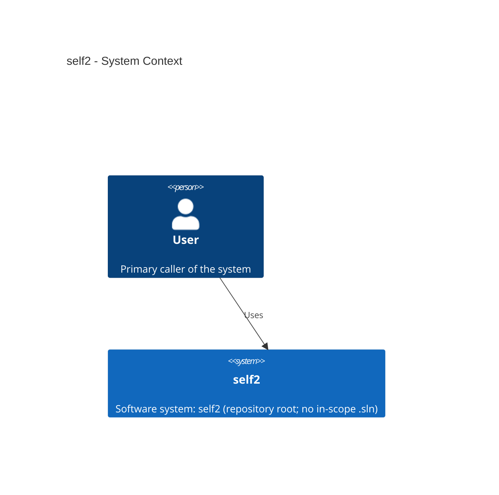

# C4 System Context

**Generated**: 2026-10-23 15:18:17

## Summary

- System: self2 (repository root)
- External systems detected: 0
- Note: no in-scope .NET solution file found; context reflects the repository itself

## Diagram

---

**Generated by AppDoc Framework**

## Provenance

- Generator Version: appdoc-run-all-generators/3.0.0
- Commit Hash: 5e53b62
- Generated At: 2026-10-23T15:18:23+00:00
- Profile: default
- Scope: .
- Confidence/Inference Flags: deterministic, evidence-backed
