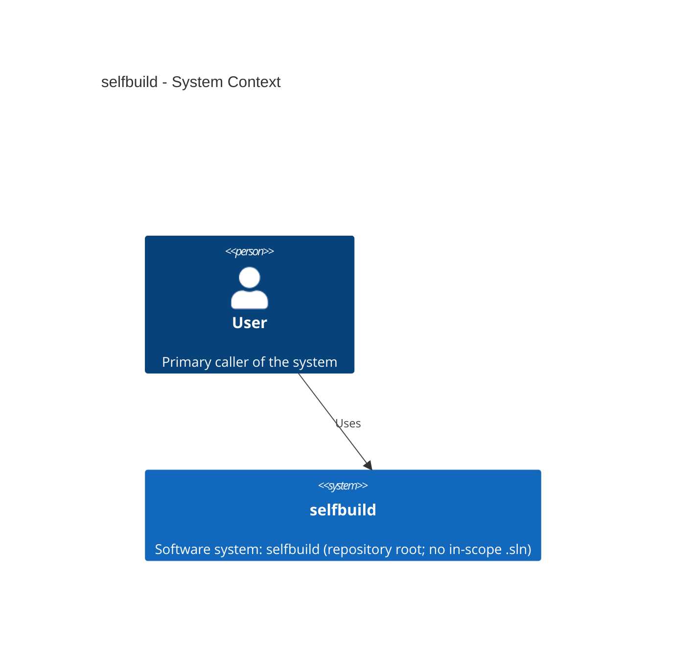

# C4 System Context

**Generated**: 2026-10-23 01:55:37

## Summary

- System: selfbuild (repository root)
- External systems detected: 0
- Note: no in-scope .NET solution file found; context reflects the repository itself

## Diagram

---

**Generated by AppDoc Framework**

## Provenance

- Generator Version: appdoc-run-all-generators/3.0.0
- Commit Hash: 17cdd36
- Generated At: 2026-10-23T01:55:45-04:00
- Profile: default
- Scope: .
- Confidence/Inference Flags: deterministic, evidence-backed
