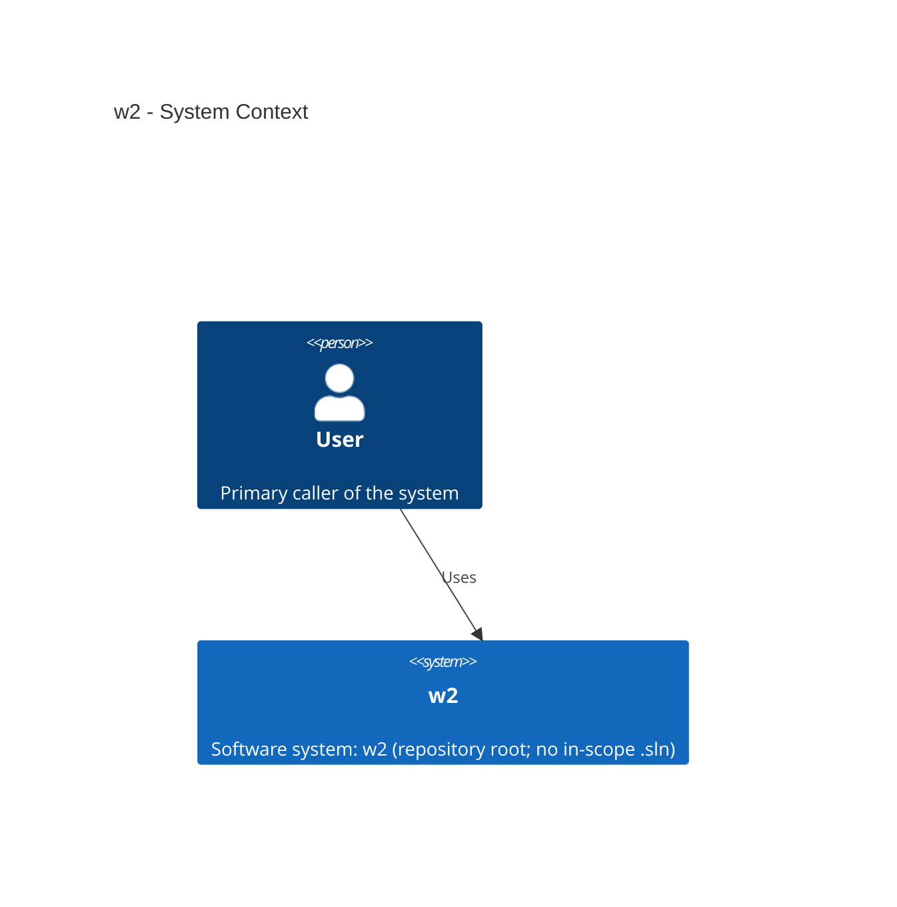

# C4 System Context

**Generated**: 2026-10-22 10:29:34

## Summary

- System: w2 (repository root)
- External systems detected: 0
- Note: no in-scope .NET solution file found; context reflects the repository itself

## Diagram

---

**Generated by AppDoc Framework**