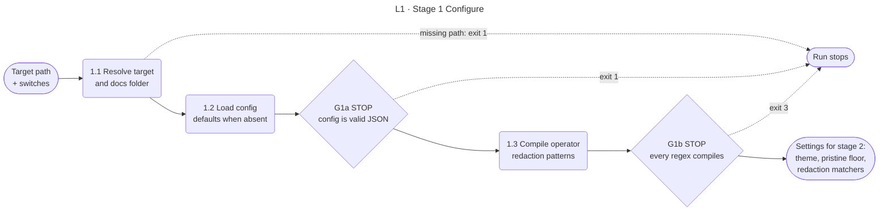

<!-- appdoc:hand-authored -->

[Overview](README.md) › 1 Configure

# Stage 1: Configure

**What does the build check before it touches anything, and what stops it?**

The build reads the target's settings and compiles the operator's redaction patterns. If either fails, it stops before it writes a single file. Nothing in the target's `docs/` folder changes on a stop at this stage.

Shapes and lines: [legend](legend.md).

## What happens

| Step | What it does | Output |
|---|---|---|
| 1.1 | Resolves the target path and works out where the docs folder is. Exit 1 if the path does not exist | Resolved paths |
| 1.2 | Loads `<target>/.appdoc/config.json`. An absent file means defaults. A missing config module is exit 1 | Theme, pristine floor, redaction settings, enrichment switch |
| 1.3 | Compiles `redactionPatterns` (escaped literals) and `redactionRegexes` (case-insensitive, 2 s match timeout) into matchers held in memory | Operator matchers for stage 5 |

## Gates

| Gate | Kind | Passes when | On failure |
|---|---|---|---|
| [G1a](gates.md#g1a) | STOP | The config file is absent or valid JSON | Exit **1**. The build refuses to run without the operator's redaction settings |
| [G1b](gates.md#g1b) | STOP | Every `redactionRegexes` entry compiles | Exit **3**. Fail closed: no output is written |

## What this stage hands on

The settings are read once and reused. The matchers compiled here are the ones the stage 5 sweep applies. A bad pattern therefore stops the build now, not after twenty minutes of generation.

Stage 6 enrichment can also be switched on by the `enableSemanticEnrich` config key. That is the only config key that changes which stages run.

## Go deeper

- Every key and its default: [config-schema](../../references/config-schema.md)
- How the matchers are used in the sweep: [redaction layers](detail/redaction-layers.md)
- Next: [Stage 2 Collect evidence](02-collect-evidence.md)

Code

- `.appdoc/scripts/powershell/run-appdoc-build.ps1`, section `(1) load config`
- `.appdoc/scripts/powershell/modules/AppDoc.Config.psm1` (`Get-AppDocConfig`)
- `.appdoc/scripts/powershell/modules/AppDoc.SecretPolicy.psm1` (`Get-AppDocOperatorRedactionMatchers`)

