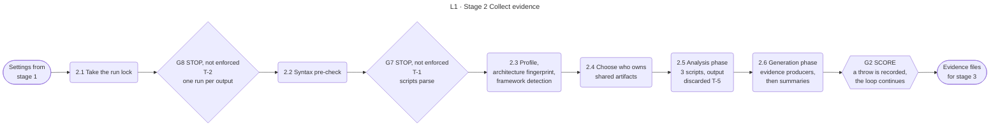

<!-- appdoc:hand-authored -->

[Overview](README.md) › 2 Collect evidence

# Stage 2: Collect evidence

**How does AppDoc turn a codebase into evidence files, and what happens when an extractor crashes?**

The orchestrator (`run-all-generators.ps1`) prepares the run, works out what kind of application the target is, then runs every extractor in a fixed order. Each extractor writes evidence files under `docs/evidence/` and a Markdown catalog under `docs/`. Everything the later stages say comes from these files.

Shapes and lines: [legend](legend.md). **G7** and **G8** are drawn as stops because that is their purpose, but the build does not enforce them. See [T-1](gates.md#known-gaps) and [T-2](gates.md#known-gaps).

## What happens

| Step | What it does | Output |
|---|---|---|
| 2.1 | Creates the docs folder. If `.appdoc-run.session.json` holds the PID of a live process, writes an error and exits 1. Otherwise writes its own PID there. The file is deleted at the end of the orchestrator | `.appdoc-run.session.json` |
| 2.2 | Runs `ci-syntax-gate.ps1` over the scripts folder. On errors it records a diagnostic and throws | diagnostics entry |
| 2.3 | Loads the documentation profile, computes the architecture fingerprint and detects frameworks. Warns when no framework signature matches | `architecture-fingerprint.json`, `framework-detection.json` |
| 2.4 | Decides who owns `api-inventory`, `data-model` and `build-cookbook`: the Classic ASP generators when the target is Classic ASP or Web Forms **and** has Classic ASP source files, otherwise the generic ones. The other set is skipped | The skip list |
| 2.5 | Runs the Analysis phase: `analyze-repository`, `generate-dependency-graph`, `extract-config`. Each prints JSON to the console. **T-5**: nothing saves it and nothing reads it | Nothing on disk |
| 2.6 | Runs the Generation phase. Evidence producers run first, then the generators that summarise evidence, in the order in the [run-order page](detail/run-order.md). Derived files from a previous run (`evidence-graph.json`, `metrics-canonical.json`) are deleted before the loop so a re-run sees the same inputs as a first run | Evidence JSON plus catalogs |

The **composer** (`generate-unified-master.ps1`) is the last script of the Generation phase. [Stage 3](03-compose.md) describes it. Because it runs inside the loop, a crash there is a G2 failure.

## Gates

| Gate | Kind | Passes when | On failure |
|---|---|---|---|
| [G8](gates.md#g8) | STOP (intended) | No live process holds the run lock | The orchestrator exits 1, but the build ignores that and carries on. **T-2** |
| [G7](gates.md#g7) | STOP (intended) | The syntax pre-check reports no errors | The orchestrator throws, but the build catches that as a warning and carries on. **T-1** |
| [G2](gates.md#g2) | SCORE | No script in the phase loop throws | The failure is recorded in `diagnostics-report.json`. The loop continues. Close-out turns the record into exit **1**. **P-1**: scripts outside the loop only warn |

A script that cannot be found is skipped with a warning and is **not** recorded as a failure (**P-1**).

## Known gaps in this stage

- **T-1.** The orchestrator throws on a failed syntax check, but the build treats that throw as a warning. The stale files from an earlier run are then reused. On a target that already has docs, the build can exit 0 with status `pass` on out-of-date evidence.
- **T-2.** The "another run is active" check exits the orchestrator, but the build carries on to its second pass, sweep and exit decision.
- **T-3.** On a target that is not Classic ASP or Web Forms, `generate-classic-asp-failures.ps1` runs after `generate-test-catalog.ps1` and overwrites `test-catalog.md` with a "not applicable" placeholder. The evidence JSON still records the tests, so the two disagree.
- **T-5.** The Analysis phase prints three JSON documents and discards them. Every real evidence file comes from the Generation phase.
- **P-1.** See [gates.md](gates.md#known-gaps).

## Go deeper

- Every script, in order: [run order](detail/run-order.md)
- Which generator owns which file: [evidence ownership](detail/evidence-ownership.md)
- Next: [Stage 3 Compose](03-compose.md)

Code

- `.appdoc/scripts/powershell/run-all-generators.ps1`: run lock, syntax gate, fingerprint, `$pipelinePhases`, the phase loop
- `.appdoc/scripts/powershell/ci-syntax-gate.ps1`
- `.appdoc/scripts/powershell/modules/AppDoc.ClassicAsp.psm1` (`Test-AppDocClassicAspTarget`)

