<!-- appdoc:hand-authored -->

[Overview](README.md) › 3 Compose

# Stage 3: Compose

**How do the evidence files become the master document, the diagrams and the HTML report?**

The composer reads the evidence and writes one 20-section document. Diagrams and the HTML report come from the same evidence. The composer runs **twice**, because on the first pass the diagrams do not exist yet, so section 14 would say "No diagram was detected".

This page groups steps by purpose. They do not all run back to back: stage 4 steps run in between. The exact clock order is in [run order](detail/run-order.md).

```mermaid
---
title: "L1 · Stage 3 Compose"
---
flowchart LR
  accTitle: Stage 3 Compose
  accDescr: The composer writes the master document from evidence. The C4 diagrams and the diagram suite are generated and checked. A remediation pass cleans the generated files and the HTML report is built. Because the diagrams now exist, the composer runs a second time so section 14 carries them, and the HTML report is rebuilt with the configured theme. None of these steps can stop the run; failures only warn.

  IN(["Evidence files<br/>from stage 2"]) --> C1("3.1 Composer, pass 1<br/>20-section master doc")
  C1 --> C2("3.2 C4 diagrams")
  C2 --> C3("3.3 Diagram suite")
  C3 --> C4("3.4 Check diagrams<br/>warn only")
  C4 --> C5("3.5 Remediation pass<br/>clean generated files")
  C5 --> C6("3.6 HTML report<br/>default theme")
  C6 --> C7("3.7 Composer, pass 2<br/>section 14 gets diagrams")
  C7 --> C8("3.8 HTML report<br/>configured theme")
  C8 --> OUT(["Master doc, diagrams,<br/>report.html"])
```

Shapes and lines: [legend](legend.md). There are no gates here. Each step that fails writes a warning and a diagnostic entry, and the run continues.

## What happens

| Step | What it does | Output | If it fails |
|---|---|---|---|
| 3.1 | `generate-unified-master.ps1` composes the master document from the evidence. It is the last script in the stage 2 phase loop | `application-documentation.md` | A throw is a **G2** failure, recorded and later exit 1 |
| 3.2 | `generate-c4-mermaid-diagrams.ps1` writes the C4 context, container and component diagrams. Skipped with `-SkipDiagrams` | `diagrams/` | Warning only. **P-1** |
| 3.3 | `generate-mermaid-architecture-suite.ps1` writes the internal and data-flow diagrams. Skipped with `-SkipDiagrams` | `diagrams/` | Warning only. **P-1** |
| 3.4 | `validate-diagrams.ps1` checks the diagrams. Skipped with `-SkipDiagrams` | diagnostics entry | Warning only |
| 3.5 | `remediate-generated-docs.ps1` cleans generated files after generation | cleaned docs | Warning only |
| 3.6 | `generate-html-report.ps1` renders the Markdown into a styled report. It runs after the first validation inputs exist and before structured validation | `report.html` | Warning only. **P-1** |
| 3.7 | The build runs the composer again, now that `diagrams/` exists. This rewrites the master document **without** the provenance footer; stage 5 stamps it again | `application-documentation.md` | Warning only. **P-1** |
| 3.8 | The build regenerates `report.html` with the theme from the config. With the default theme the output is byte-identical to 3.6 | `report.html` | Warning only |

## Why two passes

The composer runs inside the phase loop, **before** the C4 and diagram-suite generators. On a clean first run, section 14 would be composed with no diagram files to read. Pass 2 re-runs the same script after the diagrams land. It does not change the gate status or the overall score, which are frozen by then. It makes the master document and the pristine report reflect the full package.

## Go deeper

- What each of the 20 sections is built from: [composer section map](detail/composer-section-map.md)
- Next: [Stage 4 Validate](04-validate.md)

Code

- `.appdoc/scripts/powershell/generate-unified-master.ps1`
- `.appdoc/scripts/powershell/generate-c4-mermaid-diagrams.ps1`, `generate-mermaid-architecture-suite.ps1`, `validate-diagrams.ps1`
- `.appdoc/scripts/powershell/remediate-generated-docs.ps1`, `generate-html-report.ps1`
- `.appdoc/scripts/powershell/run-appdoc-build.ps1`, sections `(3) SECOND PASS` and `(4) HTML report`

