<!-- appdoc:hand-authored -->

[Overview](README.md) › 4 Validate

# Stage 4: Validate

**How does AppDoc decide whether the generated documentation is good enough?**

Validation compiles the evidence into one graph, checks the documents against it, scores the result, and writes a gate status. It never stops the run. The status waits in `validation-report.json` until [Close out](07-close-out.md) turns it into the exit code.

```mermaid
---
title: "L1 · Stage 4 Validate"
---
flowchart LR
  accTitle: Stage 4 Validate
  accDescr: The evidence is compiled into a graph and canonical metrics, and counts in the overview are realigned if they disagree. Integrity checks warn but do not stop the run. Each document is rated, root provenance is stamped, and structured validation computes the gate status. The pristine report is written and the diagnostics report records any generator failures. A second pass re-runs the pristine report and validation after the diagrams exist. The gate status is recorded by score gate G3.

  IN(["Docs, evidence,<br/>diagrams"]) --> V1("4.1 Evidence graph<br/>+ integrity check")
  V1 --> V2("4.2 Canonical metrics<br/>+ realign overview counts")
  V2 --> V3("4.3 Doc integrity check<br/>warn only")
  V3 --> V4("4.4 Rate each document<br/>quality report")
  V4 --> V5("4.5 Stamp root<br/>provenance")
  V5 --> V6("4.6 Structured validation<br/>scores, policy checks")
  V6 --> V7("4.7 Pristine report<br/>depth, report only")
  V7 --> V8("4.8 Write diagnostics<br/>incl. generator failures")
  V8 --> V9("4.9 Second pass<br/>pristine + validation")
  V9 --> G3{{"G3 SCORE<br/>gate status recorded"}}
  G3 --> OUT(["validation-report.json<br/>status"])
```

Shapes and lines: [legend](legend.md).

## What happens

| Step | What it does | Output | If it fails |
|---|---|---|---|
| 4.1 | Compiles every evidence file into one graph and checks its integrity | `evidence/evidence-graph.json` | Soft mode: warning. `-StrictValidation`: the orchestrator throws |
| 4.2 | Writes canonical metrics. If the overview's counts disagree with them, re-aligns the overview and warns, because an evidence producer must have run after the overview | `evidence/metrics-canonical.json` | Warning only |
| 4.3 | Runs `ci-doc-integrity-gate.ps1` | diagnostics entry | Soft mode: warning. `-StrictValidation`: the orchestrator throws |
| 4.4 | Rates each of 11 documents (8 gated, 3 informational) as HIGH, MEDIUM, LOW or MISSING | `quality-report.json` (written after 4.6) | Informational; warns when more than half are LOW |
| 4.5 | Stamps the provenance footer on the root artifacts so the validator's provenance policy can check it | Footers | Warning only |
| 4.6 | `validate-documentation.ps1` runs the validators, the policy checks and the contradiction checks, then computes the score and status | `validation-report.json` | Warning only; a failed run leaves the earlier report, if any |
| 4.7 | `generate-pristine-report.ps1` measures how deep the 20 composed sections are against a benchmark. Report only: it adds a sub-score but cannot change the status | `pristine-report.md`, `evidence/pristine.evidence.json` | Warning only |
| 4.8 | Writes the diagnostics report. This is where the stage 2 generator failures are saved | `diagnostics-report.json` | n/a |
| 4.9 | After stage 3 pass 2, the build re-runs the pristine report and validation so the final status reflects the complete package | `validation-report.json` (overwritten) | Warning only |

`-PristineGate` can make a shallow result block the run, but the build never passes it. Status `blocked` therefore cannot come from a build.

## Gate

| Gate | Kind | Passes when | On failure |
|---|---|---|---|
| [G3](gates.md#g3) | SCORE | `status` is `pass`, or `pass-with-weak-coverage` without `-StrictValidation` | The status is written. [Close out](07-close-out.md) turns a failed status into exit **2** unless `-AllowGateFail` is set |

## Known gaps in this stage

- **P-5.** SKILL.md says the hard bar is `status=pass`. The build exits 0 on `pass-with-weak-coverage` too, as ADR 0003 allows.

## Go deeper

- How the score and status are computed: [validation scoring](detail/validation-scoring.md)
- The rule for a sub-validator that fails: [ADR 0003](../adr/0003-sub-validator-failure-policy.md)
- Next: [Stage 5 Finalize](05-finalize.md)

Code

- `.appdoc/scripts/powershell/run-all-generators.ps1`: `[Evidence Graph]`, `[Integrity Gate]`, the quality report, structured validation, diagnostics export
- `.appdoc/scripts/powershell/validate-documentation.ps1`
- `.appdoc/scripts/powershell/generate-pristine-report.ps1`
- `.appdoc/scripts/powershell/run-appdoc-build.ps1`, section `(3) SECOND PASS`

