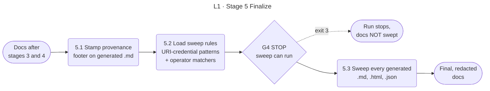

<!-- appdoc:hand-authored -->

[Overview](README.md) › 5 Finalize

# Stage 5: Finalize

**How does AppDoc make sure no secret and no missing footer reaches the published docs?**

Finalize is the last write to the generated files. It stamps a provenance footer on every generated Markdown file, then sweeps every generated file for operator-defined secrets and credentials embedded in URIs. If the sweep cannot run, the build stops and says the docs must not be published.

Shapes and lines: [legend](legend.md).

## What happens

| Step | What it does | Output |
|---|---|---|
| 5.1 | Stamps a provenance footer (generator version, commit, time, profile, scope, confidence flags) on every generated Markdown file under `docs/`. Safe to repeat. Hand-authored files are skipped | Footer on each generated `.md` |
| 5.2 | Loads the URI-credential patterns (`user:pass@`, `://:pass@`) from the redaction module, which is their single source. Adds the operator matchers compiled in [stage 1](01-configure.md) | The sweep rule set |
| 5.3 | Reads every `*.md`, `*.html` and `*.json` file under the docs folder. Skips hand-authored files and the vendored library blocks in `report.html`. Replaces each match with `[REDACTED]` and rewrites the file only if something changed | Redacted files |

## Gate

| Gate | Kind | Passes when | On failure |
|---|---|---|---|
| [G4](gates.md#g4) | STOP | The redaction module loads and returns its patterns | Exit **3**. The docs were not swept. Do not publish them |

The sweep is **not** skipped when the config has no patterns. The URI-credential patterns always apply. They are scoped to real `user:pass@` values, so they do nothing on a file without one.

## Hand-authored files

Files that are not build output are left alone: everything under `docs/adr/`, and any file that contains the marker `<!-- appdoc:hand-authored -->`. This is why these pipeline pages carry that marker. Without it, the stamper would append a footer, the sweep might rewrite example text, and the line-ending pass would rewrite the file. See [ADR 0002](../adr/0002-generated-docs-as-code.md).

## What this stage does not cover

The sweep runs before [stage 6](06-enrich.md). Values the AI session writes into `semantic/applied/` are not swept for operator patterns. The enrichment contract puts its gate on the input, not the output.

## Go deeper

- All four redaction layers and who owns each: [redaction layers](detail/redaction-layers.md)
- Next: [Stage 6 Enrich](06-enrich.md)

Code

- `.appdoc/scripts/powershell/run-appdoc-build.ps1`, sections `(4b)` and `(5)`
- `.appdoc/scripts/powershell/modules/AppDoc.Provenance.psm1` (`Set-AppDocProvenanceFooter`, `Test-AppDocHandAuthoredDoc`)
- `.appdoc/scripts/powershell/modules/AppDoc.SemanticRedaction.psm1` (`Get-AppDocSemanticUriCredentialPatterns`)
- `.appdoc/scripts/powershell/modules/AppDoc.SecretPolicy.psm1` (`Invoke-AppDocOperatorRedaction`)

