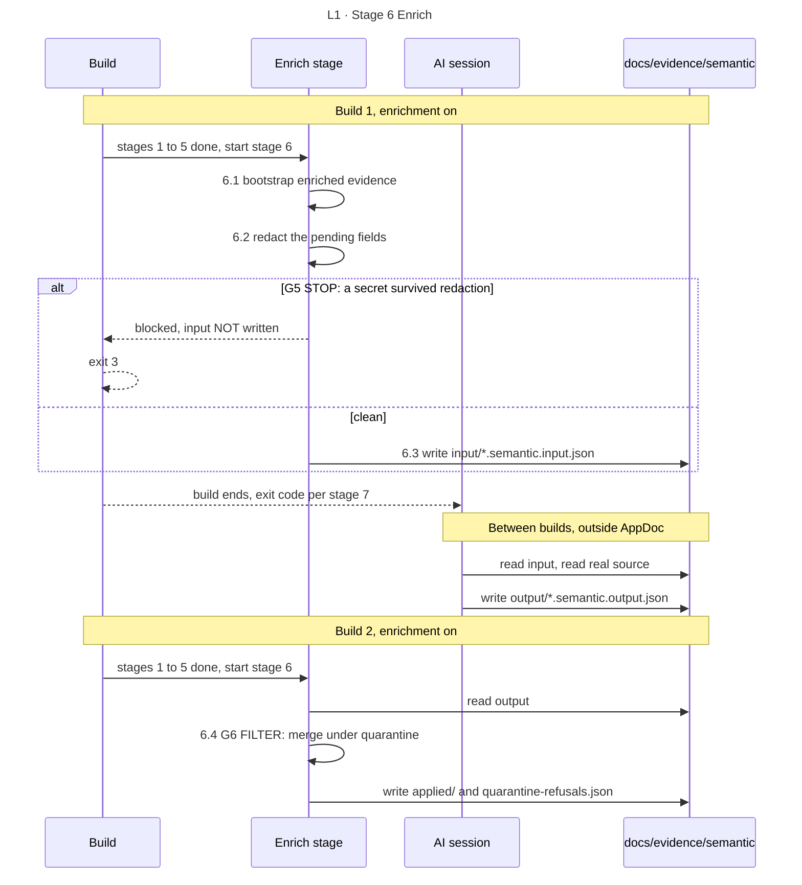

<!-- appdoc:hand-authored -->

[Overview](README.md) › 6 Enrich

# Stage 6: Enrich (optional)

**How can an AI session add meaning to the evidence without being able to overwrite a verified fact or see a secret?**

Enrichment is **off by default**. When it is off, the build prints one line and moves on. When it is on, the work is split across **two builds** with an AI session in between. AppDoc never calls a language model itself. The session that runs AppDoc does the reading and writing between the two builds.

Shapes and lines: [legend](legend.md). In a sequence diagram, time runs downward and each column is one actor.

## What happens

| Step | What it does | Output |
|---|---|---|
| 6.1 | `run-appdoc-enrich.ps1` builds enriched evidence from the deterministic evidence. The build passes `-SkipGate` and `-SkipReRender`, so the four gate-scored catalogs stay byte-identical | `evidence/*.evidence.enriched.json` |
| 6.2 | For each file, builds the input envelope: one record per pending item, with secret values replaced by `[REDACTED]`. Keys and names are kept | In-memory envelope |
| 6.3 | Runs the secret gate **G5** on the envelope. If it is clean, writes the input file | `semantic/input/<artifact>.semantic.input.json` |
| 6.4 | Reads `semantic/output/` if the AI session has written it. Merges each field under the quarantine rules (**G6**) and tags it | `semantic/applied/`, `semantic/quarantine-refusals.json`, `semantic-pending.json` |

An input-hash cache means a re-run skips records whose input has not changed. A corrected output file is picked up again.

## Gates

| Gate | Kind | Passes when | On failure |
|---|---|---|---|
| [G5](gates.md#g5) | STOP | No known secret, operator pattern or credential shape survives in the redacted envelope | The input file is not written and the build exits **3**. The first blocked file ends the stage |
| [G6](gates.md#g6) | FILTER | A value may fill a field that is open or filled only by a heuristic | An attempt to overwrite a Verified field is refused and logged. The run continues |

A failure in the enrichment stage that is **not** G5 (a missing script, an unexpected throw) is a warning and the build carries on. **P-1.**

## Go deeper

- What the quarantine guarantees, and the provenance words `llm`, `deterministic`, `open`: [enrichment quarantine](detail/enrichment-quarantine.md)
- The exact input and output shapes and the 16 fields: [enrichment-contract](../../references/enrichment-contract.md)
- How an operator runs the two builds: [enrichment-operations](../../references/enrichment-operations.md)
- Next: [Stage 7 Close out](07-close-out.md)

Code

- `.appdoc/scripts/powershell/run-appdoc-build.ps1`, section `(6)`
- `.appdoc/scripts/powershell/run-appdoc-enrich.ps1`
- `.appdoc/scripts/powershell/run-appdoc-semantic-enrich.ps1`: the secret gate, the input-hash cache, the tiered merge
- `.appdoc/scripts/powershell/modules/AppDoc.SemanticRedaction.psm1` (`Test-AppDocSemanticRedactionGate`)

