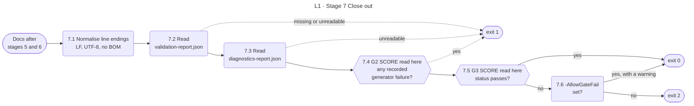

<!-- appdoc:hand-authored -->

[Overview](README.md) › 7 Close out

# Stage 7: Close out

**How does the build decide its exit code, and what does each code tell the caller?**

Close out normalises line endings, then reads the outcomes that earlier stages recorded and turns them into one exit code. It is the only place where the recorded generator failures (G2) and the gate status (G3) take effect.

Shapes and lines: [legend](legend.md). The hexagons are the score gates from earlier stages; this is where their recorded outcome is read.

## What happens

| Step | What it does | Output |
|---|---|---|
| 7.1 | Rewrites generated text files as UTF-8 without a BOM, LF line endings and one final newline, so output is identical on every OS. Hand-authored files are left alone | Normalised files |
| 7.2 | Reads `validation-report.json`. Missing or unreadable means the build cannot be trusted | Gate status, score |
| 7.3 | Reads `diagnostics-report.json` if it exists | `metadata.scriptFailures` |
| 7.4 | Any recorded generator failure means output is missing or stale, so the build fails even if the gate passed | Exit 1 |
| 7.5 | `pass` always passes. `pass-with-weak-coverage` passes unless `-StrictValidation` is set | Exit 0 |
| 7.6 | A failed status is exit 2, unless `-AllowGateFail` is set. Then it is exit 0 and a warning says why | Exit 2 or 0 |

The orchestrator's own exit code is not used, because native commands inside it also set the shell's exit code and the value would be ambiguous.

## Exit codes

| Code | Meaning | Caller should |
|---|---|---|
| **0** | The gate passed, or `-AllowGateFail` was given | Treat the docs as usable. After `-AllowGateFail`, read the warning |
| **1** | Tool error: bad path, bad config, no docs folder, unreadable report, or a generator failure | Read the console output and `diagnostics-report.json`. The package is incomplete |
| **2** | The docs were written but did not pass the gate | Read `validation-report.json` for the failed checks |
| **3** | Fail-closed stop: invalid redaction regex, sweep cannot run, or secret gate blocked | Do not publish. Fix the cause and re-run |

Codes 1 (early paths) and 3 end the run where they happen, so 7.1 does not run. The full table with every path is in [gates.md](gates.md#exit-codes).

## Known gaps in this stage

- **P-5.** SKILL.md's hard bar says `status=pass`. Step 7.5 also accepts `pass-with-weak-coverage`.
- **P-1.** Only failures recorded in the stage 2 phase loop reach step 7.4. Other generator crashes warn and never change the exit code.
- **T-1, T-2.** The preflight checks in stage 2 do not reach this stage, so a failed syntax check or an active-run conflict does not change the exit code on its own.

## Go deeper

- The three-way decision as a table, and the paths that set each code: [gates.md](gates.md#exit-codes)
- Why a failing sub-validator has a fixed meaning: [ADR 0003](../adr/0003-sub-validator-failure-policy.md)
- Back to the [overview](README.md)

Code

- `.appdoc/scripts/powershell/run-appdoc-build.ps1`, sections `(7)` and `summary + exit code`
- `.appdoc/scripts/powershell/modules/AppDoc.Provenance.psm1` (`Convert-AppDocDocsLineEndings`)

