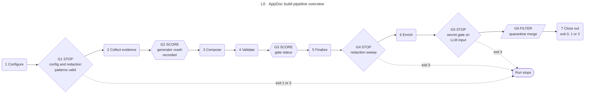

<!-- appdoc:hand-authored -->

# AppDoc pipeline: overview

**What does one build do, in what order, and which checks can stop it, score it or filter it?**

This is the top of a drill-down set. Start here, pick a stage, then follow the links down. Each page answers one question, and the gate criteria live in one place: [gates.md](gates.md).

Shapes and lines: [legend](legend.md). Stage names are fixed and mean the same thing on every page.

## What happens

1. **[Configure](01-configure.md)**: load the target's config and compile its redaction patterns. Nothing is written yet.
2. **[Collect evidence](02-collect-evidence.md)**: detect the framework and run every extractor, then the summaries built from their output.
3. **[Compose](03-compose.md)**: write the 20-section master document, the diagrams and the HTML report. Composition runs twice; the second pass picks up the diagrams.
4. **[Validate](04-validate.md)**: compile the evidence graph, run the validation gate and score the result.
5. **[Finalize](05-finalize.md)**: stamp the provenance footer on generated Markdown, then sweep every generated file for secrets.
6. **[Enrich](06-enrich.md)**: hand a redacted input to the surrounding AI session and merge its answers under quarantine rules. The session works between two builds.
7. **[Close out](07-close-out.md)**: normalise line endings and turn the recorded outcomes into the exit code.

## Gates

| Gate | Kind | One line | Detail |
|---|---|---|---|
| G1 | STOP | Config is valid JSON and every redaction pattern compiles | [G1a, G1b](gates.md#g1a) |
| G2 | SCORE | A generator that crashed is recorded; the run continues | [G2](gates.md#g2) |
| G3 | SCORE | The validation gate status is recorded; the run continues | [G3](gates.md#g3) |
| G4 | STOP | The final redaction sweep must be able to run | [G4](gates.md#g4) |
| G5 | STOP | No secret may survive into the LLM-facing input | [G5](gates.md#g5) |
| G6 | FILTER | An LLM value may not overwrite a Verified fact | [G6](gates.md#g6) |

Exit codes and the full close-out decision are in [gates.md](gates.md#exit-codes).

## Known gaps

Where the code does not yet match its contract, the pages show what the code does and tag the gap. The full list is in [gates.md](gates.md#known-gaps).

- **P-1**: some generator crashes still exit 0 (stage 2, stage 3).
- **T-1**: a failed PowerShell syntax pre-check only warns; the build carries on (stage 2).
- **T-2**: the "another run is active" guard does not stop the build (stage 2).
- **T-3**: on a target that is not Classic ASP, a placeholder overwrites a real `test-catalog.md` (stage 2).
- **T-5**: the three Analysis-phase scripts print JSON that nothing saves or reads (stage 2).

## Go deeper

- Every step of one build in execution order: [run order](detail/run-order.md)
- Which generator owns which artifact: [evidence ownership](detail/evidence-ownership.md)
- What each of the 20 sections is built from: [composer section map](detail/composer-section-map.md)
- How the gate scores a run: [validation scoring](detail/validation-scoring.md)
- The four places secrets are redacted: [redaction layers](detail/redaction-layers.md)
- What the quarantine guarantees: [enrichment quarantine](detail/enrichment-quarantine.md)
- What CI checks on this repository: [ci](ci.md)

Entry point and code

- Entry point: `.appdoc/scripts/powershell/run-appdoc-build.ps1`. It wraps `run-all-generators.ps1`, which does stages 2–4.
- Contracts that explain the rules: `docs/adr/0001-redaction-externalize-per-target-secrets.md`, `docs/adr/0003-sub-validator-failure-policy.md`, `references/`.
- These pages were traced against the code and checked by running builds on fixture copies (see [gates.md](gates.md#how-these-pages-were-checked)).

