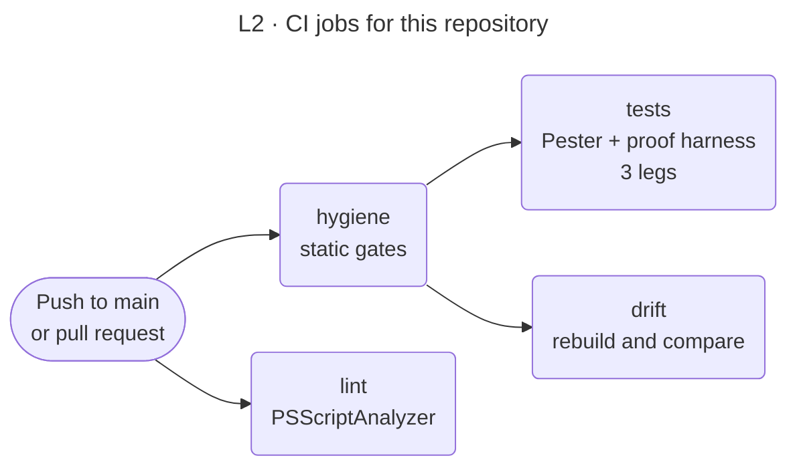

<!-- appdoc:hand-authored -->

[Overview](README.md) › CI

# What CI checks on this repository

**Which checks run on a push or pull request, and which of them protect these pipeline pages?**

This page is about the AppDoc repository's own CI (`.github/workflows/appdoc-ci.yml`). It is not part of a build. For what a build checks, see [gates](gates.md).



Shapes and lines: [legend](legend.md).

## Jobs

| Job | What it does |
|---|---|
| **hygiene** | Static checks, listed below. Nothing here runs a build |
| **lint** | PSScriptAnalyzer. Only unapproved verbs, trailing whitespace and empty `catch` blocks in `.appdoc/` fail the job |
| **tests** | Pester unit and golden suites plus the semantic quarantine proof harness. Runs on Linux and Windows with .NET, and on Linux with .NET hidden to exercise the regex fallback. The leg without .NET also runs the output snapshot harness (below) |
| **drift** | Copies the repository, builds its own docs in the copy, and compares the four catalogs, the section headings and the gate status with the committed `docs/` |

## Hygiene checks

| Check | Why it matters for these pages |
|---|---|
| No tracked file that `.gitignore` excludes | |
| Skill docs are free of host-specific text, and `SKILL.md` frontmatter is valid | |
| The core carries no slash commands and no target-specific names | Applies to every Markdown file under `docs/` except `docs/adr/`. Pages with the hand-authored marker are exempt |
| Entry scripts declare PowerShell 7.2 and `CmdletBinding` | |
| Scripts named in the README, `SKILL.md`, `references/` and prompts exist | Does not cover `docs/pipeline/` |
| No absolute host paths and no CR characters in `docs/` | Applies to these pages: use relative links and LF line endings |
| PowerShell syntax gate | |
| Documentation integrity gate | |
| **Pipeline docs gate** | Checks these pages. See below |

## The pipeline docs gate

`ci-pipeline-docs-gate.ps1` keeps `docs/pipeline/` from drifting away from the code. It is static: it reads files and does not run a build.

| It checks | Fails when |
|---|---|
| Hand-authored marker | A page lacks `<!-- appdoc:hand-authored -->`. Without it the build rewrites the page |
| Diagram accessibility | A Mermaid block lacks a front-matter `title`, `accTitle` or `accDescr` |
| Diagram portability | A diagram uses `click`, `fa:` icons, `%%{init` or custom `style` and `classDef` rules |
| Diagram size | A flowchart has more nodes than its level allows: overview 14, stage pages 12, detail pages 15 |
| Links | A relative link or `#anchor` does not resolve |
| Repository README copy | The overview diagram in the repository `README.md` differs from the one in `docs/pipeline/README.md` |
| Gate IDs | A page names a gate that has no row in `gates.md`, or a gate row has no anchor |
| Gap tags | A page uses a finding tag (`P-1`, `T-3`, and so on) that is not listed in `gates.md` |
| Exit codes | The codes in `run-appdoc-build.ps1` are not exactly 0, 1, 2 and 3, or `gates.md` or ADR 0003 lacks one of them |
| Named code | A script, module or function named in a page does not exist |

With `-Render`, and when `mmdc` is installed, it also renders every diagram. CI does not pass `-Render`: rendering needs a headless browser and GitHub already renders Mermaid.

It cannot check that a diagram is **true**. That is what the review checklist is for: a change to a script that adds, removes or reorders a step, a gate or an exit code must update the matching page in the same pull request.

## Run it yourself

```powershell
./.appdoc/scripts/powershell/ci-pipeline-docs-gate.ps1 -RootPath .
./.appdoc/scripts/powershell/ci-pipeline-docs-gate.ps1 -RootPath . -Render   # also renders each diagram
```

## The output snapshot harness

`tests/powershell/test-output-snapshot.ps1` proves that a change meant to alter nothing leaves every generated file unchanged. The golden suites check structure; this checks bytes.

| It does | Detail |
|---|---|
| Builds each fixture | Every folder under `tests/fixtures/` that is a build target, on a temp copy |
| Normalises what changes between identical runs | Timestamps (three formats), the narrative run GUID, run durations, SHA-256 values, temp and repository paths, CRLF. JSON is compared with keys sorted, because many objects come out in a different key order on each run |
| Compares with the baseline | Every file under `docs/` that the build wrote, plus the build exit code and the gate status and score, against `tests/powershell/snapshots/<profile>/<fixture>.json` |
| Fails when | A file is new, missing or changed, or the exit code or gate result moved (exit 1). It exits 2 when it cannot run, for example when there is no baseline for this environment |

The profile is `no-dotnet` when the `dotnet` CLI is not on `PATH`, which is the regex fallback. Only `no-dotnet` baselines exist so far, so CI runs the harness on that leg.

It does not cover the repository's own `docs/`: every code change moves line numbers and TODOs there. The **drift** job covers that.

When a change is meant to alter output, update the baseline in the same pull request and show the difference:

```powershell
# On the base commit
pwsh -NoProfile -File tests/powershell/test-output-snapshot.ps1 -SaveTree ../snap-base
# On the branch
pwsh -NoProfile -File tests/powershell/test-output-snapshot.ps1 -CompareTree ../snap-base   # prints a diff per changed file
pwsh -NoProfile -File tests/powershell/test-output-snapshot.ps1 -Update                     # then commit tests/powershell/snapshots/
```

<details>
<summary>Code</summary>

- `.github/workflows/appdoc-ci.yml`
- `.appdoc/scripts/powershell/ci-pipeline-docs-gate.ps1`
- `tests/powershell/test-output-snapshot.ps1`
- `.github/pull_request_template.md`

</details>
