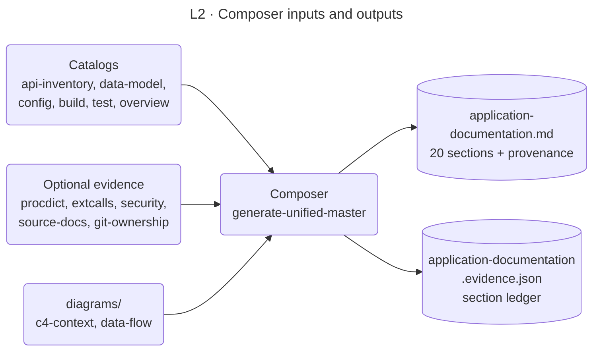

<!-- appdoc:hand-authored -->

[Overview](../README.md) › [3 Compose](../03-compose.md) › Composer section map

# Composer section map

**What is each of the 20 sections of the master document built from, and when does a section fall back to a placeholder?**

The composer (`generate-unified-master.ps1`) reads the per-artifact catalogs and evidence, writes `application-documentation.md`, and records a **section ledger** in `application-documentation.evidence.json`. The ledger says, for each section, whether it was `populated` or a `placeholder`, and which sources it used. This page is that ledger in prose.

Shapes and lines: [legend](../legend.md).

## The 20 sections

| # | Section | Built from | Placeholder when |
|---|---|---|---|
| 1 | Application Index | api-inventory | never |
| 2 | Coverage and Executive Overview | overview, api-inventory, data-model, build-cookbook | never |
| 3 | Architecture | build-cookbook, api-inventory, `diagrams/c4-context.md` | never |
| 4 | Functional Inventory | api-inventory | never |
| 5 | Roles and Access Model | api-inventory, data-model, overview | **always**: the role-capability matrix is owner-required |
| 6 | UI Catalog | api-inventory | never |
| 7 | Operational Workflows | api-inventory, procdict | No workflow areas and no procedure contracts are found |
| 8 | Data and Integrations | data-model | never |
| 9 | External Call Register | data-model, test-catalog, api-inventory, extcalls | never |
| 10 | Stored-procedure data dictionary | procdict, data-model | The target has no procdict evidence, which is any target that is not Classic ASP |
| 11 | Troubleshooting Matrix | test-catalog | never |
| 12 | Security and Operational Risks | security, test-catalog, data-model | Never marked a placeholder. Without security evidence it falls back to test-catalog and data-model, and lists the controls it cannot see as `Unknown` |
| 13 | Ownership and Maintenance | none | **always**: the ownership table is a structure with `Unknown` cells. Hand-authored ownership and change-process docs and git history add cited rows when they exist |
| 14 | Architecture and Data-Flow Diagrams | `diagrams/data-flow.md`, `diagrams/c4-context.md` | Empty on pass 1 of a clean run. Filled by [pass 2](../03-compose.md#why-two-passes) |
| 15 | Glossary | api-inventory, data-model, build-cookbook, test-catalog | never |
| 16 | Evidence Register | evidence-register.md | never |
| 17 | Open Questions and Documentation Gaps | Questions raised by sections 3, 5, 6, 7, 10, 11, 12, 13 | never |
| 18 | Recommendations | test-catalog, data-model | never |
| 19 | Operations Runbook | build-cookbook, test-catalog | never |
| 20 | Verification Appendix | verification-appendix.md | never |

After section 20 the stage 5 footer adds a **Provenance** block. It is not one of the 20 sections.

## How to read a placeholder

A placeholder is honest, not broken. The composer never invents content. Where evidence is missing it writes `Unknown`, "not detected", or "owner-required", and adds a line to section 17. How deep each section is gets measured separately by the pristine report ([stage 4](../04-validate.md)), which is report-only.

## Claim status words

Cells in these sections carry a status that says how well the evidence supports them: `Verified`, `Partly verified`, `Inferred`, `Unknown`, `Operator-supplied`. A claim cited from a hand-authored document carries `Verified-source-doc` and a `file:line`. These are separate from the enrichment words `llm`, `deterministic` and `open` (see the [legend](../legend.md#claim-status-words)).

Code

- `.appdoc/scripts/powershell/generate-unified-master.ps1`: `Add-SectionLedgerEntry` calls, one per section
- Output: `docs/application-documentation.evidence.json`, field `sections`

