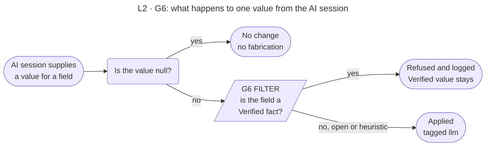

<!-- appdoc:hand-authored -->

[Overview](../README.md) › [6 Enrich](../06-enrich.md) › Enrichment quarantine

# Enrichment quarantine

**What exactly can an AI session change in the evidence, and what can it never change?**

The quarantine is the merge step in [stage 6](../06-enrich.md). It decides, field by field, whether a value from the AI session is applied. This page covers the per-field decision (gate **G6**) and the provenance words that result.

Shapes and lines: [legend](../legend.md).

## Three tiers of field

| Tier | What it is | Can the AI session change it? | Final provenance |
|---|---|---|---|
| **Verified** | The raw record already holds a real value, or the deterministic layer filled it from the source. `schemaSource` is always in this tier | **No.** An attempt is refused and logged | `deterministic` |
| **Heuristic** | A low-confidence deterministic fill, for example a role guessed from a name | **Yes**, it may be refined | `llm` once changed, otherwise `deterministic` |
| **Open** | Null or `Unknown` | **Yes**, if the value is grounded in source | `llm` if filled, otherwise `open` |

The AI session wins over a heuristic and never over a Verified fact.

## Provenance words

Each field in the applied evidence carries one of three words. They describe **who filled the field** and are separate from the claim-status words used in the composed document ([legend](../legend.md#claim-status-words)).

| Word | Meaning |
|---|---|
| `llm` | The AI session supplied the value and it passed the quarantine |
| `deterministic` | AppDoc filled it from the source |
| `open` | Nobody supplied it. It stays `Unknown` and is never invented |

## Files

| File | Written by | Holds |
|---|---|---|
| `semantic/input/<artifact>.semantic.input.json` | Build 1, after [G5](../gates.md#g5) | The redacted pending-field input |
| `semantic/output/<artifact>.semantic.output.json` | The AI session | Values to apply, keyed by `source\|name\|kind` |
| `semantic/applied/<artifact>.semantic.applied.json` | Build 2 | The merged result, with a provenance word per field |
| `semantic/quarantine-refusals.json` | Build 2 | Each refused override, with the Verified value and the value that was attempted |
| `semantic/semantic-pending.json` | Build 2 | Fields still waiting for a value |

## Checks that an enrichment worked

- **Refusals** show over-reach: the AI session tried to change a Verified fact.
- **A silent drop** is not shown there. A record whose `source`, `name` or `kind` was mistyped never joins, so it simply never applies. Open the `applied/` file and confirm the fields you set show `llm`, not `open`.

## Other guarantees

- **Input-hash cache.** A re-run skips records whose input has not changed. A corrected output file is applied again.
- **No re-render.** The build passes `-SkipReRender`, so the four gate-scored catalogs stay byte-identical. Enrichment appears in `applied/` and the enriched evidence, not in those catalogs.
- **Score caveat.** A full re-run can move `overallScore` by a point or two. The stable checks are `status` and the pristine sub-score.

The exact input and output shapes and the 16 fields are in [enrichment-contract](../../../references/enrichment-contract.md). The operator's step-by-step is in [enrichment-operations](../../../references/enrichment-operations.md).

Code

- `.appdoc/scripts/powershell/run-appdoc-semantic-enrich.ps1`: the tiered merge, the refusal log, the input-hash cache
- `.appdoc/scripts/powershell/run-appdoc-enrich.ps1`

