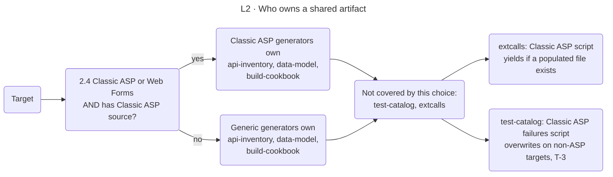

<!-- appdoc:hand-authored -->

[Overview](../README.md) › [2 Collect evidence](../02-collect-evidence.md) › Evidence ownership

# Evidence ownership

**Which script writes which file, and what happens when two scripts can write the same one?**

Each artifact has one owner. Most owners are obvious. A few artifacts can be written by a generic generator or a Classic ASP one, and the orchestrator picks between them. This page lists who writes what, and where the ownership rules are weak.

Shapes and lines: [legend](../legend.md).

## Generators and what they write

Order is the run order in the Generation phase. Paths are under `docs/`; evidence files are under `docs/evidence/`.

| Script | Writes | Notes |
|---|---|---|
| `generate-api-inventory` | `api-inventory.md`, `api-inventory.evidence.json`, `api-inventory.appendix.md` | Generic owner. Skipped on Classic ASP targets |
| `generate-data-model` | `data-model.md`, `data-model.evidence.json` | Generic owner. Skipped on Classic ASP targets |
| `generate-config-catalog` | `config-catalog.md`, `config-catalog.evidence.json` | Always runs |
| `generate-build-cookbook` | `build-cookbook.md`, `build-cookbook.evidence.json` | Generic owner. Skipped on Classic ASP targets |
| `generate-test-catalog` | `test-catalog.md`, `test-catalog.evidence.json` | Always runs. **T-3**: a later script can overwrite the `.md` |
| `generate-debt-register` | `debt-register.md`, `debt-register.evidence.json` | |
| `generate-dependencies-catalog` | `dependencies-catalog.md`, `dependencies-catalog.evidence.json` | |
| `generate-classic-asp-endpoints` | Replaces the api inventory and its evidence | Runs only on Classic ASP targets that have source |
| `generate-classic-asp-datamodel` | Replaces the data model and its evidence | Same |
| `generate-classic-asp-platform` | Replaces the build cookbook and its evidence | Same |
| `generate-classic-asp-failures` | `test-catalog.md` | **T-3**: on a non-ASP target it writes a "not applicable" placeholder over the real one |
| `generate-classic-asp-procdict` | `procdict.md`, `procdict.evidence.json` | Classic ASP only |
| `generate-classic-asp-security` | `security.md`, `security.evidence.json` | Classic ASP only |
| `generate-external-calls` | `extcalls.md`, `extcalls.evidence.json` | Generic owner |
| `generate-classic-asp-extcalls` | `extcalls.md`, `extcalls.evidence.json` | Yields to a populated file written earlier |
| `generate-overview` | `overview.md`, `overview.evidence.json`, the overview truth-pack | Summary |
| `generate-start-here` | `start-here.md`, `start-here.evidence.json`, the evidence manifest entry | Summary |
| `generate-task-guides` | `task-guides.md`, `task-guides.evidence.json` | Summary |
| `generate-docs-index` | `index.md` | Summary |
| `generate-source-docs` | `source-docs.md`, `source-docs.evidence.json` | Cites hand-authored docs |
| `generate-git-ownership` | `git-ownership.md`, `git-ownership.evidence.json` | Owner = `Unknown` when there is no git history |
| `generate-evidence-register` | `evidence-register.md` | Runs after every producer |
| `generate-verification-appendix` | `verification-appendix.md` | Runs after every producer |
| `generate-unified-master` | `application-documentation.md`, `application-documentation.evidence.json` | The composer. See [section map](composer-section-map.md) |

Before the Generation phase starts, the orchestrator also writes `architecture-fingerprint.json` and `framework-detection.json`.

## Derived files from later steps

| File | Written by | Stage |
|---|---|---|
| `evidence/evidence-graph.json`, `evidence/metrics-canonical.json` | The orchestrator | 4 |
| `evidence/diagram-truth-pack.json`, `diagrams/*.md` | The diagram generators | 3 |
| `quality-report.json`, `validation-report.json`, `pristine-report.md`, `evidence/pristine.evidence.json` | Validation and the pristine report | 4 |
| `diagnostics-report.json` | The orchestrator, once, after the first validation | 4 |
| `report.html` | `generate-html-report`, in steps 3.6 and 3.8 | 3 |
| `evidence/semantic/**` | The enrichment scripts | 6 |

The orchestrator deletes `evidence-graph.json` and `metrics-canonical.json` at the start of each run, so a re-run reads the same inputs as a first run.

## Why the order matters

Evidence producers run **before** the generators that summarise evidence. Moving a producer after `generate-overview` makes a first run and a re-run differ, and the orchestrator then re-aligns the overview's counts and warns (stage 4, step 4.2).

## Rules for adding a generator

1. Put it in the phase list at the right place: producers before summaries.
2. If it can write a file another generator also writes, decide the owner. Prefer the `generate-classic-asp-extcalls` pattern: **yield** when a populated file from another owner exists.
3. Add its output rows to this table in the same change.

Code

- `.appdoc/scripts/powershell/run-all-generators.ps1`: `$pipelinePhases`, `$classicAspOwnsShared`, `$skipScripts`
- `.appdoc/scripts/powershell/generate-*.ps1`

