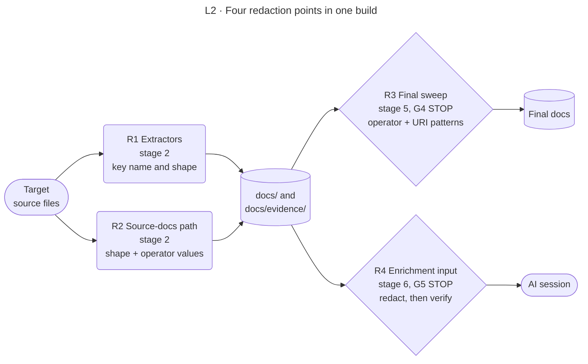

<!-- appdoc:hand-authored -->

[Overview](../README.md) › [5 Finalize](../05-finalize.md) › Redaction layers

# Redaction layers: where secrets are redacted

**Where in a build is a secret removed, and what is each point's blind spot?**

AppDoc redacts at four points. Each catches what the one before can miss. Do not confuse these with "Layer 1" and "Layer 2" in SKILL.md, which mean the deterministic build and the required enrichment loop.

Shapes and lines: [legend](../legend.md).

## The four points

| Point | Stage | What it removes | Uses | Failure behaviour | Code |
|---|---|---|---|---|---|
| **R1 Extractors** | 2 | Credential values in config, connection strings and similar, by key name and by value shape | The shared credential keyword list and shape patterns | Redaction is built into extraction; there is no separate failure | `AppDoc.ConfigCatalog.Extractor.psm1` (`Protect-AppDocConfigValue`) |
| **R2 Source-docs path** | 2 | Secrets in citations from hand-authored operational docs | Shape patterns plus the operator's values | None separate | `AppDoc.SourceDocs.psm1` (`Get-AppDocSourceDocsRedacted`) |
| **R3 Final sweep** | 5 | Operator literals, operator regexes and `user:pass@` URI credentials, in every generated `.md`, `.html` and `.json` file | Operator matchers from stage 1; URI patterns from the semantic redaction module | **G4**: cannot load the patterns, exit 3. A bad operator regex stops earlier, at **G1b**, exit 3 | `run-appdoc-build.ps1` step 5, `AppDoc.SecretPolicy.psm1` (`Invoke-AppDocOperatorRedaction`) |
| **R4 Enrichment input** | 6 | Secret values in the input handed to the AI session. Keys and names stay | Shape patterns, operator values and regexes, known-secret list (empty by default) | **G5**: a surviving secret blocks the stage, the input is not written, exit 3 | `AppDoc.SemanticRedaction.psm1` (`Protect-AppDocSemanticEnvelope`, `Test-AppDocSemanticRedactionGate`) |

## Single sources of truth

So the points cannot drift apart:

- The credential keyword vocabulary and the operator matcher compiler live in `AppDoc.SecretPolicy.psm1`. The extractors, the gate and the docs remediation all use them.
- The URI-credential patterns live in `AppDoc.SemanticRedaction.psm1`. The sweep and the enrichment gate both read them from there.

## What the operator supplies

AppDoc ships **shape patterns only** and no target's secret values ([ADR 0001](../../adr/0001-redaction-externalize-per-target-secrets.md)). Known secret values for a particular target come from the target's `.appdoc/config.json`:

| Key | Meaning |
|---|---|
| `redactionPatterns` | Exact values. Escaped, then matched as literals |
| `redactionRegexes` | Regular expressions, case-insensitive, 2 s match timeout |

A config that does not parse, or a regex that does not compile, stops the build before any output is written ([G1a](../gates.md#g1a), [G1b](../gates.md#g1b)).

## Blind spots

| Blind spot | Why | Source |
|---|---|---|
| A short secret under a key that does not look like a credential | No shape or key-name signal. It is caught only if the operator supplies it | ADR 0001 trade-off |
| Values the AI session writes into `semantic/applied/` | The sweep runs before stage 6, and the contract gates the input only | [Stage 5](../05-finalize.md#what-this-stage-does-not-cover) |
| A sensitive file outside the built-in exclusions | File scope is a static regex policy, not `.gitignore`. Common folders such as `node_modules/`, `bin/` and `obj/` are excluded | ADR 0001 follow-up |

Code

- `.appdoc/scripts/powershell/modules/AppDoc.SecretPolicy.psm1`
- `.appdoc/scripts/powershell/modules/AppDoc.SemanticRedaction.psm1`
- `.appdoc/scripts/powershell/modules/AppDoc.ConfigCatalog.Extractor.psm1`, `AppDoc.SourceDocs.psm1`
- `.appdoc/scripts/powershell/run-appdoc-build.ps1`, sections `(1)` and `(5)`

