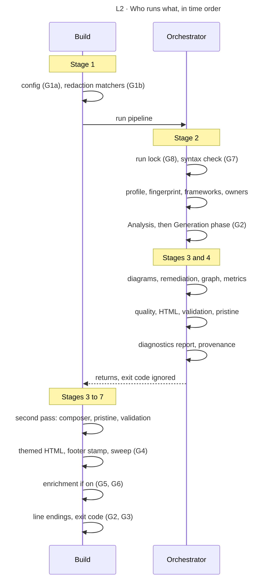

<!-- appdoc:hand-authored -->

[Overview](../README.md) › Run order

# Run order

**In what order does a build do everything, step by step?**

The stage pages group steps by purpose. This page lists them in the order they actually run. Two scripts do the work: the build (`run-appdoc-build.ps1`) calls the orchestrator (`run-all-generators.ps1`), takes control back, and finishes the job.

Shapes and lines: [legend](../legend.md).

## Every step in order

The **Step** column links the row to the numbered step on the stage page.

### Build, first part

| # | Step | Step ID | Notes |
|---|---|---|---|
| 1 | Resolve the target path | 1.1 | Exit 1 if missing |
| 2 | Load config | 1.2 | **G1a**, exit 1 |
| 3 | Compile operator redaction | 1.3 | **G1b**, exit 3 |
| 4 | Call the orchestrator | n/a | Its exit code is ignored. An exception from it becomes a warning |
| 5 | Check the docs folder exists | n/a | Exit 1 if not |

### Orchestrator

| # | Step | Step ID | Notes |
|---|---|---|---|
| 6 | Create the docs folder | 2.1 | |
| 7 | Check and take the run lock | 2.1 | **G8**, **T-2** |
| 8 | Start diagnostics | n/a | |
| 9 | PowerShell syntax check | 2.2 | **G7**, **T-1** |
| 10 | Load profile, fingerprint, detect frameworks | 2.3 | Writes `architecture-fingerprint.json`, `framework-detection.json` |
| 11 | Delete stale derived files | 2.6 | `evidence-graph.json`, `metrics-canonical.json` |
| 12 | Choose who owns shared artifacts | 2.4 | |
| 13 | Analysis phase, 3 scripts | 2.5 | **T-5**: output discarded |
| 14 | Generation phase: evidence producers, then summaries, then the composer | 2.6, 3.1 | **G2**. The composer is last |
| 15 | C4 diagrams | 3.2 | Skipped with `-SkipDiagrams` |
| 16 | Diagram suite | 3.3 | Skipped with `-SkipDiagrams` |
| 17 | Diagram validation | 3.4 | Warn only |
| 18 | Remediation pass | 3.5 | Warn only |
| 19 | Evidence graph and its integrity check | 4.1 | Soft unless `-StrictValidation` |
| 20 | Canonical metrics | 4.2 | |
| 21 | Re-align overview counts | 4.2 | Warns if it had to |
| 22 | Documentation integrity script | 4.3 | Soft unless `-StrictValidation` |
| 23 | Rate each document | 4.4 | |
| 24 | Stamp root provenance (early) | 4.5 | |
| 25 | HTML report, default theme | 3.6 | |
| 26 | Structured validation | 4.6 | Writes `validation-report.json` |
| 27 | Pristine report | 4.7 | Report only |
| 28 | Write `quality-report.json`, compute the inline gate | 4.4, 4.6 | |
| 29 | Write `diagnostics-report.json` | 4.8 | Saves `scriptFailures` |
| 30 | Re-stamp root provenance, write JSON companion summaries | 4.8 | |
| 31 | Delete the run lock | 2.1 | Return to the build |

### Build, second part

| # | Step | Step ID | Notes |
|---|---|---|---|
| 32 | Composer, second pass | 3.7 | Rewrites the master document without a footer |
| 33 | Pristine report, second pass | 4.9 | |
| 34 | Validation, second pass | 4.9 | Overwrites `validation-report.json`. **G3** |
| 35 | HTML report, configured theme | 3.8 | |
| 36 | Provenance footer on generated Markdown | 5.1 | |
| 37 | Load sweep rules | 5.2 | **G4**, exit 3 |
| 38 | Sweep generated files | 5.3 | |
| 39 | Enrichment, if on | 6.1 to 6.4 | **G5**, exit 3. **G6** |
| 40 | Normalise line endings | 7.1 | |
| 41 | Read the reports and decide the exit code | 7.2 to 7.6 | Exit 0, 1 or 2 |

## Things this order explains

- **Why two composer passes.** Step 14 runs the composer before the diagrams exist (steps 15 and 16). Step 32 runs it again.
- **Why the diagnostics report is written once.** It is saved at step 29, before the second pass. Failures in steps 32 to 35 only warn and are not in that report (**P-1**).
- **Why a stage 2 failure can still end in exit 0.** The syntax check and the run lock are steps 7 and 9. Step 4 turns their throws into warnings, so the build carries on (**T-1**, **T-2**).
- **Why the sweep comes before enrichment.** Step 38 runs before step 39. Enrichment output is not swept.

Code

- `.appdoc/scripts/powershell/run-appdoc-build.ps1`: numbered sections `(1)` to `(7)`
- `.appdoc/scripts/powershell/run-all-generators.ps1`: top to bottom

