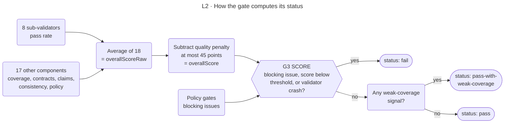

<!-- appdoc:hand-authored -->

[Overview](../README.md) › [4 Validate](../04-validate.md) › Validation scoring

# Validation scoring

**How does the gate turn 18 measurements into `pass`, `pass-with-weak-coverage` or `fail`?**

`validate-documentation.ps1` computes 18 component scores (each 0 to 100), averages them, subtracts a penalty, and then decides the status. The status is gate **G3** ([gates.md](../gates.md#g3)).

Shapes and lines: [legend](../legend.md). The default threshold is 80 (`-Threshold`).

## The 18 components

Every component is scored 0 to 100 and weighted equally.

| # | Component | What it measures |
|---|---|---|
| 1 | `validatorPassRate` | Share of the eight per-artifact sub-validators that passed |
| 2 | `artifactPresence` | Share of the eight contract documents that exist |
| 3 | `evidencePresence` | Share of the expected evidence files that exist |
| 4 | `semanticContractScore` | Mean score of the per-artifact contract checks |
| 5 | `evidenceContractScore` | Mean score of the evidence-file contract checks |
| 6 | `apiCoverage` | Documented endpoints against endpoints found in code. 100 when both are zero |
| 7 | `configCoverage` | Config keys found in code that the config catalog covers |
| 8 | `dataCoverage` | Model entities found in code that the data model covers |
| 9 | `redactionSafetyScore` | Config-catalog rows that mention credential keywords, checked for exposed values |
| 10 | `conformanceScore` | Summary sections, links, placeholders and oversized tables in the eight documents |
| 11 | `sectionSpineCoverageScore` | Coverage of the 20-section spine, matched by heading text |
| 12 | `epistemicCoverageScore` | Share of countable claims that carry a valid claim-status tag |
| 13 | `reVerifiabilityScore` | Share of Verified claims in the verification appendix whose command is not `N/A`. 100 when there are none, with a warning |
| 14 | `claimGroundingScore` | How well claims in the eight documents are grounded |
| 15 | `documentationFreshnessScore` | Share of the eight documents counted as fresh |
| 16 | `contradictionConsistencyScore` | The lower of the cross-artifact and the architecture contradiction scores |
| 17 | `metricDriftScore` | Agreement between counts in the documents and the canonical metrics |
| 18 | `policyGateScore` | The policy-gate score. Each architecture contradiction takes 20 points off and each metric drift takes 10 |

The eight contract documents are `overview`, `api-inventory`, `data-model`, `config-catalog`, `build-cookbook`, `test-catalog`, `debt-register` and `dependencies-catalog`. The three navigation pages (`start-here`, `task-guides`, `index`) are rated in the quality report but **not** scored here.

## Quality penalty

After the average, the gate subtracts a penalty. Penalty points are added per document for contradictions (30 points each), duplicate rows, misclassified rows, stale provenance and verbosity overflow (6 points for more than 350 lines without quick links). The deduction is the total divided by the number of documents, capped at **45**.

## Policy gates

Any one of these is a **blocking issue** and forces `fail`, whatever the score:

| Issue code | Meaning |
|---|---|
| `critical-doc-missing:<file>` | A required document is absent |
| `template-residue:<file>:<n>` | Placeholder text from a template remains |
| `provenance-missing:<file>`, `provenance-field-missing:<file>:<field>`, `provenance-json-unparseable:<file>` | A critical document or evidence file lacks its provenance footer or block, or a field of it |
| `overview-section-missing:<section>`, `overview-doc-missing` | The overview lacks a required section |
| `api-endpoints-table-empty` | No endpoints are listed on a target where an API is expected. On a target with no expected API surface this is a non-blocking warning |
| `architecture-contradiction:<kind>` | The documents disagree with the detected architecture, for example SOAP versus REST |
| Cross-artifact metric drift | Counts differ between documents and the canonical metrics |

## Status

| Status | Rule |
|---|---|
| `fail` | A blocking issue, **or** `overallScore` below the threshold, **or** a sub-validator crashed ([ADR 0003](../../adr/0003-sub-validator-failure-policy.md) §2) |
| `pass-with-weak-coverage` | Not `fail`, but at least one of these holds: `evidencePresence` < 70, `semanticContractScore` < 65, `evidenceContractScore` < 65, `claimGroundingScore` < 50, `sectionSpineCoverageScore` < 50, `epistemicCoverageScore` < 50, `reVerifiabilityScore` < 50 |
| `pass` | None of the above |
| `blocked` | Only with the opt-in `-PristineGate`, which the build never passes |

A sub-validator that exits non-zero lowers `validatorPassRate`. A sub-validator that **crashes** is different: it is listed in `validatorInternalErrors` and forces `fail`.

## Pristine sub-score

The pristine report measures how deep each of the 20 composed sections is. Its sub-score is added to `validation-report.json` **after** the status and `overallScore` are frozen. It cannot change them.

## Strict mode

With `-StrictValidation` the validator also exits 1 on a score below the threshold, on a blocking issue, on a validator crash, and on `pass-with-weak-coverage`. The build treats `pass-with-weak-coverage` as a failed gate in that mode, so close-out returns exit 2.

Code

- `.appdoc/scripts/powershell/validate-documentation.ps1`: the component functions, `Get-PolicyGateAnalysis`, `Get-QualityPenaltyBreakdown`, and the status block near the end
- `.appdoc/scripts/powershell/modules/AppDoc.Validation.Core.psm1` (`Get-AppDocValidatorScripts`)
- Tests: `tests/powershell/Gate.ValidatorFailure.Tests.ps1`

