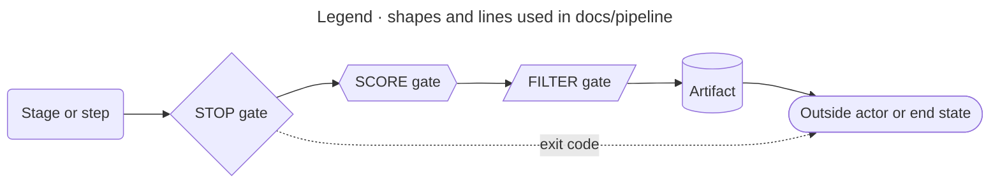

<!-- appdoc:hand-authored -->

[Overview](README.md) › Legend

# Legend

**How do I read the diagrams in this folder?**

Every page uses the same shapes. A shape is never the only signal: gates also carry their kind in the label (`G4 STOP`).

## Gate kinds

| Kind | Shape | What it does | Example |
|---|---|---|---|
| **STOP** | Diamond | Ends the run. Nothing after it runs. | The redaction sweep cannot run → exit 3 |
| **SCORE** | Hexagon | Records an outcome and lets the run continue. The close-out stage turns it into the exit code. | Gate status `fail` → exit 2 at the end |
| **FILTER** | Trapezoid | Accepts or refuses individual items, logs refusals and lets the run continue. | The quarantine refuses an LLM value that would overwrite a Verified fact |

Steps that only warn are not gates. They are listed in [gates.md](gates.md#checks-that-only-warn).

## Names and IDs

- **Stages** are fixed: Configure, Collect evidence, Compose, Validate, Finalize, Enrich, Close out. Numbers 1–7 follow the order in which a build reaches them.
- **Steps** inside a stage are numbered `stage.step` (for example `4.6`). The same numbers appear in the diagram and in the "What happens" list.
- **Gates** have stable IDs (G1a, G1b, G2 and so on). An ID is never reused. Each ID is a row in [gates.md](gates.md).
- **Gaps** are tagged with a finding ID (P-1, T-1 and so on) wherever the code differs from its contract. The tag comes off in the same change that fixes the gap.

## Claim status words

Two separate vocabularies appear in these pages. They are not the same thing.

| Where | Words | Meaning |
|---|---|---|
| Composed documents | `Verified`, `Inferred`, `Partly verified`, `Unknown`, `Operator-supplied`; `Verified-source-doc` for a claim cited from a hand-authored document | How well the evidence supports a claim in the 20-section master document |
| Enrichment records | `llm`, `deterministic`, `open` | Who filled a field in the enriched evidence |

See [composer section map](detail/composer-section-map.md) and [enrichment quarantine](detail/enrichment-quarantine.md).
