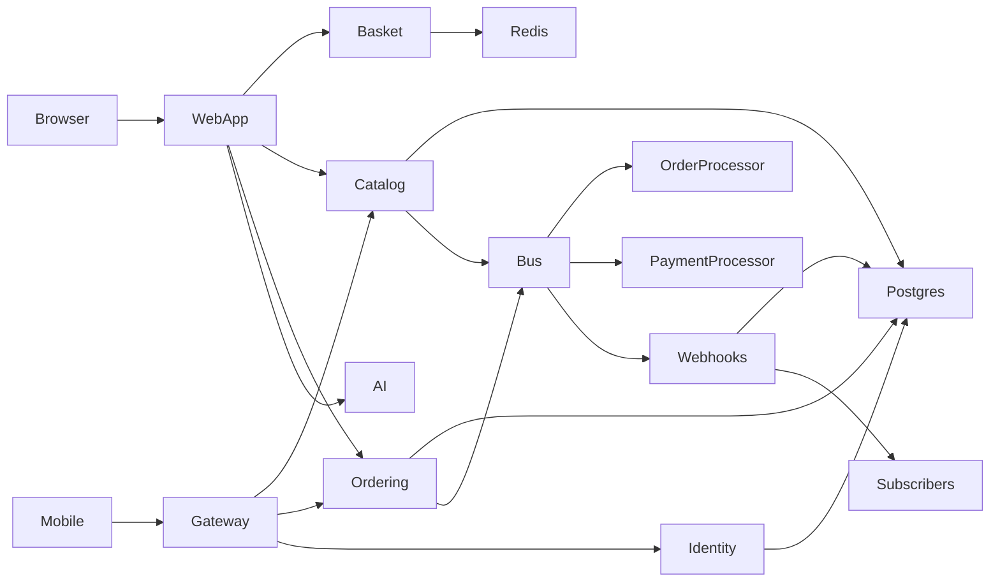
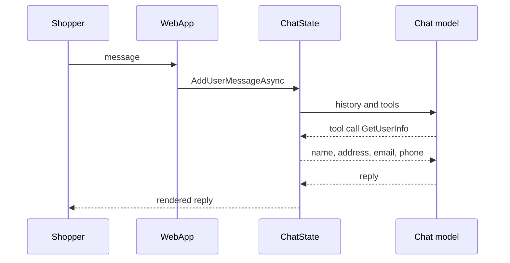
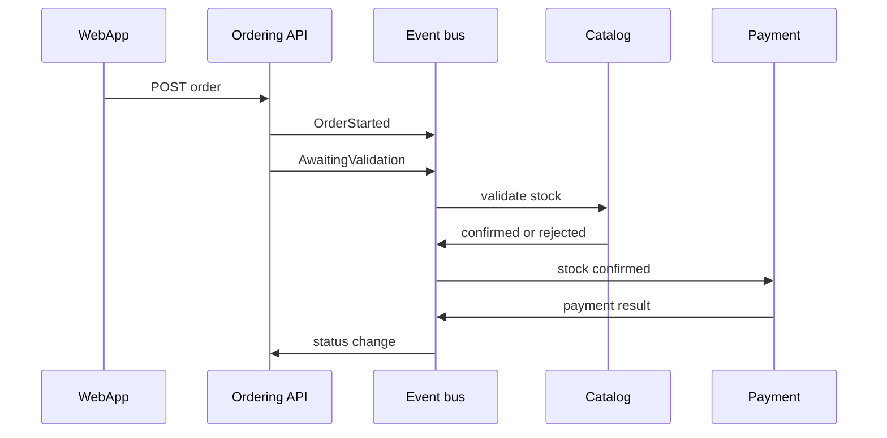
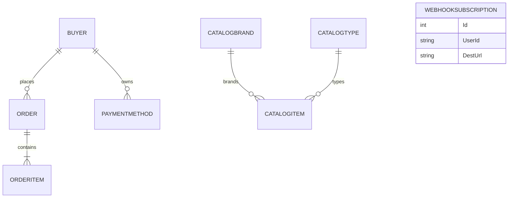
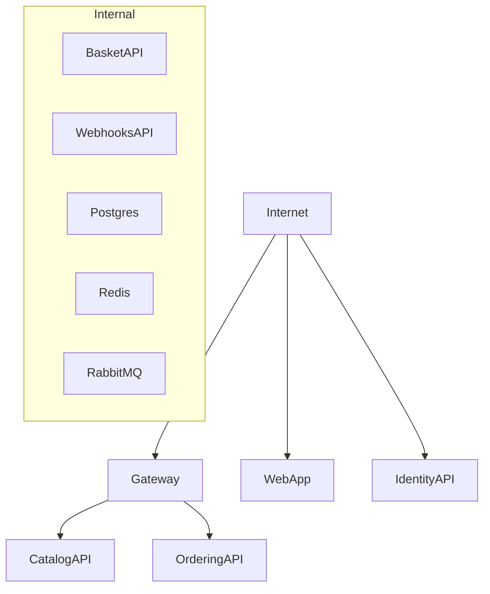

# eShop Documentation
<!-- appdoc:template 2.7 -->

**Target:** eShop | **Commit:** 913acea66708a59595351174cee9b29f37179d29 | **Evidence date:** 2026-11-23

**How to read this document.** *Cited* claims carry a path-and-line Citation. **Inferred:** marks reasoning from cited evidence. *Unknown* items are listed in section 14 and must not be assumed. Secret values are never reproduced; their locations are cited with "value omitted". The Evidence Register (source-to-claim audit) is rendered as Appendix A.

## 1. Application Index

| Support need | Primary screen or file | Workflow |
|---|---|---|
| Start the whole system locally | `README.md:52`, `src/eShop.AppHost/AppHost.cs:4-105` | [7.8 Start the system with the AppHost](#78-start-the-system-with-the-apphost) |
| Browse or search the catalog | `src/WebApp/Components/Pages/Catalog/Catalog.razor:1`, `src/Catalog.API/Apis/CatalogApi.cs:22-97` | [7.1 Browse and search the catalog](#71-browse-and-search-the-catalog) |
| Change a catalog item or its price | `src/Catalog.API/Apis/CatalogApi.cs:100-117` | [7.2 Maintain catalog items](#72-maintain-catalog-items) |
| Add to cart and check out | `src/WebApp/Components/Pages/Checkout/Checkout.razor:1`, `src/WebApp/Services/BasketState.cs:78-109` | [7.3 Place an order](#73-place-an-order) |
| Order stuck or in an unexpected status | `src/OrderProcessor/Services/GracePeriodManagerService.cs:15-62`, `src/Ordering.Domain/AggregatesModel/OrderAggregate/Order.cs:99-153` | [7.4 Order fulfilment through integration events](#74-order-fulfilment-through-integration-events) |
| Cancel or ship an order | `src/Ordering.API/Apis/OrdersApi.cs:11-12` | [7.4 Order fulfilment through integration events](#74-order-fulfilment-through-integration-events) |
| Sign in or sign out | `src/Identity.API/Quickstart/Account/AccountController.cs:40-193` | [7.5 Sign in](#75-sign-in) |
| Register or remove a webhook | `src/Webhooks.API/Apis/WebHooksApi.cs:13-82` | [7.6 Subscribe to webhooks and receive them](#76-subscribe-to-webhooks-and-receive-them) |
| Chatbot behaves oddly or privacy question | `src/WebApp/Components/Chatbot/ChatState.cs:19-93` | [7.7 Ask the shopping assistant](#77-ask-the-shopping-assistant) |
| Security findings | `src/Catalog.API/Program.cs:5-26` | [7.2 Maintain catalog items](#72-maintain-catalog-items) |

## 2. Coverage and Overview

### 2.1 What was inspected

<!-- appdoc:generated scan-coverage -->
| Stack | Supported | Files read |
|---|---|---|
| node | no (generic only) | 1 |
| aspnet-core | yes | 630 |

Files found: 1145 = scanned 1145 + pruned 0 + ignored by .appdocignore 0.

| Top folder | Files scanned |
|---|---|
| `src/` | 990 |
| `tests/` | 61 |
| `.github/` | 54 |
| `e2e/` | 5 |
| `.config/` | 4 |
| `img/` | 3 |
| `build/` | 2 |
| `.aspire/` | 1 |
| `.devcenter/` | 1 |
| `.vscode/` | 1 |

No folders were pruned.

Folders that duplicate another folder (not excluded; say in 2.1 which copy is live):
- `src/ClientApp/Platforms/MacCatalyst/` and `src/ClientApp/Platforms/iOS/` (2 files)
- `src/HybridApp/` and `src/WebApp/wwwroot/` (8 files)
- `src/HybridApp/Platforms/MacCatalyst/` and `src/HybridApp/Platforms/iOS/` (2 files)
- `src/HybridApp/wwwroot/` and `src/WebApp/` (7 files)
<!-- /appdoc:generated scan-coverage -->

The Target is a .NET Aspire solution: the solution file `eShop.slnx` and the filter `eShop.Web.slnf` list the service, web and test projects. The extractor supports the aspnet-core Stack, so routes, pages, auth attributes, connections and config keys come from Facts, while the generic node Stack covers only `package.json` (used by the Playwright end-to-end suite in `e2e/`). The Facts record <!-- appdoc:count routes -->48<!-- /appdoc:count --> routes, as listed in the block in section 4; they are Facts, not a claim about completeness of dynamic registrations (`eShop.slnx:1`).

What was read in depth: the Catalog, Ordering, Basket, Webhooks, Webhook client, Identity configuration, Web application chatbot and checkout code, the AppHost, the event bus, the two background services and the build and CI files. What was only inspected at folder level and is not described in depth: the MAUI client in `src/ClientApp/` and `src/HybridApp/`, the Identity Quickstart views and view models, the EF migrations, the static assets in `src/WebApp/wwwroot/` and `src/Identity.API/wwwroot/`, the agent skill files in `.github/skills/` and the e2e specs in `e2e/`. Runtime behaviour was not exercised.

No folder is reported as retired by name in the scan-coverage block, and none was pruned. The block does list pairs of folders that duplicate one another; each pair is resolved here. `src/HybridApp/wwwroot/` holds byte-identical static assets (fonts, icons, images, stylesheets) that also exist in `src/WebApp/wwwroot/`, and `src/HybridApp/` is matched against `src/WebApp/wwwroot/` for the same assets. The live copy for the web storefront is `src/WebApp/`: the AppHost starts it (`src/eShop.AppHost/AppHost.cs:71-79`) and `eShop.Web.slnf` lists it, while `src/HybridApp/` is a separate MAUI Blazor Hybrid head (`src/HybridApp/HybridApp.csproj:4`) that is not in the filter and not started by the AppHost; its asset files are copies for the mobile shell, not a second web application, so their contents are not described as web behaviour. The platform pairs `src/ClientApp/Platforms/MacCatalyst/` and `src/ClientApp/Platforms/iOS/`, and `src/HybridApp/Platforms/MacCatalyst/` and `src/HybridApp/Platforms/iOS/`, are near-identical entry stubs (for example `src/ClientApp/Platforms/iOS/Program.cs:5-14` and `src/ClientApp/Platforms/MacCatalyst/Program.cs:5-14`); both of each pair are live because each is compiled for its own target framework (`src/ClientApp/ClientApp.csproj:4`, `src/HybridApp/HybridApp.csproj:4`).

### 2.2 Purpose and users

The README describes eShop as a reference e-commerce application ("AdventureWorks") built from services with Aspire (`README.md:1-3`). Users are shoppers (browse, cart, orders, assistant) and, for the webhook demonstration, a webhook subscriber (`src/WebhookClient/Components/Pages/AddWebhook.razor:1`). No owner context file exists in the Target (appdoc-context.md does not exist), so business purpose beyond the README is Unknown - see Open questions. Overall risk posture: the sample ships developer-grade defaults; the most severe findings are V-1 (unauthenticated catalog writes reachable through the external gateway), then the High findings V-2, V-3 and V-4.

### 2.3 System boundary

Inside the Target: the storefront, the Catalog, Ordering, Basket, Webhooks and Identity services, the two background processors, the webhook demo client, shared infrastructure libraries and the MAUI clients (`eShop.slnx:1`). The AppHost provisions PostgreSQL (pgvector image), Redis and RabbitMQ containers (`src/eShop.AppHost/AppHost.cs:9-20`). Outside the Target: an AI chat and embedding service (Microsoft Foundry or Ollama, optional; `src/eShop.AppHost/Extensions.cs:50-86`), arbitrary webhook receiver URLs chosen by users (`src/Webhooks.API/Services/WebhooksSender.cs:13-32`), and Azure Container Apps for deployment (`src/eShop.AppHost/AppHost.cs:7`).

## 3. Architecture

### 3.1 Components

- Aspire AppHost: declares the resources and wires references between them (`src/eShop.AppHost/AppHost.cs:4-105`).
- Web storefront (Blazor server, with the chatbot): `src/WebApp/Program.cs:1-34`.
- Catalog API with EF Core on PostgreSQL and optional embeddings: `src/Catalog.API/Program.cs:5-26`, `src/Catalog.API/Extensions/Extensions.cs:1-51`.
- Ordering API (CQRS with mediator commands, domain aggregates): `src/Ordering.API/Program.cs:1-25`, `src/Ordering.Domain/AggregatesModel/OrderAggregate/Order.cs:5-186`.
- Basket API over gRPC with Redis storage: `src/Basket.API/Program.cs:1-14`, `src/Basket.API/Repositories/RedisBasketRepository.cs:1-56`.
- Identity API (IdentityServer with ASP.NET Identity): `src/Identity.API/Program.cs:1-57`.
- Webhooks API and the Webhook client demo: `src/Webhooks.API/Program.cs:1-24`, `src/WebhookClient/Endpoints/WebhookEndpoints.cs:9-55`.
- Order processor (grace period job) and payment processor (simulated payment): `src/OrderProcessor/Services/GracePeriodManagerService.cs:7-64`, `src/PaymentProcessor/IntegrationEvents/EventHandling/OrderStatusChangedToStockConfirmedIntegrationEventHandler.cs:3-34`.
- RabbitMQ event bus and the transactional event log: `src/EventBusRabbitMQ/RabbitMQEventBus.cs:13-224`, `src/IntegrationEventLogEF/Services/IntegrationEventLogService.cs:3-60`.
- Shared defaults (health, telemetry, JWT auth, OpenAPI): `src/eShop.ServiceDefaults/Extensions.cs:14-129`.
- Mobile gateway (YARP) in front of Catalog, Ordering and Identity: `src/eShop.AppHost/AppHost.cs:61-64`, `src/eShop.AppHost/Extensions.cs:88-153`.
- MAUI clients: `src/ClientApp/ClientApp.csproj:4`, `src/HybridApp/HybridApp.csproj:4`.

### 3.2 Diagram



Caption: components and their links as wired in `src/eShop.AppHost/AppHost.cs:9-103` and `src/WebApp/Extensions/Extensions.cs:31-40`.

### 3.3 Authentication and authorization

Users authenticate against the Identity API, which runs IdentityServer with in-memory clients, scopes and a developer signing credential (`src/Identity.API/Program.cs:18-37`, `src/Identity.API/Configuration/Config.cs:40-190`). The web storefront and the webhook client use cookie sessions with OpenID Connect code flow (`src/WebApp/Extensions/Extensions.cs:66-87`, `src/WebhookClient/Extensions/Extensions.cs:21-40`). The Ordering, Basket and Webhooks APIs validate JWT bearer tokens through the shared handler (`src/eShop.ServiceDefaults/AuthenticationExtensions.cs:33-50`). Enforcement is per route group in Ordering and Webhooks (`src/Ordering.API/Program.cs:21-22`, `src/Webhooks.API/Program.cs:20-21`) and per gRPC method in Basket (`src/Basket.API/Grpc/BasketService.cs:12-20`). The Catalog API registers no authentication at all (`src/Catalog.API/Program.cs:5-26`). Local login uses lockout on failure (`src/Identity.API/Quickstart/Account/AccountController.cs:95`).

## 4. Functional Inventory

<!-- appdoc:generated entry-points -->
13 route handler files; 48 routes; 46 pages; 0 commands; 3 jobs.

| Handler file | Kinds | Routes | Pages | Jobs | Commands |
|---|---|---|---|---|---|
| `src/Catalog.API/Apis/CatalogApi.cs` | route | 17 | 0 | 0 | 0 |
| `src/Ordering.API/Apis/OrdersApi.cs` | route | 7 | 0 | 0 | 0 |
| `src/Identity.API/Quickstart/Account/AccountController.cs` | page, route | 5 | 5 | 0 | 0 |
| `src/Webhooks.API/Apis/WebHooksApi.cs` | route | 4 | 0 | 0 | 0 |
| `src/Identity.API/Quickstart/Device/DeviceController.cs` | page, route | 3 | 7 | 0 | 0 |
| `src/Identity.API/Quickstart/Account/ExternalController.cs` | route | 2 | 0 | 0 | 0 |
| `src/Identity.API/Quickstart/Consent/ConsentController.cs` | page, route | 2 | 4 | 0 | 0 |
| `src/Identity.API/Quickstart/Grants/GrantsController.cs` | page, route | 2 | 1 | 0 | 0 |
| `src/Identity.API/Quickstart/Home/HomeController.cs` | page, route | 2 | 2 | 0 | 0 |
| `src/Identity.API/Quickstart/Diagnostics/DiagnosticsController.cs` | page, route | 1 | 1 | 0 | 0 |
| `src/WebhookClient/Endpoints/AuthenticationEndpoints.cs` | route | 1 | 0 | 0 | 0 |
| `src/WebhookClient/Endpoints/WebhookEndpoints.cs` | route | 1 | 0 | 0 | 0 |
| `src/eShop.ServiceDefaults/OpenApi.Extensions.cs` | route | 1 | 0 | 0 | 0 |
| `src/EventBusRabbitMQ/RabbitMQEventBus.cs` | job | 0 | 0 | 1 | 0 |
| `src/HybridApp/Components/Pages/Catalog/Catalog.razor` | page | 0 | 1 | 0 | 0 |
| `src/HybridApp/Components/Pages/Item/ItemPage.razor` | page | 0 | 1 | 0 | 0 |
| `src/Identity.API/Views/Account/AccessDenied.cshtml` | page | 0 | 1 | 0 | 0 |
| `src/Identity.API/Views/Account/LoggedOut.cshtml` | page | 0 | 1 | 0 | 0 |
| `src/Identity.API/Views/Account/Login.cshtml` | page | 0 | 1 | 0 | 0 |
| `src/Identity.API/Views/Account/Logout.cshtml` | page | 0 | 1 | 0 | 0 |
| `src/Identity.API/Views/Consent/Index.cshtml` | page | 0 | 1 | 0 | 0 |
| `src/Identity.API/Views/Device/Success.cshtml` | page | 0 | 1 | 0 | 0 |
| `src/Identity.API/Views/Device/UserCodeCapture.cshtml` | page | 0 | 1 | 0 | 0 |
| `src/Identity.API/Views/Device/UserCodeConfirmation.cshtml` | page | 0 | 1 | 0 | 0 |
| `src/Identity.API/Views/Diagnostics/Index.cshtml` | page | 0 | 1 | 0 | 0 |
| `src/Identity.API/Views/Grants/Index.cshtml` | page | 0 | 1 | 0 | 0 |
| `src/Identity.API/Views/Home/Index.cshtml` | page | 0 | 1 | 0 | 0 |
| `src/Identity.API/Views/Shared/Error.cshtml` | page | 0 | 1 | 0 | 0 |
| `src/Identity.API/Views/Shared/Redirect.cshtml` | page | 0 | 1 | 0 | 0 |
| `src/OrderProcessor/Services/GracePeriodManagerService.cs` | job | 0 | 0 | 1 | 0 |
| `src/Shared/MigrateDbContextExtensions.cs` | job | 0 | 0 | 1 | 0 |
| `src/WebApp/Components/Pages/Cart/CartPage.razor` | page | 0 | 1 | 0 | 0 |
| `src/WebApp/Components/Pages/Catalog/Catalog.razor` | page | 0 | 1 | 0 | 0 |
| `src/WebApp/Components/Pages/Checkout/Checkout.razor` | page | 0 | 1 | 0 | 0 |
| `src/WebApp/Components/Pages/Item/ItemPage.razor` | page | 0 | 1 | 0 | 0 |
| `src/WebApp/Components/Pages/User/LogIn.razor` | page | 0 | 1 | 0 | 0 |
| `src/WebApp/Components/Pages/User/LogOut.razor` | page | 0 | 1 | 0 | 0 |
| `src/WebApp/Components/Pages/User/Orders.razor` | page | 0 | 1 | 0 | 0 |
| `src/WebhookClient/Components/Pages/AddWebhook.razor` | page | 0 | 1 | 0 | 0 |
| `src/WebhookClient/Components/Pages/Error.razor` | page | 0 | 1 | 0 | 0 |
| `src/WebhookClient/Components/Pages/Home/Home.razor` | page | 0 | 1 | 0 | 0 |
| `src/WebhookClient/Components/Pages/LogIn.razor` | page | 0 | 1 | 0 | 0 |
<!-- /appdoc:generated entry-points -->

| ID | Area | Feature | Entry point | Inputs, outputs and rules | Dependencies | Status |
|---|---|---|---|---|---|---|
| F-1 | Catalog | List, filter, fetch items, pictures, types, brands and facet counts | `src/Catalog.API/Apis/CatalogApi.cs:22-57`, `src/Catalog.API/Apis/CatalogApi.cs:84-97` | GET routes under api/catalog; paging, name prefix, type and brand filters; no authentication | CatalogContext, Pics folder (`src/Catalog.API/Program.cs:7-9`) | Cited |
| F-2 | Catalog | Create, replace and delete items | `src/Catalog.API/Apis/CatalogApi.cs:100-117`, `src/Catalog.API/Apis/CatalogApi.cs:359-453` | PUT, POST and DELETE; recomputes the embedding; publishes a price-changed event when the price changed; no authentication | CatalogAI, event bus, event log | Cited |
| F-3 | Catalog AI search | Semantic search with fallback to name search | `src/Catalog.API/Apis/CatalogApi.cs:60-71`, `src/Catalog.API/Apis/CatalogApi.cs:286-338` | Text is sent to the embedding model when enabled, otherwise name prefix search | CatalogAI (`src/Catalog.API/Services/CatalogAI.cs:7-76`), pgvector | Cited |
| F-4 | Ordering | Create an order and an order draft | `src/Ordering.API/Apis/OrdersApi.cs:16-17` | POST with x-requestid header; card number masked before the command; handler is idempotent by request id | OrderingContext, event log | Cited |
| F-5 | Ordering | Read one order, list own orders, card types | `src/Ordering.API/Apis/OrdersApi.cs:13-15` | Own list filters by the caller's identity; single-order read does not | OrderQueries (`src/Ordering.API/Application/Queries/OrderQueries.cs:6-52`) | Cited |
| F-6 | Ordering | Cancel and ship an order | `src/Ordering.API/Apis/OrdersApi.cs:11-12` | PUT with x-requestid; state rules enforced in the aggregate | Order aggregate (`src/Ordering.Domain/AggregatesModel/OrderAggregate/Order.cs:130-153`) | Cited |
| F-7 | Basket | Get, update and delete the caller's basket | `src/Basket.API/Proto/basket.proto:8-10`, `src/Basket.API/Grpc/BasketService.cs:12-111` | gRPC; buyer id comes from the token, not from the request | Redis | Cited |
| F-8 | Identity | Login, logout, external login, home and error pages | `src/Identity.API/Quickstart/Account/AccountController.cs:40-199`, `src/Identity.API/Quickstart/Account/ExternalController.cs:34-64`, `src/Identity.API/Quickstart/Home/HomeController.cs:24-56` | IdentityServer Quickstart controllers; password sign-in with lockout | ASP.NET Identity store | Cited |
| F-9 | Webhooks | List, read, create and delete own subscriptions | `src/Webhooks.API/Apis/WebHooksApi.cs:13-82` | Create first proves control of a grant URL; reads and deletes filter by the caller's user id | WebhooksContext | Cited |
| F-10 | Webhook client | Receive webhook posts, answer the grant check, sign out | `src/WebhookClient/Endpoints/WebhookEndpoints.cs:16-50`, `src/WebhookClient/Endpoints/AuthenticationEndpoints.cs:12-17` | Token checked only when ValidateToken is true; received hooks kept in memory | HooksRepository (`src/WebhookClient/Services/HooksRepository.cs:5-30`) | Cited |
| F-11 | Storefront | Catalog, item and cart pages | `src/WebApp/Components/Pages/Catalog/Catalog.razor:1`, `src/WebApp/Components/Pages/Item/ItemPage.razor:1`, `src/WebApp/Components/Pages/Cart/CartPage.razor:1` | Cart requires login | Basket, Catalog and Ordering clients (`src/WebApp/Extensions/Extensions.cs:31-40`) | Cited |
| F-12 | Chatbot | Shopping assistant chat with catalog, cart and user-info tools | `src/WebApp/Components/Chatbot/Chatbot.razor:101-126`, `src/WebApp/Components/Chatbot/ChatState.cs:19-93` | Free text goes to the configured chat model; the model may call tools | External chat model (`src/WebApp/Extensions/Extensions.cs:94-109`) | Cited |
| F-13 | Messaging and jobs | Event bus consumer, grace-period timer, database migration on start | `src/EventBusRabbitMQ/RabbitMQEventBus.cs:13-224`, `src/OrderProcessor/Services/GracePeriodManagerService.cs:15-62`, `src/Shared/MigrateDbContextExtensions.cs:76-88` | Hosted services started with each project | RabbitMQ, PostgreSQL | Cited |
| F-14 | Payment simulation | Pretend to charge an order and publish success or failure | `src/PaymentProcessor/IntegrationEvents/EventHandling/OrderStatusChangedToStockConfirmedIntegrationEventHandler.cs:8-30` | Outcome comes from the PaymentSucceeded option, not a gateway | RabbitMQ | Cited |
| F-15 | Mobile gateway | Reverse-proxy routes for the mobile client | `src/eShop.AppHost/Extensions.cs:88-153` | Catalog routes, a catch-all for api/catalog, Ordering and Identity routes | YARP resource (`src/eShop.AppHost/AppHost.cs:62-64`) | Cited |
| F-16 | Client apps | MAUI native and hybrid clients | `src/HybridApp/Components/Pages/Catalog/Catalog.razor:1`, `src/HybridApp/Components/Pages/Item/ItemPage.razor:1` | Not read in depth | Mobile gateway | Inferred |
| F-17 | Platform defaults | OpenAPI document and development-only health and Scalar endpoints | `src/eShop.ServiceDefaults/OpenApi.Extensions.cs:24-42`, `src/eShop.ServiceDefaults/Extensions.cs:108-128` | Health endpoints and the Scalar UI are mapped only in Development | ServiceDefaults | Cited |
| F-18 | Identity | Consent, device flow, grants and diagnostics | `src/Identity.API/Quickstart/Consent/ConsentController.cs:33-76`, `src/Identity.API/Quickstart/Device/DeviceController.cs:28-60`, `src/Identity.API/Quickstart/Grants/GrantsController.cs:33-43`, `src/Identity.API/Quickstart/Diagnostics/DiagnosticsController.cs:11-20` | Login required; diagnostics is limited to local addresses | IdentityServer interaction service | Cited |
| F-19 | Storefront | Checkout, login, logout and orders pages | `src/WebApp/Components/Pages/Checkout/Checkout.razor:1`, `src/WebApp/Components/Pages/User/LogIn.razor:1`, `src/WebApp/Components/Pages/User/LogOut.razor:1`, `src/WebApp/Components/Pages/User/Orders.razor:1` | Checkout and orders require login; checkout sends placeholder card values | Ordering client (`src/WebApp/Extensions/Extensions.cs:38-40`) | Cited |

### 4.1 Subsystem inventory

| Subsystem | Files | Features | Primary data and dependencies | Purpose | Status |
|---|---|---|---|---|---|
| `src/Catalog.API/` | 150 | F-1, F-2, F-3 | PostgreSQL catalogdb, embeddings, RabbitMQ | Product catalog | Cited |
| `src/Ordering.API/` | 72 | F-4, F-5, F-6 | PostgreSQL orderingdb, RabbitMQ | Order commands and queries | Cited |
| `src/Ordering.Domain/` | 24 | F-4, F-6 | In-memory aggregates | Order, buyer and payment-method model | Cited |
| `src/Ordering.Infrastructure/` | 24 | F-4, F-5 | EF Core, migrations | Persistence for Ordering | Cited |
| `src/Basket.API/` | 16 | F-7 | Redis, RabbitMQ | Basket over gRPC | Cited |
| `src/Identity.API/` | 175 | F-8, F-18 | PostgreSQL identitydb | Login and token issuing | Cited |
| `src/Webhooks.API/` | 31 | F-9 | PostgreSQL webhooksdb, RabbitMQ, outbound HTTP | Webhook subscriptions and delivery | Cited |
| `src/WebhookClient/` | 33 | F-10 | In-memory queue, Webhooks API | Webhook demo receiver | Cited |
| `src/WebApp/` | 110 | F-11, F-12, F-19 | Basket, Catalog, Ordering, chat model | Storefront | Cited |
| `src/WebAppComponents/` | 13 | F-11 | Catalog HTTP client | Shared storefront components | Cited |
| `src/OrderProcessor/` | 11 | F-13 | orderingdb, RabbitMQ | Grace-period timer | Cited |
| `src/PaymentProcessor/` | 11 | F-14 | RabbitMQ | Simulated payment | Cited |
| `src/EventBus/` | 9 | F-13 | None | Event bus abstractions | Cited |
| `src/EventBusRabbitMQ/` | 6 | F-13 | RabbitMQ | Event bus implementation | Cited |
| `src/IntegrationEventLogEF/` | 8 | F-2, F-4 | EF Core | Transactional outbox log | Cited |
| `src/Shared/` | 2 | F-13 | EF Core | Migration hosted service | Cited |
| `src/eShop.AppHost/` | 5 | F-15 | Aspire resources | Orchestration and gateway | Cited |
| `src/eShop.ServiceDefaults/` | 8 | F-17 | OpenTelemetry, JWT | Shared defaults | Cited |
| `src/ClientApp/` | 198 | F-16 | Mobile gateway | MAUI client | Inferred |
| `src/HybridApp/` | 84 | F-16 | Mobile gateway | MAUI Blazor Hybrid client | Inferred |
| `tests/` | 61 | F-1, F-4, F-7, F-9 | Test containers | Unit and functional suites | Cited |
| `.github/` | 54 | F-17 | CI, skills | Workflows, dependabot and agent skills | Cited |
| `e2e/` | 5 | F-11 | Playwright | Browser journeys | Cited |
| `build/` | 2 | F-17 | Azure Container Registry build queue script and multi-arch manifest script | Registry build helpers; the queue script names the older eShopOnContainers repository (`build/acr-build/queue-all.ps1:4`) and the manifest script creates multi-arch manifests (`build/multiarch-manifests/create-manifests.ps1:10`); **Inferred:** unused here, since no file in the Target references either | Inferred |
| `.config/` | 4 | F-17 | Tooling | Tool configuration | Inferred |
| `img/` | 3 | F-11 | None | README images | Inferred |
| `.aspire/` | 1 | F-15 | Aspire CLI | CLI settings | Inferred |
| `.devcenter/` | 1 | F-17 | None | One image-definition file whose whole content is the text Initial Commit (`.devcenter/catalog/definitions/imagedefinition.yaml:1`) | Cited |
| `.vscode/` | 1 | F-17 | Editor | Editor settings | Inferred |

## 5. Roles and Access Model

### 5.1 Observed role concepts

No role or group names are declared in source (appdoc-context.md does not exist, and Identity seeds no roles; `src/Identity.API/UsersSeed.cs:8-96`). Access is expressed as three states: anonymous, authenticated user, and token with a scope. Scopes are orders, basket and webhooks (`src/Identity.API/Configuration/Config.cs:18-26`). Clients are maui, webapp, webhooksclient and three Swagger UI clients (`src/Identity.API/Configuration/Config.cs:44-188`).

### 5.2 Authorization enforcement

- Ordering and Webhooks: whole route group requires an authenticated caller (`src/Ordering.API/Program.cs:21-22`, `src/Webhooks.API/Program.cs:20-21`); no scope or role is checked, and the audience check is disabled (`src/eShop.ServiceDefaults/AuthenticationExtensions.cs:49`).
- Basket: GetBasket is anonymous but returns an empty basket without a user id; Update and Delete throw Unauthenticated (`src/Basket.API/Grpc/BasketService.cs:12-34`, `src/Basket.API/Grpc/BasketService.cs:36-69`).
- Catalog: no check on any route (`src/Catalog.API/Apis/CatalogApi.cs:22-117`, `src/Catalog.API/Program.cs:5-26`).
- Storefront pages: Authorize attribute on cart, checkout, login and orders (`src/WebApp/Components/Pages/Cart/CartPage.razor:6`, `src/WebApp/Components/Pages/Checkout/Checkout.razor:6`, `src/WebApp/Components/Pages/User/Orders.razor:2`, `src/WebApp/Components/Pages/User/LogIn.razor:3`).
- Identity controllers: Account and External allow anonymous; Consent, Device, Diagnostics and Grants require login (`src/Identity.API/Quickstart/Account/AccountController.cs:7`, `src/Identity.API/Quickstart/Consent/ConsentController.cs:10`, `src/Identity.API/Quickstart/Device/DeviceController.cs:6`, `src/Identity.API/Quickstart/Diagnostics/DiagnosticsController.cs:8`, `src/Identity.API/Quickstart/Grants/GrantsController.cs:10`).
- Webhook client receivers: token check only when ValidateToken is true (`src/WebhookClient/Endpoints/WebhookEndpoints.cs:13-50`).
- Ownership: Webhooks and the own-orders list filter by user id (`src/Webhooks.API/Apis/WebHooksApi.cs:15-16`, `src/Ordering.API/Application/Queries/OrderQueries.cs:37-40`); single-order read, cancel and ship do not (`src/Ordering.API/Application/Queries/OrderQueries.cs:6-13`).

### 5.3 Role-to-capability matrix

| Capability | Anonymous | Authenticated user |
|---|---|---|
| Catalog | Y (`src/Catalog.API/Apis/CatalogApi.cs:22-117`: reads and writes) | Y |
| Catalog AI search | Y (`src/Catalog.API/Apis/CatalogApi.cs:60-71`) | Y |
| Ordering | ? | Y (`src/Ordering.API/Program.cs:21-22`; any order id) |
| Basket | ? (empty basket only, `src/Basket.API/Grpc/BasketService.cs:12-34`) | Y (`src/Basket.API/Grpc/BasketService.cs:36-111`) |
| Identity | Y (`src/Identity.API/Quickstart/Account/AccountController.cs:7`) | Y |
| Webhooks | ? | Y (own subscriptions, `src/Webhooks.API/Apis/WebHooksApi.cs:13-82`) |
| Webhook client | Y by default (`src/WebhookClient/Endpoints/WebhookEndpoints.cs:13-50`) | Y |
| Storefront | Y (catalog and item pages, `src/WebApp/Components/Pages/Catalog/Catalog.razor:1`) | Y (cart, checkout, orders: `src/WebApp/Components/Pages/Checkout/Checkout.razor:6`) |
| Chatbot | Y (loaded in the layout, `src/WebApp/Components/Layout/MainLayout.razor:9`) | Y (user-info tool reads claims, `src/WebApp/Components/Chatbot/ChatState.cs:96-111`) |
| Mobile gateway | Y (routes forward without a check, `src/eShop.AppHost/Extensions.cs:142-143`) | Y |
| Messaging and jobs | | |
| Payment simulation | | |
| Client apps | ? | ? |
| Platform defaults | Y (OpenAPI document, `src/eShop.ServiceDefaults/OpenApi.Extensions.cs:24`) | Y |

Rows a role must not have: an anonymous caller must not create, replace or delete catalog items, yet it can (V-1); a user must not read or cancel another user's order, yet the code has no ownership check (V-3). Token view: scopes orders, basket and webhooks exist (`src/Identity.API/Configuration/Config.cs:18-26`) but no handler tests for a scope (`src/eShop.ServiceDefaults/AuthenticationExtensions.cs:33-50`).

**Restriction:** do not infer a permission from a visible control or a granted scope; enforcement is the code cited in 5.2.

## 6. UI Catalog

Source-only catalog; no screenshots or live session. Pages come from the Facts and the Razor and view files (`src/WebApp/Components/Pages/Catalog/Catalog.razor:1`).

| ID | Page | Route or entry | Reached from | Visible controls and data | States and effects | Roles and evidence |
|---|---|---|---|---|---|---|
| UI-1 | Storefront catalog | / | Header | Product grid, brand and type filters, paging | Reads Catalog API | Anonymous: `src/WebApp/Components/Pages/Catalog/Catalog.razor:1` |
| UI-2 | Item detail | /item/{itemId} | Catalog grid | Item data, add to cart | Add needs login (`src/WebApp/Components/Pages/Item/ItemPage.razor:113`) | Anonymous view: `src/WebApp/Components/Pages/Item/ItemPage.razor:1` |
| UI-3 | Cart | /cart | Header | Basket lines, quantity change | Updates basket over gRPC | Authenticated: `src/WebApp/Components/Pages/Cart/CartPage.razor:6` |
| UI-4 | Checkout | /checkout | Cart | Address form, place order | Posts an order with placeholder card values, then clears the basket (`src/WebApp/Services/BasketState.cs:78-109`) | Authenticated: `src/WebApp/Components/Pages/Checkout/Checkout.razor:1` |
| UI-5 | Orders | /user/orders | Header | Order number, date, total, status | Refreshes on status events | Authenticated: `src/WebApp/Components/Pages/User/Orders.razor:1` |
| UI-6 | Sign in (storefront) | /user/login | Header | Redirects to Identity | OIDC challenge | Authenticated attribute: `src/WebApp/Components/Pages/User/LogIn.razor:1` |
| UI-7 | Sign out (storefront) | /user/logout | Header | Sign-out action | Ends session | `src/WebApp/Components/Pages/User/LogOut.razor:1` |
| UI-8 | Shopping assistant | Floating panel in layout | Every page | Message box, chat log | Needs a configured model; otherwise shows a notice (`src/WebApp/Components/Chatbot/Chatbot.razor:50-62`) | Anonymous and authenticated: `src/WebApp/Components/Layout/MainLayout.razor:9`, `src/WebApp/Components/Chatbot/Chatbot.razor:101-108` |
| UI-9 | Identity login | /Account/Login | Any client sign-in | Username, password, remember me | Lockout on failure | Anonymous: `src/Identity.API/Quickstart/Account/AccountController.cs:7`, view `src/Identity.API/Views/Account/Login.cshtml:1` |
| UI-10 | Identity logout and logged-out | /Account/Logout | Sign out | Confirmation and redirect | Ends the IdentityServer session | `src/Identity.API/Views/Account/Logout.cshtml:1`, `src/Identity.API/Views/Account/LoggedOut.cshtml:1` |
| UI-11 | Access denied | /Account/AccessDenied | Authorization failure | Message | None | `src/Identity.API/Views/Account/AccessDenied.cshtml:1` |
| UI-12 | Consent | /Consent/Index | Authorization request | Scope list, allow or deny | Grants scopes | Authenticated: `src/Identity.API/Views/Consent/Index.cshtml:1` |
| UI-13 | Device authorization | /Device/Index | Device flow | Code entry, confirmation, success | Approves a device | Authenticated: `src/Identity.API/Views/Device/UserCodeCapture.cshtml:1`, `src/Identity.API/Views/Device/UserCodeConfirmation.cshtml:1`, `src/Identity.API/Views/Device/Success.cshtml:1` |
| UI-14 | Diagnostics | /Diagnostics/Index | Direct URL | Authentication properties | Local addresses only | Authenticated: `src/Identity.API/Views/Diagnostics/Index.cshtml:1` |
| UI-15 | Grants | /Grants/Index | Direct URL | Granted clients, revoke | Revokes grants | Authenticated: `src/Identity.API/Views/Grants/Index.cshtml:1` |
| UI-16 | Identity home and error | /Home/Index, /Home/Error | Root | Landing and error pages, redirect helper | Index is served only in Development and returns 404 elsewhere (`src/Identity.API/Quickstart/Home/HomeController.cs:26-34`); the error description is hidden outside Development (`src/Identity.API/Quickstart/Home/HomeController.cs:49-53`) | `src/Identity.API/Views/Home/Index.cshtml:1`, `src/Identity.API/Views/Shared/Error.cshtml:1`, `src/Identity.API/Views/Shared/Redirect.cshtml:1` |
| UI-17 | Webhook client home | / | Direct URL | Received hooks list | Updates when a hook arrives | `src/WebhookClient/Components/Pages/Home/Home.razor:1` |
| UI-18 | Add webhook | /add-webhook | Home | Token field and a Register button; the event is fixed to OrderPaid and the URL and grant URL are computed from the base address (`src/WebhookClient/Components/Pages/AddWebhook.razor:9-17`, `src/WebhookClient/Components/Pages/AddWebhook.razor:41-51`) | Calls the Webhooks API | `src/WebhookClient/Components/Pages/AddWebhook.razor:1` |
| UI-19 | Webhook client login and error | /login, /Error | Redirect | Sign-in redirect, error text | OIDC challenge | `src/WebhookClient/Components/Pages/LogIn.razor:1`, `src/WebhookClient/Components/Pages/Error.razor:1` |
| UI-20 | Hybrid catalog and item | /, /item/{itemId} | App start | Catalog with a single brand and a single type filter, a fixed page size and no facet counts (`src/HybridApp/Components/Pages/Catalog/Catalog.razor:10`, `src/HybridApp/Components/Pages/Catalog/Catalog.razor:37-59`); item page shows description, brand and price | Add to cart and the cart count are commented out (`src/HybridApp/Components/Pages/Item/ItemPage.razor:4`, `src/HybridApp/Components/Pages/Item/ItemPage.razor:21-28`, `src/HybridApp/Components/Pages/Item/ItemPage.razor:42-43`) | `src/HybridApp/Components/Pages/Catalog/Catalog.razor:1`, `src/HybridApp/Components/Pages/Item/ItemPage.razor:1` |
| UI-21 | MAUI shell, login, profile, settings | Shell navigation | App start | Not read in depth | Mock services exist (`src/ClientApp/Services/Identity/IdentityMockService.cs:1`) | `src/ClientApp/AppShell.xaml:3`, `src/ClientApp/Views/LoginView.xaml:3`, `src/ClientApp/Views/ProfileView.xaml:3`, `src/ClientApp/Views/SettingsView.xaml:3` |
| UI-22 | MAUI catalog, item, filters, map | Shell navigation | App start | Not read in depth | None | `src/ClientApp/Views/CatalogView.xaml:2`, `src/ClientApp/Views/CatalogItemView.xaml:3`, `src/ClientApp/Views/FiltersView.xaml:3`, `src/ClientApp/Views/MapView.xaml:3` |
| UI-23 | MAUI basket, checkout, order detail | Shell navigation | App start | Not read in depth | None | `src/ClientApp/Views/BasketView.xaml:2`, `src/ClientApp/Views/CheckoutView.xaml:3`, `src/ClientApp/Views/OrderDetailView.xaml:3`, `src/ClientApp/Views/CustomNavigationView.xaml:3`, `src/HybridApp/MainPage.xaml:2` |

## 7. Workflows

### 7.1 Browse and search the catalog

1. The storefront asks the Catalog API for a page of items with optional brand and type filters (`src/WebAppComponents/Services/CatalogService.cs:17-22`).
2. The API filters by name prefix, type and brand, counts, orders by name and pages (`src/Catalog.API/Apis/CatalogApi.cs:131-166`).
3. Semantic search embeds the text and orders by cosine distance when an embedding model is configured; otherwise it falls back to name search (`src/Catalog.API/Apis/CatalogApi.cs:294-337`).
4. Pictures are served from the Pics folder by item id (`src/Catalog.API/Apis/CatalogApi.cs:251-273`).

Failure and escalation: an unknown id returns NotFound (`src/Catalog.API/Apis/CatalogApi.cs:229-234`); if semantic search returns nothing useful, check whether the embedding model is configured (`src/Catalog.API/Extensions/Extensions.cs:38-48`) and escalate to the platform owner if embeddings fail.

### 7.2 Maintain catalog items

1. A caller sends POST, PUT or DELETE to the catalog route; no identity is required (`src/Catalog.API/Apis/CatalogApi.cs:100-117`).
2. Create copies selected fields into a new item, computes the embedding and saves (`src/Catalog.API/Apis/CatalogApi.cs:415-437`).
3. Update copies all values onto the stored item, recomputes the embedding, and when the price changed saves the event log row in the same transaction and publishes a price-changed event (`src/Catalog.API/Apis/CatalogApi.cs:373-412`).
4. Delete removes the item (`src/Catalog.API/Apis/CatalogApi.cs:439-453`).

Failure and escalation: update of a missing id returns NotFound with a message (`src/Catalog.API/Apis/CatalogApi.cs:381-386`); a failed publish is caught, logged and the log row is marked PublishedFailed (`src/Catalog.API/IntegrationEvents/CatalogIntegrationEventService.cs:21-25`); the only retrieval query selects NotPublished rows for one transaction id (`src/IntegrationEventLogEF/Services/IntegrationEventLogService.cs:19-23`), so nothing in the repository retries it and the event must be republished manually.

### 7.3 Place an order

1. The shopper adds items; the storefront stores quantities in the Basket API (`src/WebApp/Services/BasketState.cs:33-56`).
2. Checkout validates that the basket is not empty and submits the address form (`src/WebApp/Components/Pages/Checkout/Checkout.razor:101-126`).
3. The storefront posts an order with fixed placeholder card values and the x-requestid header, then deletes the basket (`src/WebApp/Services/BasketState.cs:78-109`, `src/WebApp/Services/OrderingService.cs:12-18`).
4. The Ordering API masks the card number, wraps the command with the request id for idempotency and sends it (`src/Ordering.API/Apis/OrdersApi.cs:118-166`, `src/Ordering.API/Application/Commands/IdentifiedCommandHandler.cs:39-102`).
5. Validation requires an address, a card number of the right length, a future expiry and at least one item (`src/Ordering.API/Application/Validations/CreateOrderCommandValidator.cs:6-16`).
6. The handler saves an order-started event to the event log (`src/Ordering.API/Application/Commands/CreateOrderCommandHandler.cs:33`) and saves the order with status Submitted (`src/Ordering.API/Application/Commands/CreateOrderCommandHandler.cs:35-51`, `src/Ordering.Domain/AggregatesModel/OrderAggregate/Order.cs:52-65`); the transaction behavior publishes the logged events after commit (`src/Ordering.API/Application/Behaviors/TransactionBehavior.cs:52`), and the Basket service handles the event by deleting the buyer's basket (`src/Basket.API/IntegrationEvents/EventHandling/OrderStartedIntegrationEventHandler.cs:14`).

Failure and escalation: the Ordering API answers 400 when the request id is empty on create (`src/Ordering.API/Apis/OrdersApi.cs:135`), but it returns Ok even when the command result is false (`src/Ordering.API/Apis/OrdersApi.cs:157-166`) and the storefront does not read the response (`src/WebApp/Services/OrderingService.cs:17`); escalate when an order is missing after checkout (V-12).

### 7.4 Order fulfilment through integration events

1. Orders move Submitted, AwaitingValidation, StockConfirmed, Paid, Shipped or Cancelled through aggregate methods (`src/Ordering.Domain/AggregatesModel/OrderAggregate/Order.cs:99-153`).
2. The grace-period service finds orders past the grace time and publishes a confirmation event on a timer (`src/OrderProcessor/Services/GracePeriodManagerService.cs:43-61`, `src/OrderProcessor/appsettings.json:14-17`).
3. Catalog checks stock and answers confirmed or rejected (`src/Catalog.API/IntegrationEvents/EventHandling/OrderStatusChangedToAwaitingValidationIntegrationEventHandler.cs:9-33`).
4. The payment processor publishes success or failure from a setting (`src/PaymentProcessor/IntegrationEvents/EventHandling/OrderStatusChangedToStockConfirmedIntegrationEventHandler.cs:8-30`).
5. On Paid, Catalog removes stock (`src/Catalog.API/IntegrationEvents/EventHandling/OrderStatusChangedToPaidIntegrationEventHandler.cs:9-17`).
6. Cancel and ship are API calls that change status; cancelling a Paid or Shipped order throws (`src/Ordering.API/Application/Commands/CancelOrderCommandHandler.cs:19-30`, `src/Ordering.Domain/AggregatesModel/OrderAggregate/Order.cs:142-153`).

Failure and escalation: the consumer acknowledges a message even when its handler throws, so a failed step is logged and dropped (`src/EventBusRabbitMQ/RabbitMQEventBus.cs:170-180`); escalate when an order stays in one status beyond the grace period (V-11).

### 7.5 Sign in

1. A client redirects the browser to the Identity API (`src/WebApp/Extensions/Extensions.cs:66-87`).
2. The Account controller checks the anti-forgery token and calls the password sign-in with lockout on failure (`src/Identity.API/Quickstart/Account/AccountController.cs:60-95`).
3. On success it redirects back to the authorization request or a local URL; otherwise it re-renders the form with a generic message (`src/Identity.API/Quickstart/Account/AccountController.cs:97-140`).
4. Sign-out posts back with an anti-forgery token (`src/Identity.API/Quickstart/Account/AccountController.cs:166-193`).

Failure and escalation: repeated bad passwords lock the account (`src/Identity.API/Quickstart/Account/AccountController.cs:95`); escalate unlock requests to the Identity operator, whose process is Unknown - see Open questions.

### 7.6 Subscribe to webhooks and receive them

1. The user posts a subscription with Url, GrantUrl, Token and Event (`src/Webhooks.API/Apis/WebHooksApi.cs:35-64`).
2. A filter validates well-formed URLs and the event name (`src/Webhooks.API/Model/WebhookSubscriptionRequest.cs:10-27`).
3. The service requires the grant URL to share scheme, host and port with the hook URL, sends OPTIONS with the token header and accepts only a matching echoed token (`src/Webhooks.API/Services/GrantUrlTesterService.cs:5-35`).
4. On paid and shipped order events the handlers load every subscription of that type and post the event to each (`src/Webhooks.API/IntegrationEvents/OrderStatusChangedToShippedIntegrationEventHandler.cs:11-18`, `src/Webhooks.API/Services/WebhooksRetriever.cs:5-8`, `src/Webhooks.API/Services/WebhooksSender.cs:5-32`).
5. Delete removes only the caller's own subscription (`src/Webhooks.API/Apis/WebHooksApi.cs:66-82`).
6. The demo client answers the OPTIONS check and stores received posts in memory (`src/WebhookClient/Endpoints/WebhookEndpoints.cs:16-50`).

Failure and escalation: an invalid grant URL returns 400 (`src/Webhooks.API/Apis/WebHooksApi.cs:61`); delivery errors are not retried or recorded (`src/Webhooks.API/Services/WebhooksSender.cs:32`), so escalate to the subscriber when hooks stop arriving.

### 7.7 Ask the shopping assistant

1. The shared layout includes the chatbot button and panel (`src/WebApp/Components/Layout/MainLayout.razor:2-9`).
2. If a chat client is registered, a ChatState is created with the signed-in user's claims; otherwise a notice says the assistant is off (`src/WebApp/Components/Chatbot/Chatbot.razor:101-113`).
3. Each message is appended to the history and the whole history is sent to the chat model with four tools (`src/WebApp/Components/Chatbot/ChatState.cs:39-48`, `src/WebApp/Components/Chatbot/ChatState.cs:69-93`).
4. Tools search the catalog, add to or read the cart, and return the user's name, address, email and phone from claims (`src/WebApp/Components/Chatbot/ChatState.cs:96-167`).
5. Replies are rendered with markdown images turned into image tags (`src/WebApp/Components/Chatbot/MessageProcessor.cs:10-32`).

Failure and escalation: any exception returns a fixed apology and logs the error (`src/WebApp/Components/Chatbot/ChatState.cs:84-91`); escalate model outages to whoever owns the model deployment, which is Unknown - see Open questions.

### 7.8 Start the system with the AppHost

1. `aspire run` starts the AppHost named in the root config (`README.md:49-55`, `aspire.config.json:1-5`).
2. The AppHost starts Redis, RabbitMQ and PostgreSQL, then the projects in dependency order (`src/eShop.AppHost/AppHost.cs:9-79`).
3. Each database-backed project migrates and seeds its database at start (`src/Shared/MigrateDbContextExtensions.cs:58-74`, `src/Catalog.API/Extensions/Extensions.cs:24`, `src/Identity.API/Program.cs:12`).
4. Setting UseFoundry adds the chat and embedding deployments (`src/eShop.AppHost/AppHost.cs:81-86`).

Failure and escalation: a migration exception is logged and rethrown so the service stops (`src/Shared/MigrateDbContextExtensions.cs:48-55`); escalate if the container runtime is not running, as the README warns (`README.md:44-45`).

## 8. Data and Integrations

### 8.1 Connections

| ID | Name | Kind | Configured at | Used by |
|---|---|---|---|---|
| C-1 | catalogdb | PostgreSQL | `src/eShop.AppHost/AppHost.cs:17`, `src/Catalog.API/Extensions/Extensions.cs:15` | Catalog.API |
| C-2 | identitydb | PostgreSQL | `src/eShop.AppHost/AppHost.cs:18`, `src/Identity.API/Program.cs:7` | Identity.API |
| C-3 | orderingdb | PostgreSQL | `src/eShop.AppHost/AppHost.cs:19`, `src/Ordering.API/Extensions/Extensions.cs:17` | Ordering.API, OrderProcessor |
| C-4 | webhooksdb | PostgreSQL | `src/eShop.AppHost/AppHost.cs:20`, `src/Webhooks.API/Extensions/Extensions.cs:10` | Webhooks.API |
| C-5 | redis | Redis | `src/eShop.AppHost/AppHost.cs:9`, `src/Basket.API/appsettings.json:14` | Basket.API |
| C-6 | eventbus | RabbitMQ | `src/eShop.AppHost/AppHost.cs:10-11`, `src/Basket.API/appsettings.json:15` | All services that call the RabbitMQ extension |
| C-7 | textEmbeddingModel | External AI service | `src/Catalog.API/Extensions/Extensions.cs:43` | Catalog.API |
| C-8 | chatModel | External AI service | `src/WebApp/Extensions/Extensions.cs:102` | WebApp |

### 8.2 Stored procedures and SQL

No stored procedures were found. One raw SQL SELECT exists: the OrderProcessor reads submitted orders past the grace period through an Npgsql data source (`src/OrderProcessor/Services/GracePeriodOrdersRepository.cs:23-28`). Elsewhere data access is EF Core through contexts (`src/Catalog.API/Infrastructure/CatalogContext.cs:14-16`, `src/Ordering.Infrastructure/OrderingContext.cs:12-16`, `src/Webhooks.API/Infrastructure/WebhooksContext.cs:10`), the Identity context (`src/Identity.API/Data/ApplicationDbContext.cs:1`) and StackExchange Redis for baskets (`src/Basket.API/Repositories/RedisBasketRepository.cs:5-56`). Catalog adds vector similarity ordering through the pgvector EF extension (`src/Catalog.API/Apis/CatalogApi.cs:317-331`).

### 8.3 External calls

| ID | Call | Direction | Caller | Notes |
|---|---|---|---|---|
| X-1 | gRPC to basket-api | Outbound | WebApp | `src/WebApp/Extensions/Extensions.cs:31`; plain http address, forwards the user's token |
| X-2 | HTTP to catalog-api | Outbound | WebApp | `src/WebApp/Extensions/Extensions.cs:34` |
| X-3 | HTTP to ordering-api | Outbound | WebApp | `src/WebApp/Extensions/Extensions.cs:38` |
| X-4 | HTTP to webhooks-api | Outbound | WebhookClient | `src/WebhookClient/Extensions/Extensions.cs:19` |
| X-5 | HTTP POST to subscriber URLs | Outbound | Webhooks.API | `src/Webhooks.API/Services/WebhooksSender.cs:32`; destination chosen by the user |
| X-6 | HTTP OPTIONS to the grant URL | Outbound | Webhooks.API | `src/Webhooks.API/Services/GrantUrlTesterService.cs:21` |
| X-7 | Bearer token forwarding handler | Outbound | ServiceDefaults | `src/eShop.ServiceDefaults/HttpClientExtensions.cs:48` |
| X-8 | Chat completion with tools | Outbound | WebApp chatbot | `src/WebApp/Components/Chatbot/ChatState.cs:78`; sends the whole conversation to the chat model |
| X-9 | Embedding generation | Outbound | Catalog.API | `src/Catalog.API/Services/CatalogAI.cs:61` |
| X-10 | Identity metadata and key fetch | Outbound | Services with JWT auth | `src/eShop.ServiceDefaults/AuthenticationExtensions.cs:38-39` |
| X-11 | Catalog picture forwarder | Internal | WebApp | `src/WebApp/Program.cs:32` |
| X-12 | RabbitMQ publish and consume | Outbound and inbound | Event-bus users | `src/EventBusRabbitMQ/RabbitMQEventBus.cs:31-111` |

Calls made from test code, such as those exercised in `tests/Catalog.FunctionalTests/CatalogApiTests.cs:13`, are marked as tests in the Facts and are not listed.

### 8.4 Data entities and sensitivity

| Entity | Key fields | Defined at | Sensitivity |
|---|---|---|---|
| CatalogItem | Id, Name, Price, stock, Embedding | `src/Catalog.API/Model/CatalogItem.cs:7-47` | Public product data |
| Order | Id, OrderDate, Address, Status, BuyerId | `src/Ordering.Domain/AggregatesModel/OrderAggregate/Order.cs:5-35` | PII (address) |
| OrderItem | ProductId, ProductName, UnitPrice, Units | `src/Ordering.Domain/AggregatesModel/OrderAggregate/OrderItem.cs:5-19` | Business data |
| Buyer | IdentityGuid, Name | `src/Ordering.Domain/AggregatesModel/BuyerAggregate/Buyer.cs:5-15` | PII (name, identity key) |
| PaymentMethod | Alias, card number, holder, expiry | `src/Ordering.Domain/AggregatesModel/BuyerAggregate/PaymentMethod.cs:5-16` | Financial |
| WebhookSubscription | Id, DestUrl, Token, UserId | `src/Webhooks.API/Model/WebhookSubscription.cs:3-13` | Credential (token) |
| ApplicationUser | Name, address, phone, card fields | `src/Identity.API/Models/ApplicationUser.cs:4-30` | PII and financial |
| CustomerBasket | BuyerId, items | `src/Basket.API/Model/CustomerBasket.cs:3` | Low |

CatalogItem fields.

| Field | Type | Null | Key/FK | Sensitivity | Citation |
|---|---|---|---|---|---|
| Id | int | No | PK | Public | `src/Catalog.API/Model/CatalogItem.cs:9` |
| Name | string | No | | Public | `src/Catalog.API/Model/CatalogItem.cs:12` |
| Description | string | Yes | | Public | `src/Catalog.API/Model/CatalogItem.cs:14` |
| Price | decimal | No | | Public | `src/Catalog.API/Model/CatalogItem.cs:16` |
| PictureFileName | string | Yes | | Public | `src/Catalog.API/Model/CatalogItem.cs:18` |
| CatalogTypeId | int | No | FK to CatalogType | Public | `src/Catalog.API/Model/CatalogItem.cs:20` |
| CatalogBrandId | int | No | FK to CatalogBrand | Public | `src/Catalog.API/Model/CatalogItem.cs:24` |
| AvailableStock | int | No | | Business | `src/Catalog.API/Model/CatalogItem.cs:29` |
| Embedding | vector | Yes | | Derived from name and description | `src/Catalog.API/Model/CatalogItem.cs:40` |

Order, Buyer and PaymentMethod fields.

| Field | Type | Null | Key/FK | Sensitivity | Citation |
|---|---|---|---|---|---|
| Order.Id | int | No | PK | Business | `src/Ordering.Domain/AggregatesModel/OrderAggregate/Order.cs:5` |
| Order.Address | value object | No | owned | PII | `src/Ordering.Domain/AggregatesModel/OrderAggregate/Order.cs:12` |
| Order.BuyerId | int | Yes | FK to Buyer | PII link | `src/Ordering.Domain/AggregatesModel/OrderAggregate/Order.cs:14` |
| Order.OrderStatus | enum | No | | Business | `src/Ordering.Domain/AggregatesModel/OrderAggregate/Order.cs:18` |
| Order.PaymentId | int | Yes | FK to PaymentMethod | Financial link | `src/Ordering.Domain/AggregatesModel/OrderAggregate/Order.cs:35` |
| Buyer.IdentityGuid | string | No | identity key | PII | `src/Ordering.Domain/AggregatesModel/BuyerAggregate/Buyer.cs:9` |
| Buyer.Name | string | Yes | | PII | `src/Ordering.Domain/AggregatesModel/BuyerAggregate/Buyer.cs:11` |
| PaymentMethod card number | string | No | | Financial (masked by the API before the command) | `src/Ordering.Infrastructure/EntityConfigurations/PaymentMethodEntityTypeConfiguration.cs:27-31` |
| PaymentMethod holder name | string | No | | PII | `src/Ordering.Infrastructure/EntityConfigurations/PaymentMethodEntityTypeConfiguration.cs:17-20` |
| PaymentMethod security number | string | Yes | none | Financial; no column is mapped | `src/Ordering.Domain/AggregatesModel/BuyerAggregate/PaymentMethod.cs:11` |

WebhookSubscription and ApplicationUser fields (`src/Webhooks.API/Model/WebhookSubscription.cs:3-13`, `src/Identity.API/Models/ApplicationUser.cs:4-30`).

| Field | Type | Null | Key/FK | Sensitivity | Citation |
|---|---|---|---|---|---|
| WebhookSubscription.DestUrl | string | No | | Business | `src/Webhooks.API/Model/WebhookSubscription.cs:10` |
| WebhookSubscription.Token | string | Yes | | Credential | `src/Webhooks.API/Model/WebhookSubscription.cs:11` |
| WebhookSubscription.UserId | string | No | owner | PII link | `src/Webhooks.API/Model/WebhookSubscription.cs:13` |
| ApplicationUser.CardNumber | string | No | | Financial | `src/Identity.API/Models/ApplicationUser.cs:7` |
| ApplicationUser.SecurityNumber | string | No | | Financial | `src/Identity.API/Models/ApplicationUser.cs:9` |
| ApplicationUser address fields | string | No | | PII | `src/Identity.API/Models/ApplicationUser.cs:17-25` |
| ApplicationUser.Name and LastName | string | No | | PII | `src/Identity.API/Models/ApplicationUser.cs:27-29` |

### 8.5 Failure, fallback and observability

| ID | Timeout and retry | On failure | Observability |
|---|---|---|---|
| C-1 | Default execution strategy during migration (`src/Shared/MigrateDbContextExtensions.cs:44-46`) | Migration failure is rethrown (`src/Shared/MigrateDbContextExtensions.cs:48-55`) | OpenTelemetry (`src/eShop.ServiceDefaults/Extensions.cs:50-83`) |
| C-2 | Default execution strategy during migration (`src/Shared/MigrateDbContextExtensions.cs:44-46`) | Migration failure is rethrown (`src/Shared/MigrateDbContextExtensions.cs:48-55`) | OpenTelemetry (`src/eShop.ServiceDefaults/Extensions.cs:50-83`) |
| C-3 | Default execution strategy during migration (`src/Shared/MigrateDbContextExtensions.cs:44-46`) | Migration failure is rethrown (`src/Shared/MigrateDbContextExtensions.cs:48-55`) | OpenTelemetry (`src/eShop.ServiceDefaults/Extensions.cs:50-83`) |
| C-4 | Default execution strategy during migration (`src/Shared/MigrateDbContextExtensions.cs:44-46`) | Migration failure is rethrown (`src/Shared/MigrateDbContextExtensions.cs:48-55`) | OpenTelemetry (`src/eShop.ServiceDefaults/Extensions.cs:50-83`) |
| C-5 | None coded in the repository | Update returns null and the gRPC call raises NotFound (`src/Basket.API/Repositories/RedisBasketRepository.cs:34-48`, `src/Basket.API/Grpc/BasketService.cs:53`) | Info logs (`src/Basket.API/Repositories/RedisBasketRepository.cs:41-46`) |
| C-6 | Publish uses a resilience pipeline with a retry count option (`src/EventBusRabbitMQ/RabbitMQEventBus.cs:22`) | Consumer logs a warning and acknowledges anyway (`src/EventBusRabbitMQ/RabbitMQEventBus.cs:170-180`) | Trace spans per publish and receive (`src/EventBusRabbitMQ/RabbitMQEventBus.cs:59-88`) |
| C-7 | Standard resilience handler on HTTP clients (`src/eShop.ServiceDefaults/Extensions.cs:22-29`) | Search falls back to name search only when disabled or vector is null (`src/Catalog.API/Apis/CatalogApi.cs:294-305`); an exception from the service is not caught there | Trace log of text (`src/Catalog.API/Services/CatalogAI.cs:64-67`) |
| C-8 | Same standard handler | Chat returns a fixed apology (`src/WebApp/Components/Chatbot/ChatState.cs:84-91`) | Error log (`src/WebApp/Components/Chatbot/ChatState.cs:86-89`) |
| X-1 | Standard resilience handler | Add to cart reports login needed on Unauthenticated (`src/WebApp/Components/Chatbot/ChatState.cs:145-148`) | Telemetry gRPC instrumentation (`src/eShop.ServiceDefaults/Extensions.cs:74-76`) |
| X-2 | Standard resilience handler | Exceptions surface to the page; none handled in `src/WebAppComponents/Services/CatalogService.cs:11-67` | Telemetry HTTP instrumentation (`src/eShop.ServiceDefaults/Extensions.cs:74-76`) |
| X-3 | Standard resilience handler | Response status ignored on create (`src/WebApp/Services/OrderingService.cs:17`) | Same as X-2 |
| X-4 | Standard resilience handler | Exceptions surface to the page; none handled in `src/WebhookClient/Services/WebHooksClient.cs:1-12` | Same as X-2 |
| X-5 | No timeout set and no retry; all sent concurrently (`src/Webhooks.API/Services/WebhooksSender.cs:5-11`) | Failures are not caught per receiver (`src/Webhooks.API/Services/WebhooksSender.cs:32`) | Debug log only (`src/Webhooks.API/Services/WebhooksSender.cs:27-30`) |
| X-6 | No timeout set | Exceptions become false (`src/Webhooks.API/Services/GrantUrlTesterService.cs:29-34`) | Info and warning logs (`src/Webhooks.API/Services/GrantUrlTesterService.cs:17-31`) |
| X-7 | None | Missing token means no header (`src/eShop.ServiceDefaults/HttpClientExtensions.cs:36-48`) | None |
| X-8 | Standard resilience handler | Fixed apology (`src/WebApp/Components/Chatbot/ChatState.cs:84-91`) | Meter source for AI calls (`src/eShop.ServiceDefaults/Extensions.cs:64`) |
| X-9 | Standard resilience handler | Not caught in the update and create handlers (`src/Catalog.API/Apis/CatalogApi.cs:392`, `src/Catalog.API/Apis/CatalogApi.cs:431`) | Trace log (`src/Catalog.API/Services/CatalogAI.cs:64-67`) |
| X-10 | Handled by the JWT handler (`src/eShop.ServiceDefaults/AuthenticationExtensions.cs:33-50`) | Requests are rejected if keys cannot be read; not coded here (`src/eShop.ServiceDefaults/AuthenticationExtensions.cs:38-39`) | None (`src/eShop.ServiceDefaults/AuthenticationExtensions.cs:33-50`) |
| X-11 | Standard resilience handler (`src/eShop.ServiceDefaults/Extensions.cs:22-29`) | None coded (`src/WebApp/Program.cs:32`) | None (`src/WebApp/Program.cs:32`) |
| X-12 | Retry pipeline on publish (`src/EventBusRabbitMQ/RabbitMQEventBus.cs:22`) | Dropped after handler failure (`src/EventBusRabbitMQ/RabbitMQEventBus.cs:177-180`) | Spans (`src/EventBusRabbitMQ/RabbitMQEventBus.cs:113-125`) |

## 9. Troubleshooting Matrix

| Symptom | Checks | Known response | Escalate when |
|---|---|---|---|
| Order API returns "Empty GUID is not valid for request ID" | Is the x-requestid header present and non-empty | Send a new GUID (`src/Ordering.API/Apis/OrdersApi.cs:29`, `src/Ordering.API/Apis/OrdersApi.cs:58`) | The calling client always omits the header |
| "RequestId is missing." on create | Same header on POST (`src/Ordering.API/Apis/OrdersApi.cs:135`) | Retry with a header | The storefront sends it empty |
| "Cancel order failed to process." | Order status; Paid and Shipped orders cannot be cancelled | The command returns false and a 500 problem (`src/Ordering.API/Apis/OrdersApi.cs:45`, `src/Ordering.Domain/AggregatesModel/OrderAggregate/Order.cs:142-148`) | The order is in a cancellable status and still fails |
| "Ship order failed to process." | Only Paid orders can ship | 500 problem (`src/Ordering.API/Apis/OrdersApi.cs:74`, `src/Ordering.Domain/AggregatesModel/OrderAggregate/Order.cs:130-135`) | The order is Paid and still fails |
| Webhook post answers "Invalid token" | ValidateToken and the configured token on the receiver | Use the token that was registered (`src/WebhookClient/Endpoints/WebhookEndpoints.cs:28`) | Tokens match and the receiver still rejects |
| "Invalid grant URL" when subscribing | Grant URL must share origin with the hook URL and echo the token | Fix the URL or token (`src/Webhooks.API/Apis/WebHooksApi.cs:61`, `src/Webhooks.API/Services/GrantUrlTesterService.cs:7-10`) | The receiver is reachable and still refused |
| "Subscriptions {id} not found" | The id belongs to the caller | Use an id from the list (`src/Webhooks.API/Apis/WebHooksApi.cs:32`, `src/Webhooks.API/Apis/WebHooksApi.cs:81`) | The listed id returns not found |
| Assistant panel says it is not switched on | UseFoundry or Ollama setting | Enable one and reopen (`src/WebApp/Components/Chatbot/Chatbot.razor:50-62`) | The setting is on and the notice stays |
| Assistant answers "My apologies, but I encountered an unexpected error." | Error log for the chat call | Retry once (`src/WebApp/Components/Chatbot/ChatState.cs:84-91`) | The error repeats after one retry |
| Adding to cart through the assistant says login needed | Session state | Sign in (`src/WebApp/Components/Chatbot/ChatState.cs:145-148`) | Signed-in users still see it |
| Item picture missing | Item has a picture file name and the file exists in Pics | NotFound by design (`src/Catalog.API/Apis/CatalogApi.cs:258-267`) | Files exist and the route still returns NotFound |
| Order stays in one status | Event bus health and consumer logs | Handler failures are logged and dropped (`src/EventBusRabbitMQ/RabbitMQEventBus.cs:170-180`) | Any order stuck beyond the grace period |
| Service stops at startup | Database container and migration log | Migration errors are logged and rethrown (`src/Shared/MigrateDbContextExtensions.cs:48-55`) | The database is up and migration still fails |

## 10. Security and Operational Risks

### 10.1 Verified findings

| ID | Severity | Finding | Evidence | Impact |
|---|---|---|---|---|
| V-1 | Critical | The Catalog API has no authentication, so create, replace and delete are open, and the externally exposed mobile gateway forwards a catch-all for api/catalog | `src/Catalog.API/Apis/CatalogApi.cs:100-117`, `src/Catalog.API/Program.cs:5-26`, `src/eShop.AppHost/Extensions.cs:142-143`, `src/eShop.AppHost/AppHost.cs:62-64` | Critical because an unauthenticated caller who reaches the gateway in the default AppHost configuration can rewrite prices, stock and descriptions or delete items; a price change also publishes an event (`src/Catalog.API/Apis/CatalogApi.cs:396-405`) |
| V-2 | High | A private signing key file is committed in the Identity API folder and the server uses a developer signing credential | `src/Identity.API/tempkey.jwk:1`, `src/Identity.API/Program.cs:29`, `src/Identity.API/Program.cs:37` | High as an exposed credential; **Inferred:** the developer signing credential loads this file by convention, in which case anyone with the repository can mint tokens the APIs accept (value omitted) |
| V-3 | High | Any authenticated caller can read, cancel or ship any order: single-order read has no owner filter and cancel and ship take an order number only | `src/Ordering.API/Apis/OrdersApi.cs:11-13`, `src/Ordering.API/Application/Queries/OrderQueries.cs:6-35`, `src/Ordering.API/Application/Commands/CancelOrderCommandHandler.cs:19-30`, `src/Ordering.API/Program.cs:21-22` | High because it is authenticated privilege escalation; the read returns the delivery address (`src/Ordering.API/Application/Queries/OrderQueries.cs:15-34`), and audience validation is off (`src/eShop.ServiceDefaults/AuthenticationExtensions.cs:49`) |
| V-4 | High | Credentials are hard-coded in the Identity service: seeded user passwords and OpenID client secrets | `src/Identity.API/UsersSeed.cs:33`, `src/Identity.API/UsersSeed.cs:78`, `src/Identity.API/Configuration/Config.cs:52`, `src/Identity.API/Configuration/Config.cs:82`, `src/Identity.API/Configuration/Config.cs:118` | High as exposed credentials (values omitted); seeding runs on every start in any environment (`src/Identity.API/Program.cs:12`) |
| V-20 | High | Credentials are also hard-coded in the clients and tooling: client secrets in the storefront and webhook client, a webhook token, a development database connection string and CI login values | `src/WebApp/Extensions/Extensions.cs:78`, `src/WebhookClient/Extensions/Extensions.cs:54`, `src/WebhookClient/appsettings.json:10`, `src/Identity.API/appsettings.Development.json:3`, `.github/workflows/playwright.yml:37-38` | High as exposed credentials (values omitted); the client secrets must match the Identity clients in V-4 |
| V-22 | High | The login page prints the default user names and password as a hint (values omitted) | `src/Identity.API/Views/Account/Login.cshtml:46` | High as an exposed credential shown to every visitor of the sign-in page; the accounts are created by the seed on every start (`src/Identity.API/UsersSeed.cs:33`) |
| V-5 | Medium | Chatbot PII flow: the user's typed text, the full chat history and, through the user-info tool, the user's name, address, email and phone are sent to an external AI service, with no redaction, consent notice or minimisation in the code | `src/WebApp/Components/Chatbot/ChatState.cs:72`, `src/WebApp/Components/Chatbot/ChatState.cs:78`, `src/WebApp/Components/Chatbot/ChatState.cs:96-111`, `src/WebApp/Extensions/Extensions.cs:94-109` | Medium because it needs the assistant to be enabled (UseFoundry in `src/eShop.AppHost/AppHost.cs:81-86`); with Foundry or a hosted model the data leaves the Target, with local Ollama (`src/eShop.AppHost/Extensions.cs:67-86`) it may not; the model decides when to call the tool, so a user or injected text can trigger disclosure of the claims into the model context |
| V-6 | Medium | Assistant output is rendered as HTML image tags with a model-controlled source URL, which can leak chat context to a third-party host when a response contains an image link | `src/WebApp/Components/Chatbot/MessageProcessor.cs:10-32`, `src/WebApp/Components/Chatbot/Chatbot.razor:42-47` | Medium because it needs a prompt injection or a manipulated catalog text to produce the link; the URL is encoded but not restricted to the site |
| V-7 | Medium | Webhook subscription makes the server call user-supplied URLs with no destination restriction (server-side request forgery) | `src/Webhooks.API/Apis/WebHooksApi.cs:35-64`, `src/Webhooks.API/Services/GrantUrlTesterService.cs:5-35`, `src/Webhooks.API/Model/WebhookSubscriptionRequest.cs:10-20` | Medium because it needs a login and an internal target that answers; the same-origin check compares two values the caller controls |
| V-8 | Medium | Webhook events go to every subscriber of the type, not to the subscriber who owns the order | `src/Webhooks.API/Services/WebhooksRetriever.cs:5-8`, `src/Webhooks.API/IntegrationEvents/OrderStatusChangedToShippedIntegrationEventHandler.cs:11-18`, `src/Webhooks.API/IntegrationEvents/OrderStatusChangedToShippedIntegrationEvent.cs:3` | Medium because any logged-in subscriber learns order ids and buyer names of other customers |
| V-9 | Medium | The webhook client accepts unauthenticated posts unless ValidateToken is set, keeps them in an unbounded in-memory queue and logs the token | `src/WebhookClient/Endpoints/WebhookEndpoints.cs:13`, `src/WebhookClient/Endpoints/WebhookEndpoints.cs:33-50`, `src/WebhookClient/Services/HooksRepository.cs:7` | Medium because the key ValidateToken has no value in the shipped settings (`src/WebhookClient/appsettings.json:1-12`), so the default is open; impact is forged hooks and memory growth |
| V-10 | Medium | Token audience validation is disabled, and an absent Identity section turns authentication off silently | `src/eShop.ServiceDefaults/AuthenticationExtensions.cs:24-28`, `src/eShop.ServiceDefaults/AuthenticationExtensions.cs:49` | Medium because a token issued for one API is accepted by another; the issuer is still checked (`src/eShop.ServiceDefaults/AuthenticationExtensions.cs:46`) |
| V-11 | Medium | The event bus consumer acknowledges messages even when the handler throws, with no dead-letter exchange, so events are lost | `src/EventBusRabbitMQ/RabbitMQEventBus.cs:170-180` | Medium because order status or stock changes can be dropped after a transient failure; the source comment itself says a DLX is needed |
| V-12 | Medium | The storefront does not check the order creation response, and the Ordering API returns Ok when the command failed, while the basket is deleted afterwards | `src/WebApp/Services/OrderingService.cs:17`, `src/WebApp/Services/BasketState.cs:107-108`, `src/Ordering.API/Apis/OrdersApi.cs:157-166` | Medium because a failed order looks successful and the cart is lost |
| V-13 | Medium | Commands holding the card security number and holder name are logged with a structured placeholder, and the request record is logged when the request id is empty | `src/Ordering.API/Apis/OrdersApi.cs:134`, `src/Ordering.API/Apis/OrdersApi.cs:149-153`, `src/Ordering.API/Application/Commands/IdentifiedCommandHandler.cs:80`, `src/Ordering.API/Application/Commands/CreateOrderCommand.cs:53` | Medium; the empty-request-id branch logs the whole request record (**Inferred:** a record prints every member, including card number and security number) although the comment at `src/Ordering.API/Apis/OrdersApi.cs:130` says not to;  **Inferred:** whether the structured argument is expanded depends on the logging provider, not read here; the code comment at `src/Ordering.API/Apis/OrdersApi.cs:130` shows the authors intended to avoid logging the request |
| V-21 | Medium | Webhook tokens are logged by the grant tester and the webhook client, and search text is logged at debug and trace level | `src/Webhooks.API/Services/GrantUrlTesterService.cs:17`, `src/WebhookClient/Endpoints/WebhookEndpoints.cs:35`, `src/Catalog.API/Apis/CatalogApi.cs:323`, `src/Catalog.API/Services/CatalogAI.cs:66` | Medium because log readers can see subscriber tokens, and search text may carry personal data when the assistant passes user words to search |
| V-14 | Medium | The Identity server runs with developer settings: key management off and a developer signing credential are marked in source as not for production; **Inferred:** the absent PKCE for the web client, the implicit grants for Swagger clients and HTTP metadata being allowed are also development-grade, which is our reading and not a source marking | `src/Identity.API/Program.cs:28-36`, `src/Identity.API/Configuration/Config.cs:90`, `src/Identity.API/Configuration/Config.cs:148`, `src/eShop.ServiceDefaults/AuthenticationExtensions.cs:39`, `src/WebApp/Extensions/Extensions.cs:82` | Medium because production use needs these changed; migration and seeding on start are likewise marked (`src/Catalog.API/Extensions/Extensions.cs:23`, `src/Identity.API/Program.cs:9-12`) |
| V-15 | Low | Card number masking takes the last four characters without a length check, so a short value raises an exception before validation | `src/Ordering.API/Apis/OrdersApi.cs:140`, `src/Ordering.API/Application/Validations/CreateOrderCommandValidator.cs:11` | Low: a short card number yields a server error instead of a validation message |
| V-16 | Low | A test hook in the production consumer drops any message containing a magic string | `src/EventBusRabbitMQ/RabbitMQEventBus.cs:163-166` | Low: hygiene, though a subscriber-controlled string such as a buyer name could trip it |
| V-17 | Low | Finding candidates 1a9e722a and 4f05c1b3: loggers typed for a different class, so log categories and filters are wrong | `src/Webhooks.API/IntegrationEvents/OrderStatusChangedToPaidIntegrationEventHandler.cs:6`, `src/Webhooks.API/Services/GrantUrlTesterService.cs:3` | Low: hygiene; log filtering by category misses these classes |
| V-18 | Low | The PostgreSQL image is pulled with a floating latest tag and a third-party image name | `src/eShop.AppHost/AppHost.cs:12-14` | Low: builds are not reproducible |
| V-19 | Low | Checkout sends fixed placeholder card details and payment is simulated, so the sample shows a payment flow that does not process payments | `src/WebApp/Services/BasketState.cs:100-103`, `src/PaymentProcessor/appsettings.json:13-15` | Low: informational; a reader must not treat the card handling as production-ready |

### 10.2 Unknowns that must not be treated as controls

| Control | Status | Where looked |
|---|---|---|
| TLS for the storefront | Present | HSTS outside Development and HTTPS redirect: `src/WebApp/Program.cs:17-26` |
| TLS between services and to Identity | Not established | Service addresses are plain http and metadata over HTTP is allowed: `src/WebApp/Extensions/Extensions.cs:31`, `src/eShop.ServiceDefaults/AuthenticationExtensions.cs:39`; deployed transport is not in the repository |
| CSRF protection | Present | Anti-forgery middleware and token attributes: `src/WebApp/Program.cs:24`, `src/Identity.API/Quickstart/Account/AccountController.cs:60`, `src/WebhookClient/Endpoints/AuthenticationEndpoints.cs:14` |
| Multi-factor authentication | Verified absent | Only view models mention it and no controller or sign-in code uses them: `src/Identity.API/Models/ManageViewModels/IndexViewModel.cs:11`, `src/Identity.API/Quickstart/Account/AccountController.cs:95` |
| Cookie flags | Not established | Only the lifetime is set; other flags use framework defaults not read here: `src/WebApp/Extensions/Extensions.cs:71` |
| Rate limiting | Verified absent | No limiter is registered in any host: `src/Catalog.API/Program.cs:5-26`, `src/Identity.API/Program.cs:1-57` |
| Account lockout | Present | `src/Identity.API/Quickstart/Account/AccountController.cs:95` |
| Audit-log integrity | Not established | Identity events are raised but no tamper protection is shown: `src/Identity.API/Program.cs:23-26` |
| Backup and recovery | Not established | No backup configuration found in source or workflows: `src/eShop.AppHost/AppHost.cs:12-15` |
| Production secret management | Not established | Local use of aspire secret set is documented but no production store is shown: `README.md:99-101` |
| Authentication on the Catalog API | Verified absent | `src/Catalog.API/Program.cs:5-26` |
| Owner checks on single orders, cancel and ship | Verified absent | `src/Ordering.API/Application/Queries/OrderQueries.cs:6-13`, `src/Ordering.API/Application/Commands/CancelOrderCommandHandler.cs:19-30` |
| Outbound destination restrictions for webhooks | Verified absent | `src/Webhooks.API/Services/WebhooksSender.cs:13-32`, `src/Webhooks.API/Model/WebhookSubscriptionRequest.cs:10-20` |
| Dead-letter handling and retry for consumers | Verified absent | `src/EventBusRabbitMQ/RabbitMQEventBus.cs:177-180` |
| Chatbot PII safeguards (redaction, consent notice, data-processing terms) | Verified absent | No redaction or notice in the chat path: `src/WebApp/Components/Chatbot/ChatState.cs:69-111`, `src/WebApp/Components/Chatbot/Chatbot.razor:101-126`; the provider's terms are outside the Target |
| Catalog picture path confinement | Present | Files are read from a provider rooted at Pics, with a test: `src/Catalog.API/Program.cs:7-9`, `tests/Catalog.FunctionalTests/CatalogApiTests.cs:237` |
| Order input validation | Present | `src/Ordering.API/Application/Validations/CreateOrderCommandValidator.cs:6-16` |
| Health endpoints limited to Development | Present | `src/eShop.ServiceDefaults/Extensions.cs:115-125` |

## 11. Ownership and Maintenance

| Area | Evidence | Status |
|---|---|---|
| Business owner | Unknown - see Open questions. | Unknown |
| Technical owner | A service-owner identifier is declared without a name or team: `es-metadata.yml:3-4` | Cited |
| Process owner | Unknown - see Open questions. | Unknown |
| Data and integration owners | Unknown - see Open questions. | Unknown |
| Documentation owner | Contribution guidance exists but names no owner: `CONTRIBUTING.md:1` | Unknown |
| Release and change process | Pull request build and test, a separate Playwright workflow and weekly dependency updates: `.github/workflows/pr-validation.yml:1-29`, `.github/workflows/playwright.yml:1-34`, `.github/dependabot.yml:7-12` | Cited |
| Test suite: Application.UnitTests | Catalog AI, identity configuration, processors, webhook and webhook client; covers F-3, F-8, F-10, F-13, F-14: `tests/Application.UnitTests/WebhookTests.cs:10-40` | Cited |
| Test suite: Basket.UnitTests and Basket.FunctionalTests | Basket gRPC service and Redis repository; covers F-7: `tests/Basket.UnitTests/BasketServiceTests.cs:1`, `tests/Basket.FunctionalTests/RedisBasketRepositoryTests.cs:1` | Cited |
| Test suite: Catalog.FunctionalTests | Catalog routes including picture confinement; covers F-1, F-2, F-3: `tests/Catalog.FunctionalTests/CatalogApiTests.cs:13-237` | Cited |
| Test suite: Ordering.UnitTests and Ordering.FunctionalTests | Domain, handlers and the API; covers F-4, F-5, F-6: `tests/Ordering.UnitTests/Domain/OrderAggregateTest.cs:1`, `tests/Ordering.FunctionalTests/OrderingApiTests.cs:1` | Cited |
| Test suite: Webhooks.FunctionalTests | Webhooks API; covers F-9: `tests/Webhooks.FunctionalTests/WebhooksApiTests.cs:1` | Cited |
| Test suite: eShop.AppHost.UnitTests | AppHost configuration; covers F-15: `tests/eShop.AppHost.UnitTests/AppHostConfigurationTests.cs:1` | Cited |
| Test suite: ClientApp.UnitTests | Mobile view models and services; covers F-16: `tests/ClientApp.UnitTests/ViewModels/CatalogViewModelTests.cs:1` | Cited |
| Test suite: Playwright end-to-end | Browse, cart and checkout journeys; covers F-11: `e2e/CheckoutTest.spec.ts:1`, `playwright.config.ts:86-87` | Cited |

Ownership history is Unknown because the clone is shallow (Git history: shallow in the Facts summary). Recommended maintenance minimum: keep the findings in 10.1 on a review calendar; pin base images; review dependency update pull requests weekly; run the suites before each release; name a technical and a data owner in a context file.

## 12. Architecture and Data-Flow Diagrams



Caption: chatbot data flow, where the tool result and history go to the model (`src/WebApp/Components/Chatbot/ChatState.cs:69-111`).



Caption: order fulfilment events as wired in `src/Ordering.API/Application/Commands/CreateOrderCommandHandler.cs:29-52` and `src/Catalog.API/IntegrationEvents/EventHandling/OrderStatusChangedToAwaitingValidationIntegrationEventHandler.cs:9-33`.



Caption: entities from section 8.4, defined in `src/Ordering.Domain/AggregatesModel/OrderAggregate/Order.cs:5-35` and `src/Catalog.API/Model/CatalogItem.cs:7-47`.



Caption: external endpoints are the gateway, the storefront and the Identity API, as marked in `src/eShop.AppHost/AppHost.cs:25-27`, `src/eShop.AppHost/AppHost.cs:62-63` and `src/eShop.AppHost/AppHost.cs:71-73`.

## 13. Glossary

| Term | Meaning | Citation |
|---|---|---|
| AppHost | The Aspire project that declares and starts all resources | `src/eShop.AppHost/AppHost.cs:4` |
| Aspire | The orchestration framework used for local runs and Azure deployment | `README.md:3` |
| Basket | Per-user cart stored in Redis and served over gRPC | `src/Basket.API/Grpc/BasketService.cs:8-10` |
| Chatbot | The shopping assistant panel backed by an external chat model | `src/WebApp/Components/Chatbot/ChatState.cs:9-48` |
| Embedding | A vector computed from an item's name and description for semantic search | `src/Catalog.API/Services/CatalogAI.cs:75` |
| Event log | Table that stores integration events in the same transaction as data changes | `src/IntegrationEventLogEF/Services/IntegrationEventLogService.cs:34-44` |
| Grace period | Wait before a submitted order is confirmed | `src/OrderProcessor/appsettings.json:14-17` |
| Grant URL | URL the webhook service calls to prove the receiver agrees to subscribe | `src/Webhooks.API/Services/GrantUrlTesterService.cs:5-35` |
| Identified command | A command wrapped with a request id for idempotency | `src/Ordering.API/Application/Commands/IdentifiedCommandHandler.cs:39-102` |
| Integration event | A message published on the RabbitMQ bus | `src/EventBusRabbitMQ/RabbitMQEventBus.cs:31-111` |
| Mobile gateway | The YARP resource named mobile-bff | `src/eShop.AppHost/AppHost.cs:62-64` |
| Pics | Folder of catalog images served by item id | `src/Catalog.API/Program.cs:7-9` |
| Request id | The x-requestid header used to make order commands idempotent | `src/Ordering.API/Apis/OrdersApi.cs:22-24` |
| UseFoundry | Setting that provisions the chat and embedding deployments | `src/eShop.AppHost/AppHost.cs:81-86` |
| ValidateToken | Webhook client setting that turns token checking on | `src/WebhookClient/Endpoints/WebhookEndpoints.cs:13` |

## 14. Open Questions and Documentation Gaps

| ID | Question | Why it matters | How to close | Owner | Priority |
|---|---|---|---|---|---|
| Q-1 | Who are the business, process, data and documentation owners, and which team is the technical owner behind the service id in es-metadata.yml? | Findings need an accountable owner | Owner supplies a context file | Unknown | High |
| Q-2 | Is the committed tempkey.jwk in the Identity API folder the key the Identity server actually loads in any deployed environment? | Decides whether V-2 is a live token-forgery risk | Run the service and inspect key loading, or ask the owner | Unknown | High |
| Q-3 | Is the Catalog API reachable by anonymous callers in any deployment (gateway, ingress)? | Decides whether V-1 applies outside the AppHost default | Owner confirms deployment ingress | Unknown | High |
| Q-4 | Which AI provider and region serve the chat and embedding models, and under what data-processing terms? | Determines whether the chatbot PII flow (V-5) leaves the organisation | Owner provides provider terms | Unknown | High |
| Q-5 | Does the deployed logging provider expand structured arguments such as the order command? | Decides whether V-13 writes the card security number to logs | Inspect the deployed logging configuration | Unknown | Medium |
| Q-6 | What is the production secret store, key rotation and backup and restore procedure? | 10.2 lists these as Not established | Owner supplies runbooks | Unknown | Medium |
| Q-7 | How are upgrade and rollback performed after aspire deploy? | 16.5 has no source for these steps | Owner supplies the procedure | Unknown | Medium |
| Q-8 | What do the MAUI client views and services do in detail? | Only folder-level inspection was done | Read the ClientApp and HybridApp folders in a follow-up | Unknown | Low |

<!-- appdoc:generated closed-questions -->
Closed by the audit and answered in the body: Q-9 (4.1).
<!-- /appdoc:generated closed-questions -->

## 15. Recommendations

| ID | Severity | Effort | Recommendation | Addresses |
|---|---|---|---|---|
| R-1 | Critical | S | Require authentication and a role or scope on the catalog write routes, and stop forwarding write methods through the gateway catch-all | V-1, 10.2 Authentication on the Catalog API |
| R-2 | High | S | Remove the committed signing key from the repository, rotate it and use managed key storage | V-2, Q-2 |
| R-3 | High | M | Filter single-order reads by the caller's identity and check ownership or a role for cancel and ship | V-3, 10.2 Owner checks on single orders, cancel and ship |
| R-4 | High | M | Move seeded passwords and client secrets to a secret store and disable seeding outside development | V-4, 10.2 Production secret management, Q-6 |
| R-22 | High | S | Remove client secrets, webhook token, database connection string and CI login values from source and rotate them | V-20 |
| R-24 | High | S | Remove the credential hint from the login page and the seeded accounts outside development | V-22 |
| R-5 | Medium | M | Add a consent notice, minimise or remove the user-info tool, redact PII before sending to the model and document the provider terms | V-5, 10.2 Chatbot PII safeguards (redaction, consent notice, data-processing terms), Q-4 |
| R-6 | Medium | S | Restrict image sources in assistant output to the site and strip model-produced URLs | V-6 |
| R-7 | Medium | M | Block private and loopback destinations for webhook URLs and set timeouts | V-7, 10.2 Outbound destination restrictions for webhooks |
| R-8 | Medium | M | Deliver webhook events only to the owner of the order or document that subscriptions are global | V-8 |
| R-9 | Medium | S | Default ValidateToken to true and bound the in-memory queue | V-9 |
| R-10 | Medium | S | Turn audience validation on and fail startup when the Identity section is missing | V-10 |
| R-11 | Medium | M | Add a dead-letter exchange, retries and acknowledge only on success | V-11, 10.2 Dead-letter handling and retry for consumers |
| R-12 | Medium | S | Check the order response in the storefront and return an error from the API when the command fails | V-12 |
| R-13 | Medium | S | Stop logging command objects and request records that carry card data, and remove the request log at `src/Ordering.API/Apis/OrdersApi.cs:134` | V-13, Q-5 |
| R-23 | Medium | S | Remove webhook tokens and raw search text from logs | V-21 |
| R-14 | Medium | M | Replace the developer identity settings with production settings, enable PKCE and remove implicit grants | V-14, 10.2 TLS between services and to Identity |
| R-15 | Medium | S | Set explicit cookie flags, add rate limiting on login and offer multi-factor authentication | 10.2 Cookie flags, 10.2 Rate limiting, 10.2 Multi-factor authentication |
| R-16 | Medium | M | Document backup, restore, upgrade and rollback and add audit-log protection | 10.2 Backup and recovery, 10.2 Audit-log integrity, Q-7 |
| R-17 | Low | S | Validate card number length before masking | V-15 |
| R-18 | Low | S | Remove the fake-exception test hook from the consumer | V-16 |
| R-19 | Low | S | Fix the logger types in the two classes | V-17 |
| R-20 | Low | S | Pin the PostgreSQL image tag | V-18 |
| R-21 | Low | S | Label the checkout card values and payment simulation clearly in the UI and docs | V-19 |

### 15.1 Coverage summary

This document verified, against the cited lines, the structure of the Catalog, Ordering, Basket, Webhooks, Webhook client, Identity configuration, chatbot, event bus, AppHost and CI files. It defines <!-- appdoc:count V -->22<!-- /appdoc:count --> findings (see `src/Catalog.API/Program.cs:5-26` for the most severe) and <!-- appdoc:count Q -->8<!-- /appdoc:count --> open questions (`src/Catalog.API/Program.cs:5-26`). It did not inspect the MAUI clients in depth, the EF migrations, the Identity views, static assets or agent skill files, and it did not run the system. An independent audit with delta passes was done; Appendix A states the register state (<!-- appdoc:count rows -->131<!-- /appdoc:count --> rows). A reader must confirm deployment topology, the logging provider and the AI provider terms before relying on the severity of V-1, V-5 and V-13.

## 16. Operations Runbook

### 16.1 Platform requirements

The SDK is pinned in `global.json:2-6`, projects target net10.0 (`src/WebApp/WebApp.csproj:4`) and the AppHost uses the Aspire SDK (`src/eShop.AppHost/eShop.AppHost.csproj:1`). A container runtime and the Aspire CLI are required (`README.md:17-26`). The e2e suite needs Node and Playwright (`package.json:1-17`).

### 16.2 Data stores

Four PostgreSQL databases are created by the AppHost (`src/eShop.AppHost/AppHost.cs:17-20`) and each service migrates its own at start (`src/Shared/MigrateDbContextExtensions.cs:58-74`). Seed data: catalog items come from the Setup folder (`src/Catalog.API/Infrastructure/CatalogContextSeed.cs:25`), card types are seeded for Ordering (`src/Ordering.API/Infrastructure/OrderingContextSeed.cs:9-24`) and two demo users for Identity (`src/Identity.API/UsersSeed.cs:8-96`). The pgvector extension is required (`src/Catalog.API/Infrastructure/CatalogContext.cs:20`). Redis holds baskets under a key prefix (`src/Basket.API/Repositories/RedisBasketRepository.cs:13-16`). RabbitMQ uses a direct exchange named in code (`src/EventBusRabbitMQ/RabbitMQEventBus.cs:20`).

### 16.3 Session and authentication behavior

The storefront cookie lifetime comes from SessionCookieLifetimeMinutes with a default of 60 (`src/WebApp/Extensions/Extensions.cs:62-71`, `src/WebApp/appsettings.json:12`). IdentityServer cookie lifetime and token lifetimes are two hours; remember-me lasts 30 days (`src/Identity.API/Program.cs:21`, `src/Identity.API/Configuration/Config.cs:73-74`, `src/Identity.API/Quickstart/Account/AccountOptions.cs:10`). Other cookie flags are Not established.

### 16.4 Known failure modes and operator responses

| Failure mode | Signal | Operator response |
|---|---|---|
| Database not ready at start | Migration error log, service exits | Start the database container first (`src/Shared/MigrateDbContextExtensions.cs:48-55`) |
| Event handler throws | Warning "Error Processing message" | The message is already acknowledged; replay manually (`src/EventBusRabbitMQ/RabbitMQEventBus.cs:170-180`) |
| Assistant disabled | Panel notice | Set UseFoundry or enable Ollama (`src/WebApp/Components/Chatbot/Chatbot.razor:50-62`) |
| Embeddings unavailable | Semantic search returns name matches | Configure an embedding model (`src/Catalog.API/Apis/CatalogApi.cs:294-305`) |
| Webhook receiver down | No delivery, no record | Ask the subscriber to resubscribe; no retry exists (`src/Webhooks.API/Services/WebhooksSender.cs:32`) |

### 16.5 Deployment and change process

| Step | Procedure | Evidence |
|---|---|---|
| Build | dotnet build of the solution filter in the pull-request workflow | `.github/workflows/pr-validation.yml:27` |
| Test | dotnet test of the same filter; Playwright in a separate workflow | `.github/workflows/pr-validation.yml:29`, `.github/workflows/playwright.yml:34` |
| Deploy | aspire deploy to Azure Container Apps; the README warns it is for evaluation | `README.md:129-130`, `README.md:117-118` |
| Upgrade | Unknown - see Open questions. | `README.md:142` mentions aspire publish only |
| Rollback | Unknown - see Open questions. | Not shown in the repository |
| Backup | Unknown - see Open questions. | Not shown in the repository |
| Restore | Unknown - see Open questions. | Not shown in the repository |
| Secret rotation | Unknown - see Open questions. | Only local secret setting is documented: `README.md:99-101` |

### 16.6 Configuration reference

<!-- appdoc:generated config-reference -->
| Key | Defined at | Secret location |
|---|---|---|
| ClientSecret | `src/WebApp/Extensions/Extensions.cs:78` | yes |
| ValidateToken | `src/WebhookClient/Endpoints/WebhookEndpoints.cs:13` | yes |
| WebhookClientOptions:Token | `src/WebhookClient/appsettings.json:10` | yes |
| appHostPath | `.aspire/settings.json:2` | no |
| Logging:LogLevel:Default | `src/Basket.API/appsettings.json:4` | no |
| Logging:LogLevel:Microsoft.AspNetCore | `src/Basket.API/appsettings.json:5` | no |
| Kestrel:EndpointDefaults:Protocols | `src/Basket.API/appsettings.json:10` | no |
| Identity:Audience | `src/Basket.API/appsettings.json:18` | no |
| EventBus:SubscriptionClientName | `src/Basket.API/appsettings.json:21` | no |
| OllamaEnabled | `src/Catalog.API/Extensions/Extensions.cs:38` | no |
| OpenApi:Endpoint:Name | `src/Catalog.API/appsettings.json:10` | no |
| OpenApi:Document:Description | `src/Catalog.API/appsettings.json:13` | no |
| OpenApi:Document:Title | `src/Catalog.API/appsettings.json:14` | no |
| OpenApi:Document:Version | `src/Catalog.API/appsettings.json:15` | no |
| CatalogOptions:UseCustomizationData | `src/Catalog.API/appsettings.json:25` | no |
| WebAppClient | `src/Identity.API/Configuration/Config.cs:84` | no |
| WebhooksWebClient | `src/Identity.API/Configuration/Config.cs:120` | no |
| BasketApiClient | `src/Identity.API/Configuration/Config.cs:151` | no |
| OrderingApiClient | `src/Identity.API/Configuration/Config.cs:166` | no |
| WebhooksApiClient | `src/Identity.API/Configuration/Config.cs:181` | no |
| MauiCallback | `src/Identity.API/appsettings.json:8` | no |
| UseCustomizationData | `src/Identity.API/appsettings.json:9` | no |
| TokenLifetimeMinutes | `src/Identity.API/appsettings.json:10` | no |
| PermanentTokenLifetimeDays | `src/Identity.API/appsettings.json:11` | no |
| Logging:LogLevel:System | `src/OrderProcessor/appsettings.Development.json:5` | no |
| Logging:LogLevel:Microsoft | `src/OrderProcessor/appsettings.Development.json:6` | no |
| BackgroundTaskOptions:GracePeriodTime | `src/OrderProcessor/appsettings.json:15` | no |
| BackgroundTaskOptions:CheckUpdateTime | `src/OrderProcessor/appsettings.json:16` | no |
| AllowedHosts | `src/Ordering.API/appsettings.json:8` | no |
| OpenApi:Auth:ClientId | `src/Ordering.API/appsettings.json:19` | no |
| OpenApi:Auth:AppName | `src/Ordering.API/appsettings.json:20` | no |
| Identity:Scopes:orders | `src/Ordering.API/appsettings.json:32` | no |
| Logging:Console:IncludeScopes | `src/PaymentProcessor/appsettings.Development.json:4` | no |
| PaymentOptions:PaymentSucceeded | `src/PaymentProcessor/appsettings.json:15` | no |
| IdentityUrl | `src/WebApp/Extensions/Extensions.cs:60` | no |
| CallBackUrl | `src/WebApp/Extensions/Extensions.cs:61` | no |
| SessionCookieLifetimeMinutes | `src/WebApp/appsettings.json:12` | no |
| Identity:Url | `src/Webhooks.API/appsettings.json:30` | no |
| Identity:Scopes:webhooks | `src/Webhooks.API/appsettings.json:33` | no |
| UseFoundry | `src/eShop.AppHost/Extensions.cs:15` | no |
| Logging:LogLevel:Aspire.Hosting.Dcp | `src/eShop.AppHost/appsettings.json:6` | no |
| Identity | `src/eShop.ServiceDefaults/AuthenticationExtensions.cs:22` | no |
| Url | `src/eShop.ServiceDefaults/AuthenticationExtensions.cs:35` | no |
| Audience | `src/eShop.ServiceDefaults/AuthenticationExtensions.cs:36` | no |
| OTEL_EXPORTER_OTLP_ENDPOINT | `src/eShop.ServiceDefaults/Extensions.cs:87` | no |
| OpenApi | `src/eShop.ServiceDefaults/OpenApi.Extensions.cs:17` | no |
| Scopes | `src/eShop.ServiceDefaults/OpenApi.Extensions.cs:55` | no |
| Document:Description | `src/eShop.ServiceDefaults/OpenApi.Extensions.cs:77` | no |
| Document:Title | `src/eShop.ServiceDefaults/OpenApi.Extensions.cs:77` | no |

Shown 49 of 49 application keys.

22 keys in 2 files were not classified as application configuration: `ci.yml`, `es-metadata.yml` (see facts.json).

0 env-var keys and 48 CI keys are excluded from the application table (see facts.json).
<!-- /appdoc:generated config-reference -->

### 16.7 Scheduled and background jobs

<!-- appdoc:generated scheduled-jobs -->
| Job | Schedule | Enabled by default | Defined at | Stack |
|---|---|---|---|---|
| RabbitMQEventBus | Unknown | Unknown | `src/EventBusRabbitMQ/RabbitMQEventBus.cs:13` | aspnet-core |
| GracePeriodManagerService | Unknown | Unknown | `src/OrderProcessor/Services/GracePeriodManagerService.cs:7` | aspnet-core |
| MigrationHostedService | Unknown | Unknown | `src/Shared/MigrateDbContextExtensions.cs:76` | aspnet-core |
<!-- /appdoc:generated scheduled-jobs -->

The grace-period service wakes on the interval in its options and publishes a confirmation event for each qualifying order (`src/OrderProcessor/Services/GracePeriodManagerService.cs:15-61`); its intervals are set in `src/OrderProcessor/appsettings.json:14-17`. The event-bus consumer and the migration service are hosted services started with their projects (`src/EventBusRabbitMQ/RabbitMQEventBus.cs:226-232`, `src/Shared/MigrateDbContextExtensions.cs:76-88`).

## 17. Build, Run and Test Locally

| Step | Command | Working directory | Evidence |
|---|---|---|---|
| Prerequisites | `aspire --version` | . | `README.md:19-26` |
| Restore dependencies | Not applicable | . | `.github/workflows/pr-validation.yml:26-27` runs build with no separate restore step |
| Build | `dotnet build eShop.Web.slnf` | . | `.github/workflows/pr-validation.yml:27` |
| Run | `aspire run` | . | `README.md:52` |
| Test | `dotnet test --solution eShop.Web.slnf` | . | `README.md:83` |

Prerequisites also include a .NET SDK satisfying `global.json:2-6` and a running container runtime (`README.md:44-45`). Restore is **Inferred:** a dotnet build restores packages implicitly. For the browser journeys run npm ci, then install Chromium, then npm run test:e2e (`README.md:89-91`).

## Appendix A. Evidence Register and Verification

<!-- appdoc:generated appendix-a -->
### A.1 Audit state

**Auditor:** independent. **Scope:** each planned claim was read against its cited source lines and the code that controls the result (callers, handlers, configuration), by an agent that had only the finished document, the Target and the audit plan; unplanned claims were read only where they touched a planned one

Generated blocks written by AppDoc 2.7.0 (bundle 25b4b70e8137).

Audited on 2026-11-23 with AppDoc 2.7.0 (bundle 25b4b70e8137).

Register rows cover: 4 F-1–F-19 (19 of 19) · 6 UI-1–UI-23 (23 of 23) · 8.1 C-1–C-8 (8 of 8) · 8.3 X-1–X-12 (12 of 12) · 10.1 V-1–V-4, V-20, V-22, V-5–V-13, V-21, V-14–V-19 (22 of 22) · 14 Q-1–Q-8 (8 of 8) · 15 R-1–R-4, R-22, R-24, R-5–R-13, R-23, R-14–R-21 (24 of 24) · workflows 7.1–7.8 (8 of 8).

Not covered by the audit: 2.1: scan coverage block is generated and opaque; 12: diagrams are not audited as claims; 16.6: configuration reference block is generated and opaque; 16.7: scheduled jobs block is generated and opaque.

### A.2 Coverage

147 rows (16 superseded). Current: 130 Supported, 0 Corrected, 0 Downgraded, 1 Answerable. As first audited: 121 Supported, 9 Corrected, 0 Downgraded, 1 Answerable. Each Supported or Corrected row's anchor text was found in its cited lines by the Check.

| Section | IDs with a register row |
|---|---|
| 4 | 19 of 19 |
| 6 | 23 of 23 |
| 8.1 | 8 of 8 |
| 8.3 | 12 of 12 |
| 10.1 | 22 of 22 |
| 14 | 8 of 8 |
| 15 | 24 of 24 |
| 7 (workflows) | 8 of 8 |

| Section | Planned | Audited | Extra |
|---|---|---|---|
| 10.1 | 22 | 22 | 0 |
| 7 | 8 | 8 | 0 |
| 14 | 8 | 8 | 1 |
| candidates | 0 | 0 | 0 |
| 10.2 | 1 | 1 | 0 |
| 16.5 | 1 | 1 | 0 |
| 17 | 1 | 1 | 0 |
| 4 | 5 | 5 | 14 |
| 6 | 6 | 6 | 17 |
| 8.1 | 5 | 5 | 3 |
| 8.3 | 5 | 5 | 7 |
| 9 | 1 | 1 | 0 |
| 15 | 6 | 6 | 18 |

### A.3 Register

| ID | Ref | Claim | Result | Cites | Limitation |
|---|---|---|---|---|---|
| E-1 | 10.1/V-1 | Catalog API has no authentication so create, replace and delete are open, and the external mobile gateway forwards a catch-all for api/catalog | Supported | `src/Catalog.API/Apis/CatalogApi.cs:100-117` `src/Catalog.API/Program.cs:5-26` `src/eShop.AppHost/Extensions.cs:142-143` `src/eShop.AppHost/AppHost.cs:62-64` `src/Catalog.API/Apis/CatalogApi.cs:396-405` | no Authorize/RequireAuthorization anywhere in src/Catalog.API (grep) and Program.cs registers no authentication; gateway catch-all matches any method but only with an api-version query value of 1.0, 1 or 2.0; mobile-bff has external endpoints; deployed ingress not verified (Q-3); price-changed event published at :396-405 |
| E-2 | 10.1/V-2 | Private signing key file committed in Identity.API folder and developer signing credential used | Supported | `src/Identity.API/tempkey.jwk:1` `src/Identity.API/Program.cs:29` `src/Identity.API/Program.cs:37` `src/Identity.API/Identity.API.csproj:50` | file is git-tracked and its JSON holds a private member (value not reproduced); the Inferred part (developer credential loads this file by convention) is consistent with Identity.API.csproj:50 copying tempkey.jwk to output; the library default is not in source so it stays Inferred |
| E-3 | 10.1/V-3 | Any authenticated caller can read, cancel or ship any order: no owner filter on single-order read, cancel and ship take an order number only | Supported | `src/Ordering.API/Apis/OrdersApi.cs:11-13` `src/Ordering.API/Application/Queries/OrderQueries.cs:6-35` `src/Ordering.API/Application/Commands/CancelOrderCommandHandler.cs:19-30` `src/Ordering.API/Program.cs:21-22` `src/eShop.ServiceDefaults/AuthenticationExtensions.cs:49` | GetOrderAsync returns street, city, state, zip, country; cancel handler loads by OrderNumber only; no scope or role check on the group; audience validation off at AuthenticationExtensions.cs:49 |
| E-4 | 10.1/V-4 | Credentials hard-coded in Identity service: seeded user passwords and OpenID client secrets | Supported (superseded by E-72) | `src/Identity.API/UsersSeed.cs:33` `src/Identity.API/UsersSeed.cs:78` `src/Identity.API/Configuration/Config.cs:52` `src/Identity.API/Configuration/Config.cs:82` `src/Identity.API/Configuration/Config.cs:118` `src/Identity.API/Program.cs:12` `src/Shared/MigrateDbContextExtensions.cs:76-82` | values not reproduced; seeding registered unconditionally (Program.cs:12) and run by the hosted service at each start, creating the users only when absent; the Login view also prints the default credentials (src/Identity.API/Views/Account/Login.cshtml:46), not mentioned in the document |
| E-5 | 10.1/V-20 | Credentials also hard-coded in clients and tooling: client secrets, webhook token, development connection string, CI login values | Supported | `src/WebApp/Extensions/Extensions.cs:78` `src/WebhookClient/Extensions/Extensions.cs:54` `src/WebhookClient/appsettings.json:10` `src/Identity.API/appsettings.Development.json:3` `src/Identity.API/appsettings.Development.json:3` `.github/workflows/playwright.yml:37-38` | values not reproduced; the two client secret literals equal the three Config.cs secret literals (grep count), so the statement that they must match is correct; connection string is the Development file only |
| E-6 | 10.1/V-5 | Chatbot PII flow: typed text, full history and user-info tool data (name, address, email, phone) sent to an external AI service with no redaction, consent notice or minimisation | Supported | `src/WebApp/Components/Chatbot/ChatState.cs:72` `src/WebApp/Components/Chatbot/ChatState.cs:78` `src/WebApp/Components/Chatbot/ChatState.cs:96-111` `src/WebApp/Extensions/Extensions.cs:94-109` `src/WebApp/Components/Chatbot/Chatbot.razor:101-113` `src/Identity.API/Services/ProfileService.cs:64-113` | data flow traced end to end: Chatbot.razor:107 builds ChatState with the signed-in principal; AddUserMessageAsync appends typed text (:72) and sends the whole Messages list, system prompt included, to the chat client (:78); Messages.AddMessages(response) at :81 keeps tool exchanges so tool output is re-sent every turn; GetUserInfo is registered as a model-callable tool (:43) and returns name, last name, street, city, state, zip, country, email, phone from claims (:99-111), which ProfileService issues (:64-113) and WebApp reads via userinfo (Extensions.cs:81); card claims exist but the tool does not read them; chat client is built from chatModel (OpenAI/Foundry) or Ollama and wrapped with UseFunctionInvocation (:94-108); grep of WebApp finds no redaction, consent or privacy text except dead footer anchors (FooterBar.razor:66-67); document omits last name and zip but says name and address; anonymous users get empty values; model-initiated tool call is inferred from the registration; external destination applies to Foundry only (Ollama local), region and terms unknown (Q-4) |
| E-7 | 10.1/V-6 | Assistant output rendered as HTML image tags with model-controlled source URL, can leak chat context to a third-party host | Supported | `src/WebApp/Components/Chatbot/MessageProcessor.cs:10-32` `src/WebApp/Components/Chatbot/Chatbot.razor:42-47` | src is HTML-encoded (no markup injection) but not restricted to the site; regex makes the leading ! optional so plain markdown links also become img tags; both user and assistant messages pass through AllowImages; no Content-Security-Policy in WebApp (grep; only Identity has one); leakage requires the model to emit a URL carrying data (prompt injection), inferred |
| E-8 | 10.1/V-7 | Webhook subscription makes the server call user-supplied URLs with no destination restriction | Supported | `src/Webhooks.API/Apis/WebHooksApi.cs:35-64` `src/Webhooks.API/Services/GrantUrlTesterService.cs:5-35` `src/Webhooks.API/Model/WebhookSubscriptionRequest.cs:10-20` `src/Webhooks.API/Services/WebhooksSender.cs:13-32` | only checks are well-formed URI, event name and same scheme/host/port between two caller-supplied values; the OPTIONS probe succeeds only if the target returns a success status and echoes the token header, so the target must cooperate (a little stronger than 'answers'); later deliveries POST to DestUrl without that echo |
| E-9 | 10.1/V-8 | Webhook events go to every subscriber of the type, not the order owner | Supported | `src/Webhooks.API/Services/WebhooksRetriever.cs:5-8` `src/Webhooks.API/IntegrationEvents/OrderStatusChangedToShippedIntegrationEventHandler.cs:8-17` `src/Webhooks.API/IntegrationEvents/OrderStatusChangedToShippedIntegrationEvent.cs:3` | retriever filters on Type only; buyer name is in the shipped event only, the paid event carries order id and stock items (OrderStatusChangedToPaidIntegrationEvent.cs:3), so the buyer-name impact applies to shipped hooks |
| E-10 | 10.1/V-9 | Webhook client accepts unauthenticated posts unless ValidateToken set, keeps them in unbounded in-memory queue, logs the token | Supported | `src/WebhookClient/Endpoints/WebhookEndpoints.cs:13` `src/WebhookClient/Endpoints/WebhookEndpoints.cs:33-50` `src/WebhookClient/Services/HooksRepository.cs:7` `src/WebhookClient/appsettings.json:1-12` | ValidateToken is absent from appsettings.json and appsettings.Development.json and from the AppHost; only a unit test sets it; the log line at :35 writes both the received and configured token; queue has no bound |
| E-11 | 10.1/V-10 | Token audience validation disabled and absent Identity section turns authentication off silently | Supported | `src/eShop.ServiceDefaults/AuthenticationExtensions.cs:24-28` `src/eShop.ServiceDefaults/AuthenticationExtensions.cs:49` `src/eShop.ServiceDefaults/AuthenticationExtensions.cs:46` | AddDefaultAuthentication returns before registering authentication when the section is missing; what Ordering and Webhooks (which call RequireAuthorization) then do at runtime was not traced; issuer list differs in DEBUG builds (:44), :46 is the non-DEBUG branch |
| E-12 | 10.1/V-11 | Event bus consumer acknowledges messages even when the handler throws, no dead-letter exchange, events lost | Supported | `src/EventBusRabbitMQ/RabbitMQEventBus.cs:170-180` | exception is caught, logged and the message acked; source comment at :177-178 names the missing DLX; publisher-side retry is separate |
| E-13 | 10.1/V-12 | Storefront does not check order creation response; Ordering API returns Ok when command failed; basket deleted afterwards | Supported | `src/WebApp/Services/OrderingService.cs:17` `src/WebApp/Services/BasketState.cs:107-108` `src/Ordering.API/Apis/OrdersApi.cs:157-166` | also, IdentifiedCommandHandler.cs:99-102 swallows handler and validation exceptions into a false result, which the API then returns as Ok, widening the effect (not stated in the document) |
| E-14 | 10.1/V-13 | Commands holding card security number and holder name are logged with a structured placeholder | Supported (superseded by E-73) | `src/Ordering.API/Apis/OrdersApi.cs:149-153` `src/Ordering.API/Application/Commands/IdentifiedCommandHandler.cs:79-84` `src/Ordering.API/Application/Commands/CreateOrderCommand.cs:53` `src/Ordering.API/Apis/OrdersApi.cs:130` | literal claim holds; exposure not demonstrated: CreateOrderCommand is a plain class with no ToString override, no Serilog or destructuring provider is referenced in the repo (grep) and ServiceDefaults registers only OpenTelemetry logging (Extensions.cs:52-56), so the built-in logger would likely render the type name; the Inferred caveat in the document is right and Q-5 stays open. Missed instance: OrdersApi.cs:134 logs the CreateOrderRequest record (positional record, ToString lists every member including the unmasked card number and security number) when x-requestid is empty, contradicting the comment at :130 |
| E-15 | 10.1/V-21 | Webhook tokens logged by grant tester and webhook client; search text logged at debug and trace | Supported | `src/Webhooks.API/Services/GrantUrlTesterService.cs:17` `src/WebhookClient/Endpoints/WebhookEndpoints.cs:35` `src/Catalog.API/Apis/CatalogApi.cs:323` `src/Catalog.API/Services/CatalogAI.cs:66` | search text is logged only when debug or trace is enabled and only on the embedding path |
| E-16 | 10.1/V-14 | Identity server runs with developer settings that the source marks as not for production: key management off, developer signing credential, no PKCE for web client, implicit grants, HTTP metadata allowed | Corrected (superseded by E-74) | `src/Identity.API/Program.cs:28-37` `src/Identity.API/Configuration/Config.cs:90` `src/Identity.API/Configuration/Config.cs:148` `src/eShop.ServiceDefaults/AuthenticationExtensions.cs:39` `src/WebApp/Extensions/Extensions.cs:82` `src/Catalog.API/Extensions/Extensions.cs:23` `src/Identity.API/Program.cs:9-12` | each setting exists, but source marks only key management (Program.cs:28) and the developer signing credential (Program.cs:36) as not for production; no marker accompanies RequirePkce=false, the implicit Swagger clients or RequireHttpsMetadata=false; migration/seeding markers at Catalog Extensions.cs:23 and Program.cs:9-11 are accurate. Correct the wording to say the source marks two of them and the rest are the auditor's reading of developer defaults |
| E-17 | 10.1/V-15 | Card number masking takes last four characters without a length check, so a short value raises an exception before validation | Supported | `src/Ordering.API/Apis/OrdersApi.cs:140` `src/Ordering.API/Application/Validations/CreateOrderCommandValidator.cs:11` | the exception occurs only for values shorter than four characters (or null); values of four to eleven characters pass masking and fail the validator; masking runs in the endpoint before the mediator pipeline, so validation never sees a short value |
| E-18 | 10.1/V-16 | Test hook in production consumer drops any message containing a magic string | Supported | `src/EventBusRabbitMQ/RabbitMQEventBus.cs:163-166` | the hook throws, the exception is caught and the message acked (:170-180) so it is dropped; the buyer-name trigger is inferred from BuyerName in the shipped event |
| E-19 | 10.1/V-17 | Finding candidates 1a9e722a and 4f05c1b3: loggers typed for a different class | Supported | `src/Webhooks.API/IntegrationEvents/OrderStatusChangedToPaidIntegrationEventHandler.cs:6` `src/Webhooks.API/Services/GrantUrlTesterService.cs:3` | both candidates confirmed as real: the Paid handler takes ILogger of the Shipped handler, GrantUrlTesterService takes ILogger<IGrantUrlTesterService>; the third smell in the Facts is test code and is not a finding |
| E-20 | 10.1/V-18 | PostgreSQL image pulled with floating latest tag and third-party image name | Supported | `src/eShop.AppHost/AppHost.cs:12-14` | image name ankane/pgvector is a third-party repository; no digest pin |
| E-21 | 10.1/V-19 | Checkout sends fixed placeholder card details and payment is simulated | Supported | `src/WebApp/Services/BasketState.cs:100-103` `src/PaymentProcessor/appsettings.json:13-15` | placeholder values at BasketState.cs:100-103; outcome comes from the PaymentSucceeded option (also PaymentProcessor handler :21-28) |
| E-22 | 7.1 | Browse and search the catalog workflow | Supported | `src/WebAppComponents/Services/CatalogService.cs:17-22` `src/Catalog.API/Apis/CatalogApi.cs:131-166` `src/Catalog.API/Apis/CatalogApi.cs:294-337` `src/Catalog.API/Apis/CatalogApi.cs:251-273` `src/Catalog.API/Apis/CatalogApi.cs:229-234` `src/Catalog.API/Extensions/Extensions.cs:38-48` | all four steps and the failure note read against the code; fallback to name search happens when CatalogAI is disabled or the vector is null; picture step: NotFound also when the file is missing (:258-267) |
| E-23 | 7.2 | Maintain catalog items workflow | Corrected (superseded by E-75) | `src/Catalog.API/Apis/CatalogApi.cs:100-117` `src/Catalog.API/Apis/CatalogApi.cs:373-412` `src/Catalog.API/IntegrationEvents/CatalogIntegrationEventService.cs:11-26` `src/IntegrationEventLogEF/Services/IntegrationEventLogService.cs:19-23` `src/IntegrationEventLogEF/Services/IntegrationEventLogService.cs:56-59` | steps 1 to 4 are supported; the failure sentence is not: document says 'a failed publish leaves the event row for the log service to resend' citing IntegrationEventLogService.cs:46-59. The catch block marks the row PublishedFailed (CatalogIntegrationEventService.cs:21-25) and the only retrieval query selects NotPublished rows for one transaction id (IntegrationEventLogService.cs:19-23); no code in the repo resends a failed row. Suggested wording: a failed publish marks the event row PublishedFailed and nothing in the repository retries it, so escalate and republish manually |
| E-24 | 7.3 | Place an order workflow | Corrected (superseded by E-76) | `src/WebApp/Services/BasketState.cs:33-56` `src/WebApp/Components/Pages/Checkout/Checkout.razor:101-126` `src/WebApp/Services/BasketState.cs:78-109` `src/WebApp/Services/OrderingService.cs:12-18` `src/Ordering.API/Apis/OrdersApi.cs:118-166` `src/Ordering.API/Application/Validations/CreateOrderCommandValidator.cs:6-16` `src/Ordering.API/Application/Commands/CreateOrderCommandHandler.cs:29-52` `src/Ordering.Domain/AggregatesModel/OrderAggregate/Order.cs:52-65` `src/Basket.API/IntegrationEvents/EventHandling/OrderStartedIntegrationEventHandler.cs:10-15` `src/Ordering.API/Application/Behaviors/TransactionBehavior.cs:47-52` | content is true but two citations do not carry the claim: (1) step 6 'publishes an order-started event, which clears the basket' cites CreateOrderCommandHandler.cs:29-52, which only saves the event to the log (AddAndSaveEventAsync, :33); publication happens after commit in TransactionBehavior.cs:52 and the basket is cleared by the Basket handler at OrderStartedIntegrationEventHandler.cs:14, neither cited. (2) the failure note cites OrdersApi.cs:29 for the 400 on an empty request id, but :29 is the Cancel endpoint; the create endpoint's 400 is :135 only. Also, validation failures and handler exceptions become a false result (IdentifiedCommandHandler.cs:99-102) that the API reports as Ok |
| E-25 | 7.4 | Order fulfilment through integration events workflow | Supported | `src/Ordering.Domain/AggregatesModel/OrderAggregate/Order.cs:99-153` `src/OrderProcessor/Services/GracePeriodManagerService.cs:43-61` `src/OrderProcessor/Services/GracePeriodOrdersRepository.cs:23-28` `src/OrderProcessor/appsettings.json:14-17` `src/Catalog.API/IntegrationEvents/EventHandling/OrderStatusChangedToAwaitingValidationIntegrationEventHandler.cs:9-33` `src/PaymentProcessor/IntegrationEvents/EventHandling/OrderStatusChangedToStockConfirmedIntegrationEventHandler.cs:8-30` `src/Catalog.API/IntegrationEvents/EventHandling/OrderStatusChangedToPaidIntegrationEventHandler.cs:9-17` `src/EventBusRabbitMQ/RabbitMQEventBus.cs:170-180` | grace-period selection is a raw SQL query on Submitted orders older than the grace time (GracePeriodOrdersRepository.cs); the 'throws' wording for cancelling Paid or Shipped holds in the aggregate, but the identified-command handler catches it and the API answers a 500 problem |
| E-26 | 7.5 | Sign in workflow | Supported | `src/WebApp/Extensions/Extensions.cs:66-87` `src/Identity.API/Quickstart/Account/AccountController.cs:60-95` `src/Identity.API/Quickstart/Account/AccountController.cs:97-140` `src/Identity.API/Quickstart/Account/AccountController.cs:166-193` | lockout thresholds are ASP.NET Identity framework defaults; no override in the repo (grep), so 'repeated bad passwords lock the account' rests on the flag plus defaults; a non-local return URL with no authorization context throws rather than re-rendering (:123-126) |
| E-27 | 7.6 | Subscribe to webhooks and receive them workflow | Supported | `src/Webhooks.API/Apis/WebHooksApi.cs:35-64` `src/Webhooks.API/Model/WebhookSubscriptionRequest.cs:10-27` `src/Webhooks.API/Services/GrantUrlTesterService.cs:5-35` `src/Webhooks.API/IntegrationEvents/OrderStatusChangedToShippedIntegrationEventHandler.cs:8-17` `src/Webhooks.API/IntegrationEvents/OrderStatusChangedToPaidIntegrationEventHandler.cs:8-17` `src/Webhooks.API/Services/WebhooksSender.cs:5-32` `src/Webhooks.API/Apis/WebHooksApi.cs:66-82` `src/WebhookClient/Endpoints/WebhookEndpoints.cs:16-50` | the paid handler (cited only through the shipped handler) is also verified; a price-change subscription type exists but its handler does nothing (ProductPriceChangedIntegrationEventHandler.cs), not stated in the document |
| E-28 | 7.7 | Ask the shopping assistant workflow | Supported | `src/WebApp/Components/Layout/MainLayout.razor:2-9` `src/WebApp/Components/Chatbot/ShowChatbotButton.razor:19` `src/WebApp/Components/Chatbot/Chatbot.razor:101-113` `src/WebApp/Components/Chatbot/ChatState.cs:39-48` `src/WebApp/Components/Chatbot/ChatState.cs:69-93` `src/WebApp/Components/Chatbot/ChatState.cs:96-167` `src/WebApp/Components/Chatbot/MessageProcessor.cs:10-32` | the layout includes the panel through ShowChatbotButton.razor:19, which the document does not cite; four tools registered (:43-46); tool results and history are sent to the model each turn (see V-5) |
| E-29 | 7.8 | Start the system with the AppHost workflow | Supported | `README.md:49-55` `aspire.config.json:1-5` `src/eShop.AppHost/AppHost.cs:9-79` `src/Shared/MigrateDbContextExtensions.cs:58-74` `src/Catalog.API/Extensions/Extensions.cs:24` `src/Identity.API/Program.cs:12` `src/eShop.AppHost/AppHost.cs:81-86` `src/Shared/MigrateDbContextExtensions.cs:48-55` `README.md:44-45` | dependency order comes from WithReference/WaitFor; UseFoundry also needs Azure settings per README.md:96-102; Ollama is hard-coded off in AppHost.cs:88 |
| E-30 | 8.2 | Stored procedures and SQL: 'No stored procedures or raw SQL were found; data access is EF Core' | Corrected (superseded by E-77) | `src/OrderProcessor/Services/GracePeriodOrdersRepository.cs:23-28` | not a planned ID, found while tracing 7.4: OrderProcessor reads orders with a raw SQL SELECT through Npgsql (GracePeriodOrdersRepository.cs:23-28) and does not use EF Core. Correct 8.2 to name this raw query and the NpgsqlDataSource access in OrderProcessor |
| E-31 | 14/Q-1 | Q-1 owners are not stated in source | Supported | `es-metadata.yml:3-4` | Needs owner: only a person can answer; es-metadata.yml holds only a service identifier; no appdoc-context.md in the Target |
| E-32 | 14/Q-2 | Q-2 whether the deployed Identity server loads the committed key | Supported | `src/Identity.API/Program.cs:37` `src/Identity.API/Identity.API.csproj:50` | Needs owner: only a person can answer; the project copies tempkey.jwk to output, which makes loading likely, but which key a deployed environment uses is runtime/owner knowledge |
| E-33 | 14/Q-3 | Q-3 whether the Catalog API is reachable anonymously in any deployment | Supported | `src/eShop.AppHost/AppHost.cs:62-64` | Needs owner: only a person can answer; AppHost exposes only the gateway, identity and webapp externally; deployed ingress is not in the repository |
| E-34 | 14/Q-4 | Q-4 AI provider, region and data-processing terms | Supported | `src/eShop.AppHost/Extensions.cs:55` | Needs owner: only a person can answer; source names Foundry (or local Ollama) and the models; region (README only gives an example) and terms are not in source |
| E-35 | 14/Q-5 | Q-5 deployed logging provider | Supported | `src/eShop.ServiceDefaults/Extensions.cs:52-56` | Needs owner: only a person can answer; repo registers only OpenTelemetry logging and no destructuring provider; the deployed provider and sinks are owner knowledge (see limitation of V-13) |
| E-36 | 14/Q-6 | Q-6 production secret store, key rotation, backup and restore | Supported | `README.md:99-101` | Needs owner: only a person can answer; only local secret setting is documented |
| E-37 | 14/Q-7 | Q-7 upgrade and rollback after aspire deploy | Supported | `README.md:142` | Needs owner: only a person can answer; README does not describe upgrade or rollback |
| E-38 | 14/Q-8 | Q-8 detail of MAUI client views and services | Supported | `src/ClientApp/ClientApp.csproj:4` | not an owner question: a follow-up read of src/ClientApp and src/HybridApp closes it; it was not answered in this audit, so it stays open in section 14 |
| E-39 | 14/Q-9 | Q-9 purpose of the .devcenter and build folders | Answerable | `build/acr-build/queue-all.ps1:11-12` `build/multiarch-manifests/create-manifests.ps1:19-20` `.devcenter/catalog/definitions/imagedefinition.yaml:1` | source answers it: build/ holds two PowerShell scripts, queue-all.ps1 creating Azure Container Registry build tasks and create-manifests.ps1 creating and pushing multi-arch Docker manifests; queue-all.ps1 targets the older eShopOnContainers layout (src/Services/..., src/Web/..., which do not exist here) and nothing in the repo references either script, so they look unused (Inferred); .devcenter holds one definition file whose whole content is the text 'Initial Commit', so its purpose is not stated in source. Move this into 4.1 rows for build/ and .devcenter/ and drop Q-9 |
| E-40 | 10.2 | Unknowns that must not be treated as controls: all 18 control rows | Supported | `src/WebApp/Program.cs:17-26` `src/WebApp/Extensions/Extensions.cs:31` `src/eShop.ServiceDefaults/AuthenticationExtensions.cs:39` `src/Identity.API/Quickstart/Account/AccountController.cs:60` `src/WebhookClient/Endpoints/AuthenticationEndpoints.cs:14` `src/Identity.API/Models/ManageViewModels/IndexViewModel.cs:11` `src/WebApp/Extensions/Extensions.cs:71` `src/Identity.API/Quickstart/Account/AccountController.cs:95` `src/Identity.API/Program.cs:23-26` `README.md:99-101` `src/Catalog.API/Program.cs:5-26` `src/Ordering.API/Application/Queries/OrderQueries.cs:6-13` `src/Webhooks.API/Services/WebhooksSender.cs:13-32` `src/EventBusRabbitMQ/RabbitMQEventBus.cs:177-180` `src/WebApp/Components/Chatbot/ChatState.cs:69-111` `src/Catalog.API/Program.cs:7-9` `tests/Catalog.FunctionalTests/CatalogApiTests.cs:237` `src/Ordering.API/Application/Validations/CreateOrderCommandValidator.cs:6-16` `src/Ordering.API/Extensions/Extensions.cs:40` `src/eShop.ServiceDefaults/Extensions.cs:115-125` | every item checked, none failed. TLS for the storefront (Present): HSTS outside Development and HttpsRedirection are middleware only; actual listener or ingress TLS and the http launch profile used for CI (AppHost.cs:22) are not asserted. TLS between services: plain http addresses (Extensions.cs:31) and RequireHttpsMetadata=false (:39) confirmed. CSRF: UseAntiforgery (Program.cs:24), ValidateAntiForgeryToken on Login/Logout, antiforgery.ValidateRequestAsync on webhook client logout confirmed. MFA: only TwoFactor view-model members; no sign-in use (grep TwoFactor). Cookie flags: only ExpireTimeSpan set. Rate limiting: no AddRateLimiter/UseRateLimiter anywhere in src (grep). Account lockout (Present): lockoutOnFailure flag, thresholds are framework defaults. Audit-log integrity: events enabled at Program.cs:23-26 only. Backup: no 'backup' hit in src, .github or README other than Android manifests. Production secret management: README.md:99-101 local only. Catalog authentication, order owner checks, webhook destination restrictions: absent as stated. Dead-letter handling: ack on failure; the 'retry' is for consumers (publisher retry exists, :22). Chatbot PII safeguards: no redaction in ChatState and no consent or privacy notice in Chatbot.razor or WebApp; footer Privacy and Terms are anchors without href (FooterBar.razor:66-67); 'data-processing terms' cannot be verified absent from a repository, the document correctly says they are outside the Target. Picture confinement (Present): PhysicalFileProvider rooted at Pics plus test GetCatalogItemPicDoesNotServeFilesOutsidePics asserting NotFound for ../appsettings.json (:237-263); relies on framework path handling. Order input validation (Present): validator registered through ValidatorBehavior (Extensions.cs:40,45); but a card number under four characters throws earlier (V-15) and validation failures come back as Ok (V-12). Health endpoints (Present): MapHealthChecks only inside IsDevelopment (:115-125) |
| E-41 | 9 | Troubleshooting matrix: sampled rows (Empty GUID; RequestId missing; Subscriptions not found; assistant login needed; service stops at startup) | Supported (superseded by E-144) | `src/Ordering.API/Apis/OrdersApi.cs:29` `src/Ordering.API/Apis/OrdersApi.cs:58` `src/Ordering.API/Apis/OrdersApi.cs:135` `src/WebApp/Components/Pages/Checkout/Checkout.razor:94` `src/Webhooks.API/Apis/WebHooksApi.cs:32` `src/Webhooks.API/Apis/WebHooksApi.cs:81` `src/WebApp/Components/Chatbot/ChatState.cs:145-148` `src/Shared/MigrateDbContextExtensions.cs:48-55` | all five rows verified. 'Empty GUID is not valid for request ID' is returned by cancel and ship only (create answers 'RequestId is missing.'); the storefront always supplies a GUID (Checkout.razor:94, BasketState.cs:80-83), so the escalation hint holds. 'not found' covers get-by-id and delete, both filtered by the caller's user id. The assistant message is 'You must be logged in' on an Unauthenticated gRPC error from the basket update. Migration exceptions are logged and rethrown from the hosted service start, which stops the host |
| E-42 | 16.5 | Deployment and change process: Build, Test, Deploy rows (and the Unknown rows) | Supported | `.github/workflows/pr-validation.yml:27` `.github/workflows/pr-validation.yml:29` `.github/workflows/playwright.yml:34` `README.md:129-130` `README.md:117-118` `README.md:142` `README.md:99-101` | build and test run as steps of the single test job in pr-validation.yml; Playwright runs in the separate workflow (npm run test:e2e); deploy is a manual README procedure (aspire deploy), not a workflow, and the README warning says evaluation and demonstrations, not production data; Upgrade, Rollback, Backup, Restore and Secret rotation rows correctly say Unknown (README.md:142 is aspire publish only) |
| E-43 | 17 | Build, Run and Test Locally: Prerequisites, Build, Run, Test (and Restore not applicable) | Supported | `README.md:19-26` `global.json:2-6` `.github/workflows/pr-validation.yml:26-27` `README.md:49-52` `README.md:83` `README.md:89-91` | commands match README and CI; working directory is the repository root (README.md:49); `dotnet build eShop.Web.slnf` is the CI command (the README gives no build command); test command matches pr-validation minus --no-build; eShop.Web.slnf exists at the root; restore row is correctly Inferred (no separate restore step in CI) |
| E-44 | 4/F-1 | Catalog list, filter, fetch, pictures, types, brands, facets; GET routes, no authentication | Supported | `src/Catalog.API/Apis/CatalogApi.cs:22-57` `src/Catalog.API/Apis/CatalogApi.cs:84-97` `src/Catalog.API/Program.cs:7-9` | routes are versioned groups under api/catalog; no authorization in the Catalog project |
| E-45 | 4/F-6 | Cancel and ship an order: PUT with x-requestid, state rules in the aggregate | Supported | `src/Ordering.API/Apis/OrdersApi.cs:11-12` `src/Ordering.Domain/AggregatesModel/OrderAggregate/Order.cs:130-153` | ship needs Paid; cancel is refused for Paid or Shipped |
| E-46 | 4/F-8 | Identity login, logout, external login, home and error pages; password sign-in with lockout | Supported | `src/Identity.API/Quickstart/Account/AccountController.cs:40-199` `src/Identity.API/Quickstart/Account/ExternalController.cs:34-64` `src/Identity.API/Quickstart/Home/HomeController.cs:24-56` | the Home index renders only in Development (HomeController.cs:26-33); no external provider is configured in the lines read, only the controller exists |
| E-47 | 4/F-10 | Webhook client receives posts, answers the grant check, signs out; token checked only when ValidateToken true; hooks in memory | Supported | `src/WebhookClient/Endpoints/WebhookEndpoints.cs:16-50` `src/WebhookClient/Endpoints/AuthenticationEndpoints.cs:12-17` `src/WebhookClient/Services/HooksRepository.cs:5-30` | the OPTIONS check also skips validation when ValidateToken is false (:18) |
| E-48 | 4/F-14 | Payment simulation publishes success or failure from the PaymentSucceeded option | Supported | `src/PaymentProcessor/IntegrationEvents/EventHandling/OrderStatusChangedToStockConfirmedIntegrationEventHandler.cs:8-30` | shipped setting is true (PaymentProcessor appsettings.json:15) |
| E-49 | 6/UI-3 | Cart page: basket lines, quantity change, updates basket over gRPC, authenticated | Supported (superseded by E-80) | `src/WebApp/Components/Pages/Cart/CartPage.razor:6` `src/WebApp/Components/Pages/Cart/CartPage.razor:107` `src/WebApp/Services/BasketState.cs:58-76` `src/WebApp/Components/Layout/HeaderBar.razor:13` | document cites CartPage.razor:1 (the @page line), which shows only the route; the Authorize attribute is at :6, quantity form at :107, gRPC update in BasketState.cs:73 and header link through CartMenu at HeaderBar.razor:13 |
| E-50 | 6/UI-8 | Shopping assistant: floating panel, message box, chat log, notice when no model, anonymous and authenticated | Supported (superseded by E-85) | `src/WebApp/Components/Chatbot/Chatbot.razor:50-62` `src/WebApp/Components/Chatbot/Chatbot.razor:71-78` `src/WebApp/Components/Chatbot/ShowChatbotButton.razor:19` `src/WebApp/Components/Layout/MainLayout.razor:9` | document cites Chatbot.razor:1 (rendermode line) for roles; no Authorize attribute exists on the component or layout, so any visitor sees it |
| E-51 | 6/UI-9 | Identity login page: username, password, remember me; lockout on failure; anonymous | Supported (superseded by E-86) | `src/Identity.API/Views/Account/Login.cshtml:22-43` `src/Identity.API/Quickstart/Account/AccountController.cs:7` `src/Identity.API/Quickstart/Account/AccountController.cs:95` | document cites Login.cshtml:1 (the @model line); anonymous comes from [AllowAnonymous] at AccountController.cs:7 and lockout from :95; the view also prints the default user credentials (:46) |
| E-52 | 6/UI-16 | Identity home and error pages: landing and error pages, redirect helper; states and effects 'None' | Corrected (superseded by E-93) | `src/Identity.API/Quickstart/Home/HomeController.cs:24-34` `src/Identity.API/Quickstart/Home/HomeController.cs:49-53` `src/Identity.API/Views/Home/Index.cshtml:11` | 'None' is wrong: Home/Index returns NotFound outside Development (HomeController.cs:26-34) and the error page drops the error description outside Development (:49-53). Suggested: 'Index only in Development (404 elsewhere); error description hidden outside Development' |
| E-53 | 6/UI-18 | Add webhook page: controls URL, token, event type; calls the Webhooks API | Corrected (superseded by E-95) | `src/WebhookClient/Components/Pages/AddWebhook.razor:9` `src/WebhookClient/Components/Pages/AddWebhook.razor:13-16` `src/WebhookClient/Components/Pages/AddWebhook.razor:44-55` `src/WebhookClient/Components/Pages/Home/Home.razor:11` | the page shows a single Token input and a Register button; the event is fixed to OrderPaid and the URL and grant URL are computed from the client base address (:41-51). Suggested: 'Token field and Register button; registers the OrderPaid hook for this client's own /webhook-received and /check URLs'. Reached from Home (Home.razor:11, signed-in only) |
| E-54 | 6/UI-20 | Hybrid catalog and item pages: routes / and /item/{itemId}, 'Same as the web catalog', not read in depth | Corrected (superseded by E-97) | `src/HybridApp/Components/Pages/Catalog/Catalog.razor:1-10` `src/HybridApp/Components/Pages/Catalog/Catalog.razor:37-46` `src/HybridApp/Components/Pages/Item/ItemPage.razor:21-23` `src/HybridApp/Components/Pages/Item/ItemPage.razor:4` | routes are right, but 'same as the web catalog' is overstated: the hybrid item page has add-to-cart and cart count commented out (ItemPage.razor:4, 21-28, 42-43), page size is 9 with a single brand and type filter, and facet counts are not used. Suggested: 'Catalog grid with brand and type filter and paging; item page shows details and price only, add to cart is commented out' |
| E-55 | 8.1/C-1 | catalogdb PostgreSQL used by Catalog.API | Supported | `src/eShop.AppHost/AppHost.cs:17` `src/Catalog.API/Extensions/Extensions.cs:15` |  |
| E-56 | 8.1/C-4 | webhooksdb PostgreSQL used by Webhooks.API | Supported | `src/eShop.AppHost/AppHost.cs:20` `src/Webhooks.API/Extensions/Extensions.cs:10` |  |
| E-57 | 8.1/C-5 | redis Redis used by Basket.API | Supported | `src/eShop.AppHost/AppHost.cs:9` `src/Basket.API/appsettings.json:14` `src/Basket.API/Extensions/Extensions.cs:14` | the Basket.API appsettings value is a localhost fallback; the AppHost reference supplies the real connection |
| E-58 | 8.1/C-6 | eventbus RabbitMQ, used by all services that call the RabbitMQ extension | Supported | `src/eShop.AppHost/AppHost.cs:10-11` `src/Basket.API/appsettings.json:15` | the appsettings cite is the Basket fallback only; users are Catalog, Ordering, Basket, Webhooks, WebApp, OrderProcessor, PaymentProcessor (AddRabbitMqEventBus calls, grep) |
| E-59 | 8.1/C-8 | chatModel external AI service used by WebApp | Supported | `src/WebApp/Extensions/Extensions.cs:102` `src/eShop.AppHost/Extensions.cs:55` | external only when Foundry is enabled; with Ollama it is a local container |
| E-60 | 8.3/X-1 | gRPC to basket-api, plain http, forwards the user's token | Supported | `src/WebApp/Extensions/Extensions.cs:31-32` `src/eShop.ServiceDefaults/HttpClientExtensions.cs:36-48` | token forwarding is AddAuthToken, which sets the Bearer header from the stored access token |
| E-61 | 8.3/X-2 | HTTP to catalog-api from WebApp | Supported | `src/WebApp/Extensions/Extensions.cs:34-36` | requests API version 2.0 |
| E-62 | 8.3/X-3 | HTTP to ordering-api from WebApp | Supported | `src/WebApp/Extensions/Extensions.cs:38-40` |  |
| E-63 | 8.3/X-5 | HTTP POST to subscriber URLs from Webhooks.API, destination chosen by the user | Supported | `src/Webhooks.API/Services/WebhooksSender.cs:32` `src/Webhooks.API/Services/WebhooksSender.cs:13-17` | destination is DestUrl stored from the subscription request |
| E-64 | 8.3/X-9 | Embedding generation outbound from Catalog.API | Supported (superseded by E-122) | `src/Catalog.API/Services/CatalogAI.cs:61` | 8.5 row X-9 cites CatalogAI.cs:43-46 for its trace log, which is the batch method GetEmbeddingsAsync; the single-text path used by create and update logs the text at :64-67 (the 8.5 C-7 row cites that correctly); minor mis-cite, not a wrong claim |
| E-65 | 15/R-3 | Filter single-order reads by caller identity; check ownership or role for cancel and ship | Supported | `src/Ordering.API/Application/Queries/OrderQueries.cs:6-13` `src/Ordering.API/Application/Commands/CancelOrderCommandHandler.cs:19-30` | recommendation fits V-3 and the 10.2 row it names |
| E-66 | 15/R-11 | Add dead-letter exchange, retries, acknowledge only on success | Supported | `src/EventBusRabbitMQ/RabbitMQEventBus.cs:170-180` | fits V-11 and the 10.2 dead-letter row |
| E-67 | 15/R-13 | Stop logging command objects that carry card data, webhook tokens and search text; addresses V-13, Q-5 | Corrected (superseded by E-135) | `src/Ordering.API/Apis/OrdersApi.cs:149-153` `src/WebhookClient/Endpoints/WebhookEndpoints.cs:35` `src/Catalog.API/Apis/CatalogApi.cs:323` | the Addresses column lists V-13 and Q-5 only, but the text also covers webhook tokens and search text, which are V-21 (and R-23 already covers them). Either drop those two items from R-13 or add V-21; also add OrdersApi.cs:134 (unmasked request logged) to what R-13 must cover |
| E-68 | 15/R-14 | Replace developer identity settings with production settings, enable PKCE, remove implicit grants; V-14, 10.2 TLS between services | Supported | `src/Identity.API/Program.cs:28-37` `src/Identity.API/Configuration/Config.cs:90` `src/Identity.API/Configuration/Config.cs:148` `src/eShop.ServiceDefaults/AuthenticationExtensions.cs:39` | fits V-14; the TLS-between-services link is only the HTTP metadata setting, not service-to-service transport |
| E-69 | 15/R-16 | Document backup, restore, upgrade and rollback; add audit-log protection; 10.2 rows and Q-7 | Supported | `src/eShop.AppHost/AppHost.cs:12-15` `src/Identity.API/Program.cs:23-26` `README.md:142` | fits the 10.2 Not established rows and Q-7 |
| E-70 | 15/R-23 | Remove webhook tokens and raw search text from logs; V-21 | Supported | `src/Webhooks.API/Services/GrantUrlTesterService.cs:17` `src/WebhookClient/Endpoints/WebhookEndpoints.cs:35` `src/Catalog.API/Apis/CatalogApi.cs:323` `src/Catalog.API/Services/CatalogAI.cs:66` | fits V-21 |
| E-71 | 10.1/V-22 | Login page prints the default user names and password as a hint (values omitted); High | Supported | `src/Identity.API/Views/Account/Login.cshtml:46` `src/Identity.API/Views/Account/Login.cshtml:4` `src/Identity.API/Quickstart/Account/AccountController.cs:7` `src/Identity.API/UsersSeed.cs:33` `src/Identity.API/UsersSeed.cs:78` | hint is rendered whenever local login is enabled (no environment condition in the view) and the controller is [AllowAnonymous], so every visitor sees it; the hinted password matches the seeded accounts (UsersSeed.cs:33, :78; value not reproduced); accounts are created by the seeder when absent at each start; severity High sits after V-20 and before the Medium findings, so the order holds; R-24 (High, S) addresses V-22 and is consistent |
| E-72 | 10.1/V-4 | Credentials hard-coded in Identity service: seeded user passwords and OpenID client secrets; seeding runs on every start in any environment | Supported | `src/Identity.API/UsersSeed.cs:33` `src/Identity.API/UsersSeed.cs:78` `src/Identity.API/Configuration/Config.cs:52` `src/Identity.API/Configuration/Config.cs:82` `src/Identity.API/Configuration/Config.cs:118` `src/Identity.API/Program.cs:12` `src/Shared/MigrateDbContextExtensions.cs:76-82` | re-audited against the current text: wording unchanged, values not reproduced; seeding is registered without an environment condition and runs at start, creating each user only when absent; the login hint formerly noted here is now V-22 |
| E-73 | 10.1/V-13 | Commands holding card security number and holder name are logged with a structured placeholder, and the request record is logged when the request id is empty | Supported | `src/Ordering.API/Apis/OrdersApi.cs:134` `src/Ordering.API/Apis/OrdersApi.cs:149-153` `src/Ordering.API/Application/Commands/IdentifiedCommandHandler.cs:79-84` `src/Ordering.API/Application/Commands/CreateOrderCommand.cs:53` `src/Ordering.API/Apis/OrdersApi.cs:130` | current text verified: :134 logs the CreateOrderRequest positional record (record ToString lists every member, including card number and security number) when the request id is empty, against the comment at :130; the structured-command placeholder exists at :149-153 and IdentifiedCommandHandler.cs:80; actual exposure of :149-153 depends on the logging provider (Q-5), the Inferred marking is right; minor wording: the comment at :130 is mentioned twice in the Impact cell |
| E-74 | 10.1/V-14 | Identity server runs with developer settings: key management off and developer signing credential marked in source as not for production; the rest are inferred development-grade | Supported | `src/Identity.API/Program.cs:28-36` `src/Identity.API/Configuration/Config.cs:90` `src/Identity.API/Configuration/Config.cs:148` `src/eShop.ServiceDefaults/AuthenticationExtensions.cs:39` `src/WebApp/Extensions/Extensions.cs:82` `src/Catalog.API/Extensions/Extensions.cs:23` `src/Identity.API/Program.cs:9-12` | fixed: only key management (Program.cs:28) and the developer credential (:36) carry source markers, and the document now says the rest is its own reading and marks it Inferred |
| E-75 | 7.2 | Maintain catalog items workflow, failure note now states PublishedFailed and no retry | Supported | `src/Catalog.API/Apis/CatalogApi.cs:100-117` `src/Catalog.API/Apis/CatalogApi.cs:373-412` `src/Catalog.API/Apis/CatalogApi.cs:381-386` `src/Catalog.API/Apis/CatalogApi.cs:415-453` `src/Catalog.API/IntegrationEvents/CatalogIntegrationEventService.cs:21-25` `src/IntegrationEventLogEF/Services/IntegrationEventLogService.cs:19-23` | current text matches the catch block and the NotPublished-only retrieval query; no retry code exists (grep PublishedFailed/NotPublished) |
| E-76 | 7.3 | Place an order workflow, step 6 and failure note reworded | Supported | `src/WebApp/Services/BasketState.cs:33-56` `src/WebApp/Components/Pages/Checkout/Checkout.razor:101-126` `src/WebApp/Services/BasketState.cs:78-109` `src/WebApp/Services/OrderingService.cs:12-18` `src/Ordering.API/Apis/OrdersApi.cs:118-166` `src/Ordering.API/Application/Validations/CreateOrderCommandValidator.cs:6-16` `src/Ordering.API/Application/Commands/CreateOrderCommandHandler.cs:33-51` `src/Ordering.Domain/AggregatesModel/OrderAggregate/Order.cs:52-65` `src/Ordering.API/Application/Behaviors/TransactionBehavior.cs:52` `src/Basket.API/IntegrationEvents/EventHandling/OrderStartedIntegrationEventHandler.cs:14` | current step 6 is supported: event saved to the log at :33, published after commit at TransactionBehavior.cs:52, basket deleted by the Basket handler; the 400 now cites only the create endpoint (:135) |
| E-77 | 8.2 | Stored procedures and SQL: one raw SQL SELECT in OrderProcessor, otherwise EF Core | Supported | `src/OrderProcessor/Services/GracePeriodOrdersRepository.cs:23-28` `src/Catalog.API/Infrastructure/CatalogContext.cs:14-16` `src/Basket.API/Repositories/RedisBasketRepository.cs:5-56` | current text names the raw query; no stored procedure was found |
| E-78 | 6/UI-1 | Storefront catalog: / from header, grid, brand and type filters, paging, reads Catalog API | Supported | `src/WebApp/Components/Pages/Catalog/Catalog.razor:1-11` `src/WebApp/Components/Layout/HeaderBar.razor:9` `src/WebAppComponents/Services/CatalogService.cs:17-22` | no Authorize attribute on the page, so anonymous; cited :1 is the @page line, the rest is verified at the lines listed |
| E-79 | 6/UI-2 | Item detail: /item/{itemId}, item data, add to cart, add needs login | Supported | `src/WebApp/Components/Pages/Item/ItemPage.razor:1` `src/WebApp/Components/Pages/Item/ItemPage.razor:113` `src/WebApp/Components/Pages/Item/ItemPage.razor:147-151` `src/WebApp/Components/Pages/Item/ItemPage.razor:39-43` | document cites :113 (isLoggedIn is set there); the redirect to login for an anonymous add is at :147-151; anonymous view has no Authorize attribute |
| E-80 | 6/UI-3 | Cart: /cart from header, basket lines, quantity change, updates basket over gRPC, authenticated | Supported | `src/WebApp/Components/Pages/Cart/CartPage.razor:6` `src/WebApp/Components/Pages/Cart/CartPage.razor:107` `src/WebApp/Services/BasketState.cs:73` `src/WebApp/Components/Layout/HeaderBar.razor:13` | current citation :6 shows the Authorize attribute; quantity form :107, gRPC update BasketState.cs:73, header link through CartMenu |
| E-81 | 6/UI-4 | Checkout: /checkout from cart, address form, place order, posts placeholder card values then clears basket, authenticated | Supported | `src/WebApp/Components/Pages/Checkout/Checkout.razor:6` `src/WebApp/Components/Pages/Checkout/Checkout.razor:56` `src/WebApp/Components/Pages/Cart/CartPage.razor:97` `src/WebApp/Services/BasketState.cs:78-109` | Authorize at :6 (document cites :1); 'clears the basket' is the DeleteBasketAsync call at BasketState.cs:108, and the Basket handler also deletes it on the order-started event |
| E-82 | 6/UI-5 | Orders: /user/orders from header, order number, date, total, status, refreshes on status events, authenticated | Supported | `src/WebApp/Components/Pages/User/Orders.razor:2` `src/WebApp/Components/Pages/User/Orders.razor:8` `src/WebApp/Components/Pages/User/Orders.razor:25-40` `src/WebApp/Components/Pages/User/OrdersRefreshOnStatusChange.razor:13-16` | header row lists Number, Date, Total, Status; refresh subscribes to order status notifications for the signed-in buyer |
| E-83 | 6/UI-6 | Sign in (storefront): /user/login, redirects to Identity, OIDC challenge, Authorize attribute | Supported | `src/WebApp/Components/Pages/User/LogIn.razor:3` `src/WebApp/Components/Pages/User/LogIn.razor:11-13` `src/WebApp/Extensions/Extensions.cs:66-70` | the page itself only returns to ReturnUrl; the redirect to Identity is the authorization challenge (DefaultChallengeScheme OpenIdConnect) |
| E-84 | 6/UI-7 | Sign out (storefront): /user/logout, sign-out action, ends session | Supported | `src/WebApp/Components/Pages/User/LogOut.razor:1-4` `src/WebApp/Components/Layout/UserMenu.razor:17` `src/WebApp/Components/Layout/UserMenu.razor:33-34` | the page has no controls of its own: it only exists to accept the form posted from the header user menu (comment in the file), where the logout form and handler live |
| E-85 | 6/UI-8 | Shopping assistant: floating panel in layout on every page, message box, chat log, notice when no model, anonymous and authenticated | Supported | `src/WebApp/Components/Layout/MainLayout.razor:9` `src/WebApp/Components/Chatbot/Chatbot.razor:101-108` `src/WebApp/Components/Chatbot/Chatbot.razor:50-62` `src/WebApp/Components/Chatbot/Chatbot.razor:71-78` | current citations show the layout inclusion and the chat client check; no Authorize attribute on the component or layout |
| E-86 | 6/UI-9 | Identity login: /Account/Login, username, password, remember me, lockout on failure, anonymous | Supported | `src/Identity.API/Quickstart/Account/AccountController.cs:7` `src/Identity.API/Views/Account/Login.cshtml:22-43` `src/Identity.API/Quickstart/Account/AccountController.cs:95` | the row cites AccountController.cs:7 and Login.cshtml:1; lockout (:95) is not cited in the row but verified in the controller; the view also shows the credential hint (V-22) |
| E-87 | 6/UI-10 | Identity logout and logged-out pages: confirmation and redirect, ends IdentityServer session | Supported | `src/Identity.API/Views/Account/Logout.cshtml:9-14` `src/Identity.API/Views/Account/LoggedOut.cshtml:11-16` `src/Identity.API/Quickstart/Account/AccountController.cs:146-194` | the confirmation view is shown only when the logout prompt is required (otherwise sign-out is automatic); logged-out page links back to the client and auto-redirects when enabled |
| E-88 | 6/UI-11 | Access denied: /Account/AccessDenied, message, no effects | Supported | `src/Identity.API/Views/Account/AccessDenied.cshtml:4` `src/Identity.API/Quickstart/Account/AccountController.cs:196-200` | view is a static message |
| E-89 | 6/UI-12 | Consent: /Consent/Index, scope list, allow or deny, grants scopes, authenticated | Supported | `src/Identity.API/Views/Consent/Index.cshtml:90-91` `src/Identity.API/Quickstart/Consent/ConsentController.cs:10` | [Authorize] on the controller; all configured clients set RequireConsent false for the first-party clients, so the page appears for clients that require it |
| E-90 | 6/UI-13 | Device authorization: /Device/Index, code entry, confirmation, success, approves a device, authenticated | Supported | `src/Identity.API/Quickstart/Device/DeviceController.cs:6` `src/Identity.API/Quickstart/Device/DeviceController.cs:28-60` `src/Identity.API/Views/Device/Success.cshtml:1` | no client in Config.cs uses the device grant, so the flow is reachable only if one is added (reading of Config.cs, not claimed in the document) |
| E-91 | 6/UI-14 | Diagnostics: /Diagnostics/Index, authentication properties, local addresses only, authenticated | Supported | `src/Identity.API/Quickstart/Diagnostics/DiagnosticsController.cs:8` `src/Identity.API/Quickstart/Diagnostics/DiagnosticsController.cs:13-19` | local test uses loopback and the server's own address |
| E-92 | 6/UI-15 | Grants: /Grants/Index, granted clients, revoke, authenticated | Supported | `src/Identity.API/Quickstart/Grants/GrantsController.cs:10` `src/Identity.API/Quickstart/Grants/GrantsController.cs:43-46` `src/Identity.API/Views/Grants/Index.cshtml:35-37` |  |
| E-93 | 6/UI-16 | Identity home and error: landing and error pages, Index only in Development, error description hidden outside Development | Supported | `src/Identity.API/Quickstart/Home/HomeController.cs:24-34` `src/Identity.API/Quickstart/Home/HomeController.cs:49-53` `src/Identity.API/Views/Shared/Redirect.cshtml:3` | current text matches the controller |
| E-94 | 6/UI-17 | Webhook client home: /, received hooks list, updates when a hook arrives | Supported | `src/WebhookClient/Components/Pages/Home/Home.razor:20-22` `src/WebhookClient/Components/Pages/Home/ReceivedMessages.razor:30` `src/WebhookClient/Components/Pages/Home/Home.razor:8-12` | page also shows the signed-in user's registered webhooks and the add link (Home.razor:8-12), which the row omits; not wrong |
| E-95 | 6/UI-18 | Add webhook: /add-webhook from Home, token field and Register button, event fixed to OrderPaid, URL and grant URL computed, calls the Webhooks API | Supported | `src/WebhookClient/Components/Pages/AddWebhook.razor:9-17` `src/WebhookClient/Components/Pages/AddWebhook.razor:41-55` `src/WebhookClient/Components/Pages/Home/Home.razor:11` | current text matches the page |
| E-96 | 6/UI-19 | Webhook client login and error: sign-in redirect, error text, OIDC challenge | Supported | `src/WebhookClient/Components/Pages/LogIn.razor:3` `src/WebhookClient/Components/Pages/LogIn.razor:7-11` `src/WebhookClient/Components/Pages/Error.razor:1-12` | like UI-6, the redirect to Identity is the authorization challenge |
| E-97 | 6/UI-20 | Hybrid catalog and item pages: single brand and type filter, fixed page size, no facet counts; item page shows description, brand, price; add to cart commented out | Supported | `src/HybridApp/Components/Pages/Catalog/Catalog.razor:10` `src/HybridApp/Components/Pages/Catalog/Catalog.razor:37-59` `src/HybridApp/Components/Pages/Item/ItemPage.razor:4` `src/HybridApp/Components/Pages/Item/ItemPage.razor:14-23` `src/HybridApp/Components/Pages/Item/ItemPage.razor:42-43` | current text matches; the hybrid CatalogSearch component has no facet or count code (grep) |
| E-98 | 6/UI-22 | MAUI catalog, item, filters, map: not read in depth | Supported | `src/ClientApp/Views/CatalogView.xaml:2` `src/ClientApp/Views/MapView.xaml:3` | existence of the views only (Q-8) |
| E-99 | 6/UI-23 | MAUI basket, checkout, order detail: not read in depth | Supported | `src/ClientApp/Views/BasketView.xaml:2` `src/HybridApp/MainPage.xaml:2` | existence of the views only (Q-8) |
| E-100 | 6/UI-21 | MAUI shell, login, profile, settings: not read in depth, mock services exist | Supported | `src/ClientApp/Services/Identity/IdentityMockService.cs:3` `src/ClientApp/AppShell.xaml:3` | existence of the cited files and the mock identity service namespace only; behaviour not claimed beyond that (Q-8) |
| E-101 | 4/F-2 | Catalog create, replace, delete: PUT, POST, DELETE, recomputes embedding, publishes price-changed event when price changed, no authentication | Supported | `src/Catalog.API/Apis/CatalogApi.cs:100-117` `src/Catalog.API/Apis/CatalogApi.cs:359-453` | delete does not touch embeddings; CatalogAI returns null when no model is configured |
| E-102 | 4/F-3 | Catalog AI semantic search with fallback to name search | Supported | `src/Catalog.API/Apis/CatalogApi.cs:60-71` `src/Catalog.API/Apis/CatalogApi.cs:286-338` `src/Catalog.API/Services/CatalogAI.cs:25` |  |
| E-103 | 4/F-4 | Ordering create an order and a draft: POST with x-requestid, card number masked before command, idempotent by request id | Supported | `src/Ordering.API/Apis/OrdersApi.cs:16-17` `src/Ordering.API/Apis/OrdersApi.cs:140` `src/Ordering.API/Application/Commands/IdentifiedCommandHandler.cs:41-48` | the draft route takes no x-requestid header; the request-id header and idempotency apply to create (and cancel and ship); masking has the short-value defect V-15 |
| E-104 | 4/F-5 | Ordering read one order, list own orders, card types; own list filters by caller identity, single read does not | Supported | `src/Ordering.API/Apis/OrdersApi.cs:13-15` `src/Ordering.API/Application/Queries/OrderQueries.cs:6-52` `src/Ordering.API/Apis/OrdersApi.cs:95` |  |
| E-105 | 4/F-7 | Basket get, update, delete; gRPC; buyer id from the token not the request | Supported | `src/Basket.API/Proto/basket.proto:8-10` `src/Basket.API/Grpc/BasketService.cs:12-111` `src/Basket.API/Extensions/ServerCallContextIdentityExtensions.cs:7` | request messages carry no buyer id (GetBasketRequest is empty); identity is the sub claim of the authenticated principal |
| E-106 | 4/F-9 | Webhooks list, read, create, delete own subscriptions; create proves control of grant URL; reads and deletes filter by user id | Supported | `src/Webhooks.API/Apis/WebHooksApi.cs:13-82` | grant check strength is limited (V-7) |
| E-107 | 4/F-11 | Storefront catalog, item and cart pages; cart requires login | Supported | `src/WebApp/Components/Pages/Catalog/Catalog.razor:1` `src/WebApp/Components/Pages/Item/ItemPage.razor:1` `src/WebApp/Components/Pages/Cart/CartPage.razor:6` `src/WebApp/Extensions/Extensions.cs:31-40` | document cites CartPage.razor:1 here; the Authorize attribute is at :6 |
| E-108 | 4/F-12 | Chatbot: shopping assistant with catalog, cart and user-info tools; free text goes to the configured chat model; model may call tools | Supported | `src/WebApp/Components/Chatbot/Chatbot.razor:101-126` `src/WebApp/Components/Chatbot/ChatState.cs:19-93` `src/WebApp/Extensions/Extensions.cs:94-109` | see V-5 for the traced data flow |
| E-109 | 4/F-13 | Messaging and jobs: event bus consumer, grace-period timer, database migration on start; hosted services started with each project | Supported | `src/EventBusRabbitMQ/RabbitMQEventBus.cs:13-224` `src/OrderProcessor/Services/GracePeriodManagerService.cs:15-62` `src/Shared/MigrateDbContextExtensions.cs:76-88` `src/EventBusRabbitMQ/RabbitMqDependencyInjectionExtensions.cs:37` `src/OrderProcessor/Extensions/Extensions.cs:19` | the consumer is registered as a hosted service (DI extension :37) and the migration service through AddMigration; the cited consumer range covers publish and consume code |
| E-110 | 4/F-15 | Mobile gateway: reverse-proxy routes for the mobile client, catch-all for api/catalog, Ordering and Identity routes | Supported | `src/eShop.AppHost/Extensions.cs:88-153` `src/eShop.AppHost/AppHost.cs:62-64` | catch-all requires an api-version query value |
| E-111 | 4/F-16 | MAUI native and hybrid clients: not read in depth, depend on the mobile gateway (Inferred) | Supported | `src/HybridApp/Components/Pages/Catalog/Catalog.razor:1` `src/HybridApp/Components/Pages/Item/ItemPage.razor:1` | row is Inferred and says not read in depth; the pages exist; the clients call a configurable endpoint (ClientApp SettingsService DefaultEndpoint) so 'mobile gateway' is an assumption, not verified |
| E-112 | 4/F-17 | Platform defaults: OpenAPI document and development-only health and Scalar endpoints | Supported | `src/eShop.ServiceDefaults/OpenApi.Extensions.cs:24-42` `src/eShop.ServiceDefaults/Extensions.cs:108-128` | the OpenAPI document itself is mapped outside Development (:24); health and Scalar only in Development |
| E-113 | 4/F-18 | Identity consent, device flow, grants, diagnostics: login required, diagnostics limited to local addresses | Supported | `src/Identity.API/Quickstart/Consent/ConsentController.cs:10` `src/Identity.API/Quickstart/Device/DeviceController.cs:6` `src/Identity.API/Quickstart/Grants/GrantsController.cs:10` `src/Identity.API/Quickstart/Diagnostics/DiagnosticsController.cs:8` `src/Identity.API/Quickstart/Diagnostics/DiagnosticsController.cs:13-19` |  |
| E-114 | 4/F-19 | Storefront checkout, login, logout, orders pages: checkout and orders require login; checkout sends placeholder card values | Supported | `src/WebApp/Components/Pages/Checkout/Checkout.razor:6` `src/WebApp/Components/Pages/User/Orders.razor:2` `src/WebApp/Services/BasketState.cs:100-103` `src/WebApp/Extensions/Extensions.cs:38-40` |  |
| E-115 | 8.1/C-2 | identitydb PostgreSQL used by Identity.API | Supported | `src/eShop.AppHost/AppHost.cs:18` `src/Identity.API/Program.cs:7` |  |
| E-116 | 8.1/C-3 | orderingdb PostgreSQL used by Ordering.API and OrderProcessor | Supported | `src/eShop.AppHost/AppHost.cs:19` `src/Ordering.API/Extensions/Extensions.cs:17` `src/eShop.AppHost/AppHost.cs:50` `src/OrderProcessor/Services/GracePeriodOrdersRepository.cs:16-23` | OrderProcessor receives the reference at AppHost.cs:50 and reads it through an Npgsql data source |
| E-117 | 8.1/C-7 | textEmbeddingModel external AI service used by Catalog.API | Supported | `src/Catalog.API/Extensions/Extensions.cs:43` `src/eShop.AppHost/Extensions.cs:56-58` | external only when Foundry is enabled; Ollama path uses the 'embedding' client instead (:38-41) |
| E-118 | 8.3/X-4 | HTTP to webhooks-api from WebhookClient | Supported | `src/WebhookClient/Extensions/Extensions.cs:19-21` |  |
| E-119 | 8.3/X-6 | HTTP OPTIONS to the grant URL from Webhooks.API | Supported | `src/Webhooks.API/Services/GrantUrlTesterService.cs:14` `src/Webhooks.API/Services/GrantUrlTesterService.cs:21` | the cited :21 is the SendAsync call; the OPTIONS request is built at :14 |
| E-120 | 8.3/X-7 | Bearer token forwarding handler in ServiceDefaults | Supported | `src/eShop.ServiceDefaults/HttpClientExtensions.cs:36-48` | the cited :48 is base.SendAsync; the header is set at :44 |
| E-121 | 8.3/X-8 | Chat completion with tools from the WebApp chatbot; sends the whole conversation to the chat model | Supported | `src/WebApp/Components/Chatbot/ChatState.cs:78` | whole conversation including system prompt and tool results (V-5) |
| E-122 | 8.3/X-9 | Embedding generation outbound from Catalog.API | Supported | `src/Catalog.API/Services/CatalogAI.cs:61` `src/Catalog.API/Services/CatalogAI.cs:64-67` | 8.5 X-9 row now cites :64-67 for the trace log, which is the single-text path; correct |
| E-123 | 8.3/X-10 | Identity metadata and key fetch from services with JWT auth | Supported | `src/eShop.ServiceDefaults/AuthenticationExtensions.cs:38-39` | the fetch itself is done by the JWT handler library |
| E-124 | 8.3/X-11 | Catalog picture forwarder in WebApp, internal | Supported | `src/WebApp/Program.cs:32` |  |
| E-125 | 8.3/X-12 | RabbitMQ publish and consume by event-bus users | Supported | `src/EventBusRabbitMQ/RabbitMQEventBus.cs:31-111` `src/EventBusRabbitMQ/RabbitMQEventBus.cs:132-181` `src/EventBusRabbitMQ/RabbitMQEventBus.cs:270-285` | the cited :31-111 covers publish only; consume is :132-181 and :270-285 (citation gap, claim is true) |
| E-126 | 15/R-1 | Require authentication and a role or scope on catalog write routes; stop forwarding write methods through the gateway catch-all; V-1, 10.2 Catalog authentication | Supported | `src/Catalog.API/Apis/CatalogApi.cs:100-117` `src/eShop.AppHost/Extensions.cs:142-143` | the catch-all route has no method restriction, so the recommendation targets the right place |
| E-127 | 15/R-2 | Remove committed signing key, rotate it, use managed key storage; V-2, Q-2 | Supported | `src/Identity.API/tempkey.jwk:1` `src/Identity.API/Program.cs:36-37` | fits V-2; key management is disabled at Program.cs:29 |
| E-128 | 15/R-4 | Move seeded passwords and client secrets to a secret store, disable seeding outside development; V-4, 10.2 Production secret management, Q-6 | Supported | `src/Identity.API/UsersSeed.cs:33` `src/Identity.API/Program.cs:12` `README.md:99-101` | fits V-4; V-22 and R-24 cover the login hint |
| E-129 | 15/R-6 | Restrict image sources in assistant output to the site and strip model-produced URLs; V-6 | Supported | `src/WebApp/Components/Chatbot/MessageProcessor.cs:10-32` | fits V-6; the optional ! in the regex also turns plain links into images, which the same fix covers |
| E-130 | 15/R-7 | Block private and loopback destinations for webhook URLs and set timeouts; V-7, 10.2 Outbound destination restrictions | Supported | `src/Webhooks.API/Services/GrantUrlTesterService.cs:5-35` `src/Webhooks.API/Services/WebhooksSender.cs:13-32` | no timeout is configured on the factory clients (framework default applies) |
| E-131 | 15/R-8 | Deliver webhook events only to the order owner or document that subscriptions are global; V-8 | Supported | `src/Webhooks.API/Services/WebhooksRetriever.cs:5-8` | fits V-8 |
| E-132 | 15/R-9 | Default ValidateToken to true and bound the in-memory queue; V-9 | Supported | `src/WebhookClient/Endpoints/WebhookEndpoints.cs:13` `src/WebhookClient/Services/HooksRepository.cs:7` | fits V-9 |
| E-133 | 15/R-10 | Turn audience validation on and fail startup when the Identity section is missing; V-10 | Supported | `src/eShop.ServiceDefaults/AuthenticationExtensions.cs:24-28` `src/eShop.ServiceDefaults/AuthenticationExtensions.cs:49` | fits V-10 |
| E-134 | 15/R-12 | Check the order response in the storefront and return an error from the API when the command fails; V-12 | Supported | `src/WebApp/Services/OrderingService.cs:17` `src/Ordering.API/Apis/OrdersApi.cs:157-166` | fits V-12 |
| E-135 | 15/R-13 | Stop logging command objects and request records that carry card data, and remove the request log at OrdersApi.cs:134; V-13, Q-5 | Supported | `src/Ordering.API/Apis/OrdersApi.cs:134` `src/Ordering.API/Apis/OrdersApi.cs:149-153` | current text matches V-13 and drops the V-21 items that R-23 covers |
| E-136 | 15/R-15 | Set explicit cookie flags and add rate limiting on login; addresses 10.2 Cookie flags, Rate limiting and Multi-factor authentication | Corrected (superseded by E-147) | `src/WebApp/Extensions/Extensions.cs:71` `src/Identity.API/Quickstart/Account/AccountController.cs:95` `src/Identity.API/Models/ManageViewModels/IndexViewModel.cs:11` | the recommendation text covers cookie flags and login rate limiting only; the Addresses column also lists 10.2 Multi-factor authentication, which nothing in the text addresses. Either add 'enable multi-factor authentication' to the recommendation or remove that item from Addresses (then 10.2 Multi-factor authentication would need another recommendation, since C10 requires every non-Present control to be addressed) |
| E-137 | 15/R-17 | Validate card number length before masking; V-15 | Supported | `src/Ordering.API/Apis/OrdersApi.cs:140` | fits V-15 |
| E-138 | 15/R-18 | Remove the fake-exception test hook from the consumer; V-16 | Supported | `src/EventBusRabbitMQ/RabbitMQEventBus.cs:163-166` | fits V-16 |
| E-139 | 15/R-19 | Fix the logger types in the two classes; V-17 | Supported | `src/Webhooks.API/IntegrationEvents/OrderStatusChangedToPaidIntegrationEventHandler.cs:6` `src/Webhooks.API/Services/GrantUrlTesterService.cs:3` | fits V-17 |
| E-140 | 15/R-20 | Pin the PostgreSQL image tag; V-18 | Supported | `src/eShop.AppHost/AppHost.cs:12-14` | fits V-18 |
| E-141 | 15/R-21 | Label the checkout card values and payment simulation clearly in the UI and docs; V-19 | Supported | `src/WebApp/Services/BasketState.cs:100-103` | fits V-19; the Order description already says simulated at Order.cs:126 but the UI shows nothing |
| E-142 | 15/R-22 | Remove client secrets, webhook token, database connection string and CI login values from source and rotate; V-20 | Supported | `src/WebApp/Extensions/Extensions.cs:78` `src/WebhookClient/appsettings.json:10` `.github/workflows/playwright.yml:37-38` | fits V-20 |
| E-143 | 15/R-24 | Remove the credential hint from the login page and the seeded accounts outside development; V-22 | Supported | `src/Identity.API/Views/Account/Login.cshtml:46` `src/Identity.API/UsersSeed.cs:33` | High and S are consistent with V-22 (High); fits |
| E-144 | 9 | Troubleshooting matrix: all thirteen symptom rows (Empty GUID, RequestId missing, Cancel failed, Ship failed, Invalid token, Invalid grant URL, Subscriptions not found, assistant not switched on, assistant apology, assistant login needed, picture missing, order stays in one status, service stops at startup) | Supported | `src/Ordering.API/Apis/OrdersApi.cs:29` `src/Ordering.API/Apis/OrdersApi.cs:45` `src/Ordering.API/Apis/OrdersApi.cs:58` `src/Ordering.API/Apis/OrdersApi.cs:74` `src/Ordering.API/Apis/OrdersApi.cs:135` `src/Ordering.Domain/AggregatesModel/OrderAggregate/Order.cs:130-148` `src/WebhookClient/Endpoints/WebhookEndpoints.cs:28` `src/Webhooks.API/Apis/WebHooksApi.cs:32` `src/Webhooks.API/Apis/WebHooksApi.cs:61` `src/Webhooks.API/Apis/WebHooksApi.cs:81` `src/Webhooks.API/Services/GrantUrlTesterService.cs:7-10` `src/WebApp/Components/Chatbot/Chatbot.razor:50-62` `src/WebApp/Components/Chatbot/ChatState.cs:84-91` `src/WebApp/Components/Chatbot/ChatState.cs:145-148` `src/Catalog.API/Apis/CatalogApi.cs:258-267` `src/EventBusRabbitMQ/RabbitMQEventBus.cs:170-180` `src/Shared/MigrateDbContextExtensions.cs:48-55` | each of the 13 items verified. Empty GUID: cancel and ship only; create answers 'RequestId is missing.' (:135) and the storefront always sends a GUID. Cancel/ship failures: domain exception is swallowed by the identified-command handler into false, then 500 problem. Invalid token: the /check endpoint (:28), while /webhook-received returns a bare BadRequest. Invalid grant URL also needs the echoed token (GrantUrlTesterService.cs:27). Not found: get-by-id (:32) and delete (:81) filter by caller. Assistant notice, apology text (:90) and login message (:147) match; the apology is fixed text with the error logged. Picture NotFound by design. Stuck order: handler failures acked and dropped. Startup: migration exceptions logged and rethrown from the hosted service start |
| E-145 | 4.1 | Subsystem inventory rows for build/ and .devcenter/: registry build and manifest scripts, unused (Inferred); one image-definition file whose content is the text Initial Commit | Supported | `build/acr-build/queue-all.ps1:4` `build/multiarch-manifests/create-manifests.ps1:10` `.devcenter/catalog/definitions/imagedefinition.yaml:1` | the older repository name is at queue-all.ps1:4 ($repoName); no file in the Target references either script (grep), so 'unused here' is correctly Inferred; closes Q-9 (E-39) |
| E-146 | 15/R-5 | Consent notice, minimise or remove the user-info tool, redact PII, document provider terms; V-5, 10.2 Chatbot PII safeguards, Q-4 | Supported | `src/WebApp/Components/Chatbot/ChatState.cs:96-111` `src/WebApp/Components/Chatbot/ChatState.cs:78` `src/WebApp/Components/Chatbot/Chatbot.razor:71-78` | each element maps to a traced gap in the V-5 data flow: tool returns nine PII fields, history is re-sent, no notice in the panel |
| E-147 | 15/R-15 | Set explicit cookie flags, add rate limiting on login and offer multi-factor authentication; addresses 10.2 Cookie flags, Rate limiting, Multi-factor authentication | Supported | `src/WebApp/Extensions/Extensions.cs:71` `src/Identity.API/Quickstart/Account/AccountController.cs:95` `src/Identity.API/Models/ManageViewModels/IndexViewModel.cs:11` | current text names all three controls in Addresses and the recommendation now has a clause for each; the three 10.2 rows hold as audited in E-40: cookie flags Not established (only ExpireTimeSpan set, :71), rate limiting verified absent (no limiter in src), MFA verified absent (only the TwoFactor view-model member, sign-in is password plus lockout at :95) |

### A.4 Verification commands

Run from the Target root. Each block names the expected line, then a PowerShell command and a POSIX command.

- **E-1** (section 10), expect `src/Catalog.API/Apis/CatalogApi.cs:114`

```text
Select-String -LiteralPath 'src/Catalog.API/Apis/CatalogApi.cs' -SimpleMatch -CaseSensitive -Pattern 'api.MapDelete("/items/{id:int}", DeleteItemById)'
grep -nF -- 'api.MapDelete("/items/{id:int}", DeleteItemById)' 'src/Catalog.API/Apis/CatalogApi.cs'
```

- **E-2** (section 10), expect `src/Identity.API/tempkey.jwk:1`

```text
Select-String -LiteralPath 'src/Identity.API/tempkey.jwk' -SimpleMatch -CaseSensitive -Pattern '"Alg":"RS256"'
grep -nF -- '"Alg":"RS256"' 'src/Identity.API/tempkey.jwk'
```

- **E-3** (section 10), expect `src/Ordering.API/Application/Queries/OrderQueries.cs:10`

```text
Select-String -LiteralPath 'src/Ordering.API/Application/Queries/OrderQueries.cs' -SimpleMatch -CaseSensitive -Pattern 'FirstOrDefaultAsync(o => o.Id == id)'
grep -nF -- 'FirstOrDefaultAsync(o => o.Id == id)' 'src/Ordering.API/Application/Queries/OrderQueries.cs'
```

- **E-5** (section 10), expect `src/WebApp/Extensions/Extensions.cs:78`

```text
Select-String -LiteralPath 'src/WebApp/Extensions/Extensions.cs' -SimpleMatch -CaseSensitive -Pattern 'options.ClientSecret'
grep -nF -- 'options.ClientSecret' 'src/WebApp/Extensions/Extensions.cs'
```

- **E-6** (section 10), expect `src/WebApp/Components/Chatbot/ChatState.cs:78`

```text
Select-String -LiteralPath 'src/WebApp/Components/Chatbot/ChatState.cs' -SimpleMatch -CaseSensitive -Pattern 'GetResponseAsync(Messages, _chatOptions)'
grep -nF -- 'GetResponseAsync(Messages, _chatOptions)' 'src/WebApp/Components/Chatbot/ChatState.cs'
```

- **E-7** (section 10), expect `src/WebApp/Components/Chatbot/MessageProcessor.cs:20`

```text
Select-String -LiteralPath 'src/WebApp/Components/Chatbot/MessageProcessor.cs' -SimpleMatch -CaseSensitive -Pattern 'FindMarkdownImages().Matches(message)'
grep -nF -- 'FindMarkdownImages().Matches(message)' 'src/WebApp/Components/Chatbot/MessageProcessor.cs'
```

- **E-8** (section 10), expect `src/Webhooks.API/Services/GrantUrlTesterService.cs:14`

```text
Select-String -LiteralPath 'src/Webhooks.API/Services/GrantUrlTesterService.cs' -SimpleMatch -CaseSensitive -Pattern 'new HttpRequestMessage(HttpMethod.Options, url)'
grep -nF -- 'new HttpRequestMessage(HttpMethod.Options, url)' 'src/Webhooks.API/Services/GrantUrlTesterService.cs'
```

- **E-9** (section 10), expect `src/Webhooks.API/Services/WebhooksRetriever.cs:5`

```text
Select-String -LiteralPath 'src/Webhooks.API/Services/WebhooksRetriever.cs' -SimpleMatch -CaseSensitive -Pattern 'GetSubscriptionsOfType'
grep -nF -- 'GetSubscriptionsOfType' 'src/Webhooks.API/Services/WebhooksRetriever.cs'
```

- **E-10** (section 10), expect `src/WebhookClient/Services/HooksRepository.cs:7`

```text
Select-String -LiteralPath 'src/WebhookClient/Services/HooksRepository.cs' -SimpleMatch -CaseSensitive -Pattern 'ConcurrentQueue<WebHookReceived>'
grep -nF -- 'ConcurrentQueue<WebHookReceived>' 'src/WebhookClient/Services/HooksRepository.cs'
```

- **E-11** (section 10), expect `src/eShop.ServiceDefaults/AuthenticationExtensions.cs:49`

```text
Select-String -LiteralPath 'src/eShop.ServiceDefaults/AuthenticationExtensions.cs' -SimpleMatch -CaseSensitive -Pattern 'ValidateAudience = false'
grep -nF -- 'ValidateAudience = false' 'src/eShop.ServiceDefaults/AuthenticationExtensions.cs'
```

- **E-12** (section 10), expect `src/EventBusRabbitMQ/RabbitMQEventBus.cs:180`

```text
Select-String -LiteralPath 'src/EventBusRabbitMQ/RabbitMQEventBus.cs' -SimpleMatch -CaseSensitive -Pattern 'BasicAckAsync(eventArgs.DeliveryTag, multiple: false)'
grep -nF -- 'BasicAckAsync(eventArgs.DeliveryTag, multiple: false)' 'src/EventBusRabbitMQ/RabbitMQEventBus.cs'
```

- **E-13** (section 10), expect `src/Ordering.API/Apis/OrdersApi.cs:166`

```text
Select-String -LiteralPath 'src/Ordering.API/Apis/OrdersApi.cs' -SimpleMatch -CaseSensitive -Pattern 'return TypedResults.Ok();'
grep -nF -- 'return TypedResults.Ok();' 'src/Ordering.API/Apis/OrdersApi.cs'
```

- **E-15** (section 10), expect `src/Webhooks.API/Services/GrantUrlTesterService.cs:17`

```text
Select-String -LiteralPath 'src/Webhooks.API/Services/GrantUrlTesterService.cs' -SimpleMatch -CaseSensitive -Pattern 'Sending the OPTIONS message to {Url} with token'
grep -nF -- 'Sending the OPTIONS message to {Url} with token' 'src/Webhooks.API/Services/GrantUrlTesterService.cs'
```

- **E-17** (section 10), expect `src/Ordering.API/Apis/OrdersApi.cs:140`

```text
Select-String -LiteralPath 'src/Ordering.API/Apis/OrdersApi.cs' -SimpleMatch -CaseSensitive -Pattern 'Substring(request.CardNumber.Length - 4)'
grep -nF -- 'Substring(request.CardNumber.Length - 4)' 'src/Ordering.API/Apis/OrdersApi.cs'
```

- **E-18** (section 10), expect `src/EventBusRabbitMQ/RabbitMQEventBus.cs:163`

```text
Select-String -LiteralPath 'src/EventBusRabbitMQ/RabbitMQEventBus.cs' -SimpleMatch -CaseSensitive -Pattern 'throw-fake-exception'
grep -nF -- 'throw-fake-exception' 'src/EventBusRabbitMQ/RabbitMQEventBus.cs'
```

- **E-19** (section 10), expect `src/Webhooks.API/IntegrationEvents/OrderStatusChangedToPaidIntegrationEventHandler.cs:6`

```text
Select-String -LiteralPath 'src/Webhooks.API/IntegrationEvents/OrderStatusChangedToPaidIntegrationEventHandler.cs' -SimpleMatch -CaseSensitive -Pattern 'ILogger<OrderStatusChangedToShippedIntegrationEventHandler>'
grep -nF -- 'ILogger<OrderStatusChangedToShippedIntegrationEventHandler>' 'src/Webhooks.API/IntegrationEvents/OrderStatusChangedToPaidIntegrationEventHandler.cs'
```

- **E-20** (section 10), expect `src/eShop.AppHost/AppHost.cs:14`

```text
Select-String -LiteralPath 'src/eShop.AppHost/AppHost.cs' -SimpleMatch -CaseSensitive -Pattern 'WithImageTag("latest")'
grep -nF -- 'WithImageTag("latest")' 'src/eShop.AppHost/AppHost.cs'
```

- **E-21** (section 10), expect `src/PaymentProcessor/appsettings.json:15`

```text
Select-String -LiteralPath 'src/PaymentProcessor/appsettings.json' -SimpleMatch -CaseSensitive -Pattern 'PaymentSucceeded'
grep -nF -- 'PaymentSucceeded' 'src/PaymentProcessor/appsettings.json'
```

- **E-22** (section 7), expect `src/Catalog.API/Apis/CatalogApi.cs:145`

```text
Select-String -LiteralPath 'src/Catalog.API/Apis/CatalogApi.cs' -SimpleMatch -CaseSensitive -Pattern 'root = root.Where(c => c.Name.StartsWith(name));'
grep -nF -- 'root = root.Where(c => c.Name.StartsWith(name));' 'src/Catalog.API/Apis/CatalogApi.cs'
```

- **E-25** (section 7), expect `src/EventBusRabbitMQ/RabbitMQEventBus.cs:177`

```text
Select-String -LiteralPath 'src/EventBusRabbitMQ/RabbitMQEventBus.cs' -SimpleMatch -CaseSensitive -Pattern 'Even on exception we take the message off the queue.'
grep -nF -- 'Even on exception we take the message off the queue.' 'src/EventBusRabbitMQ/RabbitMQEventBus.cs'
```

- **E-26** (section 7), expect `src/Identity.API/Quickstart/Account/AccountController.cs:95`

```text
Select-String -LiteralPath 'src/Identity.API/Quickstart/Account/AccountController.cs' -SimpleMatch -CaseSensitive -Pattern 'lockoutOnFailure: true'
grep -nF -- 'lockoutOnFailure: true' 'src/Identity.API/Quickstart/Account/AccountController.cs'
```

- **E-27** (section 7), expect `src/Webhooks.API/Services/GrantUrlTesterService.cs:7`

```text
Select-String -LiteralPath 'src/Webhooks.API/Services/GrantUrlTesterService.cs' -SimpleMatch -CaseSensitive -Pattern 'if (!CheckSameOrigin(urlHook, url))'
grep -nF -- 'if (!CheckSameOrigin(urlHook, url))' 'src/Webhooks.API/Services/GrantUrlTesterService.cs'
```

- **E-28** (section 7), expect `src/WebApp/Components/Chatbot/ShowChatbotButton.razor:19`

```text
Select-String -LiteralPath 'src/WebApp/Components/Chatbot/ShowChatbotButton.razor' -SimpleMatch -CaseSensitive -Pattern '<Chatbot />'
grep -nF -- '<Chatbot />' 'src/WebApp/Components/Chatbot/ShowChatbotButton.razor'
```

- **E-29** (section 7), expect `README.md:52`

```text
Select-String -LiteralPath 'README.md' -SimpleMatch -CaseSensitive -Pattern 'aspire run'
grep -nF -- 'aspire run' 'README.md'
```

- **E-31** (section 14), expect `es-metadata.yml:4`

```text
Select-String -LiteralPath 'es-metadata.yml' -SimpleMatch -CaseSensitive -Pattern 'service:'
grep -nF -- 'service:' 'es-metadata.yml'
```

- **E-32** (section 14), expect `src/Identity.API/Program.cs:37`

```text
Select-String -LiteralPath 'src/Identity.API/Program.cs' -SimpleMatch -CaseSensitive -Pattern 'AddDeveloperSigningCredential'
grep -nF -- 'AddDeveloperSigningCredential' 'src/Identity.API/Program.cs'
```

- **E-33** (section 14), expect `src/eShop.AppHost/AppHost.cs:63`

```text
Select-String -LiteralPath 'src/eShop.AppHost/AppHost.cs' -SimpleMatch -CaseSensitive -Pattern 'WithExternalHttpEndpoints()'
grep -nF -- 'WithExternalHttpEndpoints()' 'src/eShop.AppHost/AppHost.cs'
```

- **E-34** (section 14), expect `src/eShop.AppHost/Extensions.cs:55`

```text
Select-String -LiteralPath 'src/eShop.AppHost/Extensions.cs' -SimpleMatch -CaseSensitive -Pattern 'gpt-4.1-mini'
grep -nF -- 'gpt-4.1-mini' 'src/eShop.AppHost/Extensions.cs'
```

- **E-35** (section 14), expect `src/eShop.ServiceDefaults/Extensions.cs:52`

```text
Select-String -LiteralPath 'src/eShop.ServiceDefaults/Extensions.cs' -SimpleMatch -CaseSensitive -Pattern 'AddOpenTelemetry'
grep -nF -- 'AddOpenTelemetry' 'src/eShop.ServiceDefaults/Extensions.cs'
```

- **E-36** (section 14), expect `README.md:100`

```text
Select-String -LiteralPath 'README.md' -SimpleMatch -CaseSensitive -Pattern 'aspire secret set'
grep -nF -- 'aspire secret set' 'README.md'
```

- **E-37** (section 14), expect `README.md:142`

```text
Select-String -LiteralPath 'README.md' -SimpleMatch -CaseSensitive -Pattern 'aspire publish'
grep -nF -- 'aspire publish' 'README.md'
```

- **E-38** (section 14), expect `src/ClientApp/ClientApp.csproj:4`

```text
Select-String -LiteralPath 'src/ClientApp/ClientApp.csproj' -SimpleMatch -CaseSensitive -Pattern 'TargetFrameworks'
grep -nF -- 'TargetFrameworks' 'src/ClientApp/ClientApp.csproj'
```

- **E-40** (section 10), expect `src/WebApp/Program.cs:21`

```text
Select-String -LiteralPath 'src/WebApp/Program.cs' -SimpleMatch -CaseSensitive -Pattern 'app.UseHsts();'
grep -nF -- 'app.UseHsts();' 'src/WebApp/Program.cs'
```

- **E-42** (section 16), expect `.github/workflows/pr-validation.yml:27`

```text
Select-String -LiteralPath '.github/workflows/pr-validation.yml' -SimpleMatch -CaseSensitive -Pattern 'run: dotnet build eShop.Web.slnf'
grep -nF -- 'run: dotnet build eShop.Web.slnf' '.github/workflows/pr-validation.yml'
```

- **E-43** (section 17), expect `README.md:52`

```text
Select-String -LiteralPath 'README.md' -SimpleMatch -CaseSensitive -Pattern 'aspire run'
grep -nF -- 'aspire run' 'README.md'
```

- **E-44** (section 4), expect `src/Catalog.API/Apis/CatalogApi.cs:22`

```text
Select-String -LiteralPath 'src/Catalog.API/Apis/CatalogApi.cs' -SimpleMatch -CaseSensitive -Pattern 'v1.MapGet("/items", GetAllItemsV1)'
grep -nF -- 'v1.MapGet("/items", GetAllItemsV1)' 'src/Catalog.API/Apis/CatalogApi.cs'
```

- **E-45** (section 4), expect `src/Ordering.API/Apis/OrdersApi.cs:12`

```text
Select-String -LiteralPath 'src/Ordering.API/Apis/OrdersApi.cs' -SimpleMatch -CaseSensitive -Pattern 'api.MapPut("/ship", ShipOrderAsync);'
grep -nF -- 'api.MapPut("/ship", ShipOrderAsync);' 'src/Ordering.API/Apis/OrdersApi.cs'
```

- **E-46** (section 4), expect `src/Identity.API/Quickstart/Account/AccountController.cs:95`

```text
Select-String -LiteralPath 'src/Identity.API/Quickstart/Account/AccountController.cs' -SimpleMatch -CaseSensitive -Pattern 'lockoutOnFailure: true'
grep -nF -- 'lockoutOnFailure: true' 'src/Identity.API/Quickstart/Account/AccountController.cs'
```

- **E-47** (section 4), expect `src/WebhookClient/Endpoints/WebhookEndpoints.cs:37`

```text
Select-String -LiteralPath 'src/WebhookClient/Endpoints/WebhookEndpoints.cs' -SimpleMatch -CaseSensitive -Pattern 'if (!validateToken || tokenToValidate == token)'
grep -nF -- 'if (!validateToken || tokenToValidate == token)' 'src/WebhookClient/Endpoints/WebhookEndpoints.cs'
```

- **E-48** (section 4), expect `src/PaymentProcessor/IntegrationEvents/EventHandling/OrderStatusChangedToStockConfirmedIntegrationEventHandler.cs:21`

```text
Select-String -LiteralPath 'src/PaymentProcessor/IntegrationEvents/EventHandling/OrderStatusChangedToStockConfirmedIntegrationEventHandler.cs' -SimpleMatch -CaseSensitive -Pattern 'if (options.CurrentValue.PaymentSucceeded)'
grep -nF -- 'if (options.CurrentValue.PaymentSucceeded)' 'src/PaymentProcessor/IntegrationEvents/EventHandling/OrderStatusChangedToStockConfirmedIntegrationEventHandler.cs'
```

- **E-55** (section 8), expect `src/Catalog.API/Extensions/Extensions.cs:15`

```text
Select-String -LiteralPath 'src/Catalog.API/Extensions/Extensions.cs' -SimpleMatch -CaseSensitive -Pattern 'AddNpgsqlDbContext<CatalogContext>("catalogdb"'
grep -nF -- 'AddNpgsqlDbContext<CatalogContext>("catalogdb"' 'src/Catalog.API/Extensions/Extensions.cs'
```

- **E-56** (section 8), expect `src/Webhooks.API/Extensions/Extensions.cs:10`

```text
Select-String -LiteralPath 'src/Webhooks.API/Extensions/Extensions.cs' -SimpleMatch -CaseSensitive -Pattern 'AddNpgsqlDbContext<WebhooksContext>("webhooksdb")'
grep -nF -- 'AddNpgsqlDbContext<WebhooksContext>("webhooksdb")' 'src/Webhooks.API/Extensions/Extensions.cs'
```

- **E-57** (section 8), expect `src/eShop.AppHost/AppHost.cs:9`

```text
Select-String -LiteralPath 'src/eShop.AppHost/AppHost.cs' -SimpleMatch -CaseSensitive -Pattern 'builder.AddRedis("redis")'
grep -nF -- 'builder.AddRedis("redis")' 'src/eShop.AppHost/AppHost.cs'
```

- **E-58** (section 8), expect `src/eShop.AppHost/AppHost.cs:10`

```text
Select-String -LiteralPath 'src/eShop.AppHost/AppHost.cs' -SimpleMatch -CaseSensitive -Pattern 'AddRabbitMQ("eventbus")'
grep -nF -- 'AddRabbitMQ("eventbus")' 'src/eShop.AppHost/AppHost.cs'
```

- **E-59** (section 8), expect `src/WebApp/Extensions/Extensions.cs:102`

```text
Select-String -LiteralPath 'src/WebApp/Extensions/Extensions.cs' -SimpleMatch -CaseSensitive -Pattern 'GetConnectionString("chatModel")'
grep -nF -- 'GetConnectionString("chatModel")' 'src/WebApp/Extensions/Extensions.cs'
```

- **E-60** (section 8), expect `src/WebApp/Extensions/Extensions.cs:31`

```text
Select-String -LiteralPath 'src/WebApp/Extensions/Extensions.cs' -SimpleMatch -CaseSensitive -Pattern 'new("http://basket-api")'
grep -nF -- 'new("http://basket-api")' 'src/WebApp/Extensions/Extensions.cs'
```

- **E-61** (section 8), expect `src/WebApp/Extensions/Extensions.cs:34`

```text
Select-String -LiteralPath 'src/WebApp/Extensions/Extensions.cs' -SimpleMatch -CaseSensitive -Pattern '"https+http://catalog-api"'
grep -nF -- '"https+http://catalog-api"' 'src/WebApp/Extensions/Extensions.cs'
```

- **E-62** (section 8), expect `src/WebApp/Extensions/Extensions.cs:38`

```text
Select-String -LiteralPath 'src/WebApp/Extensions/Extensions.cs' -SimpleMatch -CaseSensitive -Pattern '"https+http://ordering-api"'
grep -nF -- '"https+http://ordering-api"' 'src/WebApp/Extensions/Extensions.cs'
```

- **E-63** (section 8), expect `src/Webhooks.API/Services/WebhooksSender.cs:32`

```text
Select-String -LiteralPath 'src/Webhooks.API/Services/WebhooksSender.cs' -SimpleMatch -CaseSensitive -Pattern 'return client.SendAsync(request);'
grep -nF -- 'return client.SendAsync(request);' 'src/Webhooks.API/Services/WebhooksSender.cs'
```

- **E-65** (section 15), expect `src/Ordering.API/Application/Queries/OrderQueries.cs:10`

```text
Select-String -LiteralPath 'src/Ordering.API/Application/Queries/OrderQueries.cs' -SimpleMatch -CaseSensitive -Pattern 'FirstOrDefaultAsync(o => o.Id == id)'
grep -nF -- 'FirstOrDefaultAsync(o => o.Id == id)' 'src/Ordering.API/Application/Queries/OrderQueries.cs'
```

- **E-66** (section 15), expect `src/EventBusRabbitMQ/RabbitMQEventBus.cs:180`

```text
Select-String -LiteralPath 'src/EventBusRabbitMQ/RabbitMQEventBus.cs' -SimpleMatch -CaseSensitive -Pattern 'BasicAckAsync(eventArgs.DeliveryTag, multiple: false)'
grep -nF -- 'BasicAckAsync(eventArgs.DeliveryTag, multiple: false)' 'src/EventBusRabbitMQ/RabbitMQEventBus.cs'
```

- **E-68** (section 15), expect `src/Identity.API/Configuration/Config.cs:90`

```text
Select-String -LiteralPath 'src/Identity.API/Configuration/Config.cs' -SimpleMatch -CaseSensitive -Pattern 'RequirePkce = false'
grep -nF -- 'RequirePkce = false' 'src/Identity.API/Configuration/Config.cs'
```

- **E-69** (section 15), expect `src/Identity.API/Program.cs:26`

```text
Select-String -LiteralPath 'src/Identity.API/Program.cs' -SimpleMatch -CaseSensitive -Pattern 'options.Events.RaiseSuccessEvents = true;'
grep -nF -- 'options.Events.RaiseSuccessEvents = true;' 'src/Identity.API/Program.cs'
```

- **E-70** (section 15), expect `src/Catalog.API/Apis/CatalogApi.cs:323`

```text
Select-String -LiteralPath 'src/Catalog.API/Apis/CatalogApi.cs' -SimpleMatch -CaseSensitive -Pattern 'LogDebug("Results from {text}'
grep -nF -- 'LogDebug("Results from {text}' 'src/Catalog.API/Apis/CatalogApi.cs'
```

- **E-71** (section 10), expect `src/Identity.API/Views/Account/Login.cshtml:46`

```text
Select-String -LiteralPath 'src/Identity.API/Views/Account/Login.cshtml' -SimpleMatch -CaseSensitive -Pattern 'The default users are'
grep -nF -- 'The default users are' 'src/Identity.API/Views/Account/Login.cshtml'
```

- **E-72** (section 10), expect `src/Identity.API/UsersSeed.cs:33`

```text
Select-String -LiteralPath 'src/Identity.API/UsersSeed.cs' -SimpleMatch -CaseSensitive -Pattern 'CreateAsync(alice'
grep -nF -- 'CreateAsync(alice' 'src/Identity.API/UsersSeed.cs'
```

- **E-73** (section 10), expect `src/Ordering.API/Apis/OrdersApi.cs:134`

```text
Select-String -LiteralPath 'src/Ordering.API/Apis/OrdersApi.cs' -SimpleMatch -CaseSensitive -Pattern 'Invalid IntegrationEvent - RequestId is missing'
grep -nF -- 'Invalid IntegrationEvent - RequestId is missing' 'src/Ordering.API/Apis/OrdersApi.cs'
```

- **E-74** (section 10), expect `src/Identity.API/Program.cs:28`

```text
Select-String -LiteralPath 'src/Identity.API/Program.cs' -SimpleMatch -CaseSensitive -Pattern 'TODO: Remove this line in production.'
grep -nF -- 'TODO: Remove this line in production.' 'src/Identity.API/Program.cs'
```

- **E-75** (section 7), expect `src/Catalog.API/IntegrationEvents/CatalogIntegrationEventService.cs:24`

```text
Select-String -LiteralPath 'src/Catalog.API/IntegrationEvents/CatalogIntegrationEventService.cs' -SimpleMatch -CaseSensitive -Pattern 'await integrationEventLogService.MarkEventAsFailedAsync(evt.Id);'
grep -nF -- 'await integrationEventLogService.MarkEventAsFailedAsync(evt.Id);' 'src/Catalog.API/IntegrationEvents/CatalogIntegrationEventService.cs'
```

- **E-76** (section 7), expect `src/Basket.API/IntegrationEvents/EventHandling/OrderStartedIntegrationEventHandler.cs:14`

```text
Select-String -LiteralPath 'src/Basket.API/IntegrationEvents/EventHandling/OrderStartedIntegrationEventHandler.cs' -SimpleMatch -CaseSensitive -Pattern 'await repository.DeleteBasketAsync(@event.UserId);'
grep -nF -- 'await repository.DeleteBasketAsync(@event.UserId);' 'src/Basket.API/IntegrationEvents/EventHandling/OrderStartedIntegrationEventHandler.cs'
```

- **E-77** (section 8), expect `src/OrderProcessor/Services/GracePeriodOrdersRepository.cs:24`

```text
Select-String -LiteralPath 'src/OrderProcessor/Services/GracePeriodOrdersRepository.cs' -SimpleMatch -CaseSensitive -Pattern 'command.CommandText = """'
grep -nF -- 'command.CommandText = """' 'src/OrderProcessor/Services/GracePeriodOrdersRepository.cs'
```

- **E-78** (section 6), expect `src/WebApp/Components/Pages/Catalog/Catalog.razor:11`

```text
Select-String -LiteralPath 'src/WebApp/Components/Pages/Catalog/Catalog.razor' -SimpleMatch -CaseSensitive -Pattern '<CatalogSearch BrandIds="@BrandIds" TypeIds="@TypeIds" />'
grep -nF -- '<CatalogSearch BrandIds="@BrandIds" TypeIds="@TypeIds" />' 'src/WebApp/Components/Pages/Catalog/Catalog.razor'
```

- **E-79** (section 6), expect `src/WebApp/Components/Pages/Item/ItemPage.razor:147`

```text
Select-String -LiteralPath 'src/WebApp/Components/Pages/Item/ItemPage.razor' -SimpleMatch -CaseSensitive -Pattern 'if (!isLoggedIn)'
grep -nF -- 'if (!isLoggedIn)' 'src/WebApp/Components/Pages/Item/ItemPage.razor'
```

- **E-80** (section 6), expect `src/WebApp/Components/Pages/Cart/CartPage.razor:6`

```text
Select-String -LiteralPath 'src/WebApp/Components/Pages/Cart/CartPage.razor' -SimpleMatch -CaseSensitive -Pattern '@attribute [Authorize]'
grep -nF -- '@attribute [Authorize]' 'src/WebApp/Components/Pages/Cart/CartPage.razor'
```

- **E-81** (section 6), expect `src/WebApp/Components/Pages/Checkout/Checkout.razor:56`

```text
Select-String -LiteralPath 'src/WebApp/Components/Pages/Checkout/Checkout.razor' -SimpleMatch -CaseSensitive -Pattern 'type="submit">Place order</button>'
grep -nF -- 'type="submit">Place order</button>' 'src/WebApp/Components/Pages/Checkout/Checkout.razor'
```

- **E-82** (section 6), expect `src/WebApp/Components/Pages/User/Orders.razor:36`

```text
Select-String -LiteralPath 'src/WebApp/Components/Pages/User/Orders.razor' -SimpleMatch -CaseSensitive -Pattern '<div>Status</div>'
grep -nF -- '<div>Status</div>' 'src/WebApp/Components/Pages/User/Orders.razor'
```

- **E-83** (section 6), expect `src/WebApp/Components/Pages/User/LogIn.razor:3`

```text
Select-String -LiteralPath 'src/WebApp/Components/Pages/User/LogIn.razor' -SimpleMatch -CaseSensitive -Pattern '@attribute [Authorize]'
grep -nF -- '@attribute [Authorize]' 'src/WebApp/Components/Pages/User/LogIn.razor'
```

- **E-84** (section 6), expect `src/WebApp/Components/Pages/User/LogOut.razor:1`

```text
Select-String -LiteralPath 'src/WebApp/Components/Pages/User/LogOut.razor' -SimpleMatch -CaseSensitive -Pattern '@page "/user/logout"'
grep -nF -- '@page "/user/logout"' 'src/WebApp/Components/Pages/User/LogOut.razor'
```

- **E-85** (section 6), expect `src/WebApp/Components/Chatbot/Chatbot.razor:60`

```text
Select-String -LiteralPath 'src/WebApp/Components/Chatbot/Chatbot.razor' -SimpleMatch -CaseSensitive -Pattern 'Assistant isn''t switched on'
grep -nF -- 'Assistant isn'\''t switched on' 'src/WebApp/Components/Chatbot/Chatbot.razor'
```

- **E-86** (section 6), expect `src/Identity.API/Quickstart/Account/AccountController.cs:7`

```text
Select-String -LiteralPath 'src/Identity.API/Quickstart/Account/AccountController.cs' -SimpleMatch -CaseSensitive -Pattern '[AllowAnonymous]'
grep -nF -- '[AllowAnonymous]' 'src/Identity.API/Quickstart/Account/AccountController.cs'
```

- **E-87** (section 6), expect `src/Identity.API/Quickstart/Account/AccountController.cs:175`

```text
Select-String -LiteralPath 'src/Identity.API/Quickstart/Account/AccountController.cs' -SimpleMatch -CaseSensitive -Pattern 'await _signInManager.SignOutAsync();'
grep -nF -- 'await _signInManager.SignOutAsync();' 'src/Identity.API/Quickstart/Account/AccountController.cs'
```

- **E-88** (section 6), expect `src/Identity.API/Views/Account/AccessDenied.cshtml:4`

```text
Select-String -LiteralPath 'src/Identity.API/Views/Account/AccessDenied.cshtml' -SimpleMatch -CaseSensitive -Pattern '<h1>Access Denied</h1>'
grep -nF -- '<h1>Access Denied</h1>' 'src/Identity.API/Views/Account/AccessDenied.cshtml'
```

- **E-89** (section 6), expect `src/Identity.API/Views/Consent/Index.cshtml:91`

```text
Select-String -LiteralPath 'src/Identity.API/Views/Consent/Index.cshtml' -SimpleMatch -CaseSensitive -Pattern 'No, Do Not Allow'
grep -nF -- 'No, Do Not Allow' 'src/Identity.API/Views/Consent/Index.cshtml'
```

- **E-90** (section 6), expect `src/Identity.API/Quickstart/Device/DeviceController.cs:32`

```text
Select-String -LiteralPath 'src/Identity.API/Quickstart/Device/DeviceController.cs' -SimpleMatch -CaseSensitive -Pattern 'return View("UserCodeCapture");'
grep -nF -- 'return View("UserCodeCapture");' 'src/Identity.API/Quickstart/Device/DeviceController.cs'
```

- **E-91** (section 6), expect `src/Identity.API/Quickstart/Diagnostics/DiagnosticsController.cs:16`

```text
Select-String -LiteralPath 'src/Identity.API/Quickstart/Diagnostics/DiagnosticsController.cs' -SimpleMatch -CaseSensitive -Pattern 'return NotFound();'
grep -nF -- 'return NotFound();' 'src/Identity.API/Quickstart/Diagnostics/DiagnosticsController.cs'
```

- **E-92** (section 6), expect `src/Identity.API/Quickstart/Grants/GrantsController.cs:45`

```text
Select-String -LiteralPath 'src/Identity.API/Quickstart/Grants/GrantsController.cs' -SimpleMatch -CaseSensitive -Pattern 'await _interaction.RevokeUserConsentAsync(clientId);'
grep -nF -- 'await _interaction.RevokeUserConsentAsync(clientId);' 'src/Identity.API/Quickstart/Grants/GrantsController.cs'
```

- **E-93** (section 6), expect `src/Identity.API/Quickstart/Home/HomeController.cs:32`

```text
Select-String -LiteralPath 'src/Identity.API/Quickstart/Home/HomeController.cs' -SimpleMatch -CaseSensitive -Pattern 'Homepage is disabled in production. Returning 404.'
grep -nF -- 'Homepage is disabled in production. Returning 404.' 'src/Identity.API/Quickstart/Home/HomeController.cs'
```

- **E-94** (section 6), expect `src/WebhookClient/Components/Pages/Home/Home.razor:22`

```text
Select-String -LiteralPath 'src/WebhookClient/Components/Pages/Home/Home.razor' -SimpleMatch -CaseSensitive -Pattern '<ReceivedMessages />'
grep -nF -- '<ReceivedMessages />' 'src/WebhookClient/Components/Pages/Home/Home.razor'
```

- **E-95** (section 6), expect `src/WebhookClient/Components/Pages/AddWebhook.razor:49`

```text
Select-String -LiteralPath 'src/WebhookClient/Components/Pages/AddWebhook.razor' -SimpleMatch -CaseSensitive -Pattern 'Event = "OrderPaid",'
grep -nF -- 'Event = "OrderPaid",' 'src/WebhookClient/Components/Pages/AddWebhook.razor'
```

- **E-96** (section 6), expect `src/WebhookClient/Components/Pages/LogIn.razor:3`

```text
Select-String -LiteralPath 'src/WebhookClient/Components/Pages/LogIn.razor' -SimpleMatch -CaseSensitive -Pattern '@attribute [Authorize]'
grep -nF -- '@attribute [Authorize]' 'src/WebhookClient/Components/Pages/LogIn.razor'
```

- **E-97** (section 6), expect `src/HybridApp/Components/Pages/Item/ItemPage.razor:4`

```text
Select-String -LiteralPath 'src/HybridApp/Components/Pages/Item/ItemPage.razor' -SimpleMatch -CaseSensitive -Pattern '@* @inject BasketState BasketState *@'
grep -nF -- '@* @inject BasketState BasketState *@' 'src/HybridApp/Components/Pages/Item/ItemPage.razor'
```

- **E-98** (section 6), expect `src/ClientApp/Views/CatalogView.xaml:2`

```text
Select-String -LiteralPath 'src/ClientApp/Views/CatalogView.xaml' -SimpleMatch -CaseSensitive -Pattern 'ContentPage'
grep -nF -- 'ContentPage' 'src/ClientApp/Views/CatalogView.xaml'
```

- **E-99** (section 6), expect `src/ClientApp/Views/BasketView.xaml:2`

```text
Select-String -LiteralPath 'src/ClientApp/Views/BasketView.xaml' -SimpleMatch -CaseSensitive -Pattern 'ContentPage'
grep -nF -- 'ContentPage' 'src/ClientApp/Views/BasketView.xaml'
```

- **E-100** (section 6), expect `src/ClientApp/Services/Identity/IdentityMockService.cs:3`

```text
Select-String -LiteralPath 'src/ClientApp/Services/Identity/IdentityMockService.cs' -SimpleMatch -CaseSensitive -Pattern 'namespace eShop.ClientApp.Services.Identity;'
grep -nF -- 'namespace eShop.ClientApp.Services.Identity;' 'src/ClientApp/Services/Identity/IdentityMockService.cs'
```

- **E-101** (section 4), expect `src/Catalog.API/Apis/CatalogApi.cs:392`

```text
Select-String -LiteralPath 'src/Catalog.API/Apis/CatalogApi.cs' -SimpleMatch -CaseSensitive -Pattern 'catalogItem.Embedding = await services.CatalogAI.GetEmbeddingAsync(catalogItem);'
grep -nF -- 'catalogItem.Embedding = await services.CatalogAI.GetEmbeddingAsync(catalogItem);' 'src/Catalog.API/Apis/CatalogApi.cs'
```

- **E-102** (section 4), expect `src/Catalog.API/Apis/CatalogApi.cs:294`

```text
Select-String -LiteralPath 'src/Catalog.API/Apis/CatalogApi.cs' -SimpleMatch -CaseSensitive -Pattern 'if (!services.CatalogAI.IsEnabled)'
grep -nF -- 'if (!services.CatalogAI.IsEnabled)' 'src/Catalog.API/Apis/CatalogApi.cs'
```

- **E-103** (section 4), expect `src/Ordering.API/Apis/OrdersApi.cs:16`

```text
Select-String -LiteralPath 'src/Ordering.API/Apis/OrdersApi.cs' -SimpleMatch -CaseSensitive -Pattern 'api.MapPost("/draft", CreateOrderDraftAsync);'
grep -nF -- 'api.MapPost("/draft", CreateOrderDraftAsync);' 'src/Ordering.API/Apis/OrdersApi.cs'
```

- **E-104** (section 4), expect `src/Ordering.API/Application/Queries/OrderQueries.cs:40`

```text
Select-String -LiteralPath 'src/Ordering.API/Application/Queries/OrderQueries.cs' -SimpleMatch -CaseSensitive -Pattern '.Where(o => o.Buyer.IdentityGuid == userId)'
grep -nF -- '.Where(o => o.Buyer.IdentityGuid == userId)' 'src/Ordering.API/Application/Queries/OrderQueries.cs'
```

- **E-105** (section 4), expect `src/Basket.API/Extensions/ServerCallContextIdentityExtensions.cs:7`

```text
Select-String -LiteralPath 'src/Basket.API/Extensions/ServerCallContextIdentityExtensions.cs' -SimpleMatch -CaseSensitive -Pattern 'FindFirst("sub")'
grep -nF -- 'FindFirst("sub")' 'src/Basket.API/Extensions/ServerCallContextIdentityExtensions.cs'
```

- **E-106** (section 4), expect `src/Webhooks.API/Apis/WebHooksApi.cs:27`

```text
Select-String -LiteralPath 'src/Webhooks.API/Apis/WebHooksApi.cs' -SimpleMatch -CaseSensitive -Pattern 's.Id == id && s.UserId == userId'
grep -nF -- 's.Id == id && s.UserId == userId' 'src/Webhooks.API/Apis/WebHooksApi.cs'
```

- **E-107** (section 4), expect `src/WebApp/Components/Pages/Cart/CartPage.razor:6`

```text
Select-String -LiteralPath 'src/WebApp/Components/Pages/Cart/CartPage.razor' -SimpleMatch -CaseSensitive -Pattern '@attribute [Authorize]'
grep -nF -- '@attribute [Authorize]' 'src/WebApp/Components/Pages/Cart/CartPage.razor'
```

- **E-108** (section 4), expect `src/WebApp/Components/Chatbot/ChatState.cs:43`

```text
Select-String -LiteralPath 'src/WebApp/Components/Chatbot/ChatState.cs' -SimpleMatch -CaseSensitive -Pattern 'AIFunctionFactory.Create(GetUserInfo),'
grep -nF -- 'AIFunctionFactory.Create(GetUserInfo),' 'src/WebApp/Components/Chatbot/ChatState.cs'
```

- **E-109** (section 4), expect `src/OrderProcessor/Extensions/Extensions.cs:19`

```text
Select-String -LiteralPath 'src/OrderProcessor/Extensions/Extensions.cs' -SimpleMatch -CaseSensitive -Pattern 'builder.Services.AddHostedService<GracePeriodManagerService>();'
grep -nF -- 'builder.Services.AddHostedService<GracePeriodManagerService>();' 'src/OrderProcessor/Extensions/Extensions.cs'
```

- **E-110** (section 4), expect `src/eShop.AppHost/Extensions.cs:142`

```text
Select-String -LiteralPath 'src/eShop.AppHost/Extensions.cs' -SimpleMatch -CaseSensitive -Pattern 'yarp.AddRoute("/api/catalog/{*any}", catalogCluster)'
grep -nF -- 'yarp.AddRoute("/api/catalog/{*any}", catalogCluster)' 'src/eShop.AppHost/Extensions.cs'
```

- **E-111** (section 4), expect `src/HybridApp/Components/Pages/Catalog/Catalog.razor:1`

```text
Select-String -LiteralPath 'src/HybridApp/Components/Pages/Catalog/Catalog.razor' -SimpleMatch -CaseSensitive -Pattern '@page "/"'
grep -nF -- '@page "/"' 'src/HybridApp/Components/Pages/Catalog/Catalog.razor'
```

- **E-112** (section 4), expect `src/eShop.ServiceDefaults/OpenApi.Extensions.cs:26`

```text
Select-String -LiteralPath 'src/eShop.ServiceDefaults/OpenApi.Extensions.cs' -SimpleMatch -CaseSensitive -Pattern 'if (app.Environment.IsDevelopment())'
grep -nF -- 'if (app.Environment.IsDevelopment())' 'src/eShop.ServiceDefaults/OpenApi.Extensions.cs'
```

- **E-113** (section 4), expect `src/Identity.API/Quickstart/Consent/ConsentController.cs:10`

```text
Select-String -LiteralPath 'src/Identity.API/Quickstart/Consent/ConsentController.cs' -SimpleMatch -CaseSensitive -Pattern '[Authorize]'
grep -nF -- '[Authorize]' 'src/Identity.API/Quickstart/Consent/ConsentController.cs'
```

- **E-114** (section 4), expect `src/WebApp/Components/Pages/Checkout/Checkout.razor:6`

```text
Select-String -LiteralPath 'src/WebApp/Components/Pages/Checkout/Checkout.razor' -SimpleMatch -CaseSensitive -Pattern '@attribute [Authorize]'
grep -nF -- '@attribute [Authorize]' 'src/WebApp/Components/Pages/Checkout/Checkout.razor'
```

- **E-115** (section 8), expect `src/Identity.API/Program.cs:7`

```text
Select-String -LiteralPath 'src/Identity.API/Program.cs' -SimpleMatch -CaseSensitive -Pattern 'AddNpgsqlDbContext<ApplicationDbContext>("identitydb")'
grep -nF -- 'AddNpgsqlDbContext<ApplicationDbContext>("identitydb")' 'src/Identity.API/Program.cs'
```

- **E-116** (section 8), expect `src/Ordering.API/Extensions/Extensions.cs:17`

```text
Select-String -LiteralPath 'src/Ordering.API/Extensions/Extensions.cs' -SimpleMatch -CaseSensitive -Pattern 'GetConnectionString("orderingdb")'
grep -nF -- 'GetConnectionString("orderingdb")' 'src/Ordering.API/Extensions/Extensions.cs'
```

- **E-117** (section 8), expect `src/Catalog.API/Extensions/Extensions.cs:43`

```text
Select-String -LiteralPath 'src/Catalog.API/Extensions/Extensions.cs' -SimpleMatch -CaseSensitive -Pattern 'GetConnectionString("textEmbeddingModel")'
grep -nF -- 'GetConnectionString("textEmbeddingModel")' 'src/Catalog.API/Extensions/Extensions.cs'
```

- **E-118** (section 8), expect `src/WebhookClient/Extensions/Extensions.cs:19`

```text
Select-String -LiteralPath 'src/WebhookClient/Extensions/Extensions.cs' -SimpleMatch -CaseSensitive -Pattern 'new("http://webhooks-api")'
grep -nF -- 'new("http://webhooks-api")' 'src/WebhookClient/Extensions/Extensions.cs'
```

- **E-119** (section 8), expect `src/Webhooks.API/Services/GrantUrlTesterService.cs:14`

```text
Select-String -LiteralPath 'src/Webhooks.API/Services/GrantUrlTesterService.cs' -SimpleMatch -CaseSensitive -Pattern 'HttpMethod.Options'
grep -nF -- 'HttpMethod.Options' 'src/Webhooks.API/Services/GrantUrlTesterService.cs'
```

- **E-120** (section 8), expect `src/eShop.ServiceDefaults/HttpClientExtensions.cs:44`

```text
Select-String -LiteralPath 'src/eShop.ServiceDefaults/HttpClientExtensions.cs' -SimpleMatch -CaseSensitive -Pattern 'new AuthenticationHeaderValue("Bearer", accessToken)'
grep -nF -- 'new AuthenticationHeaderValue("Bearer", accessToken)' 'src/eShop.ServiceDefaults/HttpClientExtensions.cs'
```

- **E-121** (section 8), expect `src/WebApp/Components/Chatbot/ChatState.cs:78`

```text
Select-String -LiteralPath 'src/WebApp/Components/Chatbot/ChatState.cs' -SimpleMatch -CaseSensitive -Pattern 'GetResponseAsync(Messages, _chatOptions)'
grep -nF -- 'GetResponseAsync(Messages, _chatOptions)' 'src/WebApp/Components/Chatbot/ChatState.cs'
```

- **E-122** (section 8), expect `src/Catalog.API/Services/CatalogAI.cs:61`

```text
Select-String -LiteralPath 'src/Catalog.API/Services/CatalogAI.cs' -SimpleMatch -CaseSensitive -Pattern 'GenerateVectorAsync(text)'
grep -nF -- 'GenerateVectorAsync(text)' 'src/Catalog.API/Services/CatalogAI.cs'
```

- **E-123** (section 8), expect `src/eShop.ServiceDefaults/AuthenticationExtensions.cs:38`

```text
Select-String -LiteralPath 'src/eShop.ServiceDefaults/AuthenticationExtensions.cs' -SimpleMatch -CaseSensitive -Pattern 'options.Authority = identityUrl;'
grep -nF -- 'options.Authority = identityUrl;' 'src/eShop.ServiceDefaults/AuthenticationExtensions.cs'
```

- **E-124** (section 8), expect `src/WebApp/Program.cs:32`

```text
Select-String -LiteralPath 'src/WebApp/Program.cs' -SimpleMatch -CaseSensitive -Pattern 'app.MapForwarder("/product-images/{id}"'
grep -nF -- 'app.MapForwarder("/product-images/{id}"' 'src/WebApp/Program.cs'
```

- **E-125** (section 8), expect `src/EventBusRabbitMQ/RabbitMQEventBus.cs:274`

```text
Select-String -LiteralPath 'src/EventBusRabbitMQ/RabbitMQEventBus.cs' -SimpleMatch -CaseSensitive -Pattern 'await _consumerChannel.BasicConsumeAsync('
grep -nF -- 'await _consumerChannel.BasicConsumeAsync(' 'src/EventBusRabbitMQ/RabbitMQEventBus.cs'
```

- **E-126** (section 15), expect `src/eShop.AppHost/Extensions.cs:142`

```text
Select-String -LiteralPath 'src/eShop.AppHost/Extensions.cs' -SimpleMatch -CaseSensitive -Pattern 'yarp.AddRoute("/api/catalog/{*any}", catalogCluster)'
grep -nF -- 'yarp.AddRoute("/api/catalog/{*any}", catalogCluster)' 'src/eShop.AppHost/Extensions.cs'
```

- **E-127** (section 15), expect `src/Identity.API/Program.cs:37`

```text
Select-String -LiteralPath 'src/Identity.API/Program.cs' -SimpleMatch -CaseSensitive -Pattern 'AddDeveloperSigningCredential'
grep -nF -- 'AddDeveloperSigningCredential' 'src/Identity.API/Program.cs'
```

- **E-128** (section 15), expect `src/Identity.API/Program.cs:12`

```text
Select-String -LiteralPath 'src/Identity.API/Program.cs' -SimpleMatch -CaseSensitive -Pattern 'AddMigration<ApplicationDbContext, UsersSeed>'
grep -nF -- 'AddMigration<ApplicationDbContext, UsersSeed>' 'src/Identity.API/Program.cs'
```

- **E-129** (section 15), expect `src/WebApp/Components/Chatbot/MessageProcessor.cs:20`

```text
Select-String -LiteralPath 'src/WebApp/Components/Chatbot/MessageProcessor.cs' -SimpleMatch -CaseSensitive -Pattern 'FindMarkdownImages().Matches(message)'
grep -nF -- 'FindMarkdownImages().Matches(message)' 'src/WebApp/Components/Chatbot/MessageProcessor.cs'
```

- **E-130** (section 15), expect `src/Webhooks.API/Services/GrantUrlTesterService.cs:13`

```text
Select-String -LiteralPath 'src/Webhooks.API/Services/GrantUrlTesterService.cs' -SimpleMatch -CaseSensitive -Pattern 'var client = factory.CreateClient();'
grep -nF -- 'var client = factory.CreateClient();' 'src/Webhooks.API/Services/GrantUrlTesterService.cs'
```

- **E-131** (section 15), expect `src/Webhooks.API/Services/WebhooksRetriever.cs:7`

```text
Select-String -LiteralPath 'src/Webhooks.API/Services/WebhooksRetriever.cs' -SimpleMatch -CaseSensitive -Pattern 's.Type == type'
grep -nF -- 's.Type == type' 'src/Webhooks.API/Services/WebhooksRetriever.cs'
```

- **E-132** (section 15), expect `src/WebhookClient/Services/HooksRepository.cs:7`

```text
Select-String -LiteralPath 'src/WebhookClient/Services/HooksRepository.cs' -SimpleMatch -CaseSensitive -Pattern 'ConcurrentQueue<WebHookReceived>'
grep -nF -- 'ConcurrentQueue<WebHookReceived>' 'src/WebhookClient/Services/HooksRepository.cs'
```

- **E-133** (section 15), expect `src/eShop.ServiceDefaults/AuthenticationExtensions.cs:49`

```text
Select-String -LiteralPath 'src/eShop.ServiceDefaults/AuthenticationExtensions.cs' -SimpleMatch -CaseSensitive -Pattern 'ValidateAudience = false'
grep -nF -- 'ValidateAudience = false' 'src/eShop.ServiceDefaults/AuthenticationExtensions.cs'
```

- **E-134** (section 15), expect `src/WebApp/Services/OrderingService.cs:17`

```text
Select-String -LiteralPath 'src/WebApp/Services/OrderingService.cs' -SimpleMatch -CaseSensitive -Pattern 'return httpClient.SendAsync(requestMessage);'
grep -nF -- 'return httpClient.SendAsync(requestMessage);' 'src/WebApp/Services/OrderingService.cs'
```

- **E-135** (section 15), expect `src/Ordering.API/Apis/OrdersApi.cs:134`

```text
Select-String -LiteralPath 'src/Ordering.API/Apis/OrdersApi.cs' -SimpleMatch -CaseSensitive -Pattern 'Invalid IntegrationEvent - RequestId is missing'
grep -nF -- 'Invalid IntegrationEvent - RequestId is missing' 'src/Ordering.API/Apis/OrdersApi.cs'
```

- **E-137** (section 15), expect `src/Ordering.API/Apis/OrdersApi.cs:140`

```text
Select-String -LiteralPath 'src/Ordering.API/Apis/OrdersApi.cs' -SimpleMatch -CaseSensitive -Pattern 'Substring(request.CardNumber.Length - 4)'
grep -nF -- 'Substring(request.CardNumber.Length - 4)' 'src/Ordering.API/Apis/OrdersApi.cs'
```

- **E-138** (section 15), expect `src/EventBusRabbitMQ/RabbitMQEventBus.cs:163`

```text
Select-String -LiteralPath 'src/EventBusRabbitMQ/RabbitMQEventBus.cs' -SimpleMatch -CaseSensitive -Pattern 'throw-fake-exception'
grep -nF -- 'throw-fake-exception' 'src/EventBusRabbitMQ/RabbitMQEventBus.cs'
```

- **E-139** (section 15), expect `src/Webhooks.API/Services/GrantUrlTesterService.cs:3`

```text
Select-String -LiteralPath 'src/Webhooks.API/Services/GrantUrlTesterService.cs' -SimpleMatch -CaseSensitive -Pattern 'ILogger<IGrantUrlTesterService>'
grep -nF -- 'ILogger<IGrantUrlTesterService>' 'src/Webhooks.API/Services/GrantUrlTesterService.cs'
```

- **E-140** (section 15), expect `src/eShop.AppHost/AppHost.cs:14`

```text
Select-String -LiteralPath 'src/eShop.AppHost/AppHost.cs' -SimpleMatch -CaseSensitive -Pattern 'WithImageTag("latest")'
grep -nF -- 'WithImageTag("latest")' 'src/eShop.AppHost/AppHost.cs'
```

- **E-141** (section 15), expect `src/WebApp/Services/BasketState.cs:101`

```text
Select-String -LiteralPath 'src/WebApp/Services/BasketState.cs' -SimpleMatch -CaseSensitive -Pattern 'CardHolderName: "TESTUSER"'
grep -nF -- 'CardHolderName: "TESTUSER"' 'src/WebApp/Services/BasketState.cs'
```

- **E-142** (section 15), expect `src/WebApp/Extensions/Extensions.cs:78`

```text
Select-String -LiteralPath 'src/WebApp/Extensions/Extensions.cs' -SimpleMatch -CaseSensitive -Pattern 'options.ClientSecret'
grep -nF -- 'options.ClientSecret' 'src/WebApp/Extensions/Extensions.cs'
```

- **E-143** (section 15), expect `src/Identity.API/Views/Account/Login.cshtml:46`

```text
Select-String -LiteralPath 'src/Identity.API/Views/Account/Login.cshtml' -SimpleMatch -CaseSensitive -Pattern 'The default users are'
grep -nF -- 'The default users are' 'src/Identity.API/Views/Account/Login.cshtml'
```

- **E-144** (section 9), expect `src/Ordering.API/Apis/OrdersApi.cs:135`

```text
Select-String -LiteralPath 'src/Ordering.API/Apis/OrdersApi.cs' -SimpleMatch -CaseSensitive -Pattern 'return TypedResults.BadRequest("RequestId is missing.");'
grep -nF -- 'return TypedResults.BadRequest("RequestId is missing.");' 'src/Ordering.API/Apis/OrdersApi.cs'
```

- **E-145** (section 4), expect `.devcenter/catalog/definitions/imagedefinition.yaml:1`

```text
Select-String -LiteralPath '.devcenter/catalog/definitions/imagedefinition.yaml' -SimpleMatch -CaseSensitive -Pattern 'Initial Commit'
grep -nF -- 'Initial Commit' '.devcenter/catalog/definitions/imagedefinition.yaml'
```

- **E-146** (section 15), expect `src/WebApp/Components/Chatbot/ChatState.cs:96`

```text
Select-String -LiteralPath 'src/WebApp/Components/Chatbot/ChatState.cs' -SimpleMatch -CaseSensitive -Pattern '[Description("Gets information about the chat user")]'
grep -nF -- '[Description("Gets information about the chat user")]' 'src/WebApp/Components/Chatbot/ChatState.cs'
```

- **E-147** (section 15), expect `src/WebApp/Extensions/Extensions.cs:71`

```text
Select-String -LiteralPath 'src/WebApp/Extensions/Extensions.cs' -SimpleMatch -CaseSensitive -Pattern '.AddCookie(options => options.ExpireTimeSpan'
grep -nF -- '.AddCookie(options => options.ExpireTimeSpan' 'src/WebApp/Extensions/Extensions.cs'
```
<!-- /appdoc:generated appendix-a -->
