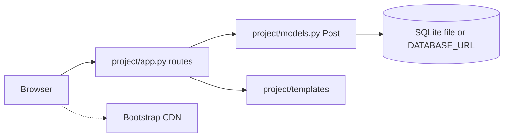
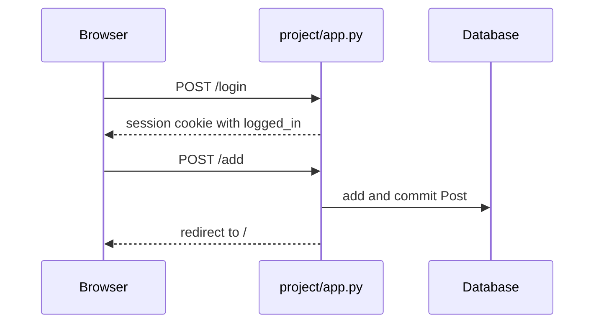
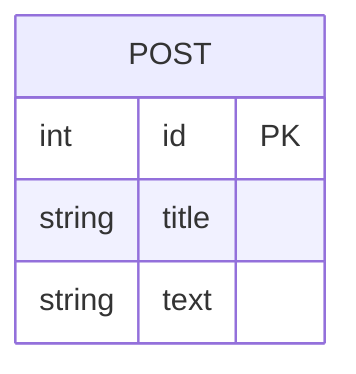

# flaskr-tdd Documentation
<!-- appdoc:template 2.7 -->

**Target:** flaskr-tdd | **Commit:** 305122f48823d98fd7fe8de989af2821b3c5d46d | **Evidence date:** 2026-11-23

**How to read this document.** *Cited* claims carry a path-and-line Citation. **Inferred:** marks reasoning from cited evidence. *Unknown* items are listed in section 14 and must not be assumed. Secret values are never reproduced; their locations are cited with "value omitted". The Evidence Register (source-to-claim audit) is rendered as Appendix A.

## 1. Application Index

| Support need | Primary screen or file | Workflow |
|---|---|---|
| A user cannot log in | `project/templates/login.html:25-27`, `project/app.py:75-88` | [7.1 Log in and log out](#71-log-in-and-log-out) |
| An entry will not post (HTTP 401) | `project/app.py:63-72` | [7.2 Post an entry](#72-post-an-entry) |
| An entry disappeared or will not delete | `project/app.py:99-112`, `project/static/main.js:8-20` | [7.3 Delete an entry](#73-delete-an-entry) |
| Search shows nothing | `project/templates/search.html:51-58`, `project/app.py:115-121` | [7.4 Browse and search entries](#74-browse-and-search-entries) |
| The database file or table is missing | `create_db.py:7-12`, `project/app.py:26-31` | [7.5 Initialize the database](#75-initialize-the-database) |
| Where credentials and the session key live | `project/app.py:22-25` (values omitted) | [7.1 Log in and log out](#71-log-in-and-log-out) |
| How to run the tests | `tests/app_test.py:11-21`, `.github/workflows/main.yml:27-29` | [Section 17](#17-build-run-and-test-locally) |

## 2. Coverage and Overview

### 2.1 What was inspected

Not read: the binary images `flaskr-app.png` and `tdd.png`, and `project/static/style.css` (styling only). The database files `project/flaskr.db` and `test.db` were opened read-only with the SQLite module and hold no rows (V-7). `README.md` is a long tutorial article; only the passages cited here were read. The extractor supports the python-flask stack and the facts-summary lists no unsupported stack, so no stack is named as unsupported. **Inferred:** from the scan-coverage block below, no folder was pruned, and the scan lists no folder that looks retired by name or that duplicates another folder, so there is no retired or duplicate-copy candidate to name here (`project/`, `tests/` and `.github/` are all live: the app is imported as `project.app:app` in `Procfile:1`, and CI runs the tests at `.github/workflows/main.yml:23-29`).

<!-- appdoc:generated scan-coverage -->
| Stack | Supported | Files read |
|---|---|---|
| python-flask | yes | 6 |

Files found: 23 = scanned 23 + pruned 0 + ignored by .appdocignore 0.

| Top folder | Files scanned |
|---|---|
| `project/` | 9 |
| `.github/` | 2 |
| `tests/` | 2 |

No folders were pruned.
<!-- /appdoc:generated scan-coverage -->

### 2.2 Purpose and users

The Target is Flaskr, a small blog-like web app built as a test-driven-development tutorial for Flask, with a little JavaScript and a Heroku deployment (`README.md:3`). Anyone can read entries and search; a single configured account can post and delete entries (`project/app.py:56-121`). No owner context file exists (no appdoc-context.md file is in the Target), so the real production users are Unknown - see Open questions (Q-1). The risk posture is poor for any real deployment: the hardcoded credentials and session key (V-1, V-2), stored XSS (V-3) and delete-by-GET (V-4) are the most severe 10.1 findings.


### 2.3 System boundary

Inside the Target: one Flask application module (`project/app.py:36-40`), one SQLAlchemy model (`project/models.py:4-7`), three Jinja templates (`project/templates/index.html`, `project/templates/search.html`, `project/templates/login.html`), one static script (`project/static/main.js:1-26`) and a pytest suite (`tests/app_test.py:1-88`). Outside: the database (SQLite file by default, or a server named in `DATABASE_URL`; `project/app.py:26-31`), the Bootstrap stylesheet that each page loads from a public CDN in the visitor's browser (`project/templates/index.html:8`), and the Heroku platform that the README deploys to (`README.md:1082-1083`). No other external system is called from source (see 8.3).


## 3. Architecture

### 3.1 Components

- `project/app.py` is the whole web tier: configuration constants (`project/app.py:21-32`), the Flask app and SQLAlchemy handle (`project/app.py:36-40`), the `login_required` decorator (`project/app.py:45-53`) and every route (`project/app.py:56-121`).
- `project/models.py` defines the single `Post` model (`project/models.py:4-7`).
- `project/templates/` holds the three pages; `project/static/main.js` adds click-to-delete in the browser (`project/static/main.js:8-20`).
- `create_db.py` creates the tables outside the web process (`create_db.py:7-9`).
- `tests/app_test.py` is the pytest suite and is test code, not application behavior (`tests/app_test.py:11-88`).
- `Procfile` starts the app under gunicorn (`Procfile:1`).

### 3.2 Diagram



Caption: component view of the Target; the app creates the handle at `project/app.py:40`, the model at `project/models.py:4`, and the page loads the CDN at `project/templates/index.html:8`.

### 3.3 Authentication and authorization

Authentication is a single configured username and password compared with `!=` against the form fields (`project/app.py:80-83`); success sets the session key `logged_in` (`project/app.py:85`) and logout removes it (`project/app.py:94`). Authorization is the presence of that session key, checked in two different ways: the `login_required` decorator returns a JSON 401 (`project/app.py:48-50`) and is used only on `/delete/<int:post_id>` (`project/app.py:99-101`); `/add` repeats the check inline and aborts with Flask's default 401 response (`project/app.py:66-67`). The session is Flask's signed cookie, signed with the key from `project/app.py:25` (value omitted).

## 4. Functional Inventory

<!-- appdoc:generated entry-points -->
1 route handler file; 7 routes; 0 pages; 0 commands; 0 jobs.

| Handler file | Kinds | Routes | Pages | Jobs | Commands |
|---|---|---|---|---|---|
| `project/app.py` | route | 7 | 0 | 0 | 0 |
<!-- /appdoc:generated entry-points -->

| ID | Area | Feature | Entry point | Inputs, outputs and rules | Dependencies | Status |
|---|---|---|---|---|---|---|
| F-1 | Entry listing | List every entry on the home page | `GET /` handled by `index` (`project/app.py:56-60`) | No input; renders all `Post` rows, or the text "No entries yet. Add some!" when there are none (`project/templates/index.html:71-78`) | `project/models.py:4`, `project/templates/index.html` | Cited |
| F-2 | Entry posting | Add an entry | `POST /add` handled by `add_entry` (`project/app.py:63-72`) | Form fields `title` and `text`; 401 unless the session is logged in; redirects to `/` with a flash message (`project/app.py:66-72`) | `project/models.py:4-11` | Cited |
| F-3 | Authentication | Log in | `GET` and `POST /login` handled by `login` (`project/app.py:75-88`) | Form fields `username` and `password`; error "Invalid username" or "Invalid password", else session flag set and redirect (`project/app.py:80-87`) | `project/templates/login.html` | Cited |
| F-4 | Authentication | Log out | `GET /logout` handled by `logout` (`project/app.py:91-96`) | No input; clears the session flag, flashes, redirects to `/` (`project/app.py:94-96`) | none | Cited |
| F-5 | Entry deletion | Delete an entry | `GET /delete/<int:post_id>` handled by `delete_entry` (`project/app.py:99-112`) | Integer id in the path; returns JSON `status` 1 and "Post Deleted", or `status` 0 with the exception text (`project/app.py:103-112`); the browser calls it when an entry is clicked (`project/static/main.js:8-20`) | `project/models.py:4`, `project/static/main.js` | Cited |
| F-6 | Search | Search entries | `GET /search/` handled by `search` (`project/app.py:115-121`) | Query parameter `query`; the page filters title and text case-insensitively in the template (`project/templates/search.html:51-52`) | `project/templates/search.html` | Cited |
| F-7 | Database initialization | Create the tables | `python create_db.py` (not a route; `create_db.py:7-9`) | No input; calls `db.create_all()` inside an app context (`create_db.py:9`) | `project/app.py:40` | Cited |

### 4.1 Subsystem inventory

The table lists <!-- appdoc:count F -->7<!-- /appdoc:count --> features across the folders below (`project/app.py:56-121`, `create_db.py:7-9`).

| Subsystem | Files | Features | Primary data and dependencies | Purpose | Status |
|---|---|---|---|---|---|
| `project/` | 9 | F-1, F-2, F-3, F-4, F-5, F-6 | SQLAlchemy, Flask (`requirements.txt:1-2`) | Web app, model, templates, static script (`project/app.py:36`) | Cited |
| `(root)` | 10 | F-7 | pip requirements, Procfile (`requirements.txt:1-8`, `Procfile:1`) | Setup, deployment and tutorial files (`create_db.py:7-12`, `Procfile:1`) | Cited |
| `tests/` | 2 | F-1, F-2, F-3, F-4, F-5 | pytest (`requirements.txt:8`) | Automated tests (`tests/app_test.py:38-88`) | Cited |
| `.github/` | 2 | none | GitHub Actions (`.github/workflows/main.yml:3-29`) | CI workflow and a funding file (`.github/workflows/main.yml:1`) | Cited |

## 5. Roles and Access Model

### 5.1 Observed role concepts

No named roles exist. There are two states: an anonymous visitor, and a session with `logged_in` set, which is the only privilege level and is granted to the one configured account (`project/app.py:23-24`, `project/app.py:85`). The templates branch on `session.logged_in` to show the post form and the log out link (`project/templates/index.html:19-27`, `project/templates/index.html:35`).

### 5.2 Authorization enforcement

Enforced in code at two places: the `login_required` decorator on `/delete/<int:post_id>` (`project/app.py:99-101`) and an inline check in `/add` (`project/app.py:66-67`). The routes `/`, `/login`, `/logout` and `/search/` have no check and are public (`project/app.py:56`, `project/app.py:75`, `project/app.py:91`, `project/app.py:115`). Hiding the form in the template is not enforcement (`project/templates/index.html:35`). The decorator and the inline check agree on the rule but fail differently: JSON 401 against Flask's default 401 response from `abort(401)` (`project/app.py:50`, `project/app.py:67`). The decorator also calls `flash` before returning JSON (`project/app.py:49`), so that message is queued for the next rendered page.

### 5.3 Role-to-capability matrix

| Capability | Anonymous | Logged-in session |
|---|---|---|
| Entry listing | Y (`project/app.py:56-60`) | Y (`project/app.py:56-60`) |
| Entry posting | blank (`project/app.py:66-67`) | Y (`project/app.py:68-72`) |
| Authentication | Y, log in and out are public (`project/app.py:75-96`) | Y (`project/app.py:75-96`) |
| Entry deletion | blank (`project/app.py:48-50`) | Y (`project/app.py:104-112`) |
| Search | Y (`project/app.py:115-121`) | Y (`project/app.py:115-121`) |
| Database initialization | blank, no route exists (`create_db.py:7-9`) | blank, no route exists (`create_db.py:7-9`) |
| Rows a role must not have: edit an entry | blank, no edit route exists (`project/app.py:56-121`) | blank, no edit route exists (`project/app.py:56-121`) |

**Restriction:** do not infer a permission from a visible control or a granted scope; enforcement is the code cited in 5.2.

## 6. UI Catalog

Source-only catalog; no screenshots or live session. All <!-- appdoc:count UI -->3<!-- /appdoc:count --> templates are catalogued (`project/templates/index.html`, `project/templates/search.html`, `project/templates/login.html`).

| ID | Page | Route or entry | Reached from | Visible controls and data | States and effects | Roles and evidence |
|---|---|---|---|---|---|---|
| UI-1 | Home | `/` (`project/app.py:56-60`) | Direct URL, the Home button on search, redirects after post, login and logout (`project/templates/search.html:17-19`) | Search button, log in or log out button, flash messages, post form when logged in, list of entries (`project/templates/index.html:17-79`) | Empty list text (`project/templates/index.html:77`); clicking an entry deletes it for a logged-in user through `project/static/main.js:8-20`; entry text is rendered unescaped (`project/templates/index.html:74`) | Anonymous sees the list; the form needs a session (`project/templates/index.html:35`) |
| UI-2 | Search | `/search/` (`project/app.py:115-121`) | Search button on UI-1 (`project/templates/index.html:17`) | Query box and Search button, matching entries (`project/templates/search.html:39-58`) | Without a query the template gets no entries and shows none (`project/app.py:121`) | Public (`project/app.py:115`) |
| UI-3 | Login | `/login` (`project/app.py:75-88`) | log in button on UI-1 and UI-2 (`project/templates/index.html:20`) | Username and password fields, error box, a hint line that prints the default credential (value omitted) (`project/templates/login.html:25-27`, `project/templates/login.html:53`) | Error text from the route (`project/app.py:81`, `project/app.py:83`) | Public (`project/app.py:75`) |

## 7. Workflows

### 7.1 Log in and log out

1. The visitor opens `/login`; a GET renders the form (`project/app.py:88`, `project/templates/login.html:31-52`).
2. On POST the route compares `username` then `password` with the configured values and sets `error` to "Invalid username" or "Invalid password" (`project/app.py:80-83`).
3. On a match it sets `session["logged_in"]`, flashes "You were logged in" and redirects to `/` (`project/app.py:85-87`).
4. `GET /logout` removes the flag, flashes "You were logged out" and redirects (`project/app.py:94-96`).
5. The tests exercise all four outcomes (`tests/app_test.py:55-64`).

Failure and escalation: a wrong value re-renders the form with an error and status 200, with no lockout or throttle (`project/app.py:80-88`); if the configured account must change, a source edit and redeploy is the only path, because only `DATABASE_URL` is read from the environment (`project/app.py:22-26`).

### 7.2 Post an entry

1. A logged-in user fills the form on `/` (`project/templates/index.html:36-65`).
2. `POST /add` aborts with 401 when the session flag is absent (`project/app.py:66-67`).
3. Otherwise it builds a `Post` from `title` and `text`, adds, commits, flashes and redirects (`project/app.py:68-72`, `project/models.py:9-11`).
4. A missing form field raises a 400 from Flask's form access, an empty string is accepted; both are **Inferred:** from `request.form[...]` indexing (`project/app.py:68`) and the non-null columns (`project/models.py:6-7`).
5. The test posts markup and asserts the title is escaped but the text is not (`tests/app_test.py:67-77`).

Failure and escalation: an anonymous POST gets 401 (`project/app.py:66-67`); a database error is not caught here, so Flask returns a 500 (`project/app.py:69-70`); escalate to the database owner if commits keep failing (Q-1).

### 7.3 Delete an entry

1. In the browser, clicking an `entry` element reads the `h2` id and calls `GET /delete/<id>` with `fetch` (`project/static/main.js:8-11`).
2. `login_required` returns a JSON 401 if the session flag is absent (`project/app.py:48-50`).
3. The route deletes the row with that id and commits (`project/app.py:106-107`), flashes, and returns `{"status": 1, "message": "Post Deleted"}` (`project/app.py:108-112`); the script then reloads the page (`project/static/main.js:20`).
4. Deleting an id that does not exist still returns status 1 because the delete matches zero rows without error (`project/app.py:106-108`); the test deletes id 1 on an empty database and expects status 1 (`tests/app_test.py:80-88`).

Failure and escalation: any exception is returned to the caller as the exception text with status 0 (`project/app.py:110-112`, see V-6); the script ignores status 0 and only reloads (`project/static/main.js:14-20`), so a user sees no error; check the application log and database availability (Q-1).

### 7.4 Browse and search entries

1. `GET /` lists every `Post` (`project/app.py:59-60`).
2. `GET /search/?query=...` passes all rows and the query to the template, which keeps rows whose title or text contains the query, ignoring case (`project/app.py:117-120`, `project/templates/search.html:51-52`).
3. With no query, or an empty one, the page renders with no results (`project/app.py:121`).
4. **Inferred:** the matching entries print `entry.post_id` as the heading id, but the model has no such attribute (`project/templates/search.html:54`, `project/models.py:5`), so the id renders empty and click-to-delete on search results builds a bad URL (`project/static/main.js:10-11`).

Failure and escalation: filtering happens in the template after loading every row, so a large table slows the page (`project/app.py:118`, `project/templates/search.html:51`); there is no error branch to escalate from (`project/app.py:115-121`).

### 7.5 Initialize the database

1. An operator runs `python create_db.py` from the Target root (`README.md:1421`).
2. The script imports the app, opens an app context, calls `db.create_all()` and commits (`create_db.py:7-12`).
3. The target is the SQLite file `project/flaskr.db` unless `DATABASE_URL` is set; a `postgres://` prefix is rewritten to `postgresql://` (`project/app.py:26-29`).

Failure and escalation: the script has no error handling, so a connection error shows as a Python traceback (`create_db.py:7-12`); escalate to the database owner if the connection string is correct and it still fails (Q-1).

## 8. Data and Integrations

### 8.1 Connections

| ID | Name | Kind | Configured at | Used by |
|---|---|---|---|---|
| C-1 | Application database (SQLite file by default, or the server named by `DATABASE_URL`) | SQL database through SQLAlchemy | `project/app.py:26-31`, `project/app.py:40` | F-1, F-2, F-5, F-6, F-7 |

### 8.2 Stored procedures and SQL

No stored procedures and no hand-written SQL. Data access is the SQLAlchemy ORM through `db.session.query(models.Post)` (`project/app.py:59`, `project/app.py:106`, `project/app.py:118`) and `db.session.add` (`project/app.py:69`). The `psycopg2-binary` dependency is the Postgres driver (`requirements.txt:4`).

### 8.3 External calls

The server makes no outbound calls (the extractor found none and `project/app.py:1-125` imports no HTTP client). The only external call is made by the visitor's browser (X-1).

| ID | Call | Direction | Caller | Notes |
|---|---|---|---|---|
| X-1 | Bootstrap 5.3.2 stylesheet from `cdn.jsdelivr.net` | Outbound from the visitor's browser | `project/templates/index.html:8`, `project/templates/search.html:8`, `project/templates/login.html:8` | No integrity attribute on the link, so the page trusts whatever the CDN serves (`project/templates/index.html:5-9`) |

### 8.4 Data entities and sensitivity

| Entity | Key fields | Defined at | Sensitivity |
|---|---|---|---|
| `Post` | `id`, `title`, `text` | `project/models.py:4-7` | Public blog content; `text` is rendered as raw HTML (`project/templates/index.html:74`) |

| Field | Type | Null | Key/FK | Sensitivity | Citation |
|---|---|---|---|---|---|
| `id` | Integer | No (primary key) | Primary key | Public | `project/models.py:5` |
| `title` | String | No | none | Public | `project/models.py:6` |
| `text` | String | No | none | Public, may hold HTML or script | `project/models.py:7` |

There is no user table: the one account is two constants in source (`project/app.py:23-24`, values omitted).

### 8.5 Failure, fallback and observability

| ID | Timeout and retry | On failure | Observability |
|---|---|---|---|
| C-1 | None configured; no timeout or retry in source (`project/app.py:36-40`) | Reads fail with a Flask 500; `/delete` catches exceptions and returns them as JSON (`project/app.py:110-112`); `/add` does not catch (`project/app.py:69-70`) | None: no logging calls in `project/app.py:1-125`; Flask and gunicorn defaults apply |
| X-1 | None; the browser decides | The page renders unstyled if the CDN is unreachable (**Inferred:** from the stylesheet being the only CSS framework, `project/templates/index.html:5-9`) | None in source |

## 9. Troubleshooting Matrix

| Symptom | Checks | Known response | Escalate when |
|---|---|---|---|
| "Invalid username" on the login page | Compare the typed name with the configured one (`project/app.py:80-81`) | Retype; the configured name is in source (value omitted) | Never: there is no other account source to check (`project/app.py:23`) |
| "Invalid password" on the login page | Compare the typed password with the configured one (`project/app.py:82-83`) | Retype; if the source value was changed, redeploy | The deployed value is not the source value (Q-3) |
| "You were logged in" / "You were logged out" shown | Normal confirmation (`project/app.py:86`, `project/app.py:95`) | None needed | Not applicable; informational only |
| "Please log in." with HTTP 401 and JSON `status` 0 on delete | Session cookie present and `logged_in` set (`project/app.py:48-50`) | Log in again, then retry | Login succeeds but the 401 persists: **Inferred:** the key is a source constant, so normally identical in every worker (`project/app.py:25`); confirm no deployed override of the key (Q-3) |
| HTTP 401 with Flask's default Unauthorized response when posting | Session flag missing (`project/app.py:66-67`) | Log in, then post again | Same trigger as the row above |
| "New entry was successfully posted" missing after a post | The flash is shown on the next page render (`project/app.py:71-72`, `project/templates/index.html:31-34`) | Reload `/` | The entry is also absent from the list: check the database (`project/app.py:69-70`) |
| "The entry was deleted." with the entry still visible | Delete returned status 1 for a missing id (`project/app.py:106-109`) | Reload; verify the id | The id exists and the row remains: check the database commit (`project/app.py:107`) |
| Delete returns status 0 and a message starting with the exception class | The text is `repr` of the exception (`project/app.py:110-111`) | Read the exception text | After one retry, escalate to the database owner |
| "No entries yet. Add some!" | The table is empty or the wrong database is in use (`project/templates/index.html:77`, `project/app.py:26-31`) | Check `DATABASE_URL` | The expected data is missing in the intended database |
| Search page lists nothing | A query was sent and matches nothing, or no query was sent (`project/app.py:119-121`) | Try another term | A known entry never matches: check the entry text (`project/templates/search.html:51-52`) |

## 10. Security and Operational Risks

### 10.1 Verified findings

This section lists <!-- appdoc:count V -->7<!-- /appdoc:count --> findings, ordered by severity (`project/app.py:23-25`).

| ID | Severity | Finding | Evidence | Impact |
|---|---|---|---|---|
| V-1 | Critical | The only account has a hardcoded default username and password in source, and the login page prints the credential hint (values omitted) | `project/app.py:23-24`, `project/templates/login.html:53` | Critical because anyone who can reach `/login` can log in with no prior access in the default configuration, and the configuration is not overridable from the environment (`project/app.py:22-26`); a logged-in session can post and delete (`project/app.py:66-67`, `project/app.py:99-101`) |
| V-2 | Critical | The session signing key is a hardcoded constant (value omitted), so session cookies can be forged | `project/app.py:25`, `project/app.py:38` | Critical because Flask trusts any cookie signed with that key, so an attacker who knows the published default can craft a cookie with `logged_in` set and skip the login form (`project/app.py:48`, `project/app.py:66`); this holds as long as the deployed key equals the source default (Q-3) |
| V-3 | High | Entry text is written to pages with the Jinja `\|safe` filter, so stored markup and script run in every visitor's browser | `project/templates/index.html:74`, `project/templates/search.html:55`, `tests/app_test.py:77` | High because it needs a logged-in session to post (`project/app.py:66-67`), which V-1 and V-2 make easy to obtain; the test shows raw HTML is intended to be kept (`tests/app_test.py:76-77`) |
| V-4 | Medium | The delete action is a GET route and the browser deletes on any click of an entry | `project/app.py:99-101`, `project/static/main.js:8-11` | Medium because it needs a logged-in victim: a link, image or prefetch to `/delete/<id>` deletes data (no CSRF token, 10.2), and an accidental click on a listed entry deletes it |
| V-5 | Low | Login returns different messages for an unknown username and a wrong password | `project/app.py:80-83` | Low because the only account name is also shown on the login page (`project/templates/login.html:53`), so little is revealed; with more accounts it would allow username enumeration |
| V-6 | Low | The delete handler returns the raw exception text to the caller | `project/app.py:110-112` | Low: leaks internal class and message text to a logged-in caller only (`project/app.py:99-101`) |
| V-7 | Low | Database files are committed to the repository: `project/flaskr.db` is the default database path and `test.db` is tracked although `.gitignore` lists it | `project/app.py:22`, `.gitignore:5`, `test.db`, `project/flaskr.db` | Low hygiene: both files were opened read-only and hold no rows (`project/flaskr.db` has an empty `post` table; `test.db` has an empty `entries` table, an older schema than the `Post` model at `project/models.py:4-7`), so no data is exposed today, but a committed live database could carry data or leave a stale schema |

### 10.2 Unknowns that must not be treated as controls

| Control | Status | Where looked |
|---|---|---|
| TLS | Not established | No TLS setting in `project/app.py:21-32` or `Procfile:1`; termination is outside the repository (Q-1) |
| CSRF protection | Verified absent | No token in the forms (`project/templates/index.html:36-65`, `project/templates/login.html:31-52`) and no CSRF library in `requirements.txt:1-8` |
| MFA | Verified absent | Login checks one username and password only (`project/app.py:80-87`) |
| Session cookie flags | Not established | No `SESSION_COOKIE_*` key is set in `project/app.py:21-32`; Flask's defaults for 3.0.0 are **Inferred** from `requirements.txt:1` and not checked here |
| Rate limiting | Verified absent | No limiter in the dependencies (`requirements.txt:1-8`) or the login route (`project/app.py:75-88`) |
| Audit-log integrity | Verified absent | No logging or audit code in `project/app.py:1-100` or `project/app.py:101-125` |
| Backup and recovery | Not established | No backup script or job in the Target; see `Procfile:1` and `.github/workflows/main.yml:3-29` (Q-2) |
| Production secret management | Verified absent | Secrets are source constants and only `DATABASE_URL` is read from the environment (`project/app.py:22-26`) |
| Authentication on state changes | Present | `/add` and `/delete` check the session (`project/app.py:66-67`, `project/app.py:99-101`) |

## 11. Ownership and Maintenance

| Area | Evidence | Status |
|---|---|---|
| Business owner | Unknown; no owner file and no appdoc-context.md file; the licence names a copyright holder only (`LICENSE:3`) | Unknown |
| Technical owner | Unknown; no CODEOWNERS or MAINTAINERS file; git history is shallow so authorship is not available | Unknown |
| Process owner | Unknown; no ownership file in the Target | Unknown |
| Data and integration owners | Unknown; the database and CDN owners are not named (`project/app.py:26-31`, `project/templates/index.html:8`) | Unknown |
| Documentation owner | Unknown; `README.md` is the tutorial text and names no owner (`README.md:1-3`) | Unknown |
| Release and change process | CI runs lint and tests on every push (`.github/workflows/main.yml:3`, `.github/workflows/main.yml:23-29`); deploy is `git push heroku main` per the README (`README.md:1083`) | Cited |
| Test suite `tests/app_test.py` | Covers F-1 (`tests/app_test.py:38-52`), F-3 and F-4 (`tests/app_test.py:55-64`), F-2 (`tests/app_test.py:67-77`) and F-5 (`tests/app_test.py:80-88`); no test covers F-6 or F-7, and none asserts on V-1 to V-7 as defects | Cited |

Recommended maintenance minimum:

- Keep `requirements.txt` pins current and run the CI workflow on every change (`requirements.txt:1-8`, `.github/workflows/main.yml:3`).
- Name a technical owner and record who deploys (Q-5).
- Move the credentials and session key out of source (R-1, R-2).

## 12. Architecture and Data-Flow Diagrams



Caption: log in then post an entry; `project/app.py:75-87` and `project/app.py:63-72`.



Caption: the only entity; `project/models.py:4-7`.

## 13. Glossary

| Term | Meaning | Citation |
|---|---|---|
| Flaskr | The blog-like tutorial application | `README.md:3` |
| Entry | A blog item, stored as a `Post` row and shown as an `entry` list item | `project/templates/index.html:71-75` |
| Post | The SQLAlchemy model with `id`, `title`, `text` | `project/models.py:4-7` |
| `logged_in` | The session key that marks an authenticated user | `project/app.py:85` |
| `login_required` | Decorator that returns JSON 401 without the session key | `project/app.py:45-53` |
| Flash message | One-time message shown on the next rendered page | `project/app.py:71` |
| `DATABASE_URL` | The only environment variable the app reads; sets the database | `project/app.py:26` |
| `SECRET_KEY` | Flask session signing key, a source constant (value omitted) | `project/app.py:25` |
| `Procfile` | Heroku process file that runs gunicorn | `Procfile:1` |
| `create_db.py` | Script that creates the tables | `create_db.py:7-12` |
| Bootstrap | CSS framework loaded from a CDN | `project/templates/index.html:8` |

## 14. Open Questions and Documentation Gaps

Open: <!-- appdoc:count Q -->5<!-- /appdoc:count --> questions.

| ID | Question | Why it matters | How to close | Owner | Priority |
|---|---|---|---|---|---|
| Q-1 | Where, if anywhere, is this deployed, behind what TLS terminator, and who deploys it? | The risk in V-1 to V-3 depends on whether it is internet-facing; `Procfile:1` and `README.md:1083` show only a Heroku path | Ask the owner for the environments and the deploy account | Unknown | High |
| Q-2 | How are backup, restore, rollback and upgrade done for the database? | No procedure or script is in the Target (16.5, 10.2 backup and recovery) | Ask the database owner; add a runbook | Unknown | Medium |
| Q-3 | Does any deployed environment run with the source credentials and session key, or are they patched at deploy time? | Decides whether V-1 and V-2 are live; only `DATABASE_URL` is read from the environment (`project/app.py:22-26`) | Inspect the deployed configuration | Unknown | High |
| Q-5 | Who owns the application, its data and its documentation? | No owner file or owner context exists | Add an appdoc-context.md file or a CODEOWNERS file | Unknown | Medium |
| Q-6 | What are the secret rotation steps for the credentials and session key? | They are source constants, so rotation means a code change (`project/app.py:23-25`) | Define the process once V-1 and V-2 are fixed | Unknown | Medium |

<!-- appdoc:generated closed-questions -->
Closed by the audit and answered in the body: Q-4 (10.1).
<!-- /appdoc:generated closed-questions -->

## 15. Recommendations

<!-- appdoc:count R -->12<!-- /appdoc:count --> recommendations, most severe first.

| ID | Severity | Effort | Recommendation | Addresses |
|---|---|---|---|---|
| R-1 | Critical | S | Read the username and password from the environment, require them to be set, and remove the hint line from `project/templates/login.html:53` | V-1, Production secret management |
| R-2 | Critical | S | Read `SECRET_KEY` from the environment and refuse to start with the default (`project/app.py:25`) | V-2, Q-3 |
| R-3 | High | S | Remove `\|safe` or sanitize entry text before storing it (`project/templates/index.html:74`, `project/templates/search.html:55`) | V-3 |
| R-4 | Medium | M | Make delete a POST with a CSRF token, and stop deleting on a plain click (`project/app.py:99`, `project/static/main.js:8`) | V-4, CSRF protection |
| R-5 | Medium | M | Set cookie flags explicitly and serve only over TLS | Session cookie flags, TLS |
| R-6 | Medium | M | Add login rate limiting and, if the app is kept, MFA | Rate limiting, MFA |
| R-7 | Medium | M | Write and test a backup, restore and rollback procedure | Backup and recovery, Q-2 |
| R-8 | Medium | S | Confirm the deployed environment and the real credentials in use | Q-1, Q-3 |
| R-9 | Low | S | Return one login error and a generic delete error; log the detail | V-5, V-6 |
| R-10 | Low | S | Remove the committed database files from git (both hold no rows, V-7) | V-7 |
| R-11 | Low | S | Add logging of logins and deletes | Audit-log integrity |
| R-12 | Low | S | Name owners and a secret-rotation step | Q-5, Q-6 |

### 15.1 Coverage summary

This document was written from the extracted Facts and from reading `project/app.py`, `project/models.py`, the three templates, `project/static/main.js`, `create_db.py`, `tests/app_test.py`, `Procfile`, `runtime.txt`, `requirements.txt` and `.github/workflows/main.yml`. An independent auditor (a fresh agent that had no writer notes) performed the source-to-claim audit on 2026-11-23: it read every planned finding, workflow, open question and finding candidate and the tool-chosen sample of sections 4, 6, 8, 9, 15, 16 and 17 against the cited lines and the surrounding code, and recorded the results in the register (Appendix A). Generated blocks and the two diagrams were not audited. The audit found three Corrected claims (fixed in sections 6, 16.1 and 17), one Downgraded claim (the Escalate cell in section 9, now marked Inferred), one Answerable question (the database file contents, answered in 10.1) and one Dismissed finding candidate; everything else audited was Supported. Not inspected: the PNG images, `project/static/style.css`, most of `README.md`, and any running instance. A reader must confirm the deployed credentials, key and TLS setup (Q-1, Q-3) before relying on the severity ratings.

## 16. Operations Runbook

### 16.1 Platform requirements

Python 3.12.0 is the pinned runtime (`runtime.txt:1`); CI also tests 3.8 to 3.12 (`.github/workflows/main.yml:11`). Flask 3.0.0, Flask-SQLAlchemy 3.1.1, gunicorn 21.2.0 and psycopg2-binary 2.9.9 are pinned, with black, flake8 and pytest for development (`requirements.txt:1-8`).

### 16.2 Data stores

C-1 is a SQLite file named `flaskr.db` next to `project/app.py` unless `DATABASE_URL` is set (`project/app.py:22`, `project/app.py:26`). Tables are created by `python create_db.py` (`create_db.py:9`); there are no migrations and no seed data in source. The tests use a separate `test.db` created and dropped by the fixture (`tests/app_test.py:11-21`).

### 16.3 Session and authentication behavior

Sessions use Flask's default signed cookie; the key is in `project/app.py:25` (value omitted). No lifetime, permanence or cookie-flag setting appears in `project/app.py:21-32`, so Flask's own defaults apply (Unknown - see Open questions, 10.2). There is one account (`project/app.py:23-24`, values omitted) and no logout other than `GET /logout` (`project/app.py:91-96`).

### 16.4 Known failure modes and operator responses

| Failure mode | Signal | Operator response |
|---|---|---|
| Database file missing or tables not created | Flask 500 on `/` (**Inferred:** the query at `project/app.py:59` fails) | Run `python create_db.py` (`create_db.py:7-9`) |
| Postgres URL with the old scheme | `postgres://` is rewritten automatically (`project/app.py:28-29`) | No action |
| Delete fails | JSON `status` 0 and the exception text (`project/app.py:110-112`) | Check database health and retry once |
| Users logged out after a restart or on another worker | Different `SECRET_KEY` per process (**Inferred:** from `project/app.py:25` being a constant, so normally identical) | Confirm the key is identical everywhere |

### 16.5 Deployment and change process

| Step | Procedure | Evidence |
|---|---|---|
| Build | None: nothing to compile; lint with flake8 and black runs in CI | `.github/workflows/main.yml:23-26` |
| Test | `python -m pytest` in the CI job named `build` | `.github/workflows/main.yml:6`, `.github/workflows/main.yml:27-29` |
| Deploy | Heroku with `git push heroku main`; the process is `gunicorn project.app:app` | `README.md:1083`, `Procfile:1` |
| Upgrade | Unknown - see Open questions (Q-2) | Not shown in the repository |
| Rollback | Unknown - see Open questions (Q-2) | Not shown in the repository |
| Backup | Unknown - see Open questions (Q-2) | Not shown in the repository |
| Restore | Unknown - see Open questions (Q-2) | Not shown in the repository |
| Secret rotation | Unknown - see Open questions (Q-6); secrets are source constants | `project/app.py:23-25` |

### 16.6 Configuration reference

<!-- appdoc:generated config-reference -->
| Key | Defined at | Secret location |
|---|---|---|
| PASSWORD | `project/app.py:24` | yes |
| SECRET_KEY | `project/app.py:25` | yes |
| DATABASE | `project/app.py:22` | no |
| USERNAME | `project/app.py:23` | no |
| SQLALCHEMY_DATABASE_URI | `project/app.py:31` | no |
| SQLALCHEMY_TRACK_MODIFICATIONS | `project/app.py:32` | no |

Shown 6 of 6 application keys.

1 env-var key and 8 CI keys are excluded from the application table (see facts.json).
<!-- /appdoc:generated config-reference -->

| Key | Effect | Evidence |
|---|---|---|
| `PASSWORD` | Compared with the submitted password at login (V-1) | `project/app.py:24`, `project/app.py:82` |
| `USERNAME` | Compared with the submitted username at login (V-1) | `project/app.py:23`, `project/app.py:80` |
| `SECRET_KEY` | Signs the session cookie (V-2) | `project/app.py:25` |
| `DATABASE_URL` | Selects the database; the only environment-driven setting | `project/app.py:26` |
| `SQLALCHEMY_DATABASE_URI` | The URI Flask-SQLAlchemy uses, set from `DATABASE_URL` or the SQLite default | `project/app.py:31` |

### 16.7 Scheduled and background jobs

<!-- appdoc:generated scheduled-jobs -->
No scheduled or background jobs were extracted. Stacks that report jobs: `python-flask`.
<!-- /appdoc:generated scheduled-jobs -->

No scheduled or background job exists in source; the only workflow trigger is a push to the repository (`.github/workflows/main.yml:3`).

## 17. Build, Run and Test Locally

| Step | Command | Working directory | Evidence |
|---|---|---|---|
| Prerequisites | Not applicable | `.` | No command is defined; the pinned runtime is `runtime.txt:1` and the CI Python matrix is `.github/workflows/main.yml:11` |
| Restore dependencies | `pip install -r requirements.txt` | `.` | `.github/workflows/main.yml:22` |
| Build | Not applicable | `.` | `Procfile:1` runs the source directly with no compile step |
| Run | `FLASK_APP=project/app.py python -m flask run -p 5001` | `.` | `README.md:216`, `README.md:1263`, `Procfile:1` |
| Test | `python -m pytest` | `.` | `.github/workflows/main.yml:29`, `tests/app_test.py:45` |

Python 3.12.0 is pinned (`runtime.txt:1`) and 3.8 to 3.12 run in CI (`.github/workflows/main.yml:11`). Before the first run, create the tables with `python create_db.py` (`README.md:1421`); production uses `gunicorn project.app:app` (`Procfile:1`). `tests/app_test.py:45` checks `test.db` relative to the current directory, so run the tests from the Target root.

## Appendix A. Evidence Register and Verification

<!-- appdoc:generated appendix-a -->
### A.1 Audit state

**Auditor:** independent. **Scope:** fresh agent with no writer notes; opened every cited span in the Target and read the surrounding handler, template, script, test and workflow code, including callers, to judge support rather than resolution; combined sections that allow only one live row per ref into one row with per-item notes; read the committed database files read-only with a SQLite client; generated blocks and diagrams were not audited

Generated blocks written by AppDoc 2.7.1 (bundle bf8cdbec967b).

Audited on 2026-11-24 with AppDoc 2.7.1 (bundle bf8cdbec967b).

`seal` writes `claim_sha` and `sealed_by` only on ID rows, workflow (7.x) and per-row section keys. Other section-level rows, Answerable rows and Dismissed rows are never sealed, so they carry no `sealed_by`. C17 `--strict` fails only on `sealed_by: upgrade`, never on an absent key.

Register rows cover: 4 F-1–F-7 (7 of 7) · 6 UI-1–UI-3 (3 of 3) · 8.1 C-1 (1 of 1) · 8.3 X-1 (1 of 1) · 10.1 V-1–V-7 (7 of 7) · 14 Q-1–Q-3, Q-5, Q-6 (5 of 5) · 15 R-2–R-4, R-6–R-12 (10 of 12) · workflows 7.1–7.5 (5 of 5).

Not covered by the audit: 2.1: generated scan-coverage block is owned by the Check and fill, not audited; 3.2: diagram was not compared with source beyond its caption; 12: diagrams were not compared with source beyond their captions; 16.6: generated configuration reference block is owned by the Check and fill, not audited; 16.7: generated scheduled-jobs block is owned by the Check and fill, not audited.

Not audited: generated and opaque blocks (entry-points, scheduled-jobs, closed-questions, appendix-a)

### A.2 Coverage

70 rows (7 superseded). Current: 55 Supported, 5 Corrected, 1 Downgraded, 1 Dismissed, 1 Answerable. As first audited: 55 Supported, 5 Corrected, 1 Downgraded, 1 Dismissed, 1 Answerable. Each Supported or Corrected row's anchor text was found in its cited lines by the Check.

| Section | IDs with a register row |
|---|---|
| 4 | 7 of 7 |
| 6 | 3 of 3 |
| 8.1 | 1 of 1 |
| 8.3 | 1 of 1 |
| 10.1 | 7 of 7 |
| 14 | 5 of 5 |
| 15 | 10 of 12 |
| 7 (workflows) | 5 of 5 |

| Section | Planned | Audited | Extra |
|---|---|---|---|
| 10.1 | 7 | 7 | 0 |
| 7 | 5 | 5 | 0 |
| 14 | 5 | 5 | 1 |
| candidates | 0 | 0 | 1 |
| 10.2 | 1 | 1 | 1 |
| 16.5 | 3 | 3 | 1 |
| 17 | 3 | 3 | 1 |
| 4 | 5 | 5 | 2 |
| 6 | 3 | 3 | 0 |
| 8.1 | 1 | 1 | 0 |
| 8.3 | 1 | 1 | 0 |
| 9 | 5 | 5 | 6 |
| 15 | 5 | 5 | 5 |

### A.3 Register

| ID | Ref | Claim | Result | Cites | Limitation |
|---|---|---|---|---|---|
| E-1 | 10.1/V-1 | The only account is a hardcoded default username and password in source and the login page prints a credential hint; not overridable from the environment | Supported | `project/app.py:23-24` `project/app.py:22-26` `project/templates/login.html:53` | values omitted; the hint line at login.html:53 is a span that names the credential; only DATABASE_URL is read via os.getenv (app.py:26) |
| E-2 | 10.1/V-2 | The session signing key is a hardcoded constant loaded into app.config, so cookies signed with the published key are accepted | Supported | `project/app.py:25` `project/app.py:38` | value omitted; forgeability is Flask framework behavior, not shown in the Target; the deployed key is unknown (Q-3) |
| E-3 | 10.1/V-3 | Entry text is rendered with the Jinja safe filter in the home and search templates, and the test keeps raw HTML | Supported | `project/templates/index.html:74` `project/templates/search.html:55` `tests/app_test.py:76-77` | tests/app_test.py:77 asserts the raw strong tag is present in the response |
| E-4 | 10.1/V-4 | Delete is a GET route and the browser script calls it on any click of an entry | Supported | `project/app.py:99-101` `project/static/main.js:8-11` | no CSRF token in any form, consistent with 10.2 |
| E-5 | 10.1/V-5 | Login returns different messages for an unknown username and a wrong password | Supported | `project/app.py:80-83` | the account name is shown on the login page (login.html:53) |
| E-6 | 10.1/V-6 | The delete handler returns the raw exception repr to the caller | Supported | `project/app.py:110-112` | reachable only through the login_required decorator |
| E-7 | 10.1/V-7 | Database files are committed: project/flaskr.db is the default database path, test.db is tracked although .gitignore lists it | Supported (superseded by E-40) | `project/app.py:22` `.gitignore:5` | the cited lines show the default path and the ignore rule; tracking of both files was confirmed with git ls-files, which is outside the cited lines; both files were opened read-only: flaskr.db has an empty post table, test.db has an empty entries table (an older schema than the model), which supports the stale-schema remark |
| E-8 | 7.1 | Log in compares username then password, sets error text, sets session logged_in and flashes on success, logout removes it; no lockout; tests cover all outcomes | Supported | `project/app.py:80-88` `project/app.py:94-96` `tests/app_test.py:55-64` | status 200 on failure is Flask's default for render_template; no throttle code exists in the cited route |
| E-9 | 7.2 | POST /add aborts 401 without the session flag, otherwise builds a Post, commits, flashes and redirects; test posts markup and asserts the title escaped, text not | Supported | `project/app.py:66-72` `tests/app_test.py:67-77` `project/models.py:9-11` | the 400-on-missing-field and database-error 500 statements are marked Inferred in the document and are reasonable from request.form[...] indexing |
| E-10 | 7.3 | Delete: click reads the h2 id and calls GET /delete/id; login_required gives JSON 401; delete and commit then JSON status 1; missing id still gives status 1; exceptions return status 0 with the text; the script ignores status 0 and reloads | Supported | `project/static/main.js:8-20` `project/app.py:48-50` `project/app.py:103-112` `tests/app_test.py:80-88` | query.delete on zero rows does not raise (SQLAlchemy behavior; the test asserts status 1 on an empty database after login); the test first asserts status 0 when logged out |
| E-11 | 7.4 | GET / lists every Post; /search/ passes all rows and query to the template which filters case-insensitively; no query gives no results; the search heading prints entry.post_id which the model lacks | Supported | `project/app.py:59-60` `project/app.py:117-121` `project/templates/search.html:51-55` `project/models.py:5` | Jinja renders an undefined attribute as empty (framework behavior), correctly marked Inferred; main.js builds the URL from the h2 id (main.js:9-11) |
| E-12 | 7.5 | create_db.py imports the app, opens an app context, calls db.create_all and commits; default SQLite file unless DATABASE_URL; postgres:// is rewritten | Supported | `create_db.py:4-12` `project/app.py:26-29` `README.md:1421` | import is at create_db.py:4, one line outside the 7-12 span the document cites |
| E-13 | 14/Q-1 | Needs owner: source shows only a Heroku push in the README and a gunicorn Procfile; deployment environment, TLS terminator and deployer are not in the Target | Supported | `README.md:1083` `Procfile:1` | Needs owner; row recorded because the question is a planned ID |
| E-14 | 14/Q-2 | Needs owner: no backup, restore, rollback or upgrade job or script exists in the Target | Supported | `.github/workflows/main.yml:27-29` | Needs owner; a grep of the Target for backup, restore and rollback outside README and this document found none |
| E-15 | 14/Q-3 | Needs owner: source only reads DATABASE_URL from the environment; what runs in any deployed environment is not shown | Supported | `project/app.py:26` | Needs owner |
| E-16 | 14/Q-4 | The committed database files can be opened from the Target: both contain no rows (post table in flaskr.db, entries table in test.db) | Answerable | `project/app.py:22` `.gitignore:5` | opened read-only with a SQLite client; the writer should close Q-4 and state the contents in V-7 (answered_in 10.1), then reword R-10 which says to remove them after checking contents |
| E-17 | 14/Q-5 | Needs owner: no CODEOWNERS or MAINTAINERS file exists; the licence names only a copyright holder | Supported | `LICENSE:3` | Needs owner |
| E-18 | 14/Q-6 | Needs owner: credentials and session key are source constants, so no rotation process is shown in source | Supported | `project/app.py:23-25` | Needs owner; values omitted |
| E-19 | smell/a413b088 | Candidate in test code: the test asserts both login error texts | Dismissed |  | tests/app_test.py:62-64 is test code that exercises the behavior; it is not application behavior; the defect itself is V-5 at project/app.py:80-83 |
| E-20 | 10.2 | Authentication on state changes is Present: /add checks the session inline and /delete uses login_required | Supported | `project/app.py:66-67` `project/app.py:99-101` | only these two state-changing routes exist; login and logout are public by design |
| E-21 | 16.5 | Build has no compile step and CI runs flake8 and black; Test is python -m pytest in the CI job named build; Deploy is git push heroku main with the gunicorn Procfile process | Supported | `.github/workflows/main.yml:23-29` `README.md:1083` `Procfile:1` | job name build is at main.yml:6, outside the cited span; the Heroku deploy is the README tutorial's instruction, not an automated job (the document says per the README); the row's other items were not planned |
| E-22 | 17 | Prerequisites, Restore dependencies, Run and Test commands in section 17 | Corrected (superseded by E-41) | `runtime.txt:1` `.github/workflows/main.yml:11` `.github/workflows/main.yml:22` `.github/workflows/main.yml:29` `README.md:216` | Restore (main.yml:22), Run (README.md:216) and Test (main.yml:29) are supported. Prerequisites cites main.yml:3 which is the push trigger; the CI Python matrix is at main.yml:11. The Prerequisites command python --version is not defined in any cited line (runtime.txt:1 only pins the version). The note under the table that CI runs the Python version range cites no line; main.yml:11 supports it |
| E-23 | 16.1 | Python 3.12.0 is pinned and CI also tests the listed Python versions; dependency versions are pinned | Corrected (superseded by E-42) | `runtime.txt:1` `.github/workflows/main.yml:11` `requirements.txt:1-8` | the document cites main.yml:3 for the CI Python versions, which is the on: push line; the matrix is at main.yml:11; runtime and requirements claims are supported |
| E-24 | 4/F-1 | GET / handled by index lists all Post rows or the empty-state text | Supported | `project/app.py:56-60` `project/templates/index.html:71-78` |  |
| E-25 | 4/F-2 | POST /add handled by add_entry needs a session, reads title and text, redirects with a flash | Supported | `project/app.py:63-72` |  |
| E-26 | 4/F-3 | GET and POST /login handled by login, errors Invalid username or Invalid password, else session flag and redirect | Supported | `project/app.py:75-88` |  |
| E-27 | 4/F-4 | GET /logout clears the session flag, flashes and redirects to / | Supported | `project/app.py:91-96` |  |
| E-28 | 4/F-6 | GET /search/ handled by search takes query and the template filters title and text case-insensitively | Supported | `project/app.py:115-121` `project/templates/search.html:51-52` |  |
| E-29 | 6/UI-1 | Home page controls, empty text, click-to-delete and unescaped entry text; Reached from lists the Home button on search | Corrected (superseded by E-43) | `project/templates/index.html:17-79` `project/templates/search.html:17-19` | the document cites search.html:13 for the Home button, which is a line break; the Home link is at search.html:17-19. All other cells are supported |
| E-30 | 6/UI-2 | Search page route, query box, no-query shows no entries, public | Supported | `project/app.py:115-121` `project/templates/search.html:39-58` |  |
| E-31 | 6/UI-3 | Login page fields, error box and a hint line printing the default credential; error text from the route | Supported | `project/templates/login.html:25-27` `project/templates/login.html:53` `project/app.py:81` | values omitted; the hint is login.html:53 |
| E-32 | 8.1/C-1 | C-1 is the SQLAlchemy database, SQLite file by default or DATABASE_URL, used by F-1, F-2, F-5, F-6, F-7 | Supported | `project/app.py:26-31` `project/app.py:40` | F-3 and F-4 do not use it, correctly omitted |
| E-33 | 8.3/X-1 | X-1 Bootstrap 5.3.2 stylesheet from cdn.jsdelivr.net loaded by the visitor's browser in the three templates, no integrity attribute | Supported | `project/templates/index.html:5-9` `project/templates/search.html:8` `project/templates/login.html:8` | absence of an integrity attribute read in the link element |
| E-34 | 9 | Troubleshooting rows: Invalid username, Invalid password, Please log in with 401 and status 0 on delete, post flash missing, search lists nothing | Downgraded (superseded by E-44) | `project/app.py:80-83` `project/app.py:48-50` `project/app.py:71-72` `project/templates/index.html:31-34` `project/app.py:119-121` | four of the five rows are supported. In the Please log in row the Escalate cell (same SECRET_KEY across every gunicorn worker and release, cited app.py:25) is unsupported as a cause: app.py:25 shows the key is a source constant, so it is identical in every process unless deployed config changes it, which the source does not show; 16.4 itself says normally identical. Mark it Inferred or reword. Minor: the post-401 row says no message, but abort(401) returns Flask's default Unauthorized page, which the Target does not show to be empty |
| E-35 | 15/R-2 | Recommendation to read SECRET_KEY from the environment and refuse to start with the default targets the source constant | Supported | `project/app.py:25` | value omitted |
| E-36 | 15/R-7 | Backup, restore and rollback procedure is a gap: the Target contains no such script or job | Supported | `Procfile:1` `.github/workflows/main.yml:5-29` | absence confirmed by grep of the Target outside README and generated documents |
| E-37 | 15/R-10 | Committed database files exist and should be reviewed and removed from git | Supported (superseded by E-45) | `.gitignore:5` `project/app.py:22` | git ls-files shows both tracked; both contain no rows (see Q-4), so the after checking their contents condition can now be answered |
| E-38 | 15/R-11 | No logging of logins or deletes exists today | Supported | `project/app.py:85-87` `project/app.py:106-109` | a grep for logging in the application folder found none |
| E-39 | 15/R-12 | Owners and secret rotation are not defined in source | Supported | `project/app.py:23-25` `LICENSE:3` | only a copyright holder is named |
| E-40 | 10.1/V-7 | Database files are committed: project/flaskr.db is the default database path and test.db is tracked although .gitignore lists it; both were opened read-only and hold no rows (empty post table in flaskr.db, empty entries table in test.db, an older schema than the model) | Supported | `project/app.py:22` `.gitignore:5` `project/models.py:4-7` | re-audit of the changed Impact text; the contents and the tracked status come from a read-only SQLite client and git ls-files, outside the cited lines; the model lines show the post-table schema the entries table differs from |
| E-41 | 17 | Prerequisites is Not applicable (no command defined; runtime pinned and CI Python matrix cited); Restore, Run and Test commands are defined in the cited lines | Corrected | `runtime.txt:1` `.github/workflows/main.yml:11` `.github/workflows/main.yml:22` `.github/workflows/main.yml:29` `README.md:216` | corrected in the document: Prerequisites no longer invents a command and the CI Python matrix cite now points at main.yml:11, which holds the matrix; the pin is runtime.txt:1; the paragraph under the table cites main.yml:11 too |
| E-42 | 16.1 | Python 3.12.0 is pinned and CI also tests 3.8 to 3.12; dependency versions are pinned | Corrected | `runtime.txt:1` `.github/workflows/main.yml:11` `requirements.txt:1-8` | corrected in the document: the CI Python versions now cite main.yml:11 instead of the push trigger at line 3 |
| E-43 | 6/UI-1 | Home page: Reached from lists the Home button on search at search.html:17-19; controls, empty text, click-to-delete and unescaped entry text as cited | Corrected | `project/templates/index.html:17-79` `project/templates/search.html:17-19` | corrected in the document: the Home button cite moved from the line break at search.html:13 to lines 17-19 |
| E-44 | 9 | Troubleshooting rows: Invalid username, Invalid password, logged in/out confirmations, Please log in with 401 and status 0 on delete, Flask default 401 on post, post flash missing, delete status 0 with exception repr, empty-list text, search lists nothing | Downgraded (superseded by E-51) | `project/app.py:80-83` `project/app.py:86` `project/app.py:95` `project/app.py:48-50` `project/app.py:66-67` `project/app.py:71-72` `project/templates/index.html:31-34` `project/app.py:110-111` `project/templates/index.html:77` `project/app.py:119-121` | corrected in the document: the SECRET_KEY escalation is now marked Inferred from the source constant, and the post-401 row says Flask's default response instead of no message; every row checked against the cited lines is supported; kept Downgraded because the audit downgraded the unmarked cause to Inferred |
| E-45 | 15/R-10 | Remove the committed database files from git (both hold no rows, V-7) | Supported | `.gitignore:5` `project/app.py:22` | re-audit of the changed recommendation text; the no-rows statement was verified read-only (see V-7); git ls-files shows both tracked |
| E-46 | 4/F-5 | GET /delete/<int:post_id> handled by delete_entry returns JSON status 1 and Post Deleted, or status 0 with the exception text; the browser calls it on click | Supported | `project/app.py:99-112` `project/static/main.js:8-20` |  |
| E-47 | 4/F-7 | python create_db.py is not a route; it calls db.create_all inside an app context with no input | Supported | `create_db.py:7-9` `project/app.py:40` |  |
| E-48 | 15/R-3 | Remove the safe filter or sanitize entry text: the unescaped output is in both templates | Supported | `project/templates/index.html:74` `project/templates/search.html:55` |  |
| E-49 | 15/R-8 | Confirm the deployed environment and credentials: source shows only a README Heroku push and DATABASE_URL as the sole environment input | Supported | `README.md:1083` `project/app.py:26` | recommendation addresses an owner-only unknown; the cited lines show only what source does not settle |
| E-50 | 15/R-9 | Return one login error and a generic delete error and log the detail: the different login messages and the raw exception repr are in source | Supported | `project/app.py:80-83` `project/app.py:110-112` |  |
| E-51 | 9 | Troubleshooting rows: Invalid username, Invalid password, logged in/out confirmations, Please log in with 401 and status 0 on delete, Flask default 401 on post, post flash missing, entry-deleted message with the entry still visible (delete of a missing id returns status 1 and flashes), delete status 0 with exception repr, empty-list text, search lists nothing | Downgraded | `project/app.py:80-83` `project/app.py:86` `project/app.py:95` `project/app.py:48-50` `project/app.py:66-67` `project/app.py:71-72` `project/templates/index.html:31-34` `project/app.py:106-109` `project/app.py:110-111` `project/templates/index.html:77` `project/app.py:119-121` | re-audit to cover each currently sampled row: Invalid password, Please log in with 401 and status 0, post flash missing, The entry was deleted with the entry still visible (a delete filters by id, so a missing id deletes zero rows, still commits and flashes), and empty-list text, all supported; still Downgraded because the unmarked SECRET_KEY escalation was downgraded to Inferred in the document |
| E-52 | 15/R-4 | Make delete a POST with CSRF token and stop deleting on a plain click: delete is a GET route and the script deletes on click | Supported | `project/app.py:99` `project/static/main.js:8` |  |
| E-53 | 15/R-6 | Add login rate limiting and MFA: the login route has a single username and password check and no limiter is in the dependencies | Supported | `project/app.py:75-88` `requirements.txt:1-8` | absence of a limiter library confirmed by reading all pinned dependencies |
| E-54 | 10.2/authentication-on-state-changes | Authentication on state changes is Present: /add checks the session inline and /delete uses login_required | Supported | `project/app.py:66-67` `project/app.py:45-51` `project/app.py:99-101` `tests/app_test.py:80-88` | these are the only two state-changing routes (login and logout change only the session); the check is only the presence of the logged_in flag in a cookie signed with a source-constant key (V-2), and there is no CSRF token; test_delete_message asserts status 0 before login and 1 after, there is no test of /add without login |
| E-55 | 16.5/build | No build step: nothing to compile; flake8 and black lint runs in CI | Supported | `.github/workflows/main.yml:23-26` `Procfile:1` | absence of a build step is shown only by the lack of any build script or compile step in the files read; black runs with --check so it verifies and does not reformat |
| E-56 | 16.5/test | Tests run with python -m pytest in the CI job named build | Corrected | `.github/workflows/main.yml:6` `.github/workflows/main.yml:27-29` | command and step are supported at main.yml:27-29, but the job id build is at main.yml:6, which the row did not cite (workflow name is Test at line 1); cite added in the Narrative; CI trigger is every push (line 3) on a 3.8-3.12 matrix (line 11); no pytest config file exists in the Target |
| E-57 | 16.5/deploy | Deploy is Heroku with git push heroku main; the process is gunicorn project.app:app | Supported | `README.md:1083` `Procfile:1` | README.md:1083 is a tutorial instruction, not a deploy script; no workflow step deploys (main.yml has only install, lint, test); whether any environment is actually deployed this way is Unknown (Q-1) |
| E-58 | 17/restore-dependencies | Restore dependencies: pip install -r requirements.txt from the Target root | Supported | `.github/workflows/main.yml:22` `requirements.txt:1-8` | the CI step runs pip install --upgrade pip first (main.yml:21); README installs packages one at a time instead (README.md:138); requirements.txt sits at the repository root so working directory . is right |
| E-59 | 17/run | Run: FLASK_APP=project/app.py python -m flask run -p 5001 from the Target root | Corrected | `README.md:216` `README.md:1263` `Procfile:1` `project/app.py:124-125` | command is supported at README.md:216 and again at 1263; the row also cited README.md:1421, which is python create_db.py, not the run command, so the cite was replaced with 1263 in the Narrative; Procfile:1 is the production gunicorn process; the env-var prefix is POSIX shell syntax; the command was not executed |
| E-60 | 17/test | Test: python -m pytest from the Target root | Supported | `.github/workflows/main.yml:29` `tests/app_test.py:45` `tests/app_test.py:10-23` | test_database checks test.db relative to the current directory (app_test.py:45) so run from the root; the fixture itself builds an absolute test.db path (app_test.py:11-17); tests were not executed |
| E-61 | 9/delete-returns-status-0-and-a-message-starting-with-the-exception-class | Delete returns status 0 with the repr of the exception as the message | Supported | `project/app.py:103-112` | the HTTP status stays 200 (jsonify default); the escalation to the database owner is advice not shown in the Target; the front-end ignores status 0 (main.js:15-20) so users see only a reload |
| E-62 | 9/http-401-with-flask-s-default-unauthorized-response-when-posting | Posting without the logged_in session flag aborts with HTTP 401 (Flask default Unauthorized response) | Supported | `project/app.py:66-67` | body is Flask/Werkzeug default, not shown in the Target; the Same trigger as the row above Escalate cell is a reference to the key being a source constant (Inferred, app.py:25) |
| E-63 | 9/new-entry-was-successfully-posted-missing-after-a-post | The post flash is queued before the redirect and shown on the next page render; if it is missing, check the database | Supported | `project/app.py:69-72` `project/templates/index.html:31-34` | get_flashed_messages is also rendered by search.html:33 and login.html:17, so the message appears on whichever of those pages renders first, not only /; a failed commit would raise before the flash (app.py:70-71) |
| E-64 | 9/no-entries-yet-add-some | The text No entries yet. Add some! appears when the entries query is empty; check the database in use via DATABASE_URL | Supported | `project/templates/index.html:71-78` `project/app.py:26-31` `tests/app_test.py:52` | the text exists only in index.html (not search.html); which database is in use depends on DATABASE_URL (app.py:26), deployed value unknown (Q-3) |
| E-65 | 9/please-log-in-with-http-401-and-json-status-0-on-delete | Delete without a session flag returns JSON status 0 and message Please log in. with HTTP 401; the check is whether the session cookie carries logged_in | Supported | `project/app.py:48-50` `project/app.py:99-101` `tests/app_test.py:82-84` | the Escalate cell is marked Inferred (key is a source constant, app.py:25) and the deployed key is not shown (Q-3); the same code also flashes Please log in. (line 49), which shows on a later page render; the test asserts status 0 but not the HTTP code |
| E-66 | 9/invalid-username-on-the-login-page | Invalid username is shown when the typed username differs from the configured one; the only account source is the source constant | Supported | `project/app.py:80-81` `project/app.py:23` | configured value omitted; deployed value not shown (Q-3); only app.py:23 defines USERNAME and nothing reads it from the environment (app.py:26 reads only DATABASE_URL) |
| E-67 | 9/invalid-password-on-the-login-page | Invalid password is shown when the username matches but the typed password differs from the configured one; fix is to retype or redeploy if the source value changed | Supported | `project/app.py:82-83` `project/app.py:24` | configured value omitted; the redeploy advice and any deployed override are not shown in the Target (Q-3); tests/app_test.py:55-64 cover the failure outcomes |
| E-68 | 9/the-entry-was-deleted-with-the-entry-still-visible | Delete of a missing id deletes zero rows, still commits, returns status 1 and flashes The entry was deleted. | Supported | `project/app.py:106-109` | Query.delete does not raise for zero matches, which is SQLAlchemy behavior not shown in the Target; the commit-check escalation at app.py:107 is advice; a real commit failure would raise and return status 0 (app.py:110-111) with no flash |
| E-69 | 9/you-were-logged-in-you-were-logged-out-shown | You were logged in / You were logged out flashes are normal confirmations after login success and logout | Supported | `project/app.py:85-87` `project/app.py:94-96` | informational row with nothing to escalate; slug chosen from the row text, not named by the plan |
| E-70 | 9/search-page-lists-nothing | Search lists nothing when a query matches no entry or when no query is sent | Supported | `project/app.py:117-121` `project/templates/search.html:50-57` | matching is a case-insensitive substring test on title or text in the template (search.html:51-52); with no query the template gets no entries so the loop renders nothing; slug chosen from the row text, not named by the plan; search.html:54 uses entry.post_id, which the model lacks (models.py:5), so the heading id is empty (not part of this claim) |

### A.4 Verification commands

Run from the Target root. Each block names the expected line, then a PowerShell command and a POSIX command.

- **E-1** (section 10), expect `project/app.py:23`

```text
Select-String -LiteralPath 'project/app.py' -SimpleMatch -CaseSensitive -Pattern 'USERNAME ='
grep -nF -- 'USERNAME =' 'project/app.py'
```

- **E-2** (section 10), expect `project/app.py:38`

```text
Select-String -LiteralPath 'project/app.py' -SimpleMatch -CaseSensitive -Pattern 'app.config.from_object(__name__)'
grep -nF -- 'app.config.from_object(__name__)' 'project/app.py'
```

- **E-3** (section 10), expect `project/templates/index.html:74`

```text
Select-String -LiteralPath 'project/templates/index.html' -SimpleMatch -CaseSensitive -Pattern 'entry.text|safe'
grep -nF -- 'entry.text|safe' 'project/templates/index.html'
```

- **E-4** (section 10), expect `project/app.py:99`

```text
Select-String -LiteralPath 'project/app.py' -SimpleMatch -CaseSensitive -Pattern 'methods=["GET"]'
grep -nF -- 'methods=["GET"]' 'project/app.py'
```

- **E-5** (section 10), expect `project/app.py:83`

```text
Select-String -LiteralPath 'project/app.py' -SimpleMatch -CaseSensitive -Pattern 'error = "Invalid password"'
grep -nF -- 'error = "Invalid password"' 'project/app.py'
```

- **E-6** (section 10), expect `project/app.py:111`

```text
Select-String -LiteralPath 'project/app.py' -SimpleMatch -CaseSensitive -Pattern 'repr(e)'
grep -nF -- 'repr(e)' 'project/app.py'
```

- **E-8** (section 7), expect `project/app.py:85`

```text
Select-String -LiteralPath 'project/app.py' -SimpleMatch -CaseSensitive -Pattern 'session["logged_in"] = True'
grep -nF -- 'session["logged_in"] = True' 'project/app.py'
```

- **E-9** (section 7), expect `project/app.py:67`

```text
Select-String -LiteralPath 'project/app.py' -SimpleMatch -CaseSensitive -Pattern 'abort(401)'
grep -nF -- 'abort(401)' 'project/app.py'
```

- **E-10** (section 7), expect `project/app.py:106`

```text
Select-String -LiteralPath 'project/app.py' -SimpleMatch -CaseSensitive -Pattern 'filter_by(id=new_id).delete()'
grep -nF -- 'filter_by(id=new_id).delete()' 'project/app.py'
```

- **E-11** (section 7), expect `project/templates/search.html:54`

```text
Select-String -LiteralPath 'project/templates/search.html' -SimpleMatch -CaseSensitive -Pattern 'entry.post_id'
grep -nF -- 'entry.post_id' 'project/templates/search.html'
```

- **E-12** (section 7), expect `create_db.py:9`

```text
Select-String -LiteralPath 'create_db.py' -SimpleMatch -CaseSensitive -Pattern 'db.create_all()'
grep -nF -- 'db.create_all()' 'create_db.py'
```

- **E-13** (section 14), expect `README.md:1083`

```text
Select-String -LiteralPath 'README.md' -SimpleMatch -CaseSensitive -Pattern 'git push heroku main'
grep -nF -- 'git push heroku main' 'README.md'
```

- **E-14** (section 14), expect `.github/workflows/main.yml:29`

```text
Select-String -LiteralPath '.github/workflows/main.yml' -SimpleMatch -CaseSensitive -Pattern 'python -m pytest'
grep -nF -- 'python -m pytest' '.github/workflows/main.yml'
```

- **E-15** (section 14), expect `project/app.py:26`

```text
Select-String -LiteralPath 'project/app.py' -SimpleMatch -CaseSensitive -Pattern 'os.getenv("DATABASE_URL"'
grep -nF -- 'os.getenv("DATABASE_URL"' 'project/app.py'
```

- **E-17** (section 14), expect `LICENSE:3`

```text
Select-String -LiteralPath 'LICENSE' -SimpleMatch -CaseSensitive -Pattern 'Copyright (c) 2023'
grep -nF -- 'Copyright (c) 2023' 'LICENSE'
```

- **E-18** (section 14), expect `project/app.py:25`

```text
Select-String -LiteralPath 'project/app.py' -SimpleMatch -CaseSensitive -Pattern 'SECRET_KEY ='
grep -nF -- 'SECRET_KEY =' 'project/app.py'
```

- **E-20** (section 10), expect `project/app.py:66`

```text
Select-String -LiteralPath 'project/app.py' -SimpleMatch -CaseSensitive -Pattern 'if not session.get("logged_in"):'
grep -nF -- 'if not session.get("logged_in"):' 'project/app.py'
```

- **E-21** (section 16), expect `README.md:1083`

```text
Select-String -LiteralPath 'README.md' -SimpleMatch -CaseSensitive -Pattern 'git push heroku main'
grep -nF -- 'git push heroku main' 'README.md'
```

- **E-24** (section 4), expect `project/templates/index.html:77`

```text
Select-String -LiteralPath 'project/templates/index.html' -SimpleMatch -CaseSensitive -Pattern 'No entries yet. Add some!'
grep -nF -- 'No entries yet. Add some!' 'project/templates/index.html'
```

- **E-25** (section 4), expect `project/app.py:68`

```text
Select-String -LiteralPath 'project/app.py' -SimpleMatch -CaseSensitive -Pattern 'request.form["title"]'
grep -nF -- 'request.form["title"]' 'project/app.py'
```

- **E-26** (section 4), expect `project/app.py:81`

```text
Select-String -LiteralPath 'project/app.py' -SimpleMatch -CaseSensitive -Pattern 'error = "Invalid username"'
grep -nF -- 'error = "Invalid username"' 'project/app.py'
```

- **E-27** (section 4), expect `project/app.py:94`

```text
Select-String -LiteralPath 'project/app.py' -SimpleMatch -CaseSensitive -Pattern 'session.pop("logged_in", None)'
grep -nF -- 'session.pop("logged_in", None)' 'project/app.py'
```

- **E-28** (section 4), expect `project/templates/search.html:51`

```text
Select-String -LiteralPath 'project/templates/search.html' -SimpleMatch -CaseSensitive -Pattern 'query.lower() in entry.title.lower()'
grep -nF -- 'query.lower() in entry.title.lower()' 'project/templates/search.html'
```

- **E-30** (section 6), expect `project/templates/search.html:43`

```text
Select-String -LiteralPath 'project/templates/search.html' -SimpleMatch -CaseSensitive -Pattern 'name="query"'
grep -nF -- 'name="query"' 'project/templates/search.html'
```

- **E-31** (section 6), expect `project/app.py:81`

```text
Select-String -LiteralPath 'project/app.py' -SimpleMatch -CaseSensitive -Pattern 'error = "Invalid username"'
grep -nF -- 'error = "Invalid username"' 'project/app.py'
```

- **E-32** (section 8), expect `project/app.py:40`

```text
Select-String -LiteralPath 'project/app.py' -SimpleMatch -CaseSensitive -Pattern 'db = SQLAlchemy(app)'
grep -nF -- 'db = SQLAlchemy(app)' 'project/app.py'
```

- **E-33** (section 8), expect `project/templates/index.html:8`

```text
Select-String -LiteralPath 'project/templates/index.html' -SimpleMatch -CaseSensitive -Pattern 'bootstrap@5.3.2'
grep -nF -- 'bootstrap@5.3.2' 'project/templates/index.html'
```

- **E-35** (section 15), expect `project/app.py:25`

```text
Select-String -LiteralPath 'project/app.py' -SimpleMatch -CaseSensitive -Pattern 'SECRET_KEY ='
grep -nF -- 'SECRET_KEY =' 'project/app.py'
```

- **E-36** (section 15), expect `Procfile:1`

```text
Select-String -LiteralPath 'Procfile' -SimpleMatch -CaseSensitive -Pattern 'web: gunicorn project.app:app'
grep -nF -- 'web: gunicorn project.app:app' 'Procfile'
```

- **E-38** (section 15), expect `project/app.py:86`

```text
Select-String -LiteralPath 'project/app.py' -SimpleMatch -CaseSensitive -Pattern 'flash("You were logged in")'
grep -nF -- 'flash("You were logged in")' 'project/app.py'
```

- **E-39** (section 15), expect `LICENSE:3`

```text
Select-String -LiteralPath 'LICENSE' -SimpleMatch -CaseSensitive -Pattern 'Copyright (c) 2023'
grep -nF -- 'Copyright (c) 2023' 'LICENSE'
```

- **E-40** (section 10), expect `.gitignore:5`

```text
Select-String -LiteralPath '.gitignore' -SimpleMatch -CaseSensitive -Pattern 'test.db'
grep -nF -- 'test.db' '.gitignore'
```

- **E-41** (section 17), expect `.github/workflows/main.yml:22`

```text
Select-String -LiteralPath '.github/workflows/main.yml' -SimpleMatch -CaseSensitive -Pattern 'pip install -r requirements.txt'
grep -nF -- 'pip install -r requirements.txt' '.github/workflows/main.yml'
```

- **E-42** (section 16), expect `.github/workflows/main.yml:11`

```text
Select-String -LiteralPath '.github/workflows/main.yml' -SimpleMatch -CaseSensitive -Pattern 'python-version: ['
grep -nF -- 'python-version: [' '.github/workflows/main.yml'
```

- **E-43** (section 6), expect `project/templates/search.html:17`

```text
Select-String -LiteralPath 'project/templates/search.html' -SimpleMatch -CaseSensitive -Pattern 'url_for(''index'')'
grep -nF -- 'url_for('\''index'\'')' 'project/templates/search.html'
```

- **E-45** (section 15), expect `.gitignore:5`

```text
Select-String -LiteralPath '.gitignore' -SimpleMatch -CaseSensitive -Pattern 'test.db'
grep -nF -- 'test.db' '.gitignore'
```

- **E-46** (section 4), expect `project/app.py:108`

```text
Select-String -LiteralPath 'project/app.py' -SimpleMatch -CaseSensitive -Pattern '"message": "Post Deleted"'
grep -nF -- '"message": "Post Deleted"' 'project/app.py'
```

- **E-47** (section 4), expect `create_db.py:9`

```text
Select-String -LiteralPath 'create_db.py' -SimpleMatch -CaseSensitive -Pattern 'db.create_all()'
grep -nF -- 'db.create_all()' 'create_db.py'
```

- **E-48** (section 15), expect `project/templates/index.html:74`

```text
Select-String -LiteralPath 'project/templates/index.html' -SimpleMatch -CaseSensitive -Pattern 'entry.text|safe'
grep -nF -- 'entry.text|safe' 'project/templates/index.html'
```

- **E-49** (section 15), expect `project/app.py:26`

```text
Select-String -LiteralPath 'project/app.py' -SimpleMatch -CaseSensitive -Pattern 'os.getenv("DATABASE_URL"'
grep -nF -- 'os.getenv("DATABASE_URL"' 'project/app.py'
```

- **E-50** (section 15), expect `project/app.py:111`

```text
Select-String -LiteralPath 'project/app.py' -SimpleMatch -CaseSensitive -Pattern 'repr(e)'
grep -nF -- 'repr(e)' 'project/app.py'
```

- **E-52** (section 15), expect `project/app.py:99`

```text
Select-String -LiteralPath 'project/app.py' -SimpleMatch -CaseSensitive -Pattern 'methods=["GET"]'
grep -nF -- 'methods=["GET"]' 'project/app.py'
```

- **E-53** (section 15), expect `project/app.py:76`

```text
Select-String -LiteralPath 'project/app.py' -SimpleMatch -CaseSensitive -Pattern 'def login():'
grep -nF -- 'def login():' 'project/app.py'
```

- **E-54** (section 10), expect `project/app.py:66`

```text
Select-String -LiteralPath 'project/app.py' -SimpleMatch -CaseSensitive -Pattern 'if not session.get("logged_in"):'
grep -nF -- 'if not session.get("logged_in"):' 'project/app.py'
```

- **E-55** (section 16), expect `.github/workflows/main.yml:26`

```text
Select-String -LiteralPath '.github/workflows/main.yml' -SimpleMatch -CaseSensitive -Pattern 'black --exclude=env --check .'
grep -nF -- 'black --exclude=env --check .' '.github/workflows/main.yml'
```

- **E-56** (section 16), expect `.github/workflows/main.yml:29`

```text
Select-String -LiteralPath '.github/workflows/main.yml' -SimpleMatch -CaseSensitive -Pattern 'python -m pytest'
grep -nF -- 'python -m pytest' '.github/workflows/main.yml'
```

- **E-57** (section 16), expect `Procfile:1`

```text
Select-String -LiteralPath 'Procfile' -SimpleMatch -CaseSensitive -Pattern 'web: gunicorn project.app:app'
grep -nF -- 'web: gunicorn project.app:app' 'Procfile'
```

- **E-58** (section 17), expect `.github/workflows/main.yml:22`

```text
Select-String -LiteralPath '.github/workflows/main.yml' -SimpleMatch -CaseSensitive -Pattern 'pip install -r requirements.txt'
grep -nF -- 'pip install -r requirements.txt' '.github/workflows/main.yml'
```

- **E-59** (section 17), expect `README.md:216`

```text
Select-String -LiteralPath 'README.md' -SimpleMatch -CaseSensitive -Pattern 'FLASK_APP=project/app.py python -m flask run -p 5001'
grep -nF -- 'FLASK_APP=project/app.py python -m flask run -p 5001' 'README.md'
```

- **E-60** (section 17), expect `.github/workflows/main.yml:29`

```text
Select-String -LiteralPath '.github/workflows/main.yml' -SimpleMatch -CaseSensitive -Pattern 'python -m pytest'
grep -nF -- 'python -m pytest' '.github/workflows/main.yml'
```

- **E-61** (section 9), expect `project/app.py:111`

```text
Select-String -LiteralPath 'project/app.py' -SimpleMatch -CaseSensitive -Pattern 'result = {"status": 0, "message": repr(e)}'
grep -nF -- 'result = {"status": 0, "message": repr(e)}' 'project/app.py'
```

- **E-62** (section 9), expect `project/app.py:67`

```text
Select-String -LiteralPath 'project/app.py' -SimpleMatch -CaseSensitive -Pattern 'abort(401)'
grep -nF -- 'abort(401)' 'project/app.py'
```

- **E-63** (section 9), expect `project/app.py:71`

```text
Select-String -LiteralPath 'project/app.py' -SimpleMatch -CaseSensitive -Pattern 'flash("New entry was successfully posted")'
grep -nF -- 'flash("New entry was successfully posted")' 'project/app.py'
```

- **E-64** (section 9), expect `project/templates/index.html:77`

```text
Select-String -LiteralPath 'project/templates/index.html' -SimpleMatch -CaseSensitive -Pattern '<li><em>No entries yet. Add some!</em></li>'
grep -nF -- '<li><em>No entries yet. Add some!</em></li>' 'project/templates/index.html'
```

- **E-65** (section 9), expect `project/app.py:50`

```text
Select-String -LiteralPath 'project/app.py' -SimpleMatch -CaseSensitive -Pattern 'return jsonify({"status": 0, "message": "Please log in."}), 401'
grep -nF -- 'return jsonify({"status": 0, "message": "Please log in."}), 401' 'project/app.py'
```

- **E-66** (section 9), expect `project/app.py:81`

```text
Select-String -LiteralPath 'project/app.py' -SimpleMatch -CaseSensitive -Pattern 'error = "Invalid username"'
grep -nF -- 'error = "Invalid username"' 'project/app.py'
```

- **E-67** (section 9), expect `project/app.py:83`

```text
Select-String -LiteralPath 'project/app.py' -SimpleMatch -CaseSensitive -Pattern 'error = "Invalid password"'
grep -nF -- 'error = "Invalid password"' 'project/app.py'
```

- **E-68** (section 9), expect `project/app.py:106`

```text
Select-String -LiteralPath 'project/app.py' -SimpleMatch -CaseSensitive -Pattern 'db.session.query(models.Post).filter_by(id=new_id).delete()'
grep -nF -- 'db.session.query(models.Post).filter_by(id=new_id).delete()' 'project/app.py'
```

- **E-69** (section 9), expect `project/app.py:95`

```text
Select-String -LiteralPath 'project/app.py' -SimpleMatch -CaseSensitive -Pattern 'flash("You were logged out")'
grep -nF -- 'flash("You were logged out")' 'project/app.py'
```

- **E-70** (section 9), expect `project/app.py:119`

```text
Select-String -LiteralPath 'project/app.py' -SimpleMatch -CaseSensitive -Pattern 'if query:'
grep -nF -- 'if query:' 'project/app.py'
```
<!-- /appdoc:generated appendix-a -->
