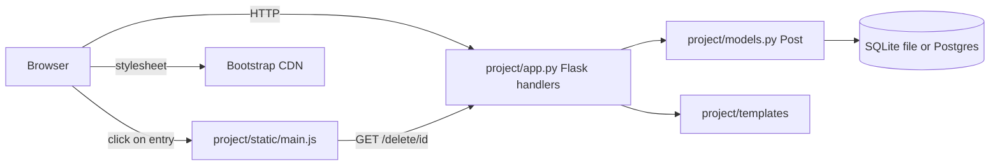
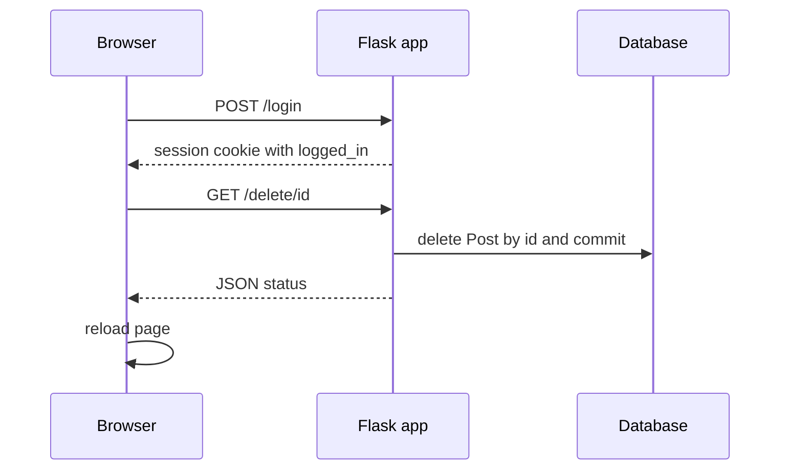
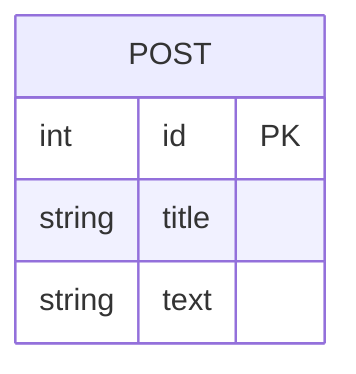

# flaskr-tdd Documentation
<!-- appdoc:template 2.4 -->

**Target:** flaskr-tdd | **Commit:** 305122f48823d98fd7fe8de989af2821b3c5d46d | **Evidence date:** 2026-11-11

**How to read this document.** *Cited* claims carry a path-and-line Citation. **Inferred:** marks reasoning from cited evidence. *Unknown* items are listed in section 14 and must not be assumed. Secret values are never reproduced; their locations are cited with "value omitted". The Evidence Register (source-to-claim audit) is rendered as Appendix A.

## 1. Application Index

| Support need | Primary screen or file | Workflow |
|---|---|---|
| See all posted entries | `project/templates/index.html:71-78` | [7.1 Browse entries](#71-browse-entries) |
| Log in or out | `project/templates/login.html:31` | [7.2 Log in and log out](#72-log-in-and-log-out) |
| Post a new entry | `project/templates/index.html:35-36` | [7.3 Post an entry](#73-post-an-entry) |
| Delete an entry | `project/static/main.js:7-21` | [7.4 Delete an entry](#74-delete-an-entry) |
| Find entries by text | `project/templates/search.html:39` | [7.5 Search entries](#75-search-entries) |
| Create the database tables | `create_db.py:7-12` | [7.6 Initialize the database](#76-initialize-the-database) |
| Change credentials, secret key or database | `project/app.py:21-32` | [7.2 Log in and log out](#72-log-in-and-log-out) |
| Deploy or run tests | `.github/workflows/main.yml:1-29` | [16.5 Deployment and change process](#165-deployment-and-change-process) |

## 2. Coverage and Overview

The Target is a small Flask web application with one Python module for the web layer, one model file, three Jinja templates and one JavaScript file (`project/`). Facts exist for the python-flask Stack only; no unsupported Stack was found in the scanned files.

### 2.1 What was inspected

Every Python, template and JavaScript file in `project/`, plus `tests/`, `create_db.py`, `requirements.txt`, `runtime.txt`, `Procfile` and `.github/workflows/main.yml`, was opened. `project/static/style.css` was also read: it holds presentation rules only, and no template or script references it. The binary files `project/flaskr.db` and `test.db` were opened read-only for table names and row counts (8.4). Not reviewed: the images `flaskr-app.png` and `tdd.png`; `LICENSE`; the body of `README.md` beyond its headings and deployment commands (`README.md:1013-1083`); no `docs/` folder exists in this Target. No deployed instance was observed; the only run was the audit's pytest run on a scratch copy (section 11).

<!-- appdoc:generated scan-coverage -->
| Stack | Supported | Files read |
|---|---|---|
| python-flask | yes | 6 |

Files found: 23 = scanned 23 + pruned 0 + ignored by .appdocignore 0.

| Top folder | Files scanned |
|---|---|
| `project/` | 9 |
| `.github/` | 2 |
| `tests/` | 2 |

No folders were pruned.
<!-- /appdoc:generated scan-coverage -->

### 2.2 Purpose and users

Flaskr is a minimal blog-style application: visitors read posted entries, and a logged-in user posts and deletes them (`project/app.py:56-112`). The README describes it as the Flask tutorial extended with test-driven development, JavaScript and deployment (`README.md:3`). No owner statement or user population is given; see Q-1. Overall risk posture: the default configuration ships a known login and a source-embedded session key (V-1, V-2), and entry text is rendered unescaped (V-3).

### 2.3 System boundary

Inside the boundary: the Flask application `project/app.py:36-40`, the `Post` model `project/models.py:4-8`, the templates and the browser script. The application talks to one database chosen by `DATABASE_URL` or a local SQLite file (`project/app.py:26-32`). The only other external system seen is the Bootstrap stylesheet that the browser fetches from a public CDN (`project/templates/index.html:5-9`). No outbound server-side calls were found in source (`project/app.py:1-125`).

## 3. Architecture

### 3.1 Components

- `project/app.py` creates the Flask app, loads module-level settings with `from_object`, creates the SQLAlchemy handle, defines the login decorator and all HTTP handlers (`project/app.py:36-125`).
- `project/models.py` defines the single `Post` entity (`project/models.py:4-8`).
- `project/templates/` holds the three pages: index, login and search (`project/templates/index.html:1-86`, `project/templates/login.html:1-62`, `project/templates/search.html:1-65`).
- `project/static/main.js` attaches a click-to-delete handler to every entry (`project/static/main.js:5-24`).
- `create_db.py` creates the tables from the model (`create_db.py:7-12`).
- `tests/app_test.py` is the pytest suite (`tests/app_test.py:1-88`).
- `Procfile` starts the app under gunicorn (`Procfile:1`).

### 3.2 Diagram



Caption: components and request paths (`project/app.py:56-125`, `project/static/main.js:11`, `project/templates/index.html:5-9`).

### 3.3 Authentication and authorization

Authentication is a single username and password compared to module-level constants; success stores `logged_in` in the Flask session (`project/app.py:75-87`). Authorization is a boolean test of that session key: the `login_required` decorator returns a JSON 401 (`project/app.py:45-53`) and `/add` repeats the test inline and aborts with 401 (`project/app.py:66-67`). The only `auth_check` Fact is the decorator applied to the delete handler (`project/app.py:100`). No user table, password hashing or roles exist in source (`project/models.py:4-14`).

## 4. Functional Inventory

<!-- appdoc:generated entry-points -->
1 route handler file; 7 routes; 0 pages; 0 commands; 0 jobs.

| Handler file | Kinds | Routes | Pages | Jobs | Commands |
|---|---|---|---|---|---|
| `project/app.py` | route | 7 | 0 | 0 | 0 |
<!-- /appdoc:generated entry-points -->

| ID | Area | Feature | Entry point | Inputs, outputs and rules | Dependencies | Status |
|---|---|---|---|---|---|---|
| F-1 | Entries | List all entries | `project/app.py:56-60` | No input. Queries every `Post` and renders them; shows an empty-state message when there are none (`project/templates/index.html:72-77`). Public. | `Post` (`project/models.py:4`) | Cited |
| F-2 | Entry creation | Add an entry (POST only) | `project/app.py:63-72` | Form fields `title` and `text`; requires the session flag, otherwise 401; commits, flashes a message and redirects to the list (`project/app.py:66-72`). | `Post`, database | Cited |
| F-3 | Authentication | Log in (GET shows form, POST checks credentials) | `project/app.py:75-88` | Form fields `username` and `password`; wrong username and wrong password produce different error texts (`project/app.py:80-83`). | Config keys `USERNAME`, `PASSWORD` (`project/app.py:23-24`) | Cited |
| F-4 | Authentication | Log out | `project/app.py:91-96` | Removes `logged_in` from the session, flashes a message, redirects; reachable by GET and requires no session (`project/app.py:91-96`). | Flask session | Cited |
| F-5 | Entry deletion | Delete an entry by id (GET) | `project/app.py:99-112` | Integer `post_id` in the path; session required; deletes the row and returns JSON `status` 1 or, on exception, `status` 0 with the exception text (`project/app.py:103-112`). | `Post`, database | Cited |
| F-6 | Search | Search entries by text | `project/app.py:115-121` | Query-string `query`; the handler loads all entries and the template filters them case-insensitively on title and text (`project/app.py:117-120`, `project/templates/search.html:51-52`). Public. | `Post` | Cited |
| F-7 | Entry deletion | Browser click handler that calls the delete route | `project/static/main.js:7-21` | Any click on an element with class `entry` sends a GET to the delete route with the heading id, then reloads the page (`project/static/main.js:7-20`). | F-5 | Cited |
| F-8 | Database setup | Create tables (command line, not HTTP) | `create_db.py:7-12` | Runs `create_all` inside the app context and commits (`create_db.py:7-12`). | `Post`, database | Cited |

### 4.1 Subsystem inventory

| Subsystem | Files | Features | Primary data and dependencies | Purpose | Status |
|---|---|---|---|---|---|
| Repository root: `create_db.py`, `Procfile`, `requirements.txt`, `runtime.txt`, `README.md` | 10 | F-8 | pip dependencies (`requirements.txt:1-8`); Python runtime pin (`runtime.txt:1`) | Setup script, process definition, dependency list, tutorial README | Cited |
| `project/` | 9 | F-1 to F-7 | `Post` entity; Flask, Flask-SQLAlchemy (`requirements.txt:1-2`) | The web application | Cited |
| `.github/` | 2 | none | GitHub Actions workflow (`.github/workflows/main.yml:1-29`) | CI: install, lint, test | Cited |
| `tests/` | 2 | F-1 to F-5 | pytest; the fixture names `test.db` but the suite writes `project/flaskr.db` (section 11, V-9) | Test suite (`tests/app_test.py:1-88`) | Cited |

## 5. Roles and Access Model

### 5.1 Observed role concepts

No named roles, groups or scopes exist in source (`project/app.py:21-125`). The only distinction is whether the session contains `logged_in`: an anonymous visitor versus a logged-in user (`project/app.py:48`, `project/app.py:85`). There is a single configured account whose name and password are module constants (`project/app.py:23-24`); values omitted.

### 5.2 Authorization enforcement

- Delete route: the `login_required` decorator (`project/app.py:45-53`, applied at `project/app.py:100`).
- Add route: an inline session test and `abort(401)` (`project/app.py:66-67`).
- Routes with no check: `/` (`project/app.py:56-60`), `/login` (`project/app.py:75-88`), `/logout` (`project/app.py:91-96`) and `/search/` (`project/app.py:115-121`).
- The templates hide the add form and swap the login and logout links using `session.logged_in` (`project/templates/index.html:19`, `project/templates/index.html:35`); this is presentation, not enforcement.
- Database setup is a command-line script and has no web route (`create_db.py:7-12`).

### 5.3 Role-to-capability matrix

| Capability | Anonymous visitor | Logged-in user |
|---|---|---|
| Entries | Y `project/app.py:56-60` | Y `project/app.py:56-60` |
| Entry creation | | Y `project/app.py:66-72` |
| Authentication | Y `project/app.py:75-88` | Y `project/app.py:91-96` |
| Entry deletion | | Y `project/app.py:99-112` |
| Search | Y `project/app.py:115-121` | Y `project/app.py:115-121` |
| Database setup | | |
| Edit an existing entry (no such route in `project/app.py:56-125`) | | |

**Restriction:** do not infer a permission from a visible control or a granted scope; enforcement is the code cited in 5.2.

## 6. UI Catalog

Source-only catalog; no screenshots or live session (`project/templates/index.html:1`).

| ID | Page | Route or entry | Reached from | Visible controls and data | States and effects | Roles and evidence |
|---|---|---|---|---|---|---|
| UI-1 | Entry list (home) | `/` via `project/app.py:56-60` | Home link on the search page (`project/templates/search.html:17-19`) and redirects after login, logout and add (`project/app.py:72`, `project/app.py:87`, `project/app.py:96`) | Search button, log in or log out button, flash messages, an add form (Title, Text, Share) shown only when logged in, the entries list (`project/templates/index.html:17-77`) | Empty list shows "No entries yet. Add some!" (`project/templates/index.html:77`); entries render title escaped and text unescaped (`project/templates/index.html:73-74`) | Anonymous and logged-in; form hidden unless logged in (`project/templates/index.html:35`) |
| UI-2 | Login | `/login` via `project/app.py:75-88` | Log in button on UI-1 (`project/templates/index.html:19-22`) and on UI-3 (`project/templates/search.html:21-24`) | Username and Password inputs, Login button, error banner, hint text naming the default login (`project/templates/login.html:25-53`) | Error text from the handler (`project/app.py:81`, `project/app.py:83`); success redirects to UI-1 | Anonymous and logged-in: the route has no session check, and the Log in links are shown only to anonymous visitors (`project/app.py:75-88`) |
| UI-3 | Search | `/search/` via `project/app.py:115-121` | Search button on UI-1 (`project/templates/index.html:17`) | Search box, Search button, filtered entries (`project/templates/search.html:39-57`) | Without a `query` parameter no results are listed (`project/app.py:119-121`); entry heading ids use `entry.post_id` (`project/templates/search.html:54`) | Anonymous and logged-in (`project/app.py:115-121`) |

All three pages of the Target are catalogued (`project/templates/index.html:1`, `project/templates/login.html:1`, `project/templates/search.html:1`).

## 7. Workflows

### 7.1 Browse entries

1. The browser requests `/`; the handler queries every `Post` (`project/app.py:56-60`).
2. The template loops over the entries and prints title and text, or the empty-state message (`project/templates/index.html:72-77`).
3. Flash messages queued earlier are printed once (`project/templates/index.html:31-35`).

Failure and escalation: the handler has no error handling, so a database failure surfaces as an unhandled server error (`project/app.py:56-60`); escalate per Q-1 and check the connection setting `DATABASE_URL` (`project/app.py:26`).

### 7.2 Log in and log out

1. GET `/login` renders the form (`project/app.py:88`).
2. POST compares the submitted username, then the password, with the configured constants; the first mismatch sets an error (`project/app.py:80-83`).
3. On a match the session gets `logged_in`, a flash message is set and the user is redirected home (`project/app.py:84-87`).
4. `/logout` removes the key, flashes and redirects home (`project/app.py:91-96`).
5. The suite asserts the logged-in, logged-out and both error messages (`tests/app_test.py:55-64`).

Failure and escalation: wrong credentials re-render the form with an error and no lockout (`project/app.py:80-88`); if the known login stops working after a deploy, the constants in source were changed (`project/app.py:23-24`) and the owner in Q-1 must supply them.

### 7.3 Post an entry

1. A logged-in user fills Title and Text and submits the form to `/add` (`project/templates/index.html:35-36`).
2. The handler rejects sessions without the flag with 401 (`project/app.py:66-67`).
3. It builds a `Post`, adds and commits it, flashes a message and redirects to the list (`project/app.py:68-72`).
4. The suite posts HTML in a title and text and asserts the title is escaped while the text is not (`tests/app_test.py:67-77`).

Failure and escalation: a missing form field raises an unhandled bad-request error from `request.form[...]` (`project/app.py:68`); a failed commit is not caught (`project/app.py:70`); after one retry, escalate per Q-1.

### 7.4 Delete an entry

1. The browser script listens for clicks on every `entry` element; a click reads the heading id and sends GET `/delete/<id>` (`project/static/main.js:7-11`).
2. The server requires the session flag, otherwise returns JSON 401 (`project/app.py:48-50`).
3. It deletes rows with that id, commits, flashes and returns JSON `status` 1 (`project/app.py:106-109`, `project/app.py:112`).
4. Only when the response has `status` 1 does the script remove the element; it reloads the page in every case, including a 401 or `status` 0 (`project/static/main.js:15-20`).
5. The suite calls the route anonymously (`status` 0) and then after login (`status` 1) (`tests/app_test.py:80-88`).

Failure and escalation: an exception returns `status` 0 with the exception text and the page still reloads (`project/app.py:110-112`, `project/static/main.js:20`); a nonexistent id still reports success because the delete matches zero rows (`project/app.py:106-109`); escalate if the same id fails twice, per Q-1.

### 7.5 Search entries

1. The user submits the search form with `query` by GET (`project/templates/search.html:39`).
2. The handler loads all entries and passes them with the query to the template; with no query it renders the page without entries (`project/app.py:117-121`).
3. The template keeps entries whose title or text contains the query, ignoring case (`project/templates/search.html:51-52`).

Failure and escalation: no match prints an empty list and no message (`project/templates/search.html:50-57`); there is no failure handling, so escalate database errors per 7.1.

### 7.6 Initialize the database

1. An operator runs `create_db.py`, which enters the app context, calls `create_all` and commits (`create_db.py:7-12`).
2. The README runs the same script on Heroku after attaching Postgres (`README.md:1717`).

Failure and escalation: the script has no error handling (`create_db.py:7-12`); a connection failure is reported only by the Python traceback, so escalate per Q-1 after checking `DATABASE_URL` (`project/app.py:26`).

## 8. Data and Integrations

### 8.1 Connections

| ID | Name | Kind | Configured at | Used by |
|---|---|---|---|---|
| C-1 | Application database | SQLite file by default; any SQLAlchemy URL in `DATABASE_URL`, such as Postgres (a `postgres://` scheme is rewritten to `postgresql://`) | `project/app.py:22-31` | The index, add, delete and search handlers through SQLAlchemy (`project/app.py:40`, `project/app.py:59`, `project/app.py:69-70`, `project/app.py:106-107`, `project/app.py:118`); login and logout never touch the database (`project/app.py:75-96`); `create_db.py:7-12` |

### 8.2 Stored procedures and SQL

No stored procedures or raw SQL were found; data access is through the SQLAlchemy ORM on the `Post` model (`project/models.py:4-8`, `project/app.py:59`, `project/app.py:106`).

### 8.3 External calls

| ID | Call | Direction | Caller | Notes |
|---|---|---|---|---|
| X-1 | Bootstrap 5.3.2 stylesheet from a public CDN | Browser to CDN | `project/templates/index.html:5-9`, `project/templates/login.html:5-9`, `project/templates/search.html:5-9` | Loaded by the user's browser, not the server; no integrity attribute is present on the tag |

### 8.4 Data entities and sensitivity

| Entity | Key fields | Defined at | Sensitivity |
|---|---|---|---|
| `Post` | `id` (primary key), `title`, `text` | `project/models.py:4-7` | Public content shown to everyone; may hold HTML that is rendered unescaped (`project/templates/index.html:74`) |

`Post` fields:

| Field | Type | Null | Key/FK | Sensitivity | Citation |
|---|---|---|---|---|---|
| `id` | Integer | No | Primary key | Public | `project/models.py:5` |
| `title` | String | No | None | Public | `project/models.py:6` |
| `text` | String | No | None | Public, may contain markup | `project/models.py:7` |

Committed database files, opened read-only: `project/flaskr.db` holds the table `post` with 0 rows; `test.db` holds the tables `entries` and `sqlite_sequence`, both with 0 rows, and is tracked although `.gitignore` lists it (`project/flaskr.db`, `test.db`, `.gitignore:5`). No entry data is exposed today (V-10).

### 8.5 Failure, fallback and observability

| ID | Timeout and retry | On failure | Observability |
|---|---|---|---|
| C-1 | None configured: no timeout, pool or retry setting is present (`project/app.py:21-32`) | Handlers do not catch database errors except delete, which returns the exception text (`project/app.py:110-112`) | None: no logging calls exist in the application module (`project/app.py:1-125`) |
| X-1 | None; browser behavior only (`project/templates/index.html:5-9`) | Page renders unstyled if the CDN is unreachable; **Inferred:** the stylesheet is the only thing loaded from it (`project/templates/index.html:5-9`) | None (`project/static/main.js:1-3`, `project/static/main.js:18` and `project/static/main.js:23` only write console messages) |

## 9. Troubleshooting Matrix

| Symptom | Checks | Known response | Escalate when |
|---|---|---|---|
| "Please log in." JSON with HTTP 401 on a delete | Whether the session holds `logged_in` (`project/app.py:48`) | Log in at `/login`, then retry (`project/app.py:75-88`) | Login succeeds but the 401 repeats; **Inferred:** this points to a session cookie problem or a changed secret key (`project/app.py:25`) |
| Flask's default 401 error page after submitting the add form (the application defines no error handler) | The session flag (`project/app.py:66-67`) | Log in first | The user is logged in and still gets 401 |
| "Invalid username" or "Invalid password" on login | Compare with the configured constants (`project/app.py:80-83`) | Re-enter credentials; values are in source (value omitted) | Correct credentials are rejected after a deploy |
| "New entry was successfully posted" does not appear | Whether the redirect reached the list (`project/app.py:71-72`) | Reload `/` | The entry is absent from the list after a reload |
| "The entry was deleted." not shown, JSON `status` 0 and a message | The returned text is the exception representation (`project/app.py:110-112`) | Retry once | The same error appears after one retry; read the database connection (`project/app.py:26-32`) |
| Delete from the search page does nothing | Heading ids on that page come from `entry.post_id` (`project/templates/search.html:54`); the model has `id` only (`project/models.py:5`) | Delete from the home page instead (`project/templates/index.html:73`) | Never needed for this symptom; it is a code defect (V-7) |
| "No entries yet. Add some!" | Whether any entry exists (`project/templates/index.html:77`) | Add an entry after logging in | Entries were added but the list stays empty after one reload |
| Messages appear on the wrong page | Flash messages are queued by the delete route and only shown on the next HTML page (`project/app.py:49`, `project/app.py:109`) | Reload any page | Never; it is expected behavior |

## 10. Security and Operational Risks

### 10.1 Verified findings

| ID | Severity | Finding | Evidence | Impact |
|---|---|---|---|---|
| V-1 | Critical | The login username and password are hardcoded constants and the login page tells visitors what to use (values omitted) | `project/app.py:24`, `project/app.py:80`, `project/templates/login.html:53` | Exploitable without authentication in the default configuration: anyone can log in and then add or delete entries. The constants are not read from the environment; only `DATABASE_URL` is (`project/app.py:26`) |
| V-2 | Critical | The Flask `SECRET_KEY` is a hardcoded placeholder constant in source (value omitted) | `project/app.py:25`, `project/app.py:85` | **Inferred:** Flask signs the session cookie with this key, so anyone who has read the source can forge a cookie containing `logged_in` and pass every session check (`project/app.py:48`, `project/app.py:66`) without the login |
| V-3 | High | Entry text is rendered with the `safe` filter, so stored HTML and script run in every viewer's browser | `project/templates/index.html:74`, `project/templates/search.html:55`, `tests/app_test.py:77` | Needs an authenticated author, which V-1 and V-2 make trivial; script then runs for every visitor including the logged-in user. The test asserts the markup is intentionally unescaped (`tests/app_test.py:77`) |
| V-4 | Medium | Deletion is a GET request and any click on an entry triggers it; forms carry no anti-forgery token | `project/app.py:99`, `project/static/main.js:7-11`, `project/templates/index.html:36` | Needs a logged-in session: a top-level link to the delete URL or an accidental click on an entry deletes the entry. **Inferred:** whether a cross-site image or prefetch request carries the session cookie depends on browser SameSite defaults, because the application sets no SameSite attribute (`project/app.py:21-32`). No CSRF library is listed (`requirements.txt:1-4`) |
| V-5 | Low | Login returns different messages for an unknown username and a wrong password | `project/app.py:81`, `project/app.py:83` | Reveals whether the username guess is right; low because a single account exists (`project/app.py:23`) and the login page prints the default login anyway (`project/templates/login.html:53`) |
| V-6 | Low | The delete handler returns the exception representation to the client | `project/app.py:111-112` | Needs a session; leaks internal error text (database or driver details) to the caller |
| V-7 | Low | The search page writes `entry.post_id` as the heading id but the model column is `id` | `project/templates/search.html:54`, `project/models.py:5` | **Inferred:** the id is empty, so a click on a search result calls the delete route without an id and cannot delete the entry; the page misleads users and the delete feature is inconsistent |
| V-8 | Low | The home page and a search with a query load the whole `Post` table with no paging; search filters in the template | `project/app.py:59`, `project/app.py:118-120`, `project/templates/search.html:51-52` | Response time and memory on those two requests grow with the number of entries; no limit exists |
| V-9 | High | Running the test suite drops the `post` table of the application's default database: the engine is created from the application URL when `db = SQLAlchemy(app)` runs, the fixture changes `SQLALCHEMY_DATABASE_URI` only afterwards, and teardown calls `drop_all`; the suite therefore uses the default SQLite file (`DATABASE`, `project/app.py:22`), not `test.db` | `project/app.py:26`, `project/app.py:40`, `tests/app_test.py:13-21`, `tests/app_test.py:43-46` | Observed by an audit run on a scratch copy (Flask 3.0.0, Flask-SQLAlchemy 3.1.1): 6 tests passed, the default SQLite file changed and `test.db` did not. Every entry in the default database is lost when a developer runs pytest there. `test_database` passes only because the tracked `test.db` exists in the working directory. **Inferred:** with `DATABASE_URL` set, the same engine points at that database, so running pytest in such a shell would drop its `post` table. CI is unaffected: it runs on a fresh checkout whose tracked database has no rows (8.4) |
| V-10 | Low | Binary database files are committed: the default SQLite store and `test.db`, which the gitignore lists but which is tracked | `.gitignore:5`, `project/flaskr.db`, `test.db` | Both hold no entry rows today (8.4), so nothing is exposed now; entries saved to the default database can be committed with the repository, and `test.db` carries an `entries` table the model does not define (`project/models.py:4-8`) |

### 10.2 Unknowns that must not be treated as controls

| Control | Status | Where looked |
|---|---|---|
| TLS | Not established | `Procfile:1`, `project/app.py:21-32`: no TLS or redirect setting; termination depends on the host (Q-5) |
| CSRF protection | Verified absent | `project/templates/index.html:36-70`, `project/templates/login.html:31-50`, `requirements.txt:1-8`: no token field and no CSRF package |
| MFA | Verified absent | `project/app.py:75-88`: password comparison only |
| Cookie flags | Verified absent | `project/app.py:21-32`: no `SESSION_COOKIE_*` setting; Flask defaults apply (Q-5) |
| Rate limiting | Verified absent | `project/app.py:75-88`: no attempt counter; `requirements.txt:1-8`: no limiter package |
| Audit-log integrity | Verified absent | `project/app.py:1-125`: no logging or audit code |
| Backup and recovery | Not established | `project/models.py:1-14`, `Procfile:1`: no backup tooling in the repository (Q-6) |
| Production secret management | Verified absent | `project/app.py:23-26`: secrets are constants; only the database URL comes from the environment |

## 11. Ownership and Maintenance

| Area | Evidence | Status |
|---|---|---|
| Business owner | Unknown - see Open questions. No owner file or context file exists in the Target (Facts: ownership files none) | Unknown |
| Technical owner | Unknown - see Open questions. The clone is shallow (`Git history: shallow`), so authorship is not available from history | Unknown |
| Process owner | Unknown - see Open questions | Unknown |
| Data and integration owners | Unknown - see Open questions | Unknown |
| Documentation owner | Unknown - see Open questions; the README is the tutorial text (`README.md:3`) | Unknown |
| Release and change process | A push triggers one CI job that installs, lints and tests (`.github/workflows/main.yml:3`, `.github/workflows/main.yml:19-29`); no release or deploy job exists | Cited |
| Test suite `tests/app_test.py` | Covers F-1 (`tests/app_test.py:38-52`), F-3 and F-4 (`tests/app_test.py:55-64`), F-2 (`tests/app_test.py:67-77`) and F-5 (`tests/app_test.py:80-88`); no test covers F-6, F-7 or F-8 | Cited |

The suite runs against `project/flaskr.db`, not `test.db`: the fixture sets `SQLALCHEMY_DATABASE_URI` after `db = SQLAlchemy(app)` has already read the URI (`tests/app_test.py:13-16`, `project/app.py:40`), and its teardown calls `drop_all` on that engine (`tests/app_test.py:19-21`). An audit run of the suite on a scratch copy (Flask 3.0.0, Flask-SQLAlchemy 3.1.1) passed 6 tests, changed `project/flaskr.db` and left `test.db` unchanged; `test_database` passes only because the tracked `test.db` exists in the working directory (`tests/app_test.py:43-46`). See V-9.

Recommended maintenance minimum:

- Move the credentials and `SECRET_KEY` out of source (`project/app.py:23-25`).
- Keep the CI lint and test job green (`.github/workflows/main.yml:23-29`).
- Add tests for search and the delete click path (`tests/app_test.py:1-88`).
- Name an owner and record it in an owner context file.

## 12. Architecture and Data-Flow Diagrams



Caption: login then click-to-delete (`project/app.py:75-87`, `project/static/main.js:7-20`, `project/app.py:99-112`).



Caption: the only entity (`project/models.py:4-7`).

## 13. Glossary

| Term | Meaning | Citation |
|---|---|---|
| Entry | A posted item, stored as a `Post` row and shown as a list item | `project/templates/index.html:72-77` |
| Post | The SQLAlchemy model with `id`, `title`, `text` | `project/models.py:4-7` |
| `logged_in` | The session key whose presence means the user is authenticated | `project/app.py:48` |
| `login_required` | Decorator that returns JSON 401 when the session key is missing | `project/app.py:45-53` |
| Flash message | One-time message queued with `flash` and printed by the next page | `project/app.py:49`, `project/templates/index.html:31-35` |
| `DATABASE_URL` | Environment variable that overrides the default SQLite location | `project/app.py:26` |
| `SECRET_KEY` | Flask configuration constant used to sign the session cookie | `project/app.py:25` |
| `from_object` | Flask call that loads the module-level upper-case constants into the Flask config object | `project/app.py:38` |
| Procfile | Process definition that starts gunicorn on `project.app:app` | `Procfile:1` |
| `create_db.py` | Script that creates the tables | `create_db.py:7-12` |

## 14. Open Questions and Documentation Gaps

| ID | Question | Why it matters | How to close | Owner | Priority |
|---|---|---|---|---|---|
| Q-1 | Who owns, operates and supports this application, and where is it deployed? | Every escalation in sections 7 and 9 needs a named contact | Owner adds an owner context file with owners and environments | Unknown | High |
| Q-2 | Is the Heroku flow in the README the real deployment, and which build and release steps are used? | The repository has no deploy job (`.github/workflows/main.yml:1-29`); 16.5 rows for Upgrade, Rollback and Restore stay Unknown | Owner confirms the target and records the steps | Unknown | Medium |
| Q-3 | Are the credentials and `SECRET_KEY` overridden in any deployed environment? | Source has no override path (`project/app.py:23-25`); determines whether V-1 and V-2 apply in production | Owner states how production values are set | Unknown | High |
| Q-5 | Is TLS terminated in front of the app, and are session cookie flags set outside this code? | TLS and cookie flags decide whether the session cookie can be intercepted; nothing in source sets them (`project/app.py:21-32`) | Owner shows the hosting configuration | Unknown | Medium |
| Q-6 | Is there a backup and recovery process for the production database? | Backup and recovery are not in the repository; data loss on delete is permanent (`project/app.py:106-107`) | Owner documents the database provider backup policy | Unknown | Medium |

## 15. Recommendations

| ID | Severity | Effort | Recommendation | Addresses |
|---|---|---|---|---|
| R-1 | Critical | S | Read the username, password and `SECRET_KEY` from environment variables, fail to start when they are missing, and remove the hint from the login page | V-1, V-2, Q-3, Production secret management |
| R-2 | High | S | Remove the `safe` filter, or sanitize entry text with an allow-list, and update the test that expects raw markup | V-3 |
| R-3 | Medium | M | Make deletion a POST (or DELETE) with an anti-forgery token, add the token to the add and login forms, and require confirmation before the click handler deletes | V-4, CSRF protection |
| R-4 | Low | S | Return one generic login error and a generic delete error; log details server-side | V-5, V-6 |
| R-5 | Low | S | Use `entry.id` in the search template and filter in SQL with paging | V-7, V-8 |
| R-6 | Medium | M | Set secure session cookie attributes, serve over TLS and add login rate limiting; add MFA if the application is exposed beyond a demo | Cookie flags, TLS, Rate limiting, MFA, Q-5 |
| R-7 | Medium | M | Add application logging for logins and deletes and document backup and restore of the database | Audit-log integrity, Backup and recovery, Q-6 |
| R-8 | Medium | S | Name business and technical owners and record them in an owner context file | Q-1, Q-2 |
| R-9 | High | S | Make the tests use `test.db`: set the database URI before `SQLAlchemy(app)` is created (for example through an application factory or a test-only `DATABASE_URL`), and make the fixture refuse to run `drop_all` against any other database | V-9 |
| R-10 | Low | S | Decide whether the database files belong in version control; if not, untrack them (they are already empty), but only after R-9 (or after `test_database` is changed): `test_database` asserts that `test.db` exists and nothing in the suite creates it, so untracking `test.db` alone makes it fail. A fresh checkout without `project/flaskr.db` also needs `create_db.py` run before the home page works | V-10 |

### 15.1 Coverage summary

Verified by reading source: every handler, the model, all templates, the click script, the setup script, the tests, the dependency list, the process file and the CI workflow. The two database files were opened read-only (8.4). Not inspected: the images, `LICENSE`, most of the README. An independent source-to-claim audit, followed by a delta audit of V-9, V-10, R-9 and R-10, was performed and its corrections are applied (see Appendix A). The only run was the audit's pytest run on a scratch copy (the question about which file the tests use is answered in V-9), so behavior marked **Inferred:** is otherwise unconfirmed. Before relying on this document, confirm Q-1, Q-2, Q-3, Q-5 and Q-6.

## 16. Operations Runbook

### 16.1 Platform requirements

- Python 3.12.0 is pinned for the host (`runtime.txt:1`); CI tests Python 3.8 to 3.12 (`.github/workflows/main.yml:11`).
- Runtime packages: Flask 3.0.0, Flask-SQLAlchemy 3.1.1, gunicorn 21.2.0, psycopg2-binary 2.9.9 (`requirements.txt:1-4`); development tools pytest, black and flake8 share the same file (`requirements.txt:6-8`).
- The web process is `gunicorn project.app:app` (`Procfile:1`).

### 16.2 Data stores

- Default store is a SQLite file named in the `DATABASE` constant, inside `project/` (`project/app.py:22`, `project/app.py:26`); setting `DATABASE_URL` selects another database such as Postgres (`project/app.py:26-31`).
- Tables are created by `create_db.py` (`create_db.py:7-12`) and by the test fixture (`tests/app_test.py:19-21`), which creates them in `project/flaskr.db` (V-9). No migration tool or seed data was found in the files read (`requirements.txt:1-8`).

### 16.3 Session and authentication behavior

The session is Flask's default signed cookie holding `logged_in` (`project/app.py:85`, `project/app.py:94`). No lifetime, cookie-flag or server-side session setting is present (`project/app.py:21-32`); Flask defaults apply (Q-5). Logging out removes the key (`project/app.py:94`).

### 16.4 Known failure modes and operator responses

| Failure mode | Signal | Operator response |
|---|---|---|
| Database unreachable or schema missing | Unhandled server error on the home page (the query runs when the template renders, `project/app.py:59-60`), on search with a query (`project/app.py:118-120`) and on add (`project/app.py:69-70`); login and logout do not touch the database (`project/app.py:75-96`) and delete returns JSON `status` 0 (`project/app.py:110-112`) | Check `DATABASE_URL` (`project/app.py:26`) and run `create_db.py` (`create_db.py:7-12`) |
| Delete raises an error | JSON `status` 0 with exception text (`project/app.py:110-112`) | Read the text, fix the database problem, retry once |
| Users logged out after a deploy | JSON 401 on delete, 401 on add (`project/app.py:50`, `project/app.py:67`) | **Inferred:** the secret key changed, which invalidates old cookies (`project/app.py:25`); log in again |
| Deployed Postgres URL not accepted | Startup error | The `postgres://` prefix is rewritten to `postgresql://` (`project/app.py:28-29`); check the URL scheme |

### 16.5 Deployment and change process

| Step | Procedure | Evidence |
|---|---|---|
| Build | CI installs dependencies with `pip install -r requirements.txt`; no separate build artifact | `.github/workflows/main.yml:19-22` |
| Test | `python -m pytest`, plus flake8 and black checks, on every push across the Python matrix | `.github/workflows/main.yml:23-29` |
| Deploy | The README deploys to Heroku with `git push heroku main`; the process is defined in the Procfile; no deploy job in CI | `README.md:1082-1083`, `Procfile:1` |
| Upgrade | Unknown - see Open questions. | Q-2 |
| Rollback | Unknown - see Open questions. | Q-2 |
| Backup | Unknown - see Open questions. | Q-6 |
| Restore | Unknown - see Open questions. | Q-6 |
| Secret rotation | **Inferred:** rotation means editing the constants and redeploying, because no environment override exists | `project/app.py:23-25` |

### 16.6 Configuration reference

<!-- appdoc:generated config-reference -->
| Key | Defined at | Secret location |
|---|---|---|
| PASSWORD | `project/app.py:24` | yes |
| SECRET_KEY | `project/app.py:25` | yes |
| DATABASE | `project/app.py:22` | no |
| USERNAME | `project/app.py:23` | no |
| SQLALCHEMY_DATABASE_URI | `project/app.py:31` | no |
| SQLALCHEMY_TRACK_MODIFICATIONS | `project/app.py:32` | no |

Shown 6 of 6 application keys.

1 env-var key and 8 CI keys are excluded from the application table (see facts.json).
<!-- /appdoc:generated config-reference -->

| Key | Effect | Evidence |
|---|---|---|
| `USERNAME` | The accepted login name, a hardcoded credential (value omitted); the generated table above marks its secret location `no` only because the extractor flags `PASSWORD` and `SECRET_KEY` alone (V-1) | `project/app.py:80` |
| `PASSWORD` | The accepted password (value omitted) | `project/app.py:82` |
| `SECRET_KEY` | Signs the session cookie (V-2) | `project/app.py:25` |
| `DATABASE_URL` | Overrides the default database location | `project/app.py:26` |
| `DATABASE` | File name used to build the default SQLite path | `project/app.py:22` |

### 16.7 Scheduled and background jobs

<!-- appdoc:generated scheduled-jobs -->
No scheduled or background jobs were extracted. Stacks that report jobs: `python-flask`.
<!-- /appdoc:generated scheduled-jobs -->

## Appendix A. Evidence Register and Verification

<!-- appdoc:generated appendix-a -->
### A.1 Audit state

**Auditor:** independent. **Scope:** Claims in sections 1, 2.1-2.3, 3.1-3.3, 4 (F-1..F-8, 4.1 sampled), 5.1-5.3, 6 (UI-1..UI-3), 7.1-7.6, 8.1-8.5, 9 (all 8 rows), 10.1 (V-1..V-8), 10.2 (one row for all 8 controls), 11, 12, 13 (5 of 10 glossary terms sampled), 14 (Q-1..Q-7), 15 (R-1, R-2, R-5 sampled; 15.1), 16.1-16.7, plus all 7 smells. Every cited span was opened in source. Q-7 was checked by running the suite on a scratch copy in TEMP (Flask 3.0.0, Flask-SQLAlchemy 3.1.1); Q-4 by reading the two db files read-only. Static reading otherwise; nothing observed on a deployed instance.

Generated blocks written by AppDoc 2.6.0.dev0 (bundle 8700443cb563).
Generated blocks were regenerated after the audit and are not covered by it.

### A.2 Coverage

91 rows: 80 Supported, 7 Corrected, 1 Downgraded, 1 Dismissed, 2 Answerable. Each Supported or Corrected row's anchor text was found in its cited lines by the Check.

| Section | IDs with a register row |
|---|---|
| 4 | 8 of 8 |
| 6 | 3 of 3 |
| 8.1 | 1 of 1 |
| 8.3 | 1 of 1 |
| 10.1 | 10 of 10 |
| 14 | 5 of 5 |
| 15 | 5 of 10 |
| 7 (workflows) | 6 of 6 |

### A.3 Register

| ID | Ref | Claim | Result | Cites | Limitation |
|---|---|---|---|---|---|
| E-1 | 1 | Index rows point to the right screens: entries loop, search form, post form, delete click handler, login form, create_db script (all 8 rows checked) | Supported | `project/templates/index.html:71-78` `project/templates/search.html:39` `project/static/main.js:7-21` `project/templates/login.html:31` `create_db.py:7-12` |  |
| E-2 | 2.1 | README deployment commands lie in README.md:1013-1083; the listed unreviewed files are binaries and LICENSE (the Target has no docs/ folder) | Supported | `README.md:1013-1083` | style.css described as presentation only: auditor saw only its font and colour rules |
| E-3 | 2.2 | Flaskr lets visitors read entries and a logged-in user post and delete them; README describes the Flask tutorial extended with TDD, JavaScript and deployment | Supported | `project/app.py:56-112` `README.md:3` | no owner statement exists, as the document says |
| E-4 | 2.3 | One database selected by DATABASE_URL or a local SQLite file; only external dependency is the Bootstrap CDN stylesheet; no outbound server-side calls | Supported | `project/app.py:26-32` `project/templates/index.html:5-9` | absence of outbound calls rests on reading app.py in full (no HTTP client imported) |
| E-5 | 3.1 | app.py creates the app, loads module constants with from_object, creates the SQLAlchemy handle, defines login_required and all handlers; models.py holds Post; main.js attaches the click handler; Procfile starts gunicorn | Supported | `project/app.py:36-125` `project/models.py:4-8` `project/static/main.js:5-24` `create_db.py:7-12` `Procfile:1` |  |
| E-6 | 3.2 | Diagram edges (browser to handlers, handlers to Post and database, click script GET to the delete route, Bootstrap CDN) match source | Supported | `project/static/main.js:11` `project/templates/index.html:5-9` |  |
| E-7 | 3.3 | Authentication compares form fields to config constants and sets logged_in; login_required returns JSON 401; /add repeats the session test and aborts 401; no user table or roles | Supported | `project/app.py:45-53` `project/app.py:66-67` `project/app.py:75-87` `project/app.py:100` `project/models.py:4-14` |  |
| E-8 | 4/F-1 | Home handler queries every Post and renders them or the empty-state message; public | Supported | `project/app.py:56-60` `project/templates/index.html:72-77` |  |
| E-9 | 4/F-2 | /add accepts POST only, needs the session flag else 401, commits, flashes and redirects | Supported | `project/app.py:63-72` |  |
| E-10 | 4/F-3 | /login shows the form on GET and checks username then password on POST with different error texts | Supported | `project/app.py:75-88` |  |
| E-11 | 4/F-4 | /logout removes logged_in, flashes and redirects; GET with no session check | Supported | `project/app.py:91-96` |  |
| E-12 | 4/F-5 | /delete/<int:post_id> needs a session, deletes by id and returns JSON status 1, or status 0 with the exception text | Supported | `project/app.py:99-112` |  |
| E-13 | 4/F-6 | /search/ reads query, loads all entries and the template filters case-insensitively on title and text; public | Supported | `project/app.py:115-121` `project/templates/search.html:51-52` |  |
| E-14 | 4/F-7 | A click on any .entry element GETs the delete route with the heading id, then reloads the page | Supported | `project/static/main.js:7-20` | element removal happens only when status is 1 (see 7.4) |
| E-15 | 4/F-8 | create_db.py runs create_all in the app context and commits | Supported | `create_db.py:7-12` |  |
| E-16 | 4.1 | Subsystem rows: pip dependencies in requirements.txt, F-ID coverage, file counts (docs 18, root 10, project 9, .github 2, tests 2) match the Facts and the tree | Supported | `requirements.txt:1-2` | root row names 5 of its 10 files (.gitignore, LICENSE, two PNGs and test.db are not named); counts agree |
| E-17 | 5.1 | No named roles; the only distinction is the logged_in session key; one configured account from module constants | Supported | `project/app.py:23-24` `project/app.py:48` `project/app.py:85` |  |
| E-18 | 5.2 | Enforcement: login_required on delete, inline test on add, none on /, /login, /logout, /search/; templates only hide controls | Supported | `project/app.py:66-67` `project/app.py:100` `project/templates/index.html:19` `project/templates/index.html:35` |  |
| E-19 | 5.3 | Capability matrix matches the route checks; no edit route exists | Supported | `project/app.py:66-72` `project/app.py:99-112` `project/app.py:115-121` | /login has no check, so a logged-in user can open it; the matrix shows Y for both roles, which is right |
| E-20 | 6/UI-1 | Home page: search, login or logout button, flash messages, add form only when logged in, entries list; empty-state text; title escaped and text unescaped | Supported | `project/templates/index.html:17-77` `project/app.py:72` |  |
| E-22 | 6/UI-3 | Search page: box, button, filtered entries; with no query parameter no entries are listed | Supported | `project/templates/search.html:39-57` `project/app.py:119-121` |  |
| E-23 | 7.1 | Home handler queries all Posts, template prints them or the empty-state message, flashes print once; no error handling in the handler | Supported | `project/app.py:56-60` `project/templates/index.html:31-35` `project/templates/index.html:72-77` | database failure behavior is inferred from the absence of a try block |
| E-24 | 7.2 | Login compares username then password, sets logged_in, flashes, redirects; logout pops the key; tests assert the messages | Supported | `project/app.py:80-88` `project/app.py:91-96` `tests/app_test.py:55-64` | no lockout is shown by absence of any counter in app.py |
| E-25 | 7.3 | Logged-in user posts via /add: 401 without session, Post built, committed, flashed, redirected; test asserts title escaped and text raw | Supported | `project/app.py:66-72` `project/templates/index.html:35-36` `tests/app_test.py:67-77` | a missing field makes Flask answer 400 (BadRequestKeyError); 'unhandled' means no application-level handler |
| E-27 | 7.5 | Search form submits query by GET; handler loads all entries and passes them only when query is truthy; template filters; no match prints an empty list | Supported | `project/templates/search.html:39` `project/templates/search.html:50-57` `project/app.py:117-121` |  |
| E-28 | 7.6 | Operator runs create_db.py (create_all and commit); the README runs it on Heroku after attaching Postgres | Supported | `create_db.py:7-12` `README.md:1717` |  |
| E-29 | 8.1 | C-1 is not used by 'all handlers': index (59), add (69-70), delete (106-107) and search (118) use SQLAlchemy; login and logout (75-96) never touch the database | Corrected | `project/app.py:59` `project/app.py:69-70` `project/app.py:75-96` `project/app.py:106-107` | SQLite default, Postgres via DATABASE_URL and the postgres:// rewrite at 28-29 are supported |
| E-30 | 8.2 | No stored procedures or raw SQL; access is ORM queries on Post | Supported | `project/app.py:106` `project/models.py:4-8` |  |
| E-31 | 8.3 | Bootstrap 5.3.2 stylesheet loaded from a public CDN by all three templates, with no integrity attribute | Supported | `project/templates/index.html:5-9` `project/templates/login.html:5-9` `project/templates/search.html:5-9` |  |
| E-32 | 8.4 | Post has id (Integer primary key), title and text (String, not null) | Supported | `project/models.py:5-7` | sensitivity labels are the writer's classification |
| E-33 | 8.5 | No timeout, pool or retry settings; only delete catches database errors; no logging calls in app.py | Supported | `project/app.py:21-32` `project/app.py:110-112` `project/static/main.js:1-3` | main.js also logs to the console at lines 18 and 23, outside the cited 1-3 |
| E-34 | 9 | Row 1 (JSON 401 on delete): the check and response are supported, but the clause that a repeating 401 'points to a session cookie problem or a changed secret key' is inference and should be marked Inferred | Downgraded | `project/app.py:48-50` | cause of a repeating 401 is not provable from source |
| E-35 | 9 | Row 2: the add-form 401 is Flask's default Unauthorized error page (no error handler is defined), not a 'blank' page | Corrected | `project/app.py:66-67` | page body is framework default behavior, not shown in the repository |
| E-36 | 9 | Row 3: wrong username and wrong password give 'Invalid username' and 'Invalid password' | Supported | `project/app.py:80-83` |  |
| E-37 | 9 | Row 4: the add flash is 'New entry was successfully posted' followed by a redirect | Supported | `project/app.py:71-72` | the flash is consumed by the first page after the redirect, so 'Reload /' checks the entry, not the message |
| E-38 | 9 | Row 5: a failed delete returns the exception representation with status 0 | Supported | `project/app.py:110-112` |  |
| E-39 | 9 | Row 6: search page headings use entry.post_id while the model has only id, so delete from search does nothing | Supported | `project/templates/search.html:54` `project/models.py:5` | runtime effect (empty id, request to /delete/) inferred from Jinja undefined handling; not run |
| E-40 | 9 | Row 7: empty-state text is 'No entries yet. Add some!' | Supported | `project/templates/index.html:77` |  |
| E-41 | 9 | Row 8: the delete route queues a flash that appears on the next HTML page | Supported | `project/app.py:49` `project/app.py:109` |  |
| E-42 | 10.1/V-1 | Login name and password are hardcoded constants (values omitted), compared at login; the login page tells visitors what to use; not read from the environment | Supported | `project/app.py:24` `project/app.py:80` `project/templates/login.html:53` | values deliberately not reproduced; severity follows the template rubric |
| E-43 | 10.1/V-2 | SECRET_KEY is a hardcoded placeholder constant (value omitted) used to sign the session that holds logged_in | Supported | `project/app.py:25` `project/app.py:85` | cookie forgery is Inferred from Flask behavior; not exercised |
| E-44 | 10.1/V-3 | Entry text is rendered with the safe filter on the home and search pages; the test asserts raw markup in the output | Supported | `project/templates/index.html:74` `project/templates/search.html:55` `tests/app_test.py:77` | script execution in browsers not run |
| E-46 | 10.1/V-5 | Login returns 'Invalid username' for an unknown user and 'Invalid password' for a wrong password; a single account exists | Supported | `project/app.py:81` `project/app.py:83` `project/app.py:23` |  |
| E-47 | 10.1/V-6 | The delete handler returns repr(e) of any exception to the client | Supported | `project/app.py:111-112` |  |
| E-48 | 10.1/V-7 | Search template writes entry.post_id as the heading id but Post has only id | Supported | `project/templates/search.html:54` `project/models.py:5` | empty id effect Inferred (marked so in the document); not run |
| E-50 | 10.2 | TLS, CSRF, MFA, cookie flags, rate limiting, audit logging, backup and production secret management are absent or not established in source; only DATABASE_URL comes from the environment | Supported | `project/app.py:21-32` `requirements.txt:1-8` `Procfile:1` | Flask cookie defaults and hosting-level TLS were not observed (Q-5) |
| E-51 | 11 | No owner or context file exists; .github/FUNDING.yml holds a sponsorship handle only and is not an ownership file | Supported | `.github/FUNDING.yml:1` | authorship unavailable because the clone is shallow (facts-summary.md) |
| E-52 | 11 | CI runs on push and has one job that installs, lints and tests; no release or deploy job; the suite covers F-1 to F-5 and not F-6, F-7 or F-8 | Supported | `.github/workflows/main.yml:3` `.github/workflows/main.yml:19-29` `tests/app_test.py:38-88` |  |
| E-53 | 11 | Inferred note: the fixture sets SQLALCHEMY_DATABASE_URI after db = SQLAlchemy(app); confirmed by running the suite, which changed project/flaskr.db and left test.db untouched | Supported | `tests/app_test.py:13-16` `project/app.py:40` | verified on a scratch copy with Flask 3.0.0 and Flask-SQLAlchemy 3.1.1 |
| E-54 | 12 | Sequence diagram (login, session cookie, delete click, delete and commit, JSON status, reload) and the Post erDiagram match source | Supported | `project/app.py:99-112` `project/static/main.js:7-20` `project/models.py:4-7` |  |
| E-55 | 13 | Glossary sample (from_object, DATABASE_URL, login_required, logged_in, create_db.py) matches source | Supported | `project/app.py:38` `project/app.py:26` `project/app.py:45-53` | 5 of 10 terms checked |
| E-56 | 14/Q-1 | Owner, operator, support contact and deployment location are not stated anywhere in the repository | Supported | `Procfile:1` | needs owner |
| E-57 | 14/Q-2 | The README shows a Heroku flow; whether it is the real deployment cannot be told from the repository | Supported | `README.md:1083` | needs owner |
| E-58 | 14/Q-3 | Source has no override path for the credentials and SECRET_KEY; whether production sets them another way is not in the repository | Supported | `project/app.py:25` | needs owner |
| E-59 | 14/Q-4 | Both tracked database files hold no entries: project/flaskr.db has table post with 0 rows; test.db has the legacy tables entries and sqlite_sequence, both with 0 rows (read-only inspection). test.db is tracked although .gitignore lists it | Answerable | `project/flaskr.db:1` | removing the files from version control is still an owner decision |
| E-60 | 14/Q-5 | Nothing in source sets TLS or cookie flags; hosting configuration is not in the repository | Supported | `project/app.py:21-32` | needs owner |
| E-61 | 14/Q-6 | No backup or recovery tooling exists in the repository; delete is a hard row delete | Supported | `project/app.py:106-107` | needs owner |
| E-62 | 14/Q-7 | The suite uses project/flaskr.db, not test.db: running pytest on a scratch copy passed 6 tests, changed project/flaskr.db and left test.db unchanged, because db = SQLAlchemy(app) reads the URI at construction and the fixture changes the config afterwards. Teardown drop_all removes the post table of that file. test_database passes only because the tracked test.db exists in the working directory | Answerable | `project/app.py:40` `tests/app_test.py:13-21` `tests/app_test.py:43-46` | answered by running the suite on a scratch copy; the framework behavior is not in repository lines |
| E-63 | 15/R-1 | R-1 targets real conditions: credentials and SECRET_KEY are constants, only DATABASE_URL is read from the environment, and the login page prints a hint | Supported | `project/app.py:23-26` `project/templates/login.html:53` | recommendation wording is advice, not a source claim |
| E-64 | 15/R-2 | R-2 targets the safe filter on both pages and the test that expects raw markup | Supported | `project/templates/index.html:74` `project/templates/search.html:55` `tests/app_test.py:77` |  |
| E-65 | 15/R-5 | R-5: index.html uses entry.id while search.html uses entry.post_id, and both loops load the whole table | Supported | `project/templates/index.html:73` `project/templates/search.html:54` |  |
| E-66 | 15.1 | Every handler, the model, templates, click script, setup script, tests, dependency list, process file and CI workflow exist and were readable; scope list of unread files is accurate | Supported | `.github/workflows/main.yml:1-29` `tests/app_test.py:1-88` | the sentence 'The source-to-claim audit has not been performed' becomes stale once this register exists; the writer should update it |
| E-67 | 16.1 | Python 3.12.0 pinned; CI matrix 3.8 to 3.12; runtime packages Flask 3.0.0, Flask-SQLAlchemy 3.1.1, gunicorn 21.2.0, psycopg2-binary 2.9.9; dev tools in the same file; gunicorn project.app:app | Supported | `runtime.txt:1` `.github/workflows/main.yml:11` `requirements.txt:1-8` `Procfile:1` |  |
| E-68 | 16.2 | Default store is a SQLite file named by DATABASE inside project/; DATABASE_URL overrides; tables are created by create_db.py and the test fixture; no migration tool | Supported | `project/app.py:22` `project/app.py:26-31` `create_db.py:7-12` `tests/app_test.py:19-21` |  |
| E-69 | 16.3 | Session is Flask's default signed cookie holding logged_in; logout removes it; no lifetime or cookie setting | Supported | `project/app.py:85` `project/app.py:94` `project/app.py:21-32` | Flask defaults not observed at runtime |
| E-70 | 16.4 | Row 1 is imprecise: database failure surfaces as an unhandled error on the home page (59), on search with a query (118-120) and on add (69-70), not on 'any page'; login and logout do not touch the database, and delete catches the error and returns JSON status 0 | Corrected | `project/app.py:59` `project/app.py:69-70` `project/app.py:75-96` `project/app.py:110-112` |  |
| E-71 | 16.4 | Rows 2-4: delete error returns status 0 with text; 401s on delete and add; postgres:// is rewritten to postgresql:// | Supported | `project/app.py:28-29` `project/app.py:50` `project/app.py:67` `project/app.py:110-112` | 'Startup error' signal for a rejected URL depends on engine creation at init; not observed |
| E-72 | 16.5 | Build and Test rows: CI installs with pip install -r requirements.txt, then flake8, black and pytest on every push across the matrix | Supported | `.github/workflows/main.yml:19-29` |  |
| E-73 | 16.5 | Deploy row: README deploys with git push heroku main; process defined in the Procfile; CI has no deploy job. Secret rotation is Inferred from constants in source. Upgrade, Rollback, Backup, Restore Unknown | Supported | `README.md:1082-1083` `Procfile:1` `project/app.py:23-25` |  |
| E-74 | 16.6 | Configuration keys and their effects match source; generated table lists 7 distinct keys | Supported | `project/app.py:22-26` `project/app.py:80` `project/app.py:82` | generated block marks USERNAME as secret location 'no' although it is a hardcoded login name; the extractor flags only PASSWORD and SECRET_KEY |
| E-75 | 16.7 | No scheduled or background jobs: one web process, CI runs on push only | Supported | `Procfile:1` `.github/workflows/main.yml:3` | absence from reading app.py and the workflow |
| E-76 | smell/a413b088 | Distinct login messages in the test file | Dismissed |  | test code (tests/app_test.py:62-64) asserting the application's messages; the behavior itself is finding V-5 |
| E-77 | 10.1/V-4 | Medium finding as now worded: delete is GET (route methods=GET), any click on an entry element triggers it, forms carry no token, no CSRF package in requirements 1-4; Impact marks the cross-site image or prefetch vector as Inferred because no SameSite attribute is set in the config block; a top-level link or accidental click is the stated reliable vector | Supported | `project/app.py:99` `project/static/main.js:7-11` `project/templates/index.html:36` `project/app.py:21-32` `requirements.txt:1-4` | browser SameSite defaults are outside the repository; not exercised in a browser |
| E-78 | 10.1/V-8 | Only the home page (59) and a search with a query (118-120, template filter 51-52) iterate the whole Post table, with no paging or limit; login, logout, add and delete do not | Supported | `project/app.py:59` `project/app.py:118-120` `project/templates/search.html:51-52` | the query is lazy: it runs when the template iterates (render at line 60 or 120); a search without query never executes it |
| E-79 | 10.1/V-9 | Verified by reading and by running: db = SQLAlchemy(app) (line 40) builds the engine from the URL at line 26 (default file named by DATABASE, line 22); the fixture sets SQLALCHEMY_DATABASE_URI only at line 16 of the test file, after that; teardown runs db.drop_all() (line 21). Scratch-copy run (Flask 3.0.0, Flask-SQLAlchemy 3.1.1, DATABASE_URL unset): 6 passed, project/flaskr.db lost its post table (no tables left), test.db hash unchanged. With DATABASE_URL set to another SQLite file holding one row, the same run dropped that file's post table. With test.db removed, test_database fails (1 failed, 5 passed), so it passes only because the tracked test.db exists in the working directory. CI has no environment override and the tracked default database has 0 rows, so nothing is lost there | Supported | `project/app.py:22` `project/app.py:26` `project/app.py:40` `tests/app_test.py:13-21` `tests/app_test.py:43-46` `.github/workflows/main.yml:27-29` | the Postgres case (DATABASE_URL pointing at Postgres) is Inferred; the same drop was observed only with a SQLite URL; runs were on a scratch copy in TEMP, never in the target |
| E-80 | 10.1/V-10 | Both binary database files are tracked (git ls-files at commit 305122f) and match HEAD; .gitignore lists test.db; project/flaskr.db is not in .gitignore, so entries saved to it can be committed; test.db holds an entries table that the model (table post) does not define | Supported | `project/flaskr.db:1` `project/models.py:4-8` | .gitignore line 5 (test.db) and test.db itself were read but cannot be cited in the register (not a recognised path form); tables and row counts read with a read-only SQLite connection (see the 8.4 row); earlier history is not available in the shallow clone |
| E-81 | 15/R-9 | The advice is workable: the URL is read once at import (line 26), so a test-only DATABASE_URL set before project.app is imported changes the engine (confirmed on a scratch copy: pytest then ran against the other file, not the default); a fixture guard against drop_all on any other database addresses the cause in V-9 | Supported | `project/app.py:26` `project/app.py:40` `tests/app_test.py:13-21` | recommendation wording is advice, not a source claim; an application factory was not tried |
| E-82 | 15/R-10 | Incomplete as written: untracking test.db on its own makes test_database fail, because it asserts that test.db exists in the working directory and the suite never creates that file (scratch run with test.db removed: 1 failed, 5 passed). R-10 is safe only after R-9 (the fixture then creates test.db) or after test_database is changed. The statement that both files are already empty is correct (V-10) | Corrected | `tests/app_test.py:43-46` `project/flaskr.db:1` | writer should state that R-10 depends on R-9 for test.db; untracking project/flaskr.db also means a fresh local checkout needs create_db.py before the home page works |
| E-83 | 6/UI-2 | Reached-from and controls are supported: the Log in link is at index.html:19-22 and search.html:21-24, the page has inputs, Login button, error banner (login.html:25-29) and the hint (53); errors come from app.py:81 and 83, success redirects to the list. The Roles cell says Anonymous only, but /login has no session check (app.py:75-88), so a logged-in user can open it by URL; the link is shown only to anonymous visitors, and 5.3 shows Y for both roles for Authentication | Corrected | `project/templates/login.html:25-53` `project/templates/index.html:19-22` `project/templates/search.html:21-24` `project/app.py:75-88` | minor: the Roles cell should read Anonymous and logged-in (link shown to anonymous only) |
| E-84 | 8.1/C-1 | Used-by list is accurate: index (59), add (69-70), delete (106-107) and search (118) use SQLAlchemy via db (40); login and logout (75-96) never touch the database; create_db.py runs create_all. Kind is imprecise: SQLite is the default, but any URL in DATABASE_URL is accepted (a SQLite URL was used in the audit run); only the postgres:// rewrite (28-29) and the psycopg2 driver in requirements point to Postgres, so 'Postgres when DATABASE_URL is set' should read 'any SQLAlchemy URL, such as Postgres' | Corrected | `project/app.py:22-31` `project/app.py:40` `project/app.py:59` `project/app.py:69-70` `project/app.py:75-96` `project/app.py:106-107` `project/app.py:118` `create_db.py:7-12` | minor wording correction; 16.2 already says 'such as Postgres' |
| E-85 | 8.3/X-1 | All three templates load Bootstrap 5.3.2 from the jsDelivr CDN with a link tag that has only rel, type and href; no integrity or crossorigin attribute; the browser fetches it, not the server | Supported | `project/templates/index.html:5-9` `project/templates/login.html:5-9` `project/templates/search.html:5-9` |  |
| E-86 | 8.5/X-1 | No server-side handling for the CDN; observability is console messages only (main.js lines 2, 18, 23); the three templates reference no other external URL and no template links style.css, so the page falls back to browser defaults if the CDN is unreachable | Supported | `project/templates/index.html:5-9` `project/static/main.js:1-3` `project/static/main.js:18` `project/static/main.js:23` | rendering without the CDN is inferred from the markup; not observed in a browser |
| E-87 | 9 | Row 1 (JSON 401 on delete, login succeeds but 401 repeats) now marks the cause as Inferred; the check (session holds logged_in, line 48), the JSON 401 (50) and the login remedy (75-88) are supported; SECRET_KEY is defined at line 25 | Supported | `project/app.py:48-50` `project/app.py:75-88` `project/app.py:25` | cause of a repeating 401 is not provable from source |
| E-88 | 9 | Row 2: /add aborts with 401 when the session flag is missing (66-67) and the application defines no error handler (none in app.py), so the response is Flask's default 401 page | Supported | `project/app.py:66-67` | the default page body is framework behavior, not shown in the repository; the add form is rendered only when logged in (index.html:35), so a 401 after a visible form implies a lost or invalid cookie (inference) |
| E-89 | 7.4 | Failure line: a delete exception returns status 0 with the exception text (110-112) and the script reloads the page after any JSON reply (main.js:20); a nonexistent id matches zero rows, still commits and reports status 1 (106-109) | Supported | `project/app.py:106-109` `project/app.py:110-112` `project/static/main.js:20` | if the reply is not JSON the catch handler only logs (main.js:22-24) and no reload happens; not exercised |
| E-90 | 11 | Test-database note: the fixture sets the URI at test line 16, after db = SQLAlchemy(app) (app.py:40) has read it; teardown calls drop_all (test line 21); an audit run on a scratch copy passed 6 tests, changed project/flaskr.db (post table dropped) and left test.db byte-identical; test_database passes only because the tracked test.db exists | Supported | `tests/app_test.py:13-16` `project/app.py:40` `tests/app_test.py:19-21` `tests/app_test.py:43-46` | the unconditional wording holds when DATABASE_URL is unset (V-9 covers the set case); scratch run with Flask 3.0.0 and Flask-SQLAlchemy 3.1.1 |
| E-91 | 8.4 | Committed database files: project/flaskr.db has table post with 0 rows; test.db has tables entries and sqlite_sequence with 0 rows (read-only SQLite connection, free-page count 0, no stray text in either file); both are tracked at commit 305122f and identical to HEAD; .gitignore lists test.db | Supported | `project/flaskr.db:1` `project/models.py:4-8` | .gitignore line 5 and test.db were read but cannot be cited in the register (not a recognised path form); 'no entry data is exposed today' covers the files at this commit only; earlier history is not available (shallow clone) |
| E-92 | 2.1 | Imprecise: 'Every source file in project/ ... was opened' conflicts with the same paragraph listing project/static/style.css as not reviewed. This audit read style.css: it holds only presentation rules and no template links it. The README deployment span (1013-1083) and the other unreviewed files are as stated | Corrected | `README.md:1013-1083` `project/static/style.css:1-3` | writer should say 'every Python, template and JavaScript file' or move style.css out of the not-reviewed list |
| E-93 | 15.1 | Coverage summary matches what exists and what was read: every handler, model, three templates, click script, setup script, tests, requirements, Procfile and the CI workflow; the open-question list (Q-1, Q-2, Q-3, Q-5, Q-6) matches section 14 | Supported | `.github/workflows/main.yml:1-29` `tests/app_test.py:1-88` | the clause 'V-9, V-10, R-9 and R-10 were added after it and await a delta audit' is stale once this delta audit is recorded; the writer should update it |
| E-94 | 16.4 | Database-failure row: home page (59-60), search with a query (118-120) and add (69-70) have no error handling, so a failure is an unhandled server error; login and logout (75-96) never touch the database; delete catches Exception and returns JSON status 0 (110-112) | Supported | `project/app.py:59` `project/app.py:69-70` `project/app.py:75-96` `project/app.py:110-112` `project/app.py:118-120` | the query is lazy, so the error is raised when the template iterates (line 60 or 120), not at the cited line 59 or 118; the outcome is the same |
| E-95 | 16.6 | USERNAME effect: the login name is compared with app.config USERNAME at line 80 and is a hardcoded constant (value omitted); the generated table marks it secret 'no' because the extractor's secret-name pattern (password, secret, token, key, credential and similar) has no username term, so only PASSWORD and SECRET_KEY are flagged | Supported | `project/app.py:23-25` `project/app.py:80` | extractor behavior checked in appdoc/secrets.py (SECRET_KEY_RE), outside the Target |

### A.4 Verification commands

Run from the Target root. Each block names the expected line, then a PowerShell command and a POSIX command.

- **E-1** (section 1), expect `project/templates/index.html:71`

```text
Select-String -LiteralPath 'project/templates/index.html' -SimpleMatch -CaseSensitive -Pattern ''
grep -nF -- '' 'project/templates/index.html'
```

- **E-2** (section 2), expect `README.md:1083`

```text
Select-String -LiteralPath 'README.md' -SimpleMatch -CaseSensitive -Pattern 'git push heroku main'
grep -nF -- 'git push heroku main' 'README.md'
```

- **E-3** (section 2), expect `README.md:3`

```text
Select-String -LiteralPath 'README.md' -SimpleMatch -CaseSensitive -Pattern 'a bit of JavaScript, and deployment'
grep -nF -- 'a bit of JavaScript, and deployment' 'README.md'
```

- **E-4** (section 2), expect `project/app.py:26`

```text
Select-String -LiteralPath 'project/app.py' -SimpleMatch -CaseSensitive -Pattern 'os.getenv("DATABASE_URL"'
grep -nF -- 'os.getenv("DATABASE_URL"' 'project/app.py'
```

- **E-5** (section 3), expect `project/app.py:38`

```text
Select-String -LiteralPath 'project/app.py' -SimpleMatch -CaseSensitive -Pattern 'app.config.from_object(__name__)'
grep -nF -- 'app.config.from_object(__name__)' 'project/app.py'
```

- **E-6** (section 3), expect `project/static/main.js:11`

```text
Select-String -LiteralPath 'project/static/main.js' -SimpleMatch -CaseSensitive -Pattern 'fetch(`/delete/${postId}`)'
grep -nF -- 'fetch(`/delete/${postId}`)' 'project/static/main.js'
```

- **E-7** (section 3), expect `project/app.py:48`

```text
Select-String -LiteralPath 'project/app.py' -SimpleMatch -CaseSensitive -Pattern 'if not session.get("logged_in"):'
grep -nF -- 'if not session.get("logged_in"):' 'project/app.py'
```

- **E-8** (section 4), expect `project/templates/index.html:77`

```text
Select-String -LiteralPath 'project/templates/index.html' -SimpleMatch -CaseSensitive -Pattern '<li><em>No entries yet. Add some!</em></li>'
grep -nF -- '<li><em>No entries yet. Add some!</em></li>' 'project/templates/index.html'
```

- **E-9** (section 4), expect `project/app.py:63`

```text
Select-String -LiteralPath 'project/app.py' -SimpleMatch -CaseSensitive -Pattern '@app.route("/add", methods=["POST"])'
grep -nF -- '@app.route("/add", methods=["POST"])' 'project/app.py'
```

- **E-10** (section 4), expect `project/app.py:83`

```text
Select-String -LiteralPath 'project/app.py' -SimpleMatch -CaseSensitive -Pattern 'error = "Invalid password"'
grep -nF -- 'error = "Invalid password"' 'project/app.py'
```

- **E-11** (section 4), expect `project/app.py:94`

```text
Select-String -LiteralPath 'project/app.py' -SimpleMatch -CaseSensitive -Pattern 'session.pop("logged_in", None)'
grep -nF -- 'session.pop("logged_in", None)' 'project/app.py'
```

- **E-12** (section 4), expect `project/app.py:108`

```text
Select-String -LiteralPath 'project/app.py' -SimpleMatch -CaseSensitive -Pattern 'result = {"status": 1, "message": "Post Deleted"}'
grep -nF -- 'result = {"status": 1, "message": "Post Deleted"}' 'project/app.py'
```

- **E-13** (section 4), expect `project/templates/search.html:52`

```text
Select-String -LiteralPath 'project/templates/search.html' -SimpleMatch -CaseSensitive -Pattern 'query.lower() in entry.text.lower()'
grep -nF -- 'query.lower() in entry.text.lower()' 'project/templates/search.html'
```

- **E-14** (section 4), expect `project/static/main.js:20`

```text
Select-String -LiteralPath 'project/static/main.js' -SimpleMatch -CaseSensitive -Pattern 'location.reload();'
grep -nF -- 'location.reload();' 'project/static/main.js'
```

- **E-15** (section 4), expect `create_db.py:9`

```text
Select-String -LiteralPath 'create_db.py' -SimpleMatch -CaseSensitive -Pattern 'db.create_all()'
grep -nF -- 'db.create_all()' 'create_db.py'
```

- **E-16** (section 4), expect `requirements.txt:2`

```text
Select-String -LiteralPath 'requirements.txt' -SimpleMatch -CaseSensitive -Pattern 'Flask-SQLAlchemy==3.1.1'
grep -nF -- 'Flask-SQLAlchemy==3.1.1' 'requirements.txt'
```

- **E-17** (section 5), expect `project/app.py:85`

```text
Select-String -LiteralPath 'project/app.py' -SimpleMatch -CaseSensitive -Pattern 'session["logged_in"] = True'
grep -nF -- 'session["logged_in"] = True' 'project/app.py'
```

- **E-18** (section 5), expect `project/app.py:67`

```text
Select-String -LiteralPath 'project/app.py' -SimpleMatch -CaseSensitive -Pattern 'abort(401)'
grep -nF -- 'abort(401)' 'project/app.py'
```

- **E-19** (section 5), expect `project/app.py:67`

```text
Select-String -LiteralPath 'project/app.py' -SimpleMatch -CaseSensitive -Pattern 'abort(401)'
grep -nF -- 'abort(401)' 'project/app.py'
```

- **E-20** (section 6), expect `project/templates/index.html:77`

```text
Select-String -LiteralPath 'project/templates/index.html' -SimpleMatch -CaseSensitive -Pattern '<li><em>No entries yet. Add some!</em></li>'
grep -nF -- '<li><em>No entries yet. Add some!</em></li>' 'project/templates/index.html'
```

- **E-22** (section 6), expect `project/app.py:121`

```text
Select-String -LiteralPath 'project/app.py' -SimpleMatch -CaseSensitive -Pattern 'return render_template("search.html")'
grep -nF -- 'return render_template("search.html")' 'project/app.py'
```

- **E-23** (section 7), expect `project/app.py:59`

```text
Select-String -LiteralPath 'project/app.py' -SimpleMatch -CaseSensitive -Pattern 'entries = db.session.query(models.Post)'
grep -nF -- 'entries = db.session.query(models.Post)' 'project/app.py'
```

- **E-24** (section 7), expect `project/app.py:81`

```text
Select-String -LiteralPath 'project/app.py' -SimpleMatch -CaseSensitive -Pattern 'error = "Invalid username"'
grep -nF -- 'error = "Invalid username"' 'project/app.py'
```

- **E-25** (section 7), expect `project/app.py:68`

```text
Select-String -LiteralPath 'project/app.py' -SimpleMatch -CaseSensitive -Pattern 'new_entry = models.Post(request.form["title"], request.form["text"])'
grep -nF -- 'new_entry = models.Post(request.form["title"], request.form["text"])' 'project/app.py'
```

- **E-27** (section 7), expect `project/app.py:119`

```text
Select-String -LiteralPath 'project/app.py' -SimpleMatch -CaseSensitive -Pattern 'if query:'
grep -nF -- 'if query:' 'project/app.py'
```

- **E-28** (section 7), expect `README.md:1717`

```text
Select-String -LiteralPath 'README.md' -SimpleMatch -CaseSensitive -Pattern 'heroku run python create_db.py'
grep -nF -- 'heroku run python create_db.py' 'README.md'
```

- **E-29** (section 8), expect `project/app.py:69`

```text
Select-String -LiteralPath 'project/app.py' -SimpleMatch -CaseSensitive -Pattern 'db.session.add(new_entry)'
grep -nF -- 'db.session.add(new_entry)' 'project/app.py'
```

- **E-30** (section 8), expect `project/app.py:106`

```text
Select-String -LiteralPath 'project/app.py' -SimpleMatch -CaseSensitive -Pattern '.filter_by(id=new_id).delete()'
grep -nF -- '.filter_by(id=new_id).delete()' 'project/app.py'
```

- **E-31** (section 8), expect `project/templates/index.html:8`

```text
Select-String -LiteralPath 'project/templates/index.html' -SimpleMatch -CaseSensitive -Pattern 'bootstrap@5.3.2'
grep -nF -- 'bootstrap@5.3.2' 'project/templates/index.html'
```

- **E-32** (section 8), expect `project/models.py:5`

```text
Select-String -LiteralPath 'project/models.py' -SimpleMatch -CaseSensitive -Pattern 'id = db.Column(db.Integer, primary_key=True)'
grep -nF -- 'id = db.Column(db.Integer, primary_key=True)' 'project/models.py'
```

- **E-33** (section 8), expect `project/app.py:110`

```text
Select-String -LiteralPath 'project/app.py' -SimpleMatch -CaseSensitive -Pattern 'except Exception as e:'
grep -nF -- 'except Exception as e:' 'project/app.py'
```

- **E-35** (section 9), expect `project/app.py:67`

```text
Select-String -LiteralPath 'project/app.py' -SimpleMatch -CaseSensitive -Pattern 'abort(401)'
grep -nF -- 'abort(401)' 'project/app.py'
```

- **E-36** (section 9), expect `project/app.py:81`

```text
Select-String -LiteralPath 'project/app.py' -SimpleMatch -CaseSensitive -Pattern 'error = "Invalid username"'
grep -nF -- 'error = "Invalid username"' 'project/app.py'
```

- **E-37** (section 9), expect `project/app.py:71`

```text
Select-String -LiteralPath 'project/app.py' -SimpleMatch -CaseSensitive -Pattern 'flash("New entry was successfully posted")'
grep -nF -- 'flash("New entry was successfully posted")' 'project/app.py'
```

- **E-38** (section 9), expect `project/app.py:111`

```text
Select-String -LiteralPath 'project/app.py' -SimpleMatch -CaseSensitive -Pattern 'result = {"status": 0, "message": repr(e)}'
grep -nF -- 'result = {"status": 0, "message": repr(e)}' 'project/app.py'
```

- **E-39** (section 9), expect `project/templates/search.html:54`

```text
Select-String -LiteralPath 'project/templates/search.html' -SimpleMatch -CaseSensitive -Pattern 'entry.post_id'
grep -nF -- 'entry.post_id' 'project/templates/search.html'
```

- **E-40** (section 9), expect `project/templates/index.html:77`

```text
Select-String -LiteralPath 'project/templates/index.html' -SimpleMatch -CaseSensitive -Pattern 'No entries yet. Add some!'
grep -nF -- 'No entries yet. Add some!' 'project/templates/index.html'
```

- **E-41** (section 9), expect `project/app.py:109`

```text
Select-String -LiteralPath 'project/app.py' -SimpleMatch -CaseSensitive -Pattern 'flash("The entry was deleted.")'
grep -nF -- 'flash("The entry was deleted.")' 'project/app.py'
```

- **E-42** (section 10), expect `project/templates/login.html:53`

```text
Select-String -LiteralPath 'project/templates/login.html' -SimpleMatch -CaseSensitive -Pattern 'for username and password</span>'
grep -nF -- 'for username and password</span>' 'project/templates/login.html'
```

- **E-43** (section 10), expect `project/app.py:25`

```text
Select-String -LiteralPath 'project/app.py' -SimpleMatch -CaseSensitive -Pattern 'SECRET_KEY ='
grep -nF -- 'SECRET_KEY =' 'project/app.py'
```

- **E-44** (section 10), expect `project/templates/index.html:74`

```text
Select-String -LiteralPath 'project/templates/index.html' -SimpleMatch -CaseSensitive -Pattern '{{ entry.text|safe }}'
grep -nF -- '{{ entry.text|safe }}' 'project/templates/index.html'
```

- **E-46** (section 10), expect `project/app.py:83`

```text
Select-String -LiteralPath 'project/app.py' -SimpleMatch -CaseSensitive -Pattern 'error = "Invalid password"'
grep -nF -- 'error = "Invalid password"' 'project/app.py'
```

- **E-47** (section 10), expect `project/app.py:111`

```text
Select-String -LiteralPath 'project/app.py' -SimpleMatch -CaseSensitive -Pattern 'repr(e)'
grep -nF -- 'repr(e)' 'project/app.py'
```

- **E-48** (section 10), expect `project/templates/search.html:54`

```text
Select-String -LiteralPath 'project/templates/search.html' -SimpleMatch -CaseSensitive -Pattern 'entry.post_id'
grep -nF -- 'entry.post_id' 'project/templates/search.html'
```

- **E-50** (section 10), expect `project/app.py:32`

```text
Select-String -LiteralPath 'project/app.py' -SimpleMatch -CaseSensitive -Pattern 'SQLALCHEMY_TRACK_MODIFICATIONS = False'
grep -nF -- 'SQLALCHEMY_TRACK_MODIFICATIONS = False' 'project/app.py'
```

- **E-51** (section 11), expect `.github/FUNDING.yml:1`

```text
Select-String -LiteralPath '.github/FUNDING.yml' -SimpleMatch -CaseSensitive -Pattern 'github:'
grep -nF -- 'github:' '.github/FUNDING.yml'
```

- **E-52** (section 11), expect `.github/workflows/main.yml:3`

```text
Select-String -LiteralPath '.github/workflows/main.yml' -SimpleMatch -CaseSensitive -Pattern 'on: [push]'
grep -nF -- 'on: [push]' '.github/workflows/main.yml'
```

- **E-53** (section 11), expect `tests/app_test.py:16`

```text
Select-String -LiteralPath 'tests/app_test.py' -SimpleMatch -CaseSensitive -Pattern 'app.config["SQLALCHEMY_DATABASE_URI"]'
grep -nF -- 'app.config["SQLALCHEMY_DATABASE_URI"]' 'tests/app_test.py'
```

- **E-54** (section 12), expect `project/static/main.js:20`

```text
Select-String -LiteralPath 'project/static/main.js' -SimpleMatch -CaseSensitive -Pattern 'location.reload();'
grep -nF -- 'location.reload();' 'project/static/main.js'
```

- **E-55** (section 13), expect `project/app.py:38`

```text
Select-String -LiteralPath 'project/app.py' -SimpleMatch -CaseSensitive -Pattern 'app.config.from_object(__name__)'
grep -nF -- 'app.config.from_object(__name__)' 'project/app.py'
```

- **E-56** (section 14), expect `Procfile:1`

```text
Select-String -LiteralPath 'Procfile' -SimpleMatch -CaseSensitive -Pattern 'web: gunicorn project.app:app'
grep -nF -- 'web: gunicorn project.app:app' 'Procfile'
```

- **E-57** (section 14), expect `README.md:1083`

```text
Select-String -LiteralPath 'README.md' -SimpleMatch -CaseSensitive -Pattern 'git push heroku main'
grep -nF -- 'git push heroku main' 'README.md'
```

- **E-58** (section 14), expect `project/app.py:25`

```text
Select-String -LiteralPath 'project/app.py' -SimpleMatch -CaseSensitive -Pattern 'SECRET_KEY ='
grep -nF -- 'SECRET_KEY =' 'project/app.py'
```

- **E-60** (section 14), expect `project/app.py:32`

```text
Select-String -LiteralPath 'project/app.py' -SimpleMatch -CaseSensitive -Pattern 'SQLALCHEMY_TRACK_MODIFICATIONS = False'
grep -nF -- 'SQLALCHEMY_TRACK_MODIFICATIONS = False' 'project/app.py'
```

- **E-61** (section 14), expect `project/app.py:106`

```text
Select-String -LiteralPath 'project/app.py' -SimpleMatch -CaseSensitive -Pattern '.delete()'
grep -nF -- '.delete()' 'project/app.py'
```

- **E-63** (section 15), expect `project/app.py:26`

```text
Select-String -LiteralPath 'project/app.py' -SimpleMatch -CaseSensitive -Pattern 'os.getenv("DATABASE_URL"'
grep -nF -- 'os.getenv("DATABASE_URL"' 'project/app.py'
```

- **E-64** (section 15), expect `project/templates/index.html:74`

```text
Select-String -LiteralPath 'project/templates/index.html' -SimpleMatch -CaseSensitive -Pattern '{{ entry.text|safe }}'
grep -nF -- '{{ entry.text|safe }}' 'project/templates/index.html'
```

- **E-65** (section 15), expect `project/templates/search.html:54`

```text
Select-String -LiteralPath 'project/templates/search.html' -SimpleMatch -CaseSensitive -Pattern 'entry.post_id'
grep -nF -- 'entry.post_id' 'project/templates/search.html'
```

- **E-66** (section 15), expect `.github/workflows/main.yml:29`

```text
Select-String -LiteralPath '.github/workflows/main.yml' -SimpleMatch -CaseSensitive -Pattern 'python -m pytest'
grep -nF -- 'python -m pytest' '.github/workflows/main.yml'
```

- **E-67** (section 16), expect `runtime.txt:1`

```text
Select-String -LiteralPath 'runtime.txt' -SimpleMatch -CaseSensitive -Pattern 'python-3.12.0'
grep -nF -- 'python-3.12.0' 'runtime.txt'
```

- **E-68** (section 16), expect `create_db.py:9`

```text
Select-String -LiteralPath 'create_db.py' -SimpleMatch -CaseSensitive -Pattern 'db.create_all()'
grep -nF -- 'db.create_all()' 'create_db.py'
```

- **E-69** (section 16), expect `project/app.py:94`

```text
Select-String -LiteralPath 'project/app.py' -SimpleMatch -CaseSensitive -Pattern 'session.pop("logged_in", None)'
grep -nF -- 'session.pop("logged_in", None)' 'project/app.py'
```

- **E-70** (section 16), expect `project/app.py:59`

```text
Select-String -LiteralPath 'project/app.py' -SimpleMatch -CaseSensitive -Pattern 'entries = db.session.query(models.Post)'
grep -nF -- 'entries = db.session.query(models.Post)' 'project/app.py'
```

- **E-71** (section 16), expect `project/app.py:29`

```text
Select-String -LiteralPath 'project/app.py' -SimpleMatch -CaseSensitive -Pattern 'url = url.replace("postgres://", "postgresql://", 1)'
grep -nF -- 'url = url.replace("postgres://", "postgresql://", 1)' 'project/app.py'
```

- **E-72** (section 16), expect `.github/workflows/main.yml:22`

```text
Select-String -LiteralPath '.github/workflows/main.yml' -SimpleMatch -CaseSensitive -Pattern 'pip install -r requirements.txt'
grep -nF -- 'pip install -r requirements.txt' '.github/workflows/main.yml'
```

- **E-73** (section 16), expect `README.md:1083`

```text
Select-String -LiteralPath 'README.md' -SimpleMatch -CaseSensitive -Pattern 'git push heroku main'
grep -nF -- 'git push heroku main' 'README.md'
```

- **E-74** (section 16), expect `project/app.py:26`

```text
Select-String -LiteralPath 'project/app.py' -SimpleMatch -CaseSensitive -Pattern 'os.getenv("DATABASE_URL"'
grep -nF -- 'os.getenv("DATABASE_URL"' 'project/app.py'
```

- **E-75** (section 16), expect `Procfile:1`

```text
Select-String -LiteralPath 'Procfile' -SimpleMatch -CaseSensitive -Pattern 'web: gunicorn project.app:app'
grep -nF -- 'web: gunicorn project.app:app' 'Procfile'
```

- **E-77** (section 10), expect `project/app.py:99`

```text
Select-String -LiteralPath 'project/app.py' -SimpleMatch -CaseSensitive -Pattern 'methods=["GET"]'
grep -nF -- 'methods=["GET"]' 'project/app.py'
```

- **E-78** (section 10), expect `project/app.py:59`

```text
Select-String -LiteralPath 'project/app.py' -SimpleMatch -CaseSensitive -Pattern 'entries = db.session.query(models.Post)'
grep -nF -- 'entries = db.session.query(models.Post)' 'project/app.py'
```

- **E-79** (section 10), expect `project/app.py:40`

```text
Select-String -LiteralPath 'project/app.py' -SimpleMatch -CaseSensitive -Pattern 'db = SQLAlchemy(app)'
grep -nF -- 'db = SQLAlchemy(app)' 'project/app.py'
```

- **E-80** (section 10), expect `project/models.py:4`

```text
Select-String -LiteralPath 'project/models.py' -SimpleMatch -CaseSensitive -Pattern 'class Post(db.Model):'
grep -nF -- 'class Post(db.Model):' 'project/models.py'
```

- **E-81** (section 15), expect `project/app.py:26`

```text
Select-String -LiteralPath 'project/app.py' -SimpleMatch -CaseSensitive -Pattern 'os.getenv("DATABASE_URL"'
grep -nF -- 'os.getenv("DATABASE_URL"' 'project/app.py'
```

- **E-82** (section 15), expect `tests/app_test.py:45`

```text
Select-String -LiteralPath 'tests/app_test.py' -SimpleMatch -CaseSensitive -Pattern 'Path("test.db").is_file()'
grep -nF -- 'Path("test.db").is_file()' 'tests/app_test.py'
```

- **E-83** (section 6), expect `project/templates/login.html:27`

```text
Select-String -LiteralPath 'project/templates/login.html' -SimpleMatch -CaseSensitive -Pattern '<strong>Error:</strong> {{ error }}'
grep -nF -- '<strong>Error:</strong> {{ error }}' 'project/templates/login.html'
```

- **E-84** (section 8), expect `project/app.py:69`

```text
Select-String -LiteralPath 'project/app.py' -SimpleMatch -CaseSensitive -Pattern 'db.session.add(new_entry)'
grep -nF -- 'db.session.add(new_entry)' 'project/app.py'
```

- **E-85** (section 8), expect `project/templates/index.html:8`

```text
Select-String -LiteralPath 'project/templates/index.html' -SimpleMatch -CaseSensitive -Pattern 'bootstrap@5.3.2'
grep -nF -- 'bootstrap@5.3.2' 'project/templates/index.html'
```

- **E-86** (section 8), expect `project/static/main.js:18`

```text
Select-String -LiteralPath 'project/static/main.js' -SimpleMatch -CaseSensitive -Pattern 'console.log(result);'
grep -nF -- 'console.log(result);' 'project/static/main.js'
```

- **E-87** (section 9), expect `project/app.py:50`

```text
Select-String -LiteralPath 'project/app.py' -SimpleMatch -CaseSensitive -Pattern 'return jsonify({"status": 0, "message": "Please log in."}), 401'
grep -nF -- 'return jsonify({"status": 0, "message": "Please log in."}), 401' 'project/app.py'
```

- **E-88** (section 9), expect `project/app.py:67`

```text
Select-String -LiteralPath 'project/app.py' -SimpleMatch -CaseSensitive -Pattern 'abort(401)'
grep -nF -- 'abort(401)' 'project/app.py'
```

- **E-89** (section 7), expect `project/static/main.js:20`

```text
Select-String -LiteralPath 'project/static/main.js' -SimpleMatch -CaseSensitive -Pattern 'location.reload();'
grep -nF -- 'location.reload();' 'project/static/main.js'
```

- **E-90** (section 11), expect `project/app.py:40`

```text
Select-String -LiteralPath 'project/app.py' -SimpleMatch -CaseSensitive -Pattern 'db = SQLAlchemy(app)'
grep -nF -- 'db = SQLAlchemy(app)' 'project/app.py'
```

- **E-91** (section 8), expect `project/models.py:4`

```text
Select-String -LiteralPath 'project/models.py' -SimpleMatch -CaseSensitive -Pattern 'class Post(db.Model):'
grep -nF -- 'class Post(db.Model):' 'project/models.py'
```

- **E-92** (section 2), expect `project/static/style.css:2`

```text
Select-String -LiteralPath 'project/static/style.css' -SimpleMatch -CaseSensitive -Pattern 'font-family: sans-serif;'
grep -nF -- 'font-family: sans-serif;' 'project/static/style.css'
```

- **E-93** (section 15), expect `.github/workflows/main.yml:29`

```text
Select-String -LiteralPath '.github/workflows/main.yml' -SimpleMatch -CaseSensitive -Pattern 'python -m pytest'
grep -nF -- 'python -m pytest' '.github/workflows/main.yml'
```

- **E-94** (section 16), expect `project/app.py:59`

```text
Select-String -LiteralPath 'project/app.py' -SimpleMatch -CaseSensitive -Pattern 'entries = db.session.query(models.Post)'
grep -nF -- 'entries = db.session.query(models.Post)' 'project/app.py'
```

- **E-95** (section 16), expect `project/app.py:80`

```text
Select-String -LiteralPath 'project/app.py' -SimpleMatch -CaseSensitive -Pattern 'app.config["USERNAME"]'
grep -nF -- 'app.config["USERNAME"]' 'project/app.py'
```
<!-- /appdoc:generated appendix-a -->
