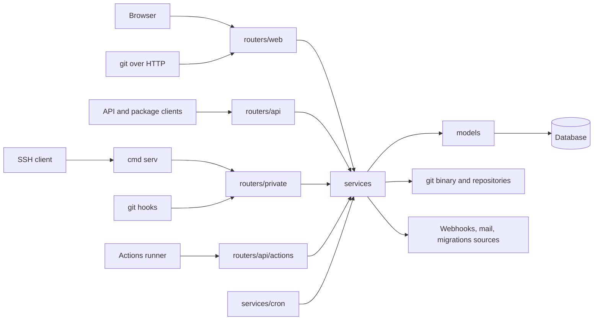
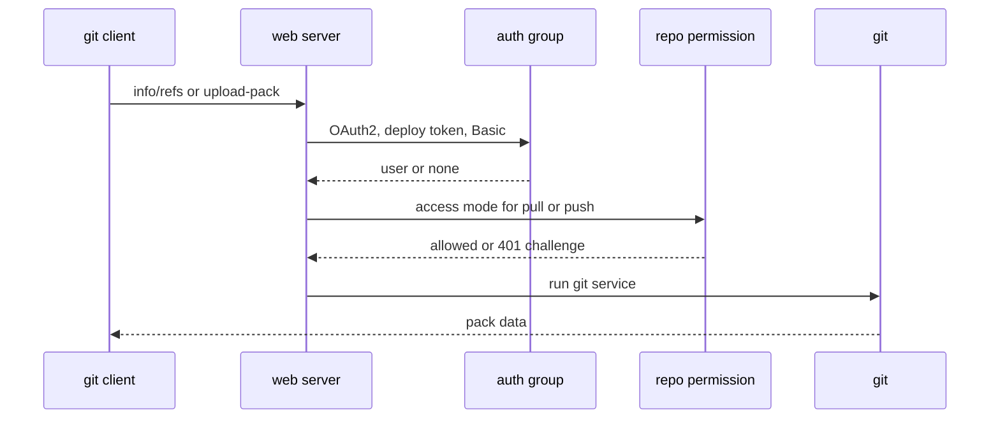
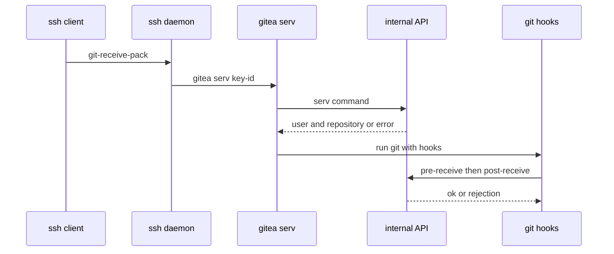
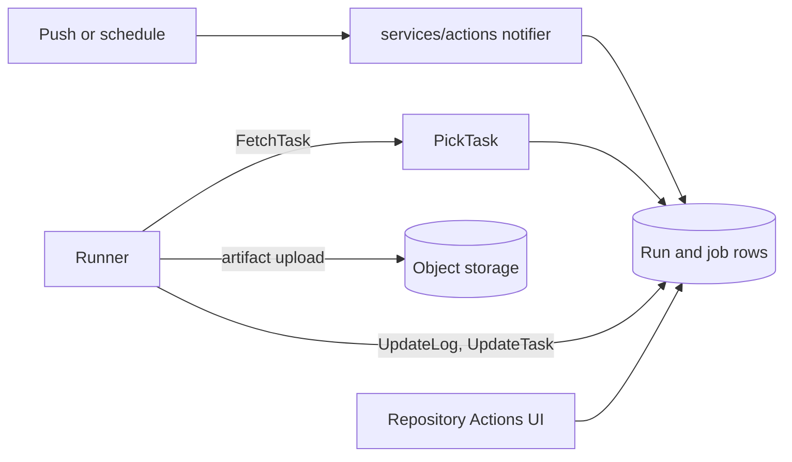
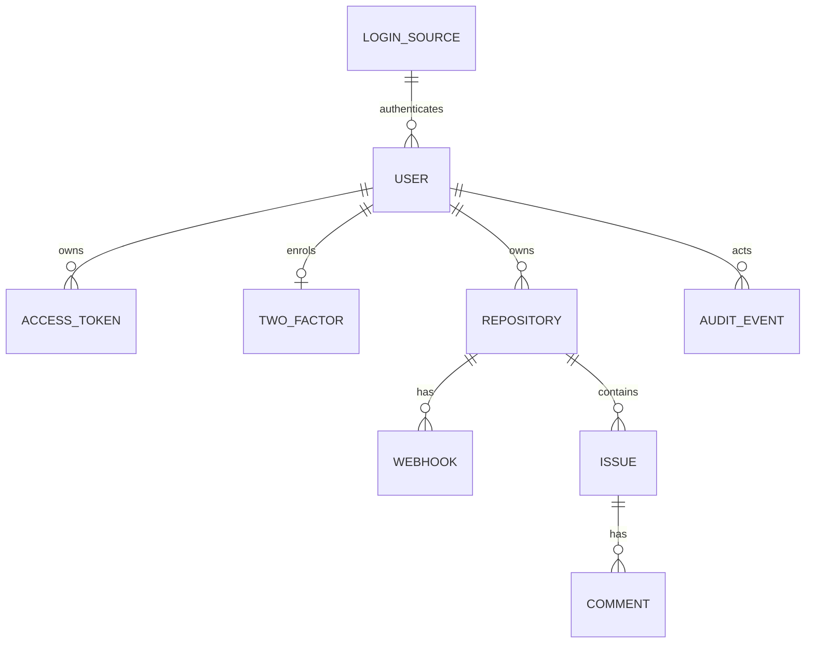

# gitea Documentation
<!-- appdoc:template 2.7 -->

**Target:** gitea | **Commit:** a61ad4876a6c8e6b3803c74d4423615e2571613b | **Evidence date:** 2026-11-23

**How to read this document.** *Cited* claims carry a path-and-line Citation. **Inferred:** marks reasoning from cited evidence. *Unknown* items are listed in section 14 and must not be assumed. Secret values are never reproduced; their locations are cited with "value omitted". The Evidence Register (source-to-claim audit) is rendered as Appendix A. An independent audit with delta passes covered the planned items and its findings were applied by hand.

## 1. Application Index

| Support need | Primary screen or file | Workflow |
|---|---|---|
| A new instance shows the installer or will not start | `cmd/web.go:261-298`, `routers/install/install.go:63` | [7.1 Install a new instance](#71-install-a-new-instance) |
| A user cannot sign in or is locked out of two-factor | `routers/web/auth/auth.go:288`, `models/auth/twofactor.go:125` | [7.2 Sign in and sign out](#72-sign-in-and-sign-out) |
| Create or recover an account | `routers/web/auth/auth.go:552`, `cmd/admin_user_create.go:24` | [7.3 Provision an account](#73-provision-an-account) |
| An API call returns 401 or 403 | `routers/api/v1/api.go:277-319`, `routers/web/user/setting/applications.go:67` | [7.4 Create a personal access token and call the API](#74-create-a-personal-access-token-and-call-the-api) |
| Create or import a repository | `routers/web/repo/repo.go:193`, `routers/web/repo/migrate.go:125` | [7.5 Create or migrate a repository](#75-create-or-migrate-a-repository) |
| A push or clone is refused | `routers/web/repo/githttp.go:62`, `routers/private/serv.go:68` | [7.6 Push and pull over HTTP and SSH](#76-push-and-pull-over-http-and-ssh) |
| A pull request cannot be merged | `routers/web/repo/pull.go:1088`, `services/pull/merge.go:308` | [7.7 Open, review and merge a pull request](#77-open-review-and-merge-a-pull-request) |
| Issues, labels and milestones | `routers/web/repo/issue_new.go:331` | [7.8 Create and edit issues, labels and milestones](#78-create-and-edit-issues-labels-and-milestones) |
| CI jobs do not start | `routers/api/actions/runner/runner.go:168`, `services/actions/task.go:66` | [7.9 Run a CI workflow with Actions](#79-run-a-ci-workflow-with-actions) |
| Package upload or download fails | `routers/api/packages/api.go:92`, `routers/api/packages/generic/generic.go:74` | [7.10 Publish and install a package](#710-publish-and-install-a-package) |
| A webhook is not delivered | `services/webhook/deliver.go:147` | [7.11 Deliver a webhook](#711-deliver-a-webhook) |
| Administer or impersonate a user | `routers/web/admin/users.go:568`, `cmd/admin_user.go:30` | [7.12 Administer users and impersonate](#712-administer-users-and-impersonate) |
| A scheduled task failed | `services/cron/tasks.go:100`, `services/cron/tasks_basic.go:31` | [7.13 Run scheduled jobs](#713-run-scheduled-jobs) |
| Back up or upgrade | `cmd/dump.go:26`, `contrib/upgrade.sh:3` | [7.14 Back up and upgrade](#714-back-up-and-upgrade) |
| Organizations and teams | `routers/web/org/org.go:46`, `routers/web/web.go:944` | [7.15 Create and manage organizations and teams](#715-create-and-manage-organizations-and-teams) |
| Configuration reference and secrets | `custom/conf/app.example.ini:437`, `modules/setting/security.go:134` | [7.1 Install a new instance](#71-install-a-new-instance) |
| Security findings | `routers/install/install.go:74`, `modules/setting/security.go:147` | [7.2 Sign in and sign out](#72-sign-in-and-sign-out) |

## 2. Coverage and Overview

### 2.1 What was inspected

The Facts cover the Go backend as a supported Stack. The Node.js frontend (`package.json:1-10`) and the Python lint tooling (`pyproject.toml:1-10`) are unsupported Stacks: only generic Facts (files, dependencies, config keys) exist for them, so this document describes them from reading source and marks anything it did not establish as Unknown. The extracted Facts list <!-- appdoc:count routes -->1431<!-- /appdoc:count --> routes and <!-- appdoc:count commands -->72<!-- /appdoc:count --> CLI commands (the generated blocks in section 4 and below state the breakdown), and <!-- appdoc:count jobs -->31<!-- /appdoc:count --> scheduled jobs registered under `services/cron/tasks_basic.go:31`, `services/cron/tasks_extended.go:26` and `services/cron/tasks_actions.go:27`.

The generated block below lists no folder that looks retired by name and no folder that duplicates another folder, so no copy needs to be named live or dead. The two container image variants are separate on purpose and both live: `Dockerfile:41` copies `docker/root` while `Dockerfile.rootless:40` copies `docker/rootless`. No folder was pruned and the ignore file appdocignore does not exist in the Target.

What was not read in depth: the HTML templates under `templates/`, the locale bundles under `options/locale/`, the static assets under `public/` and the TypeScript and CSS under `web_src/` were sampled by file name and by the handlers that render them, not read line by line. The `modelmigration/` folder (one file per schema migration) was inspected for structure only. Test suites under `tests/` and the `*_test.go` files were used as evidence of intended behavior where cited in section 11 and not otherwise reviewed. The runtime configuration file that Gitea writes on first start was never available (only the examples and templates in `custom/conf/app.example.ini:1-60`, `docker/root/etc/templates/app.ini:1-60` and `docker/rootless/etc/templates/app.ini:1-57` were read), so the effective values of any deployed instance are Unknown - see Open questions. No running instance, database or runner was exercised.

<!-- appdoc:generated scan-coverage -->
| Stack | Supported | Files read |
|---|---|---|
| go | yes | 3184 |
| node | no (generic only) | 1 |
| python | no (generic only) | 1 |

Files found: 6415 = scanned 6415 + pruned 0 + ignored by .appdocignore 0.

| Top folder | Files scanned |
|---|---|
| `modules/` | 1288 |
| `tests/` | 886 |
| `services/` | 746 |
| `templates/` | 608 |
| `routers/` | 519 |
| `public/` | 502 |
| `models/` | 469 |
| `web_src/` | 419 |
| `modelmigration/` | 407 |
| `options/` | 331 |
| `cmd/` | 58 |
| `.github/` | 33 |
| `contrib/` | 31 |
| `docker/` | 21 |
| `tools/` | 19 |
| `build/` | 10 |
| `docs/` | 9 |
| `assets/` | 4 |
| `snap/` | 3 |
| `.devcontainer/` | 1 |
| `custom/` | 1 |

No folders were pruned.
<!-- /appdoc:generated scan-coverage -->

### 2.2 Purpose and users

Gitea describes its goal as an easy, self-hosted all-in-one development service covering Git hosting, code review, issue tracking, project kanban, wiki, team collaboration, a package registry and CI/CD that can reuse GitHub Actions workflows (`README.md:14-20`). The users the code distinguishes are anonymous visitors, signed-in individuals, restricted users, organization members and owners, site administrators, bot accounts and Actions task identities (`models/user/user.go:50-66`, `models/user/user.go:140-151`, `models/perm/access_mode.go:15-22`). The business purpose and the named owners of any specific deployment are not in the Target: Unknown - see Open questions.

Overall risk posture: the default configuration disables self-registration and requires no token to read public content (`modules/setting/service.go:141`, `modules/setting/service.go:163`, `custom/conf/app.example.ini:853`); the most severe finding is V-1 (the installer echoes stored database and SMTP passwords while the install lock is unset) at High, followed by V-2 (reverse-proxy header trust when that mode is enabled), V-3 (the shared fallback secret key), V-4 and V-5 at Medium, and then V-6 to V-11 at Low.

### 2.3 System boundary

Inside the Target is one Go binary that serves the web UI, the REST API, the package registries, the Actions runner protocol, Git over HTTP, LFS and an internal API used by its own `serv` and `hook` subcommands (`routers/init.go:176-207`, `cmd/serv.go:40`, `cmd/hook.go:33`), together with a built-in or external SSH front end (`modules/setting/ssh.go:20-21`), a cron scheduler (`services/cron/tasks_basic.go:31`) and background queues (`modules/queue/manager.go`). The frontend sources in `web_src/` are compiled by Vite into `public/assets` and embedded or served alongside the binary (`Makefile:110-113`, `vite.config.ts:1-12`).

Outside the Target, and touched by it: the relational database (`models/db/engine_init.go:28-34`), the `git` executable (`routers/init.go:115-118`), optional Redis, Elasticsearch, Meilisearch, S3-compatible and Azure Blob storage, SMTP and IMAP mail servers, LDAP, PAM and external OAuth2 identity providers (`custom/conf/app.example.ini:1592-1666`, `custom/conf/app.example.ini:2891-3017`, `services/auth/source/ldap/source.go:59`), webhook receivers (`services/webhook/deliver.go:34-92`), migration sources such as GitHub, GitLab and Bitbucket (`services/migrations/github_graphql.go:166`, `services/migrations/bitbucket.go:179`), the Cloudflare, hCaptcha, reCAPTCHA and mCaptcha verification services (`modules/turnstile/turnstile.go:47`, `modules/hcaptcha/hcaptcha.go:96`, `modules/recaptcha/recaptcha.go:35`, `modules/mcaptcha/mcaptcha.go:44`), the Have I Been Pwned range API (`modules/auth/password/pwn/pwn.go:22`) and the Gitea release feed (`services/cron/tasks_extended.go:168`). Runner machines that execute Actions jobs are separate processes that call back over the runner protocol (`routers/api/actions/actions.go:20-24`).

## 3. Architecture

### 3.1 Components

- **Entry binary and CLI.** `./main.go:36-45` builds the `urfave/cli` application from `cmd/`; `gitea web` (`cmd/web.go:41`) starts the server, while `serv`, `hook` and `keys` are internal commands called by SSH and Git (`cmd/serv.go:40`, `cmd/hook.go:33`, `cmd/keys.go:21`).
- **HTTP routing (`routers/`).** `routers/init.go:176-214` mounts the web UI at the root, the REST API at `/api/v1`, the internal API at `/api/internal`, and conditionally the package registries and Actions endpoints; `routers/web/web.go:257-321` assembles the web middleware chain (sessioner, context, audit origin, authentication, QoS) and `routers/install/routes.go:19-40` serves only the installer until installation is locked.
- **Services (`services/`).** Business logic grouped by domain: authentication (`services/auth/group.go:1-60`), context (`services/context/context.go:174-176`), pull requests (`services/pull/merge.go:308`), Actions task dispatch (`services/actions/task.go:66`), webhooks (`services/webhook/deliver.go:147`), migrations (`services/migrations/migrate.go`), cron (`services/cron/tasks_basic.go:31`), audit (`services/audit/event.go`) and mail (`services/mailer/`).
- **Models and migrations (`models/`, `modelmigration/`).** XORM entities such as the user (`models/user/user.go:101`), repository (`models/repo/repo.go:153`), access token (`models/auth/access_token.go:20`), webhook (`models/webhook/webhook.go:123`) and audit event (`models/audit/audit_event.go:20`); schema migrations run at start unless disabled (`routers/common/db.go:43-58`).
- **Modules (`modules/`).** Framework-independent libraries: configuration loading (`modules/setting/security.go:134-215`), sessions (`modules/session/session.go:110-135`), storage backends (`modules/storage/storage.go`), queues (`modules/queue/manager.go`), caches (`modules/cache/cache.go`), indexers (`modules/indexer/issues/indexer.go`), the egress policy (`modules/egress/policies.go:86`) and markup renderers registered in `./main.go:17-22`.
- **Frontend (`web_src/`, `templates/`, `options/`, `public/`).** Go HTML templates in `templates/`, TypeScript, Vue and CSS in `web_src/` built by Vite (`vite.config.ts:1-12`), embedded data and locales in `options/`, and prebuilt static files in `public/` (`Makefile:110-116`).
- **Tests and tooling (`tests/`, `tools/`, `build/`, `.github/`).** Integration, end-to-end and migration tests (`Makefile:436-473`), build generators (`build/generate-emoji.go:81`) and CI workflows (`.github/workflows/pull-db-tests.yml:1-20`).

### 3.2 Diagram



Caption: component view of the request paths mounted in `routers/init.go:176-207`, with the internal API reached by the `serv` and `hook` commands (`cmd/serv.go:40`, `cmd/hook.go:33`).

### 3.3 Authentication and authorization

Web requests build an ordered authentication group: OAuth2 token, deploy token and HTTP Basic only on routes that opt in, then reverse-proxy header auth when enabled, then the session, then SSPI on Windows (`routers/web/web.go:124-160`). The first method that returns a user wins and earlier errors are ignored (`services/auth/group.go:44-70`). API requests use OAuth2/PAT bearer tokens, HTTP signatures and Basic, plus reverse-proxy auth when `ENABLE_REVERSE_PROXY_AUTHENTICATION_API` is on (`routers/api/v1/api.go:851-862`). Package registries have their own per-ecosystem group (`routers/api/packages/api.go:71-90`, `routers/api/packages/auth.go:18-52`), the Actions runner protocol authenticates with a runner UUID and token (`routers/api/actions/runner/interceptor.go:56-66`), and the internal API requires a shared token header (`routers/private/internal.go:25-43`).

Authorization is layered: `verifyAuthWithOptionsWeb` applies sign-in, sign-out, admin and cross-origin checks per route (`routers/web/web.go:178-258`); repository and unit permissions come from `context.RepoAssignment`, `context.RequireUnitReader` and `context.RequireUnitWriter` (`routers/web/web.go:896-899`); the API repeats the pattern with `reqToken`, `reqSiteAdmin`, `reqRepoAdmin` and scope checks (`routers/api/v1/api.go:277-360`). Cross-site request forgery is handled by Go's cross-origin protection and `SameSite` cookies rather than a form token: `services/context/context.go:174-176` records that the CSRF token was dropped, and `routers/web/web.go:179` creates the standard-library cross-origin check that `routers/web/web.go:221` applies. A successful login regenerates the session (`routers/web/auth/auth.go:397-403`) and the cookie is `HttpOnly` with `Secure` derived from the root URL scheme (`modules/session/session.go:125-135`, `modules/setting/session.go:64`).
## 4. Functional Inventory

<!-- appdoc:generated entry-points -->
12 route handler files; 1431 routes; 0 pages; 72 commands; 31 jobs.

| Handler file | Kinds | Routes | Pages | Jobs | Commands |
|---|---|---|---|---|---|
| `routers/web/web.go` | route | 691 | 0 | 0 | 0 |
| `routers/api/v1/api.go` | route | 503 | 0 | 0 | 0 |
| `routers/api/packages/api.go` | route | 170 | 0 | 0 | 0 |
| `routers/private/internal.go` | route | 21 | 0 | 0 | 0 |
| `routers/web/githttp.go` | route | 12 | 0 | 0 | 0 |
| `routers/common/lfs.go` | route | 10 | 0 | 0 | 0 |
| `routers/install/routes.go` | route | 7 | 0 | 0 | 0 |
| `cmd/web.go` | command, route | 6 | 0 | 0 | 1 |
| `routers/api/actions/artifacts.go` | route | 6 | 0 | 0 | 0 |
| `routers/api/actions/actions.go` | route | 3 | 0 | 0 | 0 |
| `models/unittest/mock_http.go` | route | 1 | 0 | 0 | 0 |
| `routers/init.go` | route | 1 | 0 | 0 | 0 |
| `cmd/actions.go` | command | 0 | 0 | 0 | 2 |
| `cmd/admin.go` | command | 0 | 0 | 0 | 5 |
| `cmd/admin_auth.go` | command | 0 | 0 | 0 | 2 |
| `cmd/admin_auth_ldap.go` | command | 0 | 0 | 0 | 4 |
| `cmd/admin_auth_oauth.go` | command | 0 | 0 | 0 | 2 |
| `cmd/admin_auth_smtp.go` | command | 0 | 0 | 0 | 2 |
| `cmd/admin_regenerate.go` | command | 0 | 0 | 0 | 2 |
| `cmd/admin_user.go` | command | 0 | 0 | 0 | 1 |
| `cmd/admin_user_change_password.go` | command | 0 | 0 | 0 | 1 |
| `cmd/admin_user_change_type.go` | command | 0 | 0 | 0 | 1 |
| `cmd/admin_user_create.go` | command | 0 | 0 | 0 | 1 |
| `cmd/admin_user_delete.go` | command | 0 | 0 | 0 | 1 |
| `cmd/admin_user_disable_2fa.go` | command | 0 | 0 | 0 | 1 |
| `cmd/admin_user_generate_access_token.go` | command | 0 | 0 | 0 | 1 |
| `cmd/admin_user_list.go` | command | 0 | 0 | 0 | 1 |
| `cmd/admin_user_must_change_password.go` | command | 0 | 0 | 0 | 1 |
| `cmd/cert.go` | command | 0 | 0 | 0 | 1 |
| `cmd/config.go` | command | 0 | 0 | 0 | 2 |
| `cmd/docs.go` | command | 0 | 0 | 0 | 1 |
| `cmd/doctor.go` | command | 0 | 0 | 0 | 3 |
| `cmd/doctor_convert.go` | command | 0 | 0 | 0 | 1 |
| `cmd/dump.go` | command | 0 | 0 | 0 | 1 |
| `cmd/dump_repo.go` | command | 0 | 0 | 0 | 1 |
| `cmd/embedded.go` | command | 0 | 0 | 0 | 4 |
| `cmd/generate.go` | command | 0 | 0 | 0 | 8 |
| `cmd/hook.go` | command | 0 | 0 | 0 | 5 |
| `cmd/keys.go` | command | 0 | 0 | 0 | 1 |
| `cmd/manager.go` | command | 0 | 0 | 0 | 6 |
| `cmd/manager_logging.go` | command | 0 | 0 | 0 | 5 |
| `cmd/migrate.go` | command | 0 | 0 | 0 | 1 |
| `cmd/migrate_storage.go` | command | 0 | 0 | 0 | 1 |
| `cmd/restore_repo.go` | command | 0 | 0 | 0 | 1 |
| `cmd/serv.go` | command | 0 | 0 | 0 | 1 |
| `services/cron/tasks_actions.go` | job | 0 | 0 | 6 | 0 |
| `services/cron/tasks_basic.go` | job | 0 | 0 | 10 | 0 |
| `services/cron/tasks_extended.go` | job | 0 | 0 | 15 | 0 |
<!-- /appdoc:generated entry-points -->

| ID | Area | Feature | Entry point | Inputs, outputs and rules | Dependencies | Status |
|---|---|---|---|---|---|---|
| F-1 | CLI | Run the server and control a running process: `web`, `manager` (shutdown, restart, reload templates, flush queues, processes), `logging`, plus the internal `serv`, `hook` and `keys` commands called by SSH and Git | `cmd/web.go:41`, `cmd/manager.go:18`, `cmd/manager_logging.go:18`, `cmd/serv.go:40`, `cmd/hook.go:33` | `web` loads settings, shows the installer when `INSTALL_LOCK` is unset, otherwise serves the application and records startup and shutdown audit events (`cmd/web.go:232-238`); the manager commands call the internal API with the shared internal token (`routers/private/internal.go:89-97`); further command files: `cmd/keys.go:21` | Internal API (F-21), configuration (`modules/setting/security.go:134-215`) | Cited |
| F-2 | CLI | Administer authentication sources and generated files: `admin` (repo-sync-releases, sendmail), `admin auth` (list, delete, add and update LDAP, OAuth, SMTP), `admin regenerate` (hooks, keys) | `cmd/admin.go:22`, `cmd/admin_auth.go:22`, `cmd/admin_auth_ldap.go:179`, `cmd/admin_auth_oauth.go:137`, `cmd/admin_auth_smtp.go:75` | Operator-supplied flags; writes authentication sources to the database and rewrites hooks and `authorized_keys`; no application login is involved, access is whoever can run the binary with the configuration; further command files: `cmd/admin_regenerate.go:18` | Database (C-1), auth sources (C-9) | Cited |
| F-3 | CLI | Manage users: `admin user` create, list, delete, change-password, change-type, must-change-password, disable-2fa, generate-access-token | `cmd/admin_user.go:30`, `cmd/admin_user_create.go:24`, `cmd/admin_user_delete.go:22`, `cmd/admin_user_change_password.go:22`, `cmd/admin_user_change_type.go:19` | Flags select the user by id, name or email; `disable-2fa` and `generate-access-token` act without the user's involvement; further command files: `cmd/admin_user_disable_2fa.go:21`, `cmd/admin_user_generate_access_token.go:19`, `cmd/admin_user_list.go:19`, `cmd/admin_user_must_change_password.go:18` | Database (C-1) | Cited |
| F-4 | CLI | Maintenance: `dump` (zip of files and database), `dump-repo`, `restore-repo`, `doctor` (check, recreate-table, convert), `migrate`, `migrate-storage` | `cmd/dump.go:26`, `cmd/dump_repo.go:28`, `cmd/restore_repo.go:18`, `cmd/doctor.go:28`, `cmd/doctor_convert.go:18` | `migrate` runs the versioned schema migration so users can be created before the first server start (`cmd/migrate.go:19-40`); `dump` is described as usable for backup (`cmd/dump.go:26-30`); further command files: `cmd/migrate.go:19`, `cmd/migrate_storage.go:30` | Database (C-1), object storage (C-7) | Cited |
| F-5 | CLI | Utilities: `actions generate-runner-token`, `cert`, `config edit-ini`, `docs`, `embedded` (list, view, extract), `generate` (secret, ssh, INTERNAL_TOKEN, JWT_SECRET, SECRET_KEY, key, host-keys) | `cmd/actions.go:17`, `cmd/cert.go:31`, `cmd/config.go:19`, `cmd/docs.go:18`, `cmd/embedded.go:29` | Generates secrets and key material for the operator to place in configuration; values are printed to the terminal; further command files: `cmd/generate.go:22` | Configuration (`modules/setting/security.go:134-215`) | Cited |
| F-6 | Install | First-run installer: a form that sets database, paths, mail, the first administrator and registration policy, then writes the configuration file | `routers/install/routes.go:30-32`, `routers/install/install.go:63`, `routers/install/install.go:190` | Unauthenticated until `INSTALL_LOCK` is set; both handlers return the done page when it is set (`routers/install/install.go:64-67`, `routers/install/install.go:191-194`); on success generates a secret key if none exists (`routers/install/install.go:393-400`) | Database (C-1), configuration file | Cited |
| F-7 | Authentication | Sign in (password, two-factor TOTP, WebAuthn, passkey), sign up, account activation, password recovery, external OAuth2 sign-in, account linking, sign out | `routers/web/web.go:567-607`, `routers/web/web.go:725-747`, `routers/web/auth/auth.go:288`, `routers/web/auth/auth.go:552` | Sign-in form with optional captcha, sign-up closed by default and gated by password length, complexity and breach checks (`routers/web/auth/auth.go:560-603`); a login regenerates the session (`routers/web/auth/auth.go:397-403`) | Database (C-1), session store (C-4), auth sources (C-9), mail (C-8), HIBP (X-7) | Cited |
| F-8 | OAuth2 provider | Gitea as an OAuth2 and OpenID Connect provider: authorize, grant, access_token, userinfo, keys, introspect, discovery | `routers/web/web.go:592-606`, `routers/web/web.go:520-521` | Enabled only when OAuth2 is enabled (`routers/web/web.go:362-367`, `routers/web/auth/oauth2_wellknown.go:17`); authorize and grant require sign-in, token endpoints accept any origin | Database (C-1) | Cited |
| F-9 | Account settings | User settings: profile, account, appearance, notifications, security (2FA, WebAuthn), applications and OAuth2 apps, SSH, GPG and principal keys, packages, Actions secrets and runners, webhooks, blocked users | `routers/web/web.go:608-723` | All behind sign-in (`routers/web/web.go:723`); creates and deletes personal access tokens, keys, OAuth2 applications and webhooks | Database (C-1), webhooks (F-23) | Cited |
| F-10 | Administration | Site administration UI: dashboard, configuration, monitoring (audit logs, queues, cron, stacktrace, perftrace), users (create, edit, delete, impersonate, bot tokens), organizations, repositories, packages, emails, hooks, authentication sources, notices, applications, Actions | `routers/web/web.go:749-876` | Admin-only through the admin verify options (`routers/web/web.go:243-248`) | Database (C-1), queues (C-5) | Cited |
| F-11 | Organizations | Create organizations and teams, members and invitations, org-level settings (applications, hooks, labels, Actions, packages, blocked users) | `routers/web/web.go:937-1070` | Membership and ownership checks through `OrgAssignment` with the RequireMember, RequireTeamMember and RequireOwner options (`routers/web/web.go:955-982`, `routers/web/web.go:1067`) | Database (C-1) | Cited |
| F-12 | Repositories | Create, migrate, search and configure repositories: settings, collaborators and teams, protected branches and tags, hooks, deploy keys, LFS, Actions, danger-zone operations | `routers/web/web.go:1071-1078`, `routers/web/web.go:1146-1270`, `routers/web/repo/repo.go:193` | Creation requires sign-in; settings require repository admin; destructive operations sit behind the danger zone | Database (C-1), git repositories (C-2) | Cited |
| F-13 | Repositories | Browse and edit code: file views, raw and media, blame, commits, branches, tags, releases, archives, wiki, activity graphs, search, stars and watches | `routers/web/web.go:1418-1517`, `routers/web/web.go:1586-1626`, `routers/web/web.go:1658-1746` | Read access through `RepoAssignment` and unit readers; archive and source downloads can be disabled (`routers/web/web.go:403-408`) | Git repositories (C-2), indexers (C-6) | Cited |
| F-14 | Issues and pull requests | Issues, pull requests, comments, labels, milestones, reviews, merge, auto-merge, time tracking, dependencies, projects | `routers/web/web.go:1271-1417`, `routers/web/web.go:1519-1540`, `routers/web/web.go:1628-1657`, `routers/web/repo/pull.go:1088` | Merge checks the pull request state, permission, work-in-progress flag, required checks and signatures before merging (`routers/web/repo/pull.go:1110-1139`) | Database (C-1), git repositories (C-2), indexers (C-6), webhooks (F-23) | Cited |
| F-15 | Git transport | Smart HTTP git (upload-pack, receive-pack, upload-archive, info/refs, dumb-protocol files) and the LFS API | `routers/web/githttp.go:12-24`, `routers/common/lfs.go:17-29`, `routers/web/repo/githttp.go:62-162` | Anonymous pulls only for public repositories and owners, or where the repository grants anonymous access, unless sign-in is required; unauthenticated callers otherwise get a 401 challenge and signed-in callers without access get 404 (`routers/web/repo/githttp.go:137-161`, `routers/web/repo/githttp.go:197-199`); LFS uses its own JWT handling (`routers/web/web.go:1750-1752`) | Git repositories (C-2), object storage (C-7) | Cited |
| F-16 | REST API | API v1 repository surface: repositories, contents, branches, tags, commits, issues, pull requests, releases, hooks, keys, Actions, statuses, topics | `routers/api/v1/api.go:1239-1730` | Token scopes by category and HTTP method (`routers/api/v1/api.go:277-308`), then repository permission checks (`routers/api/v1/api.go:378-418`) | Database (C-1), git repositories (C-2) | Cited |
| F-17 | REST API | API v1 identity surface: users, current user, keys, tokens, notifications, organizations, teams, admin (cron, users, hooks, runners), settings, markup | `routers/api/v1/api.go:1011-1235`, `routers/api/v1/api.go:1732-1880` | Admin routes require the admin scope, a token, site admin and a non-public-only token (`routers/api/v1/api.go:1827-1876`) | Database (C-1) | Cited |
| F-18 | Packages | Package registries mounted at `/api/packages` and `/v2`: one router per ecosystem (npm, Maven, NuGet, PyPI, Cargo, container, Debian, RPM, Helm, Go, Composer, Conan and others) | `routers/api/packages/api.go:92-110`, `routers/api/packages/api.go:523` | Each ecosystem enforces `reqPackageAccess` for reads and writes (`routers/api/packages/api.go:42-58`); enabled only when packages are enabled (`routers/init.go:188-194`) | Object storage (C-7), database (C-1) | Cited |
| F-19 | Actions | Runner protocol (register, declare, fetch task, update task and log), artifact upload and download (v1 and v4), job summaries and OIDC token endpoints | `routers/api/actions/actions.go:15-27`, `routers/api/actions/artifacts.go:108-130`, `routers/api/actions/runner/runner.go:168` | Runners authenticate with UUID and token and receive tasks only when not disabled (`routers/api/actions/runner/interceptor.go:56-66`, `services/actions/task.go:66-73`) | Database (C-1), object storage (C-7) | Cited |
| F-20 | Actions | Repository Actions UI: list runs, run, rerun, cancel, approve, delete, logs, artifacts and workflow badges | `routers/web/web.go:1541-1584` | Writer permission for run, rerun, cancel, approve and delete; admin permission to enable or disable a workflow (`routers/web/web.go:1544-1573`) | Actions runners (F-19) | Cited |
| F-21 | Internal API | Endpoints for `serv`, `hook`, `keys` and `manager`: SSH key lookup, pre-receive, post-receive, proc-receive, serv, process manager, mail send, restore repo, runner token generation | `routers/private/internal.go:71-100` | Every request must carry the internal token header (`routers/private/internal.go:25-43`) | Git repositories (C-2) | Cited |
| F-22 | Scheduled jobs | Cron tasks for mirrors, health checks, statistics, archive and branch cleanup, external user sync, hook-task cleanup, package cleanup, Actions housekeeping, audit and notice pruning, update check | `services/cron/tasks_basic.go:31`, `services/cron/tasks_extended.go:26`, `services/cron/tasks_actions.go:27` | Schedules and defaults are in the generated 16.7 block; administrators can trigger a task from the API (`routers/api/v1/api.go:1828-1831`) | Database (C-1), git repositories (C-2) | Cited |
| F-23 | Webhooks | Webhook management at user, organization, repository and system level for Gitea, Gogs, Slack, Discord, DingTalk, Telegram, Matrix, MS Teams, Feishu, WeCom and Packagist, and the delivery queue | `routers/web/web.go:448-480`, `routers/web/web.go:706-718`, `services/webhook/deliver.go:147` | Deliveries are queued, sent with an HMAC secret and recorded with the Authorization header masked (`services/webhook/deliver.go:91`, `services/webhook/deliver.go:186-192`) | Queues (C-5), external receivers (X-1) | Cited |
| F-24 | Migrations | Import a repository and its issues, pull requests and releases from GitHub, GitLab, Gitea, Gogs, Bitbucket, Bitbucket Server, CodeCommit, OneDev, Codebase or a plain git URL | `routers/web/web.go:1073-1074`, `routers/web/web.go:1146-1152`, `routers/api/v1/repo/migrate.go`, `services/migrations/migrate.go` | Outbound requests use the migration egress policy (`services/migrations/http_client.go:37`) | External sources (X-2, X-3, X-4), database (C-1) | Cited |
| F-25 | Operations endpoints | Health check, metrics, robots, ssh_info, Swagger and OpenAPI documents, sitemap, node info and WebFinger, websocket, profiling | `routers/web/web.go:290-298`, `routers/web/web.go:306-308`, `routers/web/web.go:518-524`, `routers/web/web.go:1769-1771`, `cmd/web.go:246-251` | Metrics need a bearer token only if one is configured (`routers/web/metrics.go:14-26`); profiling listens on localhost when enabled (`cmd/web.go:238-257`); the websocket is mounted at `routers/web/web.go:590` | Configuration | Cited |

### 4.1 Subsystem inventory

| Subsystem | Files | Features | Primary data and dependencies | Purpose | Status |
|---|---|---|---|---|---|
| `modules/` | 1288 | F-1, F-5, F-15 | Settings, queues, storage, caches, indexers, egress policy | Framework-independent libraries (`modules/setting/security.go:134-215`) | Cited |
| `tests/` | 886 | none | Integration fixtures, end-to-end specs | Integration, end-to-end and fuzz tests (`Makefile:436-473`) | Cited |
| `services/` | 746 | F-14, F-19, F-22, F-23, F-24 | Database, git, mail, webhooks | Domain services behind handlers (`services/pull/merge.go:308`) | Cited |
| `templates/` | 608 | F-7, F-9, F-10, F-12 to F-14 | Go HTML templates | Server-rendered pages (`routers/web/home.go:25`) | Cited |
| `routers/` | 519 | F-6 to F-21, F-25 | Services, middleware | HTTP routing for web, API, packages, Actions, installer and internal API (`routers/init.go:176-214`) | Cited |
| `public/` | 502 | F-25 | Static files and built frontend assets | Served under `/assets` (`routers/web/web.go:265`) | Cited |
| `models/` | 469 | F-3, F-7, F-9 to F-14, F-19 | XORM entities and database | Persistent entities (`models/user/user.go:101`) | Cited |
| `web_src/` | 419 | F-7, F-14, F-20 | TypeScript, Vue, CSS | Frontend sources built by Vite (`vite.config.ts:1-12`) | Cited |
| `modelmigration/` | 407 | F-4 | Database schema | Versioned schema migrations run at start (`routers/common/db.go:43-58`) | Cited |
| `options/` | 331 | F-7, F-13 | Locales, license, gitignore, label templates | Embedded data and translations (`Makefile:116`) | Cited |
| `cmd/` | 58 | F-1 to F-5 | Settings, internal API | Command-line interface (`./main.go:36-45`) | Cited |
| `.github/` | 33 | none | CI workflows | Pull-request, nightly and release automation (`.github/workflows/pull-db-tests.yml:1-20`) | Cited |
| `contrib/` | 31 | none | Service files, upgrade script | Deployment helpers (`contrib/upgrade.sh:1-6`) | Cited |
| `docker/` | 21 | none | Image setup scripts and config templates | Container image content (`Dockerfile:41`) | Cited |
| `tools/` | 19 | none | Scripts | Test and release scripts (`Makefile:436-441`) | Cited |
| `build/` | 10 | none | Go generators | Build-time generators for emoji, gitignore and licenses (`build/generate-emoji.go:81`) | Cited |
| `docs/` | 9 | none | Markdown guides | Developer guides (`docs/testing.md:1-6`) | Cited |
| `assets/` | 4 | none | Logo and image sources | Brand assets (`Makefile:631-633`) | Inferred |
| `snap/` | 3 | none | Snap packaging | Snap build (`snap/snapcraft.yaml:1-3`) | Cited |
| `.devcontainer/` | 1 | none | Dev container definition | Developer environment | Inferred |
| `custom/` | 1 | none | Example configuration | The annotated settings example (`custom/conf/app.example.ini:1-60`) | Cited |
| `./main.go` | 50 | F-1 | Go entry and root files | Program entry (`./main.go:36-45`) | Cited |

## 5. Roles and Access Model

### 5.1 Observed role concepts

- **Anonymous visitor.** No session or token; may read public content unless `REQUIRE_SIGNIN_VIEW` is set (`modules/setting/service.go:163-170`, `routers/web/repo/githttp.go:130-146`).
- **Individual user types.** Individual, organization, reserved names, bot and remote user (`models/user/user.go:50-66`); sessions of accounts converted to bots are rejected (`services/auth/session.go:44-48`).
- **User flags.** Site administrator, restricted, active, prohibit-login, must-change-password (`models/user/user.go:113-151`).
- **Repository access modes.** None, read, write, admin and owner (`models/perm/access_mode.go:15-22`), applied per unit: code, issues, pull requests, releases, wiki, external wiki, external tracker, projects, packages and Actions (`models/unit/unit.go:23-36`).
- **Organization roles.** The built-in Owners team (`models/organization/team.go:72-73`) and other teams, with `reqOrgOwnership`, `reqOrgMembership` and `reqTeamMembership` checks in the API (`routers/api/v1/api.go:421-560`).
- **Token scopes.** `all`, `public-only`, `no-token-scope` and read or write scopes for activitypub, admin, misc, notification, organization, package, issue, repository, user and commit status (`models/auth/access_token_scope.go:58-90`).
- **Machine identities.** Actions runners with a UUID and token (`routers/api/actions/runner/interceptor.go:56-66`), Actions task users (`routers/api/packages/auth.go:41-42`), deploy keys and deploy tokens (`routers/web/web.go:136-138`), and the internal token holder (`routers/private/internal.go:25-43`).

### 5.2 Authorization enforcement

- **Web.** `verifyAuthWithOptionsWeb` enforces sign-in, sign-out, admin and cross-origin checks; prohibited and inactive accounts are intercepted there (`routers/web/web.go:178-258`). Admin routes use `adminReq` (`routers/web/web.go:243-248`). Repository groups chain `RepoAssignment` with unit readers and writers (`routers/web/web.go:1308-1309`, `routers/web/web.go:1737`).
- **API.** `apiAuth` authenticates, `verifyAuthWithOptionsAPI` applies sign-in and admin options, and each route adds scope and role middleware such as `reqToken`, `reqSiteAdmin`, `reqRepoWriter` and `reqOrgOwnership` (`routers/api/v1/api.go:864-922`, `routers/api/v1/api.go:311-418`). The `sudo` middleware lets a site admin act as another user (`routers/api/v1/api.go:111-146`).
- **Public-only tokens.** Rejected on endpoints that mix private data (`routers/api/v1/api.go:249-257`).
- **Packages.** Per-registry authentication groups then `reqPackageAccess` (`routers/api/packages/api.go:42-90`).
- **Routes with no check.** The home page, explore pages, sign-in and sign-up forms, the OAuth2 discovery and key documents, health check, robots, ssh_info, avatars, assets and (when no token is configured) metrics are reachable anonymously (`routers/web/web.go:262-298`, `routers/web/web.go:518-536`, `routers/web/metrics.go:14-17`). The installer is also unauthenticated until installation is locked (`routers/install/routes.go:25-40`).
- **Internal API.** Authenticated only by the shared header token; there is no per-user check (`routers/private/internal.go:25-43`).

### 5.3 Role-to-capability matrix

| Capability | Anonymous | Signed-in user | Repo or org admin | Site admin | Internal token holder |
|---|---|---|---|---|---|
| CLI (`cmd/web.go:41`) | | | | | |
| Install (`routers/install/routes.go:30-32`) | Y | | | | |
| Authentication (`routers/web/web.go:567-590`) | Y | | | | |
| OAuth2 provider (`routers/web/web.go:592-606`) | ? | Y | Y | Y | |
| Account settings (`routers/web/web.go:608-723`) | | Y | Y | Y | |
| Administration (`routers/web/web.go:749-876`) | | | | Y | |
| Organizations (`routers/web/web.go:937-1070`) | | ? | Y | Y | |
| Repositories (`routers/web/web.go:1071-1270`) | ? | ? | Y | Y | |
| Issues and pull requests (`routers/web/web.go:1271-1417`) | ? | ? | Y | Y | |
| Git transport (`routers/web/repo/githttp.go:130-161`) | ? | ? | Y | Y | |
| REST API (`routers/api/v1/api.go:962-964`) | ? | ? | Y | Y | |
| Packages (`routers/api/packages/api.go:42-58`) | ? | ? | Y | Y | |
| Actions (`routers/web/web.go:1541-1573`) | ? | ? | Y | Y | |
| Internal API (`routers/private/internal.go:25-43`) | | | | | Y |
| Scheduled jobs (`routers/api/v1/api.go:1828-1831`) | | | | Y | |
| Webhooks (`routers/web/web.go:706-718`) | | Y | Y | Y | |
| Migrations (`routers/web/web.go:1073-1074`) | | Y | Y | Y | |
| Operations endpoints (`routers/web/web.go:290-298`) | Y | | | Y | |
| Token scope view: admin API (`routers/api/v1/api.go:1876`) | | | | Y | |
| Token scope view: public-only token on private data (`routers/api/v1/api.go:249-257`) | | | | | |

**Restriction:** do not infer a permission from a visible control or a granted scope; enforcement is the code cited in 5.2.

## 6. UI Catalog

Source-only catalog; no screenshots or live session. A representative subset of the screens is catalogued; the remainder of the server-rendered templates under `templates/` are not individually listed (see Q-4).

| ID | Page | Route or entry | Reached from | Visible controls and data | States and effects | Roles and evidence |
|---|---|---|---|---|---|---|
| UI-1 | Installer | `/` while not installed | Any request before install | Database, general, mail and administrator fields; the stored database password is placed in the form (`templates/install.tmpl:41-42`) | Posts to `/`; writes the configuration (`routers/install/install.go:190`) | Anonymous; `routers/install/routes.go:30-32` |
| UI-2 | Home | `/` | Site root | Landing content or dashboard redirect (`routers/web/home.go:27-49`) | Renders the home template | Anonymous; `routers/web/web.go:518` |
| UI-3 | Sign in | `/user/login` | Home, any protected page | Username, password, remember me, external providers (`templates/user/auth/signin.tmpl`) | Wrong credentials re-render with an error; 2FA users are redirected (`routers/web/auth/auth.go:310-366`) | Anonymous; `routers/web/web.go:567` |
| UI-4 | Sign up | `/user/sign_up` | Sign-in page when registration is allowed | Name, email, password, retype, captcha (`templates/user/auth/signup.tmpl`) | Forbidden when registration is disabled (`routers/web/auth/auth.go:560-563`) | Anonymous; `routers/web/web.go:570` |
| UI-5 | Two-factor | `/user/two_factor` | After password sign-in | TOTP passcode or scratch code (`templates/user/auth/twofa.tmpl`) | Completes sign-in on success | Anonymous with a pending login; `routers/web/web.go:575-580` |
| UI-6 | Forgot password | `/user/forgot_password` | Sign-in page | Email field (`templates/user/auth/forgot_passwd.tmpl`) | Sends a recovery mail | Anonymous; `routers/web/web.go:732` |
| UI-7 | OAuth2 authorize | `/login/oauth/authorize` | Third-party application redirect | Grant or deny (`templates/user/auth/grant.tmpl`) | Issues an authorization code on grant | Signed-in; `routers/web/web.go:593-598` |
| UI-8 | Explore | `/explore/repos` | Site header | Repository, user and organization lists (`templates/explore/repos.tmpl`) | Requires sign-in only when configured (`routers/web/web.go:358`) | Anonymous or signed-in; `routers/web/web.go:539-555` |
| UI-9 | Dashboard | `/` when signed in and `/{org}/dashboard` | After sign-in | Activity feeds, repository list (`templates/user/dashboard/dashboard.tmpl`) | Renders feed per user or organization (`routers/web/user/home.go:79-137`) | Signed-in; `routers/web/web.go:956-957` |
| UI-10 | User profile | `/{username}` | Links, search | Profile, repositories, heatmap (`templates/user/profile.tmpl`) | Visibility checked against the viewer (`routers/web/web.go:880-891`) | Anonymous or signed-in; `routers/web/web.go:888` |
| UI-11 | User settings | `/user/settings` and sub-pages | User menu | Profile, account, security, applications, keys, packages, Actions, hooks (`templates/user/settings/profile.tmpl`) | Saves changes; token creation shows the value once | Signed-in; `routers/web/web.go:608-723` |
| UI-12 | New repository | `/repo/create` | Dashboard | Owner, name, visibility, template, initialization options (`templates/repo/create.tmpl`) | Creates the repository (`routers/web/repo/repo.go:193`) | Signed-in; `routers/web/web.go:1072-1073` |
| UI-13 | Migrate repository | `/repo/migrate` | New repository menu | Source type, clone URL, credentials, items to import (`templates/repo/migrate`) | Starts a background task (`routers/web/repo/migrate.go:125`) | Signed-in; `routers/web/web.go:1074-1075` |
| UI-14 | Repository home | `/{username}/{reponame}` | Search, profile | File tree, README, clone panel (`templates/repo/home.tmpl`) | Empty repositories show setup help (`routers/web/repo/view_home.go:276`) | Whoever the repository assignment admits (`routers/web/web.go:1267`); feeds also need code-unit read (`routers/web/repo/view_home.go:349`) |
| UI-15 | Issue list | `/{username}/{reponame}/issues` | Repository tabs | Filters, labels, milestones (`templates/repo/issue/list.tmpl`) | Query-driven list | Issues reader; `routers/web/web.go:1308` |
| UI-16 | Issue or pull request | `/{username}/{reponame}/issues/{index}` and `/pulls/{index}` | Lists | Conversation, sidebar, merge box (`templates/repo/issue/view.tmpl`) | Merge, close, comment, review | Issues or pulls reader and writer; `routers/web/web.go:1323`, `routers/web/web.go:1631` |
| UI-17 | Repository settings | `/{username}/{reponame}/settings` | Repository tabs | Options, collaborators, branches, hooks, keys, LFS, danger zone (`templates/repo/settings/options.tmpl`) | Destructive actions confirm by name | Repository admin; `routers/web/web.go:1158-1166` |
| UI-18 | Actions runs | `/{username}/{reponame}/actions` | Repository tabs | Workflow list, runs, job logs (`templates/repo/actions/list.tmpl`) | Run, rerun, cancel, approve | Actions reader and writer; `routers/web/web.go:1541-1573` |
| UI-19 | Wiki | `/{username}/{reponame}/wiki` | Repository tabs | Pages, editor (`templates/repo/wiki`) | Edit, create, delete pages | Wiki reader and writer; `routers/web/web.go:1586-1592` |
| UI-20 | Organization home | `/{org}` | Profile or search | Teams, members, repositories (`templates/org/home.tmpl`) | Follow or unfollow | Visibility checked; `routers/web/web.go:888` |
| UI-21 | Admin dashboard | `/-/admin` | User menu for admins | System status, operations (`templates/admin/dashboard.tmpl`) | Run maintenance operations (`routers/web/web.go:750-752`) | Site admin; `routers/web/web.go:749-752` |
| UI-22 | Admin users | `/-/admin/users` | Admin navigation | User list, create, edit, impersonate (`templates/admin/user/list.tmpl`) | Impersonation signs the admin in as the user (`routers/web/web.go:787`) | Site admin; `routers/web/web.go:782-795` |
| UI-23 | API documentation | `/api/swagger` | Footer link | Swagger viewer (`templates/swagger/openapi-viewer.tmpl`) | Static viewer | Anonymous when enabled; `routers/web/web.go:306-309` |
## 7. Workflows

### 7.1 Install a new instance

1. `gitea web` starts; when `INSTALL_LOCK` is not set it loads the installer routes only and serves the install page (`cmd/web.go:285-286`, `cmd/web.go:136-166`).
2. The installer pre-fills the form from the loaded settings, including the database and SMTP password fields (`routers/install/install.go:70-100`) and renders it (`routers/install/install.go:113-114`).
3. On submit it validates the git binary (`routers/install/install.go:212`) and the database connection (`routers/install/install.go:239`), generates a secret key only if none is configured (`routers/install/install.go:393-400`), writes the configuration file (`routers/install/install.go:429`) and creates the first administrator when an administrator name is supplied (`routers/install/install.go:452-470`).
4. Once the lock is set both handlers answer with the done page, and the next start serves the application (`routers/install/install.go:64-67`, `routers/install/install.go:191-194`, `cmd/web.go:168-170`).

Failure and escalation: a missing git binary re-renders the form with the error (`routers/install/install.go:212-215`) and a database failure is reported through the database check (`routers/install/install.go:239`); if the listener cannot open, the log says "Is Gitea already running?" (`cmd/web.go:152-156`); escalate when the installer remains reachable after setup because the lock was not persisted (`routers/install/install.go:64-67`).

### 7.2 Sign in and sign out

1. The browser posts the sign-in form; the handler refuses it when the password form is disabled, verifies a captcha if required, and calls the sign-in service (`routers/web/auth/auth.go:288-306`, `routers/web/auth/auth.go:308`).
2. The service finds the user by email or name, then checks the account source and that the account is not prohibited from login (`services/auth/signin.go:27-100`).
3. Users with TOTP or WebAuthn are redirected to the second factor with the pending user kept in a regenerated session (`routers/web/auth/auth.go:326-366`); passwordless passkey and external OAuth2 paths are mounted beside it (`routers/web/web.go:575-607`, `routers/web/web.go:737-740`).
4. Completion clears pending keys, regenerates the session, optionally issues a remember-me token cookie and stamps the last login (`routers/web/auth/auth.go:376-430`).
5. Sign out destroys the session and removes the remember cookie; an impersonating administrator is returned to the admin area instead (`routers/web/auth/auth.go:456-464`, `routers/web/auth/auth.go:467-489`).

Failure and escalation: wrong credentials show the generic "username or password incorrect" message and log a failed-attempt warning (`routers/web/auth/auth.go:309-314`); a prohibited account gets the prohibit page (`routers/web/auth/auth.go:316-319`); there is no lockout (see V-4), so escalate repeated failures from one source to the operator's log tooling.

### 7.3 Provision an account

1. Self-registration posts the sign-up form; it returns 403 unless registration is enabled (default disabled), then checks captcha, email domain, matching passwords, minimum length, complexity and the breach list before creating the user (`routers/web/auth/auth.go:552-612`, `modules/setting/service.go:141`).
2. An administrator can create a user in the admin UI or with `gitea admin user create` (`routers/web/web.go:784-785`, `cmd/admin_user_create.go:24`).
3. Activation by mail, password recovery and account linking use the routes in `routers/web/web.go:725-747`; password recovery shows the same reset-sent page for an unknown email and for an ordinary local account, but a non-local account gets a distinct error and a resend within the limit shows the rate-limited page (`routers/web/auth/password.go:70-75`, `routers/web/auth/password.go:82-86`, `routers/web/auth/password.go:88-92`).
4. An administrator can delete a user, which fails while the user still owns repositories unless purge is requested, and can never delete themself (`routers/web/admin/users.go:590-608`).

Failure and escalation: a rejected password shows the specific length, complexity or breach error (`routers/web/auth/auth.go:584-603`); if the breach service is unreachable the handler logs the request error and shows a generic message (`routers/web/auth/auth.go:594-600`); escalate when mail is not delivered, since recovery and activation depend on it (C-8).

### 7.4 Create a personal access token and call the API

1. The user opens application settings and submits a name and scopes; at least one permission scope is required, duplicate names are refused, and a token-authenticated request cannot mint a broader token (`routers/web/user/setting/applications.go:67-120`).
2. The token value is generated once, only its salted hash and last eight characters are stored (`models/auth/access_token.go:46-61`).
3. The client sends the token as a bearer header; `OAuth2` auth parses it, and query-string tokens are also accepted unless disabled (`services/auth/oauth2.go:83-110`, `modules/setting/security.go:224`).
4. Each API route then checks scope by category and by HTTP method, and role middleware (`routers/api/v1/api.go:277-308`).
5. Deleting or regenerating a token records an audit event (`routers/web/user/setting/applications.go:155-187`).

Failure and escalation: a missing token yields 401 "token is required" (`routers/api/v1/api.go:311-319`); an insufficient scope yields 403 naming the required and held scopes (`routers/api/v1/api.go:303-306`); escalate unexplained 403 responses by comparing the token's scopes with the route's category.

### 7.5 Create or migrate a repository

1. A signed-in user opens `/repo/create` and posts the create form, which validates template choices and the owner's creation rights before creating the repository (`routers/web/web.go:1072-1073`, `routers/web/repo/repo.go:193-250`).
2. Migration posts a source and credentials; the work runs as a background task whose failure message is shown only to the user who started it or to a repository admin (`routers/web/repo/migrate.go:125`, `routers/web/repo/migrate.go:277-283`).
3. Migration downloaders use the migration egress policy for outbound requests (`services/migrations/http_client.go:37`).
4. Repository settings let admins rename, transfer, archive, delete, change visibility and manage collaborators: the settings routes are behind the repository-admin requirement and the operations are the action cases of the settings handler (`routers/web/web.go:1158-1161`, `routers/web/web.go:1261`, `routers/web/repo/setting/setting.go:166-210`).

Failure and escalation: a task that ends failed shows its message to authorized users (`routers/web/repo/migrate.go:282`); escalate stuck migrations by inspecting the task queue in the admin monitor (`routers/web/web.go:765-780`).

### 7.6 Push and pull over HTTP and SSH

1. For HTTP, the client calls the smart-protocol routes mounted with Basic, OAuth2 and deploy-token auth; HTTP git can be disabled globally (`routers/web/web.go:1750-1757`, `routers/web/repo/githttp.go:41-46`).
2. `httpBase` classifies the service as pull or push, rejects pushes to archived repositories, and permits anonymous pull only for public repositories under a public owner or when the repository grants anonymous access by permission (`routers/web/repo/githttp.go:62-146`); unauthenticated callers otherwise get a 401 Basic challenge, while a signed-in caller without access gets 404 "Repository not found" (`routers/web/repo/githttp.go:149-161`, `routers/web/repo/githttp.go:197-199`).
3. For SSH, the SSH server (built in or external) runs `gitea serv`, which asks the internal API to resolve the key, user and repository and returns a 401, 403 or 404 message on denial (`cmd/serv.go:40`, `routers/private/serv.go:29-70`, `routers/private/serv.go:140-262`).
4. During a push the Git hooks call the internal API; pre-receive checks write permission per ref, protected branches and tags (`cmd/hook.go:49-92`, `routers/private/hook_pre_receive.go:75-111`).
5. Post-receive collects the push updates, syncs the database branches and queues the asynchronous push-update work that feeds notifications such as webhooks and Actions (`routers/private/hook_post_receive.go:91-96`, `services/actions/notifier.go:548`).

Failure and escalation: SSH users see the message from the failing check, for example "Repository is in a broken state" or "Your account is disabled." (`routers/private/serv.go:59`, `routers/private/serv.go:167`); HTTP clients get the plain-text 403 "This repo is archived" (`routers/web/repo/githttp.go:124-128`); escalate hook failures to the operator because the internal token must be set (`routers/private/internal.go:25-30`) and the hooks reach the server through `LOCAL_ROOT_URL` (`modules/setting/server.go:246`).

### 7.7 Open, review and merge a pull request

1. A user with pull request access views the pull request, comments, and submits reviews through the routes in `routers/web/web.go:1628-1657`.
2. The merge button posts to the merge handler, which chooses the check type (general, auto, manual) and calls `CheckPullMergeable` (`routers/web/repo/pull.go:1088-1110`).
3. A closed, already merged, work-in-progress, not-ready, unsigned or dependency-blocked pull request is refused with a specific message (`routers/web/repo/pull.go:1111-1139`).
4. On success it assembles the merge message and calls `Merge` (`routers/web/repo/pull.go:1195`), optionally deleting the branch afterwards (`routers/web/repo/pull.go:1160-1178`, `services/pull/merge.go:308`).
5. Cancelling auto-merge, updating the branch and cleaning up the branch are separate posts (`routers/web/web.go:1640-1644`).

Failure and escalation: the handler returns the translated refusal as JSON, and unknown errors become a server error named WebCheck (`routers/web/repo/pull.go:1134-1136`); escalate repeated server errors to the operator with the log line.

### 7.8 Create and edit issues, labels and milestones

1. Issue creation uses `NewIssue` and `NewIssuePost`; edits, comments, locks, pins, dependencies and time tracking are grouped under the issue index (`routers/web/repo/issue_new.go:99`, `routers/web/repo/issue_new.go:331`, `routers/web/web.go:1327-1384`).
2. Labels and milestones have their own post routes guarded by the repository unit writer (`routers/web/web.go:1392-1397`, `routers/web/web.go:1399-1406`); comment edits sit under the sign-in group and the handlers check permissions themselves (`routers/web/web.go:1386-1390`, `routers/web/web.go:1415`).
3. Projects, columns and cards are managed under the repository and owner project routes (`routers/web/web.go:1519-1540`, `routers/web/web.go:336-348`).
4. Archived repositories reject updates through `RepoMustNotBeArchived` (`routers/web/web.go:1383-1384`).

Failure and escalation: a forbidden or missing unit returns not found from the unit middleware (`routers/web/web.go:430-446`); escalate permission surprises by comparing the user's unit access mode (`models/perm/access_mode.go:15-22`).

### 7.9 Run a CI workflow with Actions

1. A push or other event reaches the Actions notifier, which skips empty or archived repositories and clears schedules when Actions is globally disabled (`services/actions/notifier_helper.go:151-160`).
2. Runs and jobs are created in the database; an administrator registers a runner using a registration token, and the runner calls `Register`, which validates the token and issues a UUID and token (`routers/api/actions/runner/runner.go:44-100`).
3. The runner polls `FetchTask`; the server compares task versions and tries to pick a task for a non-disabled runner under a concurrency limit (`routers/api/actions/runner/runner.go:168-215`, `services/actions/task.go:66-100`); a disabled runner gets no task (`services/actions/task.go:73-75`).
4. The runner streams `UpdateLog` and `UpdateTask`, and uploads artifacts through the artifact routes (`routers/api/actions/runner/runner.go:220-288`, `routers/api/actions/artifacts.go:108-130`).
5. Users view, rerun, cancel, approve and delete runs in the repository UI (`routers/web/web.go:1541-1573`); housekeeping jobs stop zombie and endless tasks and clean old runs (`services/cron/tasks_actions.go:27-80`).

Failure and escalation: unknown runners or bad tokens receive "unregistered runner" (`routers/api/actions/runner/interceptor.go:42-67`); a registration token that was invalidated returns the message "runner registration token has been invalidated, please use the latest one" (`routers/api/actions/runner/runner.go:57-59`); escalate jobs that never start by checking runner labels and the runner's disabled state (`services/actions/task.go:73-75`).

### 7.10 Publish and install a package

1. A client uses an ecosystem router under `/api/packages` or `/v2`, authenticating with the ecosystem's method or Basic or OAuth2 (`routers/api/packages/api.go:92-110`).
2. Writes require write access to the owner's packages; for generic packages the upload handler validates name, file name and version and stores the stream with a hash (`routers/api/packages/api.go:332-339`, `routers/api/packages/generic/generic.go:74-129`).
3. Quotas and duplicate files are rejected with 403 and 409 (`routers/api/packages/generic/generic.go:130-139`).
4. Cleanup rules in user and organization settings and the nightly job remove old versions (`routers/web/web.go:671-690`, `services/cron/tasks_basic.go:140`).

Failure and escalation: registries return 401 with a Basic realm challenge when permission or scope is missing (`routers/api/packages/api.go:42-58`); escalate quota errors to the owner who can change the limits.

### 7.11 Deliver a webhook

1. A repository, organization, user or system event creates delivery tasks that are queued (`services/webhook/webhook.go`, `services/webhook/deliver.go:274-300`).
2. `Deliver` loads the webhook, builds the request for its type, records request headers with the Authorization value masked, and sends through a transport created from the webhook egress policy (`services/webhook/deliver.go:147-190`, `services/webhook/deliver.go:277`).
3. Delivery results and the last status are stored with the task; old tasks are cleaned by a nightly job (`services/webhook/deliver.go:200-272`, `services/cron/tasks_basic.go:125`).

Failure and escalation: a panic during delivery is logged with a stack trace and does not stop the queue (`services/webhook/deliver.go:154-161`); escalate repeated failures by checking the hook history page and the egress policy for blocked targets (`modules/egress/policies.go:86`).

### 7.12 Administer users and impersonate

1. Administrators reach the user list, create or edit users, rotate bot tokens and remove users from organizations (`routers/web/web.go:782-795`).
2. Impersonation refuses bot accounts, switches the session to the target user, and records an audit event (`routers/web/admin/users.go:568-587`).
3. Ending impersonation happens on sign-out, which records an exit event and returns to the admin page (`routers/web/auth/auth.go:472-483`).
4. The CLI offers the same operations without the web (`cmd/admin_user.go:30`).

Failure and escalation: impersonating a missing user returns "unable to get user" (`routers/web/admin/users.go:568-573`); deleting oneself or a user who still owns repositories is refused with a flash message (`routers/web/admin/users.go:598-608`).

### 7.13 Run scheduled jobs

1. At the end of startup the cron service registers the basic, extended and Actions tasks and starts the scheduler (`routers/init.go:171-172`, `services/cron/cron.go:33-49`).
2. Each task is a registered function with a schedule and an enabled flag; some tasks are registered only when a feature is enabled, for example audit pruning and LFS garbage collection (`services/cron/tasks_extended.go:140-143`, `services/cron/tasks_extended.go:196-206`).
3. A site administrator can list tasks and trigger one by name through the admin API or by posting to the admin dashboard route from the monitor page (`routers/api/v1/api.go:1828-1831`, `routers/web/web.go:752`, `routers/web/admin/admin.go:178-186`).

Failure and escalation: a task that returns an error is marked with status error, its message is kept and a system notice is created, and a panic inside a task is recovered and logged (`services/cron/tasks.go:100-140`); escalate repeated error notices for the same task to the operator, since success notices are off unless the task sets them (`services/cron/tasks.go:151-156`).

### 7.14 Back up and upgrade

1. `gitea dump` compresses files and the database into a zip for backup (`cmd/dump.go:26-30`).
2. The upgrade helper stops the service, backs up with `gitea dump`, downloads the release, verifies checksum and signature, replaces the binary, keeping the old one as a `.bak` copy, and restarts (`contrib/upgrade.sh:3-6`, `contrib/upgrade.sh:99-116`, `contrib/upgrade.sh:123-135`).
3. At startup the application migrates the schema under a global lock unless automatic migration is off, in which case a version mismatch is fatal and the operator runs `gitea migrate` (`routers/common/db.go:43-58`, `services/versioned_migration/migration.go:14-23`).

Failure and escalation: with automatic migration disabled and a version mismatch the process exits with a message naming both versions (`routers/common/db.go:53-56`); escalate failed migrations by restoring from the dump, since no downgrade path is shown (see Q-6).

### 7.15 Create and manage organizations and teams

1. A user who may create organizations posts the create form; otherwise the handler fails with a not-allowed error (`routers/web/web.go:944-947`, `routers/web/org/org.go:48-50`).
2. A name already in use, reserved or disallowed re-renders the form with an error (`routers/web/org/org.go:66-78`).
3. Members act on memberships and view teams (`routers/web/web.go:955-979`); owners edit and delete teams and manage labels, hooks and Actions settings, which require the owner option (`routers/web/web.go:982-987`, `routers/web/web.go:1006-1035`, `routers/web/web.go:1067`).
4. Leaving is a member action and deleting an organization is an owner-only settings route (`routers/web/web.go:966`, `routers/web/web.go:1040`).

Failure and escalation: a user without the creation right gets a not-allowed error and a taken, reserved or disallowed name re-renders the form (`routers/web/org/org.go:48-50`, `routers/web/org/org.go:71-78`); escalate membership questions to an organization owner, since team editing and deletion require the owner option (`routers/web/web.go:982-987`, `routers/web/web.go:1067`).
## 8. Data and Integrations

### 8.1 Connections

| ID | Name | Kind | Configured at | Used by |
|---|---|---|---|---|
| C-1 | Application database (MySQL, PostgreSQL, MSSQL or SQLite) | Relational database | `custom/conf/app.example.ini:353-436`, `modules/setting/database.go:15-17` | `models/db/engine_init.go:28-34`, every model |
| C-2 | Git executable and repository directories | Process and filesystem | `custom/conf/app.example.ini:748-815`, `custom/conf/app.example.ini:1048-1160` | `routers/init.go:115-118`, repository and Git services |
| C-3 | Cache (memory, two-queue, Redis, memcached) | Cache | `custom/conf/app.example.ini:1940-1972` | `modules/cache/cache.go:21-39`, `routers/init.go:128` |
| C-4 | Session store (file by default, Redis and others) | Session storage | `custom/conf/app.example.ini:1974-2003`, `modules/setting/session.go:43-62` | `modules/session/session.go:110-135` |
| C-5 | Work queues (in-memory channel, LevelDB, Redis) | Queue | `custom/conf/app.example.ini:1666-1704` | `modules/queue/manager.go`, `services/webhook/deliver.go:274-300` |
| C-6 | Search indexers (Bleve, Elasticsearch, Meilisearch, database) | Search engine | `custom/conf/app.example.ini:1592-1651` | `modules/indexer/issues/indexer.go`, `services/indexer/` |
| C-7 | Object storage (local, MinIO or S3, Azure Blob) | Object storage | `custom/conf/app.example.ini:2891-3017`, `modules/setting/storage.go:109-118` | `modules/storage/storage.go`, attachments, LFS, packages, avatars, Actions artifacts |
| C-8 | SMTP and IMAP mail | Mail | `custom/conf/app.example.ini:1798-1938`, `modules/setting/mailer.go` | `services/mailer/`, `routers/web/auth/password.go:94` |
| C-9 | Authentication sources (database, LDAP, OAuth2, PAM, SMTP, SSPI) | Identity provider | `models/auth/source.go:137-148`, `cmd/admin_auth.go:22` | `services/auth/signin.go:27-132`, `services/auth/source/ldap/source.go:59` |

### 8.2 Stored procedures and SQL

No stored procedures or SQL script files were found; the data-access mechanism is the XORM engine created in `models/db/engine_init.go:28-60`. The extracted data-access Facts sit mostly in the schema migrations, for example `modelmigration/v1_10/v100.go:55`, and the application also issues a few parameterized raw statements, for example `models/dbfs/dbfile.go:125` and `models/dbfs/dbfile.go:300`. Several secrets are encrypted before they reach the database, using the configured secret key, for example LDAP bind passwords (`services/auth/source/ldap/source.go:59-70`), migration task credentials (`services/task/task.go:73-88`), Actions secrets (`models/secret/secret.go:79`) and the webhook Authorization header (`models/webhook/webhook.go:215-224`).

### 8.3 External calls

| ID | Call | Direction | Caller | Notes |
|---|---|---|---|---|
| X-1 | Webhook delivery to receiver URLs chosen by users (generic, Matrix, Packagist and chat services) | Outbound HTTP | `services/webhook/deliver.go:34-92`, `services/webhook/matrix.go:55`, `services/webhook/payloader.go:112` | Transport built from the webhook egress policy (`services/webhook/deliver.go:277`); timeout setting in `custom/conf/app.example.ini:1780` |
| X-2 | GitHub API and GraphQL import | Outbound HTTP | `services/migrations/github_graphql.go:166` | Credentials supplied by the importing user; uses the migration egress policy (`services/migrations/http_client.go:37`) |
| X-3 | Bitbucket Cloud and Bitbucket Server import | Outbound HTTP | `services/migrations/bitbucket.go:179`, `services/migrations/bitbucketserver.go:349` | Bitbucket Cloud uses the migration transport with the retry-after wrapper (`services/migrations/bitbucket.go:152`); Bitbucket Server uses the migration transport without the wrapper and its API call function handles rate limits itself (`services/migrations/bitbucketserver.go:116`) |
| X-4 | Codebase, CodeCommit, OneDev and shared migration requests | Outbound HTTP | `services/migrations/codebase.go:128`, `services/migrations/codecommit.go:300`, `services/migrations/onedev.go:120`, `services/migrations/common.go:28` | Same transport |
| X-5 | Captcha verification (hCaptcha, reCAPTCHA, mCaptcha, Cloudflare Turnstile) | Outbound HTTP | `modules/hcaptcha/hcaptcha.go:96`, `modules/recaptcha/recaptcha.go:35`, `modules/mcaptcha/mcaptcha.go:44`, `modules/turnstile/turnstile.go:47` | Used only when captcha is enabled (`modules/setting/service.go:180`) |
| X-6 | Gitea release feed check | Outbound HTTP | `modules/updatechecker/update_checker.go:37` | Scheduled weekly by default (`services/cron/tasks_extended.go:163-170`); uses the proxy setting, not the egress policy (`modules/updatechecker/update_checker.go:30-34`) |
| X-7 | Have I Been Pwned password range lookup | Outbound HTTP | `modules/auth/password/pwn/pwn.go:49` | Sends a five-character hash prefix when the breach check is enabled (`modules/auth/password/pwn/pwn.go:44-49`, `modules/setting/security.go:180`) |
| X-8 | Elasticsearch indexer requests | Outbound HTTP | `modules/indexer/internal/elasticsearch/indexer.go:64-73` | Only when that indexer type is configured (`custom/conf/app.example.ini:1600`) |
| X-9 | LFS HTTP client for remote LFS endpoints | Outbound HTTP | `modules/lfs/http_client.go:236` | Used by mirrors and migrations |
| X-10 | Azure Blob storage requests | Outbound HTTP | `modules/storage/azureblob.go:222-243` | Only for the Azure storage type (`custom/conf/app.example.ini:3002-3017`) |
| X-11 | External OAuth2 and OpenID Connect sign-in | Outbound HTTP | `routers/web/auth/oauth.go:313` | Provider endpoints come from the configured authentication source; the egress policy is applied to the avatar download only (`routers/web/auth/oauth.go:302-307`, `routers/web/auth/oauth.go:313`), and the sign-in redirect, token exchange and user-information calls are not wrapped by it in the code read |
| X-12 | Build-time downloads of emoji and gitignore data | Outbound HTTP, build time only | `build/generate-emoji.go:81`, `build/generate-gitignores.go:45` | Not part of the running application |
| X-13 | Mock HTTP transport for tests | Test-only | `models/unittest/mock_http.go:87` | Not application behavior |

### 8.4 Data entities and sensitivity

| Entity | Key fields | Defined at | Sensitivity |
|---|---|---|---|
| User | id, lower name, name, email, password hash, salt, login source, admin and restricted flags | `models/user/user.go:101-181` | PII and credential hash |
| Access token | user id, token hash, salt, last eight characters, scope | `models/auth/access_token.go:20-33` | Credential hash |
| Two-factor record | user id, encrypted secret, scratch hash | `models/auth/twofactor.go:60-69` | Credential |
| WebAuthn credential | user id, credential data | `models/auth/webauthn.go:61` | Credential |
| OAuth2 application and grant | client id, secret hash, redirect URIs | `models/auth/oauth2.go:57-59` | Credential |
| Authentication source | name, type, configuration | `models/auth/source.go:137-148` | Credential (bind passwords) |
| Session | key, data, expiry | `models/auth/session.go:15-19` | Session data |
| Repository | owner, name, visibility, mirror and archive flags | `models/repo/repo.go:153-198` | Business data, private repository names |
| Issue, pull request, comment | repository, poster, content | `models/issues/issue.go:130`, `models/issues/pull.go:170`, `models/issues/comment.go:373` | User content, may be private |
| Package, version and file | owner, name, version, blob reference | `models/packages/package.go:18`, `models/packages/package_version.go:23`, `models/packages/package_file.go:20` | Business data |
| Webhook and delivery task | URL, secret, encrypted Authorization header, payload | `models/webhook/webhook.go:123-145`, `models/webhook/hooktask.go:81` | Credential, payload content |
| Actions run, runner and secret | run state, runner token hash, encrypted secret data | `models/actions/run.go:79`, `models/actions/runner.go:207`, `models/secret/secret.go:95` | Credential hash, encrypted secrets |
| SSH and deploy keys | public key, fingerprint, mode | `models/asymkey/ssh_key.go:57`, `models/deploykey/deploykey.go:58` | Public material |
| Audit event | action, actor, impersonator, scope, origin, metadata, IP address | `models/audit/audit_event.go:19-37` | PII (IP address) |

**User fields**

| Field | Type | Null | Key/FK | Sensitivity | Citation |
|---|---|---|---|---|---|
| ID | int64 | no | primary key | Low | `models/user/user.go:102` |
| LowerName, Name | string | no | unique | PII | `models/user/user.go:103-104` |
| Email | string | no | none | PII | `models/user/user.go:107` |
| Passwd | string | no | none | Credential hash | `models/user/user.go:110` |
| PasswdHashAlgo | string | no | none | Low | `models/user/user.go:111` |
| Salt, Rands | string up to 32 | yes | none | Credential material | `models/user/user.go:123-124` |
| LoginType, LoginSource | auth type, int64 | LoginSource no | logical reference to the authentication source | Low | `models/user/user.go:117-118` |
| IsAdmin | bool | yes | none | Privilege flag | `models/user/user.go:141` |
| IsRestricted | bool | no | none | Privilege flag | `models/user/user.go:144` |
| ProhibitLogin | bool | no | none | Low | `models/user/user.go:151` |

**Access token fields**

| Field | Type | Null | Key/FK | Sensitivity | Citation |
|---|---|---|---|---|---|
| ID | int64 | no | primary key | Low | `models/auth/access_token.go:21` |
| UID | int64 | yes | indexed, logical reference to the user | Low | `models/auth/access_token.go:22` |
| Token | string, not stored | not applicable | none | Credential shown once | `models/auth/access_token.go:24` |
| TokenHash | string | yes | unique | Credential hash | `models/auth/access_token.go:25` |
| TokenSalt | string | yes | none | Credential material | `models/auth/access_token.go:26` |
| TokenLastEight | string | yes | indexed | Partial credential | `models/auth/access_token.go:27` |
| Scope | scope string | yes | none | Privilege | `models/auth/access_token.go:28` |

**Two-factor fields**

| Field | Type | Null | Key/FK | Sensitivity | Citation |
|---|---|---|---|---|---|
| UID | int64 | yes | unique, logical reference to the user | Low | `models/auth/twofactor.go:62` |
| Secret | string (AES-encrypted, base64) | yes | none | Credential | `models/auth/twofactor.go:63`, `models/auth/twofactor.go:101-112` |
| ScratchSalt, ScratchHash | string | yes | none | Credential hash | `models/auth/twofactor.go:64-65` |
| LastUsedPasscode | string up to 10 | yes | none | Replay guard | `models/auth/twofactor.go:66` |

**Webhook fields**

| Field | Type | Null | Key/FK | Sensitivity | Citation |
|---|---|---|---|---|---|
| RepoID, OwnerID | int64 | yes | indexed | Low | `models/webhook/webhook.go:125-126` |
| URL | text | yes | none | Business data | `models/webhook/webhook.go:128` |
| Secret | text | yes | none | Credential, stored as given | `models/webhook/webhook.go:132` |
| Events | text | yes | none | Low | `models/webhook/webhook.go:133` |
| HeaderAuthorizationEncrypted | text | yes | none | Credential, encrypted | `models/webhook/webhook.go:141` |

**Audit event fields**

| Field | Type | Null | Key/FK | Sensitivity | Citation |
|---|---|---|---|---|---|
| Action | action code | no | indexed | Low | `models/audit/audit_event.go:21` |
| ActorID, ActorName, ActorCredential | int64, string | ActorID no | indexed | PII | `models/audit/audit_event.go:22-24` |
| ImpersonatorID, ImpersonatorName | int64, string | yes | indexed | PII | `models/audit/audit_event.go:25-26` |
| ScopeID, ScopeType, ScopeName | int64, type, string | ScopeID and ScopeType no | composite index | Low | `models/audit/audit_event.go:30-32` |
| Metadata | long text JSON | yes | none | May hold PII | `models/audit/audit_event.go:35` |
| IPAddress | string | yes | none | PII | `models/audit/audit_event.go:36` |
| TimestampUnix | unix time | no | indexed | Low | `models/audit/audit_event.go:37` |

### 8.5 Failure, fallback and observability

| ID | Timeout and retry | On failure | Observability |
|---|---|---|---|
| C-1 | The engine initialization retries the connection with a configurable retry count and backoff (`routers/common/db.go:21-41`, `modules/setting/database.go:87-88`) | After the last attempt the error is returned and startup fails (`routers/common/db.go:32-33`); with automatic migration off, a version mismatch is fatal (`routers/common/db.go:53-56`) | Per-attempt log lines and the health endpoint (`routers/common/db.go:28-37`, `routers/web/healthcheck/check.go:76`) |
| C-2 | Git operation timeouts are configurable (`custom/conf/app.example.ini:796-810`) | A failure to initialize Git is fatal through `mustInit` (`routers/init.go:59-66`); missing SHA-256 support only logs a warning (`routers/init.go:116-119`) | Version and home path logged at start (`routers/init.go:116`) |
| C-3 | The cache is pinged up to ten times, one second apart, before use whichever adapter is configured (`modules/cache/cache.go:27-32`) | Initialization failure is fatal (`routers/init.go:128`); a failed resend-limit write is only logged (`routers/web/auth/password.go:99-101`) | Logs; the health check reports cache status (`routers/web/healthcheck/check.go:86`, `routers/web/healthcheck/check.go:126-130`) |
| C-4 | Session lifetime and GC interval are settings (`modules/setting/session.go:62-66`) | An unavailable store causes the sessioner to fail to initialize and the process exits (`routers/common/middleware.go:110-116`) | Logs only; no session-specific metric was found (Unknown - see Open questions) |
| C-5 | Worker queue behavior is set per queue; the defaults are a length of one hundred thousand, a batch length of twenty and a worker count of half the processors clamped between one and ten (`modules/setting/queue.go:30-46`); no retry policy was read | The admin UI can flush and inspect queues (`routers/web/web.go:772-780`) and `gitea manager flush-queues` exists (`cmd/manager.go:73`) | Admin queue pages (`routers/web/web.go:772-780`) |
| C-6 | The indexer start timeout is configurable and can be disabled (`custom/conf/app.example.ini:1611-1612`) | A failure to initialize the indexer is fatal through `mustInit` (`routers/init.go:150`); search results are then unavailable | Logs |
| C-7 | Azure Blob sets dial, handshake and idle timeouts and retries a request up to three times with a capped delay (`modules/storage/azureblob.go:151-153`, `modules/storage/azureblob.go:222-243`); local storage retries removing and renaming files (`modules/storage/local.go:86-90`, `modules/storage/local.go:101`); MinIO and S3 behavior was not traced (Unknown - see Open questions) | Storage initialization failure is fatal (`routers/init.go:125`) | Logs |
| C-8 | The mail context is created at start and sends are queued (`routers/init.go:127`); the sendmail timeout defaults to five minutes (`modules/setting/mailer.go:107`) | No retry policy was read; failures are logged by the mailer (`services/mailer/`) | Logs |
| C-9 | LDAP, SMTP and OAuth2 calls run inside the sign-in request (`services/auth/signin.go:100-132`) | A failing source returns an error to the sign-in handler, which shows a server error (`routers/web/auth/auth.go:320-322`) | Logs of failed attempts (`routers/web/auth/auth.go:312`) |
| X-1 | Delivery timeout is configurable with a default of five seconds and the delivery queue length defaults to one thousand (`modules/setting/webhook.go:34-35`, `custom/conf/app.example.ini:1780`); no retry is shown in the delivery function (`services/webhook/deliver.go:147-272`) | The failure is stored on the delivery task and a panic is recovered (`services/webhook/deliver.go:154-161`) | Hook history page and logs (`routers/web/web.go:706-718`) |
| X-2 | Migration requests retry with a configurable attempt count and backoff (`custom/conf/app.example.ini:2766-2775`) | The migration task is marked failed with the error text (`services/task/migrate.go:67-68`) | Task status page (`routers/web/repo/migrate.go:282`) |
| X-3 | Same as X-2 (`custom/conf/app.example.ini:2766-2775`) | Same as X-2 (`services/task/migrate.go:67-68`) | Same as X-2 (`routers/web/repo/migrate.go:282`) |
| X-4 | Same as X-2 (`custom/conf/app.example.ini:2766-2775`) | Same as X-2 (`services/task/migrate.go:67-68`) | Same as X-2 (`routers/web/repo/migrate.go:282`) |
| X-5 | No explicit timeout was read in the captcha clients (`modules/hcaptcha/hcaptcha.go:96`) | A failed verification rejects the form; the exact message is in the captcha helpers (`routers/web/auth/auth.go:303-305`) | Logs |
| X-6 | One request per scheduled run with no explicit timeout (`modules/updatechecker/update_checker.go:30-40`) | The task returns the error and a system notice is created (`services/cron/tasks.go:123-140`) | Admin notices |
| X-7 | No retry; the call uses an HTTP client request with a ten-second dial timeout and a sixty-second read and write timeout (`modules/auth/password/pwn/pwn.go:49-52`, `modules/httplib/client_request.go:23`, `modules/httplib/client_request.go:40`, `modules/httplib/client_request.go:144`) | The handler logs the request error and shows a generic message (`routers/web/auth/auth.go:594-600`) | Logs |
| X-8 | The client deliberately has no overall timeout; the transport sets dial, TLS handshake, response-header and idle timeouts and per-request deadlines come from the caller (`modules/indexer/internal/elasticsearch/indexer.go:64-73`) | Unknown - see Open questions | Logs |
| X-9 | No explicit timeout was read (`modules/lfs/http_client.go:236`) | Errors are returned to the caller, which fails the mirror or migration step | Logs |
| X-10 | The transport sets dial, TLS handshake and idle timeouts and the request loop retries up to three times on errors and on statuses 408, 429, 500, 502, 503 and 504, with a delay capped at three seconds (`modules/storage/azureblob.go:151-153`, `modules/storage/azureblob.go:222-243`) | Errors surface to the storage caller | Logs |
| X-11 | Sign-in redirect and callback are interactive; no retry; the avatar download has a thirty-second timeout (`routers/web/auth/oauth.go:302-307`) | The sign-in fails with an error page | Logs |
| X-12 | Not applicable at runtime (`build/generate-emoji.go:81`) | The generator fails and the build step stops | Make output |
| X-13 | Not applicable at runtime (`models/unittest/mock_http.go:87`) | Not applicable | Not applicable |

## 9. Troubleshooting Matrix

| Symptom | Checks | Known response | Escalate when |
|---|---|---|---|
| The installer page keeps appearing, or startup logs "Is Gitea already running?" | Whether `INSTALL_LOCK` is true in the configuration and whether another process holds the port | The listener failure is logged and a graceful shutdown starts (`cmd/web.go:152-156`); the installer is served while the lock is unset (`cmd/web.go:285-286`) | The lock is true but the installer is still served after a restart |
| Startup stops with "Can not find APP_DATA_PATH" | The configured data path exists and is writable | The process exits with a fatal log (`cmd/web.go:213`) | The path exists and the error persists after one restart |
| Git hooks or `gitea manager` return 403 from the internal API | The internal token exists in the configuration and matches | The server logs that `INTERNAL_TOKEN` is missing and answers 403 (`routers/private/internal.go:26-31`); a wrong token also answers 403 (`routers/private/internal.go:34-40`) | Two services report different tokens after a deployment |
| Browser shows "Failed to authenticate user" with 401 | The authentication method that failed in the server log | The handler logs the error and returns 401 (`routers/web/web.go:160-165`) | The same user fails on every request after one fresh sign-in |
| API returns 401 "token is required" | The `Authorization` header is sent and the token is valid | Sign in or supply a token (`routers/api/v1/api.go:311-319`); a bad credential gives "invalid username, password or token" (`routers/api/v1/api.go:864-877`) | A freshly created token is rejected |
| API returns 403 naming required scopes | The token's scopes against the route category and HTTP method | The message lists the required and held scopes (`routers/api/v1/api.go:303-306`) | The scopes match and the call is still refused |
| API returns 403 "not available for public-only tokens" | Whether the token was created as public-only | Use a token without the public-only restriction (`routers/api/v1/api.go:249-257`) | The token has no public-only restriction |
| API returns 403 "This account is not activated." or "You must change your password. Change it at: ..." | The account state in the admin user view | Activate the account or change the password at the address in the message (`routers/api/v1/api.go:884-896`) | The account is active and still refused |
| Git over HTTP returns 403 "This repo is archived" or "not allowed" | Repository archive flag and the HTTP git setting | The handler sends the plain-text message (`routers/web/repo/githttp.go:124-128`, `routers/web/repo/githttp.go:41-45`) | The repository is not archived and HTTP git is enabled |
| SSH push reports "Repository is in a broken state" or "Mirror Repository ... is read-only" (message abbreviated: the repository name is omitted) | Repository status and mirror flag | `serv` returns the message from the internal API (`routers/private/serv.go:160-175`) | The repository files exist on disk and the state persists |
| Startup logs repeated "ORM engine initialization attempt #n/m failed" (message abbreviated: the real line ends with the error) | Database reachability and credentials | The server retries and then stops (`routers/common/db.go:29-41`) | After the retry count is exhausted |
| Startup exits because the database version differs from the expected one | Whether automatic migration is disabled | Run the migrate command or enable automatic migration (`routers/common/db.go:53-56`) | The migration command itself fails |
| Two-factor validation fails with "maybe SECRET_KEY is wrong" | Whether the secret key changed since enrollment | The error text names the cause (`models/auth/twofactor.go:125`); an administrator can disable 2FA from the CLI (`cmd/admin_user_disable_2fa.go:21`) | Users enrolled before a key change cannot be recovered |
| Runner reports "unregistered runner" | Runner UUID and token files, whether the runner was deleted | The interceptor refuses the request (`routers/api/actions/runner/interceptor.go:49-67`); re-register with a current registration token (`routers/api/actions/runner/runner.go:57-59`) | A freshly registered runner is rejected |
| Package client receives 401 with a Basic realm | Token scope and package access mode | The registry adds the challenge header and refuses (`routers/api/packages/api.go:42-58`) | The user owns the package namespace and still fails |
| Metrics scrape returns 401 | The configured metrics token and the `Authorization` header | An empty or wrong header is refused (`routers/web/metrics.go:20-31`) | The token matches |
| Git client gets 401 "Update your password" | The account's must-change-password flag | The server answers git clients with the translated message `auth.must_change_password`, whose English text is "Update your password"; browsers are redirected to the change-password page (`routers/web/web.go:198-205`, `options/locale/locale_en-US.json:383`) | The flag is cleared and the message persists |

## 10. Security and Operational Risks

### 10.1 Verified findings

| ID | Severity | Finding | Evidence | Impact |
|---|---|---|---|---|
| V-1 | High | While `INSTALL_LOCK` is unset, the unauthenticated installer page echoes the configured database password and SMTP password back into the HTML form fields | `routers/install/install.go:74`, `routers/install/install.go:100`, `templates/install.tmpl:42`, `docker/root/etc/templates/app.ini:30` | Needs an instance whose configuration already holds those values (the Docker template fills the database password from the environment, `docker/root/etc/templates/app.ini:30`) and whose lock is still unset, which the image allows when no secret key is supplied (`docker/root/etc/s6/gitea/setup:28-30`); any visitor can then read the credentials from the page source |
| V-2 | Medium | Reverse-proxy authentication trusts the identity header without checking where the request came from and can auto-register users | `services/auth/reverseproxy.go:47-52`, `services/auth/reverseproxy.go:110-118`, `modules/setting/service.go:175` | Needs `ENABLE_REVERSE_PROXY_AUTHENTICATION` (off by default, `custom/conf/app.example.ini:872`) and a client able to reach Gitea without the proxy; the code says verification is left to the proxy |
| V-3 | Medium | When `SECRET_KEY` is empty the code falls back to a fixed constant (value omitted) that is the same for every installation | `modules/setting/security.go:147-151` | Needs an upgraded or hand-built configuration without a key; the installer generates one (`routers/install/install.go:393-400`). The key encrypts LDAP bind passwords, migration credentials, Actions secrets, webhook headers and the two-factor secrets (`models/auth/twofactor.go:101-104`, `services/task/task.go:73-88`), so a database copy would be decryptable by anyone |
| V-4 | Medium | Password sign-in and Basic authentication have no per-account or per-IP throttle or lockout | `routers/web/auth/auth.go:303-322`, `services/auth/signin.go:27-132` | Online guessing is limited only by the optional captcha (`custom/conf/app.example.ini:880`) and the optional load shedder (`modules/setting/service.go:258`); weak passwords are allowed by default because complexity is off and the minimum length is eight (`modules/setting/security.go:167`, `modules/setting/security.go:209-212`) |
| V-5 | Medium | API tokens are accepted in the URL query string by default | `modules/setting/security.go:224`, `services/auth/oauth2.go:83-97` | Tokens in URLs can leak through access logs, proxies and referrers; the server sets only a deprecation header (`routers/api/v1/api.go:932-936`) and the default is `false` for `DISABLE_QUERY_AUTH_TOKEN` |
| V-6 | Low | A failed internal API call logs the presented authentication header at debug level | `routers/private/internal.go:34-38` | At debug log level a wrong or truncated internal token, and any token sent by a misconfigured client, lands in the log file |
| V-7 | Low | The metrics endpoint serves Prometheus data without authentication when no token is configured | `routers/web/metrics.go:14-17`, `modules/setting/metrics.go:14` | Needs metrics enabled (off by default, `modules/setting/metrics.go:13`); exposes operational metrics to anyone who can reach the site |
| V-8 | Low | Webhook secrets are stored as plain text in the database while the Authorization header is encrypted | `models/webhook/webhook.go:132`, `services/webhook/deliver.go:91`, `models/webhook/webhook.go:215-224` | Needs read access to the database or a dump; allows forging signed deliveries to receivers |
| V-9 | Low | The AES key for two-factor secrets is derived with a single unsalted MD5 of the secret key | `models/auth/twofactor.go:101-104` | Weakens the encryption of two-factor secrets if the secret key is guessable, notably in the V-3 case |
| V-10 | Low | Sign-out is a GET request | `routers/web/web.go:734`, `routers/web/auth/auth.go:467-489` | A third-party page can log a signed-in user out; the route group carries no cross-origin check (`routers/web/web.go:725-740`) |
| V-11 | Low | The profiling server, when enabled, exposes pprof and fgprof without authentication on localhost port 6060 | `cmd/web.go:244-257`, `modules/setting/server.go:278` | Needs `ENABLE_PPROF` (off by default, `custom/conf/app.example.ini:302`) and local access to the host |

### 10.2 Unknowns that must not be treated as controls

| Control | Status | Where looked |
|---|---|---|
| TLS | Not established | The server can listen for HTTPS with a certificate or ACME (`cmd/web.go:343-366`), but the default protocol is HTTP (`custom/conf/app.example.ini:63`); whether a deployment terminates TLS in front is not in the Target |
| CSRF | Present | Standard-library cross-origin protection on routes that opt in and SameSite cookies (`routers/web/web.go:179`, `routers/web/web.go:221`, `modules/setting/session.go:38-40`); some routes carry no check (V-10) |
| MFA | Present | TOTP and WebAuthn with optional enforcement (`routers/web/auth/auth.go:326-366`, `modules/setting/security.go:196-199`); not enforced by default |
| Cookie flags | Present | `HttpOnly`, `SameSite` and derived `Secure` (`modules/session/session.go:125-135`, `modules/web/middleware/cookie.go:60-75`) |
| Rate limiting | Verified absent | No per-client limiter on sign-in, Basic auth or the API in the code paths read (`routers/web/auth/auth.go:288-322`); the QoS middleware is a load shedder that is off by default (`routers/common/qos.go:38-60`, `modules/setting/service.go:258`) |
| Audit-log integrity | Verified absent | Recording is off by default and events are plain rows with no hash or signature (`modules/setting/audit.go:21-28`, `models/audit/audit_event.go:19-37`) |
| Backup and recovery | Not established | A `dump` command exists (`cmd/dump.go:26-30`); no restore command for a dump and no scheduled backup were found, only `restore-repo` (`cmd/restore_repo.go:18-25`) |
| Production secret management | Not established | Secrets can be read from files through `*_URI` settings (`modules/setting/security.go:105-133`) and generated by `gitea generate` (`cmd/generate.go:22`); no rotation procedure exists for the secret key (`modules/setting/security.go:147-150`) |
| Outbound request filtering | Present | Webhook and migration transports use an egress policy that blocks non-public targets in lax mode (`services/webhook/deliver.go:277`, `services/migrations/http_client.go:37`, `custom/conf/app.example.ini:539-562`) |
## 11. Ownership and Maintenance

The checkout is a shallow clone (Git history: shallow in the Facts summary), so no per-author ownership Facts exist and ownership of any file or area is Unknown beyond the files below.

| Area | Evidence | Status |
|---|---|---|
| Business owner | Not stated in the Target; appdoc-context.md does not exist and the README names the project goal only (`README.md:14-20`). Unknown - see Open questions. | Unknown |
| Technical owner | The `MAINTAINERS` file lists the project maintainers by name and handle (`MAINTAINERS`); individual addresses are not reproduced here. The contribution guide assigns maintainers to review areas they know (`CONTRIBUTING.md:265-267`). | Cited |
| Process owner | Labels, milestones and the merge queue are governed by the community governance guide (`docs/community-governance.md:35-130`) and contribution roles are defined in the same file (`docs/community-governance.md:130-244`). | Cited |
| Data and integration owners | No owner is named for the database, storage or integrations. Unknown - see Open questions. | Unknown |
| Documentation owner | User documentation lives in a separate repository (`README.md:34-38`); developer guides are kept in `docs/` and the contribution guide asks that docs be user-facing and concise (`AGENTS.md:7`). | Cited |
| Release and change process | Pull requests are squash-merged with Conventional Commit titles (`CONTRIBUTING.md:173-175`, `CONTRIBUTING.md:263`); backports, the release cadence and the release manager checklist are in `docs/release-management.md:1-74`; nightly and tagged releases are built by `.github/workflows/release-nightly.yml:37-61` and `.github/workflows/release-tag-version.yml:33-34`. | Cited |
| Test suite: Go unit tests | Unit tests sit beside the code, for example `models/user/user_test.go` and `services/pull/merge_test.go`, run by `make test-backend` (`Makefile:368-370`); they cover F-14, F-7 and F-9 behavior at function level. | Cited |
| Test suite: integration tests | `tests/integration/` drives the full server against SQLite, MySQL, PostgreSQL or MSSQL (`Makefile:436-441`, `.github/workflows/pull-db-tests.yml:93-114`); examples cover sign-in (`tests/integration/signin_test.go`), sign-up (`tests/integration/signup_test.go`), API auth (`tests/integration/api_auth_test.go`), public-only tokens (`tests/integration/api_public_only_test.go`), pull request merge (`tests/integration/pull_merge_test.go`), smart HTTP and push (`tests/integration/git_smart_http_test.go`, `tests/integration/git_push_test.go`), packages (`tests/integration/api_packages_test.go`), runners (`tests/integration/actions_runner_test.go`), LDAP (`tests/integration/auth_ldap_test.go`) and OAuth2 (`tests/integration/oauth_test.go`); they cover F-6, F-7, F-8, F-14 to F-20 and F-23. | Cited |
| Test suite: migration tests | Schema migrations are tested against stored database dumps and per-version tests (`Makefile:453-465`); they cover F-4. | Cited |
| Test suite: end-to-end tests | Playwright specs in `tests/e2e/` (for example `tests/e2e/login.test.ts`, `tests/e2e/pr-review.test.ts`) run with `make test-e2e` (`Makefile:473`); they cover F-7, F-12 to F-14 and F-20. | Cited |
| Test suite: frontend unit tests | Vitest runs the TypeScript tests in `web_src/js/` (`Makefile:373-375`, `web_src/js/utils.test.ts`). | Cited |
| Test suite: fuzz tests | A single fuzz test file exists (`tests/fuzz/fuzz_test.go`). | Cited |

Recommended maintenance minimum:

- Keep the Go toolchain and Node requirements pinned in `./go.mod:3-5` and `package.json:4-7` in step with the container build in `Dockerfile:3`.
- Run `make checks-backend` and the database test matrix before each release (`Makefile:266`, `.github/workflows/pull-db-tests.yml:93-248`).
- Review the vulnerability check target periodically; it never fails the build (`Makefile:498-500`).
- Regenerate the API specification after API changes (`Makefile:221-227`).

## 12. Architecture and Data-Flow Diagrams

Component diagram: see 3.2.



Caption: HTTP Git request path from `routers/web/githttp.go:12-24` through the authentication group in `routers/web/web.go:124-160` and the access decision in `routers/web/repo/githttp.go:130-161`.



Caption: SSH push path through `cmd/serv.go:40`, `routers/private/serv.go:68`, `cmd/hook.go:49-92` and `routers/private/hook_pre_receive.go:75-111`.



Caption: Actions data flow from `services/actions/notifier_helper.go:151-160` through `services/actions/task.go:66-100` and the runner service in `routers/api/actions/runner/runner.go:168-288`.



Caption: logical relations between the entities in 8.4, taken from `models/user/user.go:117-118`, `models/auth/access_token.go:22`, `models/auth/twofactor.go:62`, `models/webhook/webhook.go:125-126` and `models/audit/audit_event.go:22`; the code uses logical rather than declared foreign keys.

Deployment diagram: the container images copy one of two configuration template sets (`Dockerfile:41`, `Dockerfile.rootless:40`) and expose the SSH and web ports (`Dockerfile:53`, `Dockerfile.rootless:48`); the topology of a production deployment is Unknown - see Open questions.

## 13. Glossary

| Term | Meaning | Citation |
|---|---|---|
| Doer | The authenticated user performing the current request, possibly absent | `services/context/context.go:174-176` |
| Context user | The user or organization that owns the URL being visited | `routers/web/web.go:1000-1040` |
| Unit | A repository feature that carries its own permission: code, issues, pull requests, releases, wiki, projects, packages, Actions | `models/unit/unit.go:23-36` |
| Access mode | The ordered permission level none, read, write, admin, owner | `models/perm/access_mode.go:15-22` |
| Token scope | A read or write category on a personal access or OAuth2 token | `models/auth/access_token_scope.go:58-90` |
| Public-only token | A token restricted to public organizations and repositories | `models/auth/access_token_scope.go:60` |
| Deploy token and deploy key | Credentials limited to one repository, used for Git access | `routers/web/web.go:136-138`, `models/deploykey/deploykey.go:58` |
| Login source | A configured way to authenticate users: database, LDAP, OAuth2, PAM, SMTP or SSPI | `models/auth/source.go:137-148` |
| Reverse-proxy authentication | Signing in from a trusted header set by a front proxy | `services/auth/reverseproxy.go:47-52` |
| Impersonation | A site administrator acting as another user in a session | `routers/web/admin/users.go:568-587` |
| Internal token | The shared secret that authorizes calls to the internal API | `routers/private/internal.go:25-43` |
| Internal API | Endpoints used by `serv`, `hook` and `manager` and mounted at `/api/internal` | `routers/init.go:184` |
| Serv | The command run by SSH to resolve a key and repository | `cmd/serv.go:40` |
| Hook | A Git server-side hook delegated to the Gitea binary | `cmd/hook.go:49-92` |
| Proc-receive | The hook used for agit-style pull request pushes | `cmd/hook.go:92` |
| Runner | An external process that executes Actions jobs | `routers/api/actions/runner/runner.go:44-100` |
| Registration token | A token that lets a runner register itself | `routers/api/actions/runner/runner.go:51-60` |
| Action run, job and task | A workflow execution, one job of it, and the unit assigned to a runner | `models/actions/run.go:79`, `services/actions/task.go:66-100` |
| Scoped workflow | A workflow source applied across repositories of an owner | `routers/web/web.go:507-514` |
| Package registry | A per-ecosystem endpoint set that stores and serves packages | `routers/api/packages/api.go:92-110` |
| Cleanup rule | A package retention rule | `routers/web/web.go:671-690` |
| LFS | Git Large File Storage endpoints served by Gitea | `routers/common/lfs.go:17-29` |
| Egress policy | The allow and block policy for outbound requests | `modules/egress/policies.go:86` |
| QoS | Optional load shedding that deprioritizes anonymous traffic | `routers/common/qos.go:38-60` |
| Cron task | A scheduled background function with a schedule and enabled flag | `services/cron/tasks.go:100-140` |
| System notice | An administrator-visible message created by tasks | `services/cron/tasks.go:139` |
| Audit event | A recorded security-relevant action | `models/audit/audit_event.go:19-37` |
| Migration | Importing a repository from another forge, or a database schema migration | `services/migrations/migrate.go`, `modelmigration/v1_10/v100.go:55` |
| Mirror | A repository kept in sync with a remote | `models/repo/mirror.go:41`, `services/cron/tasks_basic.go:31` |
| Protected branch | A branch with push and merge rules | `models/git/protected_branch.go:83` |
| Bot user | A non-human individual account type | `models/user/user.go:60-62` |
| Install lock | The setting that disables the installer | `routers/install/install.go:64-67` |

## 14. Open Questions and Documentation Gaps

| ID | Question | Why it matters | How to close | Owner | Priority |
|---|---|---|---|---|---|
| Q-1 | Who are the business, process, data and integration owners for this deployment, and what is its business purpose? | Section 11 can name no owner and the severity of findings depends on what the instance hosts | Provide an owner context file for the Target | Unknown | Medium |
| Q-2 | What are the effective values in the deployed configuration file (install lock, secret key present, query-token auth, sign-in requirement, TLS, reverse-proxy auth, metrics)? | V-1 to V-5 and V-7 depend on them and the runtime file was not available | Review the deployed configuration file and the environment | Unknown | High |
| Q-3 | Where is TLS terminated and is the Gitea port reachable other than through the proxy? | TLS is Not established in 10.2 and V-2 depends on direct reachability | Review the deployment topology | Unknown | High |
| Q-4 | Which of the remaining server-rendered templates are separate screens that belong in the UI catalog? | Section 6 lists a subset of the screens | Walk the template folder and route table and extend section 6 | Unknown | Low |
| Q-5 | Is there a documented and tested procedure to restore a dump produced by the dump command? | Backup and recovery is Not established in 10.2 | Test a restore and document it | Unknown | Medium |
| Q-6 | How is a failed or unwanted schema migration rolled back? | No downgrade path was found for the Rollback step in 16.5 | Check the release notes procedure and test a restore | Unknown | Medium |
| Q-9 | What do the TypeScript, Vue and CSS sources in `web_src/` implement beyond what the templates show? | Node is an unsupported Stack so the frontend behavior is not in the Facts | Extend extraction to the Node stack or review the sources | Unknown | Low |
| Q-10 | What are the timeout and retry behaviors of the MinIO and S3 object storage backends? | Section 8.5 states the Azure Blob and local storage behavior, queue, mail and webhook behavior, but C-7 still reads Unknown for MinIO and S3 | Read the MinIO storage code and the storage settings defaults and extend C-7 | Unknown | Low |

<!-- appdoc:generated closed-questions -->
Closed by the audit and answered in the body: Q-7 (8.5), Q-8 (16.5).
<!-- /appdoc:generated closed-questions -->

## 15. Recommendations

| ID | Severity | Effort | Recommendation | Addresses |
|---|---|---|---|---|
| R-1 | High | S | Finish installation before exposing the instance, set the install lock in the template, and stop echoing stored passwords into the installer form (`routers/install/install.go:74`, `docker/root/etc/templates/app.ini:52`) | V-1 |
| R-2 | Medium | M | Add per-account and per-IP throttling or lockout for password and Basic authentication, enable password complexity and enforce two-factor where required (`routers/web/auth/auth.go:303-322`, `modules/setting/security.go:196-199`) | V-4, Rate limiting |
| R-3 | Medium | S | Refuse to start without a secret key instead of using the shared fallback, and decide a rotation procedure, since the code states that rotating an existing key is not yet supported (`modules/setting/security.go:147-151`) | V-3, Production secret management |
| R-4 | Medium | S | Set `DISABLE_QUERY_AUTH_TOKEN` to true in every deployment (`modules/setting/security.go:224`) | V-5 |
| R-5 | Medium | S | When reverse-proxy authentication is enabled, accept the identity header only from the proxy address and keep the Gitea port unreachable otherwise (`services/auth/reverseproxy.go:47-52`) | V-2, Q-3 |
| R-6 | Medium | M | Terminate TLS for every deployment, set secure cookies and confirm the reverse proxy configuration (`custom/conf/app.example.ini:63`, `modules/setting/session.go:64`) | TLS, Q-3 |
| R-7 | Medium | M | Schedule `gitea dump`, and write and rehearse a restore procedure (`cmd/dump.go:26-30`, `contrib/upgrade.sh:32`) | Backup and recovery, Q-5, Q-6 |
| R-8 | Low | S | Stop logging the presented internal authentication header (`routers/private/internal.go:37`) | V-6 |
| R-9 | Low | S | Set a metrics token whenever metrics are enabled (`routers/web/metrics.go:14-17`) | V-7 |
| R-10 | Low | M | Encrypt webhook secrets at rest as the Authorization header already is (`models/webhook/webhook.go:132`, `models/webhook/webhook.go:215-224`) | V-8 |
| R-11 | Low | M | Derive the two-factor encryption key with a salted key-derivation function (`models/auth/twofactor.go:101-104`) | V-9 |
| R-12 | Low | S | Make sign-out a POST protected by the cross-origin check (`routers/web/web.go:734`) | V-10 |
| R-13 | Low | S | Keep `ENABLE_PPROF` off in production, or protect the port (`cmd/web.go:244-257`) | V-11 |
| R-14 | Low | M | Export audit events to an append-only external sink or add tamper evidence (`models/audit/audit_event.go:19-37`) | Audit-log integrity |

### 15.1 Coverage summary

This document was written from the extracted Facts and from reading the source cited in each section; an independent audit with delta passes covered the planned items and its findings were applied by hand, and Appendix A is the register of that audit. It covers the Go backend, the route tables, the authentication and authorization middleware, the installer, Actions, packages, webhooks, migrations, cron, configuration and the build and test tooling. It did not inspect the full body of the templates, locales, static assets or the TypeScript and Vue sources, did not read the schema migrations beyond their structure, and did not run the application. A reader must confirm the effective runtime configuration (Q-2) and the deployment topology (Q-3) before relying on the findings in section 10.

## 16. Operations Runbook

### 16.1 Platform requirements

- Go 1.27 with toolchain 1.27.4 (`./go.mod:3-5`); the container build uses the Alpine Go 1.27 image (`Dockerfile:3`).
- Node.js 22.18 or newer and pnpm for the frontend (`package.json:4-7`, `docs/build-setup.md:25-27`); Python 3.12 or newer for lint tooling only (`pyproject.toml:4`).
- A supported database: MySQL, PostgreSQL, MSSQL or SQLite (`modules/setting/database.go:15-17`); SQLite and PAM need the cgo build tags (`Makefile:38-42`).
- The `git` executable at runtime, with SHA-256 repository support requiring Git 2.42 or newer (`routers/init.go:115-119`); the runtime image installs git, openssh, s6 and sqlite (`Dockerfile:55-66`).
- Windows, Linux, macOS and BSD are supported by Go and the README (`README.md:19-22`).

### 16.2 Data stores

- **Database (C-1).** Created on first start by the versioned migration under a global lock; later versions migrate at start unless automatic migration is disabled (`routers/common/db.go:43-58`, `services/versioned_migration/migration.go:14-23`). The Docker template defaults the database path to a SQLite file (`docker/root/etc/templates/app.ini:25`). No seed data beyond the installer's first administrator was found (`routers/install/install.go:267`).
- **Repositories and data directories (C-2, C-7).** Created under the configured paths; startup requires the application data path to exist (`cmd/web.go:213`).
- **Cache, session, queue, indexer (C-3 to C-6).** Provisioned from the settings in `custom/conf/app.example.ini:1592-2003`; file and LevelDB defaults live under the data path (`modules/setting/session.go:50-56`).

### 16.3 Session and authentication behavior

- Sessions are stored in files by default, with a 24-hour lifetime and GC interval (`modules/setting/session.go:44-76`); the cookie is named `gitea_session` by default (`modules/setting/session.go:60`).
- The remember-me cookie `gitea_remember` lasts 31 days by default (`modules/setting/security.go:145-153`).
- Sign-in regenerates the session id and, for accounts with a second factor, requires it before the session carries the user (`routers/web/auth/auth.go:326-366`, `routers/web/auth/auth.go:397-403`).
- Access tokens do not expire by themselves; OAuth2 token lifetimes are configured (`custom/conf/app.example.ini:626-632`).
- The password hash algorithm defaults to pbkdf2 (`modules/auth/password/hash/setting.go:13`).

### 16.4 Known failure modes and operator responses

| Failure mode | Signal | Operator response |
|---|---|---|
| Database unavailable at start | "ORM engine initialization attempt" error lines (abbreviated), then exit | Fix connectivity; the retry count and backoff are settings (`routers/common/db.go:29-41`, `modules/setting/database.go:87-88`) |
| Schema version mismatch with automatic migration off | Fatal message naming both versions | Run the migrate command or enable automatic migration (`routers/common/db.go:53-56`) |
| Internal token missing or different between processes | Hooks and SSH pushes fail; log says the token is missing | Set the same token everywhere (`routers/private/internal.go:25-41`) |
| Data path missing | Fatal "Can not find APP_DATA_PATH" | Create the path or fix the setting (`cmd/web.go:213`) |
| Runner cannot authenticate | Runner log shows "unregistered runner" | Re-register with a current registration token (`routers/api/actions/runner/interceptor.go:49-67`) |
| Scheduled task error | A system notice appears in the admin area | Read the notice, fix the cause and run the task from the admin monitor (`services/cron/tasks.go:123-140`, `routers/api/v1/api.go:1828-1831`) |
| Process hang or load | High latency or 503 pages when load shedding is on | Use the admin stacktrace and queue pages, or the manager commands (`routers/web/web.go:765-780`, `cmd/manager.go:18-95`, `routers/common/qos.go:38-60`) |

### 16.5 Deployment and change process

| Step | Procedure | Evidence |
|---|---|---|
| Build | `make build` builds the frontend and the backend; CI builds for several platforms on pull requests | `Makefile:477-483`, `.github/workflows/pull-compliance.yml:81-109` |
| Test | `make test-backend` for unit tests, `make test-integration` against a chosen database, `make test-migration` and `make test-e2e` | `Makefile:368-370`, `Makefile:436-441`, `Makefile:453-465`, `Makefile:473` |
| Deploy | Release binaries and container images are built by the nightly and tag workflows; the standard image copies `docker/root` and the rootless image copies `docker/rootless`; how a given environment is deployed is Unknown - see Open questions | `.github/workflows/release-nightly.yml:37-61`, `.github/workflows/release-nightly.yml:101-186`, `.github/workflows/release-tag-version.yml:16-30`, `.github/workflows/release-tag-version.yml:154-168`, `Dockerfile:41`, `Dockerfile.rootless:40` |
| Upgrade | The helper script stops the service, takes a dump, downloads the release, verifies checksum and signature, swaps the binary and starts the service; the application migrates the schema at start | `contrib/upgrade.sh:3-6`, `contrib/upgrade.sh:99-116`, `contrib/upgrade.sh:123-135`, `routers/common/db.go:43-58` |
| Rollback | Unknown for the schema - see Open questions; the upgrade script keeps the previous binary as a `.bak` copy before replacing it | `contrib/upgrade.sh:132` |
| Backup | `gitea dump` writes a zip of files and the database; the upgrade script passes extra options through `backupopts` | `cmd/dump.go:26-30`, `contrib/upgrade.sh:32` |
| Restore | Unknown for a dump; `gitea restore-repo` restores a repository from a directory | `cmd/restore_repo.go:18-25` |
| Secret rotation | `gitea generate` creates new internal tokens, JWT secrets and secret keys; the code states that rotating an existing secret key is not yet supported, so there is no supported rotation procedure for existing data | `cmd/generate.go:56-73`, `modules/setting/security.go:147-150` |

### 16.6 Configuration reference

<!-- appdoc:generated config-reference -->
| Key | Defined at | Secret location |
|---|---|---|
| security.SECRET_KEY | `custom/conf/app.example.ini:446` | yes |
| security.INTERNAL_TOKEN | `custom/conf/app.example.ini:453` | yes |
| database.PASSWD | `docker/root/etc/templates/app.ini:30` | yes |
| server.LFS_JWT_SECRET | `modules/setting/lfs.go:79` | yes |
| oauth2.JWT_SECRET | `modules/setting/oauth2.go:147` | yes |
| service.RECAPTCHA_SECRET | `modules/setting/service.go:185` | yes |
| service.CF_TURNSTILE_SECRET | `modules/setting/service.go:188` | yes |
| service.HCAPTCHA_SECRET | `modules/setting/service.go:190` | yes |
| service.MCAPTCHA_SECRET | `modules/setting/service.go:193` | yes |
| MINIO_SECRET_ACCESS_KEY | `modules/setting/storage.go:109` | yes |
| AZURE_BLOB_ACCOUNT_KEY | `modules/setting/storage.go:118` | yes |
| mailer.PASSWD | `routers/install/install.go:356` | yes |
| WORK_PATH | `cmd/web.go:180` | no |
| server.LOCAL_ROOT_URL | `cmd/web.go:323` | no |
| database.DB_TYPE | `custom/conf/app.example.ini:363` | no |
| database.HOST | `custom/conf/app.example.ini:364` | no |
| database.NAME | `custom/conf/app.example.ini:365` | no |
| database.USER | `custom/conf/app.example.ini:366` | no |
| security.INSTALL_LOCK | `custom/conf/app.example.ini:442` | no |
| oauth2.ENABLED | `custom/conf/app.example.ini:603` | no |
| log.MODE | `custom/conf/app.example.ini:663` | no |
| log.LEVEL | `custom/conf/app.example.ini:666` | no |
| APP_NAME | `docker/root/etc/templates/app.ini:1` | no |
| RUN_MODE | `docker/root/etc/templates/app.ini:2` | no |
| repository.ROOT | `docker/root/etc/templates/app.ini:5` | no |
| repository.local.LOCAL_COPY_PATH | `docker/root/etc/templates/app.ini:8` | no |
| repository.upload.TEMP_PATH | `docker/root/etc/templates/app.ini:11` | no |
| server.APP_DATA_PATH | `docker/root/etc/templates/app.ini:14` | no |
| server.DOMAIN | `docker/root/etc/templates/app.ini:15` | no |
| server.SSH_DOMAIN | `docker/root/etc/templates/app.ini:16` | no |
| server.HTTP_PORT | `docker/root/etc/templates/app.ini:17` | no |
| server.ROOT_URL | `docker/root/etc/templates/app.ini:18` | no |
| server.DISABLE_SSH | `docker/root/etc/templates/app.ini:19` | no |
| server.SSH_PORT | `docker/root/etc/templates/app.ini:20` | no |
| server.SSH_LISTEN_PORT | `docker/root/etc/templates/app.ini:21` | no |
| server.LFS_START_SERVER | `docker/root/etc/templates/app.ini:22` | no |
| database.PATH | `docker/root/etc/templates/app.ini:25` | no |
| database.LOG_SQL | `docker/root/etc/templates/app.ini:31` | no |
| indexer.ISSUE_INDEXER_PATH | `docker/root/etc/templates/app.ini:34` | no |
| session.PROVIDER_CONFIG | `docker/root/etc/templates/app.ini:37` | no |
| picture.AVATAR_UPLOAD_PATH | `docker/root/etc/templates/app.ini:40` | no |
| picture.REPOSITORY_AVATAR_UPLOAD_PATH | `docker/root/etc/templates/app.ini:41` | no |
| attachment.PATH | `docker/root/etc/templates/app.ini:44` | no |
| log.ROOT_PATH | `docker/root/etc/templates/app.ini:49` | no |
| service.DISABLE_REGISTRATION | `docker/root/etc/templates/app.ini:56` | no |
| service.REQUIRE_SIGNIN_VIEW | `docker/root/etc/templates/app.ini:57` | no |
| lfs.PATH | `docker/root/etc/templates/app.ini:60` | no |
| RUN_USER | `docker/rootless/etc/templates/app.ini:2` | no |
| server.START_SSH_SERVER | `docker/rootless/etc/templates/app.ini:21` | no |
| server.BUILTIN_SSH_SERVER_USER | `docker/rootless/etc/templates/app.ini:24` | no |
| actions.ZOMBIE_TASK_TIMEOUT | `modules/setting/actions.go:133` | no |
| actions.ENDLESS_TASK_TIMEOUT | `modules/setting/actions.go:134` | no |
| actions.ABANDONED_JOB_TIMEOUT | `modules/setting/actions.go:135` | no |
| admin.DISABLE_REGULAR_ORG_CREATION | `modules/setting/admin.go:31` | no |
| admin.DEFAULT_EMAIL_NOTIFICATIONS | `modules/setting/admin.go:32` | no |
| admin.USER_DISABLED_FEATURES | `modules/setting/admin.go:33` | no |
| admin.EXTERNAL_USER_DISABLE_FEATURES | `modules/setting/admin.go:34` | no |
| ALLOWED_TYPES | `modules/setting/attachment.go:29` | no |
| MAX_SIZE | `modules/setting/attachment.go:30` | no |
| MAX_FILES | `modules/setting/attachment.go:31` | no |
| ENABLED | `modules/setting/attachment.go:32` | no |
| cache.ADAPTER | `modules/setting/cache.go:47` | no |
| cache.HOST | `modules/setting/cache.go:51` | no |
| camo.ALLWAYS | `modules/setting/camo.go:22` | no |
| database.SCHEMA | `modules/setting/database.go:63` | no |
| database.SSL_MODE | `modules/setting/database.go:64` | no |
| database.CHARSET_COLLATION | `modules/setting/database.go:65` | no |
| database.SQLITE_TIMEOUT | `modules/setting/database.go:69` | no |
| database.SQLITE_JOURNAL_MODE | `modules/setting/database.go:75` | no |
| database.MAX_IDLE_CONNS | `modules/setting/database.go:77` | no |
| database.CONN_MAX_LIFETIME | `modules/setting/database.go:79` | no |
| database.MAX_OPEN_CONNS | `modules/setting/database.go:83` | no |
| database.ITERATE_BUFFER_SIZE | `modules/setting/database.go:85` | no |
| database.DB_RETRIES | `modules/setting/database.go:87` | no |
| database.DB_RETRY_BACKOFF | `modules/setting/database.go:88` | no |
| database.AUTO_MIGRATION | `modules/setting/database.go:89` | no |
| database.SLOW_QUERY_THRESHOLD | `modules/setting/database.go:90` | no |
| git.HOME_PATH | `modules/setting/git.go:96` | no |
| global_lock.SERVICE_TYPE | `modules/setting/global_lock.go:21` | no |
| global_lock.SERVICE_CONN_STR | `modules/setting/global_lock.go:25` | no |
| i18n.LANGS | `modules/setting/i18n.go:59` | no |
| i18n.NAMES | `modules/setting/i18n.go:63` | no |
| indexer.ISSUE_INDEXER_TYPE | `modules/setting/indexer.go:55` | no |
| indexer.ISSUE_INDEXER_CONN_STR | `modules/setting/indexer.go:63` | no |
| indexer.ISSUE_INDEXER_NAME | `modules/setting/indexer.go:76` | no |
| indexer.REPO_INDEXER_ENABLED | `modules/setting/indexer.go:78` | no |
| indexer.REPO_INDEXER_REPO_TYPES | `modules/setting/indexer.go:79` | no |
| indexer.REPO_INDEXER_TYPE | `modules/setting/indexer.go:80` | no |
| indexer.REPO_INDEXER_PATH | `modules/setting/indexer.go:81` | no |
| indexer.REPO_INDEXER_CONN_STR | `modules/setting/indexer.go:85` | no |
| indexer.REPO_INDEXER_NAME | `modules/setting/indexer.go:86` | no |
| indexer.REPO_INDEXER_INCLUDE | `modules/setting/indexer.go:88` | no |
| indexer.REPO_INDEXER_EXCLUDE | `modules/setting/indexer.go:89` | no |
| indexer.REPO_INDEXER_EXCLUDE_VENDORED | `modules/setting/indexer.go:90` | no |
| indexer.MAX_FILE_SIZE | `modules/setting/indexer.go:91` | no |
| indexer.STARTUP_TIMEOUT | `modules/setting/indexer.go:92` | no |
| indexer.TYPE_BLEVE_MAX_FUZZINESS | `modules/setting/indexer.go:93` | no |
| server.LFS_HTTP_AUTH_EXPIRY | `modules/setting/lfs.go:63` | no |
| log.STACKTRACE_LEVEL | `modules/setting/log.go:39` | no |
| log.BUFFER_LEN | `modules/setting/log.go:40` | no |
| log.ENABLE_SSH_LOG | `modules/setting/log.go:49` | no |
| log.ACCESS_LOG_TEMPLATE | `modules/setting/log.go:51` | no |
| log.REQUEST_ID_HEADERS | `modules/setting/log.go:52` | no |
| log.logger.default.MODE | `modules/setting/log.go:59` | no |
| log.ACCESS | `modules/setting/log.go:64` | no |
| log.logger.access.MODE | `modules/setting/log.go:65` | no |
| log.ENABLE_ACCESS_LOG | `modules/setting/log.go:67` | no |
| log.ROUTER | `modules/setting/log.go:73` | no |
| log.logger.router.MODE | `modules/setting/log.go:74` | no |
| log.DISABLE_ROUTER_LOG | `modules/setting/log.go:80` | no |
| log.XORM | `modules/setting/log.go:86` | no |
| log.logger.xorm.MODE | `modules/setting/log.go:87` | no |
| log.ENABLE_XORM_LOG | `modules/setting/log.go:93` | no |
| mailer.ENABLED | `modules/setting/mailer.go:72` | no |
| mailer.HOST | `modules/setting/mailer.go:81` | no |
| mailer.SMTP_ADDR | `modules/setting/mailer.go:91` | no |
| mailer.SMTP_PORT | `modules/setting/mailer.go:92` | no |
| mailer.PROTOCOL | `modules/setting/mailer.go:95` | no |
| mailer.NAME | `modules/setting/mailer.go:101` | no |
| mailer.ENABLE_HELO | `modules/setting/mailer.go:103` | no |
| mailer.FORCE_TRUST_SERVER_CERT | `modules/setting/mailer.go:104` | no |
| mailer.USE_CLIENT_CERT | `modules/setting/mailer.go:105` | no |
| mailer.SENDMAIL_PATH | `modules/setting/mailer.go:106` | no |
| mailer.SENDMAIL_TIMEOUT | `modules/setting/mailer.go:107` | no |
| mailer.SENDMAIL_CONVERT_CRLF | `modules/setting/mailer.go:108` | no |
| mailer.FROM | `modules/setting/mailer.go:109` | no |
| mailer.USER | `modules/setting/mailer.go:109` | no |
| mailer.SENDMAIL_ARGS | `modules/setting/mailer.go:163` | no |
| service.REGISTER_EMAIL_CONFIRM | `modules/setting/mailer.go:218` | no |
| service.ENABLE_NOTIFY_MAIL | `modules/setting/mailer.go:228` | no |
| markdown.FILE_EXTENSIONS | `modules/setting/markup.go:80` | no |
| markup.MERMAID_MAX_SOURCE_CHARACTERS | `modules/setting/markup.go:137` | no |
| ALLOW_DATA_URI_IMAGES | `modules/setting/markup.go:178` | no |
| ELEMENT | `modules/setting/markup.go:183` | no |
| ALLOW_ATTR | `modules/setting/markup.go:184` | no |
| REGEXP | `modules/setting/markup.go:191` | no |
| FILE_EXTENSIONS | `modules/setting/markup.go:245` | no |
| RENDER_COMMAND | `modules/setting/markup.go:251` | no |
| RENDER_CONTENT_MODE | `modules/setting/markup.go:261` | no |
| DISABLE_SANITIZER | `modules/setting/markup.go:262` | no |
| RENDER_CONTENT_SANDBOX | `modules/setting/markup.go:272` | no |
| IS_INPUT_FILE | `modules/setting/markup.go:281` | no |
| NEED_POST_PROCESS | `modules/setting/markup.go:287` | no |
| migrations.MAX_ATTEMPTS | `modules/setting/migrations.go:24` | no |
| migrations.RETRY_BACKOFF | `modules/setting/migrations.go:25` | no |
| migrations.EGRESS_MODE | `modules/setting/migrations.go:28` | no |
| migrations.SKIP_TLS_VERIFY | `modules/setting/migrations.go:53` | no |
| oauth2_client.REGISTER_EMAIL_CONFIRM | `modules/setting/oauth2.go:65` | no |
| oauth2_client.ENABLE_AUTO_REGISTRATION | `modules/setting/oauth2.go:67` | no |
| oauth2_client.USERNAME | `modules/setting/oauth2.go:68` | no |

Shown 150 of 349 application keys; 775 commented defaults in 1 file are not listed (see facts.json).

62 keys in 1 file were not classified as application configuration: `options/label/Advanced.yaml` (see facts.json).

30 env-var keys and 423 CI keys are excluded from the application table (see facts.json).
<!-- /appdoc:generated config-reference -->

| Key | Effect | Evidence |
|---|---|---|
| `security.INSTALL_LOCK` | When unset the installer is served and the installer form echoes stored passwords (V-1) | `routers/install/install.go:64-74`, `custom/conf/app.example.ini:442` |
| `security.SECRET_KEY` | Encrypts stored secrets; an empty value selects the shared fallback (V-3) | `modules/setting/security.go:147-151` |
| `security.DISABLE_QUERY_AUTH_TOKEN` | Default false accepts tokens in the query string (V-5) | `modules/setting/security.go:224` |
| `security.TWO_FACTOR_AUTH` | The value enforced requires two-factor enrollment | `modules/setting/security.go:193-199` |
| `service.DISABLE_REGISTRATION` | Defaults to true and closes self-registration (7.3) | `modules/setting/service.go:141` |
| `service.ENABLE_REVERSE_PROXY_AUTHENTICATION` | Turns on header-based sign-in (V-2) | `modules/setting/service.go:175` |
| `metrics.TOKEN` | An empty token leaves metrics unauthenticated (V-7) | `modules/setting/metrics.go:14`, `routers/web/metrics.go:14-17` |
| `server.ENABLE_PPROF` | Starts the profiling listener on localhost (V-11) | `modules/setting/server.go:278`, `cmd/web.go:293-295` |
| `audit.RECORD_OUTPUT` | Disabled by default; the database value records audit events | `modules/setting/audit.go:21-28` |

### 16.7 Scheduled and background jobs

<!-- appdoc:generated scheduled-jobs -->
| Job | Schedule | Enabled by default | Defined at | Stack |
|---|---|---|---|---|
| stop_zombie_tasks | `@every 5m` | yes | `services/cron/tasks_actions.go:27` | go |
| stop_endless_tasks | `@every 30m` | yes | `services/cron/tasks_actions.go:37` | go |
| cancel_abandoned_jobs | `@every 6h` | yes | `services/cron/tasks_actions.go:47` | go |
| start_schedule_tasks | `@every 1m` | yes | `services/cron/tasks_actions.go:59` | go |
| cleanup_actions | `@midnight` | yes | `services/cron/tasks_actions.go:70` | go |
| cleanup_action_runs | `@midnight` | yes | `services/cron/tasks_actions.go:80` | go |
| update_mirrors | `@every 10m` | yes | `services/cron/tasks_basic.go:31` | go |
| repo_health_check | `@midnight` | yes | `services/cron/tasks_basic.go:50` | go |
| check_repo_stats | `@midnight` | yes | `services/cron/tasks_basic.go:65` | go |
| archive_cleanup | `@midnight` | yes | `services/cron/tasks_basic.go:75` | go |
| sync_external_users | `@midnight` | yes | `services/cron/tasks_basic.go:88` | go |
| deleted_branches_cleanup | `@midnight` | yes | `services/cron/tasks_basic.go:101` | go |
| update_migration_poster_id | `@midnight` | yes | `services/cron/tasks_basic.go:115` | go |
| cleanup_hook_task_table | `@midnight` | yes | `services/cron/tasks_basic.go:125` | go |
| cleanup_packages | `@midnight` | yes | `services/cron/tasks_basic.go:140` | go |
| sync_repo_licenses | `@annually` | no | `services/cron/tasks_basic.go:153` | go |
| delete_inactive_accounts | `@annually` | no | `services/cron/tasks_extended.go:26` | go |
| delete_repo_archives | `@annually` | no | `services/cron/tasks_extended.go:39` | go |
| git_gc_repos | `@every 72h` | no | `services/cron/tasks_extended.go:54` | go |
| resync_all_sshkeys | `@every 72h` | no | `services/cron/tasks_extended.go:69` | go |
| resync_all_sshprincipals | `@every 72h` | no | `services/cron/tasks_extended.go:79` | go |
| resync_all_hooks | `@every 72h` | no | `services/cron/tasks_extended.go:89` | go |
| reinit_missing_repos | `@every 72h` | no | `services/cron/tasks_extended.go:99` | go |
| delete_missing_repos | `@every 72h` | no | `services/cron/tasks_extended.go:109` | go |
| delete_generated_repository_avatars | `@every 72h` | no | `services/cron/tasks_extended.go:119` | go |
| delete_old_actions | `@every 168h` | no | `services/cron/tasks_extended.go:129` | go |
| delete_old_audit_events | `@every 24h` | yes | `services/cron/tasks_extended.go:146` | go |
| update_checker | `@every 168h` | yes | `services/cron/tasks_extended.go:163` | go |
| delete_old_system_notices | `@every 168h` | no | `services/cron/tasks_extended.go:176` | go |
| gc_lfs | `@every 24h` | no | `services/cron/tasks_extended.go:201` | go |
| rebuild_issue_indexer | `@annually` | no | `services/cron/tasks_extended.go:231` | go |
<!-- /appdoc:generated scheduled-jobs -->

Two jobs matter to findings and operations: the audit pruning job is registered only when audit recording is enabled and retention is positive (`services/cron/tasks_extended.go:140-143`), and the update checker contacts the Gitea release feed weekly by default (`services/cron/tasks_extended.go:163-170`).

## 17. Build, Run and Test Locally

| Step | Command | Working directory | Evidence |
|---|---|---|---|
| Prerequisites | Not applicable | `.` | `./go.mod:3-5`, `package.json:4-7`, `docs/build-setup.md:13-27` |
| Restore dependencies | `make deps` | `.` | `Makefile:555-556` |
| Build | `make build` | `.` | `Makefile:477-478` |
| Run | `./gitea web` | `.` | `cmd/web.go:41`, `Makefile:57` |
| Test | `make test-backend` | `.` | `Makefile:368-370` |

Prerequisites are a Go toolchain matching `go.mod`, Node.js and pnpm matching `package.json`, and Python with uv for the lint tools (`Makefile:582-584`); there is no single command that installs them. `make deps` runs `deps-frontend`, `deps-backend`, `deps-tools` and `deps-py` (`Makefile:555-575`); the frontend-only and backend-only variants are `make deps-frontend` and `make deps-backend`. Local tests default to SQLite (`Makefile:30-33`); other targets are `make test-integration`, `make test-migration`, `make test-e2e` and `make test-frontend` (`Makefile:373-375`, `Makefile:436-441`, `Makefile:453-453`, `Makefile:473`). For development, `make watch` rebuilds the frontend and backend on change (`docs/development.md:38`), and `./gitea web` serves the installer on port 3000 until the install lock is set (`cmd/web.go:45-52`).

## Appendix A. Evidence Register and Verification

<!-- appdoc:generated appendix-a -->
### A.1 Audit state

**Auditor:** independent. **Scope:** A fresh agent read each planned claim against the cited source lines in the Target and traced callers and handlers where the cited span only named a route or setting; findings, workflows, open questions, finding candidates and the sampled sections were all covered as the plan names them. Claims were judged for support, not for whether a citation resolves.

Generated blocks written by AppDoc 2.7.0 (bundle 25b4b70e8137).

Audited on 2026-11-24 with AppDoc 2.7.0 (bundle 25b4b70e8137).

Register rows cover: 4 F-1–F-25 (25 of 25) · 6 UI-1–UI-23 (23 of 23) · 8.1 C-1–C-9 (9 of 9) · 8.3 X-1–X-13 (13 of 13) · 10.1 V-1–V-11 (11 of 11) · 14 Q-1–Q-6, Q-9, Q-10 (8 of 8) · 15 R-1–R-14 (14 of 14) · workflows 7.1–7.15 (15 of 15).

Not covered by the audit: 2.1: generated scan coverage block is not audited; 3.2: diagram is not audited; 12: diagrams are not audited; 16.7: generated scheduled jobs block is not audited.

### A.2 Coverage

174 rows (46 superseded). Current: 126 Supported, 0 Corrected, 0 Downgraded, 2 Answerable. As first audited: 99 Supported, 27 Corrected, 0 Downgraded, 2 Answerable. Each Supported or Corrected row's anchor text was found in its cited lines by the Check.

| Section | IDs with a register row |
|---|---|
| 4 | 25 of 25 |
| 6 | 23 of 23 |
| 8.1 | 9 of 9 |
| 8.3 | 13 of 13 |
| 10.1 | 11 of 11 |
| 14 | 8 of 8 |
| 15 | 14 of 14 |
| 7 (workflows) | 15 of 15 |

| Section | Planned | Audited | Extra |
|---|---|---|---|
| 10.1 | 11 | 11 | 0 |
| 7 | 15 | 15 | 0 |
| 14 | 8 | 8 | 2 |
| candidates | 0 | 0 | 0 |
| 10.2 | 1 | 1 | 0 |
| 16.5 | 1 | 1 | 0 |
| 17 | 1 | 1 | 0 |
| 4 | 7 | 7 | 18 |
| 6 | 6 | 6 | 17 |
| 8.1 | 5 | 5 | 4 |
| 8.3 | 5 | 5 | 8 |
| 9 | 1 | 1 | 0 |
| 15 | 5 | 5 | 9 |

### A.3 Register

| ID | Ref | Claim | Result | Cites | Limitation |
|---|---|---|---|---|---|
| E-1 | 10.1/V-1 | While INSTALL_LOCK is unset the unauthenticated installer page echoes the configured database password and SMTP password into the HTML form fields | Supported | `routers/install/install.go:74` `routers/install/install.go:100` `templates/install.tmpl:42` `docker/root/etc/templates/app.ini:30` `docker/root/etc/s6/gitea/setup:28-32` | Install() fills the form from loaded settings (install.go:74,100), AssignForm puts it in ctx.Data (:113) and the template renders value={{.db_passwd}}. Image setup sets the lock only when SECRET_KEY is non-empty (setup:28-32). Severity is High here but section 2.2 says V-1 and V-2 are both Medium: Narrative inconsistency, not a source defect. |
| E-2 | 10.1/V-2 | Reverse-proxy authentication trusts the identity header without checking the request origin and can auto-register users | Supported | `services/auth/reverseproxy.go:50-51` `services/auth/reverseproxy.go:64-68` `modules/setting/service.go:175` `custom/conf/app.example.ini:872` | Code comment says verification is left to the proxy; auto-register path at reverseproxy.go:64-68 depends on isAutoRegisterAllowed (a separate setting). Default off confirmed in ini:872 and service.go:175. |
| E-3 | 10.1/V-3 | When SECRET_KEY is empty the code falls back to a fixed constant shared by every installation | Supported | `modules/setting/security.go:147-152` `routers/install/install.go:393-400` `models/auth/twofactor.go:101-104` `services/task/task.go:73-88` | Constant fallback at security.go:151 (value omitted from this row's claim). Installer generates a key only if none (install.go:393-400). Secret key used for 2FA secret (twofactor.go:101-104) and migration credentials (task.go:73-88). Impact sentence about LDAP, Actions secrets and webhook headers rests on other files not cited in the row. |
| E-4 | 10.1/V-4 | Password sign-in and Basic authentication have no per-account or per-IP throttle or lockout; guessing limited only by optional captcha and optional load shedder; weak passwords allowed by default (complexity off, minimum length eight) | Corrected (superseded by E-158) | `routers/web/auth/auth.go:302-322` `services/auth/signin.go:27-132` `services/auth/basic.go:140` `modules/setting/service.go:258` `modules/setting/security.go:167` `modules/setting/security.go:209-212` `custom/conf/app.example.ini:880` | Core claim supported: SignInPost and UserSignIn contain no counter or lockout, Basic calls UserSignIn (basic.go:140), captcha default false (ini:880), QoS default off. DEFECT in document: the Impact cites modules/setting/security.go:155-158 for the minimum length of eight, but those lines hold reverse-proxy header settings; MinPasswordLength default 8 is at security.go:167 and complexity default off at 209-212. Correct the citation to security.go:167 and 209-212. |
| E-5 | 10.1/V-5 | API tokens are accepted in the URL query string by default; server sets only a deprecation header; DISABLE_QUERY_AUTH_TOKEN default false | Supported | `modules/setting/security.go:224` `services/auth/oauth2.go:86-94` `routers/api/v1/api.go:932-935` | parseToken reads token and access_token from the query unless the setting is true; checkDeprecatedAuthMethods only sets X-Gitea-Warning. |
| E-6 | 10.1/V-6 | A failed internal API call logs the presented authentication header at debug level | Supported | `routers/private/internal.go:33-38` | log.Debug prints the raw X-Gitea-Auth header value on any mismatch. |
| E-7 | 10.1/V-7 | Metrics endpoint serves Prometheus data without authentication when no token is configured; metrics off by default | Supported | `routers/web/metrics.go:17-19` `modules/setting/metrics.go:13-14` `routers/web/web.go:290-293` | Empty token goes straight to promhttp; route registered only if Metrics.Enabled (default false). |
| E-8 | 10.1/V-8 | Webhook secrets are stored as plain text while the Authorization header is encrypted | Supported | `models/webhook/webhook.go:132` `models/webhook/webhook.go:224` `services/webhook/deliver.go:91` `routers/web/repo/setting/webhook.go:255` | Secret is assigned from the form unencrypted (setting/webhook.go:255) and used raw as HMAC key (deliver.go:91); header goes through EncryptSecret (webhook.go:224). |
| E-9 | 10.1/V-9 | The AES key for two-factor secrets is a single unsalted MD5 of the secret key | Supported | `models/auth/twofactor.go:101-104` | getEncryptionKey returns md5 of SecretKey used for AesEncrypt/AesDecrypt. |
| E-10 | 10.1/V-10 | Sign-out is a GET request and the route group carries no cross-origin check | Supported | `routers/web/web.go:734` `routers/web/web.go:725-741` `routers/web/auth/auth.go:467-489` | The /user group at 725 has no verify middleware; the cross-origin check lives in verifyAuthWithOptionsWeb (web.go:220-225), which is not attached. Note: Go cross-origin protection allows safe methods anyway, so attaching it would not by itself stop a GET logout. |
| E-11 | 10.1/V-11 | The profiling server, when enabled, exposes pprof and fgprof without authentication on localhost port 6060 | Supported | `cmd/web.go:244-257` `cmd/web.go:293-295` `modules/setting/server.go:278` `custom/conf/app.example.ini:302` | Handlers mounted with no auth; started only if EnablePprof (default false). |
| E-12 | 4/F-8 | Gitea as OAuth2/OIDC provider: authorize, grant, access_token, userinfo, keys, introspect, discovery; enabled only when OAuth2 enabled; authorize and grant need sign-in, token endpoints accept any origin | Supported (superseded by E-97) | `routers/web/web.go:362-367` `routers/web/web.go:592-606` `routers/web/web.go:520-521` `routers/web/auth/oauth2_wellknown.go:17` | Group 592-606 wrapped in oauth2Enabled; authorize/grant under reqSignIn (598); the rest use optSignInFromAnyOrigin (605). Discovery sits outside that group but its handler returns 404 when OAuth2 is disabled (oauth2_wellknown.go:17), a line the document does not cite. |
| E-13 | 4/F-9 | User settings: profile, account, appearance, notifications, security, applications and OAuth2 apps, keys, packages, Actions, webhooks, blocked users; all behind sign-in (extra row, not planned) | Corrected (superseded by E-98) | `routers/web/web.go:608-723` | Document cites web.go:608-700. That range omits the reqSignIn middleware (line 723), the webhooks (706-718) and blocked-users (720-721) routes it lists. Correct the citation to routers/web/web.go:608-723. UI-11 and 5.3 reuse the same short range. |
| E-14 | 7.1 | Install workflow: web starts installer when lock unset; form pre-filled; submit validates database and git, creates first admin, writes configuration, generates secret key only if none; lock set then done page | Corrected (superseded by E-78) | `cmd/web.go:136-166` `cmd/web.go:285-286` `routers/install/install.go:70-114` `routers/install/install.go:190-216` `routers/install/install.go:239` `routers/install/install.go:393-400` `routers/install/install.go:429` `routers/install/install.go:452-470` | Steps 1, 2, 4 and the failure paragraph are supported. Step 3 cites install.go:190-216, which shows only the lock check, form fix-up and the git check (212); the database check (239), configuration write SaveTo (429) and administrator creation (initAdminUser, 452-470) lie outside the cited lines. Correct step 3 to cite install.go:212, 239, 429, 452-470 and 393-400. |
| E-15 | 7.2 | Sign-in and sign-out workflow | Corrected (superseded by E-79) | `routers/web/auth/auth.go:288-322` `routers/web/auth/auth.go:326-366` `routers/web/auth/auth.go:376-428` `routers/web/auth/auth.go:456-489` `services/auth/signin.go:27-100` `routers/web/web.go:575-607` `routers/web/web.go:737-740` | Steps 1 to 4 and the failure paragraph are supported (the sign-in service call is at auth.go:308, just past the cited 288-306). Step 5 cites auth.go:467-489 and 422-432 for destroying the session and removing the remember cookie; 422-432 is inside handleSignInFull (last-login update) and unrelated. The destroy and cookie deletion are in HandleSignOut, auth.go:456-464. Correct the second cite to 456-464. |
| E-16 | 7.3 | Provision an account: sign-up gating, admin create, activation and recovery, admin delete | Corrected (superseded by E-80) | `routers/web/auth/auth.go:552-612` `modules/setting/service.go:141` `routers/web/web.go:784-785` `cmd/admin_user_create.go:24` `routers/web/auth/password.go:64-107` `routers/web/admin/users.go:590-608` `routers/web/auth/auth.go:584-603` | Document text: 'password recovery answers identically whether or not the email exists and limits resends per account'. Source: an unknown email gets the reset-sent page (password.go:70-75) but an existing non-local account gets a distinct error (82-86) and a rate-limited existing account gets ResendLimited (88-92), so responses differ in those cases. Suggested correction: 'answers with the same page for unknown emails and for ordinary local accounts, but a non-local account or a resend limit changes the response'. Other steps supported. |
| E-17 | 7.4 | Personal access token workflow: create with scopes, hash stored, bearer or query token parsed, scope check by category and method, audit on delete or regenerate; 401 token is required and 403 naming scopes | Corrected (superseded by E-81) | `routers/web/user/setting/applications.go:67-125` `routers/web/user/setting/applications.go:155-187` `models/auth/access_token.go:46-61` `services/auth/oauth2.go:83-110` `modules/setting/security.go:224` `routers/api/v1/api.go:277-319` | Substance supported. Step 2 cites access_token.go:55-61 for 'only its salted hash and last eight characters are stored'; that range is NewAccessToken (insert) and the hash, salt and last-eight assignments are at 46-54. Correct the cite to 46-61. Other steps and the 401 and 403 messages (api.go:317, 305) match. |
| E-18 | 7.5 | Create or migrate a repository workflow | Corrected (superseded by E-82) | `routers/web/web.go:1072-1073` `routers/web/web.go:1158-1161` `routers/web/web.go:1261` `routers/web/repo/setting/setting.go:166-210` `routers/web/repo/repo.go:193-250` `routers/web/repo/migrate.go:125` `routers/web/repo/migrate.go:252` `routers/web/repo/migrate.go:282` `services/migrations/http_client.go:37` | Document step 4: 'Repository settings let admins rename, transfer, archive, delete, change visibility and manage collaborators in the danger zone and the collaboration pages (routers/web/web.go:1158-1250)'. The cited routes show only Settings/SettingsPost (1160-1161) and collaboration routes; the operations (update, transfer, archive, delete, visibility) are the action cases in routers/web/repo/setting/setting.go:166-210, the danger zone is in templates/repo/settings/options.tmpl, and the admin requirement (reqRepoAdmin) is at web.go:1261, outside the cited range. Correct the cite to setting.go:166-210 plus web.go:1158-1161 and 1261. Steps 1 to 3 supported. |
| E-19 | 7.6 | Push and pull over HTTP and SSH workflow | Corrected (superseded by E-83) | `routers/web/web.go:1750-1757` `routers/web/repo/githttp.go:41-46` `routers/web/repo/githttp.go:124-207` `routers/private/serv.go:29-70` `routers/private/serv.go:155-175` `routers/private/hook_pre_receive.go:75-111` `routers/private/hook_post_receive.go:91-96` `routers/private/internal.go:25-30` `routers/private/internal.go:84-86` | Document step 2: 'permits anonymous pull only for public repositories under a public owner; everything else gets a 401 Basic challenge (githttp.go:62-161)'. Source: anonymous pull is also allowed when the repository grants anonymous access by permission (githttp.go:138-145), and 401 is returned only to unauthenticated callers (149-161); a signed-in user without access gets 404 'Repository not found' (197-199), 403 for disabled accounts (180-182) or a 401 about two-factor (168-173). Suggested: say anonymous pull needs a public repo and owner or an anonymous-access grant, and that unauthenticated callers get the 401 challenge while signed-in callers without access get 404. Step 5: 'Post-receive updates the database, triggers webhooks and Actions' cites internal.go:85 and services/actions/notifier.go:548; the post-receive handler is hook_post_receive.go:91-96 (PushUpdates), the notifier line is only one downstream consumer. Failure paragraph: 'the internal token and LOCAL_ROOT_URL must be consistent' cites internal.go:25-30, which shows only the missing-token check; LOCAL_ROOT_URL is not in those lines. Steps 1, 3, 4 supported. |
| E-20 | 7.7 | Open, review and merge a pull request workflow | Supported (superseded by E-84) | `routers/web/web.go:1628-1657` `routers/web/repo/pull.go:1088-1139` `routers/web/repo/pull.go:1160-1178` `routers/web/repo/pull.go:1195` `services/pull/merge.go:308` `routers/web/web.go:1640-1644` | Check type selection (1101-1107), the refusal cases (1112-1133) and the WebCheck default (1135) match. The actual Merge call is at pull.go:1195 and auto-merge scheduling at 1179-1183 (merge-when-checks-succeed branch), both outside the cited 1160-1178; merge.go:308 is the definition. Minor cite gap, claim supported. |
| E-21 | 7.8 | Create and edit issues, labels and milestones workflow | Corrected (superseded by E-85) | `routers/web/repo/issue_new.go:99` `routers/web/repo/issue_new.go:331` `routers/web/web.go:1327-1384` `routers/web/web.go:1386-1417` `routers/web/web.go:336-348` `routers/web/web.go:1519-1540` `routers/web/web.go:430-446` | Document step 2: 'Labels, milestones and comment edits have their own post routes guarded by the repository unit writer (web.go:1386-1417)'. Source: only labels (1392-1397) and milestones (1399-1406) carry context.RequireUnitWriter; the comments/{id} group (1386-1390) has no unit-writer middleware (the enclosing group requires sign-in, repo assignment and not-archived at 1415; the handlers check permissions themselves). Suggested: 'labels and milestones are guarded by the unit writer; comment edits sit under the sign-in group and are checked in the handlers'. Failure paragraph: the cited unit middleware (430-446) returns only not found; 'forbidden' is not shown there. Steps 1, 3, 4 supported. |
| E-22 | 7.9 | Run a CI workflow with Actions workflow | Supported (superseded by E-86) | `services/actions/notifier_helper.go:151-159` `routers/api/actions/runner/runner.go:44-100` `routers/api/actions/runner/runner.go:168-215` `services/actions/task.go:66-100` `routers/api/actions/runner/interceptor.go:46-67` `routers/api/actions/runner/runner.go:57-59` `services/cron/tasks_actions.go:27-80` | Notifier skips empty or archived repos and cleans schedules when Actions is globally disabled; Register validates the token and issues UUID and token; FetchTask compares versions and calls TryPickTask with a throttled outcome (concurrency limit); disabled runners get no task (task.go:73-75, the doc cites 71-73, one line short). Steps 2 and 4 clause 'runs and jobs are created' is not itself shown in cited lines. |
| E-23 | 7.10 | Publish and install a package workflow | Corrected (superseded by E-87) | `routers/api/packages/api.go:44-65` `routers/api/packages/api.go:92-110` `routers/api/packages/api.go:332-340` `routers/api/packages/generic/generic.go:74-129` `routers/api/packages/generic/generic.go:130-139` `routers/web/web.go:671-690` `services/cron/tasks_basic.go:139-148` | Document step 3: 'Quotas and duplicate files are rejected with 403 and 409 (generic.go:140-150)'. The status mapping (ErrDuplicatePackageFile 409, quota errors 403) is at generic.go:130-139; lines 140-150 are the 201 response and the start of DeletePackage. Correct the cite to generic.go:130-139. Other steps supported. |
| E-24 | 7.11 | Deliver a webhook workflow | Supported | `services/webhook/webhook.go:162-203` `services/webhook/deliver.go:147-190` `services/webhook/deliver.go:200-272` `services/webhook/deliver.go:274-285` `services/cron/tasks_basic.go:125-136` | Task creation and enqueue are in webhook.go (PrepareWebhook, 162-203), which the document cites without lines; deliver.go:274-300 is queue init. Authorization masked at deliver.go:192, status and last status stored (213-236), panic recovered (153-160), egress transport (277). |
| E-25 | 7.12 | Administer users and impersonate workflow | Supported | `routers/web/web.go:782-795` `routers/web/admin/users.go:568-587` `routers/web/admin/users.go:598-608` `routers/web/auth/auth.go:472-483` `cmd/admin_user.go:30` | Impersonation refuses bot accounts, calls ImpersonateUser, records an audit event; exit recorded at sign-out; self-delete and owns-repos refused with flash messages. |
| E-26 | 7.13 | Run scheduled jobs workflow | Corrected (superseded by E-88) | `routers/init.go:171-172` `services/cron/cron.go:33-49` `services/cron/tasks_basic.go:31-42` `services/cron/tasks_extended.go:141-144` `services/cron/tasks_extended.go:196-206` `routers/api/v1/api.go:1828-1831` `routers/web/web.go:752` `routers/web/admin/admin.go:178-186` `services/cron/tasks.go:100-156` | Step 1 cites tasks_basic.go:31-60, which registers only update_mirrors and repo_health_check; registering the basic tasks and starting the scheduler happen in services/cron/cron.go:33-49 (initBasicTasks, initExtendedTasks, initActionsTasks, scheduler.Start), reached from routers/init.go:171-172. Step 2 cites tasks_extended.go:201-206 for LFS GC being registered only when a feature is on; the guard (StartServer) is at 197-199, outside that range. Step 3 cites web.go:766-770 for triggering a task from the admin monitor page: 769 is a GET that only lists tasks; triggering is a POST to the dashboard route (web.go:752, handler admin.go:178-186, redirecting back to the monitor page when from=monitor). Failure paragraph and API trigger (api.go:1828-1831) supported. |
| E-27 | 7.14 | Back up and upgrade workflow | Corrected (superseded by E-89) | `cmd/dump.go:26-30` `contrib/upgrade.sh:3-6` `contrib/upgrade.sh:99-116` `contrib/upgrade.sh:123-135` `routers/common/db.go:43-58` `services/versioned_migration/migration.go:14-23` | Step 2 says the helper stops the service, backs up with gitea dump, downloads, verifies checksum and signature, replaces the binary and restarts, citing upgrade.sh:3-6 and 99-116. Download and verification are at 101-116; stop, dump, replace and restart are at 123-135 (outside the cited lines). Correct the cite to add upgrade.sh:123-135. Note line 132 copies the old binary to a .bak file before replacing it, relevant to the Rollback gap in 16.5. Step 3 supported, with the nuance that an uninitialised database still migrates when automatic migration is off (db.go:50-52). |
| E-28 | 7.15 | Create and manage organizations and teams workflow | Corrected (superseded by E-90) | `routers/web/web.go:944-947` `routers/web/org/org.go:44-82` `routers/web/web.go:955-990` `routers/web/web.go:982-987` `routers/web/web.go:1006-1041` `routers/web/web.go:1067` | Step 3: 'Owners and team members manage members, teams, invitations, labels, hooks and Actions settings (web.go:955-990)'. Lines 955-990 cover dashboards, member actions and team pages; labels, hooks and Actions settings are at 1006-1035 and require the owner option (1067) not team membership. Step 4 cites 991-1070 for 'deleting an organization or leaving it': deletion is at 1040, but leaving is the member action at 966. Failure paragraph cites 977-990 for owner-only team editing; RequireOwner is set at 1067, and 977-979 is RequireMember. Suggested: cite 982-987 and 1067 for owner-only team edit and delete, 1006-1041 for labels, hooks, Actions, delete. Steps 1 and 2 supported. |
| E-29 | 4/F-15 | Smart HTTP git and LFS: anonymous pulls only for public repositories and owners unless sign-in is required; every other request gets a 401 challenge (extra row, not planned) | Corrected (superseded by E-102) | `routers/web/repo/githttp.go:130-161` `routers/web/repo/githttp.go:168-199` | Same defect as workflow 7.6: githttp.go:137-145 also allows anonymous pull through a repository anonymous-access permission; 401 is returned only when not signed in (149-161), a signed-in caller without access gets 404 (197-199). |
| E-30 | 14/Q-1 | Question: who are the business, process, data and integration owners and what is the business purpose. Classified Needs owner: the Target holds only the project goal, no deployment owners or purpose | Supported | `README.md:16` | Needs owner. appdoc-context.md is absent; README names the project goal only. Row exists because the plan lists the question; the question stays open in section 14. |
| E-31 | 14/Q-2 | Question: effective values in the deployed configuration. Classified Needs owner: only the example configuration exists in the Target | Supported | `custom/conf/app.example.ini:442` | Needs owner. The example file shows defaults only; the deployed app.ini is not in the Target. Stays open. |
| E-32 | 14/Q-3 | Question: where TLS terminates and whether the Gitea port is reachable other than through the proxy. Classified Needs owner | Supported | `custom/conf/app.example.ini:63` | Needs owner. The code supports HTTPS listening but deployment topology is not in the Target. Stays open. |
| E-33 | 14/Q-4 | Question: which remaining templates are separate screens for the UI catalog. Classified: not an owner question and not closable by one cited fact; it is a coverage choice the writer made | Supported | `routers/web/web.go:518` | Ambiguity: the source could answer this by walking templates and routes, so it is strictly Answerable, but answering means extending section 6 rather than citing one fact. Left open (not marked Answerable) so section 14 and the register agree without a forced rewrite. |
| E-34 | 14/Q-5 | Question: is there a documented and tested restore procedure for a dump. Classified Needs owner: the command set has restore-repo only and documentation lives outside the Target | Supported | `cmd/restore_repo.go:19` `cmd/dump.go:28` | Needs owner. restore-repo restores a repository directory, not a dump produced by dump; whether a tested procedure exists elsewhere cannot be shown from source. Stays open. |
| E-35 | 14/Q-6 | Question: how a failed or unwanted schema migration is rolled back. Classified Needs owner: no downgrade path in code | Supported | `routers/common/db.go:53-56` `contrib/upgrade.sh:132` | Needs owner. Code only refuses to start on a version mismatch with automatic migration off. Note upgrade.sh:132 keeps a .bak copy of the old binary, a binary rollback aid the document does not mention; it does not roll back schema. Stays open. |
| E-36 | 14/Q-7 | Question: retry and timeout behaviours of queues, object storage, mail and webhook delivery. Classified Answerable: defaults are readable in settings code (for example webhook delivery timeout and queue length) | Answerable (superseded by E-163) | `modules/setting/webhook.go:35` `modules/setting/queue.go:39` | The source answers it (webhook deliver timeout default five seconds, queue length default one thousand, no retry in Deliver; queue worker defaults in queue.go) but storage and mail were not traced by the auditor, so the writer must read modules/setting/storage.go and mailer.go to finish the answer. Section 8.5 rows C-5, C-7, C-8 and X-1 are the place to put it. |
| E-37 | 14/Q-8 | Question: supported procedure to rotate the secret key. Classified Answerable: the code states rotation of an existing secret key is not supported | Answerable (superseded by E-164) | `modules/setting/security.go:149-150` | Comment at security.go:149-150 says the shared default stays 'Until it supports rotating an existing secret key' (issue 16832 reference). The document already says no rotation procedure exists (10.2, 16.5). If the writer closes Q-8, R-3 lists Q-8 in Addresses and would need updating. Whether maintainers have an out-of-band procedure is not in the source. |
| E-38 | 14/Q-9 | Question: what the TypeScript, Vue and CSS sources in web_src implement beyond what templates show. Classified as a coverage statement: not an owner question; source is readable but out of the supported Stack | Supported | `vite.config.ts:1` | Ambiguity as for Q-4: strictly answerable by reading web_src, but not by a short cited fact. Left open. |
| E-39 | 10.2 | Four planned items in the unknowns table: CSRF Present (standard-library cross-origin protection on opted-in routes plus SameSite cookies); MFA Present (TOTP and WebAuthn, optional enforcement); Cookie flags Present (HttpOnly, SameSite, derived Secure); Outbound request filtering Present (webhook and migration egress policy blocking non-public targets in lax mode) | Supported | `routers/web/web.go:179` `routers/web/web.go:220-225` `modules/setting/session.go:39` `modules/setting/session.go:64` `routers/web/auth/auth.go:326-366` `modules/setting/security.go:193-200` `services/context/context.go:203` `modules/session/session.go:125-135` `modules/web/middleware/cookie.go:65-74` `services/webhook/deliver.go:277` `services/migrations/http_client.go:37` `custom/conf/app.example.ini:539-562` | CSRF verified: check applied in verifyAuthWithOptionsWeb unless disabled or sign-out-required; Go's protection exempts safe methods; SameSite defaults to lax. MFA verified: enforcement flag at security.go:193-199 and enforced in context.go:203 and api.go:227. Cookie flags verified: HttpOnly set, SameSite from setting, Secure derived from the AppURL scheme (session.go:64) with COOKIE_SECURE override. Outbound filtering verified for webhook and migration transports only; the filter does not cover direct proxied targets (ini:561) nor every outbound call (see X-11 and the update checker), which the status 'Present' does not claim. Other 10.2 rows were not planned. |
| E-40 | 16.5 | Six planned items in the deployment table: Build, Test, Deploy, Upgrade, Backup, Secret rotation | Corrected (superseded by E-161) | `Makefile:477-483` `Makefile:368-370` `Makefile:436-441` `Makefile:453-465` `Makefile:473` `Makefile:440` `.github/workflows/pull-compliance.yml:81-109` `Dockerfile:41` `Dockerfile.rootless:40` `contrib/upgrade.sh:3-6` `contrib/upgrade.sh:99-116` `contrib/upgrade.sh:123-135` `cmd/dump.go:26-30` `contrib/upgrade.sh:32` `cmd/generate.go:54-77` `modules/setting/security.go:147-150` | Build, Test, Backup and Secret rotation supported (pull-compliance runs on pull_request and builds arm64, windows and 386). Deploy: the row says images and binaries are built 'by the nightly and tag workflows' but cites only release-nightly.yml:37-61 and 101-186; the tag workflow (release-tag-version.yml) is not cited, and 'docker/root or docker/rootless' is evidenced by Dockerfile:41 alone (rootless is Dockerfile.rootless:40). Upgrade: the row cites upgrade.sh:3-6 and 99-116 for 'stops the service, takes a dump, ... swaps the binary and starts'; stop, dump, swap and restart are at upgrade.sh:123-135. Suggested: add release-tag-version.yml lines, Dockerfile.rootless:40 and upgrade.sh:123-135. |
| E-41 | 17 | Four planned steps: Restore dependencies (make deps), Build (make build), Run (./gitea web), Test (make test-backend), plus the prose beneath the table | Supported | `Makefile:555-575` `Makefile:477-478` `Makefile:57` `cmd/web.go:41` `Makefile:368-370` `Makefile:30-33` `Makefile:582-584` `docs/development.md:38` | deps target lists the four sub-targets; build depends on frontend and backend and produces the gitea executable (EXECUTABLE ?= gitea); web command exists; test-backend runs go test; local tests default to sqlite. Not run by the auditor. |
| E-42 | 9 | Five sampled troubleshooting rows: browser 401 'Failed to authenticate user'; API 401 'token is required'; API 403 naming scopes; git over HTTP 403 'This repo is archived' or 'not allowed'; startup exit on database version mismatch | Supported (superseded by E-77) | `routers/web/web.go:160-165` `routers/api/v1/api.go:311-319` `routers/api/v1/api.go:864-872` `routers/api/v1/api.go:303-306` `routers/web/repo/githttp.go:41-46` `routers/web/repo/githttp.go:125-127` `routers/common/db.go:53-56` | Each symptom text and response matches the code; the 'invalid username, password or token' fallback (api.go:869) also matches. HTTP git disabled returns 403 with a body but handler continues (githttp.go:42-45), still a 403 as documented. |
| E-43 | 4/F-5 | CLI utilities: actions generate-runner-token, cert, config edit-ini, docs, embedded (list, view, extract), generate (secret, ssh, INTERNAL_TOKEN, JWT_SECRET, SECRET_KEY, key, host-keys); values printed to terminal | Supported | `cmd/actions.go:17` `cmd/cert.go:31` `cmd/config.go:19` `cmd/docs.go:18-19` `cmd/embedded.go:29` `cmd/generate.go:22` | All command names present in the files (generate-runner-token at actions.go:27; list, view, extract in embedded.go; secret and ssh subtrees in generate.go). Output through cprintf. |
| E-44 | 4/F-13 | Browse and edit code: file views, raw and media, blame, commits, branches, tags, releases, archives, wiki, activity, search, stars and watches; read access through RepoAssignment and unit readers; archive downloads can be disabled | Supported | `routers/web/web.go:403-408` `routers/web/web.go:1418-1517` `routers/web/web.go:1586-1626` `routers/web/web.go:1658-1746` | Routes exist as described; archive group carries dlSourceEnabled (1667). Editing routes additionally need sign-in and code writer or fork-to-edit (1420-1466), which the rules cell does not mention. |
| E-45 | 4/F-14 | Issues, pull requests, comments, labels, milestones, reviews, merge, auto-merge, time tracking, dependencies, projects; merge checks state, permission, WIP, required checks and signatures | Supported | `routers/web/web.go:1271-1417` `routers/web/web.go:1519-1540` `routers/web/web.go:1628-1657` `routers/web/repo/pull.go:1088-1139` | Refusal cases at pull.go:1112-1133 include closed, merged, no permission, WIP, not mergeable, not ready, unverified signatures, dependencies. |
| E-46 | 4/F-16 | API v1 repository surface with token scopes by category and HTTP method then repository permission checks | Supported | `routers/api/v1/api.go:277-308` `routers/api/v1/api.go:378-418` `routers/api/v1/api.go:1238` | tokenRequiresScopes derives read or write level from the method (292-294); reqRepoAdmin, reqRepoWriter and reqRepoReader at 378-408. |
| E-47 | 4/F-21 | Internal API endpoints for serv, hook, keys and manager; every request carries the internal token header | Supported | `routers/private/internal.go:25-43` `routers/private/internal.go:71-100` | authInternal is attached to the whole router (line 74) and rejects a missing or wrong token with 403. |
| E-48 | 4/F-22 | Cron tasks for mirrors, health checks, statistics, archive and branch cleanup, user sync, hook-task cleanup, package cleanup, Actions housekeeping, audit and notice pruning, update check; admin can trigger from API | Supported | `services/cron/tasks_basic.go:31` `services/cron/tasks_extended.go:26` `services/cron/tasks_actions.go:27` `routers/api/v1/api.go:1828-1831` | Registrations match the list; trigger route is POST /admin/cron/{task} under the admin scope group. |
| E-49 | 6/UI-7 | OAuth2 authorize page: grant or deny, issues authorization code on grant; signed-in | Supported | `routers/web/web.go:593-598` `templates/user/auth/grant.tmpl` | Authorize and grant routes sit under reqSignIn (598) and oauth2Enabled; template file exists. Code issuance is in the handler, not shown in the cited lines. |
| E-50 | 6/UI-9 | Dashboard at / when signed in and /{org}/dashboard; activity feeds and repository list | Supported | `routers/web/home.go:32-34` `routers/web/user/home.go:79-137` `routers/web/web.go:956-957` | Home() calls Dashboard for signed-in users; the org dashboard route requires org membership (web.go:968), stricter than the 'Signed-in' role cell says. |
| E-51 | 6/UI-14 | Repository home: file tree, README, clone panel; empty repositories show setup help; read permission | Supported (superseded by E-121) | `routers/web/web.go:1267` `routers/web/repo/view_home.go:255-266` `routers/web/repo/view_home.go:349` | The cited route line shows optSignIn and RepoAssignment; the read-permission check and the empty-repository branch are in view_home.go (349, 255-266), not in the cited line. |
| E-52 | 6/UI-19 | Wiki page: pages and editor; edit, create, delete pages; wiki reader and writer | Supported | `routers/web/web.go:1586-1592` `routers/web/web.go:1595-1597` | Reader is required for the group (reqUnitWikiReader, line 1596), writer for POST. Delete is a POST action handled inside WikiPost (not shown). |
| E-53 | 6/UI-21 | Admin dashboard at /-/admin: system status, operations; site admin | Supported | `routers/web/web.go:749-752` `routers/web/web.go:746` | Dashboard GET and DashboardPost; admin requirement is the adminReq middleware defined at 746 and applied to the group. |
| E-54 | 6/UI-22 | Admin users at /-/admin/users: list, create, edit, impersonate; impersonation signs the admin in as the user | Supported | `routers/web/web.go:782-795` `routers/web/admin/users.go:580-586` | Route exists; handler switches the session via auth_service.ImpersonateUser and redirects to user settings. |
| E-55 | 8.1/C-3 | Cache connection: memory, two-queue, Redis, memcached; configured in the cache section; used by cache.go and routers/init.go | Corrected (superseded by E-130) | `custom/conf/app.example.ini:1944-1954` `modules/cache/cache.go:21-39` `routers/init.go:128` | Document cites routers/init.go:134-135 as the cache initialisation (also in 8.5 as 'Initialization failure is fatal'); those lines are external.RegisterRenderers and markup.Init. Cache init is routers/init.go:128. Also 8.5 says 'The Redis-backed cache pings in a retry loop'; cache.go:27-32 pings every adapter, not only Redis. Same file shows other shifted init cites in 8.5: storage init is init.go:125 (doc 127), mailer context is 127 (doc 129), indexer init is 150 (doc 152). |
| E-56 | 8.1/C-5 | Work queues: channel, LevelDB, Redis; configured in the queue section; used by queue manager and webhook delivery | Supported | `custom/conf/app.example.ini:1675-1677` `services/webhook/deliver.go:281` | ini lists level, channel, redis, dummy; webhook sender queue created at deliver.go:281 (cited range 274-300 includes it). |
| E-57 | 8.1/C-6 | Search indexers: Bleve, Elasticsearch, Meilisearch, database; configured in the indexer section | Supported | `custom/conf/app.example.ini:1599-1600` `modules/indexer/issues/indexer.go` | ini line 1599 lists bleve, db, elasticsearch, meilisearch. The 8.5 row for C-6 cites routers/init.go:152 for fatal indexer init; the call is init.go:150 (152 is InitSyncMirrors). |
| E-58 | 8.1/C-8 | SMTP and IMAP mail: configured in the mailer section; used by services/mailer and the password reset handler | Corrected (superseded by E-133) | `custom/conf/app.example.ini:1798-1807` `routers/web/auth/password.go:94` `modules/setting/mailer.go:37` | The document cites routers/web/auth/password.go:96 as a use of the mailer; line 96 is a comment, the call is at 94. IMAP receiver init exists (routers/init.go:158). Minor cite error. |
| E-59 | 8.1/C-9 | Authentication sources: database, LDAP, OAuth2, PAM, SMTP, SSPI; configured via models/auth/source.go and cmd/admin_auth.go; used by signin and LDAP source | Supported (superseded by E-134) | `models/auth/source.go:29-38` `models/auth/source.go:137-148` `services/auth/signin.go:27-132` `services/auth/source/ldap/source.go:59` | The type list (source.go:29-38) is the support for the kinds; the cited 137-148 is the Source struct. cmd/admin_auth.go:22 is the auth delete subcommand; the auth command itself is registered in cmd/admin.go:55. |
| E-60 | 8.3/X-3 | Bitbucket Cloud and Bitbucket Server import, outbound HTTP, same transport and retry settings as other migrations | Supported (superseded by E-137) | `services/migrations/bitbucket.go:152` `services/migrations/bitbucket.go:179` `services/migrations/bitbucketserver.go:116` `services/migrations/bitbucketserver.go:349` `custom/conf/app.example.ini:2766-2770` | Cloud downloader uses the migration transport wrapped in retryAfterTransport (152). Server downloader uses the migration transport without retryAfterTransport and retries rate limits itself (bitbucketserver.go:116 comment), so 'same retry settings' is true of the egress transport, not of retry handling. Cited lines 179 and 349 show only request creation. |
| E-61 | 8.3/X-4 | Codebase, CodeCommit, OneDev and shared migration requests, same transport | Supported | `services/migrations/codebase.go:88` `services/migrations/codebase.go:128` `services/migrations/codecommit.go:71` `services/migrations/codecommit.go:300` `services/migrations/onedev.go:88` `services/migrations/onedev.go:120` `services/migrations/common.go:28` | Codebase and OneDev use newMigrationHTTPClient; CodeCommit uses getMigrationHTTPClient. The cited lines are the request creations; the transport is set at the lines added here. |
| E-62 | 8.3/X-7 | Have I Been Pwned range lookup: sends a five-character hash prefix when the breach check is enabled | Corrected (superseded by E-140) | `modules/auth/password/pwn/pwn.go:44-49` `modules/setting/security.go:180` | Prefix is the first five characters of the SHA-1 hex digest (pwn.go:46-49). The document cites modules/setting/security.go:176 for the enabling setting; line 176 is part of the password hash algorithm check, PASSWORD_CHECK_PWN is read at security.go:180 (default false). Correct the cite. |
| E-63 | 8.3/X-11 | External OAuth2 and OpenID Connect sign-in; provider endpoints come from the configured source; egress policy is applied (routers/web/auth/oauth.go:313) | Corrected (superseded by E-144) | `routers/web/auth/oauth.go:302-313` | The only egress policy in the OAuth2 sign-in code is the 'oauth2-avatar' client at oauth.go:302-307, used for downloading the provider's avatar image (oauth2UpdateAvatarIfNeed, request at 313). The sign-in redirect, token exchange and userinfo calls go through goth providers (services/auth/source/oauth2) with no egress wrapper in the code read. Suggested: say the egress policy applies to avatar fetching only, and that the provider calls themselves are not covered by it. The 8.5 row repeats the same cite. |
| E-64 | 8.3/X-13 | Mock HTTP transport for tests, test-only, not application behavior | Supported | `models/unittest/mock_http.go:83-88` | Test helper using testing assertions (require.NoError); lives under models/unittest. |
| E-65 | 15/R-2 | Add throttling or lockout for password and Basic authentication, enable password complexity and enforce two-factor where required | Supported | `routers/web/auth/auth.go:302-322` `modules/setting/security.go:193-200` `modules/setting/security.go:209-212` | Recommendation matches V-4 and the Rate limiting control; two-factor enforcement exists (TWO_FACTOR_AUTH=enforced) and complexity defaults to off. |
| E-66 | 15/R-3 | Refuse to start without a secret key instead of using the shared fallback, and decide a rotation procedure | Supported (superseded by E-147) | `modules/setting/security.go:147-151` | Fallback behaviour at 148-151 is what the recommendation targets. |
| E-67 | 15/R-4 | Set DISABLE_QUERY_AUTH_TOKEN to true in every deployment | Supported | `modules/setting/security.go:224` | Default false confirmed; the setting disables query-string tokens (oauth2.go:86-97). |
| E-68 | 15/R-8 | Stop logging the presented internal authentication header | Supported | `routers/private/internal.go:37` | Line 37 is the log call. |
| E-69 | 15/R-11 | Derive the two-factor encryption key with a salted key-derivation function | Supported | `models/auth/twofactor.go:101-104` | Key derivation is a single MD5; matches V-9. |
| E-70 | 16.1 | Platform requirements bullets (extra row, not planned): runtime image installs git, openssh, s6 and sqlite | Corrected (superseded by E-160) | `Dockerfile:55-64` `Makefile:36-42` `README.md:19-22` | Document cites Dockerfile:50-62; the package list is Dockerfile:55-66 (git at 60, openssh 62, s6 63, sqlite 64), so s6 and sqlite fall outside the cited range. |
| E-71 | 12 | Deployment sentence in section 12 (extra row, not planned): images copy one of two template sets (Dockerfile:41-46, Dockerfile.rootless:40-45) and expose the SSH and web ports (Dockerfile:46) | Corrected (superseded by E-162) | `Dockerfile:41` `Dockerfile:53` `Dockerfile.rootless:40` `Dockerfile.rootless:48` | Dockerfile:46 is part of the chmod list; the EXPOSE line is Dockerfile:53 (22 and 3000) and Dockerfile.rootless:48 (2222 and 3000). The template COPY lines are Dockerfile:41 and Dockerfile.rootless:40. Section 12 is listed under exclusions for its diagrams; this row covers only that prose sentence. |
| E-72 | 4/F-1 | The web command serves the application and records startup and shutdown audit events, cited to cmd/web.go:261-298 | Corrected (superseded by E-91) | `cmd/web.go:232-238` `cmd/web.go:261-298` | The behaviour is real but the cited span 261-298 (runWeb) holds only the install-or-serve dispatch; the audit events are recorded in serveInstalled at cmd/web.go:232-238. Cite should be 232-238. |
| E-73 | 4/F-25 | Operations endpoints (health, metrics, robots, ssh_info, Swagger and OpenAPI, sitemap, node info, WebFinger, websocket, profiling) cited to web.go:290-298, 1779-1782, routers/init.go:186, cmd/web.go:246-251 | Corrected (superseded by E-109) | `routers/web/web.go:1769-1771` `routers/web/web.go:1779-1782` `routers/init.go:184-187` | Swagger and OpenAPI JSON routes are at web.go:1769-1771; web.go:1779-1782 are devtest mail-preview routes (non-production only) and routers/init.go:186 mounts fetch-redirect. Metrics, robots, ssh_info and healthz (290-298) and profiling (cmd/web.go:244-257) are supported. |
| E-74 | 8.3/X-8 | Elasticsearch indexer requests: Narrative 8.5 says no explicit timeout in the request code (indexer.go:284) | Corrected (superseded by E-141) | `modules/indexer/internal/elasticsearch/indexer.go:64-73` `modules/indexer/internal/elasticsearch/indexer.go:284` | The request function has no deadline of its own, but the client transport sets dial, TLS-handshake, response-header and idle timeouts (64-73) by design; the row should say so instead of implying none. |
| E-75 | 8.3/X-10 | Azure Blob requests: Narrative 8.5 says no explicit timeout was read (azureblob.go:226) | Corrected (superseded by E-143) | `modules/storage/azureblob.go:149-154` `modules/storage/azureblob.go:222-243` | The client transport sets dial 10 s, TLS handshake 10 s and idle 90 s (151-153) and the request loop retries up to 3 times on errors and statuses 408, 429, 500, 502, 503, 504 with delay min(200ms<<retry, 3 s) (224-243); line 226 is inside that loop. |
| E-76 | 8.1/C-7 | Object storage: Narrative 8.5 says no timeout or retry handling was read (Unknown) | Corrected (superseded by E-132) | `modules/storage/azureblob.go:149-154` `modules/storage/azureblob.go:222-243` `modules/storage/local.go:86-90` | Azure Blob has timeouts and a bounded retry (see X-10); local storage uses RemoveWithRetry and RenameWithRetry (local.go:88-132). MinIO and S3 client behaviour was not traced, so Unknown is only valid for those. |
| E-77 | 9 | Troubleshooting symptoms: git client 401 "must change password" and API 403 "must change password" | Corrected (superseded by E-156) | `routers/web/web.go:198-205` `routers/api/v1/api.go:884-896` `options/locale/locale_en-US.json:383` | Quoted text does not match what the client sees: the git 401 body is the en-US string "Update your password" (locale line 383), and the API 403 message is "You must change your password. Change it at: ..." (api.go:892-893). Only these two symptoms were re-checked in this pass; the other symptom rows were not re-audited. |
| E-78 | 7.1 | Install workflow: installer served when the lock is unset, form pre-filled, git and database validated, secret key generated only if none, configuration written, first administrator created when a name is supplied, done page once locked | Supported (superseded by E-166) | `cmd/web.go:285-286` `cmd/web.go:136-166` `routers/install/install.go:70-100` `routers/install/install.go:113-114` `routers/install/install.go:212` `routers/install/install.go:239` `routers/install/install.go:393-400` `routers/install/install.go:429` `routers/install/install.go:452-470` `routers/install/install.go:64-67` `routers/install/install.go:191-194` `cmd/web.go:168-170` `routers/install/install.go:212-215` `cmd/web.go:152-156` | Current steps and cites match: git check 212, database check 239, SaveTo 429, initAdminUser 452-470 (conditional on AdminName), startup dispatch cmd/web.go:285-286, listener message 152-156. The failure paragraph cites only the git re-render (212-215); the database failure re-render goes through checkDatabase, which is outside that cite, a minor gap. |
| E-79 | 7.2 | Sign-in and sign-out workflow: password form check and captcha, sign-in service, second factor redirect, session regeneration and remember cookie, sign-out destroys session and cookie, impersonator returned to admin area | Supported | `routers/web/auth/auth.go:288-306` `routers/web/auth/auth.go:308` `services/auth/signin.go:27-100` `routers/web/auth/auth.go:326-366` `routers/web/web.go:575-607` `routers/web/web.go:737-740` `routers/web/auth/auth.go:376-430` `routers/web/auth/auth.go:456-464` `routers/web/auth/auth.go:467-489` `routers/web/auth/auth.go:309-314` `routers/web/auth/auth.go:316-319` | Step 5 now cites HandleSignOut (auth.go:456-464) and SignOut (467-489); generic incorrect-credentials message with warning log at 309-314 and prohibit page at 316-319 match. |
| E-80 | 7.3 | Provision an account: sign-up gating and checks, admin create, recovery with the corrected description of responses, admin delete refusal rules | Supported | `routers/web/auth/auth.go:552-612` `modules/setting/service.go:141` `routers/web/web.go:784-785` `cmd/admin_user_create.go:24` `routers/web/web.go:725-747` `routers/web/auth/password.go:70-75` `routers/web/auth/password.go:82-86` `routers/web/auth/password.go:88-92` `routers/web/admin/users.go:590-608` `routers/web/auth/auth.go:584-603` `routers/web/auth/auth.go:594-600` | The recovery sentence now matches password.go:70-92: reset-sent page for unknown email and ordinary local account, distinct error for a non-local account, rate-limited page within the resend window. |
| E-81 | 7.4 | Personal access token workflow: scopes required, duplicate names refused, no broader child token, salted hash and last eight stored, bearer or query token, scope check, audit on delete or regenerate, 401 and 403 messages | Supported | `routers/web/user/setting/applications.go:67-120` `models/auth/access_token.go:46-61` `services/auth/oauth2.go:83-110` `modules/setting/security.go:224` `routers/api/v1/api.go:277-308` `routers/web/user/setting/applications.go:155-187` `routers/api/v1/api.go:311-319` `routers/api/v1/api.go:303-306` | Cite corrected to access_token.go:46-61 and now shows the salt, hash and last-eight assignment; applications.go:67-120 holds the scope, duplicate and child-scope checks. |
| E-82 | 7.5 | Create or migrate a repository workflow: create form, migration as a background task, migration egress policy, settings behind repository admin | Supported (superseded by E-167) | `routers/web/web.go:1072-1073` `routers/web/repo/repo.go:193-250` `routers/web/repo/migrate.go:125` `routers/web/repo/migrate.go:252` `routers/web/repo/migrate.go:282` `services/migrations/http_client.go:37` `routers/web/web.go:1158-1161` `routers/web/web.go:1261` `routers/web/repo/setting/setting.go:166-210` `routers/web/web.go:765-780` | Step 4 now cites the admin requirement (web.go:1261) and the settings action cases (setting.go:166-210) as suggested; migration task cites match migrate.go:125, 252, 282. |
| E-83 | 7.6 | Push and pull workflow: HTTP smart protocol, anonymous pull rule including anonymous-access permission, 401 challenge for unauthenticated callers, 404 for signed-in callers without access, SSH through serv, hooks, post-receive | Supported | `routers/web/web.go:1750-1757` `routers/web/repo/githttp.go:41-46` `routers/web/repo/githttp.go:62-146` `routers/web/repo/githttp.go:149-161` `routers/web/repo/githttp.go:197-199` `cmd/serv.go:40` `routers/private/serv.go:29-70` `routers/private/serv.go:140-262` `cmd/hook.go:49-92` `routers/private/hook_pre_receive.go:75-111` `routers/private/hook_post_receive.go:91-96` `services/actions/notifier.go:548` `routers/private/serv.go:59` `routers/private/serv.go:167` `routers/web/repo/githttp.go:124-128` `routers/private/internal.go:25-30` `modules/setting/server.go:246` | Step 2 now matches githttp.go:137-161 and 197-199; archived 403 text at 124-128 and the serv.go messages at 59 and 167 match. |
| E-84 | 7.7 | Open, review and merge a pull request workflow | Supported | `routers/web/web.go:1628-1657` `routers/web/repo/pull.go:1088-1110` `routers/web/repo/pull.go:1111-1139` `routers/web/repo/pull.go:1195` `routers/web/repo/pull.go:1160-1178` `services/pull/merge.go:308` `routers/web/web.go:1640-1644` `routers/web/repo/pull.go:1134-1136` | The Merge call is now cited at pull.go:1195 and the branch deletion at 1160-1178; refusal cases 1111-1139 and WebCheck default 1134-1136 match. |
| E-85 | 7.8 | Create and edit issues, labels and milestones workflow | Supported | `routers/web/repo/issue_new.go:99` `routers/web/repo/issue_new.go:331` `routers/web/web.go:1327-1384` `routers/web/web.go:1392-1397` `routers/web/web.go:1399-1406` `routers/web/web.go:1386-1390` `routers/web/web.go:1415` `routers/web/web.go:1519-1540` `routers/web/web.go:336-348` `routers/web/web.go:1383-1384` `routers/web/web.go:430-446` `models/perm/access_mode.go:15-22` | Step 2 now separates unit-writer guarded labels and milestones (1392-1406) from comment edits under the sign-in group (1386-1390, 1415), as corrected; failure paragraph cites the unit middleware 430-446 which returns not found. |
| E-86 | 7.9 | Run a CI workflow with Actions workflow | Supported | `services/actions/notifier_helper.go:151-160` `routers/api/actions/runner/runner.go:44-100` `routers/api/actions/runner/runner.go:168-215` `services/actions/task.go:66-100` `services/actions/task.go:73-75` `routers/api/actions/runner/runner.go:220-288` `routers/api/actions/artifacts.go:108-130` `routers/web/web.go:1541-1573` `services/cron/tasks_actions.go:27-80` `routers/api/actions/runner/interceptor.go:42-67` `routers/api/actions/runner/runner.go:57-59` | Disabled-runner cite now task.go:73-75; interceptor and registration-token messages match. The clause that runs and jobs are created is evidenced only indirectly by the notifier span. |
| E-87 | 7.10 | Publish and install a package workflow | Supported | `routers/api/packages/api.go:92-110` `routers/api/packages/api.go:332-339` `routers/api/packages/generic/generic.go:74-129` `routers/api/packages/generic/generic.go:130-139` `routers/web/web.go:671-690` `services/cron/tasks_basic.go:140` `routers/api/packages/api.go:42-58` | Quota and duplicate statuses now cited at generic.go:130-139; other steps match. |
| E-88 | 7.13 | Run scheduled jobs workflow | Supported | `routers/init.go:171-172` `services/cron/cron.go:33-49` `services/cron/tasks_extended.go:140-143` `services/cron/tasks_extended.go:196-206` `routers/api/v1/api.go:1828-1831` `routers/web/web.go:752` `routers/web/admin/admin.go:178-186` `services/cron/tasks.go:100-140` `services/cron/tasks.go:151-156` | Step 1 now cites cron.go:33-49 and routers/init.go:171-172; step 2 the guards at tasks_extended.go:140-143 and 196-206; step 3 the admin dashboard POST at web.go:752 and admin.go:178-186; all match. |
| E-89 | 7.14 | Back up and upgrade workflow: dump, upgrade helper keeps the old binary as a .bak copy, schema migration at start | Supported | `cmd/dump.go:26-30` `contrib/upgrade.sh:3-6` `contrib/upgrade.sh:99-116` `contrib/upgrade.sh:123-135` `routers/common/db.go:43-58` `services/versioned_migration/migration.go:14-23` `routers/common/db.go:53-56` | Step 2 now cites upgrade.sh:123-135 and mentions the .bak copy (line 132); step 3 matches db.go:43-58 (an uninitialised database still migrates when automatic migration is off, not stated). |
| E-90 | 7.15 | Create and manage organizations and teams workflow | Supported | `routers/web/web.go:944-947` `routers/web/org/org.go:48-50` `routers/web/org/org.go:66-78` `routers/web/web.go:955-979` `routers/web/web.go:982-987` `routers/web/web.go:1006-1035` `routers/web/web.go:1067` `routers/web/web.go:966` `routers/web/web.go:1040` `routers/web/org/org.go:71-78` | Cites now 982-987 and 1067 for owner-only team edit and delete, 1006-1035 for labels, hooks and Actions, 966 for leaving and 1040 for deleting; all match. |
| E-91 | 4/F-1 | CLI: web, manager, logging, serv, hook, keys; web shows the installer when the lock is unset and records startup and shutdown audit events | Supported | `cmd/web.go:41` `cmd/manager.go:18` `cmd/manager_logging.go:18` `cmd/serv.go:40` `cmd/hook.go:33` `cmd/web.go:232-238` `routers/private/internal.go:89-97` `cmd/keys.go:21` `modules/setting/security.go:134-215` | Cite now cmd/web.go:232-238 where the audit events are recorded (corrects E-72); install dispatch at web.go:285-289 is outside the cited span but the claim is real; manager commands and internal token routes at internal.go:89-97 match. |
| E-92 | 4/F-2 | CLI: admin repo-sync-releases and sendmail, admin auth list/delete/add/update for LDAP, OAuth and SMTP, admin regenerate hooks and keys | Supported | `cmd/admin.go:22` `cmd/admin_auth.go:22` `cmd/admin_auth_ldap.go:179` `cmd/admin_auth_oauth.go:137` `cmd/admin_auth_smtp.go:75` `cmd/admin_regenerate.go:18` | Command names match cmd/admin.go and cmd/admin_regenerate.go; no application login is involved. |
| E-93 | 4/F-3 | CLI: admin user create, list, delete, change-password, change-type, must-change-password, disable-2fa, generate-access-token | Supported | `cmd/admin_user.go:30` `cmd/admin_user_create.go:24` `cmd/admin_user_delete.go:22` `cmd/admin_user_change_password.go:22` `cmd/admin_user_change_type.go:19` `cmd/admin_user_disable_2fa.go:21` `cmd/admin_user_generate_access_token.go:19` `cmd/admin_user_list.go:19` `cmd/admin_user_must_change_password.go:18` | All eight subcommands exist at the cited lines. |
| E-94 | 4/F-4 | CLI maintenance: dump, dump-repo, restore-repo, doctor check/recreate-table/convert, migrate, migrate-storage | Supported | `cmd/dump.go:26` `cmd/dump_repo.go:28` `cmd/restore_repo.go:18` `cmd/doctor.go:28` `cmd/doctor_convert.go:18` `cmd/migrate.go:19-40` `cmd/dump.go:26-30` `cmd/migrate.go:19` `cmd/migrate_storage.go:30` | migrate description and dump description (usable for backup) match cmd/migrate.go:19-40 and cmd/dump.go:26-30; doctor subcommands check and recreate-table are at doctor.go:41 and 81, convert at doctor_convert.go:18. |
| E-95 | 4/F-6 | First-run installer: unauthenticated until the lock is set, both handlers return the done page when locked, secret key generated if none | Supported | `routers/install/routes.go:30-32` `routers/install/install.go:63` `routers/install/install.go:190` `routers/install/install.go:64-67` `routers/install/install.go:191-194` `routers/install/install.go:393-400` | Matches install.go:64-67, 191-194 and 393-400. |
| E-96 | 4/F-7 | Authentication: sign in, sign up closed by default and gated by length, complexity and breach checks, session regenerated on login | Supported | `routers/web/web.go:567-607` `routers/web/web.go:725-747` `routers/web/auth/auth.go:288` `routers/web/auth/auth.go:552` `routers/web/auth/auth.go:560-603` `routers/web/auth/auth.go:397-403` `modules/setting/service.go:141` | DISABLE_REGISTRATION defaults to true (modules/setting/service.go:141); captcha is conditional (auth.go:288-306); session regeneration at auth.go:397-403. |
| E-97 | 4/F-8 | Gitea as OAuth2 and OpenID Connect provider, enabled only when OAuth2 is enabled; authorize and grant require sign-in; token endpoints accept any origin | Supported | `routers/web/web.go:592-606` `routers/web/web.go:520-521` `routers/web/web.go:362-367` `routers/web/auth/oauth2_wellknown.go:17` | Group wrapped in oauth2Enabled (web.go:362-367, 606); authorize and grant under reqSignIn (598); the remaining endpoints use optSignInFromAnyOrigin (605); discovery returns an error when disabled (oauth2_wellknown.go:17). |
| E-98 | 4/F-9 | User settings, all behind sign-in, creating and deleting tokens, keys, OAuth2 applications and webhooks | Supported | `routers/web/web.go:608-723` `routers/web/web.go:723` | Cite is now 608-723 and includes the reqSignIn middleware at 723 (corrects E-13). |
| E-99 | 4/F-10 | Site administration UI behind the admin verify options | Supported | `routers/web/web.go:749-876` `routers/web/web.go:243-248` `routers/web/web.go:876-877` | AdminRequired check at web.go:243-248 and adminReq applied at web.go:876 match. |
| E-100 | 4/F-11 | Organizations: membership and ownership checks via OrgAssignment with RequireMember, RequireTeamMember and RequireOwner | Supported | `routers/web/web.go:937-1070` `routers/web/web.go:955-982` `routers/web/web.go:1067` | RequireOwner is now cited at web.go:1067; RequireMember and RequireTeamMember at 968-979. |
| E-101 | 4/F-12 | Repositories: creation requires sign-in, settings require repository admin, danger-zone operations | Supported | `routers/web/web.go:1071-1078` `routers/web/web.go:1146-1270` `routers/web/repo/repo.go:193` `routers/web/web.go:1261` | Create routes under reqSignIn (web.go:1071-1078), settings group requires reqRepoAdmin (1261). |
| E-102 | 4/F-15 | Smart HTTP git and LFS: anonymous pull for public repositories and owners or anonymous-access permission unless strict sign-in is required; 401 challenge for unauthenticated callers; 404 for signed-in callers without access; LFS has its own JWT handling | Supported | `routers/web/githttp.go:12-24` `routers/common/lfs.go:17-29` `routers/web/repo/githttp.go:62-162` `routers/web/repo/githttp.go:137-161` `routers/web/repo/githttp.go:197-199` `routers/web/web.go:1750-1752` | Text now matches githttp.go:130-161 and 197-199 and web.go:1750-1752. |
| E-103 | 4/F-17 | API v1 identity surface: admin routes require the admin scope, a token, site admin and a non-public-only token | Supported | `routers/api/v1/api.go:1011-1235` `routers/api/v1/api.go:1732-1880` `routers/api/v1/api.go:1827-1876` | Matches api.go:1827-1876. |
| E-104 | 4/F-18 | Package registries at /api/packages and /v2, reqPackageAccess for reads and writes, enabled only when packages are enabled | Supported | `routers/api/packages/api.go:92-110` `routers/api/packages/api.go:523` `routers/api/packages/api.go:42-58` `routers/init.go:188-194` | Matches api.go:42-58 and init.go:188-194. |
| E-105 | 4/F-19 | Actions runner protocol: runners authenticate with UUID and token and receive tasks only when not disabled | Supported | `routers/api/actions/actions.go:15-27` `routers/api/actions/artifacts.go:108-130` `routers/api/actions/runner/runner.go:168` `routers/api/actions/runner/interceptor.go:56-66` `services/actions/task.go:66-73` | Matches interceptor.go:56-66 and task.go:66-73. |
| E-106 | 4/F-20 | Repository Actions UI: writer permission for run, rerun, cancel, approve and delete; admin permission to enable or disable a workflow | Supported | `routers/web/web.go:1541-1584` `routers/web/web.go:1544-1573` | Matches web.go:1544-1573. |
| E-107 | 4/F-23 | Webhooks: management at four levels for eleven receiver types; deliveries queued, sent with an HMAC secret and recorded with the Authorization header masked | Supported (superseded by E-172) | `routers/web/web.go:448-480` `routers/web/web.go:706-718` `services/webhook/deliver.go:147` `services/webhook/deliver.go:91` `services/webhook/deliver.go:186-190` `services/webhook/deliver.go:186-192` | The masking is at deliver.go:192, two lines past the cited 186-190, so the cite is slightly short (extra cite added); route lists at web.go:448-480 match the eleven types. |
| E-108 | 4/F-24 | Migrations: import from GitHub, GitLab, Gitea, Gogs, Bitbucket, Bitbucket Server, CodeCommit, OneDev, Codebase or plain git URL; outbound requests use the migration egress policy | Supported | `routers/web/web.go:1073-1074` `routers/web/web.go:1146-1152` `services/migrations/http_client.go:37` | Downloader files exist for each named source; policy at http_client.go:37. |
| E-109 | 4/F-25 | Operations endpoints: health, metrics with optional bearer token, robots, ssh_info, Swagger and OpenAPI, sitemap, node info and WebFinger, websocket, profiling on localhost | Supported (superseded by E-171) | `routers/web/web.go:290-298` `routers/web/web.go:306-308` `routers/web/web.go:1769-1771` `cmd/web.go:246-251` `routers/web/metrics.go:14-26` `cmd/web.go:238-257` `routers/web/web.go:518-524` `routers/web/web.go:590` | Cites corrected (Swagger now 1769-1771 and 306-308; devtest and fetch-redirect cites removed). Sitemap, node info, WebFinger (web.go:518-524) and the websocket route (590) are real but not cited in the row; metrics 14-26 and profiling 244-257 match. |
| E-110 | 6/UI-1 | Installer page: stored database password placed in the form; posts to /; anonymous until installed | Supported | `templates/install.tmpl:41-42` `routers/install/install.go:190` `routers/install/routes.go:30-32` | Template value attribute at install.tmpl:42 and form.DbPasswd = setting.Database.Passwd at install.go:74; handler SubmitInstall at install.go:190. |
| E-111 | 6/UI-2 | Home: signed-in users see the dashboard, anonymous users get landing content or a redirect | Supported | `routers/web/home.go:27-49` `routers/web/web.go:518` | home.go:27-49 renders the dashboard when signed in and otherwise redirects to the landing page or sign-in. |
| E-112 | 6/UI-3 | Sign in page: wrong credentials re-render with an error; 2FA users redirected | Supported | `routers/web/auth/auth.go:310-366` `routers/web/web.go:567` | Matches auth.go:310-366; template exists. |
| E-113 | 6/UI-4 | Sign up page: forbidden when registration is disabled | Supported | `routers/web/auth/auth.go:560-563` `routers/web/web.go:570` | Matches auth.go:560-563 (POST handler); route at web.go:570. |
| E-114 | 6/UI-5 | Two-factor page for a pending login | Supported | `routers/web/web.go:575-580` | Routes at web.go:575-580. |
| E-115 | 6/UI-6 | Forgot password page sends a recovery mail | Supported | `routers/web/web.go:732` | Route at web.go:732; the mail send is in password.go (see 7.3). |
| E-116 | 6/UI-8 | Explore: requires sign-in only when configured | Supported | `routers/web/web.go:358` `routers/web/web.go:539-555` | Matches web.go:358 and 539-555. |
| E-117 | 6/UI-10 | User profile with visibility checked against the viewer | Supported | `routers/web/web.go:880-891` `routers/web/web.go:888` | Group at web.go:880-891 applies ReqContextUserVisibleToDoer. |
| E-118 | 6/UI-11 | User settings: saves changes; token creation shows the value once | Supported | `routers/web/web.go:608-723` `routers/web/user/setting/applications.go:136-139` | Cite now 608-723 including the reqSignIn middleware; the new token value is rendered once through panel.NewTokenValue (applications.go:136). |
| E-119 | 6/UI-12 | New repository page creates the repository for signed-in users | Supported | `routers/web/repo/repo.go:193` `routers/web/web.go:1072-1073` | Matches web.go:1071-1073 and repo.go:193. |
| E-120 | 6/UI-13 | Migrate repository page starts a background task | Supported | `routers/web/repo/migrate.go:125` `routers/web/web.go:1074-1075` `routers/web/repo/migrate.go:209` | MigratePost (migrate.go:125) calls task.MigrateRepository at line 209, the cited line alone shows only the handler start. |
| E-121 | 6/UI-14 | Repository home: file tree, README, clone panel; empty repositories show setup help; read permission | Supported (superseded by E-170) | `routers/web/web.go:1267` `routers/web/repo/view_home.go:349` `routers/web/repo/view_home.go:270-277` | The route line shows optSignIn and RepoAssignment. The empty-repository help is at view_home.go:276 (tplRepoEMPTY), which the row does not cite, and the cited view_home.go:349 is the branch-feed gate inside handleRepoHomeFeed, not the main read check, so the evidence for the Read permission wording is indirect. |
| E-122 | 6/UI-15 | Issue list for issue readers | Supported | `routers/web/web.go:1308` | Matches web.go:1308. |
| E-123 | 6/UI-16 | Issue or pull request view | Supported | `routers/web/web.go:1323` `routers/web/web.go:1631` | Issue route at web.go:1323 and pull view at 1631. |
| E-124 | 6/UI-17 | Repository settings for repository admins with a danger-zone confirmation form | Supported | `routers/web/web.go:1158-1166` `routers/web/web.go:1261` | Admin requirement at web.go:1261; dangerous_operation_form.tmpl exists. |
| E-125 | 6/UI-18 | Actions runs: run, rerun, cancel, approve for writers | Supported | `routers/web/web.go:1541-1573` | Matches web.go:1541-1573. |
| E-126 | 6/UI-20 | Organization home with follow or unfollow | Supported | `routers/web/web.go:888` `templates/org/header.tmpl:17` | Route is the shared owner profile (web.go:888); follow button comes from templates/org/follow_unfollow.tmpl included at header.tmpl:17. |
| E-127 | 6/UI-23 | API documentation at /api/swagger, shown when enabled, linked from the footer | Supported | `routers/web/web.go:306-309` `templates/base/footer_content.tmpl:38` | Route at web.go:306-308; footer link rendered when EnableSwagger (footer_content.tmpl:38). |
| E-128 | 8.1/C-1 | Application database connection: MySQL, PostgreSQL, MSSQL or SQLite, configured in the database section, used by the engine initialisation and every model | Supported | `custom/conf/app.example.ini:353-436` `modules/setting/database.go:15-17` `models/db/engine_init.go:28-34` | Supported database type names at database.go:15-17; engine setup at engine_init.go:28-34; ini [database] section at 353. |
| E-129 | 8.1/C-2 | Git executable and repository directories: configured in the git and repository sections, initialised at routers/init.go:115-118 | Supported | `custom/conf/app.example.ini:748-815` `custom/conf/app.example.ini:1048-1160` `routers/init.go:115-118` | Matches init.go:115-118 and the ini sections 748-815, 1048-1160. |
| E-130 | 8.1/C-3 | Cache connection (memory, two-queue, Redis, memcached): configured in the cache section, used by cache.go and routers/init.go:128 | Supported (superseded by E-169) | `custom/conf/app.example.ini:1940-1972` `modules/cache/cache.go:21-39` `routers/init.go:128` `routers/init.go:128` | Cites now cache.go:21-39 and init.go:128 (corrects E-55); the retry ping loop is at cache.go:27-32. |
| E-131 | 8.1/C-4 | Session store (file by default, Redis and others): configured in the session section and session.go:43-62, used by the session module | Supported | `custom/conf/app.example.ini:1974-2003` `modules/setting/session.go:43-62` `modules/session/session.go:110-135` | Matches session.go:43-62; session module cite 110-135 is the session id validation and provider helpers. |
| E-132 | 8.1/C-7 | Object storage (local, MinIO or S3, Azure Blob): configured in the storage sections, used by modules/storage and the features that store files | Supported | `custom/conf/app.example.ini:2891-3017` `modules/setting/storage.go:109-118` | Configuration cites match storage.go:109-118 and ini 2891-3017; the row makes no timeout claim. The timeout and retry statements in 8.5 are covered by the 8.5 and X-10 rows. |
| E-133 | 8.1/C-8 | SMTP and IMAP mail: configured in the mailer section, used by services/mailer and the password reset handler | Supported | `custom/conf/app.example.ini:1798-1938` `routers/web/auth/password.go:94` | Cite now password.go:94 where the mailer call is (corrects E-58). |
| E-134 | 8.1/C-9 | Authentication sources (database, LDAP, OAuth2, PAM, SMTP, SSPI): source model, sign-in service and LDAP bind password decryption | Supported | `models/auth/source.go:137-148` `cmd/admin_auth.go:22` `services/auth/signin.go:27-132` `services/auth/source/ldap/source.go:59` | Source model at models/auth/source.go:137-148, signin.go:27-132 loops over sources, LDAP bind password decrypted at ldap/source.go:59; this re-check replaces E-59 whose anchor no longer resolves against the current cites. |
| E-135 | 8.3/X-1 | Webhook delivery to user-chosen receiver URLs through a transport built from the webhook egress policy; timeout setting in the ini file | Supported | `services/webhook/deliver.go:34-92` `services/webhook/matrix.go:55` `services/webhook/payloader.go:112` `services/webhook/deliver.go:277` `custom/conf/app.example.ini:1780` `services/webhook/deliver.go:274-280` | Transport and client with timeout at deliver.go:274-280; DELIVER_TIMEOUT default 5 at ini:1780. |
| E-136 | 8.3/X-2 | GitHub API and GraphQL import with credentials supplied by the importing user, using the migration egress policy | Supported | `services/migrations/github_graphql.go:166` `services/migrations/http_client.go:37` `services/migrations/http_client.go:27-29` `services/migrations/github.go:106` | GitHub downloader builds its clients with newMigrationHTTPClient (github.go:106, 111), which wraps the migration transport from http_client.go:36-37; GraphQL request at github_graphql.go:166. |
| E-137 | 8.3/X-3 | Bitbucket Cloud uses the migration transport with the retry-after wrapper; Bitbucket Server uses it without the wrapper and handles rate limits in callAPI | Supported | `services/migrations/bitbucket.go:179` `services/migrations/bitbucketserver.go:349` `services/migrations/bitbucket.go:152` `services/migrations/bitbucketserver.go:116` `services/migrations/bitbucketserver.go:311-324` | Both statements match bitbucket.go:152 and bitbucketserver.go:116, with callAPI retrying 429 responses at bitbucketserver.go:311-324. |
| E-138 | 8.3/X-5 | Captcha verification clients, used only when captcha is enabled | Supported | `modules/hcaptcha/hcaptcha.go:96` `modules/recaptcha/recaptcha.go:35` `modules/mcaptcha/mcaptcha.go:44` `modules/turnstile/turnstile.go:47` `modules/setting/service.go:180` | All four clients issue a request at the cited lines; captcha is off by default (service.go:180). |
| E-139 | 8.3/X-6 | Gitea release feed check, weekly by default, using the proxy setting and not the egress policy | Supported | `modules/updatechecker/update_checker.go:37` `services/cron/tasks_extended.go:163-170` `modules/updatechecker/update_checker.go:30-34` | Schedule at tasks_extended.go:163-170; client built with proxy.Proxy() and no egress policy or timeout at update_checker.go:30-34. |
| E-140 | 8.3/X-7 | Have I Been Pwned range lookup sending a five-character hash prefix when the breach check is enabled | Supported | `modules/auth/password/pwn/pwn.go:49` `modules/auth/password/pwn/pwn.go:44-49` `modules/setting/security.go:180` `modules/httplib/client_request.go:33-45` | Prefix is the first five hex characters of the SHA-1 (pwn.go:44-48); PASSWORD_CHECK_PWN at security.go:180 (corrects E-62). The request uses httplib.NewClientRequest, which carries a 10 s dial and 60 s read-write timeout (httplib/client_request.go:23,40,144). |
| E-141 | 8.3/X-8 | Elasticsearch indexer requests, only when that indexer type is configured; caller cite now shows the client transport | Supported | `modules/indexer/internal/elasticsearch/indexer.go:64-73` `custom/conf/app.example.ini:1600` | Cite now indexer.go:64-73, which shows the transport timeouts and the deliberate absence of a client-level timeout (corrects E-74). |
| E-142 | 8.3/X-9 | LFS HTTP client for remote LFS endpoints, used by mirrors and migrations | Supported | `modules/lfs/http_client.go:236` `modules/lfs/http_client.go:37-47` | Request built at http_client.go:236; the default transport (nil transport case, http_client.go:37-42) has only a proxy setting and no explicit timeout, matching the 8.5 wording; callers may pass their own transport. |
| E-143 | 8.3/X-10 | Azure Blob storage requests, only for the Azure storage type | Supported | `modules/storage/azureblob.go:222-243` `custom/conf/app.example.ini:3002-3017` `modules/storage/azureblob.go:149-154` | Caller cite now azureblob.go:222-243 (the request loop with its retry), corrects E-75. |
| E-144 | 8.3/X-11 | External OAuth2 and OpenID Connect sign-in: the egress policy covers the avatar download only; redirect, token exchange and userinfo calls are not wrapped by it in the code read | Supported | `routers/web/auth/oauth.go:313` `routers/web/auth/oauth.go:302-307` | The avatar client at oauth.go:302-307 (30 s timeout, request at 313) is the only egress-policy use in the sign-in handler. The new hedged sentence ("not wrapped by it in the code read") is a reading of the auditor-traced handler: the goth provider calls in services/auth/source/oauth2 were not found to use the egress transport, so it is accurate as hedged. |
| E-145 | 8.3/X-12 | Build-time downloads of emoji and gitignore data, not part of the running application | Supported | `build/generate-emoji.go:81` `build/generate-gitignores.go:45` | Both generator files make the request at the cited lines. |
| E-146 | 15/R-1 | Recommendation: finish installation before exposure, set the install lock in the template, stop echoing stored passwords into the installer form (addresses V-1) | Supported | `routers/install/install.go:74` `docker/root/etc/templates/app.ini:52` | install.go:74 copies the stored database password into the form; docker template line 52 reads INSTALL_LOCK. |
| E-147 | 15/R-3 | Recommendation: refuse to start without a secret key and decide a rotation procedure, since rotation of an existing key is not yet supported (addresses V-3 and production secret management) | Supported | `modules/setting/security.go:147-151` | security.go:147-151 holds the fallback and the comment; Addresses no longer lists Q-8, consistent with Q-8 being closed. The comment says the shared default stays until rotation is supported, which the row paraphrases. |
| E-148 | 15/R-5 | Recommendation: accept the reverse-proxy identity header only from the proxy address (addresses V-2, Q-3) | Supported | `services/auth/reverseproxy.go:47-52` | reverseproxy.go:47-52 states that header verification is left to the reverse proxy. |
| E-149 | 15/R-6 | Recommendation: terminate TLS, set secure cookies, confirm the proxy configuration (addresses TLS and Q-3) | Supported | `custom/conf/app.example.ini:63` `modules/setting/session.go:64` | COOKIE_SECURE defaults from an https AppURL (session.go:64); ini:63 is the protocol setting. |
| E-150 | 15/R-7 | Recommendation: schedule gitea dump and rehearse a restore (addresses backup and recovery, Q-5, Q-6) | Supported | `cmd/dump.go:26-30` `contrib/upgrade.sh:32` | dump description at dump.go:26-30 and upgrade.sh:32 backup options match. |
| E-151 | 15/R-9 | Recommendation: set a metrics token whenever metrics are enabled (addresses V-7) | Supported | `routers/web/metrics.go:14-17` | metrics.go:14-17 serves metrics without authentication when the token is empty. |
| E-152 | 15/R-10 | Recommendation: encrypt webhook secrets at rest as the Authorization header already is (addresses V-8) | Supported | `models/webhook/webhook.go:132` `models/webhook/webhook.go:215-224` | The Authorization header is stored encrypted (webhook.go:215-224) while Secret is a plain TEXT column (webhook.go:132). |
| E-153 | 15/R-12 | Recommendation: make sign-out a POST protected by the cross-origin check (addresses V-10) | Supported | `routers/web/web.go:734` | Sign-out is a GET route at web.go:734. |
| E-154 | 15/R-13 | Recommendation: keep ENABLE_PPROF off in production or protect the port (addresses V-11) | Supported | `cmd/web.go:244-257` | ENABLE_PPROF defaults to false (server.go:278); the pprof server listens on localhost:6060 (cmd/web.go:244-257). |
| E-155 | 15/R-14 | Recommendation: export audit events to an append-only external sink or add tamper evidence | Supported | `models/audit/audit_event.go:19-37` | models/audit/audit_event.go:19-37 defines the stored Event with no integrity field. |
| E-156 | 9 | All seventeen troubleshooting symptom rows: each quoted message and known response was compared with the cited handler | Supported (superseded by E-173) | `cmd/web.go:152-156` `cmd/web.go:285-286` `cmd/web.go:213` `routers/private/internal.go:26-31` `routers/private/internal.go:34-40` `routers/web/web.go:160-165` `routers/api/v1/api.go:311-319` `routers/api/v1/api.go:864-877` `routers/api/v1/api.go:303-306` `routers/api/v1/api.go:249-257` `routers/api/v1/api.go:884-896` `routers/web/repo/githttp.go:124-128` `routers/web/repo/githttp.go:41-45` `routers/private/serv.go:160-175` `routers/common/db.go:29-41` `routers/common/db.go:53-56` `models/auth/twofactor.go:125` `cmd/admin_user_disable_2fa.go:21` `routers/api/actions/runner/interceptor.go:49-67` `routers/api/actions/runner/runner.go:57-59` `routers/api/packages/api.go:42-58` `routers/web/metrics.go:20-31` `routers/web/web.go:198-205` `options/locale/locale_en-US.json:383` | The two earlier mismatches are fixed: the git 401 now quotes "Update your password" with the locale cite, and the API 403 quotes "You must change your password. Change it at: ...". Quoted text abbreviates two messages (the mirror message omits the repository name, the ORM message omits the attempt counter), which does not change the meaning. All other cites resolve to the stated handlers. |
| E-157 | 8.5 | Failure, fallback and observability table (C-1 to C-9, X-1 to X-13) and its prose: timeouts, retries, failure behaviour and observability per connection and external call | Corrected (superseded by E-174) | `routers/common/db.go:21-41` `modules/setting/database.go:87-88` `routers/common/db.go:32-33` `routers/common/db.go:53-56` `routers/common/db.go:28-37` `routers/web/healthcheck/check.go:76` `custom/conf/app.example.ini:796-810` `routers/init.go:59-66` `routers/init.go:116-119` `routers/init.go:116` `modules/cache/cache.go:27-32` `routers/init.go:128` `routers/web/auth/password.go:99-101` `routers/web/healthcheck/check.go:13` `modules/setting/session.go:62-66` `routers/common/middleware.go:110-116` `modules/setting/queue.go:30-46` `routers/web/web.go:772-780` `cmd/manager.go:73` `custom/conf/app.example.ini:1611-1612` `routers/init.go:150` `modules/storage/azureblob.go:151-153` `modules/storage/azureblob.go:222-243` `modules/storage/local.go:86-90` `modules/storage/local.go:101` `routers/init.go:125` `routers/init.go:127` `modules/setting/mailer.go:107` `services/auth/signin.go:100-132` `routers/web/auth/auth.go:320-322` `routers/web/auth/auth.go:312` `modules/setting/webhook.go:34-35` `custom/conf/app.example.ini:1780` `services/webhook/deliver.go:147-272` `services/webhook/deliver.go:154-161` `routers/web/web.go:706-718` `custom/conf/app.example.ini:2766-2775` `routers/web/repo/migrate.go:252` `routers/web/repo/migrate.go:282` `modules/hcaptcha/hcaptcha.go:96` `routers/web/auth/auth.go:303-305` `modules/updatechecker/update_checker.go:30-40` `services/cron/tasks.go:123-140` `modules/auth/password/pwn/pwn.go:49-52` `modules/httplib/client_request.go:23` `modules/httplib/client_request.go:40` `modules/httplib/client_request.go:144` `routers/web/auth/auth.go:594-600` `modules/indexer/internal/elasticsearch/indexer.go:64-73` `modules/lfs/http_client.go:236` `routers/web/auth/oauth.go:302-307` `build/generate-emoji.go:81` `models/unittest/mock_http.go:87` `services/task/migrate.go:64-70` | DEFECT (cite): X-2, X-3 and X-4 say "The migration task is marked failed with a message (`routers/web/repo/migrate.go:252`)". Line 252 is inside MigrateCancelPost and only marks a running task failed with the message "canceled" when the user cancels. A failed migration is marked failed with err.Error() in services/task/migrate.go:64-70 (and the translatable message at 128-133); the cite should point there. The same migrate.go:252 cite is used for failure visibility in 7.5 step 2 and failure paragraph (the viewer restriction is at migrate.go:277-283). Minor: C-3 cites check.go:13 (an import) for the cache status check, which is checkCache at check.go:86 and 126-130. Everything else was compared with source and matches: the Azure, local storage, Elasticsearch, httplib (X-7), webhook, mail, queue and session statements, the queue.go:30-46 defaults, mailer.go:107 and webhook.go:34-35. |
| E-158 | 10.1/V-4 | Password sign-in and Basic authentication have no per-account or per-IP throttle or lockout; guessing limited only by optional captcha and optional load shedder; weak passwords allowed by default | Supported | `routers/web/auth/auth.go:303-322` `services/auth/signin.go:27-132` `custom/conf/app.example.ini:880` `modules/setting/service.go:258` `modules/setting/security.go:167` `modules/setting/security.go:209-212` `services/auth/basic.go:140` | The Impact cites now use security.go:167 (minimum length eight) and 209-212 (complexity), correcting E-4; no counter or lockout in SignInPost or UserSignIn; captcha default false (ini:880); QoS default off (service.go:258). |
| E-159 | 2.2 | Purpose and users and the overall risk posture sentence: default configuration disables self-registration; severities V-1 High, V-2 to V-5 Medium, V-6 to V-11 Low | Supported (superseded by E-168) | `README.md:14-20` `models/user/user.go:50-66` `models/user/user.go:140-151` `models/perm/access_mode.go:15-22` `modules/setting/service.go:141` `modules/setting/service.go:163` | The risk sentence matches the 10.1 severities (V-1 High; V-2 to V-5 Medium; V-6 to V-11 Low). Registration is disabled by default (service.go:141). The clause "requires no token to read public content" is true (REQUIRE_SIGNIN_VIEW defaults to false, service.go:163 and ini:853) but the single cited line 141 does not show it; user types and access modes match user.go:50-66 and access_mode.go:15-22. |
| E-160 | 16.1 | Platform requirements: Go and Node versions, supported databases and cgo tags, git requirement and image packages, supported platforms | Supported | `./go.mod:3-5` `Dockerfile:3` `package.json:4-7` `docs/build-setup.md:25-27` `pyproject.toml:4` `modules/setting/database.go:15-17` `Makefile:38-42` `routers/init.go:115-119` `Dockerfile:55-66` `README.md:19-22` | Package list cite is now Dockerfile:55-66 (corrects E-70); Go 1.27 and toolchain at go.mod:3-5, Node engines at package.json:4-7, cgo tags sqlite_mattn and pam at Makefile:36-42, platforms at README.md:19-22. |
| E-161 | 16.5 | Six planned items in the deployment table: Build, Test, Deploy, Upgrade, Backup, Secret rotation (plus Rollback and Restore rows) | Supported | `Makefile:477-483` `.github/workflows/pull-compliance.yml:81-109` `Makefile:368-370` `Makefile:436-441` `Makefile:453-465` `Makefile:473` `.github/workflows/release-nightly.yml:37-61` `.github/workflows/release-nightly.yml:101-186` `.github/workflows/release-tag-version.yml:16-30` `.github/workflows/release-tag-version.yml:154-168` `Dockerfile:41` `Dockerfile.rootless:40` `contrib/upgrade.sh:3-6` `contrib/upgrade.sh:99-116` `contrib/upgrade.sh:123-135` `routers/common/db.go:43-58` `contrib/upgrade.sh:132` `cmd/dump.go:26-30` `contrib/upgrade.sh:32` `cmd/restore_repo.go:18-25` `cmd/generate.go:56-73` `modules/setting/security.go:147-150` | Deploy now cites the tag workflow (release-tag-version.yml:16-30, 154-168) and both Dockerfile copy lines; Upgrade cites upgrade.sh:123-135 for stop, dump, swap and restart; the Rollback row names the .bak copy (upgrade.sh:132); Secret rotation cites cmd/generate.go:56-73 and security.go:147-150, and the code comment supports that rotation of an existing key is not yet supported. All corrections from E-40 are applied. |
| E-162 | 12 | Deployment sentence in section 12: images copy one of two configuration template sets and expose the SSH and web ports | Supported | `Dockerfile:41` `Dockerfile.rootless:40` `Dockerfile:53` `Dockerfile.rootless:48` | Cites are now the COPY lines (Dockerfile:41, Dockerfile.rootless:40) and the EXPOSE lines (Dockerfile:53 for ports 22 and 3000, Dockerfile.rootless:48 for 2222 and 3000), correcting E-71. Covers only this prose sentence; the diagrams are excluded. |
| E-163 | 14/Q-7 | Question: retry and timeout behaviours of queues, object storage, mail and webhook delivery. Answerable from source and now answered in 8.5 | Answerable | `modules/setting/queue.go:30-46` `modules/setting/mailer.go:107` `modules/setting/webhook.go:34-35` `modules/storage/azureblob.go:222-243` `modules/storage/local.go:86-90` | Verified the 8.5 answers: queue defaults length 100000, batch 20, workers NumCPU/2 clamped 1..10 (queue.go:30-46); sendmail timeout five minutes (mailer.go:107); webhook delivery timeout 5 s and queue length 1000 (webhook.go:34-35); Azure Blob and local storage in C-7 and X-10. MinIO and S3 remain open as the narrower Q-10. |
| E-164 | 14/Q-8 | Question: supported procedure to rotate the secret key. Answerable from source and now answered in 16.5 | Answerable | `modules/setting/security.go:147-150` `cmd/generate.go:56-73` | The comment at security.go:149-150 says the shared default stays until rotation of an existing key is supported, so the 16.5 statement that there is no supported rotation procedure for existing data matches the code. R-3 no longer lists Q-8 in Addresses, as needed. Whether maintainers have an out-of-band procedure is not in the source. |
| E-165 | 14/Q-10 | Question: timeout and retry behaviour of the MinIO and S3 object storage backends; genuinely open because it depends on the SDK defaults outside the Target | Supported | `modules/storage/minio.go:126-130` | Nearest evidence: the MinIO client is built with a transport that sets only TLS options and no explicit timeout or retry (minio.go:126-130), so any retry or timeout comes from the minio-go SDK defaults, which are not in the Target. The question as narrowed (MinIO and S3 only) is not answerable from the Target source alone; the Azure and local parts are already answered in 8.5. |
| E-166 | 7.1 | Install workflow, failure paragraph now also names the database check (install.go:239) | Supported | `cmd/web.go:285-286` `cmd/web.go:136-166` `routers/install/install.go:70-100` `routers/install/install.go:113-114` `routers/install/install.go:212` `routers/install/install.go:239` `routers/install/install.go:393-400` `routers/install/install.go:429` `routers/install/install.go:452-470` `routers/install/install.go:64-67` `routers/install/install.go:191-194` `cmd/web.go:168-170` `routers/install/install.go:212-215` `cmd/web.go:152-156` | Steps and failure paragraph match install.go:212-215, 239, 393-400, 429, 452-470 and cmd/web.go:152-156, 285-286; the database failure path is now cited. |
| E-167 | 7.5 | Create or migrate a repository workflow: failure message shown only to the user who started the migration or to a repository admin | Supported | `routers/web/web.go:1072-1073` `routers/web/repo/repo.go:193-250` `routers/web/repo/migrate.go:125` `routers/web/repo/migrate.go:277-283` `services/migrations/http_client.go:37` `routers/web/web.go:1158-1161` `routers/web/web.go:1261` `routers/web/repo/setting/setting.go:166-210` `routers/web/repo/migrate.go:282` `routers/web/web.go:765-780` | Migration paragraph now cites migrate.go:125 and 277-283, which show exactly that viewer restriction; the earlier irrelevant 252 cite is gone; other steps unchanged and verified. |
| E-168 | 2.2 | Purpose and users and risk posture sentence: registration disabled by default, public content readable without a token, severities match 10.1 | Supported | `README.md:14-20` `models/user/user.go:50-66` `models/user/user.go:140-151` `models/perm/access_mode.go:15-22` `modules/setting/service.go:141` `modules/setting/service.go:163` `custom/conf/app.example.ini:853` | Now also cites service.go:163 and app.example.ini:853 for the REQUIRE_SIGNIN_VIEW default of false; severities match 10.1. |
| E-169 | 8.1/C-3 | Cache connection (memory, two-queue, Redis, memcached), configured in the cache section and used by cache.go and routers/init.go:128 | Supported | `custom/conf/app.example.ini:1940-1972` `modules/cache/cache.go:21-39` `routers/init.go:128` `routers/init.go:128` | Row unchanged; re-verified alongside the 8.5 C-3 cites (check.go:86 and 126-130 now show the cache ping). |
| E-170 | 6/UI-14 | Repository home: file tree, README, clone panel; empty repositories show setup help; access is whoever the repository assignment admits; feeds also need code-unit read | Supported | `routers/web/repo/view_home.go:276` `routers/web/web.go:1267` `routers/web/repo/view_home.go:349` | Reworded claims now match: setup help at view_home.go:276 (tplRepoEMPTY), access via RepoAssignment at web.go:1267, and the code-read gate for feeds at view_home.go:349 (handleRepoHomeFeed). |
| E-171 | 4/F-25 | Operations endpoints: health, metrics with optional bearer token, robots, ssh_info, Swagger and OpenAPI, sitemap, node info, WebFinger, websocket, profiling on localhost | Supported | `routers/web/web.go:290-298` `routers/web/web.go:306-308` `routers/web/web.go:518-524` `routers/web/web.go:1769-1771` `cmd/web.go:246-251` `routers/web/metrics.go:14-26` `cmd/web.go:238-257` `routers/web/web.go:590` | Sitemap, node info and WebFinger (web.go:518-524) and websocket (web.go:590) are now cited and match; metrics 14-26 and profiling 244-257 match. |
| E-172 | 4/F-23 | Webhooks at four levels for eleven receiver types; deliveries queued, sent with an HMAC secret and recorded with the Authorization header masked | Supported | `routers/web/web.go:448-480` `routers/web/web.go:706-718` `services/webhook/deliver.go:147` `services/webhook/deliver.go:91` `services/webhook/deliver.go:186-192` | Cite now deliver.go:186-192, which includes the masking line 192. |
| E-173 | 9 | All seventeen troubleshooting symptom rows; mirror and ORM messages now marked abbreviated | Supported | `cmd/web.go:152-156` `cmd/web.go:285-286` `cmd/web.go:213` `routers/private/internal.go:26-31` `routers/private/internal.go:34-40` `routers/web/web.go:160-165` `routers/api/v1/api.go:311-319` `routers/api/v1/api.go:864-877` `routers/api/v1/api.go:303-306` `routers/api/v1/api.go:249-257` `routers/api/v1/api.go:884-896` `routers/web/repo/githttp.go:124-128` `routers/web/repo/githttp.go:41-45` `routers/private/serv.go:160-175` `routers/common/db.go:29-41` `routers/common/db.go:53-56` `models/auth/twofactor.go:125` `cmd/admin_user_disable_2fa.go:21` `routers/api/actions/runner/interceptor.go:49-67` `routers/api/actions/runner/runner.go:57-59` `routers/api/packages/api.go:42-58` `routers/web/metrics.go:20-31` `routers/web/web.go:198-205` `options/locale/locale_en-US.json:383` | All quoted messages match the cited handlers; the two abbreviated messages are now labelled as such. |
| E-174 | 8.5 | Failure, fallback and observability table and prose | Supported | `routers/common/db.go:21-41` `modules/setting/database.go:87-88` `routers/common/db.go:32-33` `routers/common/db.go:53-56` `routers/common/db.go:28-37` `routers/web/healthcheck/check.go:76` `custom/conf/app.example.ini:796-810` `routers/init.go:59-66` `routers/init.go:116-119` `routers/init.go:116` `modules/cache/cache.go:27-32` `routers/init.go:128` `routers/web/auth/password.go:99-101` `routers/web/healthcheck/check.go:86` `routers/web/healthcheck/check.go:126-130` `modules/setting/session.go:62-66` `routers/common/middleware.go:110-116` `modules/setting/queue.go:30-46` `routers/web/web.go:772-780` `cmd/manager.go:73` `custom/conf/app.example.ini:1611-1612` `routers/init.go:150` `modules/storage/azureblob.go:151-153` `modules/storage/azureblob.go:222-243` `modules/storage/local.go:86-90` `modules/storage/local.go:101` `routers/init.go:125` `routers/init.go:127` `modules/setting/mailer.go:107` `services/auth/signin.go:100-132` `routers/web/auth/auth.go:320-322` `routers/web/auth/auth.go:312` `modules/setting/webhook.go:34-35` `custom/conf/app.example.ini:1780` `services/webhook/deliver.go:147-272` `services/webhook/deliver.go:154-161` `routers/web/web.go:706-718` `custom/conf/app.example.ini:2766-2775` `services/task/migrate.go:67-68` `routers/web/repo/migrate.go:282` `modules/hcaptcha/hcaptcha.go:96` `routers/web/auth/auth.go:303-305` `modules/updatechecker/update_checker.go:30-40` `services/cron/tasks.go:123-140` `modules/auth/password/pwn/pwn.go:49-52` `modules/httplib/client_request.go:23` `modules/httplib/client_request.go:40` `modules/httplib/client_request.go:144` `routers/web/auth/auth.go:594-600` `modules/indexer/internal/elasticsearch/indexer.go:64-73` `modules/lfs/http_client.go:236` `routers/web/auth/oauth.go:302-307` `build/generate-emoji.go:81` `models/unittest/mock_http.go:87` | X-2 to X-4 now cite services/task/migrate.go:67-68, where a failed migration is marked failed with the error text; C-3 cites check.go:86 and 126-130 for the cache check. All other statements were compared with source earlier and match. |

### A.4 Verification commands

Run from the Target root. Each block names the expected line, then a PowerShell command and a POSIX command.

- **E-1** (section 10), expect `routers/install/install.go:74`

```text
Select-String -LiteralPath 'routers/install/install.go' -SimpleMatch -CaseSensitive -Pattern 'form.DbPasswd = setting.Database.Passwd'
grep -nF -- 'form.DbPasswd = setting.Database.Passwd' 'routers/install/install.go'
```

- **E-2** (section 10), expect `services/auth/reverseproxy.go:50`

```text
Select-String -LiteralPath 'services/auth/reverseproxy.go' -SimpleMatch -CaseSensitive -Pattern 'Verification of header data is not performed'
grep -nF -- 'Verification of header data is not performed' 'services/auth/reverseproxy.go'
```

- **E-3** (section 10), expect `modules/setting/security.go:151`

```text
Select-String -LiteralPath 'modules/setting/security.go' -SimpleMatch -CaseSensitive -Pattern 'SecretKey = "!#@FDEWREWR&*("'
grep -nF -- 'SecretKey = "!#@FDEWREWR&*("' 'modules/setting/security.go'
```

- **E-5** (section 10), expect `modules/setting/security.go:224`

```text
Select-String -LiteralPath 'modules/setting/security.go' -SimpleMatch -CaseSensitive -Pattern 'DisableQueryAuthToken = sec.Key("DISABLE_QUERY_AUTH_TOKEN").MustBool(false)'
grep -nF -- 'DisableQueryAuthToken = sec.Key("DISABLE_QUERY_AUTH_TOKEN").MustBool(false)' 'modules/setting/security.go'
```

- **E-6** (section 10), expect `routers/private/internal.go:37`

```text
Select-String -LiteralPath 'routers/private/internal.go' -SimpleMatch -CaseSensitive -Pattern 'Forbidden attempt to access internal url: Authorization header: %s'
grep -nF -- 'Forbidden attempt to access internal url: Authorization header: %s' 'routers/private/internal.go'
```

- **E-7** (section 10), expect `routers/web/metrics.go:17`

```text
Select-String -LiteralPath 'routers/web/metrics.go' -SimpleMatch -CaseSensitive -Pattern 'if setting.Metrics.Token == "" {'
grep -nF -- 'if setting.Metrics.Token == "" {' 'routers/web/metrics.go'
```

- **E-8** (section 10), expect `models/webhook/webhook.go:224`

```text
Select-String -LiteralPath 'models/webhook/webhook.go' -SimpleMatch -CaseSensitive -Pattern 'secret.EncryptSecret(setting.SecretKey, cleartext)'
grep -nF -- 'secret.EncryptSecret(setting.SecretKey, cleartext)' 'models/webhook/webhook.go'
```

- **E-9** (section 10), expect `models/auth/twofactor.go:102`

```text
Select-String -LiteralPath 'models/auth/twofactor.go' -SimpleMatch -CaseSensitive -Pattern 'k := md5.Sum([]byte(setting.SecretKey))'
grep -nF -- 'k := md5.Sum([]byte(setting.SecretKey))' 'models/auth/twofactor.go'
```

- **E-10** (section 10), expect `routers/web/web.go:734`

```text
Select-String -LiteralPath 'routers/web/web.go' -SimpleMatch -CaseSensitive -Pattern 'm.Get("/logout", auth.SignOut)'
grep -nF -- 'm.Get("/logout", auth.SignOut)' 'routers/web/web.go'
```

- **E-11** (section 10), expect `cmd/web.go:256`

```text
Select-String -LiteralPath 'cmd/web.go' -SimpleMatch -CaseSensitive -Pattern 'Addr: "localhost:6060"'
grep -nF -- 'Addr: "localhost:6060"' 'cmd/web.go'
```

- **E-24** (section 7), expect `services/webhook/deliver.go:279`

```text
Select-String -LiteralPath 'services/webhook/deliver.go' -SimpleMatch -CaseSensitive -Pattern 'webhookHTTPClient = &http.Client{Timeout: timeout, Transport: transport}'
grep -nF -- 'webhookHTTPClient = &http.Client{Timeout: timeout, Transport: transport}' 'services/webhook/deliver.go'
```

- **E-25** (section 7), expect `routers/web/admin/users.go:571`

```text
Select-String -LiteralPath 'routers/web/admin/users.go' -SimpleMatch -CaseSensitive -Pattern 'ctx.JSONError("unable to get user")'
grep -nF -- 'ctx.JSONError("unable to get user")' 'routers/web/admin/users.go'
```

- **E-30** (section 14), expect `README.md:16`

```text
Select-String -LiteralPath 'README.md' -SimpleMatch -CaseSensitive -Pattern 'The goal of Gitea is to make the easiest'
grep -nF -- 'The goal of Gitea is to make the easiest' 'README.md'
```

- **E-31** (section 14), expect `custom/conf/app.example.ini:442`

```text
Select-String -LiteralPath 'custom/conf/app.example.ini' -SimpleMatch -CaseSensitive -Pattern 'INSTALL_LOCK = false'
grep -nF -- 'INSTALL_LOCK = false' 'custom/conf/app.example.ini'
```

- **E-32** (section 14), expect `custom/conf/app.example.ini:63`

```text
Select-String -LiteralPath 'custom/conf/app.example.ini' -SimpleMatch -CaseSensitive -Pattern ';PROTOCOL = http'
grep -nF -- ';PROTOCOL = http' 'custom/conf/app.example.ini'
```

- **E-33** (section 14), expect `routers/web/web.go:518`

```text
Select-String -LiteralPath 'routers/web/web.go' -SimpleMatch -CaseSensitive -Pattern 'm.Get("/", optSignInHome, Home)'
grep -nF -- 'm.Get("/", optSignInHome, Home)' 'routers/web/web.go'
```

- **E-34** (section 14), expect `cmd/restore_repo.go:19`

```text
Select-String -LiteralPath 'cmd/restore_repo.go' -SimpleMatch -CaseSensitive -Pattern '"Restore the repository from disk"'
grep -nF -- '"Restore the repository from disk"' 'cmd/restore_repo.go'
```

- **E-35** (section 14), expect `routers/common/db.go:53`

```text
Select-String -LiteralPath 'routers/common/db.go' -SimpleMatch -CaseSensitive -Pattern 'current != expected'
grep -nF -- 'current != expected' 'routers/common/db.go'
```

- **E-38** (section 14), expect `vite.config.ts:1`

```text
Select-String -LiteralPath 'vite.config.ts' -SimpleMatch -CaseSensitive -Pattern 'import {build, defineConfig} from ''vite'';'
grep -nF -- 'import {build, defineConfig} from '\''vite'\'';' 'vite.config.ts'
```

- **E-39** (section 10), expect `routers/web/web.go:221`

```text
Select-String -LiteralPath 'routers/web/web.go' -SimpleMatch -CaseSensitive -Pattern 'if err := crossOriginProtection.Check(ctx.Req); err != nil {'
grep -nF -- 'if err := crossOriginProtection.Check(ctx.Req); err != nil {' 'routers/web/web.go'
```

- **E-41** (section 17), expect `Makefile:555`

```text
Select-String -LiteralPath 'Makefile' -SimpleMatch -CaseSensitive -Pattern 'deps: deps-frontend deps-backend deps-tools deps-py ## install dependencies'
grep -nF -- 'deps: deps-frontend deps-backend deps-tools deps-py ## install dependencies' 'Makefile'
```

- **E-43** (section 4), expect `cmd/docs.go:19`

```text
Select-String -LiteralPath 'cmd/docs.go' -SimpleMatch -CaseSensitive -Pattern '"Output CLI documentation"'
grep -nF -- '"Output CLI documentation"' 'cmd/docs.go'
```

- **E-44** (section 4), expect `routers/web/web.go:406`

```text
Select-String -LiteralPath 'routers/web/web.go' -SimpleMatch -CaseSensitive -Pattern 'if setting.Repository.DisableDownloadSourceArchives {'
grep -nF -- 'if setting.Repository.DisableDownloadSourceArchives {' 'routers/web/web.go'
```

- **E-45** (section 4), expect `routers/web/repo/pull.go:1135`

```text
Select-String -LiteralPath 'routers/web/repo/pull.go' -SimpleMatch -CaseSensitive -Pattern 'ctx.ServerError("WebCheck", err)'
grep -nF -- 'ctx.ServerError("WebCheck", err)' 'routers/web/repo/pull.go'
```

- **E-46** (section 4), expect `routers/api/v1/api.go:1238`

```text
Select-String -LiteralPath 'routers/api/v1/api.go' -SimpleMatch -CaseSensitive -Pattern '// Repos (requires repo scope)'
grep -nF -- '// Repos (requires repo scope)' 'routers/api/v1/api.go'
```

- **E-47** (section 4), expect `routers/private/internal.go:74`

```text
Select-String -LiteralPath 'routers/private/internal.go' -SimpleMatch -CaseSensitive -Pattern 'r.AfterRouting(authInternal)'
grep -nF -- 'r.AfterRouting(authInternal)' 'routers/private/internal.go'
```

- **E-48** (section 4), expect `services/cron/tasks_basic.go:31`

```text
Select-String -LiteralPath 'services/cron/tasks_basic.go' -SimpleMatch -CaseSensitive -Pattern 'RegisterTaskFatal("update_mirrors", &UpdateMirrorTaskConfig{'
grep -nF -- 'RegisterTaskFatal("update_mirrors", &UpdateMirrorTaskConfig{' 'services/cron/tasks_basic.go'
```

- **E-49** (section 6), expect `routers/web/web.go:595`

```text
Select-String -LiteralPath 'routers/web/web.go' -SimpleMatch -CaseSensitive -Pattern 'm.Post("/grant", web.Bind[*forms.GrantApplicationForm](), auth.GrantApplicationOAuth)'
grep -nF -- 'm.Post("/grant", web.Bind[*forms.GrantApplicationForm](), auth.GrantApplicationOAuth)' 'routers/web/web.go'
```

- **E-50** (section 6), expect `routers/web/home.go:33`

```text
Select-String -LiteralPath 'routers/web/home.go' -SimpleMatch -CaseSensitive -Pattern 'user.Dashboard(ctx)'
grep -nF -- 'user.Dashboard(ctx)' 'routers/web/home.go'
```

- **E-52** (section 6), expect `routers/web/web.go:1589`

```text
Select-String -LiteralPath 'routers/web/web.go' -SimpleMatch -CaseSensitive -Pattern 'Post(context.RepoMustNotBeArchived(), reqSignIn, reqUnitWikiWriter, repo.WikiPost)'
grep -nF -- 'Post(context.RepoMustNotBeArchived(), reqSignIn, reqUnitWikiWriter, repo.WikiPost)' 'routers/web/web.go'
```

- **E-53** (section 6), expect `routers/web/web.go:746`

```text
Select-String -LiteralPath 'routers/web/web.go' -SimpleMatch -CaseSensitive -Pattern 'adminReq := verifyAuthWithOptionsWeb(&common.VerifyOptions{SignInRequired: true, AdminRequired: true})'
grep -nF -- 'adminReq := verifyAuthWithOptionsWeb(&common.VerifyOptions{SignInRequired: true, AdminRequired: true})' 'routers/web/web.go'
```

- **E-54** (section 6), expect `routers/web/web.go:787`

```text
Select-String -LiteralPath 'routers/web/web.go' -SimpleMatch -CaseSensitive -Pattern 'm.Post("/{userid}/impersonate", admin.ImpersonateUser)'
grep -nF -- 'm.Post("/{userid}/impersonate", admin.ImpersonateUser)' 'routers/web/web.go'
```

- **E-56** (section 8), expect `services/webhook/deliver.go:281`

```text
Select-String -LiteralPath 'services/webhook/deliver.go' -SimpleMatch -CaseSensitive -Pattern 'hookQueue = queue.CreateUniqueQueue(graceful.GetManager().ShutdownContext(), "webhook_sender", handler)'
grep -nF -- 'hookQueue = queue.CreateUniqueQueue(graceful.GetManager().ShutdownContext(), "webhook_sender", handler)' 'services/webhook/deliver.go'
```

- **E-57** (section 8), expect `custom/conf/app.example.ini:1600`

```text
Select-String -LiteralPath 'custom/conf/app.example.ini' -SimpleMatch -CaseSensitive -Pattern ';ISSUE_INDEXER_TYPE = bleve'
grep -nF -- ';ISSUE_INDEXER_TYPE = bleve' 'custom/conf/app.example.ini'
```

- **E-61** (section 8), expect `services/migrations/codebase.go:88`

```text
Select-String -LiteralPath 'services/migrations/codebase.go' -SimpleMatch -CaseSensitive -Pattern 'client:    newMigrationHTTPClient(baseURL.String(), basicAuthorization(username, password)),'
grep -nF -- 'client:    newMigrationHTTPClient(baseURL.String(), basicAuthorization(username, password)),' 'services/migrations/codebase.go'
```

- **E-64** (section 8), expect `models/unittest/mock_http.go:86`

```text
Select-String -LiteralPath 'models/unittest/mock_http.go' -SimpleMatch -CaseSensitive -Pattern 'liveURL := liveServerBaseURL + strings.TrimPrefix(reqPath, opt.StripPrefix)'
grep -nF -- 'liveURL := liveServerBaseURL + strings.TrimPrefix(reqPath, opt.StripPrefix)' 'models/unittest/mock_http.go'
```

- **E-65** (section 15), expect `modules/setting/security.go:196`

```text
Select-String -LiteralPath 'modules/setting/security.go' -SimpleMatch -CaseSensitive -Pattern 'case "enforced":'
grep -nF -- 'case "enforced":' 'modules/setting/security.go'
```

- **E-67** (section 15), expect `modules/setting/security.go:224`

```text
Select-String -LiteralPath 'modules/setting/security.go' -SimpleMatch -CaseSensitive -Pattern 'DisableQueryAuthToken = sec.Key("DISABLE_QUERY_AUTH_TOKEN").MustBool(false)'
grep -nF -- 'DisableQueryAuthToken = sec.Key("DISABLE_QUERY_AUTH_TOKEN").MustBool(false)' 'modules/setting/security.go'
```

- **E-68** (section 15), expect `routers/private/internal.go:37`

```text
Select-String -LiteralPath 'routers/private/internal.go' -SimpleMatch -CaseSensitive -Pattern 'log.Debug("Forbidden attempt to access internal url: Authorization header: %s", tokens)'
grep -nF -- 'log.Debug("Forbidden attempt to access internal url: Authorization header: %s", tokens)' 'routers/private/internal.go'
```

- **E-69** (section 15), expect `models/auth/twofactor.go:102`

```text
Select-String -LiteralPath 'models/auth/twofactor.go' -SimpleMatch -CaseSensitive -Pattern 'k := md5.Sum([]byte(setting.SecretKey))'
grep -nF -- 'k := md5.Sum([]byte(setting.SecretKey))' 'models/auth/twofactor.go'
```

- **E-79** (section 7), expect `routers/web/auth/auth.go:308`

```text
Select-String -LiteralPath 'routers/web/auth/auth.go' -SimpleMatch -CaseSensitive -Pattern 'u, source, err := auth_service.UserSignIn(ctx, form.UserName, form.Password)'
grep -nF -- 'u, source, err := auth_service.UserSignIn(ctx, form.UserName, form.Password)' 'routers/web/auth/auth.go'
```

- **E-80** (section 7), expect `routers/web/auth/password.go:84`

```text
Select-String -LiteralPath 'routers/web/auth/password.go' -SimpleMatch -CaseSensitive -Pattern 'ctx.RenderWithErrDeprecated(ctx.Tr("auth.non_local_account"), tplForgotPassword, nil)'
grep -nF -- 'ctx.RenderWithErrDeprecated(ctx.Tr("auth.non_local_account"), tplForgotPassword, nil)' 'routers/web/auth/password.go'
```

- **E-81** (section 7), expect `models/auth/access_token.go:53`

```text
Select-String -LiteralPath 'models/auth/access_token.go' -SimpleMatch -CaseSensitive -Pattern 't.TokenLastEight = t.Token[len(t.Token)-8:]'
grep -nF -- 't.TokenLastEight = t.Token[len(t.Token)-8:]' 'models/auth/access_token.go'
```

- **E-83** (section 7), expect `routers/web/repo/githttp.go:198`

```text
Select-String -LiteralPath 'routers/web/repo/githttp.go' -SimpleMatch -CaseSensitive -Pattern 'ctx.PlainText(http.StatusNotFound, "Repository not found")'
grep -nF -- 'ctx.PlainText(http.StatusNotFound, "Repository not found")' 'routers/web/repo/githttp.go'
```

- **E-84** (section 7), expect `routers/web/repo/pull.go:1195`

```text
Select-String -LiteralPath 'routers/web/repo/pull.go' -SimpleMatch -CaseSensitive -Pattern 'if err := pull_service.Merge(ctx, pr.ID, ctx.Doer, repo_model.MergeStyle(form.Do), form.HeadCommitID, message, false); err != nil {'
grep -nF -- 'if err := pull_service.Merge(ctx, pr.ID, ctx.Doer, repo_model.MergeStyle(form.Do), form.HeadCommitID, message, false); err != nil {' 'routers/web/repo/pull.go'
```

- **E-85** (section 7), expect `routers/web/web.go:1392`

```text
Select-String -LiteralPath 'routers/web/web.go' -SimpleMatch -CaseSensitive -Pattern 'm.Group("/labels", func() {'
grep -nF -- 'm.Group("/labels", func() {' 'routers/web/web.go'
```

- **E-86** (section 7), expect `routers/api/actions/runner/runner.go:58`

```text
Select-String -LiteralPath 'routers/api/actions/runner/runner.go' -SimpleMatch -CaseSensitive -Pattern 'return nil, errors.New("runner registration token has been invalidated, please use the latest one")'
grep -nF -- 'return nil, errors.New("runner registration token has been invalidated, please use the latest one")' 'routers/api/actions/runner/runner.go'
```

- **E-87** (section 7), expect `routers/api/packages/generic/generic.go:133`

```text
Select-String -LiteralPath 'routers/api/packages/generic/generic.go' -SimpleMatch -CaseSensitive -Pattern 'apiError(ctx, http.StatusConflict, err)'
grep -nF -- 'apiError(ctx, http.StatusConflict, err)' 'routers/api/packages/generic/generic.go'
```

- **E-88** (section 7), expect `services/cron/tasks_extended.go:196`

```text
Select-String -LiteralPath 'services/cron/tasks_extended.go' -SimpleMatch -CaseSensitive -Pattern 'func registerGCLFS() {'
grep -nF -- 'func registerGCLFS() {' 'services/cron/tasks_extended.go'
```

- **E-89** (section 7), expect `contrib/upgrade.sh:132`

```text
Select-String -LiteralPath 'contrib/upgrade.sh' -SimpleMatch -CaseSensitive -Pattern 'cp -f "$giteabin" "$giteabin.bak" && mv -f "$binname" "$giteabin"'
grep -nF -- 'cp -f "$giteabin" "$giteabin.bak" && mv -f "$binname" "$giteabin"' 'contrib/upgrade.sh'
```

- **E-90** (section 7), expect `routers/web/web.go:1040`

```text
Select-String -LiteralPath 'routers/web/web.go' -SimpleMatch -CaseSensitive -Pattern 'm.Post("/delete", org.SettingsDeleteOrgPost)'
grep -nF -- 'm.Post("/delete", org.SettingsDeleteOrgPost)' 'routers/web/web.go'
```

- **E-91** (section 4), expect `cmd/web.go:234`

```text
Select-String -LiteralPath 'cmd/web.go' -SimpleMatch -CaseSensitive -Pattern 'audit.Record(auditCtx, audit_model.SystemStartup, nil, "version", setting.AppVer)'
grep -nF -- 'audit.Record(auditCtx, audit_model.SystemStartup, nil, "version", setting.AppVer)' 'cmd/web.go'
```

- **E-92** (section 4), expect `cmd/admin_auth_ldap.go:179`

```text
Select-String -LiteralPath 'cmd/admin_auth_ldap.go' -SimpleMatch -CaseSensitive -Pattern '"add-ldap"'
grep -nF -- '"add-ldap"' 'cmd/admin_auth_ldap.go'
```

- **E-93** (section 4), expect `cmd/admin_user_disable_2fa.go:21`

```text
Select-String -LiteralPath 'cmd/admin_user_disable_2fa.go' -SimpleMatch -CaseSensitive -Pattern '"disable-2fa"'
grep -nF -- '"disable-2fa"' 'cmd/admin_user_disable_2fa.go'
```

- **E-94** (section 4), expect `cmd/migrate.go:21`

```text
Select-String -LiteralPath 'cmd/migrate.go' -SimpleMatch -CaseSensitive -Pattern 'so that you can run "gitea admin create user" before starting the server.'
grep -nF -- 'so that you can run "gitea admin create user" before starting the server.' 'cmd/migrate.go'
```

- **E-95** (section 4), expect `routers/install/install.go:64`

```text
Select-String -LiteralPath 'routers/install/install.go' -SimpleMatch -CaseSensitive -Pattern 'if setting.InstallLock {'
grep -nF -- 'if setting.InstallLock {' 'routers/install/install.go'
```

- **E-96** (section 4), expect `routers/web/auth/auth.go:589`

```text
Select-String -LiteralPath 'routers/web/auth/auth.go' -SimpleMatch -CaseSensitive -Pattern 'if !password.IsComplexEnough(form.Password) {'
grep -nF -- 'if !password.IsComplexEnough(form.Password) {' 'routers/web/auth/auth.go'
```

- **E-97** (section 4), expect `routers/web/web.go:602`

```text
Select-String -LiteralPath 'routers/web/web.go' -SimpleMatch -CaseSensitive -Pattern '"/access_token"'
grep -nF -- '"/access_token"' 'routers/web/web.go'
```

- **E-98** (section 4), expect `routers/web/web.go:723`

```text
Select-String -LiteralPath 'routers/web/web.go' -SimpleMatch -CaseSensitive -Pattern '}, reqSignIn, user_setting.SettingsCtxData)'
grep -nF -- '}, reqSignIn, user_setting.SettingsCtxData)' 'routers/web/web.go'
```

- **E-99** (section 4), expect `routers/web/web.go:749`

```text
Select-String -LiteralPath 'routers/web/web.go' -SimpleMatch -CaseSensitive -Pattern 'm.Group("/-/admin", func() {'
grep -nF -- 'm.Group("/-/admin", func() {' 'routers/web/web.go'
```

- **E-100** (section 4), expect `routers/web/web.go:989`

```text
Select-String -LiteralPath 'routers/web/web.go' -SimpleMatch -CaseSensitive -Pattern 'context.OrgAssignment(context.OrgAssignmentOptions{RequireOwner: true})'
grep -nF -- 'context.OrgAssignment(context.OrgAssignmentOptions{RequireOwner: true})' 'routers/web/web.go'
```

- **E-101** (section 4), expect `routers/web/repo/repo.go:193`

```text
Select-String -LiteralPath 'routers/web/repo/repo.go' -SimpleMatch -CaseSensitive -Pattern 'func CreatePost(ctx *context.Context) {'
grep -nF -- 'func CreatePost(ctx *context.Context) {' 'routers/web/repo/repo.go'
```

- **E-102** (section 4), expect `routers/web/repo/githttp.go:198`

```text
Select-String -LiteralPath 'routers/web/repo/githttp.go' -SimpleMatch -CaseSensitive -Pattern 'ctx.PlainText(http.StatusNotFound, "Repository not found")'
grep -nF -- 'ctx.PlainText(http.StatusNotFound, "Repository not found")' 'routers/web/repo/githttp.go'
```

- **E-103** (section 4), expect `routers/api/v1/api.go:1875`

```text
Select-String -LiteralPath 'routers/api/v1/api.go' -SimpleMatch -CaseSensitive -Pattern 'reqToken(), reqSiteAdmin(), rejectPublicOnly()'
grep -nF -- 'reqToken(), reqSiteAdmin(), rejectPublicOnly()' 'routers/api/v1/api.go'
```

- **E-104** (section 4), expect `routers/init.go:193`

```text
Select-String -LiteralPath 'routers/init.go' -SimpleMatch -CaseSensitive -Pattern 'r.Mount("/v2", packages_router.ContainerRoutes())'
grep -nF -- 'r.Mount("/v2", packages_router.ContainerRoutes())' 'routers/init.go'
```

- **E-105** (section 4), expect `services/actions/task.go:73`

```text
Select-String -LiteralPath 'services/actions/task.go' -SimpleMatch -CaseSensitive -Pattern 'if runner.IsDisabled {'
grep -nF -- 'if runner.IsDisabled {' 'services/actions/task.go'
```

- **E-106** (section 4), expect `routers/web/web.go:1544`

```text
Select-String -LiteralPath 'routers/web/web.go' -SimpleMatch -CaseSensitive -Pattern 'm.Post("/disable", reqRepoAdmin, actions.DisableWorkflowFile)'
grep -nF -- 'm.Post("/disable", reqRepoAdmin, actions.DisableWorkflowFile)' 'routers/web/web.go'
```

- **E-108** (section 4), expect `services/migrations/http_client.go:37`

```text
Select-String -LiteralPath 'services/migrations/http_client.go' -SimpleMatch -CaseSensitive -Pattern 't := egress.NewMigrationPolicy().NewHTTPTransport()'
grep -nF -- 't := egress.NewMigrationPolicy().NewHTTPTransport()' 'services/migrations/http_client.go'
```

- **E-110** (section 6), expect `templates/install.tmpl:42`

```text
Select-String -LiteralPath 'templates/install.tmpl' -SimpleMatch -CaseSensitive -Pattern 'value="{{.db_passwd}}"'
grep -nF -- 'value="{{.db_passwd}}"' 'templates/install.tmpl'
```

- **E-111** (section 6), expect `routers/web/home.go:27`

```text
Select-String -LiteralPath 'routers/web/home.go' -SimpleMatch -CaseSensitive -Pattern 'func Home(ctx *context.Context) {'
grep -nF -- 'func Home(ctx *context.Context) {' 'routers/web/home.go'
```

- **E-112** (section 6), expect `routers/web/auth/auth.go:311`

```text
Select-String -LiteralPath 'routers/web/auth/auth.go' -SimpleMatch -CaseSensitive -Pattern 'ctx.RenderWithErrDeprecated(ctx.Tr("form.username_password_incorrect"), tplSignIn, &form)'
grep -nF -- 'ctx.RenderWithErrDeprecated(ctx.Tr("form.username_password_incorrect"), tplSignIn, &form)' 'routers/web/auth/auth.go'
```

- **E-113** (section 6), expect `routers/web/auth/auth.go:560`

```text
Select-String -LiteralPath 'routers/web/auth/auth.go' -SimpleMatch -CaseSensitive -Pattern 'if setting.Service.DisableRegistration || setting.Service.AllowOnlyExternalRegistration {'
grep -nF -- 'if setting.Service.DisableRegistration || setting.Service.AllowOnlyExternalRegistration {' 'routers/web/auth/auth.go'
```

- **E-114** (section 6), expect `routers/web/web.go:575`

```text
Select-String -LiteralPath 'routers/web/web.go' -SimpleMatch -CaseSensitive -Pattern 'm.Group("/two_factor", func() {'
grep -nF -- 'm.Group("/two_factor", func() {' 'routers/web/web.go'
```

- **E-115** (section 6), expect `routers/web/web.go:732`

```text
Select-String -LiteralPath 'routers/web/web.go' -SimpleMatch -CaseSensitive -Pattern 'm.Get("/forgot_password", auth.ForgotPasswd)'
grep -nF -- 'm.Get("/forgot_password", auth.ForgotPasswd)' 'routers/web/web.go'
```

- **E-116** (section 6), expect `routers/web/web.go:358`

```text
Select-String -LiteralPath 'routers/web/web.go' -SimpleMatch -CaseSensitive -Pattern 'optExploreSignIn := verifyAuthWithOptionsWeb('
grep -nF -- 'optExploreSignIn := verifyAuthWithOptionsWeb(' 'routers/web/web.go'
```

- **E-117** (section 6), expect `routers/web/web.go:888`

```text
Select-String -LiteralPath 'routers/web/web.go' -SimpleMatch -CaseSensitive -Pattern 'm.Get("/{username}", user.OwnerProfile)'
grep -nF -- 'm.Get("/{username}", user.OwnerProfile)' 'routers/web/web.go'
```

- **E-118** (section 6), expect `routers/web/web.go:723`

```text
Select-String -LiteralPath 'routers/web/web.go' -SimpleMatch -CaseSensitive -Pattern '}, reqSignIn, user_setting.SettingsCtxData)'
grep -nF -- '}, reqSignIn, user_setting.SettingsCtxData)' 'routers/web/web.go'
```

- **E-119** (section 6), expect `routers/web/web.go:1072`

```text
Select-String -LiteralPath 'routers/web/web.go' -SimpleMatch -CaseSensitive -Pattern 'm.Get("/create", repo.Create)'
grep -nF -- 'm.Get("/create", repo.Create)' 'routers/web/web.go'
```

- **E-120** (section 6), expect `routers/web/repo/migrate.go:209`

```text
Select-String -LiteralPath 'routers/web/repo/migrate.go' -SimpleMatch -CaseSensitive -Pattern 'err = task.MigrateRepository(ctx, ctx.Doer, ctxUser, opts)'
grep -nF -- 'err = task.MigrateRepository(ctx, ctx.Doer, ctxUser, opts)' 'routers/web/repo/migrate.go'
```

- **E-122** (section 6), expect `routers/web/web.go:1308`

```text
Select-String -LiteralPath 'routers/web/web.go' -SimpleMatch -CaseSensitive -Pattern 'm.Group("/{username}/{reponame}/{type:issues}", addIssuesPullsViewRoutes'
grep -nF -- 'm.Group("/{username}/{reponame}/{type:issues}", addIssuesPullsViewRoutes' 'routers/web/web.go'
```

- **E-123** (section 6), expect `routers/web/web.go:1323`

```text
Select-String -LiteralPath 'routers/web/web.go' -SimpleMatch -CaseSensitive -Pattern 'm.Get("/{index}", repo.ViewIssue)'
grep -nF -- 'm.Get("/{index}", repo.ViewIssue)' 'routers/web/web.go'
```

- **E-124** (section 6), expect `routers/web/web.go:1158`

```text
Select-String -LiteralPath 'routers/web/web.go' -SimpleMatch -CaseSensitive -Pattern 'm.Group("/{username}/{reponame}/settings", func() {'
grep -nF -- 'm.Group("/{username}/{reponame}/settings", func() {' 'routers/web/web.go'
```

- **E-125** (section 6), expect `routers/web/web.go:1541`

```text
Select-String -LiteralPath 'routers/web/web.go' -SimpleMatch -CaseSensitive -Pattern 'm.Group("/{username}/{reponame}/actions", func() {'
grep -nF -- 'm.Group("/{username}/{reponame}/actions", func() {' 'routers/web/web.go'
```

- **E-126** (section 6), expect `routers/web/web.go:888`

```text
Select-String -LiteralPath 'routers/web/web.go' -SimpleMatch -CaseSensitive -Pattern 'm.Get("/{username}", user.OwnerProfile)'
grep -nF -- 'm.Get("/{username}", user.OwnerProfile)' 'routers/web/web.go'
```

- **E-127** (section 6), expect `routers/web/web.go:306`

```text
Select-String -LiteralPath 'routers/web/web.go' -SimpleMatch -CaseSensitive -Pattern 'if setting.API.EnableSwagger {'
grep -nF -- 'if setting.API.EnableSwagger {' 'routers/web/web.go'
```

- **E-128** (section 8), expect `models/db/engine_init.go:28`

```text
Select-String -LiteralPath 'models/db/engine_init.go' -SimpleMatch -CaseSensitive -Pattern 'connOpts := GlobalConnOptions()'
grep -nF -- 'connOpts := GlobalConnOptions()' 'models/db/engine_init.go'
```

- **E-129** (section 8), expect `routers/init.go:115`

```text
Select-String -LiteralPath 'routers/init.go' -SimpleMatch -CaseSensitive -Pattern 'mustInit(git.InitFull)'
grep -nF -- 'mustInit(git.InitFull)' 'routers/init.go'
```

- **E-131** (section 8), expect `modules/setting/session.go:43`

```text
Select-String -LiteralPath 'modules/setting/session.go' -SimpleMatch -CaseSensitive -Pattern 'sec := rootCfg.Section("session")'
grep -nF -- 'sec := rootCfg.Section("session")' 'modules/setting/session.go'
```

- **E-132** (section 8), expect `modules/setting/storage.go:110`

```text
Select-String -LiteralPath 'modules/setting/storage.go' -SimpleMatch -CaseSensitive -Pattern 'storageSec.Key("MINIO_BUCKET").MustString("gitea")'
grep -nF -- 'storageSec.Key("MINIO_BUCKET").MustString("gitea")' 'modules/setting/storage.go'
```

- **E-133** (section 8), expect `routers/web/auth/password.go:94`

```text
Select-String -LiteralPath 'routers/web/auth/password.go' -SimpleMatch -CaseSensitive -Pattern 'mailer.SendResetPasswordMail(u)'
grep -nF -- 'mailer.SendResetPasswordMail(u)' 'routers/web/auth/password.go'
```

- **E-134** (section 8), expect `models/auth/source.go:137`

```text
Select-String -LiteralPath 'models/auth/source.go' -SimpleMatch -CaseSensitive -Pattern 'type Source struct {'
grep -nF -- 'type Source struct {' 'models/auth/source.go'
```

- **E-135** (section 8), expect `services/webhook/deliver.go:277`

```text
Select-String -LiteralPath 'services/webhook/deliver.go' -SimpleMatch -CaseSensitive -Pattern 'transport := egress.NewWebhookPolicy().NewHTTPTransport()'
grep -nF -- 'transport := egress.NewWebhookPolicy().NewHTTPTransport()' 'services/webhook/deliver.go'
```

- **E-136** (section 8), expect `services/migrations/http_client.go:27`

```text
Select-String -LiteralPath 'services/migrations/http_client.go' -SimpleMatch -CaseSensitive -Pattern 'func newMigrationHTTPClient(baseURL, authorization string) *http.Client {'
grep -nF -- 'func newMigrationHTTPClient(baseURL, authorization string) *http.Client {' 'services/migrations/http_client.go'
```

- **E-137** (section 8), expect `services/migrations/bitbucketserver.go:116`

```text
Select-String -LiteralPath 'services/migrations/bitbucketserver.go' -SimpleMatch -CaseSensitive -Pattern '// not retrying, callAPI retries rate limits itself'
grep -nF -- '// not retrying, callAPI retries rate limits itself' 'services/migrations/bitbucketserver.go'
```

- **E-138** (section 8), expect `modules/setting/service.go:180`

```text
Select-String -LiteralPath 'modules/setting/service.go' -SimpleMatch -CaseSensitive -Pattern 'Service.EnableCaptcha = sec.Key("ENABLE_CAPTCHA").MustBool(false)'
grep -nF -- 'Service.EnableCaptcha = sec.Key("ENABLE_CAPTCHA").MustBool(false)' 'modules/setting/service.go'
```

- **E-139** (section 8), expect `services/cron/tasks_extended.go:167`

```text
Select-String -LiteralPath 'services/cron/tasks_extended.go' -SimpleMatch -CaseSensitive -Pattern '"@every 168h"'
grep -nF -- '"@every 168h"' 'services/cron/tasks_extended.go'
```

- **E-140** (section 8), expect `modules/auth/password/pwn/pwn.go:49`

```text
Select-String -LiteralPath 'modules/auth/password/pwn/pwn.go' -SimpleMatch -CaseSensitive -Pattern 'req := httplib.NewClientRequest(http.MethodGet, fmt.Sprintf("%s%s", passwordURL, prefix))'
grep -nF -- 'req := httplib.NewClientRequest(http.MethodGet, fmt.Sprintf("%s%s", passwordURL, prefix))' 'modules/auth/password/pwn/pwn.go'
```

- **E-141** (section 8), expect `modules/indexer/internal/elasticsearch/indexer.go:64`

```text
Select-String -LiteralPath 'modules/indexer/internal/elasticsearch/indexer.go' -SimpleMatch -CaseSensitive -Pattern '// No client-level Timeout: bulk/_delete_by_query can legitimately run for'
grep -nF -- '// No client-level Timeout: bulk/_delete_by_query can legitimately run for' 'modules/indexer/internal/elasticsearch/indexer.go'
```

- **E-142** (section 8), expect `modules/lfs/http_client.go:236`

```text
Select-String -LiteralPath 'modules/lfs/http_client.go' -SimpleMatch -CaseSensitive -Pattern 'req, err := http.NewRequestWithContext(ctx, method, url, body)'
grep -nF -- 'req, err := http.NewRequestWithContext(ctx, method, url, body)' 'modules/lfs/http_client.go'
```

- **E-143** (section 8), expect `modules/storage/azureblob.go:224`

```text
Select-String -LiteralPath 'modules/storage/azureblob.go' -SimpleMatch -CaseSensitive -Pattern 'const maxDelay = 3 * time.Second'
grep -nF -- 'const maxDelay = 3 * time.Second' 'modules/storage/azureblob.go'
```

- **E-144** (section 8), expect `routers/web/auth/oauth.go:305`

```text
Select-String -LiteralPath 'routers/web/auth/oauth.go' -SimpleMatch -CaseSensitive -Pattern 'Transport: egress.NewSecurityPolicy("oauth2-avatar").NewHTTPTransport(),'
grep -nF -- 'Transport: egress.NewSecurityPolicy("oauth2-avatar").NewHTTPTransport(),' 'routers/web/auth/oauth.go'
```

- **E-145** (section 8), expect `build/generate-emoji.go:81`

```text
Select-String -LiteralPath 'build/generate-emoji.go' -SimpleMatch -CaseSensitive -Pattern 'res, err := http.Get(emojiTestURL)'
grep -nF -- 'res, err := http.Get(emojiTestURL)' 'build/generate-emoji.go'
```

- **E-146** (section 15), expect `routers/install/install.go:74`

```text
Select-String -LiteralPath 'routers/install/install.go' -SimpleMatch -CaseSensitive -Pattern 'form.DbPasswd = setting.Database.Passwd'
grep -nF -- 'form.DbPasswd = setting.Database.Passwd' 'routers/install/install.go'
```

- **E-147** (section 15), expect `modules/setting/security.go:150`

```text
Select-String -LiteralPath 'modules/setting/security.go' -SimpleMatch -CaseSensitive -Pattern '// Until it supports rotating an existing secret key, we shouldn''t move users off of the widely used default value'
grep -nF -- '// Until it supports rotating an existing secret key, we shouldn'\''t move users off of the widely used default value' 'modules/setting/security.go'
```

- **E-148** (section 15), expect `services/auth/reverseproxy.go:50`

```text
Select-String -LiteralPath 'services/auth/reverseproxy.go' -SimpleMatch -CaseSensitive -Pattern 'Verification of header data is not performed as it should have already been done by'
grep -nF -- 'Verification of header data is not performed as it should have already been done by' 'services/auth/reverseproxy.go'
```

- **E-149** (section 15), expect `modules/setting/session.go:64`

```text
Select-String -LiteralPath 'modules/setting/session.go' -SimpleMatch -CaseSensitive -Pattern 'SessionConfig.Secure ='
grep -nF -- 'SessionConfig.Secure =' 'modules/setting/session.go'
```

- **E-150** (section 15), expect `contrib/upgrade.sh:32`

```text
Select-String -LiteralPath 'contrib/upgrade.sh' -SimpleMatch -CaseSensitive -Pattern ': "${backupopts:=""}" # see'
grep -nF -- ': "${backupopts:=""}" # see' 'contrib/upgrade.sh'
```

- **E-151** (section 15), expect `routers/web/metrics.go:17`

```text
Select-String -LiteralPath 'routers/web/metrics.go' -SimpleMatch -CaseSensitive -Pattern 'if setting.Metrics.Token == "" {'
grep -nF -- 'if setting.Metrics.Token == "" {' 'routers/web/metrics.go'
```

- **E-152** (section 15), expect `models/webhook/webhook.go:215`

```text
Select-String -LiteralPath 'models/webhook/webhook.go' -SimpleMatch -CaseSensitive -Pattern 'return secret.DecryptSecret(setting.SecretKey, w.HeaderAuthorizationEncrypted)'
grep -nF -- 'return secret.DecryptSecret(setting.SecretKey, w.HeaderAuthorizationEncrypted)' 'models/webhook/webhook.go'
```

- **E-153** (section 15), expect `routers/web/web.go:734`

```text
Select-String -LiteralPath 'routers/web/web.go' -SimpleMatch -CaseSensitive -Pattern 'm.Get("/logout", auth.SignOut)'
grep -nF -- 'm.Get("/logout", auth.SignOut)' 'routers/web/web.go'
```

- **E-154** (section 15), expect `cmd/web.go:255`

```text
Select-String -LiteralPath 'cmd/web.go' -SimpleMatch -CaseSensitive -Pattern 'log.Info("Starting pprof server on localhost:6060")'
grep -nF -- 'log.Info("Starting pprof server on localhost:6060")' 'cmd/web.go'
```

- **E-155** (section 15), expect `models/audit/audit_event.go:22`

```text
Select-String -LiteralPath 'models/audit/audit_event.go' -SimpleMatch -CaseSensitive -Pattern 'type Event struct {'
grep -nF -- 'type Event struct {' 'models/audit/audit_event.go'
```

- **E-158** (section 10), expect `modules/setting/service.go:258`

```text
Select-String -LiteralPath 'modules/setting/service.go' -SimpleMatch -CaseSensitive -Pattern 'Service.QoS.Enabled = sec.Key("ENABLED").MustBool(false)'
grep -nF -- 'Service.QoS.Enabled = sec.Key("ENABLED").MustBool(false)' 'modules/setting/service.go'
```

- **E-160** (section 16), expect `Dockerfile:55`

```text
Select-String -LiteralPath 'Dockerfile' -SimpleMatch -CaseSensitive -Pattern 'apk --no-cache add'
grep -nF -- 'apk --no-cache add' 'Dockerfile'
```

- **E-161** (section 16), expect `contrib/upgrade.sh:132`

```text
Select-String -LiteralPath 'contrib/upgrade.sh' -SimpleMatch -CaseSensitive -Pattern 'cp -f "$giteabin" "$giteabin.bak" && mv -f "$binname" "$giteabin"'
grep -nF -- 'cp -f "$giteabin" "$giteabin.bak" && mv -f "$binname" "$giteabin"' 'contrib/upgrade.sh'
```

- **E-162** (section 12), expect `Dockerfile:53`

```text
Select-String -LiteralPath 'Dockerfile' -SimpleMatch -CaseSensitive -Pattern 'EXPOSE 22 3000'
grep -nF -- 'EXPOSE 22 3000' 'Dockerfile'
```

- **E-165** (section 14), expect `modules/storage/minio.go:129`

```text
Select-String -LiteralPath 'modules/storage/minio.go' -SimpleMatch -CaseSensitive -Pattern '&http.Transport{TLSClientConfig: &tls.Config{InsecureSkipVerify: config.InsecureSkipVerify}}'
grep -nF -- '&http.Transport{TLSClientConfig: &tls.Config{InsecureSkipVerify: config.InsecureSkipVerify}}' 'modules/storage/minio.go'
```

- **E-166** (section 7), expect `routers/install/install.go:239`

```text
Select-String -LiteralPath 'routers/install/install.go' -SimpleMatch -CaseSensitive -Pattern 'if !checkDatabase(ctx, form) {'
grep -nF -- 'if !checkDatabase(ctx, form) {' 'routers/install/install.go'
```

- **E-167** (section 7), expect `routers/web/repo/migrate.go:281`

```text
Select-String -LiteralPath 'routers/web/repo/migrate.go' -SimpleMatch -CaseSensitive -Pattern 'canSeeFailure := (ctx.Doer != nil && ctx.Doer.ID == task.DoerID) || ctx.Repo.Permission.IsAdmin()'
grep -nF -- 'canSeeFailure := (ctx.Doer != nil && ctx.Doer.ID == task.DoerID) || ctx.Repo.Permission.IsAdmin()' 'routers/web/repo/migrate.go'
```

- **E-168** (section 2), expect `modules/setting/service.go:141`

```text
Select-String -LiteralPath 'modules/setting/service.go' -SimpleMatch -CaseSensitive -Pattern 'Service.DisableRegistration = sec.Key("DISABLE_REGISTRATION").MustBool(true)'
grep -nF -- 'Service.DisableRegistration = sec.Key("DISABLE_REGISTRATION").MustBool(true)' 'modules/setting/service.go'
```

- **E-169** (section 8), expect `modules/cache/cache.go:27`

```text
Select-String -LiteralPath 'modules/cache/cache.go' -SimpleMatch -CaseSensitive -Pattern 'for range 10 {'
grep -nF -- 'for range 10 {' 'modules/cache/cache.go'
```

- **E-170** (section 6), expect `routers/web/web.go:1267`

```text
Select-String -LiteralPath 'routers/web/web.go' -SimpleMatch -CaseSensitive -Pattern 'context.RepoAssignment, context.RepoRefByType(git.RefTypeBranch), repo.Home)'
grep -nF -- 'context.RepoAssignment, context.RepoRefByType(git.RefTypeBranch), repo.Home)' 'routers/web/web.go'
```

- **E-171** (section 4), expect `routers/web/web.go:1770`

```text
Select-String -LiteralPath 'routers/web/web.go' -SimpleMatch -CaseSensitive -Pattern 'm.Get("/swagger.v1.json", SwaggerV1Json)'
grep -nF -- 'm.Get("/swagger.v1.json", SwaggerV1Json)' 'routers/web/web.go'
```

- **E-172** (section 4), expect `services/webhook/deliver.go:192`

```text
Select-String -LiteralPath 'services/webhook/deliver.go' -SimpleMatch -CaseSensitive -Pattern 't.RequestInfo.Headers["Authorization"] = "******"'
grep -nF -- 't.RequestInfo.Headers["Authorization"] = "******"' 'services/webhook/deliver.go'
```

- **E-173** (section 9), expect `routers/web/web.go:201`

```text
Select-String -LiteralPath 'routers/web/web.go' -SimpleMatch -CaseSensitive -Pattern 'ctx.HTTPError(http.StatusUnauthorized, ctx.Locale.TrString("auth.must_change_password"))'
grep -nF -- 'ctx.HTTPError(http.StatusUnauthorized, ctx.Locale.TrString("auth.must_change_password"))' 'routers/web/web.go'
```

- **E-174** (section 8), expect `services/task/migrate.go:68`

```text
Select-String -LiteralPath 'services/task/migrate.go' -SimpleMatch -CaseSensitive -Pattern 't.Message = err.Error()'
grep -nF -- 't.Message = err.Error()' 'services/task/migrate.go'
```
<!-- /appdoc:generated appendix-a -->
