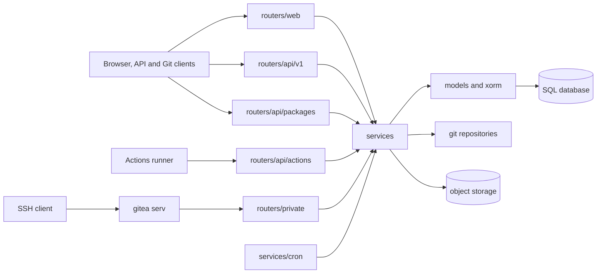
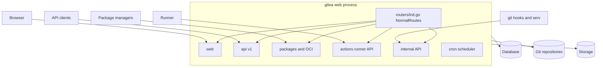
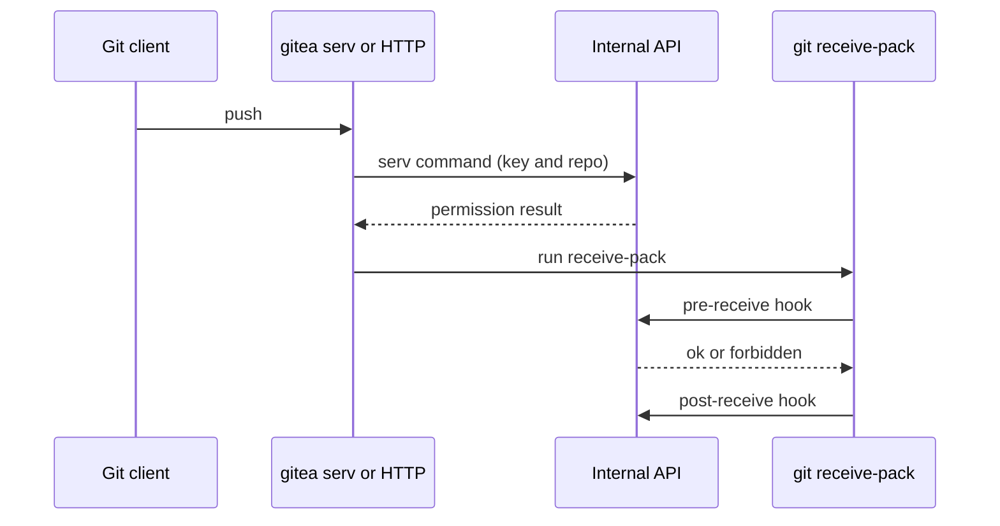
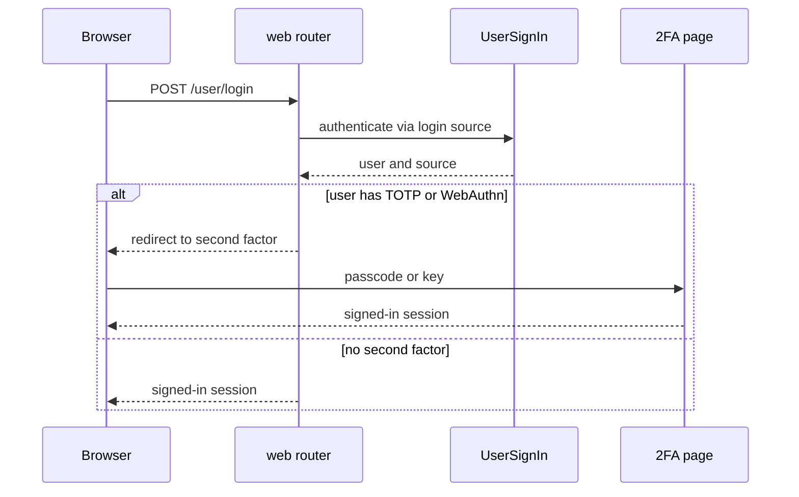
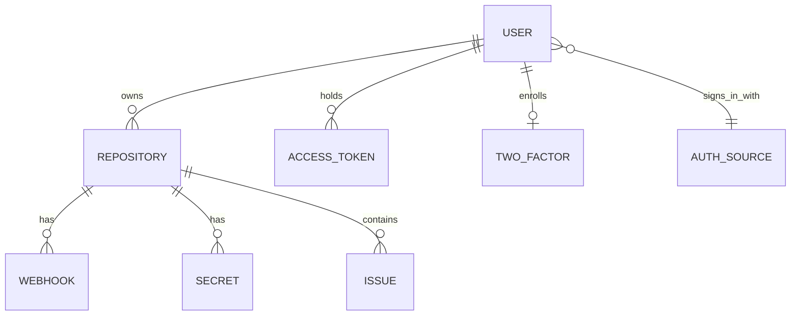
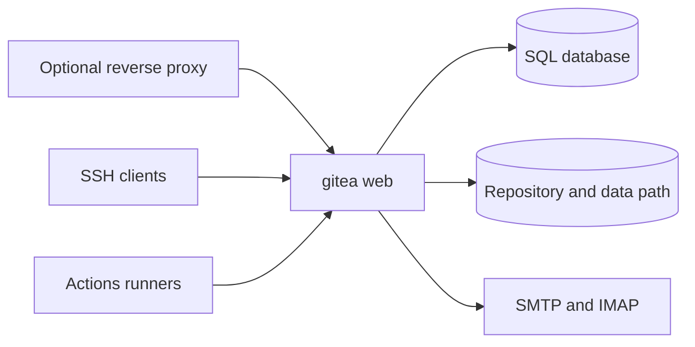

# gitea Documentation
<!-- appdoc:template 2.4 -->

**Target:** gitea | **Commit:** a61ad4876a6c8e6b3803c74d4423615e2571613b | **Evidence date:** 2026-11-11

**How to read this document.** *Cited* claims carry a path-and-line Citation. **Inferred:** marks reasoning from cited evidence. *Unknown* items are listed in section 14 and must not be assumed. Secret values are never reproduced; their locations are cited with "value omitted". The Evidence Register (source-to-claim audit) is rendered as Appendix A.

## 1. Application Index

| Support need | Primary screen or file | Workflow |
|---|---|---|
| Install a new instance | `cmd/web.go:285`, UI-1 in section 6 | [7.1 Install the instance](#71-install-the-instance) |
| A user cannot sign in | `routers/web/auth/auth.go:288`, UI-3 | [7.2 Sign in with password and two-factor](#72-sign-in-with-password-and-two-factor) |
| Create a repository | `routers/web/repo/repo.go:193`, UI-11 | [7.3 Create a repository](#73-create-a-repository) |
| Create an issue | `routers/web/repo/issue_new.go:331`, UI-15 | [7.4 Create an issue](#74-create-an-issue) |
| Merge a pull request | `routers/web/repo/pull.go:1088`, UI-16 | [7.5 Merge a pull request](#75-merge-a-pull-request) |
| A Git push is rejected | `routers/private/hook_pre_receive.go:75` | [7.6 Push code over SSH or HTTP](#76-push-code-over-ssh-or-http) |
| A webhook is not delivered | `services/webhook/deliver.go:274` | [7.7 Deliver a webhook](#77-deliver-a-webhook) |
| An Actions job is stuck | `services/cron/tasks_actions.go:27`, UI-20 | [7.8 Run an Actions job](#78-run-an-actions-job) |
| Create, edit or unlock a user | `cmd/admin_user.go:30`, UI-24 | [7.9 Manage users as a site administrator](#79-manage-users-as-a-site-administrator) |
| Upgrade the binary | `contrib/upgrade.sh:1` | [7.10 Upgrade the binary](#710-upgrade-the-binary) |
| Back up or restore data | `cmd/dump.go:26`, `cmd/restore_repo.go:18` | Section 16.5; restore of a full dump is Unknown (Q-4) |
| Rotate secrets or tokens | `cmd/generate.go:33` | Section 16.5; SECRET_KEY rotation is not supported by the code (V-13) |
| API token returns 401 or 403 | `routers/api/v1/api.go:277` | Section 9 |
| Find a configuration key | `custom/conf/app.example.ini:1` | Section 16.6 |
| See security risks | `routers/api/v1/api.go:111` | Section 10 |

## 2. Coverage and Overview

### 2.1 What was inspected

<!-- appdoc:generated scan-coverage -->
| Stack | Supported | Files read |
|---|---|---|
| go | yes | 3184 |
| node | no (generic only) | 1 |
| python | no (generic only) | 1 |

Files found: 6415 = scanned 6415 + pruned 0 + ignored by .appdocignore 0.

| Top folder | Files scanned |
|---|---|
| `modules/` | 1288 |
| `tests/` | 886 |
| `services/` | 746 |
| `templates/` | 608 |
| `routers/` | 519 |
| `public/` | 502 |
| `models/` | 469 |
| `web_src/` | 419 |
| `modelmigration/` | 407 |
| `options/` | 331 |
| `cmd/` | 58 |
| `.github/` | 33 |
| `contrib/` | 31 |
| `docker/` | 21 |
| `tools/` | 19 |
| `build/` | 10 |
| `docs/` | 9 |
| `assets/` | 4 |
| `snap/` | 3 |
| `.devcontainer/` | 1 |
| `custom/` | 1 |

No folders were pruned.
<!-- /appdoc:generated scan-coverage -->

The Go Stack is supported, so route, command and scheduled-job Facts exist for it (`go.mod`). The `node` Stack (`package.json`) and the `python` Stack (`pyproject.toml`) are unsupported: only generic Facts (files, dependencies, config keys) exist for them, and the TypeScript and Vue frontend in `web_src/` was not extracted by any Stack.

Not read: the Facts contain no UI pages, no schema objects, no connections and no finding candidates, so those lists were built by reading source. Not opened in detail: `web_src/`, `public/`, `options/locale/`, most of `templates/`, `modelmigration/` (only its folder structure), the `tests/` bodies, `build/`, and the generated swagger files under `templates/swagger/`. A runtime-generated app.ini is not in the repository, so deployed settings are Unknown - see Open questions. Ownership Facts exist for `CONTRIBUTING.md` and `MAINTAINERS` only; the extraction used a shallow git history, so per-file ownership is Unknown - see Open questions. No folder was pruned (see the block above).

### 2.2 Purpose and users

Gitea is a self-hosted software development service: Git hosting, code review, issue tracking, project kanban, wiki, team collaboration, package registry and CI/CD that can reuse GitHub Actions (`README.md:14-19`). The Go module is named gitea.dev and requires Go 1.27 (`go.mod:1-5`). Users are anonymous visitors, signed-in individuals, organization members, site administrators, Git clients over HTTP and SSH, package-manager clients, and Actions runners (`routers/init.go:176-207`, `routers/api/actions/runner/runner.go:30`).

The business owner and the production user population are Unknown - see Open questions.

Overall risk posture: no Critical finding was verified; the Medium findings V-1, V-2, V-3 and V-13 each need an additional condition (query-string tokens in use, no external throttling, audit output left disabled, SECRET_KEY left empty), and the controls that are off by default are listed in 10.2.

### 2.3 System boundary

Inside the Target: one Go binary with web, REST API, package-registry, Git-over-HTTP, LFS, internal and Actions-runner routes (`routers/init.go:176-207`), an optional built-in SSH server (`modules/ssh/server.go`), a cron scheduler (`routers/init.go:172`) and the command-line tools (`cmd/main.go`).

Outside the Target: the SQL database (MySQL, PostgreSQL, SQLite or MSSQL, `custom/conf/app.example.ini:363-396`), Git repositories on disk and the git executable (`routers/init.go:115`), session, cache and queue stores (`custom/conf/app.example.ini:1666`, `custom/conf/app.example.ini:1940`, `custom/conf/app.example.ini:1974`), indexers (`custom/conf/app.example.ini:1592`), object storage (`custom/conf/app.example.ini:2891`), SMTP and IMAP servers (`custom/conf/app.example.ini:1798`, `custom/conf/app.example.ini:1899`), external login sources such as LDAP and OAuth2 providers (`services/auth/source/`), captcha providers (`modules/hcaptcha/hcaptcha.go:96`), the release feed queried by the update checker (`services/cron/tasks_extended.go:163-168`), forges that migrations pull from (`services/migrations/github_graphql.go:166`), webhook receivers (`services/webhook/deliver.go:277`) and Actions runner machines (`routers/api/actions/runner/interceptor.go:46`).

## 3. Architecture

### 3.1 Components

- Command layer: `cmd/main.go` builds the urfave/cli application and `cmd/web.go:39-76` defines the `web` command that serves HTTP, HTTPS, FastCGI or a Unix socket (`cmd/web.go:332-392`). The same binary offers admin, doctor, dump, migrate, manager, generate and hook commands (`cmd/admin.go:22`, `cmd/doctor.go:28`, `cmd/dump.go:26`, `cmd/migrate.go:19`, `cmd/manager.go:18`, `cmd/generate.go:22`, `cmd/hook.go:33`).
- Router layer (`routers/`): `routers/web/web.go:257-321` mounts the web routes, `routers/api/v1/api.go:939` the REST API, `routers/private/internal.go:71` the internal API used by `gitea serv` and the Git hooks, `routers/api/packages/api.go` the package registries, and `routers/api/actions/actions.go:17` the Actions endpoints. `routers/init.go:176-214` mounts all of them.
- Service layer (`services/`): business operations such as pull-request merging (`services/pull/`), repository operations (`services/repository/`), webhook delivery (`services/webhook/deliver.go:274`), Actions orchestration (`services/actions/run.go`), mail (`services/mailer/`), migrations (`services/migrations/`), authentication (`services/auth/auth.go`) and the cron scheduler (`services/cron/cron.go`).
- Model layer (`models/`): xorm-mapped entities registered through `db.RegisterModel` (`models/user/user.go:197`, `models/repo/repo.go:225`, `models/issues/issue.go:130`) and schema migrations in `modelmigration/migrations.go`.
- Shared modules (`modules/`): settings (`modules/setting/session.go:64`), git access (`modules/git/`), storage (`modules/storage/minio.go:129`), markup rendering (`modules/markup/`), queues (`modules/queue/`), logging (`modules/log/`), indexers (`modules/indexer/`) and the egress policy used by outgoing HTTP (`modules/egress/`).
- Presentation: server-rendered Go templates (`templates/`) and a TypeScript and Vue frontend built from `web_src/` (`package.json:3-6`); the frontend was not read in detail.
- Startup order: `routers/init.go:114-173` initializes git, locales, settings, storage, mailer, cache, database, models, indexers, webhooks, SSH and finally cron.

### 3.2 Diagram



Caption: component view of how requests reach services; mounts at `routers/init.go:176-207`, internal API at `routers/private/internal.go:71-78`, cron start at `routers/init.go:172`.

### 3.3 Authentication and authorization

- The web layer builds an auth group per request: OAuth2, deploy token and Basic only on routes that opt in, then optional reverse-proxy auth, the session, and SSPI on Windows (`routers/web/web.go:124-158`). A failed verification returns 401 (`routers/web/web.go:160-165`).
- The API group is OAuth2 token, HTTP signature and Basic, plus reverse-proxy auth when `ENABLE_REVERSE_PROXY_AUTHENTICATION_API` is set (`routers/api/v1/api.go:851-862`). Token scopes are checked per route category and HTTP method (`routers/api/v1/api.go:277-308`). Scope names are listed in `models/auth/access_token_scope.go:58-90`.
- Basic authentication first tries the password field as an OAuth2 token, a personal access token and an Actions task token, and only then, if enabled, the user password (`services/auth/basic.go:71-146`).
- Web access checks: `verifyAuthWithOptionsWeb` blocks inactive and prohibited accounts, forces a password change, redirects anonymous users when sign-in is required, applies cross-origin protection and enforces admin-only routes (`routers/web/web.go:177-245`). Repository access uses unit-level checks such as `context.RequireUnitReader` (`routers/web/web.go:893-909`).
- API access checks include `reqToken`, `reqSiteAdmin`, `reqRepoWriter`, `reqOrgOwnership` and team checks (`routers/api/v1/api.go:311-318`, `routers/api/v1/api.go:350-357`, `routers/api/v1/api.go:391-410`, `routers/api/v1/api.go:421`).
- The internal API accepts only requests whose `X-Gitea-Internal-Auth` bearer value equals the configured internal token, compared in constant time (`routers/private/internal.go:25-43`).
- Runners authenticate with a UUID and a token verified against a salted hash (`routers/api/actions/runner/interceptor.go:46-107`).
- Passwords are checked by `UserSignIn` through the account's login source (`services/auth/signin.go:27-100`); when no local user matches, every active login source that can check passwords is tried in turn (`services/auth/signin.go:104-125`). Two-factor TOTP and WebAuthn are enforced at web sign-in for enrolled users, unless the login source skips local 2FA (`routers/web/auth/auth.go:326-365`).
- A global switch `security.TWO_FACTOR_AUTH = enforced` makes users without two-factor lose repository access through the web and the API (`modules/setting/security.go:193-197`, `routers/api/v1/api.go:226-229`, `custom/conf/app.example.ini:525-527`); the deployed value is Unknown (Q-9).

## 4. Functional Inventory

<!-- appdoc:generated entry-points -->
12 route handler files; 1431 routes; 0 pages; 72 commands; 31 jobs.

| Handler file | Kinds | Routes | Pages | Jobs | Commands |
|---|---|---|---|---|---|
| `routers/web/web.go` | route | 691 | 0 | 0 | 0 |
| `routers/api/v1/api.go` | route | 503 | 0 | 0 | 0 |
| `routers/api/packages/api.go` | route | 170 | 0 | 0 | 0 |
| `routers/private/internal.go` | route | 21 | 0 | 0 | 0 |
| `routers/web/githttp.go` | route | 12 | 0 | 0 | 0 |
| `routers/common/lfs.go` | route | 10 | 0 | 0 | 0 |
| `routers/install/routes.go` | route | 7 | 0 | 0 | 0 |
| `cmd/web.go` | command, route | 6 | 0 | 0 | 1 |
| `routers/api/actions/artifacts.go` | route | 6 | 0 | 0 | 0 |
| `routers/api/actions/actions.go` | route | 3 | 0 | 0 | 0 |
| `models/unittest/mock_http.go` | route | 1 | 0 | 0 | 0 |
| `routers/init.go` | route | 1 | 0 | 0 | 0 |
| `cmd/actions.go` | command | 0 | 0 | 0 | 2 |
| `cmd/admin.go` | command | 0 | 0 | 0 | 5 |
| `cmd/admin_auth.go` | command | 0 | 0 | 0 | 2 |
| `cmd/admin_auth_ldap.go` | command | 0 | 0 | 0 | 4 |
| `cmd/admin_auth_oauth.go` | command | 0 | 0 | 0 | 2 |
| `cmd/admin_auth_smtp.go` | command | 0 | 0 | 0 | 2 |
| `cmd/admin_regenerate.go` | command | 0 | 0 | 0 | 2 |
| `cmd/admin_user.go` | command | 0 | 0 | 0 | 1 |
| `cmd/admin_user_change_password.go` | command | 0 | 0 | 0 | 1 |
| `cmd/admin_user_change_type.go` | command | 0 | 0 | 0 | 1 |
| `cmd/admin_user_create.go` | command | 0 | 0 | 0 | 1 |
| `cmd/admin_user_delete.go` | command | 0 | 0 | 0 | 1 |
| `cmd/admin_user_disable_2fa.go` | command | 0 | 0 | 0 | 1 |
| `cmd/admin_user_generate_access_token.go` | command | 0 | 0 | 0 | 1 |
| `cmd/admin_user_list.go` | command | 0 | 0 | 0 | 1 |
| `cmd/admin_user_must_change_password.go` | command | 0 | 0 | 0 | 1 |
| `cmd/cert.go` | command | 0 | 0 | 0 | 1 |
| `cmd/config.go` | command | 0 | 0 | 0 | 2 |
| `cmd/docs.go` | command | 0 | 0 | 0 | 1 |
| `cmd/doctor.go` | command | 0 | 0 | 0 | 3 |
| `cmd/doctor_convert.go` | command | 0 | 0 | 0 | 1 |
| `cmd/dump.go` | command | 0 | 0 | 0 | 1 |
| `cmd/dump_repo.go` | command | 0 | 0 | 0 | 1 |
| `cmd/embedded.go` | command | 0 | 0 | 0 | 4 |
| `cmd/generate.go` | command | 0 | 0 | 0 | 8 |
| `cmd/hook.go` | command | 0 | 0 | 0 | 5 |
| `cmd/keys.go` | command | 0 | 0 | 0 | 1 |
| `cmd/manager.go` | command | 0 | 0 | 0 | 6 |
| `cmd/manager_logging.go` | command | 0 | 0 | 0 | 5 |
| `cmd/migrate.go` | command | 0 | 0 | 0 | 1 |
| `cmd/migrate_storage.go` | command | 0 | 0 | 0 | 1 |
| `cmd/restore_repo.go` | command | 0 | 0 | 0 | 1 |
| `cmd/serv.go` | command | 0 | 0 | 0 | 1 |
| `services/cron/tasks_actions.go` | job | 0 | 0 | 6 | 0 |
| `services/cron/tasks_basic.go` | job | 0 | 0 | 10 | 0 |
| `services/cron/tasks_extended.go` | job | 0 | 0 | 15 | 0 |
<!-- /appdoc:generated entry-points -->

| ID | Area | Feature | Entry point | Inputs, outputs and rules | Dependencies | Status |
|---|---|---|---|---|---|---|
| F-1 | Installer | First-run install page served while the instance is not locked | `routers/install/routes.go:30-32`, `cmd/web.go:285-286` | Form post writes the configuration; the page is served only while INSTALL_LOCK is false (`custom/conf/app.example.ini:442`) | Settings, database | Cited |
| F-2 | Authentication and sessions | Password sign-in, registration, 2FA (TOTP, WebAuthn), account activation, password recovery, sign-out, external OAuth2 sign-in | `routers/web/web.go:567-594`, `routers/web/web.go:725-741`, `routers/web/auth/auth.go:288` | Username or email plus password; optional captcha (`routers/web/auth/auth.go:302-306`); password form can be disabled (`routers/web/auth/auth.go:289-292`); 2FA step after a correct password (`routers/web/auth/auth.go:326-345`) | Login sources, session store, mailer | Cited |
| F-3 | OAuth2 provider | Authorize, grant, token, userinfo, introspect and key endpoints; OpenID discovery | `routers/web/web.go:592-606`, `routers/web/web.go:521` | Enabled by `oauth2Enabled` (`routers/web/web.go:362`); token endpoints allow CORS and any-origin sign-in (`routers/web/web.go:605`) | OAuth2 applications and grants (`models/auth/oauth2.go:57-59`) | Cited |
| F-4 | User account settings | Profile, avatar, account and email, appearance, notifications, security keys, access tokens, OAuth2 apps, package and Actions settings, webhooks, blocked users | `routers/web/web.go:608-723` | Signed-in users only (`routers/web/web.go:723`); password change gate (`routers/web/web.go:198-211`) | User, token and credential entities (`models/user/user.go:197`, `models/auth/access_token.go:43`) | Cited |
| F-5 | Repositories | Create, generate from template, migrate, fork, settings, collaborators, branches, tags, releases, in-browser editor, transfer, star and watch | `routers/web/web.go:1071-1075`, `routers/web/web.go:1158-1260`, `routers/web/web.go:1430-1500`, `routers/web/web.go:1744-1747` | Create form (`routers/web/repo/repo.go:193-260`); forced-private option (`routers/web/repo/repo.go:222`); delete and settings need repo admin (`routers/web/web.go:893`) | Git on disk, repository entities (`models/repo/repo.go:225`), storage | Cited |
| F-6 | Issues and pull requests | Create, edit, close, delete issues; comments, labels, milestones, reviews, merge, auto-merge | `routers/web/web.go:1308-1416`, `routers/web/web.go:1628-1657`, `routers/web/repo/issue_new.go:331`, `routers/web/repo/pull.go:1088` | Issue delete needs repo admin (`routers/web/web.go:1365`); merge goes through `CheckPullMergeable` (`routers/web/repo/pull.go:1110`) and `pull_service.Merge` (`routers/web/repo/pull.go:1195`) | Issue and pull entities (`models/issues/issue.go:130`, `models/issues/pull.go:170`), git, notifications | Cited |
| F-7 | Projects | Kanban projects, columns, issue cards and project workflows at owner and repository level | `routers/web/web.go:330-348`, `routers/web/web.go:1112-1140`, `routers/web/web.go:1519-1540`, `routers/api/v1/api.go:768-806` | Columns created with a form (`routers/web/web.go:341`); API routes check the projects unit (`routers/api/v1/api.go:754`) | Project entities (`models/project/project.go:184`) | Cited |
| F-8 | Wiki | Create, edit and delete wiki pages | `routers/web/web.go:1586-1600`, `routers/web/repo/wiki.go` | Writes require the wiki writer unit (`routers/web/web.go:1589`) | Wiki git repository | Cited |
| F-9 | Actions CI | Workflow runs, attempts, jobs, artifacts, schedules, scoped workflows, runners, variables and secrets, runner RPC and artifact APIs | `routers/web/web.go:1541-1585`, `routers/web/web.go:479-510`, `routers/api/actions/runner/runner.go:30`, `routers/api/actions/artifacts.go:119-124` | Mounted only if Actions are enabled (`routers/init.go:196-207`); runners authenticate with UUID and token (`routers/api/actions/runner/interceptor.go:46-107`) | Actions entities (`models/actions/run.go:79`), services (`services/actions/run.go`), secrets (`models/secret/secret.go:95`) | Cited |
| F-10 | Git transport and LFS | Git smart HTTP, LFS batch, upload, download, verify and locks; SSH access through `serv` and hooks | `routers/web/githttp.go:13-24`, `routers/common/lfs.go:18-29`, `routers/private/serv.go:68`, `routers/private/hook_pre_receive.go:75` | Pre-receive checks branch and tag rules (`routers/private/hook_pre_receive.go:111-135`); LFS server starts only when configured (`cmd/web.go:345-347`) | Repositories, LFS entities (`models/git/lfs.go:89`), SSH keys (`models/asymkey/ssh_key.go:57`) | Cited |
| F-11 | Organizations and teams | Organization pages, members, teams, invitations, labels, org settings, org-level webhooks, secrets, packages and blocked users | `routers/web/web.go:937-1068`, `routers/api/v1/api.go:1736`, `routers/api/v1/api.go:1801` | Org routes use `context.OrgAssignment` (`routers/web/web.go:937-1068`); API org rules (`routers/api/v1/api.go:421-577`) | Organization and team entities (`models/organization/team.go:134-138`) | Cited |
| F-12 | Packages | Registries for many package types and the OCI container registry; package settings and cleanup rules in the web UI | `routers/api/packages/api.go:107-548`, `routers/web/web.go:1080-1110`, `routers/web/web.go:671-690` | Mounted only if packages are enabled (`routers/init.go:188-194`); most registry routes apply `reqPackageAccess` (`routers/api/packages/api.go:44-65`), which also checks the token's package scope; the Terraform module archive download skips it when the URL carries a valid archive signature (`routers/api/packages/api.go:107-111`) and the container registry uses `container.ReqContainerAccess` (`routers/api/packages/api.go:543`) | Package entities (`models/packages/package.go:18`), storage | Cited |
| F-13 | REST API | Versioned JSON API for users, repositories, organizations, teams, packages, notifications, markup, settings and admin; Swagger rendering | `routers/api/v1/api.go:939-1878`, `routers/web/web.go:1769-1772` | Token scope by category and HTTP method (`routers/api/v1/api.go:277-308`); optional admin impersonation with `sudo` (`routers/api/v1/api.go:111-146`) | Auth group (`routers/api/v1/api.go:851-862`), services, models | Cited |
| F-14 | Site administration | Admin dashboard, config, users, organizations, repositories, packages, system and default webhooks, auth sources, notices, OAuth2 applications, queues, monitor, audit view, self-check; admin API | `routers/web/web.go:746-870`, `routers/web/admin/audit.go`, `routers/api/v1/api.go:1829` | Web routes use `adminReq` (`routers/web/web.go:746`); API admin group uses `reqSiteAdmin` (`routers/api/v1/api.go:350`); the web user group also exposes `POST /{userid}/impersonate` (`routers/web/web.go:787`, V-3) | Models, auth sources, queues | Cited |
| F-15 | Internal API | Endpoints for SSH key lookup, hook callbacks, serv, process manager, mail send, repo restore and runner-token generation | `routers/private/internal.go:80-100` | Every route requires the internal token (`routers/private/internal.go:25-43`) | Hooks, `gitea serv`, `gitea manager` | Cited |
| F-16 | Webhooks | Create, edit, delete and deliver webhooks (Gitea, Gogs, Slack, Discord, DingTalk, Telegram, Matrix, MS Teams, Feishu, WeChat Work, Packagist) | `routers/web/web.go:449-476`, `services/webhook/deliver.go:274-290` | Delivery uses the egress policy transport (`services/webhook/deliver.go:277`); certificate verification is skipped when `webhook.SKIP_TLS_VERIFY` is true, default false (`services/webhook/deliver.go:278`, `modules/setting/webhook.go:26`, V-11); response body read limit 1 MiB (`services/webhook/deliver.go:262`) | Webhook entities (`models/webhook/webhook.go:148`), queue | Cited |
| F-17 | Notifications and feeds | Notification inbox, websocket updates, RSS and Atom feeds | `routers/web/web.go:1759-1767`, `routers/web/web.go:590`, `routers/web/web.go:886-887`, `routers/api/v1/api.go:1046-1054` | Feeds can be turned off (`routers/web/web.go:426-431`); tokens authenticate feeds only (`routers/web/web.go:885`) | Notification entities (`models/activities/notification.go:115`) | Cited |
| F-18 | Explore and search | Explore pages, sitemap, user and code search, user search API | `routers/web/web.go:519`, `routers/web/web.go:539-556`, `routers/common/codesearch.go`, `routers/api/v1/api.go:1058` | Sign-in may be required via `optExploreSignIn` (`routers/web/web.go:358`) | Indexers (`custom/conf/app.example.ini:1592`) | Cited |
| F-19 | Operations endpoints | Health check, HEAD root, metrics, SSH info, robots, captcha image, development test pages, optional pprof server | `routers/web/web.go:264`, `routers/web/web.go:290-298`, `routers/web/web.go:1774-1792`, `cmd/web.go:244-259`, `routers/install/routes.go:36` | Metrics need a bearer token only when one is set (`routers/web/metrics.go:16-33`); devtest pages exist only outside production or in end-to-end test mode (`routers/web/web.go:1774`); pprof listens on localhost:6060 (`cmd/web.go:255-256`) | Prometheus client (`go.mod:73`) | Cited |
| F-20 | Command line | web, admin (user, auth, regenerate, sendmail, repo-sync-releases), doctor, dump, dump-repo, migrate, migrate-storage, restore-repo, manager, generate, hook, keys, serv, cert, config, embedded, docs, actions | `cmd/web.go:39`, `cmd/admin.go:22`, `cmd/doctor.go:28`, `cmd/dump.go:26`, `cmd/migrate.go:19`, `cmd/manager.go:18`, `cmd/generate.go:22`, `cmd/actions.go:17`, `cmd/serv.go:40` | Subcommands and flags per source file; operator use in 16.5 | Database, configuration, internal API | Cited |
| F-21 | Scheduled jobs | Background jobs for Actions cleanup, mirrors, repo health, archives, user sync, package cleanup, audit pruning, update check and others | `services/cron/tasks_basic.go:31`, `services/cron/tasks_extended.go:26`, `services/cron/tasks_actions.go:27` | Schedules and defaults are in the generated block 16.7; config sections start at `custom/conf/app.example.ini:2143` | Cron scheduler (`services/cron/cron.go:17-24`), services | Cited |

### 4.1 Subsystem inventory

| Subsystem | Files | Features | Primary data and dependencies | Purpose | Status |
|---|---|---|---|---|---|
| `modules/` | 1288 | F-2, F-10, F-16, F-19 | Settings, git, storage, queue, markup, egress packages | Shared libraries used by routers and services (`modules/setting/session.go:64`, `modules/storage/minio.go:129`) | Cited |
| `tests/` | 886 | F-1 to F-21 | Integration, end-to-end and fuzz tests | Test suites (`tests/integration/admin_audit_test.go`, `Makefile:436`) | Cited |
| `services/` | 746 | F-5, F-6, F-9, F-12, F-16, F-21 | Models, git, queues, mail | Business logic (`services/webhook/deliver.go:274`, `services/cron/cron.go`) | Cited |
| `templates/` | 608 | F-2 to F-18 | Go template files, generated swagger files | Server-rendered HTML pages (`templates/swagger/v1-swagger.generated.json`) | Inferred |
| `routers/` | 519 | F-1 to F-19 | Services, models, `modules/setting` | HTTP route registration and handlers (`routers/init.go:176-214`) | Cited |
| `public/` | 502 | F-19 | Static files | Static assets served under `/assets` (`routers/web/web.go:265`) | Inferred |
| `models/` | 469 | F-2 to F-18 | xorm entities and SQL database | Entities and data access (`models/user/user.go:197`, `models/repo/repo.go:225`) | Cited |
| `web_src/` | 419 | F-4 to F-9 | TypeScript, Vue and CSS sources | Frontend source built by Vite (`package.json:3-6`) | Inferred |
| `modelmigration/` | 407 | F-20 | SQL database schema | Versioned schema migrations run by `gitea migrate` (`cmd/migrate.go:26-43`) | Cited |
| `options/` | 331 | F-2, F-5 | Locale, label, license, gitignore and readme data | Locale and template data files (`options/locale/locale_en-US.json`) | Inferred |
| `cmd/` | 58 | F-20 | Configuration, database, internal API | Command-line tools (`cmd/main.go`) | Cited |
| (root) | 50 | F-20 | Build and tool configuration | Makefile, Dockerfile, go.mod, package.json and policy files (`go.mod`, `Dockerfile`) | Cited |
| `.github/` | 33 | F-20 | GitHub Actions workflows | CI, release and bot workflows (`.github/workflows/pull-db-tests.yml:1`) | Cited |
| `contrib/` | 31 | F-20 | Service files, upgrade script | Packaging and operations helpers (`contrib/upgrade.sh:1-12`) | Cited |
| `docs/` | 9 | F-20 | Markdown guides | Developer and governance guides (`docs/development.md`, `docs/community-governance.md:1`) | Inferred |
| `docker/` | 21 | F-20 | Container entrypoint and templates | Container image runtime files (`docker/root/usr/bin/entrypoint`, `Dockerfile:89`) | Cited |
| `tools/` | 19 | F-20 | Build and lint helpers | Developer tooling scripts (`tools/test-integration.sh`) | Inferred |
| `build/` | 10 | F-20 | Generated data sources | Generators for emoji and gitignore data (`build/generate-emoji.go:81`) | Cited |
| `assets/` | 4 | F-19 | Logo and license data | Static asset sources (`assets/logo.svg`) | Inferred |
| `snap/` | 3 | F-20 | Snap packaging | Snap build scripts (`snap/snapcraft.yaml`) | Inferred |
| `.devcontainer/` | 1 | F-20 | Dev container | Development container definition (`.devcontainer/devcontainer.json`) | Inferred |
| `custom/` | 1 | F-1 | Configuration | Example configuration file (`custom/conf/app.example.ini:1`) | Cited |

## 5. Roles and Access Model

### 5.1 Observed role concepts

- Anonymous visitor: allowed on routes behind `optSignIn`, `optExploreSignIn` and `optSignInHome`; sign-in becomes mandatory when `RequireSignInViewStrict` is set (`routers/web/web.go:353-358`).
- Signed-in individual or bot: API handlers that act on "the authenticated user" accept only individual or bot accounts and reject system users unless allowed (`routers/api/v1/api.go:259-273`).
- Site administrator: the `IsAdmin` flag gates `adminReq` web routes and `reqSiteAdmin` API routes (`routers/web/web.go:238-244`, `routers/api/v1/api.go:350-357`).
- Restricted, inactive and login-prohibited accounts: `IsRestricted`, `IsActive` and `ProhibitLogin` are user columns (`models/user/user.go:139-151`); prohibited and inactive accounts are stopped by `verifyAuthWithOptionsWeb` (`routers/web/web.go:183-199`).
- Organization owner, member and team: organizations and teams are entities (`models/organization/team.go:134-138`); API checks are `reqOrgOwnership`, `reqOrgMembership` and `reqTeamMembership` (`routers/api/v1/api.go:421`, `routers/api/v1/api.go:548`, `routers/api/v1/api.go:537`).
- Repository permission by unit: collaborators and team access are stored (`models/repo/collaboration.go:30`, `models/perm/access/access.go:33`) and checked per unit type: code, issues, pull requests, releases, wiki, projects and Actions (`routers/web/web.go:893-909`).
- Package access mode: `reqPackageAccess` compares the caller's access mode with the required one (`routers/web/web.go:911-917`).
- Personal access token and scope: scope categories are ActivityPub, admin, notification, organization, package, issue, repository, user and commit status, plus a placeholder `misc` category (`models/auth/access_token_scope.go:20`), the `all` and `public-only` scopes and a `no-token-scope` scope that grants no API permission (`models/auth/access_token_scope.go:18-27`, `models/auth/access_token_scope.go:58-90`).
- OAuth2 application and grant: applications, authorization codes and grants are entities (`models/auth/oauth2.go:57-59`).
- Deploy key and deploy token: deploy keys are entities (`models/deploykey/deploykey.go:58`) and a deploy-token auth method exists (`routers/web/web.go:136-138`).
- Actions task identity: a running Actions task token authenticates as an Actions user (`services/auth/basic.go:111-116`); runners have their own UUID and token (`routers/api/actions/runner/interceptor.go:46-107`).
- Impersonation (`sudo`): site administrators can act as another user through a query parameter or header (`routers/api/v1/api.go:111-146`). The admin web area has a second path, `POST /{userid}/impersonate`, which refuses bot users and records an audit event when audit output is on (`routers/web/web.go:787`, `routers/web/admin/users.go:568-585`).
- Reverse-proxy authenticated user: accepted only when the corresponding service setting is on (`routers/web/web.go:147-150`, `routers/api/v1/api.go:857-859`).
- Login-source two-factor policy: each auth source carries a `TwoFactorPolicy` (`models/auth/source.go:143`); the global `security.TWO_FACTOR_AUTH` switch is described in 3.3 (`modules/setting/security.go:193-197`).
- Internal-token holder: the `gitea serv` and hook processes use the internal token (`routers/private/internal.go:25-43`).

### 5.2 Authorization enforcement

- Web: middleware factories `reqSignIn`, `reqSignOut`, `optSignIn`, `optExploreSignIn`, `adminReq` and `crossOriginProtect` wrap route groups (`routers/web/web.go:353-360`, `routers/web/web.go:746`). Unit checks use `context.RequireUnitReader` and `RequireUnitWriter` (`routers/web/web.go:893-909`). Private users are hidden by `individualPermsChecker` (`routers/web/web.go:919-935`).
- Web, cross-origin: unless a route is sign-out-required or disables it, `http.NewCrossOriginProtection` checks requests (`routers/web/web.go:179`, `routers/web/web.go:220-225`). **Inferred:** the Go check lets safe methods such as GET through, so it does not guard GET routes such as `/user/logout` (V-8).
- API: `reqToken`, scope middleware, `repoAssignment`, `reqRepoReader`, `reqRepoWriter`, `reqSiteAdmin`, `reqSelfOrAdmin` and `reqOrgMembership` are applied per group (`routers/api/v1/api.go:148`, `routers/api/v1/api.go:311-318`, `routers/api/v1/api.go:369-410`). Public-only tokens are rejected on endpoints that mix private data (`routers/api/v1/api.go:249`, `routers/api/v1/api.go:1044-1054`).
- Packages: registry routes are wrapped by `reqPackageAccess` (it also checks the token's package scope and answers 401, `routers/api/packages/api.go:44-65`) and by package or user assignment middleware (`routers/api/packages/api.go:107-134`); the Terraform signed-archive download skips it (`routers/api/packages/api.go:107-111`) and the container registry uses `container.ReqContainerAccess` (`routers/api/packages/api.go:543`). **Inferred:** other registries were not each traced.
- Git push: the pre-receive hook asserts write permission on each ref and blocks default-branch deletion (`routers/private/hook_pre_receive.go:111-135`).
- Internal API: bearer internal token, compared in constant time (`routers/private/internal.go:25-43`).
- Routes with no sign-in check, by design or by omission: `/user/activate`, `/user/recover_account`, `/user/forgot_password` and `/user/logout` (`routers/web/web.go:725-734`); `/ssh_info`, `/api/healthz`, `/robots.txt`, the avatar and asset routes (`routers/web/web.go:265-298`); the signed Actions artifact preview route, which is served without a session (`routers/web/web.go:296`); `/-/ws`, which checks `ctx.IsSigned` inside its handler instead (`routers/web/web.go:590`, `routers/web/websocket/websocket.go:42`); `/.well-known` routes (`routers/web/web.go:520-532`); the API public group (version, signing keys, gitignore, license and label templates, settings) (`routers/api/v1/api.go:1016-1036`); the metrics endpoint when no metrics token is set (`routers/web/metrics.go:16-20`); and the Swagger JSON routes when Swagger is enabled (`routers/web/web.go:1769-1772`).
- Actions token permissions: the design document describes `GITEA_TOKEN` permissions clamped by a repository or organisation ceiling, with cross-repository access limited to public repositories (read-only) plus an owner-level allow list (`services/actions/token_permission_design.md:7-14`, `services/actions/token_permission_design.md:34-40`).
- Not traced: **Inferred:** per-route permission for every one of the web and API routes beyond the middleware named in the Facts, and per-package-type authentication in the registries.

### 5.3 Role-to-capability matrix

| Capability | Anonymous | Signed-in user | Repo writer | Repo admin | Org owner | Site admin |
|---|---|---|---|---|---|---|
| Installer: open the install page while INSTALL_LOCK is false (`cmd/web.go:285-286`) | Y | Y | Y | Y | Y | Y |
| Authentication and sessions: sign in (`routers/web/web.go:569`, sign-out required `routers/web/web.go:215-218`) | Y | | | | | |
| Authentication and sessions: register (`routers/web/web.go:571`; depends on DISABLE_REGISTRATION `custom/conf/app.example.ini:841`) | ? | | | | | |
| OAuth2 provider: authorize and grant an application (`routers/web/web.go:592-598`) | | Y | Y | Y | Y | Y |
| User account settings: edit own profile and tokens (`routers/web/web.go:608-723`) | | Y | Y | Y | Y | Y |
| Repositories: create a repository (`routers/web/web.go:1073`) | | Y | Y | Y | Y | Y |
| Repositories: settings and danger zone need repo admin (`routers/web/web.go:893`, `routers/web/web.go:1158`) | | | | Y | ? | ? |
| Repositories: create or delete a branch (`routers/web/web.go:1455-1459`) | | | Y | Y | ? | ? |
| Issues and pull requests: create an issue (`routers/web/web.go:1331`) | | Y | Y | Y | Y | Y |
| Issues and pull requests: delete an issue (`routers/web/web.go:1365`) | | | | Y | ? | ? |
| Issues and pull requests: merge a pull request (refusal `routers/web/repo/pull.go:1118-1119`, group middleware `routers/web/web.go:1655`) | | | ? | ? | ? | ? |
| Projects: change a board (`routers/web/web.go:898`) | | | ? | ? | ? | ? |
| Wiki: edit pages (`routers/web/web.go:1589`) | | | ? | ? | ? | ? |
| Actions CI: view runs (`routers/web/web.go:1541-1585`) | ? | ? | ? | ? | ? | ? |
| Actions CI: runner polls for jobs (runner token only, `routers/api/actions/runner/interceptor.go:46-107`) | | | | | | |
| Git transport and LFS: push to a branch (`routers/private/hook_pre_receive.go:114`) | | | Y | Y | ? | ? |
| Git transport and LFS: clone a public repository (`routers/web/githttp.go:13-24`) | ? | ? | ? | ? | ? | ? |
| Organizations and teams: manage an organization over the API (`routers/api/v1/api.go:421`) | | | | | Y | ? |
| Packages: publish or read a package (`routers/api/packages/api.go:44-65`; the Terraform signed-archive download is the exception, `routers/api/packages/api.go:107-111`) | ? | ? | ? | ? | ? | ? |
| REST API: call token-required endpoints (`routers/api/v1/api.go:311-318`) | | Y | Y | Y | Y | Y |
| REST API: read version, templates and settings (`routers/api/v1/api.go:1016-1036`) | Y | Y | Y | Y | Y | Y |
| REST API: impersonate another user with `sudo` (`routers/api/v1/api.go:118-143`) | | | | | | Y |
| REST API: admin endpoints (`routers/api/v1/api.go:350-357`) | | | | | | Y |
| Site administration: open the admin area (`routers/web/web.go:238-244`) | | | | | | Y |
| Site administration: impersonate a user from the admin area (`routers/web/web.go:787`) | | | | | | Y |
| Site administration: system and default webhooks (`routers/web/web.go:829-842`) | | | | | | Y |
| Internal API: any endpoint (internal token only, `routers/private/internal.go:25-43`) | | | | | | |
| Webhooks: repository webhook settings (`routers/web/web.go:1198-1215`) | | | | ? | ? | ? |
| Notifications and feeds: read own notifications (`routers/web/web.go:1759-1767`) | | Y | Y | Y | Y | Y |
| Explore and search: browse explore pages (`routers/web/web.go:539-556`; default does not require sign-in `custom/conf/app.example.ini:853`; the setting also accepts `expensive`, `modules/setting/service.go:163-168`) | Y | Y | Y | Y | Y | Y |
| Operations endpoints: health check (`routers/web/web.go:298`) | Y | Y | Y | Y | Y | Y |
| Operations endpoints: metrics (`routers/web/metrics.go:16-33`; only when enabled) | ? | ? | ? | ? | ? | ? |
| Command line: operator commands run on the server with configuration and database access, not through web roles (`cmd/main.go`) | | | | | | |
| Scheduled jobs: run by the scheduler without a user role (`routers/init.go:172`) | | | | | | |
| Token scope view: a token needs `write:admin` style scopes for admin routes (`routers/api/v1/api.go:277-308`, `models/auth/access_token_scope.go:65-66`) | | | | | | Y |

**Restriction:** do not infer a permission from a visible control or a granted scope; enforcement is the code cited in 5.2.

## 6. UI Catalog

Source-only catalog; no screenshots or live session. Pages are taken from the web route registrations (`routers/web/web.go:257-321`). Twenty-seven screen groups are catalogued; the total number of screens is Unknown - see Open questions (Q-1). Controls are taken from handler and route names, not from rendered pages.

| ID | Page | Route or entry | Reached from | Visible controls and data | States and effects | Roles and evidence |
|---|---|---|---|---|---|---|
| UI-1 | Install page | install server `/` and `/post-install` | First start before INSTALL_LOCK is set | Installation form; **Inferred:** database, admin and server fields | Writes configuration and locks the installer | Anyone while unlocked (`routers/install/routes.go:30-32`) |
| UI-2 | Home | `/` | Site root | Landing or dashboard by sign-in state | Redirects by session | Optional sign-in (`routers/web/web.go:264`, `routers/web/home.go`) |
| UI-3 | Sign in | `/user/login` | Home, redirects | Username, password, remember me, optional captcha | Error text on failure; redirects to 2FA when enrolled | `GET /user/login` is deliberately not sign-out-required so signed-in users can be redirected, while `POST /user/login` sits in the sign-out-required group (`routers/web/web.go:566-569`, `routers/web/web.go:588`, `routers/web/auth/auth.go:288-346`) |
| UI-4 | Register | `/user/sign_up` | Sign-in page | Registration form | Account created or blocked by settings | Sign-out required (`routers/web/web.go:571`) |
| UI-5 | Two-factor and WebAuthn | `/user/two_factor`, `/user/webauthn` | After a correct password | Passcode or security-key prompt | Completes sign-in | Pending-2FA session (`routers/web/auth/auth.go:348-365`) |
| UI-6 | Forgot and reset password | `/user/forgot_password`, `/user/recover_account` | Sign-in page | Email field, new-password form | Sends mail, resets password | Public (`routers/web/web.go:730-733`) |
| UI-7 | OAuth2 authorize | `/login/oauth/authorize` | Third-party application | Application name, requested access, grant button | Redirects with a code | Signed in (`routers/web/web.go:592-598`, `routers/web/auth/oauth2_provider.go:372-376`) |
| UI-8 | User or organization profile | `/{username}` | Links everywhere | Profile, repositories, follow action | Follow toggles | Optional sign-in, visibility checks (`routers/web/web.go:888-891`) |
| UI-9 | Account settings | `/user/settings` and sub-pages | User menu | Profile, account, security, applications, packages, Actions, webhooks | Saves changes | Signed in (`routers/web/web.go:608-723`) |
| UI-10 | Explore | `/explore` | Top navigation | Repository, user and organization lists, search | Read only | Optional sign-in (`routers/web/web.go:539-556`) |
| UI-11 | Create repository | `/repo/create` | Plus menu | Name, owner, template, license, readme, privacy | Creates repository | Signed in (`routers/web/web.go:1071-1075`, `routers/web/repo/repo.go:193`) |
| UI-12 | Repository home and file view | `/{username}/{reponame}` and `/src` | Repository links | Files, branches, README, clone URLs | Read only | Repo reader (`routers/web/web.go:1724-1739`) |
| UI-13 | Repository settings | `/{username}/{reponame}/settings` | Repository menu | General, collaborators, branches, tags, hooks, keys, LFS, Actions | Saves settings | Repo admin (`routers/web/web.go:1158-1260`) |
| UI-14 | Issue list and view | `/{username}/{reponame}/issues` | Repository tab | Filters, labels, milestones, comments | Comment, close, label | Issues reader (`routers/web/web.go:1308-1310`, `routers/web/repo/issue_view.go`) |
| UI-15 | New issue | `/{username}/{reponame}/issues/new` | Issue list | Title, content, labels, assignees, milestone, attachments | Creates issue | Signed in and issues reader (`routers/web/web.go:1331`) |
| UI-16 | Pull request | `/{username}/{reponame}/pulls/{index}` | Pull list | Conversation, commits, files, reviews, merge box | Merge, close, review | Pulls reader (`routers/web/web.go:1628-1657`, `routers/web/repo/pull_merge_box.go`) |
| UI-17 | Branches and tags | `/{username}/{reponame}/branches`, `/tags` | Repository tab | Branch and tag lists, create and delete | Create or delete branch | Code reader or writer (`routers/web/web.go:1453-1480`) |
| UI-18 | Releases | `/{username}/{reponame}/releases` | Repository tab | Release list, new release form | Create or delete release | Release reader or writer (`routers/web/web.go:1480-1500`) |
| UI-19 | Wiki | `/{username}/{reponame}/wiki` | Repository tab | Pages, editor, history | Create, edit, delete page | Wiki reader or writer (`routers/web/web.go:1586-1600`) |
| UI-20 | Actions run view | `/{username}/{reponame}/actions` | Repository tab | Runs, attempts, jobs, logs, artifacts | Re-run, cancel, approve | Actions reader or writer (`routers/web/web.go:1541-1585`) |
| UI-21 | Projects board | `/{username}/{reponame}/projects` and owner projects | Repository or profile tab | Columns, cards | Move cards and columns | Projects reader or writer (`routers/web/web.go:1112-1140`, `routers/web/web.go:1519-1540`) |
| UI-22 | Organization pages | `/org` and `/{org}` | Profile and org menu | Members, teams, settings, labels, secrets | Saves org changes | Org membership and ownership (`routers/web/web.go:937-1068`) |
| UI-23 | Package pages | `/{username}/-/packages` | Profile and repository tab | Package list, versions, settings, cleanup rules | Delete or link package | Package access mode (`routers/web/web.go:1080-1110`) |
| UI-24 | Admin area | `/-/admin` and sub-pages | Admin menu | Dashboard, users, orgs, repos, hooks, auth sources, notices, queues, config, audit | Admin actions | Site admin (`routers/web/web.go:746-870`, `routers/web/admin/admin.go`) |
| UI-25 | Notifications | `/notifications` | Header bell | Inbox, subscriptions, watching | Mark read, purge | Signed in (`routers/web/web.go:1759-1767`) |
| UI-26 | Swagger API page | `/api/swagger` | Footer link | Swagger UI | Read only | Public when enabled (`routers/web/web.go:306-309`) |
| UI-27 | Development test pages | `/devtest` | Development builds | Component and mail-preview pages | Test only | Outside production or in end-to-end test mode (`routers/web/web.go:1774-1792`) |

## 7. Workflows

### 7.1 Install the instance

1. `gitea web` reads the INSTALL_LOCK setting; when it is false the command serves the install page instead of the application (`cmd/web.go:285-286`, `custom/conf/app.example.ini:442`).
2. The installer loads only the settings it needs and listens on the install port (`routers/init.go:107-111`, `cmd/web.go:136-153`).
3. The install form is served at `/` and submitted by POST (`routers/install/routes.go:30-31`); a post-install page follows (`routers/install/routes.go:32`).
4. After the installer returns, the same process continues with the installed routes (`cmd/web.go:297`, `cmd/web.go:168-171`).

Failure and escalation: if the listener cannot open, the log asks whether Gitea is already running and the process shuts down (`cmd/web.go:153-157`); escalate to the host owner when no other instance holds the port.

### 7.2 Sign in with password and two-factor

1. The sign-in form posts to the web route (`routers/web/web.go:569`); the handler refuses the request when the password form is disabled (`routers/web/auth/auth.go:289-292`).
2. If captcha is enabled for login, it is verified first (`routers/web/auth/auth.go:302-306`).
3. `UserSignIn` looks the user up by activated email or by name, loads the login source, and calls the source's authenticator (`services/auth/signin.go:27-92`); when no local user matches, it tries every active login source that can check passwords in turn (`services/auth/signin.go:104-125`).
4. A prohibited user is rejected after authentication (`services/auth/signin.go:96-98`); an inactive account is checked later so the user can resend the confirmation mail (`services/auth/signin.go:94-95`).
5. If the source skips local 2FA, or the user has no TOTP or WebAuthn, the sign-in completes (`routers/web/auth/auth.go:328-343`); otherwise the session is regenerated with the pending user and the browser goes to the WebAuthn or TOTP page (`routers/web/auth/auth.go:348-364`).
6. `handleSignInFull` finishes the session and optional remember-me token (`routers/web/auth/auth.go:376-380`).

Failure and escalation: wrong credentials show a generic message and log the attempt with the remote address (`routers/web/auth/auth.go:310-312`); there is no lockout (V-2), and a failed attempt for an unknown name can reach every external login source, so escalate repeated failures from many addresses to the network owner.

### 7.3 Create a repository

1. A signed-in user posts the create form (`routers/web/web.go:1071-1075`, `routers/web/repo/repo.go:193`).
2. The handler resolves the owner (user or organization) with `checkContextUser` (`routers/web/repo/repo.go:197-201`).
3. With a template, it validates the chosen items, requires the source to be a template, and calls `GenerateRepository` (`routers/web/repo/repo.go:203-247`); privacy is forced on when the site setting requires it (`routers/web/repo/repo.go:222`).
4. Without a template it calls `CreateRepository` with gitignores, labels, license and readme choices (`routers/web/repo/repo.go:253-260`).
5. On success the user is redirected to the new repository (`routers/web/repo/repo.go:250`).

Failure and escalation: validation errors re-render the create form (`routers/web/repo/repo.go:211-214`); escalate to the site admin if repository creation fails after validation passes.

### 7.4 Create an issue

1. A signed-in reader of the issues unit posts to the new-issue route (`routers/web/web.go:1331`).
2. `ValidateRepoMetasForCreateIssue` checks labels, assignees, milestone and projects (`routers/web/repo/issue_new.go:336-341`); projects need project read permission (`routers/web/repo/issue_new.go:343-349`).
3. Attachments are accepted only when attachments are enabled (`routers/web/repo/issue_new.go:351-354`).
4. An issue template file, if named, replaces the content (`routers/web/repo/issue_new.go:361-366`).
5. The issue is built with the doer as poster and stored through `issue_service.NewIssue` (`routers/web/repo/issue_new.go:368-379`).

Failure and escalation: form errors are returned as JSON (`routers/web/repo/issue_new.go:356-359`) and service errors through `JSONErrorAuto` (`routers/web/repo/issue_new.go:379-380`); escalate to the repository admin when the user lacks a unit permission they expect.

### 7.5 Merge a pull request

1. The merge route is registered at `routers/web/web.go:1640` inside a group that applies the pulls-reader unit check (`routers/web/web.go:1655`); the handler loads the pull request (`routers/web/repo/pull.go:1088-1097`).
2. It picks the check type: general, auto (merge when checks succeed) or manual (`routers/web/repo/pull.go:1099-1107`).
3. `CheckPullMergeable` validates permissions, merge style and force flag (`routers/web/repo/pull.go:1110`).
4. A scheduled auto-merge is created when requested (`routers/web/repo/pull.go:1181-1183`); otherwise `pull_service.Merge` runs with the head commit ID and message (`routers/web/repo/pull.go:1195`).
5. After a merge, the head branch can be deleted (`routers/web/repo/pull.go:1275`).

Failure and escalation: conflicts, rebase conflicts, unrelated histories, out-of-date pushes and SHA mismatch each produce a specific message and redirect to the pull request (`routers/web/repo/pull.go:1196-1230`); escalate to the repository admin when the user is not allowed to merge: a refusal for lack of permission returns the `repo.pulls.update_not_allowed` message from `ErrNoPermissionToMerge` (`routers/web/repo/pull.go:1118-1119`).

### 7.6 Push code over SSH or HTTP

1. Over HTTP, Git clients use the smart-HTTP routes such as `git-receive-pack` (`routers/web/githttp.go:13-14`).
2. Over SSH, `gitea serv` asks the internal API what the key may do through `/serv/command` (`cmd/serv.go:40`, `routers/private/internal.go:87-88`, `routers/private/serv.go:68`).
3. Before the push is accepted, the pre-receive hook calls the internal API (`routers/private/internal.go:84`); `HookPreReceive` loads the doer's permission and checks every ref (`routers/private/hook_pre_receive.go:75-106`).
4. For a branch it asserts write permission and refuses deleting the default branch or the pull-request target branch (`routers/private/hook_pre_receive.go:114-135`).
5. After the push, the post-receive hook handles follow-up work (`routers/private/internal.go:85`, `routers/private/hook_post_receive.go:80`).

Failure and escalation: refused refs return a forbidden message to the Git client (`routers/private/hook_pre_receive.go:129-133`); if the internal token is missing the internal API answers 403 (`routers/private/internal.go:27-31`), so escalate to the operator to fix the configuration used by the hook process.

### 7.7 Deliver a webhook

1. A user or admin creates a webhook for one of the supported receiver types (`routers/web/web.go:449-461`); edits use the matching edit routes (`routers/web/web.go:464-476`).
2. At start-up the delivery service builds an HTTP client with the egress policy transport and the configured timeout; certificate verification is skipped when `webhook.SKIP_TLS_VERIFY` is true, default false (`services/webhook/deliver.go:274-279`, `modules/setting/webhook.go:26`, V-11).
3. A unique queue named `webhook_sender` carries hook tasks and undelivered tasks are re-queued from the database at start-up (`services/webhook/deliver.go:281-300`).
4. The HTTP request is sent and the response body is read up to 1 MiB and stored on the task (`services/webhook/deliver.go:262-267`).

Failure and escalation: an unreadable response is stored as the response body and returned as an error (`services/webhook/deliver.go:263-265`); escalate to the receiver's owner after one redelivery fails.

### 7.8 Run an Actions job

1. Actions endpoints are mounted only when Actions are enabled (`routers/init.go:196-207`), and the service starts at `routers/init.go:167`.
2. A scheduled job starts due workflow schedules every minute (`services/cron/tasks_actions.go:59`).
3. Runners poll the runner RPC service, authenticating with UUID and token (`routers/api/actions/runner/runner.go:30-36`, `routers/api/actions/runner/interceptor.go:46-66`).
4. **Inferred:** tasks are assigned to runners from the task table (`models/actions/task.go:68`); job steps and outputs are stored in task step and output tables (`models/actions/task_step.go:62`, `models/actions/task_output.go:24`).
5. Artifacts are uploaded and downloaded through the artifact routes (`routers/api/actions/artifacts.go:119-124`).
6. Maintenance jobs stop zombie tasks every 5 minutes, stop endless tasks every 30 minutes, cancel abandoned jobs every 6 hours and clean up old runs at midnight (`services/cron/tasks_actions.go:27`, `services/cron/tasks_actions.go:37`, `services/cron/tasks_actions.go:47`, `services/cron/tasks_actions.go:70-80`).

Failure and escalation: a runner with an unknown UUID or bad token is refused (`routers/api/actions/runner/interceptor.go:59-66`); escalate to the Actions admin when a runner disappears from the admin runner list.

### 7.9 Manage users as a site administrator

1. In the web UI, site admins create, view, edit and delete users, and can impersonate a non-bot user with `POST /{userid}/impersonate`, which records an audit event only when audit output is on (`routers/web/web.go:784-788`, `routers/web/admin/users.go:568-585`, V-3).
2. On the server, `gitea admin user create`, `delete`, `change-password`, `disable-2fa`, `generate-access-token`, `list` and `must-change-password` do the same from the command line (`cmd/admin_user_create.go:24`, `cmd/admin_user_delete.go:22`, `cmd/admin_user_change_password.go:22`, `cmd/admin_user_disable_2fa.go:21`, `cmd/admin_user_generate_access_token.go:19`, `cmd/admin_user_list.go:19`, `cmd/admin_user_must_change_password.go:18`).
3. Users from external sources are synchronized by the `sync_external_users` job at midnight (`services/cron/tasks_basic.go:88`).
4. CLI actions are recorded with the CLI origin and a CLI user when audit recording is on (`cmd/audit.go:15-16`).

Failure and escalation: command errors are printed by the CLI; **Inferred:** the exact messages come from the user service. Escalate to the technical owner when an admin account is locked out and no other admin exists (see Q-3).

### 7.10 Upgrade the binary

1. The script requires a running `gitea` process and the needed tools (`contrib/upgrade.sh:14-17`, `contrib/upgrade.sh:76`).
2. It resolves the target version, or asks the release feed for the latest (`contrib/upgrade.sh:79-83`), and asks for confirmation unless `-y` is given (`contrib/upgrade.sh:89-94`).
3. It downloads the binary, checksum and signature, then always verifies the checksum and verifies the GPG signature unless `--ignore-gpg` is given (`contrib/upgrade.sh:54`, `contrib/upgrade.sh:101-116`).
4. It flushes the queues, stops the service, creates a backup with `gitea dump`, keeps the old binary as a `.bak` copy, installs the new one and restarts (`contrib/upgrade.sh:124-136`).

Failure and escalation: the script exits on the first failing command (`contrib/upgrade.sh:60-61`), so a failure after the stop step leaves the service stopped; escalate to the operator to restart the service or restore the `.bak` binary manually (see Q-5).

## 8. Data and Integrations

### 8.1 Connections

| ID | Name | Kind | Configured at | Used by |
|---|---|---|---|---|
| C-1 | SQL database (MySQL, PostgreSQL, SQLite, MSSQL) | database | `custom/conf/app.example.ini:353-400`; credential keys are secret locations, values omitted (`custom/conf/app.example.ini:367`) | `models/db/engine.go:112`, `routers/init.go:136` |
| C-2 | Git repositories and the git executable | filesystem and process | `custom/conf/app.example.ini:748`, `custom/conf/app.example.ini:1048` | `routers/init.go:115`, `modules/git/` |
| C-3 | Session store (file, memory, Redis or database) | session | `custom/conf/app.example.ini:1974-1985` | `modules/setting/session.go:64` |
| C-4 | Cache | cache | `custom/conf/app.example.ini:1940` | `routers/init.go:128` |
| C-5 | Work queues | queue | `custom/conf/app.example.ini:1666` | `services/webhook/deliver.go:281` |
| C-6 | Redis | key-value store | `custom/conf/app.example.ini:1653` | `modules/nosql/manager_redis.go:244` |
| C-7 | Search indexers (Bleve, Elasticsearch, Meilisearch) | search index | `custom/conf/app.example.ini:1592` | `routers/init.go:150`, `modules/indexer/internal/elasticsearch/indexer.go:284` |
| C-8 | Object storage (local, MinIO, Azure Blob) | storage | `custom/conf/app.example.ini:2891-3002` | `modules/storage/minio.go:129`, `modules/storage/azureblob.go:226` |
| C-9 | SMTP mail server | email | `custom/conf/app.example.ini:1798` | `services/mailer/sender/smtp.go:49` |
| C-10 | IMAP incoming mail | email | `custom/conf/app.example.ini:1899-1930` | `services/mailer/incoming/incoming.go:63` |
| C-11 | External login sources (LDAP, SMTP, OAuth2) | identity | stored in the database (`models/auth/source.go:137-147`) | `services/auth/source/ldap/source_search.go:181`, `services/auth/source/smtp/auth.go:59` |
| C-12 | Built-in SSH server | network listener | `custom/conf/app.example.ini:147-163` | `modules/ssh/server.go`, `routers/init.go:162` |
| C-13 | Actions runners | RPC clients | enabled by Actions (`routers/init.go:196-207`) | `routers/api/actions/actions.go:25`, `routers/api/actions/runner/runner.go:30-36` |
| C-14 | HTTP proxy for outgoing requests | proxy | `custom/conf/app.example.ini:3018` | `services/gitproxy/` |

### 8.2 Stored procedures and SQL

No stored procedures were found. Data access uses the xorm ORM (`go.mod:102`); entities are registered with `db.RegisterModel` (`models/db/engine.go:112`). The engine itself is created with `xorm.NewEngine` (`models/db/engine_init.go:34`). Raw SQL statements appear in versioned schema migrations, for example `modelmigration/v1_10/v100.go:55` and `modelmigration/v1_11/v106.go:25`, which run when the `migrate` command or web start-up initializes the engine (`cmd/migrate.go:26-43`).

### 8.3 External calls

| ID | Call | Direction | Caller | Notes |
|---|---|---|---|---|
| X-1 | Captcha verification (hCaptcha, reCAPTCHA, mCaptcha, Cloudflare Turnstile) | Outbound HTTP(S) | `modules/hcaptcha/hcaptcha.go:96`, `modules/recaptcha/recaptcha.go:35`, `modules/mcaptcha/mcaptcha.go:44`, `modules/turnstile/turnstile.go:47` | Used only when captcha is enabled (`custom/conf/app.example.ini:880`); the reCAPTCHA and mCaptcha endpoints are configurable, so HTTPS is not guaranteed (`modules/recaptcha/recaptcha.go:33`, `modules/mcaptcha/mcaptcha.go:41`) |
| X-2 | Elasticsearch requests | Outbound | `modules/indexer/internal/elasticsearch/indexer.go:284` | Only when that indexer is chosen |
| X-3 | LFS client requests | Outbound | `modules/lfs/http_client.go:236` | Used to fetch LFS objects from other servers |
| X-4 | Azure Blob storage requests | Outbound | `modules/storage/azureblob.go:226` | Only when Azure storage is configured |
| X-5 | Update check | Outbound | `modules/updatechecker/update_checker.go:37` | Run by the enabled `update_checker` cron job (`services/cron/tasks_extended.go:163`); the client uses only the global proxy, not the egress policy (`modules/updatechecker/update_checker.go:31-35`, V-12) |
| X-6 | OAuth2 provider calls during external sign-in | Outbound | `routers/web/auth/oauth.go:313` | Only with an OAuth2 login source |
| X-7 | Migration from external forges | Outbound | `services/migrations/bitbucket.go:179`, `services/migrations/bitbucketserver.go:349`, `services/migrations/codebase.go:128`, `services/migrations/codecommit.go:300`, `services/migrations/github_graphql.go:166`, `services/migrations/onedev.go:120`, `services/migrations/common.go:28` | Started by repository migration (`routers/web/repo/migrate.go:125`) |
| X-8 | Webhook delivery to receivers | Outbound | `services/webhook/deliver.go:39`, `services/webhook/deliver.go:50`, `services/webhook/deliver.go:67`, `services/webhook/deliver.go:79`, `services/webhook/matrix.go:55`, `services/webhook/payloader.go:112` | Uses the egress policy transport (`services/webhook/deliver.go:277`); certificate verification is skipped when `webhook.SKIP_TLS_VERIFY` is true (`services/webhook/deliver.go:278`, V-11) |
| X-9 | Build-time data generators | Outbound at build time | `build/generate-emoji.go:81`, `build/generate-gitignores.go:45` | Not part of the running application |
| X-10 | HTTP mock for tests | Test-only | `models/unittest/mock_http.go:87` | Test-only, not application behavior |
| X-11 | Release download in the upgrade script | Outbound from the operator host | `contrib/upgrade.sh:81`, `contrib/upgrade.sh:103-105` | Operator tooling; always verifies the checksum, and the GPG signature unless `--ignore-gpg` is given (`contrib/upgrade.sh:108-115`) |
| X-12 | Internal API calls from hooks and `serv` to the server | Local HTTP | `modules/private/internal.go:89` | Server side is `routers/private/internal.go:71` |

### 8.4 Data entities and sensitivity

| Entity | Key fields | Defined at | Sensitivity |
|---|---|---|---|
| User | ID, LowerName, Name, Email, Passwd, LoginSource | `models/user/user.go:101` | PII and credentials (password hash) |
| Email address | Fields not read | `models/user/email_address.go:93` | PII |
| Access token | ID, UID, TokenHash | `models/auth/access_token.go:20` | Credential (hash only stored) |
| Two-factor credential | ID, UID, encrypted secret | `models/auth/twofactor.go:60` | Credential |
| WebAuthn credential | Fields not read | `models/auth/webauthn.go:61` | Credential |
| OAuth2 application, code and grant | Fields not read | `models/auth/oauth2.go:57-59` | Credential |
| Auth source | ID, Name, Cfg | `models/auth/source.go:137` | Credentials inside Cfg (bind password encrypted, `services/auth/source/ldap/source.go:58-74`) |
| Session | Fields not read | `models/auth/session.go:24` | Credential |
| Repository | ID, OwnerID, LowerName, IsPrivate | `models/repo/repo.go:153` | Source code metadata, access control |
| Repository unit, collaboration, access | Fields not read | `models/repo/repo_unit.go:53`, `models/repo/collaboration.go:30`, `models/perm/access/access.go:33` | Access control |
| Issue, comment, pull request, review | Fields not read | `models/issues/issue.go:130`, `models/issues/comment.go:373`, `models/issues/pull.go:170`, `models/issues/review.go:155` | User content, PII |
| Release and attachment | Fields not read | `models/repo/release.go:94`, `models/repo/attachment.go:42` | User content |
| Organization, team | Fields not read | `models/organization/team.go:134-138` | Access control |
| SSH key, GPG key, deploy key | Fields not read | `models/asymkey/ssh_key.go:57`, `models/asymkey/gpg_key.go:42`, `models/deploykey/deploykey.go:58` | Public keys, access control |
| Webhook and hook task | ID, RepoID, OwnerID, URL, Secret | `models/webhook/webhook.go:123`, `models/webhook/hooktask.go:81` | Secrets and payloads (V-7) |
| Actions secret | OwnerID, RepoID, Name, Data | `models/secret/secret.go:39` | Credential (stored encrypted) |
| Actions run, task, runner and runner token | Fields not read | `models/actions/run.go:79`, `models/actions/task.go:68`, `models/actions/runner.go:207`, `models/actions/runner_token.go:45` | Credentials (runner token hash), logs |
| Package, version, file, blob | Fields not read | `models/packages/package.go:18`, `models/packages/package_version.go:23`, `models/packages/package_file.go:20`, `models/packages/package_blob.go:26` | User content |
| LFS object and lock | Fields not read | `models/git/lfs.go:89`, `models/git/lfs_lock.go:31` | User content |
| Notification and action feed | Fields not read | `models/activities/notification.go:115`, `models/activities/action.go:154` | PII |
| Audit event | Fields not read | `models/audit/audit_event.go:19` | Security log, PII |
| System setting, app state, notice | Fields not read | `models/system/setting.go:35`, `models/system/appstate.go:24`, `models/system/notice.go:37` | Configuration |

User fields (`models/user/user.go:101-185`):

| Field | Type | Null | Key/FK | Sensitivity | Citation |
|---|---|---|---|---|---|
| ID | int64 | No | PK | Internal | `models/user/user.go:102` |
| LowerName | string | No | Unique | Public | `models/user/user.go:103` |
| Name | string | No | Unique | Public | `models/user/user.go:104` |
| Email | string | No | | PII | `models/user/user.go:107` |
| Passwd | string | No | | Credential (hash) | `models/user/user.go:110` |
| PasswdHashAlgo | string | No | | Credential metadata | `models/user/user.go:111` |
| MustChangePassword | bool | No | | Policy flag | `models/user/user.go:115` |
| LoginSource | int64 | No | FK to auth source | Internal | `models/user/user.go:118` |
| Rands, Salt | string (32) | Yes | | Credential material | `models/user/user.go:123-124` |
| LastLoginUnix | timestamp | Yes | Index | PII | `models/user/user.go:130` |
| IsActive | bool | Yes | Index | Policy flag | `models/user/user.go:139` |
| IsRestricted | bool | No | | Policy flag | `models/user/user.go:144` |
| ProhibitLogin | bool | No | | Policy flag | `models/user/user.go:151` |
| AvatarEmail | string | No | | PII | `models/user/user.go:155` |
| Visibility | enum | No | | Access control | `models/user/user.go:167` |

Repository fields (`models/repo/repo.go:153-221`):

| Field | Type | Null | Key/FK | Sensitivity | Citation |
|---|---|---|---|---|---|
| ID | int64 | No | PK | Internal | `models/repo/repo.go:154` |
| OwnerID | int64 | Yes | Unique with name, FK to user | Internal | `models/repo/repo.go:155` |
| LowerName | string | No | Unique with owner | Public | `models/repo/repo.go:158` |
| Description | text | Yes | | User content | `models/repo/repo.go:160` |
| OriginalURL | string (2048) | Yes | | May reveal migration source | `models/repo/repo.go:163` |
| IsPrivate | bool | Yes | Index | Access control | `models/repo/repo.go:186` |
| IsArchived | bool | Yes | Index | Policy flag | `models/repo/repo.go:188` |
| IsMirror | bool | Yes | Index | Policy flag | `models/repo/repo.go:189` |
| IsFork, ForkID | bool, int64 | No, Yes | FK to repository | Internal | `models/repo/repo.go:198-199` |
| IsTemplate, TemplateID | bool, int64 | No, Yes | FK to repository | Internal | `models/repo/repo.go:201-202` |
| ObjectFormatName | string (6) | No | | Internal | `models/repo/repo.go:211` |

Access token fields (`models/auth/access_token.go:20-33`):

| Field | Type | Null | Key/FK | Sensitivity | Citation |
|---|---|---|---|---|---|
| ID | int64 | No | PK | Internal | `models/auth/access_token.go:21` |
| UID | int64 | Yes | Index, FK to user | Internal | `models/auth/access_token.go:22` |
| TokenHash | string | Yes | Unique | Credential (sha256 of the token) | `models/auth/access_token.go:25` |
| TokenLastEight | string | Yes | Index | Credential fragment | `models/auth/access_token.go:27` |

Two-factor fields (`models/auth/twofactor.go:60-68`):

| Field | Type | Null | Key/FK | Sensitivity | Citation |
|---|---|---|---|---|---|
| ID | int64 | No | PK | Internal | `models/auth/twofactor.go:61` |
| UID | int64 | Yes | Unique, FK to user | Internal | `models/auth/twofactor.go:62` |
| Secret | encrypted string | Yes | | Credential, written by `SetSecret` | `models/auth/twofactor.go:107-108` |
| LastUsedPasscode | string (10) | Yes | | Credential fragment | `models/auth/twofactor.go:66` |

Webhook fields (`models/webhook/webhook.go:123-144`):

| Field | Type | Null | Key/FK | Sensitivity | Citation |
|---|---|---|---|---|---|
| ID | int64 | No | PK | Internal | `models/webhook/webhook.go:124` |
| RepoID, OwnerID | int64 | Yes | Index | Internal | `models/webhook/webhook.go:125-126` |
| URL | text | Yes | | May embed credentials | `models/webhook/webhook.go:128` |
| Secret | text | Yes | | Credential, stored as plain text | `models/webhook/webhook.go:132` |
| HeaderAuthorizationEncrypted | text | Yes | | Credential, encrypted | `models/webhook/webhook.go:141` |

Actions secret fields (`models/secret/secret.go:39-46`):

| Field | Type | Null | Key/FK | Sensitivity | Citation |
|---|---|---|---|---|---|
| OwnerID | int64 | No | Unique with repo and name | Internal | `models/secret/secret.go:41` |
| RepoID | int64 | No | Unique with owner and name | Internal | `models/secret/secret.go:42` |
| Name | string | No | Unique with owner and repo | Internal | `models/secret/secret.go:43` |
| Data | long text | Yes | | Credential, encrypted | `models/secret/secret.go:44` |

Auth source fields (`models/auth/source.go:137-147`):

| Field | Type | Null | Key/FK | Sensitivity | Citation |
|---|---|---|---|---|---|
| ID | int64 | No | PK | Internal | `models/auth/source.go:138` |
| Name | string | Yes | Unique | Internal | `models/auth/source.go:140` |
| IsActive | bool | No | Index | Policy flag | `models/auth/source.go:141` |
| TwoFactorPolicy | string | No | | Policy flag | `models/auth/source.go:143` |
| Cfg | text (JSON) | Yes | | Credentials inside, see `services/auth/source/ldap/source.go:58-74` | `models/auth/source.go:144` |

### 8.5 Failure, fallback and observability

| ID | Timeout and retry | On failure | Observability |
|---|---|---|---|
| C-1 | Not traced; connection settings are in the database section (`custom/conf/app.example.ini:353-400`) | Start-up exits through `log.Fatal` (`routers/init.go:68-74`) | Log line "ORM engine initialization successful" (`routers/init.go:137`) |
| C-2 | Git command timeouts have a settings section (`custom/conf/app.example.ini:797`) | Git version check at start-up exits on error (`routers/init.go:115-116`) | Git version logged at start-up (`routers/init.go:116`) |
| C-3 | Session life time and garbage collection interval are configurable (`custom/conf/app.example.ini:1994-1997`) | none beyond start-up checks; looked at `modules/setting/session.go:64` | Not traced |
| C-4 | Not traced | Cache initialization failure exits at start-up (`routers/init.go:128`) | Not traced |
| C-5 | Webhook queue repopulates undelivered tasks at start (`services/webhook/deliver.go:292-300`) | Queue creation failure returns an error (`services/webhook/deliver.go:281-284`) | Process names registered in the process manager (`services/webhook/deliver.go:293`) |
| C-6 | Not traced; Redis TLS verification options at `modules/nosql/manager_redis.go:244-253` | Not traced | Not traced |
| C-7 | Not traced | Indexer initialization failure exits at start-up (`routers/init.go:150`) | Not traced |
| C-8 | Not traced | Storage initialization failure exits at start-up (`routers/init.go:125`) | Not traced |
| C-9 | Not traced | none; looked at `services/mailer/sender/smtp.go:49` | Start-up log reports mail service state (`cmd/web.go:131-133`) |
| C-10 | Not traced | none; looked at `services/mailer/incoming/incoming.go:63` | Not traced |
| C-11 | Not traced | Sign-in against an inactive source is rejected (`services/auth/signin.go:80-82`); other sources are tried in turn (`services/auth/signin.go:104-110`) | Failed attempts are logged (`routers/web/auth/auth.go:312`) |
| C-12 | Not traced | none; looked at `modules/ssh/server.go` | Not traced |
| C-13 | Verified runner tokens are cached in an LRU of 10000 entries (`routers/api/actions/runner/interceptor.go:33`) | Unknown runner or bad token is refused (`routers/api/actions/runner/interceptor.go:59-66`) | Not traced |
| C-14 | Not traced | none; looked at `services/gitproxy/` | Not traced |
| X-1 | Not traced | none; looked at `modules/hcaptcha/hcaptcha.go:96` | Not traced |
| X-2 | Not traced | none; looked at `modules/indexer/internal/elasticsearch/indexer.go:284` | Not traced |
| X-3 | Not traced | none; looked at `modules/lfs/http_client.go:236` | Not traced |
| X-4 | Not traced | none; looked at `modules/storage/azureblob.go:226` | Not traced |
| X-5 | Weekly schedule (`services/cron/tasks_extended.go:163`) | none; looked at `modules/updatechecker/update_checker.go:37` | Not traced |
| X-6 | Not traced | none; looked at `routers/web/auth/oauth.go:313` | Not traced |
| X-7 | Not traced | none; looked at `services/migrations/common.go:28` | Not traced |
| X-8 | Delivery timeout setting (`custom/conf/app.example.ini:1780`); client timeout set at `services/webhook/deliver.go:275-279` | Response read error is stored on the task and returned (`services/webhook/deliver.go:262-268`) | Response info stored on the hook task (`services/webhook/deliver.go:267`) |
| X-9 | Not applicable at runtime | none; build-time only (`build/generate-emoji.go:81`) | Not applicable |
| X-10 | Not applicable (test-only) | none; test-only (`models/unittest/mock_http.go:87`) | Not applicable |
| X-11 | curl connect timeout 10 s (`contrib/upgrade.sh:105`) | Script exits on any failed step (`contrib/upgrade.sh:61`) | Echoes each step (`contrib/upgrade.sh:124-138`) |
| X-12 | Not traced | **Inferred:** hooks fail the Git operation when the internal API is unreachable (no cited line shows this case); a missing INTERNAL_TOKEN or an invalid internal URL ends the process through `log.Fatal` (`modules/private/internal.go:90-97`) | Forbidden attempts are logged at debug (`routers/private/internal.go:37`) |

## 9. Troubleshooting Matrix

| Symptom | Checks | Known response | Escalate when |
|---|---|---|---|
| Hooks or `gitea serv` fail, log says the internal token setting is missing | Is the INTERNAL_TOKEN key set in the configuration the process loads (`modules/private/internal.go:90-92`)? | Run the command with the correct config path or generate a token with `gitea generate secret INTERNAL_TOKEN` (`cmd/generate.go:56`) | After both processes use the same config and 403 persists (`routers/private/internal.go:36-39`) |
| Web start-up stops with "Can not find APP_DATA_PATH" | Does the directory exist and is it readable by the service user (`cmd/web.go:212-214`)? | Create or restore the directory | If the directory exists with correct permissions and the error remains |
| Log warns that WORK_PATH from config does not match other paths | Environment variables or flags that set a second work path (`cmd/web.go:173-177`) | Keep only the WORK_PATH setting in the config file | If repositories are still not found after one restart |
| Log reports a legacy public asset in the custom path | Files directly under the custom public folder (`cmd/web.go:195-205`) | Move them under custom/public/assets | Not needed for the log message alone; if assets still do not load after the move |
| Install page appears on an existing instance | INSTALL_LOCK value in the loaded config (`cmd/web.go:285-290`, `custom/conf/app.example.ini:442`) | Point the process at the right config file | If the correct config is loaded and the page still appears |
| Sign-in fails with "username or password incorrect" | Account email activated and login source active (`services/auth/signin.go:38-42`, `services/auth/signin.go:80-82`) | Use password recovery (`routers/web/web.go:730-733`) | After a failed reset, or on repeated failures from many addresses (see V-2) |
| User is forced to the password-change page and Git over HTTP returns 401 | The must-change-password flag (`routers/web/web.go:198-206`); the 401 applies to requests whose user agent starts with `git` | Change the password in settings or clear the flag with `gitea admin user must-change-password` (`cmd/admin_user_must_change_password.go:18`) | If the flag is clear and the redirect continues |
| API says the account is prohibited from signing in | ProhibitLogin and login-source state (`routers/api/v1/api.go:888-891`, `models/user/user.go:151`) | A site admin edits the user (`routers/web/web.go:786`) | If the account is not marked prohibited |
| API returns 403 "token does not have at least one of required scope(s)" | Token scopes against the route category (`routers/api/v1/api.go:297-306`) | Create a token with the named scope (`models/auth/access_token_scope.go:58-90`) | If the token already has the scope and is not public-only (`routers/api/v1/api.go:261-263`) |
| API returns 401 "token is required" | Authorization header or token present (`routers/api/v1/api.go:311-318`) | Send a token in the Authorization header | If a valid token is sent and 401 remains |
| API returns "Only administrators allowed to sudo" | Caller is a site admin (`routers/api/v1/api.go:138-142`) | Remove the sudo parameter or use an admin token | If an admin token is refused |
| Webhook delivery shows an error on the hook task | Egress allow list for private targets and the delivery timeout (`custom/conf/app.example.ini:539-562`, `custom/conf/app.example.ini:1780`) | Allow the host in the allow list or fix the receiver | After one redelivery to a public receiver still fails (`services/webhook/deliver.go:262-268`) |
| Git push rejected because the branch is the default branch, the pull-request target branch or protected | Deleting the default branch or the pull-request target branch is refused first (`routers/private/hook_pre_receive.go:128-135`); protected-branch rules are looked up next (`routers/private/hook_pre_receive.go:137`) | Do not delete those branches, or change the default branch or protection rule | If the rule is not expected by the repository admin |
| Pull-request merge shows conflict, out-of-date or SHA mismatch | Merge style and head commit (`routers/web/repo/pull.go:1195-1230`) | Resolve conflicts, update the branch, retry | After a refresh and retry still show the same error |
| Metrics endpoint returns 401 | Metrics token set and bearer header matches (`routers/web/metrics.go:21-31`) | Send the Authorization bearer header with the configured token | If the header matches and 401 remains |
| Actions runner cannot authenticate | Runner UUID and token (`routers/api/actions/runner/interceptor.go:59-66`) | Create a new registration token with `gitea actions generate-runner-token` (`cmd/actions.go:27`) and re-register the runner | If the runner no longer exists in the admin runner list |

## 10. Security and Operational Risks

### 10.1 Verified findings

| ID | Severity | Finding | Evidence | Impact |
|---|---|---|---|---|
| V-1 | Medium | API tokens are accepted in the URL query string by default | `services/auth/oauth2.go:84-97`, `routers/api/v1/api.go:932-935`, `custom/conf/app.example.ini:520` | Needs clients that put tokens in URLs; the key `security.DISABLE_QUERY_AUTH_TOKEN` defaults to false, so such tokens can end up in proxy logs and referrers |
| V-2 | Medium | Password sign-in has no throttling or lockout; failures are only logged | `routers/web/auth/auth.go:308-324`, `services/auth/signin.go:27-100`, `services/auth/signin.go:104-125`, `routers/web/web.go:190-194` | Online password guessing is possible when no external throttling exists and the account has no 2FA; API Basic authentication with a password is on by default (`custom/conf/app.example.ini:861`, `routers/api/v1/api.go:855`); a sign-in with an unknown name is tried against every active login source, so failed attempts also reach external LDAP and SMTP servers (`services/auth/signin.go:104-125`) |
| V-3 | Medium | Admin impersonation (`sudo` over the API and the web `impersonate` action) leaves no durable record in the default configuration | `routers/api/v1/api.go:129-131`, `routers/web/web.go:787`, `routers/web/admin/users.go:585`, `services/audit/event.go:131-134`, `modules/setting/audit.go:24`, `custom/conf/app.example.ini:572` | Needs audit output left disabled (the default, `audit.RECORD_OUTPUT`); both paths call the same audit recorder, which writes nothing while audit is disabled; events are also pruned after 30 days by default (`custom/conf/app.example.ini:576`) |
| V-4 | Low | The metrics endpoint serves data without authentication when no token is set | `routers/web/metrics.go:17-20`, `custom/conf/app.example.ini:2756-2758` | Needs `metrics.ENABLED` true (default false) and an empty `metrics.TOKEN`; then anyone reaching the route reads counters |
| V-5 | Low | A failed internal-API authentication writes the presented header to the debug log | `routers/private/internal.go:33-38` | Needs debug logging and log access; a mistyped or stale internal token would appear in the log |
| V-6 | Low | Two-factor secrets are encrypted with a key derived from an unsalted MD5 of the secret key | `models/auth/twofactor.go:102-108` | Confidentiality depends entirely on `security.SECRET_KEY` staying secret; no rotation path exists (see V-13) |
| V-7 | Low | Webhook signing secrets are stored in plain text while the authorization header is encrypted | `models/webhook/webhook.go:132`, `models/webhook/webhook.go:141`, `models/webhook/webhook.go:224-228` | Needs database read access; the attacker can then forge signed deliveries to webhook receivers |
| V-8 | Low | Sign-out is a state-changing GET route outside the sign-out-required group | `routers/web/web.go:734`, `routers/web/auth/auth.go:467-469` | Any page can log a visitor out through a link or image; nuisance only. **Inferred:** Go's cross-origin check lets safe methods such as GET through, so it does not stop this |
| V-9 | Low | TLS certificate verification is disabled for the internal API client when the target is loopback or unspecified | `modules/private/internal.go:74-77` | Limited to local connections; hygiene |
| V-10 | Low | The example configuration for incoming mail sets TLS verification off | `custom/conf/app.example.ini:1926-1927` | Needs an operator to uncomment the example as shipped (`email.incoming.SKIP_TLS_VERIFY`); the line is commented and the code has no default for it, so it stays off unless set (`modules/setting/incoming_email.go:23`) |
| V-11 | Low | TLS certificate verification can be switched off for webhook delivery, repository migrations, outgoing mail, IMAP, LDAP and SMTP login sources, MinIO storage and Redis | `services/webhook/deliver.go:278`, `modules/setting/webhook.go:36`, `services/migrations/http_client.go:38`, `modules/setting/migrations.go:53`, `services/mailer/sender/smtp.go:49`, `services/mailer/incoming/incoming.go:63`, `services/auth/source/ldap/source_search.go:181`, `services/auth/source/smtp/auth.go:59`, `modules/storage/minio.go:129`, `modules/nosql/manager_redis.go:239-253` | Each switch is an operator opt-in and defaults to off (`modules/setting/webhook.go:26`, `modules/setting/migrations.go:53`, `custom/conf/app.example.ini:1845`, `custom/conf/app.example.ini:2108`); the LDAP and SMTP switch is stored per login source (`models/auth/source.go:100-102`) and Redis takes `skipverify` or `insecureskipverify` from the connection URI. Where one is set, a network attacker can impersonate the remote service; the deployed values are Unknown (Q-2); V-9 and V-10 are related cases |
| V-12 | Low | The update check calls an external host outside the egress policy and is enabled by default | `modules/updatechecker/update_checker.go:31-37`, `services/cron/tasks_extended.go:163-168` | The client uses only the global proxy, so an allow-list or strict egress mode does not restrict it; the weekly job requests a fixed release-feed URL unless the cron section overrides it (`services/cron/tasks_extended.go:163-168`) |
| V-13 | Medium | An empty SECRET_KEY falls back to a built-in default (value omitted) and the code states that rotation is not supported | `modules/setting/security.go:147-152`, `routers/install/install.go:392-399`, `custom/conf/app.example.ini:446`, `services/auth/source/ldap/source.go:58-65` | Needs SECRET_KEY left empty (the installer generates one and the example file ships the key empty): 2FA secrets, Actions secrets, webhook authorization headers and LDAP bind passwords are then encrypted with a key that is public in the source (`models/auth/twofactor.go:102`, `models/secret/secret.go:79`, `models/webhook/webhook.go:224`). A source comment says rotation of an existing key is not supported (`modules/setting/security.go:149-150`) and no re-encryption command was found; an LDAP decrypt failure is only logged (`services/auth/source/ldap/source.go:58-65`), so changing or losing the key leaves that data unreadable (`custom/conf/app.example.ini:445`) |
| V-14 | Low | Audit events are ordinary database rows with no integrity protection | `models/audit/audit_event.go:22-38`, `services/cron/tasks_extended.go:141-154` | The event table has no hash, signature or chain field, and the retention task deletes events older than the retention period (default 30 days, `custom/conf/app.example.ini:576`), so anyone with database write access can alter or remove events; database-level protections are deployment-specific |

### 10.2 Unknowns that must not be treated as controls

| Control | Status | Where looked |
|---|---|---|
| TLS (built-in HTTPS and ACME listener) | Present | `cmd/web.go:356-368` |
| TLS termination in the deployed environment | Not established | `custom/conf/app.example.ini:476-479`, `cmd/web.go:339-343` |
| CSRF (cross-origin protection by request headers) | Present | `routers/web/web.go:179`, `routers/web/web.go:220-225` |
| MFA (optional TOTP and WebAuthn) | Present | `routers/web/auth/auth.go:326-345` |
| MFA mandatory for all users | Not established | `models/auth/source.go:143`, `modules/setting/security.go:193-197`, `routers/api/v1/api.go:226-229` |
| Cookie flags (HttpOnly, Secure, SameSite) | Present | `modules/web/middleware/cookie.go:71-73`, `modules/setting/session.go:64` |
| Rate limiting of sign-in attempts | Verified absent | `routers/web/auth/auth.go:288-346`, `services/auth/signin.go:27-100` |
| Overload protection (QoS), off by default | Present | `routers/common/qos.go:49-52`, `custom/conf/app.example.ini:1022` |
| Audit recording, off by default | Present | `modules/setting/audit.go:24`, `services/audit/event.go:131-134` |
| Audit-log integrity | Verified absent | `models/audit/audit_event.go:22-38`, `custom/conf/app.example.ini:576` |
| Backup through `gitea dump` | Present | `cmd/dump.go:26`, `contrib/upgrade.sh:130` |
| Backup and recovery: full restore | Not established | `cmd/restore_repo.go:18`, `contrib/upgrade.sh:130-132` |
| Production secret management | Not established | `custom/conf/app.example.ini:446-456`, `cmd/generate.go:56-81` |
| Password hashing | Present | `modules/auth/password/hash/hash.go:116` |
| Outbound request policy against internal targets (webhook, OAuth2 and migration clients; the update checker is not covered) | Present | `services/webhook/deliver.go:277`, `services/migrations/http_client.go:37`, `custom/conf/app.example.ini:539-544`, `modules/updatechecker/update_checker.go:31-35` |
| Dependency vulnerability check in the build | Not established | `Makefile:497-499` |

## 11. Ownership and Maintenance

| Area | Evidence | Status |
|---|---|---|
| Business owner | No owner context file exists in the Target. Purpose is stated in `README.md:14-19`; who owns the instance in production is not in source (Q-3) | Unknown |
| Technical owner | `MAINTAINERS` lists individual maintainers (names omitted here); the governance guide defines Maintainers, Mergers and a Technical Oversight Committee (`docs/community-governance.md:132`, `docs/community-governance.md:161`, `docs/community-governance.md:186`); owners of any deployment are Unknown (Q-3) | Cited |
| Process owner | Code review and merge process: `CONTRIBUTING.md:147`, `docs/community-governance.md:35`; AI-assistance policy `CONTRIBUTING.md:53` | Cited |
| Data and integration owners | Not named in source (Q-3) | Unknown |
| Documentation owner | Documentation guidance is in `CONTRIBUTING.md:277`; user documentation lives on an external site (`README.md:32-38`); the owner is Unknown (Q-3) | Cited |
| Release and change process | Release management guide `docs/release-management.md`; tag creation and publishing workflows `.github/workflows/release-create-tag.yml:14`, `.github/workflows/release-tag-version.yml:16`, nightly at `.github/workflows/release-nightly.yml:37`; breaking-change handling `CONTRIBUTING.md:231-256` | Cited |
| Test suite: Go unit tests | Run by `make test-backend` (`Makefile:368`); described in `docs/testing.md:10`; **Inferred:** unit tests across the Go packages, no per-feature coverage mapping was read | Cited |
| Test suite: integration tests | `tests/integration/` (for example `tests/integration/admin_audit_test.go`, `tests/integration/actions_oidc_test.go`); `Makefile:436`; CI runs them on PostgreSQL, SQLite, MySQL and MSSQL (`.github/workflows/pull-db-tests.yml:18`, `.github/workflows/pull-db-tests.yml:93`, `.github/workflows/pull-db-tests.yml:173`, `.github/workflows/pull-db-tests.yml:220`, `.github/workflows/pull-db-tests.yml:248`); covers F-2, F-5, F-6, F-9, F-12, F-13, F-14 | Cited |
| Test suite: migration tests | `Makefile:453`; `modelmigration/migrationtest/`; covers F-20 (migrate) | Cited |
| Test suite: end-to-end tests | Playwright via `Makefile:473`; `tests/e2e/`; `.github/workflows/pull-e2e-tests.yml:18`; covers the UI in section 6 | Cited |
| Test suite: frontend unit tests | `Makefile:373`; `vitest.config.ts`; covers `web_src/` | Cited |
| Test suite: fuzz tests | `tests/fuzz/`; **Inferred:** parser and input fuzzing from the folder name | Inferred |
| Compliance and lint checks | `.github/workflows/pull-compliance.yml:18-81`; `Makefile:269` | Cited |

Recommended maintenance minimum:

- Keep a named owner for each deployment in an owner context file and list it in section 11.
- Re-run extraction and this document after each release; Appendix A must be regenerated after any audit.
- Review the Medium findings (V-1 to V-3 and V-13) and the Not-established controls in 10.2 before each release.
- Exercise full restore from a dump at least once per release train and record the procedure (Q-4).
- Keep `custom/conf/app.example.ini` and the settings code in step when defaults change; the sampled defaults match except the incoming-mail example (see 16.6 and V-10).

## 12. Architecture and Data-Flow Diagrams



Caption: component diagram of the mounted routers; `routers/init.go:176-207`, `routers/private/internal.go:71-78`, `routers/init.go:172`.



Caption: push flow through the internal API; `routers/private/internal.go:84-88`, `routers/private/serv.go:68`, `routers/private/hook_pre_receive.go:75-109`, `routers/private/hook_post_receive.go:80`.



Caption: password sign-in with second factor; `routers/web/auth/auth.go:288-365`, `services/auth/signin.go:27-100`.



Caption: entities and keys from `models/repo/repo.go:155`, `models/auth/access_token.go:22`, `models/auth/twofactor.go:62`, `models/user/user.go:118`, `models/webhook/webhook.go:125`, `models/secret/secret.go:42`, `routers/web/repo/issue_new.go:369`.



Caption: deployment view from the configuration surface; proxy trust at `custom/conf/app.example.ini:476-479`, service unit `contrib/service/systemd/gitea.service`, container files `docker/root/usr/bin/entrypoint`; actual topology is Unknown (Q-2).

## 13. Glossary

| Term | Meaning | Citation |
|---|---|---|
| Doer | The user on whose behalf a request runs | `routers/web/web.go:166` |
| Unit | A repository feature area (code, issues, pull requests, releases, wiki, projects, Actions) with its own permission | `routers/web/web.go:903-909` |
| Scope | A permission category and level carried by an access token, such as read:repository | `models/auth/access_token_scope.go:58-90` |
| public-only | Token scope limiting a token to public organizations and repositories | `models/auth/access_token_scope.go:60` |
| Sudo | Admin impersonation of another user through the API (the admin web area has a separate impersonate action, `routers/web/web.go:787`) | `routers/api/v1/api.go:111-146` |
| Internal token | Shared secret for calls between Gitea processes | `routers/private/internal.go:25-43` |
| Install lock | Setting that disables the installer once set | `custom/conf/app.example.ini:442` |
| Login source | An authentication back end (local, LDAP, SMTP, OAuth2) assigned to a user | `models/auth/source.go:137-147` |
| Egress policy | Rules that limit which hosts webhook, OAuth2 and migration requests may reach; the update check is not covered | `custom/conf/app.example.ini:539-562` |
| Mirror | A repository kept in sync with a remote | `models/repo/mirror.go:41` |
| Migration | Import of a repository and its metadata from another forge | `routers/web/repo/migrate.go:125` |
| Actions | Built-in CI/CD that runs workflow files on runners | `README.md:14-19` |
| Runner | An external machine that executes Actions jobs | `routers/api/actions/runner/runner.go:30` |
| Scoped workflow | A workflow source applied across repositories at owner level | `models/actions/scoped_workflow.go:41` |
| Package registry | Hosting of package-manager artifacts and OCI images | `routers/api/packages/api.go:543-548` |
| LFS | Git Large File Storage server and client support | `routers/common/lfs.go:18-29` |
| Hook | A Git hook that calls back into Gitea (pre-receive, post-receive, proc-receive) | `routers/private/internal.go:84-86` |
| Webhook | An HTTP callback sent to a receiver after repository or organization events | `models/webhook/webhook.go:123` |
| Protected branch | A branch with push and merge rules | `models/git/protected_branch.go:83` |
| Deploy key | A key granting access to one repository | `models/deploykey/deploykey.go:58` |
| Deploy token | A token authenticating Git access for a deployment | `routers/web/web.go:136-138` |
| Queue | A background work queue backed by the configured store | `custom/conf/app.example.ini:1666` |
| Cron task | A scheduled background job | `services/cron/cron.go:17-24` |
| Audit event | A recorded security-relevant action | `models/audit/audit_event.go:19` |
| Federation | Optional ActivityPub support; the API handlers return not implemented | `routers/api/v1/api.go:1010-1013` |
| Camo | An image proxy option for external images | `custom/conf/app.example.ini:580-594` |
| QoS | Request prioritization and overload shedding, off by default | `routers/common/qos.go:46-52` |
| Maintenance mode | A global handler that can block normal routes | `routers/common/maintenancemode.go` |
| Doctor | Command that diagnoses and optionally repairs problems | `cmd/doctor.go:28-41` |
| Dump | Command that archives data, repositories and database | `cmd/dump.go:26` |
| Passkey and WebAuthn | Phishing-resistant sign-in and second factor | `routers/web/web.go:581-586`, `routers/web/passkey.go` |

## 14. Open Questions and Documentation Gaps

| ID | Question | Why it matters | How to close | Owner | Priority |
|---|---|---|---|---|---|
| Q-1 | Which screens exist beyond the 27 catalogued groups in section 6, and what do they show? | The UI catalog is a subset of the 608 template files (`templates/`) | Render the templates or read them by folder | Unknown | Low |
| Q-2 | What configuration does each deployment run (database, session and cache providers, storage, audit mode, proxy)? | Most risks in 10.1 depend on deployed settings | Obtain the deployed app.ini with secrets redacted | Unknown | High |
| Q-3 | Who owns the business service, the data and integrations, and administrator recovery in each deployment? | Needed for escalation in sections 9 and 16 | Owner context file from the instance owner | Unknown | Medium |
| Q-4 | Backup and recovery: full restore of a `gitea dump` archive | Only `restore-repo` restores one repository (`cmd/restore_repo.go:18`) | Documented and tested restore procedure | Unknown | High |
| Q-5 | What is the rollback procedure after a failed upgrade (binary and schema)? | The upgrade script keeps only a `.bak` binary (`contrib/upgrade.sh:132`) | Test a downgrade from a dump | Unknown | High |
| Q-7 | Is sign-in throttling provided outside the application (reverse proxy, fail2ban)? Related control: Rate limiting of sign-in attempts | V-2 depends on it (`routers/web/web.go:190-194`) | Ask the operator | Unknown | Medium |
| Q-8 | Where is TLS terminated in each deployment? Related control: TLS termination in the deployed environment | Cookie Secure default follows the root URL scheme (`modules/setting/session.go:64`) | Inspect the proxy and root URL setting | Unknown | Medium |
| Q-9 | Is two-factor required for all users? Related control: MFA mandatory for all users | The global `security.TWO_FACTOR_AUTH` setting can enforce it (`modules/setting/security.go:193-197`), and each login source has a policy (`models/auth/source.go:143`); the deployed values are runtime data | Inspect the `security.TWO_FACTOR_AUTH` value in the deployed app.ini and the auth source settings | Unknown | Medium |
| Q-12 | Does the frontend and template output escape user content and set a strict content security policy? | `web_src/` and most templates were not read; a CSP setting exists (`custom/conf/app.example.ini:536-537`) | Review templates and frontend code | Unknown | Medium |
| Q-13 | Who owns individual areas of the code? | Git history is shallow, so no ownership Facts exist (`docs/appdoc/facts-summary.md:5`) | Re-extract with full history | Unknown | Low |

## 15. Recommendations

| ID | Severity | Effort | Recommendation | Addresses |
|---|---|---|---|---|
| R-1 | Medium | S | Set DISABLE_QUERY_AUTH_TOKEN to true and move clients to the Authorization header | V-1 |
| R-2 | Medium | M | Add sign-in throttling in front of the application or in code, require 2FA with `security.TWO_FACTOR_AUTH = enforced`, and turn off Basic authentication when not needed | V-2, Q-7, Rate limiting of sign-in attempts |
| R-3 | Medium | S | Turn audit recording on with a retention that fits policy (0 keeps events forever); only the disabled and database outputs exist, so copying events elsewhere is an operator task | V-3 |
| R-4 | Low | S | Set a metrics token whenever metrics are enabled | V-4 |
| R-5 | Low | S | Log a redacted marker instead of the received internal-auth header | V-5 |
| R-6 | Low | M | Derive the 2FA key with a salted, slow key-derivation function and document rotation | V-6, V-13 |
| R-7 | Low | M | Encrypt webhook secrets the way the authorization header is encrypted | V-7 |
| R-8 | Low | S | Make sign-out a POST route behind cross-origin protection | V-8 |
| R-9 | Low | S | Verify the internal API certificate against a configured trust root instead of skipping verification | V-9 |
| R-10 | Low | S | Ship the incoming-mail example with TLS verification on | V-10 |
| R-11 | High | M | Document and test a full restore from a dump | Backup and recovery: full restore, Q-4 |
| R-12 | High | S | Document and test upgrade rollback | Q-5 |
| R-13 | High | M | Load secrets from files or a secret manager and document rotation | Production secret management, V-13 |
| R-14 | Medium | S | Confirm and document TLS termination for each deployment | TLS termination in the deployed environment, Q-8 |
| R-15 | Medium | M | Enforce two-factor with `security.TWO_FACTOR_AUTH = enforced` (`modules/setting/security.go:193-197`) and through the login-source policy where required | MFA mandatory for all users, Q-9 |
| R-16 | Medium | M | Review the frontend and templates for output escaping and CSP | Q-12 |
| R-17 | Low | S | Record deployment owners in an owner context file | Q-3, Q-13 |
| R-18 | Low | S | Keep TLS verification on for webhook, migration, mail, IMAP, login-source, MinIO and Redis connections, and check the deployed configuration for the skip switches | V-11 |
| R-19 | Low | M | Send the update check through the egress policy, or turn the `update_checker` job off where strict egress is required | V-12 |
| R-20 | Medium | M | Set a generated SECRET_KEY on every instance (or load it from a file) and add a supported re-encryption path before the key is ever changed | V-13 |
| R-21 | Low | M | Export audit events to a store that database administrators cannot modify, or add a chained hash, and restrict write access to the audit table | V-14, Audit-log integrity |
| R-22 | Low | S | Make `make security-check` fail on findings and confirm that CI runs it | Dependency vulnerability check in the build |

### 15.1 Coverage summary

Verified by reading source: the application start-up and routing structure, web and API authentication middleware, token scopes, the internal API authentication, the password sign-in path, repository creation, issue creation, pull-request merge, Git push hooks, webhook delivery set-up, the upgrade script, the operator commands' definitions, the cron job definitions, selected entity definitions, and the example configuration. Not inspected: `web_src/`, most templates, most service implementations, the schema migrations, package registry handlers per type, and all runtime configuration. A reader must confirm the deployed settings (Q-2) before relying on the claims. An independent sampled audit of this document was performed against the source and its register is Appendix A; it did not cover sections 12 and 13, most UI-n rows, the 4.1 file counts or the full 16.6 table. Findings V-11 to V-14 were added after that audit and need a delta audit. The `xorm.NewEngine` sentence in 8.2 and the 16.6 prose about the generated key table were rewritten when this document was regenerated for AppDoc 2.5 and are audited by row E-141 and E-118, by the regenerating session rather than the original independent auditor.

## 16. Operations Runbook

### 16.1 Platform requirements

- Go 1.27 with toolchain go1.27.4 (`go.mod:3-5`); the container build uses golang 1.27 on Alpine 3.24 and an Alpine 3.24 runtime (`Dockerfile:3`, `Dockerfile:12`, `Dockerfile:51`).
- Node 22.18 or newer and pnpm 12.17 or newer for the frontend build (`package.json:3-6`).
- Git is required; SHA-256 repositories need Git 2.42 or newer (`routers/init.go:115-119`).
- Databases: MySQL, PostgreSQL, SQLite and MSSQL (`custom/conf/app.example.ini:363-396`); CI runs tests against PostgreSQL, SQLite, MySQL and MSSQL (`.github/workflows/pull-db-tests.yml:18`, `.github/workflows/pull-db-tests.yml:93`, `.github/workflows/pull-db-tests.yml:173`, `.github/workflows/pull-db-tests.yml:220`).
- Version and build tags are injected at build time (`Dockerfile:14-15`).

### 16.2 Data stores

- SQL database: schema is created and migrated by versioned migrations when the engine starts with migration enabled or when `gitea migrate` runs (`cmd/migrate.go:26-43`, `routers/init.go:136`). Seed data: none found; **Inferred:** the first admin account is created by the installer (`routers/install/routes.go:31`) or `gitea admin user create` (`cmd/admin_user_create.go:24`).
- **Inferred:** the YAML files in `models/fixtures/` are test fixtures loaded by `models/unittest/`, not production seed data.
- Application data path: must exist before start (`cmd/web.go:212-214`); temporary files older than three days are removed at start (`cmd/web.go:218`).
- Sessions, cache, queues, Redis, indexers and storage are configured in the sections listed in 8.1 (`custom/conf/app.example.ini:1974`, `custom/conf/app.example.ini:1940`, `custom/conf/app.example.ini:1666`, `custom/conf/app.example.ini:1653`, `custom/conf/app.example.ini:1592`, `custom/conf/app.example.ini:2891`).
- Moving stored files between backends: `gitea migrate-storage` handles attachments, lfs, avatars, repo-avatars, repo-archivers, packages, actions-log and actions-artifacts (`cmd/migrate_storage.go:30-51`).

### 16.3 Session and authentication behavior

- Sessions default to the file provider, cookie `gitea_session`, life time 86400 seconds, garbage collection every 86400 seconds and SameSite lax (`custom/conf/app.example.ini:1979-2000`, `modules/setting/session.go:39`).
- The session cookie is HttpOnly and Secure follows the root URL scheme unless set (`modules/web/middleware/cookie.go:71-73`, `modules/setting/session.go:64`).
- Remember-me lasts 31 days by default (`custom/conf/app.example.ini:459`).
- Personal access tokens are stored as hashes and stay valid until deleted; **Inferred:** no expiry field exists in the token entity (`models/auth/access_token.go:20-33`).
- OAuth2 token lifetimes are set by the keys near `custom/conf/app.example.ini:626-632` (example defaults: access token 3600 seconds, refresh token 730 hours); effective values are Unknown - see Open questions (Q-2).
- Runner tokens are salted hashes (`routers/api/actions/runner/interceptor.go:97-105`).

### 16.4 Known failure modes and operator responses

| Failure mode | Signal | Operator response |
|---|---|---|
| Database cannot be initialized at start | Fatal log naming the init function (`routers/init.go:68-74`) | Fix connection settings and restart |
| Internal token missing | Hooks fail; internal API returns 403 (`routers/private/internal.go:27-31`) | Set INTERNAL_TOKEN or INTERNAL_TOKEN_URI (`custom/conf/app.example.ini:453-456`) |
| Data path missing | Fatal "Can not find APP_DATA_PATH" (`cmd/web.go:212-214`) | Create the directory and restart |
| Queue backlog during maintenance | Pending queue items | Run `gitea manager flush-queues` before stopping (`cmd/manager.go:73`, `contrib/upgrade.sh:125`) |
| Upgrade script fails after stopping the service | Service stays stopped (`contrib/upgrade.sh:60-61`, `contrib/upgrade.sh:127`) | Start the service manually or restore the `.bak` binary (`contrib/upgrade.sh:132`) |
| Zombie or endless Actions tasks | Jobs never finish | The scheduler stops them (`services/cron/tasks_actions.go:27`, `services/cron/tasks_actions.go:37`) |
| Webhook receiver unreachable | Error stored on the hook task (`services/webhook/deliver.go:263-267`) | Fix the receiver or the egress allow list |
| Internal pprof server exposure | pprof listens on localhost only when enabled (`cmd/web.go:255-256`) | Keep ENABLE_PPROF off in production (`custom/conf/app.example.ini:302`) |

### 16.5 Deployment and change process

| Step | Procedure | Evidence |
|---|---|---|
| Build | `make build` builds frontend and backend (`Makefile:477-483`); `make release` produces release binaries (`Makefile:510`); the image is built in stages (`Dockerfile:3-51`); nightly and tag builds run in CI (`.github/workflows/release-nightly.yml:37`, `.github/workflows/release-tag-version.yml:16`) | `Makefile:477`, `Dockerfile:3` |
| Test | `make test-backend` (`Makefile:368`), `make test-integration` (`Makefile:436`), `make test-migration` (`Makefile:453`), `make test-e2e` (`Makefile:473`); CI jobs `test-unit`, `test-sqlite`, `test-mysql`, `test-mssql` and the PostgreSQL shards (`.github/workflows/pull-db-tests.yml:115`, `.github/workflows/pull-db-tests.yml:93`, `.github/workflows/pull-db-tests.yml:173`, `.github/workflows/pull-db-tests.yml:220`) | `Makefile:368`, `.github/workflows/pull-db-tests.yml:18` |
| Deploy | Run `gitea web` (`cmd/web.go:39-76`), through a service unit (`contrib/service/systemd/gitea.service`) or the container entrypoint (`docker/root/usr/bin/entrypoint`); how each environment is deployed is Unknown - see Open questions (Q-2) | `cmd/web.go:39`, `Dockerfile:89` |
| Upgrade | Binary installs: `contrib/upgrade.sh` flushes queues, stops the service, dumps data, swaps the binary and restarts (`contrib/upgrade.sh:124-136`); schema changes apply through `gitea migrate` or at start (`cmd/migrate.go:26-43`); container upgrades are Unknown - see Open questions (Q-5) | `contrib/upgrade.sh:124` |
| Rollback | Unknown - see Open questions (Q-5); the script keeps the previous binary as a `.bak` copy but provides no command to restore it or the schema | `contrib/upgrade.sh:132` |
| Backup | `gitea dump` archives files and the database with flags to skip parts (`cmd/dump.go:26-92`); `gitea dump-repo` exports one repository (`cmd/dump_repo.go:28`) | `cmd/dump.go:26`, `contrib/upgrade.sh:130` |
| Restore | `gitea restore-repo` restores one repository from a directory (`cmd/restore_repo.go:18-40`); a full restore of a dump is Unknown - see Open questions (Q-4) | `cmd/restore_repo.go:18` |
| Secret rotation | `gitea generate secret` creates new SECRET_KEY, INTERNAL_TOKEN and JWT_SECRET values (`cmd/generate.go:33-81`); `gitea actions generate-runner-token` creates runner registration tokens (`cmd/actions.go:27`); regenerate hooks and keys with `gitea admin regenerate` (`cmd/admin_regenerate.go:18-26`); the effect of changing SECRET_KEY: the code states that rotating an existing key is not supported and no command re-encrypts stored data, so data encrypted with the old key becomes unreadable (V-13, `modules/setting/security.go:147-152`, `custom/conf/app.example.ini:445`) | `cmd/generate.go:33` |

Other operator commands, all defined in the command layer: `gitea doctor check` runs diagnostics with `--list`, `--run`, `--all` and `--default`; with `--fix` it modifies the database or data storage to repair what it can (`cmd/doctor.go:41-65`), `gitea doctor recreate-table` and `convert` repair or convert tables (`cmd/doctor.go:81`, `cmd/doctor_convert.go:18`); `gitea admin` manages users, auth sources, sendmail and release sync (`cmd/admin.go:22-77`, `cmd/admin_auth.go:22-31`, `cmd/admin_auth_ldap.go:179-212`, `cmd/admin_auth_oauth.go:137-148`, `cmd/admin_auth_smtp.go:75-89`); `gitea manager` controls the running process: shutdown, restart, reload-templates, flush-queues, processes and logging (`cmd/manager.go:34-95`, `cmd/manager_logging.go:18-49`); `gitea config edit-ini` edits configuration (`cmd/config.go:19`); `gitea admin user` groups the user commands (`cmd/admin_user.go:30`) including `change-type` (`cmd/admin_user_change_type.go:19`); `gitea cert` (`cmd/cert.go:31`), `gitea docs` (`cmd/docs.go:18`) and `gitea keys` (`cmd/keys.go:21`) are further utility commands whose behavior was not read; `gitea embedded` has the subcommands list, view and extract (`cmd/embedded.go:29-72`).

### 16.6 Configuration reference

<!-- appdoc:generated config-reference -->
| Key | Defined at | Secret location |
|---|---|---|
| security.SECRET_KEY | `custom/conf/app.example.ini:446` | yes |
| security.INTERNAL_TOKEN | `custom/conf/app.example.ini:453` | yes |
| database.PASSWD | `docker/root/etc/templates/app.ini:30` | yes |
| server.LFS_JWT_SECRET | `modules/setting/lfs.go:79` | yes |
| oauth2.JWT_SECRET | `modules/setting/oauth2.go:147` | yes |
| service.RECAPTCHA_SECRET | `modules/setting/service.go:185` | yes |
| service.CF_TURNSTILE_SECRET | `modules/setting/service.go:188` | yes |
| service.HCAPTCHA_SECRET | `modules/setting/service.go:190` | yes |
| service.MCAPTCHA_SECRET | `modules/setting/service.go:193` | yes |
| MINIO_SECRET_ACCESS_KEY | `modules/setting/storage.go:109` | yes |
| AZURE_BLOB_ACCOUNT_KEY | `modules/setting/storage.go:118` | yes |
| mailer.PASSWD | `routers/install/install.go:356` | yes |
| WORK_PATH | `cmd/web.go:180` | no |
| server.LOCAL_ROOT_URL | `cmd/web.go:323` | no |
| database.DB_TYPE | `custom/conf/app.example.ini:363` | no |
| database.HOST | `custom/conf/app.example.ini:364` | no |
| database.NAME | `custom/conf/app.example.ini:365` | no |
| database.USER | `custom/conf/app.example.ini:366` | no |
| security.INSTALL_LOCK | `custom/conf/app.example.ini:442` | no |
| oauth2.ENABLED | `custom/conf/app.example.ini:603` | no |
| log.MODE | `custom/conf/app.example.ini:663` | no |
| log.LEVEL | `custom/conf/app.example.ini:666` | no |
| APP_NAME | `docker/root/etc/templates/app.ini:1` | no |
| RUN_MODE | `docker/root/etc/templates/app.ini:2` | no |
| repository.ROOT | `docker/root/etc/templates/app.ini:5` | no |
| repository.local.LOCAL_COPY_PATH | `docker/root/etc/templates/app.ini:8` | no |
| repository.upload.TEMP_PATH | `docker/root/etc/templates/app.ini:11` | no |
| server.APP_DATA_PATH | `docker/root/etc/templates/app.ini:14` | no |
| server.DOMAIN | `docker/root/etc/templates/app.ini:15` | no |
| server.SSH_DOMAIN | `docker/root/etc/templates/app.ini:16` | no |
| server.HTTP_PORT | `docker/root/etc/templates/app.ini:17` | no |
| server.ROOT_URL | `docker/root/etc/templates/app.ini:18` | no |
| server.DISABLE_SSH | `docker/root/etc/templates/app.ini:19` | no |
| server.SSH_PORT | `docker/root/etc/templates/app.ini:20` | no |
| server.SSH_LISTEN_PORT | `docker/root/etc/templates/app.ini:21` | no |
| server.LFS_START_SERVER | `docker/root/etc/templates/app.ini:22` | no |
| database.PATH | `docker/root/etc/templates/app.ini:25` | no |
| database.LOG_SQL | `docker/root/etc/templates/app.ini:31` | no |
| indexer.ISSUE_INDEXER_PATH | `docker/root/etc/templates/app.ini:34` | no |
| session.PROVIDER_CONFIG | `docker/root/etc/templates/app.ini:37` | no |
| picture.AVATAR_UPLOAD_PATH | `docker/root/etc/templates/app.ini:40` | no |
| picture.REPOSITORY_AVATAR_UPLOAD_PATH | `docker/root/etc/templates/app.ini:41` | no |
| attachment.PATH | `docker/root/etc/templates/app.ini:44` | no |
| log.ROOT_PATH | `docker/root/etc/templates/app.ini:49` | no |
| service.DISABLE_REGISTRATION | `docker/root/etc/templates/app.ini:56` | no |
| service.REQUIRE_SIGNIN_VIEW | `docker/root/etc/templates/app.ini:57` | no |
| lfs.PATH | `docker/root/etc/templates/app.ini:60` | no |
| RUN_USER | `docker/rootless/etc/templates/app.ini:2` | no |
| server.START_SSH_SERVER | `docker/rootless/etc/templates/app.ini:21` | no |
| server.BUILTIN_SSH_SERVER_USER | `docker/rootless/etc/templates/app.ini:24` | no |
| actions.ZOMBIE_TASK_TIMEOUT | `modules/setting/actions.go:133` | no |
| actions.ENDLESS_TASK_TIMEOUT | `modules/setting/actions.go:134` | no |
| actions.ABANDONED_JOB_TIMEOUT | `modules/setting/actions.go:135` | no |
| admin.DISABLE_REGULAR_ORG_CREATION | `modules/setting/admin.go:31` | no |
| admin.DEFAULT_EMAIL_NOTIFICATIONS | `modules/setting/admin.go:32` | no |
| admin.USER_DISABLED_FEATURES | `modules/setting/admin.go:33` | no |
| admin.EXTERNAL_USER_DISABLE_FEATURES | `modules/setting/admin.go:34` | no |
| ALLOWED_TYPES | `modules/setting/attachment.go:29` | no |
| MAX_SIZE | `modules/setting/attachment.go:30` | no |
| MAX_FILES | `modules/setting/attachment.go:31` | no |
| ENABLED | `modules/setting/attachment.go:32` | no |
| cache.ADAPTER | `modules/setting/cache.go:47` | no |
| cache.HOST | `modules/setting/cache.go:51` | no |
| camo.ALLWAYS | `modules/setting/camo.go:22` | no |
| database.SCHEMA | `modules/setting/database.go:63` | no |
| database.SSL_MODE | `modules/setting/database.go:64` | no |
| database.CHARSET_COLLATION | `modules/setting/database.go:65` | no |
| database.SQLITE_TIMEOUT | `modules/setting/database.go:69` | no |
| database.SQLITE_JOURNAL_MODE | `modules/setting/database.go:75` | no |
| database.MAX_IDLE_CONNS | `modules/setting/database.go:77` | no |
| database.CONN_MAX_LIFETIME | `modules/setting/database.go:79` | no |
| database.MAX_OPEN_CONNS | `modules/setting/database.go:83` | no |
| database.ITERATE_BUFFER_SIZE | `modules/setting/database.go:85` | no |
| database.DB_RETRIES | `modules/setting/database.go:87` | no |
| database.DB_RETRY_BACKOFF | `modules/setting/database.go:88` | no |
| database.AUTO_MIGRATION | `modules/setting/database.go:89` | no |
| database.SLOW_QUERY_THRESHOLD | `modules/setting/database.go:90` | no |
| git.HOME_PATH | `modules/setting/git.go:96` | no |
| global_lock.SERVICE_TYPE | `modules/setting/global_lock.go:21` | no |
| global_lock.SERVICE_CONN_STR | `modules/setting/global_lock.go:25` | no |
| i18n.LANGS | `modules/setting/i18n.go:59` | no |
| i18n.NAMES | `modules/setting/i18n.go:63` | no |
| indexer.ISSUE_INDEXER_TYPE | `modules/setting/indexer.go:55` | no |
| indexer.ISSUE_INDEXER_CONN_STR | `modules/setting/indexer.go:63` | no |
| indexer.ISSUE_INDEXER_NAME | `modules/setting/indexer.go:76` | no |
| indexer.REPO_INDEXER_ENABLED | `modules/setting/indexer.go:78` | no |
| indexer.REPO_INDEXER_REPO_TYPES | `modules/setting/indexer.go:79` | no |
| indexer.REPO_INDEXER_TYPE | `modules/setting/indexer.go:80` | no |
| indexer.REPO_INDEXER_PATH | `modules/setting/indexer.go:81` | no |
| indexer.REPO_INDEXER_CONN_STR | `modules/setting/indexer.go:85` | no |
| indexer.REPO_INDEXER_NAME | `modules/setting/indexer.go:86` | no |
| indexer.REPO_INDEXER_INCLUDE | `modules/setting/indexer.go:88` | no |
| indexer.REPO_INDEXER_EXCLUDE | `modules/setting/indexer.go:89` | no |
| indexer.REPO_INDEXER_EXCLUDE_VENDORED | `modules/setting/indexer.go:90` | no |
| indexer.MAX_FILE_SIZE | `modules/setting/indexer.go:91` | no |
| indexer.STARTUP_TIMEOUT | `modules/setting/indexer.go:92` | no |
| indexer.TYPE_BLEVE_MAX_FUZZINESS | `modules/setting/indexer.go:93` | no |
| server.LFS_HTTP_AUTH_EXPIRY | `modules/setting/lfs.go:63` | no |
| log.STACKTRACE_LEVEL | `modules/setting/log.go:39` | no |
| log.BUFFER_LEN | `modules/setting/log.go:40` | no |
| log.ENABLE_SSH_LOG | `modules/setting/log.go:49` | no |
| log.ACCESS_LOG_TEMPLATE | `modules/setting/log.go:51` | no |
| log.REQUEST_ID_HEADERS | `modules/setting/log.go:52` | no |
| log.logger.default.MODE | `modules/setting/log.go:59` | no |
| log.ACCESS | `modules/setting/log.go:64` | no |
| log.logger.access.MODE | `modules/setting/log.go:65` | no |
| log.ENABLE_ACCESS_LOG | `modules/setting/log.go:67` | no |
| log.ROUTER | `modules/setting/log.go:73` | no |
| log.logger.router.MODE | `modules/setting/log.go:74` | no |
| log.DISABLE_ROUTER_LOG | `modules/setting/log.go:80` | no |
| log.XORM | `modules/setting/log.go:86` | no |
| log.logger.xorm.MODE | `modules/setting/log.go:87` | no |
| log.ENABLE_XORM_LOG | `modules/setting/log.go:93` | no |
| mailer.ENABLED | `modules/setting/mailer.go:72` | no |
| mailer.HOST | `modules/setting/mailer.go:81` | no |
| mailer.SMTP_ADDR | `modules/setting/mailer.go:91` | no |
| mailer.SMTP_PORT | `modules/setting/mailer.go:92` | no |
| mailer.PROTOCOL | `modules/setting/mailer.go:95` | no |
| mailer.NAME | `modules/setting/mailer.go:101` | no |
| mailer.ENABLE_HELO | `modules/setting/mailer.go:103` | no |
| mailer.FORCE_TRUST_SERVER_CERT | `modules/setting/mailer.go:104` | no |
| mailer.USE_CLIENT_CERT | `modules/setting/mailer.go:105` | no |
| mailer.SENDMAIL_PATH | `modules/setting/mailer.go:106` | no |
| mailer.SENDMAIL_TIMEOUT | `modules/setting/mailer.go:107` | no |
| mailer.SENDMAIL_CONVERT_CRLF | `modules/setting/mailer.go:108` | no |
| mailer.FROM | `modules/setting/mailer.go:109` | no |
| mailer.USER | `modules/setting/mailer.go:109` | no |
| mailer.SENDMAIL_ARGS | `modules/setting/mailer.go:163` | no |
| service.REGISTER_EMAIL_CONFIRM | `modules/setting/mailer.go:218` | no |
| service.ENABLE_NOTIFY_MAIL | `modules/setting/mailer.go:228` | no |
| markdown.FILE_EXTENSIONS | `modules/setting/markup.go:80` | no |
| markup.MERMAID_MAX_SOURCE_CHARACTERS | `modules/setting/markup.go:137` | no |
| ALLOW_DATA_URI_IMAGES | `modules/setting/markup.go:178` | no |
| ELEMENT | `modules/setting/markup.go:183` | no |
| ALLOW_ATTR | `modules/setting/markup.go:184` | no |
| REGEXP | `modules/setting/markup.go:191` | no |
| FILE_EXTENSIONS | `modules/setting/markup.go:245` | no |
| RENDER_COMMAND | `modules/setting/markup.go:251` | no |
| RENDER_CONTENT_MODE | `modules/setting/markup.go:261` | no |
| DISABLE_SANITIZER | `modules/setting/markup.go:262` | no |
| RENDER_CONTENT_SANDBOX | `modules/setting/markup.go:272` | no |
| IS_INPUT_FILE | `modules/setting/markup.go:281` | no |
| NEED_POST_PROCESS | `modules/setting/markup.go:287` | no |
| migrations.MAX_ATTEMPTS | `modules/setting/migrations.go:24` | no |
| migrations.RETRY_BACKOFF | `modules/setting/migrations.go:25` | no |
| migrations.EGRESS_MODE | `modules/setting/migrations.go:28` | no |
| migrations.SKIP_TLS_VERIFY | `modules/setting/migrations.go:53` | no |
| oauth2_client.REGISTER_EMAIL_CONFIRM | `modules/setting/oauth2.go:65` | no |
| oauth2_client.ENABLE_AUTO_REGISTRATION | `modules/setting/oauth2.go:67` | no |
| oauth2_client.USERNAME | `modules/setting/oauth2.go:68` | no |

Shown 150 of 349 application keys; 775 commented defaults in 1 file are not listed (see facts.json).

62 keys in 1 file were not classified as application configuration: `options/label/Advanced.yaml` (see facts.json).

30 env-var keys and 423 CI keys are excluded from the application table (see facts.json).
<!-- /appdoc:generated config-reference -->

The generated table above lists only keys the extractor classified as application configuration; environment-variable reads and CI-file keys are excluded and counted in the trailer. The "Secret location" column is a name-based heuristic that matches key names, not values; read it together with the curated table below, not as a list of credentials.

Defaults in the settings code were sampled against the example file and match (`modules/setting/service.go:141` and `custom/conf/app.example.ini:841`, `modules/setting/service.go:172` and `custom/conf/app.example.ini:861`, `modules/setting/security.go:224` and `custom/conf/app.example.ini:520`); the exception is the commented `email.incoming.SKIP_TLS_VERIFY = true` example, whose code default is off (`custom/conf/app.example.ini:1927`, `modules/setting/incoming_email.go:23`, V-10). A full key-by-key comparison was not done.

| Key | Effect | Evidence |
|---|---|---|
| security.INSTALL_LOCK | Disables the installer once true | `custom/conf/app.example.ini:442` |
| security.SECRET_KEY | Key for encrypted data such as 2FA secrets (value omitted) | `custom/conf/app.example.ini:446` |
| security.INTERNAL_TOKEN | Authenticates internal API calls (value omitted) | `custom/conf/app.example.ini:453` |
| security.DISABLE_QUERY_AUTH_TOKEN | Rejects tokens in the URL query when true (finding V-1) | `custom/conf/app.example.ini:520` |
| security.EGRESS_MODE | Strictness of outgoing request checks | `custom/conf/app.example.ini:542` |
| audit.RECORD_OUTPUT | Turns audit recording on (finding V-3) | `custom/conf/app.example.ini:572` |
| audit.RETENTION_DAYS | Days audit events are kept | `custom/conf/app.example.ini:576` |
| metrics.TOKEN | Bearer token for the metrics endpoint (finding V-4) | `custom/conf/app.example.ini:2758` |
| session.COOKIE_SECURE | Secure flag of the session cookie | `custom/conf/app.example.ini:1991` |
| service.REQUIRE_SIGNIN_VIEW | Forces sign-in to view anything | `custom/conf/app.example.ini:853` |
| service.ENABLE_BASIC_AUTHENTICATION | Allows password Basic authentication (finding V-2) | `custom/conf/app.example.ini:861` |
| service.DISABLE_REGISTRATION | Disables self-registration | `custom/conf/app.example.ini:841` |
| qos.ENABLED | Enables overload protection | `custom/conf/app.example.ini:1022` |
| email.incoming.SKIP_TLS_VERIFY | Skips IMAP certificate verification (finding V-10) | `custom/conf/app.example.ini:1927` |

### 16.7 Scheduled and background jobs

<!-- appdoc:generated scheduled-jobs -->
| Job | Schedule | Enabled by default | Defined at | Stack |
|---|---|---|---|---|
| stop_zombie_tasks | `@every 5m` | yes | `services/cron/tasks_actions.go:27` | go |
| stop_endless_tasks | `@every 30m` | yes | `services/cron/tasks_actions.go:37` | go |
| cancel_abandoned_jobs | `@every 6h` | yes | `services/cron/tasks_actions.go:47` | go |
| start_schedule_tasks | `@every 1m` | yes | `services/cron/tasks_actions.go:59` | go |
| cleanup_actions | `@midnight` | yes | `services/cron/tasks_actions.go:70` | go |
| cleanup_action_runs | `@midnight` | yes | `services/cron/tasks_actions.go:80` | go |
| update_mirrors | `@every 10m` | yes | `services/cron/tasks_basic.go:31` | go |
| repo_health_check | `@midnight` | yes | `services/cron/tasks_basic.go:50` | go |
| check_repo_stats | `@midnight` | yes | `services/cron/tasks_basic.go:65` | go |
| archive_cleanup | `@midnight` | yes | `services/cron/tasks_basic.go:75` | go |
| sync_external_users | `@midnight` | yes | `services/cron/tasks_basic.go:88` | go |
| deleted_branches_cleanup | `@midnight` | yes | `services/cron/tasks_basic.go:101` | go |
| update_migration_poster_id | `@midnight` | yes | `services/cron/tasks_basic.go:115` | go |
| cleanup_hook_task_table | `@midnight` | yes | `services/cron/tasks_basic.go:125` | go |
| cleanup_packages | `@midnight` | yes | `services/cron/tasks_basic.go:140` | go |
| sync_repo_licenses | `@annually` | no | `services/cron/tasks_basic.go:153` | go |
| delete_inactive_accounts | `@annually` | no | `services/cron/tasks_extended.go:26` | go |
| delete_repo_archives | `@annually` | no | `services/cron/tasks_extended.go:39` | go |
| git_gc_repos | `@every 72h` | no | `services/cron/tasks_extended.go:54` | go |
| resync_all_sshkeys | `@every 72h` | no | `services/cron/tasks_extended.go:69` | go |
| resync_all_sshprincipals | `@every 72h` | no | `services/cron/tasks_extended.go:79` | go |
| resync_all_hooks | `@every 72h` | no | `services/cron/tasks_extended.go:89` | go |
| reinit_missing_repos | `@every 72h` | no | `services/cron/tasks_extended.go:99` | go |
| delete_missing_repos | `@every 72h` | no | `services/cron/tasks_extended.go:109` | go |
| delete_generated_repository_avatars | `@every 72h` | no | `services/cron/tasks_extended.go:119` | go |
| delete_old_actions | `@every 168h` | no | `services/cron/tasks_extended.go:129` | go |
| delete_old_audit_events | `@every 24h` | yes | `services/cron/tasks_extended.go:146` | go |
| update_checker | `@every 168h` | yes | `services/cron/tasks_extended.go:163` | go |
| delete_old_system_notices | `@every 168h` | no | `services/cron/tasks_extended.go:176` | go |
| gc_lfs | `@every 24h` | no | `services/cron/tasks_extended.go:201` | go |
| rebuild_issue_indexer | `@annually` | no | `services/cron/tasks_extended.go:231` | go |
<!-- /appdoc:generated scheduled-jobs -->

Jobs that matter to findings or workflows: `delete_old_audit_events` prunes recorded audit events, but it is registered only when audit recording is on and the retention is above zero, so with the default (audit disabled) the job does not exist and the "yes" in the table applies only once audit is on (`services/cron/tasks_extended.go:141-146`); `gc_lfs` is likewise registered only when the LFS server is started (`services/cron/tasks_extended.go:197-199`); `update_checker` calls an external host outside the egress policy (V-12); `update_mirrors` refreshes mirror repositories every ten minutes (`services/cron/tasks_basic.go:31`); `sync_external_users` synchronizes external login sources at midnight (`services/cron/tasks_basic.go:88`); the Actions jobs in 7.8 keep runner tasks healthy (`services/cron/tasks_actions.go:27-80`). Each job can be configured in its own `cron.*` section (`custom/conf/app.example.ini:2143`).

## Appendix A. Evidence Register and Verification

<!-- appdoc:generated appendix-a -->
### A.1 Audit state

**Auditor:** independent. **Scope:** Independent audit, read-only against the Target. Covered every 10.1 finding (V-1 to V-10), every workflow 7.1 to 7.10 (key steps traced in source), and all 14 section 14 questions. Sections 3, 4, 5, 6, 8, 9, 10.2, 11, 15 and 16 were sampled, prioritising auth and authorization statements, defaults and settings, counts and enumerations: all 31 scheduled jobs in 16.7 were compared with services/cron/tasks_actions.go, tasks_basic.go and tasks_extended.go, and the entry-point totals were reconciled with facts.json. Not audited: section 12 diagrams, section 13 glossary, most UI-n rows (only UI-3, UI-26, UI-27 and the count of 27), 4.1 file counts (generated, covered by the Check), the 16.6 key table beyond sampling, templates and web_src. 8.4 field tables were spot-checked for User, Repository, access token, two-factor, secret and auth source. The Facts contain no smell Facts for this target.

Generated blocks written by AppDoc 2.6.0.dev0 (bundle 8700443cb563).
Generated blocks were regenerated after the audit and are not covered by it.

### A.2 Coverage

141 rows: 121 Supported, 14 Corrected, 2 Downgraded, 4 Answerable. Each Supported or Corrected row's anchor text was found in its cited lines by the Check.

| Section | IDs with a register row |
|---|---|
| 4 | 10 of 21 |
| 6 | 3 of 27 |
| 8.1 | 2 of 14 |
| 8.3 | 5 of 12 |
| 10.1 | 14 of 14 |
| 14 | 10 of 10 |
| 15 | 4 of 22 |
| 7 (workflows) | 10 of 10 |

### A.3 Register

| ID | Ref | Claim | Result | Cites | Limitation |
|---|---|---|---|---|---|
| E-1 | 3.1 | Start-up initialises git, locales, settings, storage, mailer, cache, database, models, indexers, webhooks, SSH and finally cron. | Supported | `routers/init.go:114-172` |  |
| E-2 | 3.1 | NormalRoutes mounts web routes at /, the REST API at /api/v1, the internal API at /api/internal and, when enabled, packages and Actions. | Supported | `routers/init.go:182-184` `routers/init.go:188-196` |  |
| E-3 | 3.3 | The web layer builds an auth group per request (OAuth2, deploy token and Basic only where a route opts in, optional reverse proxy, session, SSPI on Windows); a failed verification returns 401. | Supported | `routers/web/web.go:124-165` |  |
| E-4 | 3.3 | The API auth group is OAuth2 token, HTTP signature and Basic (plus reverse proxy when enabled); token scopes are checked by category and HTTP method. | Supported | `routers/api/v1/api.go:851-862` `routers/api/v1/api.go:290-294` |  |
| E-5 | 3.3 | Basic authentication tries the password field as OAuth2 token, personal access token and Actions task token first, and only then the user password when enabled. | Supported | `services/auth/basic.go:130-137` |  |
| E-6 | 3.3 | The internal API compares the X-Gitea-Internal-Auth bearer value with the configured internal token in constant time. | Supported | `routers/private/internal.go:33-35` |  |
| E-7 | 3.3 | Runners authenticate with a UUID and a token verified against a salted hash. | Supported | `routers/api/actions/runner/interceptor.go:97-106` |  |
| E-8 | 3.3 | verifyAuthWithOptionsWeb blocks inactive and prohibited accounts, forces a password change, redirects anonymous users when sign-in is required, applies cross-origin protection and enforces admin-only routes. | Supported | `routers/web/web.go:177-245` |  |
| E-9 | 3.3 | Two-factor TOTP and WebAuthn are enforced at web sign-in. | Supported | `routers/web/auth/auth.go:328-345` | Only for enrolled users, and skipped when the login source skips local 2FA (line 328). A global switch, security.TWO_FACTOR_AUTH = enforced (modules/setting/security.go:193-197), also exists and is not mentioned in 3.3. |
| E-10 | 4 | Generated entry-point block: 1431 routes, 72 commands, 31 jobs; the 31 jobs equal the tasks registered in services/cron (6 + 10 + 15). | Supported | `services/cron/tasks_actions.go:27` `services/cron/tasks_basic.go:31` `services/cron/tasks_extended.go:231` | facts.json holds 1450 routes and 73 commands; the block excludes 19 routes and 1 command from test files (detail.test true). models/unittest/mock_http.go is counted as a route handler file although it is test support (see X-10). |
| E-11 | 4/F-12 | Corrected: not every package registry route applies reqPackageAccess. The Terraform module archive download skips it when the URL carries a valid archive signature, and the container registry (/v2) uses container.ReqContainerAccess. reqPackageAccess also checks the token's package scope. | Corrected | `routers/api/packages/api.go:107-111` `routers/api/packages/api.go:543` | Other registries were not each traced; routes outside the two named exceptions were not enumerated. |
| E-12 | 4/F-19 | The pprof server listens on localhost:6060 and only when ENABLE_PPROF is set. | Supported | `cmd/web.go:255-256` `cmd/web.go:293-294` |  |
| E-13 | 4/F-15 | Every internal API route requires the internal token. | Supported | `routers/private/internal.go:74` |  |
| E-14 | 4/F-16 | Webhook types are Gitea, Gogs, Slack, Discord, DingTalk, Telegram, Matrix, MS Teams, Feishu, WeChat Work and Packagist. | Supported | `routers/web/web.go:461` `modules/setting/webhook.go:44` | Delivery also honours webhook.SKIP_TLS_VERIFY (services/webhook/deliver.go:278), which the feature row does not mention. |
| E-15 | 4/F-6 | Deleting an issue needs repo admin. | Supported | `routers/web/web.go:1365` |  |
| E-16 | 4/F-3 | OAuth2 token endpoints allow CORS and any-origin sign-in. | Supported | `routers/web/web.go:605` |  |
| E-17 | 4/F-14 | Admin web routes use adminReq and the admin API group uses reqSiteAdmin. | Supported | `routers/web/web.go:746` `routers/api/v1/api.go:350-353` `routers/api/v1/api.go:1875` | The web user admin group also exposes POST /{userid}/impersonate (routers/web/web.go:787), which F-14 and 7.9 do not list. |
| E-18 | 4/F-20 | The command line includes admin repo-sync-releases, regenerate, auth and sendmail. | Supported | `cmd/admin.go:36` |  |
| E-19 | 4/F-17 | Tokens authenticate feeds only. | Supported | `routers/web/web.go:885` |  |
| E-20 | 4/F-1 | The installer is served only while INSTALL_LOCK is false. | Supported | `cmd/web.go:285-291` |  |
| E-21 | 5.1 | Token scope categories and the all and public-only scopes. | Supported | `models/auth/access_token_scope.go:58-60` | The file also defines the no-token-scope scope (line 59) and a placeholder misc category (line 20), which the list omits. |
| E-22 | 5.1 | Site administrators can act as another user (sudo) through a query parameter or header. | Supported | `routers/api/v1/api.go:119` |  |
| E-23 | 5.1 | A deploy-token auth method exists. | Supported | `routers/web/web.go:136-138` |  |
| E-24 | 5.1 | A running Actions task token authenticates as an Actions user. | Supported | `services/auth/basic.go:111-116` |  |
| E-25 | 5.2 | Unless a route disables it, http.NewCrossOriginProtection checks non-sign-out web requests. | Supported | `routers/web/web.go:220-225` |  |
| E-26 | 5.2 | Routes with no sign-in check include /user/activate, /user/recover_account, /user/forgot_password and /user/logout. | Supported | `routers/web/web.go:725-734` | The list is not complete: the signed artifact preview route (routers/web/web.go:296, comment 'no session') also has no sign-in check; /-/ws (web.go:590) checks ctx.IsSigned inside its handler (routers/web/websocket/websocket.go:42). |
| E-27 | 5.2 | Corrected: package registry routes are not all wrapped by reqPackageAccess; the helper is defined at routers/api/packages/api.go:44-65 (it also checks token package scope and answers 401), and the Terraform signed-archive download skips it (lines 107-111). | Corrected | `routers/api/packages/api.go:44-65` `routers/api/packages/api.go:107-111` |  |
| E-28 | 5.2 | Public-only tokens are rejected on endpoints that mix private data. | Supported | `routers/api/v1/api.go:249-256` `routers/api/v1/api.go:1054` |  |
| E-29 | 5.3 | Corrected: the cited line 1304 of pull.go is the permission check for cancelling a scheduled auto-merge (CancelAutoMergePullRequest), not the merge permission. A merge refused for lack of permission maps ErrNoPermissionToMerge at pull.go:1118-1119. The pulls-reader unit check is the group middleware at web.go:1655, not line 1640. | Corrected | `routers/web/repo/pull.go:1118-1119` `routers/web/repo/pull.go:1303-1304` `routers/web/web.go:1655` |  |
| E-30 | 5.3 | Registration availability depends on DISABLE_REGISTRATION; the code default is true, matching the example file. | Supported | `modules/setting/service.go:141` `custom/conf/app.example.ini:841` |  |
| E-31 | 5.3 | Creating or deleting a branch needs the code writer unit. | Supported | `routers/web/web.go:1453-1463` |  |
| E-32 | 5.3 | Explore pages do not require sign-in by default. | Supported | `custom/conf/app.example.ini:853` `modules/setting/service.go:163` | REQUIRE_SIGNIN_VIEW also accepts 'expensive' (example lines 849-852, service.go:163-168); the Explore row does not mention that mode. |
| E-33 | 5.3 | Repository webhook settings sit in the repo-admin settings group. | Supported | `routers/web/web.go:1204-1214` `routers/web/web.go:1261` |  |
| E-34 | 6 | The UI catalog lists 27 screen groups taken from the web route registrations. | Supported | `routers/web/web.go:257` | UI-1 to UI-27 counted in the table. |
| E-35 | 6/UI-27 | Development test pages exist only outside production. | Supported | `routers/web/web.go:1774` | They are also mounted in production mode when the end-to-end test flag is set. |
| E-36 | 6/UI-26 | The Swagger API page is public when Swagger is enabled. | Supported | `routers/web/web.go:306-308` |  |
| E-37 | 6/UI-3 | Corrected: the sign-in page is deliberately not sign-out-required for GET /user/login (so logged-in users can be redirected), while POST /user/login sits in the sign-out-required group; auth.go:288-346 does not show that requirement. | Corrected | `routers/web/web.go:566-569` `routers/web/web.go:588` |  |
| E-38 | 7.1 | Install the instance: gitea web serves the install page while INSTALL_LOCK is false, listens, then continues with the installed routes. | Supported | `cmd/web.go:285-291` `cmd/web.go:152-157` `routers/init.go:107-110` |  |
| E-39 | 7.2 | Sign in: password form check, optional captcha, UserSignIn, prohibited-user rejection, then 2FA redirect or session completion. | Supported | `routers/web/auth/auth.go:308` `routers/web/auth/auth.go:326-345` `services/auth/signin.go:96-98` | When no local user matches, UserSignIn tries every active login source (services/auth/signin.go:104-125); the steps omit this. 'No lockout' rests on searching routers/ and services/ for lockout and rate-limit terms only. |
| E-40 | 7.3 | Create a repository: owner resolution, template generation or plain creation, forced-private option. | Supported | `routers/web/repo/repo.go:247` `routers/web/repo/repo.go:222` | The redirect at repo.go:250 is the template path; the non-template success redirect lies after the cited span. |
| E-41 | 7.4 | Create an issue: metadata validation, project read check, attachments only when enabled, template content, issue_service.NewIssue. | Supported | `routers/web/repo/issue_new.go:379` `routers/web/web.go:1331` |  |
| E-42 | 7.5 | Corrected: the failure line cites pull.go:1304-1306, which is the cancel-auto-merge permission check. The merge permission failure is ErrNoPermissionToMerge at pull.go:1118-1119 (message repo.pulls.update_not_allowed); the pulls-reader unit check is the group middleware at web.go:1655. | Corrected | `routers/web/repo/pull.go:1118-1119` `routers/web/repo/pull.go:1303-1304` `routers/web/web.go:1655` | Steps 2 to 5 (check type, CheckPullMergeable, auto-merge, pull_service.Merge, branch deletion) match pull.go:1099-1275. |
| E-43 | 7.6 | Push over SSH or HTTP: serv, pre-receive checks per ref, default and pull-request target branch deletion refused, post-receive. | Supported | `routers/private/hook_pre_receive.go:128-135` `routers/private/internal.go:84-88` |  |
| E-44 | 7.7 | Deliver a webhook: egress-policy client with timeout, webhook_sender queue repopulated at start-up, response body limited to 1 MiB. | Supported | `services/webhook/deliver.go:262-267` `services/webhook/deliver.go:277-279` `services/webhook/deliver.go:281` | deliver.go:278 also sets InsecureSkipVerify from webhook.SKIP_TLS_VERIFY (default false, modules/setting/webhook.go:26), omitted from the steps. 'Escalate after one redelivery' is operational advice, not source. |
| E-45 | 7.8 | Run an Actions job: endpoints mounted when Actions are enabled, schedule task every minute, runner UUID and token auth, maintenance jobs. | Supported | `services/cron/tasks_actions.go:59-62` `routers/init.go:196-198` `routers/api/actions/runner/interceptor.go:59-67` | Step 4 is marked Inferred in the document and was not traced. |
| E-46 | 7.9 | Manage users as a site administrator: web create, view, edit, delete; CLI commands; midnight sync of external users; CLI audit origin. | Supported | `routers/web/web.go:784-788` `cmd/audit.go:15-16` `services/cron/tasks_basic.go:88-94` | The same web group exposes POST /{userid}/impersonate (routers/web/web.go:787), not described in the workflow. |
| E-47 | 7.10 | Corrected: the upgrade script always verifies the checksum, but the GPG signature check is skipped when --ignore-gpg is given; 'verifies both' holds only without that flag. | Corrected | `contrib/upgrade.sh:108-116` |  |
| E-48 | 8.1/C-1 | The SQL database is configured in the database section for MySQL, PostgreSQL, SQLite and MSSQL (credential values omitted). | Supported | `custom/conf/app.example.ini:363` `custom/conf/app.example.ini:396` |  |
| E-49 | 8.2 | Data access uses xorm (go.mod line 102, xorm.io/xorm v1.4.3) and entities are registered with db.RegisterModel. | Supported | `models/db/engine.go:112` | go.mod is not accepted as a register citation path; the xorm dependency line (go.mod:102) was read separately. |
| E-50 | 8.3/X-1 | Captcha verification calls external services (hCaptcha, reCAPTCHA, mCaptcha, Cloudflare Turnstile) when captcha is enabled. | Supported | `modules/hcaptcha/hcaptcha.go:96` `modules/turnstile/turnstile.go:47-48` `modules/mcaptcha/mcaptcha.go:44` | reCAPTCHA and mCaptcha endpoints are configurable (modules/recaptcha/recaptcha.go:33, modules/mcaptcha/mcaptcha.go:41), so 'Outbound HTTPS' is not guaranteed. |
| E-51 | 8.3/X-5 | The update check is an outbound request run by the enabled update_checker cron job. | Supported | `modules/updatechecker/update_checker.go:31-37` `services/cron/tasks_extended.go:163-168` | The update checker's HTTP client uses only the global proxy (update_checker.go:31-35), not the egress policy. |
| E-52 | 8.3/X-8 | Webhook delivery uses the egress policy transport. | Supported | `services/webhook/deliver.go:277-279` | The next line sets InsecureSkipVerify from webhook.SKIP_TLS_VERIFY. |
| E-53 | 8.3/X-11 | Corrected: the upgrade script verifies the checksum unconditionally, the GPG signature only when --ignore-gpg is not set. | Corrected | `contrib/upgrade.sh:108-115` |  |
| E-54 | 8.4 | User entity: Passwd, PasswdHashAlgo and LoginSource are non-null columns; the field table matches the struct. | Supported | `models/user/user.go:110-111` | Field tables for User, Repository, access token, two-factor, secret and auth source were spot-checked against the structs; all type, null and key entries checked were consistent. |
| E-55 | 8.4 | Access tokens store only a hash (sha256 of the token). | Supported | `models/auth/access_token.go:25` |  |
| E-56 | 8.4 | LDAP bind passwords are encrypted before being stored in the auth source configuration. | Supported | `services/auth/source/ldap/source.go:70` |  |
| E-57 | 8.4 | Actions secret data is stored encrypted. | Supported | `models/secret/secret.go:44` |  |
| E-58 | 8.5/C-13 | Verified runner tokens are cached in an LRU of 10000 entries. | Supported | `routers/api/actions/runner/interceptor.go:33` |  |
| E-59 | 8.5/C-1 | Database initialisation failure exits at start-up through log.Fatal. | Supported | `routers/init.go:68-74` |  |
| E-60 | 8.5/X-12 | Hooks fail the Git operation when the internal API is unreachable (marked Inferred in the document). | Downgraded | `modules/private/internal.go:89-97` | The cited lines show log.Fatal for a missing INTERNAL_TOKEN or an invalid URL, not the unreachable-server case; the document already labels it Inferred, so only the cite is weak. |
| E-61 | 9 | Hooks or serv fail when INTERNAL_TOKEN is missing; the internal API answers 403. | Supported | `modules/private/internal.go:90-92` |  |
| E-62 | 9 | Sign-in fails when the email is not activated or the login source is inactive. | Supported | `services/auth/signin.go:38-42` `services/auth/signin.go:80-82` | 'After three failed resets' is not a threshold found in source; it is operational advice. |
| E-63 | 9 | A user forced to change password is redirected, and Git over HTTP gets 401. | Supported | `routers/web/web.go:198-206` | The 401 applies to requests whose user agent starts with 'git'. |
| E-64 | 9 | API 403 'token does not have at least one of required scope(s)'. | Supported | `routers/api/v1/api.go:304-306` |  |
| E-65 | 9 | API 'Only administrators allowed to sudo'. | Supported | `routers/api/v1/api.go:138-142` |  |
| E-66 | 9 | Corrected: lines 128-134 refuse only deletion of the default branch and of the pull-request target branch ('is protected from deletion'); they are not a general protected-branch rule check, which follows at line 137. A push to a protected branch is a separate cause the row does not name. | Corrected | `routers/private/hook_pre_receive.go:128-135` |  |
| E-67 | 9 | Pull-request merge shows conflict, out-of-date or SHA mismatch messages. | Supported | `routers/web/repo/pull.go:1226-1232` |  |
| E-68 | 9 | The metrics endpoint answers 401 when a token is set and the bearer header is absent or wrong. | Supported | `routers/web/metrics.go:21-31` |  |
| E-69 | 9 | A runner registration token is created with gitea actions generate-runner-token. | Supported | `cmd/actions.go:27` |  |
| E-70 | 9 | Start-up stops with 'Can not find APP_DATA_PATH' when the directory is missing. | Supported | `cmd/web.go:212-214` |  |
| E-71 | 9 | Webhook delivery errors depend on the delivery timeout setting. | Supported | `custom/conf/app.example.ini:1780` |  |
| E-72 | 10.1/V-1 | API tokens in the URL query string are accepted unless DISABLE_QUERY_AUTH_TOKEN is true (default false). | Supported | `services/auth/oauth2.go:86` `routers/api/v1/api.go:933` `custom/conf/app.example.ini:520` `modules/setting/security.go:224` | Code default confirmed by MustBool(false) at security.go:224, not only by the commented example. |
| E-73 | 10.1/V-2 | Password sign-in has no throttling or lockout; failures are only logged; Basic authentication with a password is on by default. | Supported | `routers/web/auth/auth.go:312` `routers/web/web.go:190-194` `custom/conf/app.example.ini:861` `routers/api/v1/api.go:855` `modules/setting/service.go:172` | Absence of throttling rests on a search of routers/ and services/ for lockout, rate-limit and brute-force terms (no hits for sign-in); modules/ was not searched exhaustively. Basic auth with a password also checks WebAuthn enrolment (services/auth/basic.go:148-150). |
| E-74 | 10.1/V-3 | Admin impersonation through the API (sudo) writes an audit record only when audit output is enabled; the default is disabled. | Supported | `routers/api/v1/api.go:131` `services/audit/event.go:132-134` `modules/setting/audit.go:24-25` `custom/conf/app.example.ini:572` `custom/conf/app.example.ini:576` | Only a log.Trace line (api.go:129) exists otherwise. Web-UI impersonation (routers/web/web.go:787) is a second path the finding does not cover. |
| E-75 | 10.1/V-4 | The metrics endpoint serves data without authentication when no token is set; it is registered only when metrics are enabled (default false). | Supported | `routers/web/metrics.go:17-20` `custom/conf/app.example.ini:2756-2758` `routers/web/web.go:290-292` |  |
| E-76 | 10.1/V-5 | A failed internal-API authentication writes the presented header to the debug log. | Supported | `routers/private/internal.go:37` |  |
| E-77 | 10.1/V-6 | Two-factor secrets are encrypted with a key derived from an unsalted MD5 of the secret key. | Supported | `models/auth/twofactor.go:102` | AES encryption internals (secret.AesEncrypt) were not reviewed. |
| E-78 | 10.1/V-7 | Webhook signing secrets are used and stored as plain text while the authorization header is encrypted. | Supported | `services/webhook/deliver.go:91` `models/webhook/webhook.go:132` `models/webhook/webhook.go:224-228` | No encryption call for Secret exists in models/webhook/webhook.go; writers in forms and services were not each traced. |
| E-79 | 10.1/V-8 | Sign-out is a GET route outside the sign-out-required group, so a link or image can log a visitor out. | Supported | `routers/web/web.go:734` `routers/web/auth/auth.go:467-469` | As I understand Go's CrossOriginProtection, safe methods such as GET pass it anyway, so the real issue is the state change on GET rather than the missing check. |
| E-80 | 10.1/V-9 | TLS verification is disabled for the internal API client when the target is local. | Supported | `modules/private/internal.go:74-78` | Local means localhost, loopback or unspecified addresses (lines 66-71). |
| E-81 | 10.1/V-10 | The example configuration for incoming mail sets TLS verification off. | Supported | `custom/conf/app.example.ini:1926-1927` | The line is commented and the code default is false (modules/setting/incoming_email.go:23 has no default), so only an operator who uncomments the example is affected. |
| E-82 | 10.2 | Corrected: a global control for mandatory two-factor exists. security.TWO_FACTOR_AUTH = enforced sets TwoFactorAuthEnforced and users without 2FA lose repository access via web and API. The deployed value is Unknown, so 'Not established' stands, but the row, Q-9 and R-15 should name this key rather than only the per-source policy. | Corrected | `modules/setting/security.go:193-197` `routers/api/v1/api.go:226-229` `custom/conf/app.example.ini:525-527` |  |
| E-83 | 10.2 | Rate limiting of sign-in attempts is verified absent. | Supported | `routers/web/auth/auth.go:308-324` | Based on reading the sign-in path and a search of routers/ and services/; no external limiter can be ruled out (Q-7). |
| E-84 | 10.2 | Corrected: the dependency vulnerability check is a standalone make target that ignores govulncheck's exit status (\|\| true) and is not a prerequisite of build; whether CI runs it was not established. | Corrected | `Makefile:497-499` |  |
| E-85 | 10.2 | Corrected: the egress allow-list is documented for webhook and OAuth2 clients only; other outbound calls are not shown to use it, for example the update checker's client uses only the global proxy. | Corrected | `custom/conf/app.example.ini:544` `modules/updatechecker/update_checker.go:31-35` |  |
| E-86 | 10.2 | Cross-origin protection by request headers is present on web routes. | Supported | `routers/web/web.go:220-225` | Safe methods (GET), including /user/logout, are not blocked by it; see V-8. |
| E-87 | 10.2 | Session cookies are HttpOnly with Secure and SameSite from settings. | Supported | `modules/web/middleware/cookie.go:71-73` |  |
| E-88 | 10.2 | Built-in HTTPS and an ACME listener are present. | Supported | `cmd/web.go:356-368` |  |
| E-89 | 10.2 | Overload protection (QoS) is present and off by default. | Supported | `routers/common/qos.go:49-52` `custom/conf/app.example.ini:1022` |  |
| E-90 | 11 | Technical owner row: the governance guide defines Maintainers, Mergers and a Technical Oversight Committee. | Supported | `docs/community-governance.md:132` `docs/community-governance.md:161` `docs/community-governance.md:186` |  |
| E-91 | 11 | Corrected: CI runs the integration tests on MSSQL as well as PostgreSQL, SQLite and MySQL. | Corrected | `.github/workflows/pull-db-tests.yml:248` |  |
| E-92 | 11 | Downgraded: 'covers all of F-1 to F-21 at package level' for the Go unit tests is not shown by the cited make target. | Downgraded | `Makefile:368` | The target runs go test over GO_TEST_PACKAGES; no per-feature coverage mapping was read. |
| E-93 | 11 | Release and change process: the tag creation workflow uses the release-signing environment. | Supported | `.github/workflows/release-create-tag.yml:14-18` |  |
| E-94 | 15/R-1 | DISABLE_QUERY_AUTH_TOKEN defaults to false in both example and code. | Supported | `custom/conf/app.example.ini:520` `modules/setting/security.go:224` |  |
| E-95 | 15/R-2 | Requiring 2FA and turning off Basic authentication are available settings. | Supported | `custom/conf/app.example.ini:525-527` `custom/conf/app.example.ini:861` | The concrete key is security.TWO_FACTOR_AUTH = enforced; example lines 859-860 warn that disabling Basic authentication blocks password access to the token endpoints. |
| E-96 | 15/R-3 | Audit recording can be enabled with a retention period. | Supported | `modules/setting/audit.go:15-18` | Only the disabled and database outputs exist, so 'ship events off the database' relies on export tooling that was not traced. |
| E-97 | 15/R-13 | Secrets can be loaded from files. | Supported | `custom/conf/app.example.ini:450` `custom/conf/app.example.ini:456` |  |
| E-98 | 16.1 | Go 1.27 with toolchain go1.27.4 (go.mod lines 3-5); Node 22.18 or newer and pnpm 12.17 or newer. | Supported | `package.json:3-7` | go.mod is not accepted as a register citation path; go.mod:3-5 was read separately and matches. |
| E-99 | 16.1 | CI runs the database tests on MSSQL as well. | Supported | `.github/workflows/pull-db-tests.yml:220` |  |
| E-100 | 16.2 | Temporary files older than three days are removed at start. | Supported | `cmd/web.go:216-218` |  |
| E-101 | 16.2 | migrate-storage handles attachments, lfs, avatars, repo-avatars, repo-archivers, packages, actions-log and actions-artifacts. | Supported | `cmd/migrate_storage.go:39` |  |
| E-102 | 16.3 | Sessions default to file provider, 86400 second lifetime and GC interval, SameSite lax. | Supported | `custom/conf/app.example.ini:1996-2000` `modules/setting/session.go:36-39` |  |
| E-103 | 16.3 | Remember-me lasts 31 days by default. | Supported | `custom/conf/app.example.ini:459` |  |
| E-104 | 16.3 | Secure follows the root URL scheme unless COOKIE_SECURE is set. | Supported | `modules/setting/session.go:64` |  |
| E-105 | 16.3 | Personal access tokens stay valid until deleted (marked Inferred): the token entity has no expiry field. | Supported | `models/auth/access_token.go:20-33` | Struct inspection only; other expiry mechanisms were not searched. |
| E-106 | 16.3 | OAuth2 token lifetimes are set by keys near example lines 626-632 (defaults 3600 seconds and 730 hours). | Supported | `custom/conf/app.example.ini:626` | The document says effective values are Unknown, which is right for deployments; the example defaults could be stated. |
| E-107 | 16.4 | pprof exposure: ENABLE_PPROF defaults to false. | Supported | `custom/conf/app.example.ini:302` |  |
| E-108 | 16.4 | The upgrade script stops on the first failing command, so a failure after the service stop leaves it stopped. | Supported | `contrib/upgrade.sh:61` `contrib/upgrade.sh:127` |  |
| E-109 | 16.5 | make build builds frontend and backend. | Supported | `Makefile:477` |  |
| E-110 | 16.5 | make test-integration and the CI database jobs. | Supported | `Makefile:436` `.github/workflows/pull-db-tests.yml:115` |  |
| E-111 | 16.5 | The container runs through the entrypoint script. | Supported | `Dockerfile:89` |  |
| E-112 | 16.5 | The script keeps the previous binary as a .bak copy and offers no restore command. | Supported | `contrib/upgrade.sh:132` |  |
| E-113 | 16.5 | gitea dump archives files and the database. | Supported | `cmd/dump.go:27` |  |
| E-114 | 16.5 | gitea restore-repo restores one repository. | Supported | `cmd/restore_repo.go:19` |  |
| E-115 | 16.5 | gitea generate secret creates new SECRET_KEY, INTERNAL_TOKEN and JWT_SECRET values. | Supported | `cmd/generate.go:74` |  |
| E-116 | 16.5 | gitea doctor check runs diagnostics with --list, --run, --all and --default. | Supported | `cmd/doctor.go:41-66` | The command also has a --fix flag, which makes doctor repair data and is not mentioned. |
| E-117 | 16.6 | security.EGRESS_MODE controls the strictness of outgoing request checks. | Supported | `custom/conf/app.example.ini:542` |  |
| E-118 | 16.6 | Corrected (2.5 regeneration): the generated 16.6 table lists only keys classified as application configuration; env-var and CI keys are excluded and counted in the trailer. The Secret location column is a name-based heuristic. The 2.5.0 table flagged ordinary settings such as security.MIN_PASSWORD_LENGTH and PASSWORD_HASH_ALGO; the 2.6.0 table does not flag them. | Corrected | `modules/setting/security.go:167` `modules/setting/security.go:175` | Heuristic name-based flag in the extractor; the table is generated. Re-audited by the regenerating session, not independently. The generated 16.6 block was regenerated by AppDoc 2.6.0 after the audit; the two keys no longer carry secret_location in facts.json, and the row was not re-audited. |
| E-119 | 16.7 | The scheduled-jobs enumeration lists all 31 registered jobs with matching schedules and defaults. | Supported | `services/cron/tasks_extended.go:231` | All 31 Schedule and Enabled values were compared with the three source files; every row matches the registration call. |
| E-120 | 16.7 | Corrected: delete_old_audit_events is not enabled by default in practice. It is registered only when audit recording is on and retention is above zero, so with the default (audit disabled) the job does not exist; the table's 'Enabled by default: yes' applies only once audit is on. gc_lfs is likewise registered only when the LFS server is started. | Corrected | `services/cron/tasks_extended.go:142-146` `services/cron/tasks_extended.go:197-199` |  |
| E-121 | 16.7 | update_mirrors refreshes mirrors every ten minutes. | Supported | `services/cron/tasks_basic.go:31-37` |  |
| E-122 | 16.7 | sync_external_users runs at midnight and the Actions jobs run every 5 minutes, 30 minutes and 6 hours. | Supported | `services/cron/tasks_basic.go:88-94` `services/cron/tasks_actions.go:27-31` |  |
| E-123 | 14/Q-1 | Screens beyond the 27 catalogued groups are not answered by the route file; templates must be reviewed. | Supported | `routers/web/web.go:257` | needs owner; also answerable only by a full review of the 608 template files, which was not done |
| E-124 | 14/Q-2 | Deployed configuration of each environment is loaded from a runtime configuration file, not from source. | Supported | `cmd/migrate.go:35` | needs owner |
| E-125 | 14/Q-3 | Source names project maintainers only; deployment, data and recovery owners are not in source. | Supported | `docs/community-governance.md:134` | needs owner |
| E-126 | 14/Q-4 | Full restore of a gitea dump archive: source restores a single repository only. | Supported | `cmd/restore_repo.go:19` | needs owner; only restore-repo restores a single repository in source |
| E-127 | 14/Q-5 | Rollback procedure after a failed upgrade: the script only keeps a .bak binary. | Supported | `contrib/upgrade.sh:132` | needs owner |
| E-128 | 14/Q-6 | Encrypted data after a SECRET_KEY change: the example file warns that data encrypted with the key (such as 2FA secrets) cannot be decrypted if the key is lost, and the LDAP source logs 'maybe SECRET_KEY is wrong' on a decrypt failure; none of the commands in the 2.1 entry-point list rotates or re-encrypts data. Production secret management itself still needs an owner. | Answerable | `custom/conf/app.example.ini:445` `services/auth/source/ldap/source.go:61` | answers the rotation-effect part only; the secret-management part needs owner |
| E-129 | 14/Q-7 | External sign-in throttling: the source comment says failed-attempt logging was designed for fail2ban; whether one is deployed is not in source. | Supported | `routers/web/web.go:190-194` | needs owner |
| E-130 | 14/Q-8 | Where TLS is terminated: source only logs the root URL for operators to check behind a reverse proxy. | Supported | `cmd/web.go:339-343` | needs owner |
| E-131 | 14/Q-9 | Whether two-factor is required for all users depends on the deployed security.TWO_FACTOR_AUTH value and source policies. | Supported | `modules/setting/security.go:193-197` | needs owner; the mechanism is in source but the deployed value is not |
| E-132 | 14/Q-10 | Audit events are plain database rows with no hash, signature or chain field, so a database administrator can alter or delete them undetected; the retention task deletes them too. | Answerable | `models/audit/audit_event.go:22-38` `services/cron/tasks_extended.go:154` | source shows no integrity field; database-level protections are deployment-specific |
| E-133 | 14/Q-11 | The Actions token permission model is described in services/actions/token_permission_design.md (requests clamped by a repository or organisation ceiling, read-only cross-repository access limited to an allow list), and package registry access is enforced by reqPackageAccess. | Answerable | `services/actions/token_permission_design.md:7-14` `services/actions/token_permission_design.md:34-40` `routers/api/packages/api.go:44-65` | design document read only for its first 40 lines; per-package-type authentication was not traced |
| E-134 | 14/Q-12 | Template and frontend escaping and the content security policy. | Supported | `custom/conf/app.example.ini:535-537` | needs owner; the example documents a default general CSP, but escaping in templates and web_src was not reviewed here |
| E-135 | 14/Q-13 | Ownership of code areas needs full git history; the extraction used a shallow clone. | Supported | `docs/appdoc/facts-summary.md:5` | needs owner |
| E-136 | 14/Q-14 | Sampled defaults match between code and the example file (DISABLE_REGISTRATION true, ENABLE_BASIC_AUTHENTICATION true, DISABLE_QUERY_AUTH_TOKEN false); the example's email.incoming SKIP_TLS_VERIFY = true differs from the code default (false). | Answerable | `modules/setting/service.go:141` `modules/setting/service.go:172` `modules/setting/security.go:224` `custom/conf/app.example.ini:841` `custom/conf/app.example.ini:861` `custom/conf/app.example.ini:520` `custom/conf/app.example.ini:1927` `modules/setting/incoming_email.go:23` | a full key-by-key comparison was not done |
| E-137 | 10.1/V-11 | TLS certificate verification can be switched off for webhook delivery, repository migrations, outgoing mail, IMAP, LDAP and SMTP login sources, MinIO storage and Redis. | Supported | `services/webhook/deliver.go:278` `modules/setting/webhook.go:36` `modules/setting/migrations.go:53` `modules/storage/minio.go:129` `modules/nosql/manager_redis.go:239` |  |
| E-138 | 10.1/V-12 | The update check calls an external host outside the egress policy and is enabled by default. | Supported | `modules/updatechecker/update_checker.go:31-37` `services/cron/tasks_extended.go:163-168` |  |
| E-139 | 10.1/V-13 | An empty SECRET_KEY falls back to a built-in default and the code states that rotation is not supported. | Supported | `modules/setting/security.go:147-152` `routers/install/install.go:392-399` `models/auth/twofactor.go:102` `models/secret/secret.go:79` |  |
| E-140 | 10.1/V-14 | Audit events are ordinary database rows with no integrity protection. | Supported | `models/audit/audit_event.go:22-38` `services/cron/tasks_extended.go:141-154` |  |
| E-141 | 8.2 | The database engine is created with xorm.NewEngine. | Supported | `models/db/engine_init.go:34` | Added in the 2.5 regeneration; read by the regenerating session, not the original independent auditor. |

### A.4 Verification commands

Run from the Target root. Each block names the expected line, then a PowerShell command and a POSIX command.

- **E-1** (section 3), expect `routers/init.go:172`

```text
Select-String -LiteralPath 'routers/init.go' -SimpleMatch -CaseSensitive -Pattern 'cron.Init(ctx)'
grep -nF -- 'cron.Init(ctx)' 'routers/init.go'
```

- **E-2** (section 3), expect `routers/init.go:184`

```text
Select-String -LiteralPath 'routers/init.go' -SimpleMatch -CaseSensitive -Pattern 'r.Mount("/api/internal", private.Routes())'
grep -nF -- 'r.Mount("/api/internal", private.Routes())' 'routers/init.go'
```

- **E-3** (section 3), expect `routers/web/web.go:163`

```text
Select-String -LiteralPath 'routers/web/web.go' -SimpleMatch -CaseSensitive -Pattern 'ctx.HTTPError(http.StatusUnauthorized, "Failed to authenticate user")'
grep -nF -- 'ctx.HTTPError(http.StatusUnauthorized, "Failed to authenticate user")' 'routers/web/web.go'
```

- **E-4** (section 3), expect `routers/api/v1/api.go:854`

```text
Select-String -LiteralPath 'routers/api/v1/api.go' -SimpleMatch -CaseSensitive -Pattern '&auth.HTTPSign{},'
grep -nF -- '&auth.HTTPSign{},' 'routers/api/v1/api.go'
```

- **E-5** (section 3), expect `services/auth/basic.go:135`

```text
Select-String -LiteralPath 'services/auth/basic.go' -SimpleMatch -CaseSensitive -Pattern 'if !setting.Service.EnableBasicAuth {'
grep -nF -- 'if !setting.Service.EnableBasicAuth {' 'services/auth/basic.go'
```

- **E-6** (section 3), expect `routers/private/internal.go:35`

```text
Select-String -LiteralPath 'routers/private/internal.go' -SimpleMatch -CaseSensitive -Pattern 'subtle.ConstantTimeCompare([]byte(after), []byte(setting.InternalToken)) == 1'
grep -nF -- 'subtle.ConstantTimeCompare([]byte(after), []byte(setting.InternalToken)) == 1' 'routers/private/internal.go'
```

- **E-7** (section 3), expect `routers/api/actions/runner/interceptor.go:102`

```text
Select-String -LiteralPath 'routers/api/actions/runner/interceptor.go' -SimpleMatch -CaseSensitive -Pattern 'auth_model.HashToken(token, runner.TokenSalt)'
grep -nF -- 'auth_model.HashToken(token, runner.TokenSalt)' 'routers/api/actions/runner/interceptor.go'
```

- **E-8** (section 3), expect `routers/web/web.go:238`

```text
Select-String -LiteralPath 'routers/web/web.go' -SimpleMatch -CaseSensitive -Pattern 'if options.AdminRequired {'
grep -nF -- 'if options.AdminRequired {' 'routers/web/web.go'
```

- **E-9** (section 3), expect `routers/web/auth/auth.go:345`

```text
Select-String -LiteralPath 'routers/web/auth/auth.go' -SimpleMatch -CaseSensitive -Pattern 'handleTwoFactorRequired(ctx, u, form.Remember, nil)'
grep -nF -- 'handleTwoFactorRequired(ctx, u, form.Remember, nil)' 'routers/web/auth/auth.go'
```

- **E-10** (section 4), expect `services/cron/tasks_extended.go:231`

```text
Select-String -LiteralPath 'services/cron/tasks_extended.go' -SimpleMatch -CaseSensitive -Pattern 'RegisterTaskFatal("rebuild_issue_indexer"'
grep -nF -- 'RegisterTaskFatal("rebuild_issue_indexer"' 'services/cron/tasks_extended.go'
```

- **E-11** (section 4), expect `routers/api/packages/api.go:108`

```text
Select-String -LiteralPath 'routers/api/packages/api.go' -SimpleMatch -CaseSensitive -Pattern 'if !tfmodule.HasValidArchiveSignature(ctx) {'
grep -nF -- 'if !tfmodule.HasValidArchiveSignature(ctx) {' 'routers/api/packages/api.go'
```

- **E-12** (section 4), expect `cmd/web.go:255`

```text
Select-String -LiteralPath 'cmd/web.go' -SimpleMatch -CaseSensitive -Pattern 'Starting pprof server on localhost:6060'
grep -nF -- 'Starting pprof server on localhost:6060' 'cmd/web.go'
```

- **E-13** (section 4), expect `routers/private/internal.go:74`

```text
Select-String -LiteralPath 'routers/private/internal.go' -SimpleMatch -CaseSensitive -Pattern 'r.AfterRouting(authInternal)'
grep -nF -- 'r.AfterRouting(authInternal)' 'routers/private/internal.go'
```

- **E-14** (section 4), expect `routers/web/web.go:461`

```text
Select-String -LiteralPath 'routers/web/web.go' -SimpleMatch -CaseSensitive -Pattern 'm.Post("/packagist/new"'
grep -nF -- 'm.Post("/packagist/new"' 'routers/web/web.go'
```

- **E-15** (section 4), expect `routers/web/web.go:1365`

```text
Select-String -LiteralPath 'routers/web/web.go' -SimpleMatch -CaseSensitive -Pattern 'reqRepoAdmin, repo.DeleteIssue'
grep -nF -- 'reqRepoAdmin, repo.DeleteIssue' 'routers/web/web.go'
```

- **E-16** (section 4), expect `routers/web/web.go:605`

```text
Select-String -LiteralPath 'routers/web/web.go' -SimpleMatch -CaseSensitive -Pattern 'optionsCorsHandler(), webAuth.AllowOAuth2, optSignInFromAnyOrigin'
grep -nF -- 'optionsCorsHandler(), webAuth.AllowOAuth2, optSignInFromAnyOrigin' 'routers/web/web.go'
```

- **E-17** (section 4), expect `routers/web/web.go:746`

```text
Select-String -LiteralPath 'routers/web/web.go' -SimpleMatch -CaseSensitive -Pattern 'adminReq := verifyAuthWithOptionsWeb(&common.VerifyOptions{SignInRequired: true, AdminRequired: true})'
grep -nF -- 'adminReq := verifyAuthWithOptionsWeb(&common.VerifyOptions{SignInRequired: true, AdminRequired: true})' 'routers/web/web.go'
```

- **E-18** (section 4), expect `cmd/admin.go:36`

```text
Select-String -LiteralPath 'cmd/admin.go' -SimpleMatch -CaseSensitive -Pattern '"repo-sync-releases"'
grep -nF -- '"repo-sync-releases"' 'cmd/admin.go'
```

- **E-19** (section 4), expect `routers/web/web.go:885`

```text
Select-String -LiteralPath 'routers/web/web.go' -SimpleMatch -CaseSensitive -Pattern 'tokens only authenticate feeds, the other variants render data outside any token scope'
grep -nF -- 'tokens only authenticate feeds, the other variants render data outside any token scope' 'routers/web/web.go'
```

- **E-20** (section 4), expect `cmd/web.go:285`

```text
Select-String -LiteralPath 'cmd/web.go' -SimpleMatch -CaseSensitive -Pattern 'if !setting.InstallLock {'
grep -nF -- 'if !setting.InstallLock {' 'cmd/web.go'
```

- **E-21** (section 5), expect `models/auth/access_token_scope.go:60`

```text
Select-String -LiteralPath 'models/auth/access_token_scope.go' -SimpleMatch -CaseSensitive -Pattern '"public-only"'
grep -nF -- '"public-only"' 'models/auth/access_token_scope.go'
```

- **E-22** (section 5), expect `routers/api/v1/api.go:119`

```text
Select-String -LiteralPath 'routers/api/v1/api.go' -SimpleMatch -CaseSensitive -Pattern 'if ctx.IsSigned && ctx.Doer.IsAdmin {'
grep -nF -- 'if ctx.IsSigned && ctx.Doer.IsAdmin {' 'routers/api/v1/api.go'
```

- **E-23** (section 5), expect `routers/web/web.go:137`

```text
Select-String -LiteralPath 'routers/web/web.go' -SimpleMatch -CaseSensitive -Pattern 'group.Add(&auth_service.DeployToken{})'
grep -nF -- 'group.Add(&auth_service.DeployToken{})' 'routers/web/web.go'
```

- **E-24** (section 5), expect `services/auth/basic.go:115`

```text
Select-String -LiteralPath 'services/auth/basic.go' -SimpleMatch -CaseSensitive -Pattern 'return user_model.NewActionsUserWithTaskID(task.ID), nil'
grep -nF -- 'return user_model.NewActionsUserWithTaskID(task.ID), nil' 'services/auth/basic.go'
```

- **E-25** (section 5), expect `routers/web/web.go:221`

```text
Select-String -LiteralPath 'routers/web/web.go' -SimpleMatch -CaseSensitive -Pattern 'crossOriginProtection.Check(ctx.Req)'
grep -nF -- 'crossOriginProtection.Check(ctx.Req)' 'routers/web/web.go'
```

- **E-26** (section 5), expect `routers/web/web.go:730`

```text
Select-String -LiteralPath 'routers/web/web.go' -SimpleMatch -CaseSensitive -Pattern 'm.Get("/recover_account", auth.ResetPasswd)'
grep -nF -- 'm.Get("/recover_account", auth.ResetPasswd)' 'routers/web/web.go'
```

- **E-27** (section 5), expect `routers/api/packages/api.go:44`

```text
Select-String -LiteralPath 'routers/api/packages/api.go' -SimpleMatch -CaseSensitive -Pattern 'func reqPackageAccess(accessMode perm.AccessMode) func(ctx *context.Context) {'
grep -nF -- 'func reqPackageAccess(accessMode perm.AccessMode) func(ctx *context.Context) {' 'routers/api/packages/api.go'
```

- **E-28** (section 5), expect `routers/api/v1/api.go:255`

```text
Select-String -LiteralPath 'routers/api/v1/api.go' -SimpleMatch -CaseSensitive -Pattern 'this endpoint is not available for public-only tokens'
grep -nF -- 'this endpoint is not available for public-only tokens' 'routers/api/v1/api.go'
```

- **E-29** (section 5), expect `routers/web/repo/pull.go:1118`

```text
Select-String -LiteralPath 'routers/web/repo/pull.go' -SimpleMatch -CaseSensitive -Pattern 'case errors.Is(err, pull_service.ErrNoPermissionToMerge):'
grep -nF -- 'case errors.Is(err, pull_service.ErrNoPermissionToMerge):' 'routers/web/repo/pull.go'
```

- **E-30** (section 5), expect `modules/setting/service.go:141`

```text
Select-String -LiteralPath 'modules/setting/service.go' -SimpleMatch -CaseSensitive -Pattern 'Service.DisableRegistration = sec.Key("DISABLE_REGISTRATION").MustBool(true)'
grep -nF -- 'Service.DisableRegistration = sec.Key("DISABLE_REGISTRATION").MustBool(true)' 'modules/setting/service.go'
```

- **E-31** (section 5), expect `routers/web/web.go:1463`

```text
Select-String -LiteralPath 'routers/web/web.go' -SimpleMatch -CaseSensitive -Pattern 'reqRepoCodeWriter, repo.MustBeNotEmpty)'
grep -nF -- 'reqRepoCodeWriter, repo.MustBeNotEmpty)' 'routers/web/web.go'
```

- **E-32** (section 5), expect `custom/conf/app.example.ini:853`

```text
Select-String -LiteralPath 'custom/conf/app.example.ini' -SimpleMatch -CaseSensitive -Pattern ';REQUIRE_SIGNIN_VIEW = false'
grep -nF -- ';REQUIRE_SIGNIN_VIEW = false' 'custom/conf/app.example.ini'
```

- **E-33** (section 5), expect `routers/web/web.go:1204`

```text
Select-String -LiteralPath 'routers/web/web.go' -SimpleMatch -CaseSensitive -Pattern 'm.Group("/hooks", func() {'
grep -nF -- 'm.Group("/hooks", func() {' 'routers/web/web.go'
```

- **E-34** (section 6), expect `routers/web/web.go:257`

```text
Select-String -LiteralPath 'routers/web/web.go' -SimpleMatch -CaseSensitive -Pattern 'func Routes() *web.Router {'
grep -nF -- 'func Routes() *web.Router {' 'routers/web/web.go'
```

- **E-35** (section 6), expect `routers/web/web.go:1774`

```text
Select-String -LiteralPath 'routers/web/web.go' -SimpleMatch -CaseSensitive -Pattern 'if !setting.IsProd || setting.IsInE2eTesting() {'
grep -nF -- 'if !setting.IsProd || setting.IsInE2eTesting() {' 'routers/web/web.go'
```

- **E-36** (section 6), expect `routers/web/web.go:308`

```text
Select-String -LiteralPath 'routers/web/web.go' -SimpleMatch -CaseSensitive -Pattern 'routes.Get("/api/swagger", append(mid, misc.Swagger)...)'
grep -nF -- 'routes.Get("/api/swagger", append(mid, misc.Swagger)...)' 'routers/web/web.go'
```

- **E-37** (section 6), expect `routers/web/web.go:567`

```text
Select-String -LiteralPath 'routers/web/web.go' -SimpleMatch -CaseSensitive -Pattern 'm.Get("/user/login", auth.SignIn)'
grep -nF -- 'm.Get("/user/login", auth.SignIn)' 'routers/web/web.go'
```

- **E-38** (section 7), expect `cmd/web.go:285`

```text
Select-String -LiteralPath 'cmd/web.go' -SimpleMatch -CaseSensitive -Pattern 'if !setting.InstallLock {'
grep -nF -- 'if !setting.InstallLock {' 'cmd/web.go'
```

- **E-39** (section 7), expect `routers/web/auth/auth.go:308`

```text
Select-String -LiteralPath 'routers/web/auth/auth.go' -SimpleMatch -CaseSensitive -Pattern 'u, source, err := auth_service.UserSignIn(ctx, form.UserName, form.Password)'
grep -nF -- 'u, source, err := auth_service.UserSignIn(ctx, form.UserName, form.Password)' 'routers/web/auth/auth.go'
```

- **E-40** (section 7), expect `routers/web/repo/repo.go:247`

```text
Select-String -LiteralPath 'routers/web/repo/repo.go' -SimpleMatch -CaseSensitive -Pattern 'repo, err = repo_service.GenerateRepository(ctx, ctx.Doer, ctxUser, templateRepo, opts)'
grep -nF -- 'repo, err = repo_service.GenerateRepository(ctx, ctx.Doer, ctxUser, templateRepo, opts)' 'routers/web/repo/repo.go'
```

- **E-41** (section 7), expect `routers/web/repo/issue_new.go:379`

```text
Select-String -LiteralPath 'routers/web/repo/issue_new.go' -SimpleMatch -CaseSensitive -Pattern 'issue_service.NewIssue(ctx, repo, ctx.Repo.Permission, issue, labelIDs, attachments, assigneeIDs, projectIDs)'
grep -nF -- 'issue_service.NewIssue(ctx, repo, ctx.Repo.Permission, issue, labelIDs, attachments, assigneeIDs, projectIDs)' 'routers/web/repo/issue_new.go'
```

- **E-42** (section 7), expect `routers/web/repo/pull.go:1118`

```text
Select-String -LiteralPath 'routers/web/repo/pull.go' -SimpleMatch -CaseSensitive -Pattern 'case errors.Is(err, pull_service.ErrNoPermissionToMerge):'
grep -nF -- 'case errors.Is(err, pull_service.ErrNoPermissionToMerge):' 'routers/web/repo/pull.go'
```

- **E-43** (section 7), expect `routers/private/hook_pre_receive.go:129`

```text
Select-String -LiteralPath 'routers/private/hook_pre_receive.go' -SimpleMatch -CaseSensitive -Pattern 'is the default branch and cannot be deleted'
grep -nF -- 'is the default branch and cannot be deleted' 'routers/private/hook_pre_receive.go'
```

- **E-44** (section 7), expect `services/webhook/deliver.go:262`

```text
Select-String -LiteralPath 'services/webhook/deliver.go' -SimpleMatch -CaseSensitive -Pattern 'util.ReadWithLimit(resp.Body, 1024*1024)'
grep -nF -- 'util.ReadWithLimit(resp.Body, 1024*1024)' 'services/webhook/deliver.go'
```

- **E-45** (section 7), expect `services/cron/tasks_actions.go:59`

```text
Select-String -LiteralPath 'services/cron/tasks_actions.go' -SimpleMatch -CaseSensitive -Pattern 'RegisterTaskFatal("start_schedule_tasks"'
grep -nF -- 'RegisterTaskFatal("start_schedule_tasks"' 'services/cron/tasks_actions.go'
```

- **E-46** (section 7), expect `routers/web/web.go:784`

```text
Select-String -LiteralPath 'routers/web/web.go' -SimpleMatch -CaseSensitive -Pattern 'admin.NewUserPost'
grep -nF -- 'admin.NewUserPost' 'routers/web/web.go'
```

- **E-47** (section 7), expect `contrib/upgrade.sh:109`

```text
Select-String -LiteralPath 'contrib/upgrade.sh' -SimpleMatch -CaseSensitive -Pattern 'if [[ -z "${ignore_gpg:-}" ]]; then'
grep -nF -- 'if [[ -z "${ignore_gpg:-}" ]]; then' 'contrib/upgrade.sh'
```

- **E-48** (section 8), expect `custom/conf/app.example.ini:363`

```text
Select-String -LiteralPath 'custom/conf/app.example.ini' -SimpleMatch -CaseSensitive -Pattern 'DB_TYPE = mysql'
grep -nF -- 'DB_TYPE = mysql' 'custom/conf/app.example.ini'
```

- **E-49** (section 8), expect `models/db/engine.go:112`

```text
Select-String -LiteralPath 'models/db/engine.go' -SimpleMatch -CaseSensitive -Pattern 'func RegisterModel(bean any, initFunc ...func() error) {'
grep -nF -- 'func RegisterModel(bean any, initFunc ...func() error) {' 'models/db/engine.go'
```

- **E-50** (section 8), expect `modules/hcaptcha/hcaptcha.go:96`

```text
Select-String -LiteralPath 'modules/hcaptcha/hcaptcha.go' -SimpleMatch -CaseSensitive -Pattern 'http.NewRequestWithContext(c.ctx, http.MethodPost, verifyURL'
grep -nF -- 'http.NewRequestWithContext(c.ctx, http.MethodPost, verifyURL' 'modules/hcaptcha/hcaptcha.go'
```

- **E-51** (section 8), expect `modules/updatechecker/update_checker.go:37`

```text
Select-String -LiteralPath 'modules/updatechecker/update_checker.go' -SimpleMatch -CaseSensitive -Pattern 'http.NewRequest(http.MethodGet, httpEndpoint, nil)'
grep -nF -- 'http.NewRequest(http.MethodGet, httpEndpoint, nil)' 'modules/updatechecker/update_checker.go'
```

- **E-52** (section 8), expect `services/webhook/deliver.go:277`

```text
Select-String -LiteralPath 'services/webhook/deliver.go' -SimpleMatch -CaseSensitive -Pattern 'egress.NewWebhookPolicy().NewHTTPTransport()'
grep -nF -- 'egress.NewWebhookPolicy().NewHTTPTransport()' 'services/webhook/deliver.go'
```

- **E-53** (section 8), expect `contrib/upgrade.sh:109`

```text
Select-String -LiteralPath 'contrib/upgrade.sh' -SimpleMatch -CaseSensitive -Pattern 'if [[ -z "${ignore_gpg:-}" ]]; then'
grep -nF -- 'if [[ -z "${ignore_gpg:-}" ]]; then' 'contrib/upgrade.sh'
```

- **E-54** (section 8), expect `models/user/user.go:111`

```text
Select-String -LiteralPath 'models/user/user.go' -SimpleMatch -CaseSensitive -Pattern 'NOT NULL DEFAULT ''argon2'''
grep -nF -- 'NOT NULL DEFAULT '\''argon2'\''' 'models/user/user.go'
```

- **E-55** (section 8), expect `models/auth/access_token.go:25`

```text
Select-String -LiteralPath 'models/auth/access_token.go' -SimpleMatch -CaseSensitive -Pattern '// sha256 of token'
grep -nF -- '// sha256 of token' 'models/auth/access_token.go'
```

- **E-56** (section 8), expect `services/auth/source/ldap/source.go:70`

```text
Select-String -LiteralPath 'services/auth/source/ldap/source.go' -SimpleMatch -CaseSensitive -Pattern 'secret.EncryptSecret(setting.SecretKey, source.BindPassword)'
grep -nF -- 'secret.EncryptSecret(setting.SecretKey, source.BindPassword)' 'services/auth/source/ldap/source.go'
```

- **E-57** (section 8), expect `models/secret/secret.go:44`

```text
Select-String -LiteralPath 'models/secret/secret.go' -SimpleMatch -CaseSensitive -Pattern '// encrypted data'
grep -nF -- '// encrypted data' 'models/secret/secret.go'
```

- **E-58** (section 8), expect `routers/api/actions/runner/interceptor.go:33`

```text
Select-String -LiteralPath 'routers/api/actions/runner/interceptor.go' -SimpleMatch -CaseSensitive -Pattern 'lru.New[runnerTokenHash, [sha256.Size]byte](10000)'
grep -nF -- 'lru.New[runnerTokenHash, [sha256.Size]byte](10000)' 'routers/api/actions/runner/interceptor.go'
```

- **E-59** (section 8), expect `routers/init.go:73`

```text
Select-String -LiteralPath 'routers/init.go' -SimpleMatch -CaseSensitive -Pattern 'log.Fatal("%s(ctx) failed: %v", fi.Name(), err)'
grep -nF -- 'log.Fatal("%s(ctx) failed: %v", fi.Name(), err)' 'routers/init.go'
```

- **E-61** (section 9), expect `modules/private/internal.go:90`

```text
Select-String -LiteralPath 'modules/private/internal.go' -SimpleMatch -CaseSensitive -Pattern 'if setting.InternalToken == "" {'
grep -nF -- 'if setting.InternalToken == "" {' 'modules/private/internal.go'
```

- **E-62** (section 9), expect `services/auth/signin.go:38`

```text
Select-String -LiteralPath 'services/auth/signin.go' -SimpleMatch -CaseSensitive -Pattern 'if !emailAddress.IsActivated {'
grep -nF -- 'if !emailAddress.IsActivated {' 'services/auth/signin.go'
```

- **E-63** (section 9), expect `routers/web/web.go:200`

```text
Select-String -LiteralPath 'routers/web/web.go' -SimpleMatch -CaseSensitive -Pattern 'strings.HasPrefix(ctx.Req.UserAgent(), "git")'
grep -nF -- 'strings.HasPrefix(ctx.Req.UserAgent(), "git")' 'routers/web/web.go'
```

- **E-64** (section 9), expect `routers/api/v1/api.go:305`

```text
Select-String -LiteralPath 'routers/api/v1/api.go' -SimpleMatch -CaseSensitive -Pattern 'token does not have at least one of required scope(s)'
grep -nF -- 'token does not have at least one of required scope(s)' 'routers/api/v1/api.go'
```

- **E-65** (section 9), expect `routers/api/v1/api.go:140`

```text
Select-String -LiteralPath 'routers/api/v1/api.go' -SimpleMatch -CaseSensitive -Pattern 'Only administrators allowed to sudo.'
grep -nF -- 'Only administrators allowed to sudo.' 'routers/api/v1/api.go'
```

- **E-66** (section 9), expect `routers/private/hook_pre_receive.go:133`

```text
Select-String -LiteralPath 'routers/private/hook_pre_receive.go' -SimpleMatch -CaseSensitive -Pattern 'is protected from deletion'
grep -nF -- 'is protected from deletion' 'routers/private/hook_pre_receive.go'
```

- **E-67** (section 9), expect `routers/web/repo/pull.go:1232`

```text
Select-String -LiteralPath 'routers/web/repo/pull.go' -SimpleMatch -CaseSensitive -Pattern 'repo.pulls.head_out_of_date'
grep -nF -- 'repo.pulls.head_out_of_date' 'routers/web/repo/pull.go'
```

- **E-68** (section 9), expect `routers/web/metrics.go:27`

```text
Select-String -LiteralPath 'routers/web/metrics.go' -SimpleMatch -CaseSensitive -Pattern 'want := []byte("Bearer " + setting.Metrics.Token)'
grep -nF -- 'want := []byte("Bearer " + setting.Metrics.Token)' 'routers/web/metrics.go'
```

- **E-69** (section 9), expect `cmd/actions.go:27`

```text
Select-String -LiteralPath 'cmd/actions.go' -SimpleMatch -CaseSensitive -Pattern '"generate-runner-token"'
grep -nF -- '"generate-runner-token"' 'cmd/actions.go'
```

- **E-70** (section 9), expect `cmd/web.go:213`

```text
Select-String -LiteralPath 'cmd/web.go' -SimpleMatch -CaseSensitive -Pattern 'log.Fatal("Can not find APP_DATA_PATH %q", setting.AppDataPath)'
grep -nF -- 'log.Fatal("Can not find APP_DATA_PATH %q", setting.AppDataPath)' 'cmd/web.go'
```

- **E-71** (section 9), expect `custom/conf/app.example.ini:1780`

```text
Select-String -LiteralPath 'custom/conf/app.example.ini' -SimpleMatch -CaseSensitive -Pattern ';DELIVER_TIMEOUT = 5'
grep -nF -- ';DELIVER_TIMEOUT = 5' 'custom/conf/app.example.ini'
```

- **E-72** (section 10), expect `services/auth/oauth2.go:86`

```text
Select-String -LiteralPath 'services/auth/oauth2.go' -SimpleMatch -CaseSensitive -Pattern 'if !setting.DisableQueryAuthToken {'
grep -nF -- 'if !setting.DisableQueryAuthToken {' 'services/auth/oauth2.go'
```

- **E-73** (section 10), expect `routers/web/auth/auth.go:312`

```text
Select-String -LiteralPath 'routers/web/auth/auth.go' -SimpleMatch -CaseSensitive -Pattern 'Failed authentication attempt for %s from %s: %v'
grep -nF -- 'Failed authentication attempt for %s from %s: %v' 'routers/web/auth/auth.go'
```

- **E-74** (section 10), expect `routers/api/v1/api.go:131`

```text
Select-String -LiteralPath 'routers/api/v1/api.go' -SimpleMatch -CaseSensitive -Pattern 'audit.Record(ctx, audit_model.UserImpersonation, user)'
grep -nF -- 'audit.Record(ctx, audit_model.UserImpersonation, user)' 'routers/api/v1/api.go'
```

- **E-75** (section 10), expect `routers/web/metrics.go:17`

```text
Select-String -LiteralPath 'routers/web/metrics.go' -SimpleMatch -CaseSensitive -Pattern 'if setting.Metrics.Token == "" {'
grep -nF -- 'if setting.Metrics.Token == "" {' 'routers/web/metrics.go'
```

- **E-76** (section 10), expect `routers/private/internal.go:37`

```text
Select-String -LiteralPath 'routers/private/internal.go' -SimpleMatch -CaseSensitive -Pattern 'Forbidden attempt to access internal url: Authorization header: %s'
grep -nF -- 'Forbidden attempt to access internal url: Authorization header: %s' 'routers/private/internal.go'
```

- **E-77** (section 10), expect `models/auth/twofactor.go:102`

```text
Select-String -LiteralPath 'models/auth/twofactor.go' -SimpleMatch -CaseSensitive -Pattern 'k := md5.Sum([]byte(setting.SecretKey))'
grep -nF -- 'k := md5.Sum([]byte(setting.SecretKey))' 'models/auth/twofactor.go'
```

- **E-78** (section 10), expect `services/webhook/deliver.go:91`

```text
Select-String -LiteralPath 'services/webhook/deliver.go' -SimpleMatch -CaseSensitive -Pattern 'addDefaultHeaders(req, []byte(w.Secret), w, t, body)'
grep -nF -- 'addDefaultHeaders(req, []byte(w.Secret), w, t, body)' 'services/webhook/deliver.go'
```

- **E-79** (section 10), expect `routers/web/web.go:734`

```text
Select-String -LiteralPath 'routers/web/web.go' -SimpleMatch -CaseSensitive -Pattern 'm.Get("/logout", auth.SignOut)'
grep -nF -- 'm.Get("/logout", auth.SignOut)' 'routers/web/web.go'
```

- **E-80** (section 10), expect `modules/private/internal.go:77`

```text
Select-String -LiteralPath 'modules/private/internal.go' -SimpleMatch -CaseSensitive -Pattern 'return &tls.Config{InsecureSkipVerify: true, ServerName: domain}'
grep -nF -- 'return &tls.Config{InsecureSkipVerify: true, ServerName: domain}' 'modules/private/internal.go'
```

- **E-81** (section 10), expect `custom/conf/app.example.ini:1927`

```text
Select-String -LiteralPath 'custom/conf/app.example.ini' -SimpleMatch -CaseSensitive -Pattern ';SKIP_TLS_VERIFY = true'
grep -nF -- ';SKIP_TLS_VERIFY = true' 'custom/conf/app.example.ini'
```

- **E-82** (section 10), expect `modules/setting/security.go:196`

```text
Select-String -LiteralPath 'modules/setting/security.go' -SimpleMatch -CaseSensitive -Pattern 'case "enforced":'
grep -nF -- 'case "enforced":' 'modules/setting/security.go'
```

- **E-83** (section 10), expect `routers/web/auth/auth.go:308`

```text
Select-String -LiteralPath 'routers/web/auth/auth.go' -SimpleMatch -CaseSensitive -Pattern 'auth_service.UserSignIn(ctx, form.UserName, form.Password)'
grep -nF -- 'auth_service.UserSignIn(ctx, form.UserName, form.Password)' 'routers/web/auth/auth.go'
```

- **E-84** (section 10), expect `Makefile:499`

```text
Select-String -LiteralPath 'Makefile' -SimpleMatch -CaseSensitive -Pattern '-show color ./... || true'
grep -nF -- '-show color ./... || true' 'Makefile'
```

- **E-85** (section 10), expect `custom/conf/app.example.ini:544`

```text
Select-String -LiteralPath 'custom/conf/app.example.ini' -SimpleMatch -CaseSensitive -Pattern 'Webhook and oauth2 clients can only call allowed hosts for security reasons'
grep -nF -- 'Webhook and oauth2 clients can only call allowed hosts for security reasons' 'custom/conf/app.example.ini'
```

- **E-86** (section 10), expect `routers/web/web.go:221`

```text
Select-String -LiteralPath 'routers/web/web.go' -SimpleMatch -CaseSensitive -Pattern 'crossOriginProtection.Check(ctx.Req)'
grep -nF -- 'crossOriginProtection.Check(ctx.Req)' 'routers/web/web.go'
```

- **E-87** (section 10), expect `modules/web/middleware/cookie.go:72`

```text
Select-String -LiteralPath 'modules/web/middleware/cookie.go' -SimpleMatch -CaseSensitive -Pattern 'HttpOnly: true,'
grep -nF -- 'HttpOnly: true,' 'modules/web/middleware/cookie.go'
```

- **E-88** (section 10), expect `cmd/web.go:357`

```text
Select-String -LiteralPath 'cmd/web.go' -SimpleMatch -CaseSensitive -Pattern 'if setting.EnableAcme {'
grep -nF -- 'if setting.EnableAcme {' 'cmd/web.go'
```

- **E-89** (section 10), expect `routers/common/qos.go:50`

```text
Select-String -LiteralPath 'routers/common/qos.go' -SimpleMatch -CaseSensitive -Pattern 'if !setting.Service.QoS.Enabled {'
grep -nF -- 'if !setting.Service.QoS.Enabled {' 'routers/common/qos.go'
```

- **E-90** (section 11), expect `docs/community-governance.md:132`

```text
Select-String -LiteralPath 'docs/community-governance.md' -SimpleMatch -CaseSensitive -Pattern '### Maintainers'
grep -nF -- '### Maintainers' 'docs/community-governance.md'
```

- **E-91** (section 11), expect `.github/workflows/pull-db-tests.yml:248`

```text
Select-String -LiteralPath '.github/workflows/pull-db-tests.yml' -SimpleMatch -CaseSensitive -Pattern 'GITEA_TEST_DATABASE=mssql make test-integration'
grep -nF -- 'GITEA_TEST_DATABASE=mssql make test-integration' '.github/workflows/pull-db-tests.yml'
```

- **E-93** (section 11), expect `.github/workflows/release-create-tag.yml:17`

```text
Select-String -LiteralPath '.github/workflows/release-create-tag.yml' -SimpleMatch -CaseSensitive -Pattern 'name: release-signing'
grep -nF -- 'name: release-signing' '.github/workflows/release-create-tag.yml'
```

- **E-94** (section 15), expect `custom/conf/app.example.ini:520`

```text
Select-String -LiteralPath 'custom/conf/app.example.ini' -SimpleMatch -CaseSensitive -Pattern ';DISABLE_QUERY_AUTH_TOKEN = false'
grep -nF -- ';DISABLE_QUERY_AUTH_TOKEN = false' 'custom/conf/app.example.ini'
```

- **E-95** (section 15), expect `custom/conf/app.example.ini:527`

```text
Select-String -LiteralPath 'custom/conf/app.example.ini' -SimpleMatch -CaseSensitive -Pattern ';TWO_FACTOR_AUTH ='
grep -nF -- ';TWO_FACTOR_AUTH =' 'custom/conf/app.example.ini'
```

- **E-96** (section 15), expect `modules/setting/audit.go:17`

```text
Select-String -LiteralPath 'modules/setting/audit.go' -SimpleMatch -CaseSensitive -Pattern 'AuditRecordOutputDatabase AuditRecordOutput = "database"'
grep -nF -- 'AuditRecordOutputDatabase AuditRecordOutput = "database"' 'modules/setting/audit.go'
```

- **E-97** (section 15), expect `custom/conf/app.example.ini:450`

```text
Select-String -LiteralPath 'custom/conf/app.example.ini' -SimpleMatch -CaseSensitive -Pattern ';SECRET_KEY_URI = file:/etc/gitea/secret_key'
grep -nF -- ';SECRET_KEY_URI = file:/etc/gitea/secret_key' 'custom/conf/app.example.ini'
```

- **E-98** (section 16), expect `package.json:5`

```text
Select-String -LiteralPath 'package.json' -SimpleMatch -CaseSensitive -Pattern '"node": ">= 22.18.0"'
grep -nF -- '"node": ">= 22.18.0"' 'package.json'
```

- **E-99** (section 16), expect `.github/workflows/pull-db-tests.yml:220`

```text
Select-String -LiteralPath '.github/workflows/pull-db-tests.yml' -SimpleMatch -CaseSensitive -Pattern 'test-mssql:'
grep -nF -- 'test-mssql:' '.github/workflows/pull-db-tests.yml'
```

- **E-100** (section 16), expect `cmd/web.go:218`

```text
Select-String -LiteralPath 'cmd/web.go' -SimpleMatch -CaseSensitive -Pattern 'RemoveOutdated(3 * 24 * time.Hour)'
grep -nF -- 'RemoveOutdated(3 * 24 * time.Hour)' 'cmd/web.go'
```

- **E-101** (section 16), expect `cmd/migrate_storage.go:39`

```text
Select-String -LiteralPath 'cmd/migrate_storage.go' -SimpleMatch -CaseSensitive -Pattern '''actions-artifacts'''
grep -nF -- ''\''actions-artifacts'\''' 'cmd/migrate_storage.go'
```

- **E-102** (section 16), expect `custom/conf/app.example.ini:1997`

```text
Select-String -LiteralPath 'custom/conf/app.example.ini' -SimpleMatch -CaseSensitive -Pattern ';SESSION_LIFE_TIME = 86400'
grep -nF -- ';SESSION_LIFE_TIME = 86400' 'custom/conf/app.example.ini'
```

- **E-103** (section 16), expect `custom/conf/app.example.ini:459`

```text
Select-String -LiteralPath 'custom/conf/app.example.ini' -SimpleMatch -CaseSensitive -Pattern ';LOGIN_REMEMBER_DAYS = 31'
grep -nF -- ';LOGIN_REMEMBER_DAYS = 31' 'custom/conf/app.example.ini'
```

- **E-104** (section 16), expect `modules/setting/session.go:64`

```text
Select-String -LiteralPath 'modules/setting/session.go' -SimpleMatch -CaseSensitive -Pattern 'strings.HasPrefix(strings.ToLower(AppURL), "https://")'
grep -nF -- 'strings.HasPrefix(strings.ToLower(AppURL), "https://")' 'modules/setting/session.go'
```

- **E-105** (section 16), expect `models/auth/access_token.go:25`

```text
Select-String -LiteralPath 'models/auth/access_token.go' -SimpleMatch -CaseSensitive -Pattern '// sha256 of token'
grep -nF -- '// sha256 of token' 'models/auth/access_token.go'
```

- **E-106** (section 16), expect `custom/conf/app.example.ini:626`

```text
Select-String -LiteralPath 'custom/conf/app.example.ini' -SimpleMatch -CaseSensitive -Pattern ';ACCESS_TOKEN_EXPIRATION_TIME = 3600'
grep -nF -- ';ACCESS_TOKEN_EXPIRATION_TIME = 3600' 'custom/conf/app.example.ini'
```

- **E-107** (section 16), expect `custom/conf/app.example.ini:302`

```text
Select-String -LiteralPath 'custom/conf/app.example.ini' -SimpleMatch -CaseSensitive -Pattern ';ENABLE_PPROF = false'
grep -nF -- ';ENABLE_PPROF = false' 'custom/conf/app.example.ini'
```

- **E-108** (section 16), expect `contrib/upgrade.sh:61`

```text
Select-String -LiteralPath 'contrib/upgrade.sh' -SimpleMatch -CaseSensitive -Pattern 'set -euo pipefail'
grep -nF -- 'set -euo pipefail' 'contrib/upgrade.sh'
```

- **E-109** (section 16), expect `Makefile:477`

```text
Select-String -LiteralPath 'Makefile' -SimpleMatch -CaseSensitive -Pattern 'build: frontend backend ## build everything'
grep -nF -- 'build: frontend backend ## build everything' 'Makefile'
```

- **E-110** (section 16), expect `Makefile:436`

```text
Select-String -LiteralPath 'Makefile' -SimpleMatch -CaseSensitive -Pattern 'test-integration: $(EXECUTABLE)'
grep -nF -- 'test-integration: $(EXECUTABLE)' 'Makefile'
```

- **E-111** (section 16), expect `Dockerfile:89`

```text
Select-String -LiteralPath 'Dockerfile' -SimpleMatch -CaseSensitive -Pattern 'ENTRYPOINT ["/usr/bin/entrypoint"]'
grep -nF -- 'ENTRYPOINT ["/usr/bin/entrypoint"]' 'Dockerfile'
```

- **E-112** (section 16), expect `contrib/upgrade.sh:132`

```text
Select-String -LiteralPath 'contrib/upgrade.sh' -SimpleMatch -CaseSensitive -Pattern 'cp -f "$giteabin" "$giteabin.bak" && mv -f "$binname" "$giteabin"'
grep -nF -- 'cp -f "$giteabin" "$giteabin.bak" && mv -f "$binname" "$giteabin"' 'contrib/upgrade.sh'
```

- **E-113** (section 16), expect `cmd/dump.go:27`

```text
Select-String -LiteralPath 'cmd/dump.go' -SimpleMatch -CaseSensitive -Pattern 'Dump Gitea files and database'
grep -nF -- 'Dump Gitea files and database' 'cmd/dump.go'
```

- **E-114** (section 16), expect `cmd/restore_repo.go:19`

```text
Select-String -LiteralPath 'cmd/restore_repo.go' -SimpleMatch -CaseSensitive -Pattern 'Restore the repository from disk'
grep -nF -- 'Restore the repository from disk' 'cmd/restore_repo.go'
```

- **E-115** (section 16), expect `cmd/generate.go:74`

```text
Select-String -LiteralPath 'cmd/generate.go' -SimpleMatch -CaseSensitive -Pattern 'Generate a new SECRET_KEY'
grep -nF -- 'Generate a new SECRET_KEY' 'cmd/generate.go'
```

- **E-116** (section 16), expect `cmd/doctor.go:63`

```text
Select-String -LiteralPath 'cmd/doctor.go' -SimpleMatch -CaseSensitive -Pattern '"fix",'
grep -nF -- '"fix",' 'cmd/doctor.go'
```

- **E-117** (section 16), expect `custom/conf/app.example.ini:542`

```text
Select-String -LiteralPath 'custom/conf/app.example.ini' -SimpleMatch -CaseSensitive -Pattern 'EGRESS_MODE = lax'
grep -nF -- 'EGRESS_MODE = lax' 'custom/conf/app.example.ini'
```

- **E-118** (section 16), expect `modules/setting/security.go:167`

```text
Select-String -LiteralPath 'modules/setting/security.go' -SimpleMatch -CaseSensitive -Pattern 'MIN_PASSWORD_LENGTH'
grep -nF -- 'MIN_PASSWORD_LENGTH' 'modules/setting/security.go'
```

- **E-119** (section 16), expect `services/cron/tasks_extended.go:231`

```text
Select-String -LiteralPath 'services/cron/tasks_extended.go' -SimpleMatch -CaseSensitive -Pattern 'RegisterTaskFatal("rebuild_issue_indexer"'
grep -nF -- 'RegisterTaskFatal("rebuild_issue_indexer"' 'services/cron/tasks_extended.go'
```

- **E-120** (section 16), expect `services/cron/tasks_extended.go:142`

```text
Select-String -LiteralPath 'services/cron/tasks_extended.go' -SimpleMatch -CaseSensitive -Pattern 'if !setting.AuditRecordEnabled() || setting.AuditRetentionPeriod() <= 0 {'
grep -nF -- 'if !setting.AuditRecordEnabled() || setting.AuditRetentionPeriod() <= 0 {' 'services/cron/tasks_extended.go'
```

- **E-121** (section 16), expect `services/cron/tasks_basic.go:35`

```text
Select-String -LiteralPath 'services/cron/tasks_basic.go' -SimpleMatch -CaseSensitive -Pattern '@every 10m'
grep -nF -- '@every 10m' 'services/cron/tasks_basic.go'
```

- **E-122** (section 16), expect `services/cron/tasks_basic.go:92`

```text
Select-String -LiteralPath 'services/cron/tasks_basic.go' -SimpleMatch -CaseSensitive -Pattern '@midnight'
grep -nF -- '@midnight' 'services/cron/tasks_basic.go'
```

- **E-123** (section 14), expect `routers/web/web.go:257`

```text
Select-String -LiteralPath 'routers/web/web.go' -SimpleMatch -CaseSensitive -Pattern 'func Routes() *web.Router {'
grep -nF -- 'func Routes() *web.Router {' 'routers/web/web.go'
```

- **E-124** (section 14), expect `cmd/migrate.go:35`

```text
Select-String -LiteralPath 'cmd/migrate.go' -SimpleMatch -CaseSensitive -Pattern 'Configuration file: %s'
grep -nF -- 'Configuration file: %s' 'cmd/migrate.go'
```

- **E-125** (section 14), expect `docs/community-governance.md:134`

```text
Select-String -LiteralPath 'docs/community-governance.md' -SimpleMatch -CaseSensitive -Pattern 'We list [maintainers](../MAINTAINERS)'
grep -nF -- 'We list [maintainers](../MAINTAINERS)' 'docs/community-governance.md'
```

- **E-126** (section 14), expect `cmd/restore_repo.go:19`

```text
Select-String -LiteralPath 'cmd/restore_repo.go' -SimpleMatch -CaseSensitive -Pattern 'Restore the repository from disk'
grep -nF -- 'Restore the repository from disk' 'cmd/restore_repo.go'
```

- **E-127** (section 14), expect `contrib/upgrade.sh:132`

```text
Select-String -LiteralPath 'contrib/upgrade.sh' -SimpleMatch -CaseSensitive -Pattern 'cp -f "$giteabin" "$giteabin.bak" && mv -f "$binname" "$giteabin"'
grep -nF -- 'cp -f "$giteabin" "$giteabin.bak" && mv -f "$binname" "$giteabin"' 'contrib/upgrade.sh'
```

- **E-129** (section 14), expect `routers/web/web.go:193`

```text
Select-String -LiteralPath 'routers/web/web.go' -SimpleMatch -CaseSensitive -Pattern 'It was designed for "fail2ban".'
grep -nF -- 'It was designed for "fail2ban".' 'routers/web/web.go'
```

- **E-130** (section 14), expect `cmd/web.go:340`

```text
Select-String -LiteralPath 'cmd/web.go' -SimpleMatch -CaseSensitive -Pattern 'strange behaviors behind a reverse-proxy'
grep -nF -- 'strange behaviors behind a reverse-proxy' 'cmd/web.go'
```

- **E-131** (section 14), expect `modules/setting/security.go:196`

```text
Select-String -LiteralPath 'modules/setting/security.go' -SimpleMatch -CaseSensitive -Pattern 'case "enforced":'
grep -nF -- 'case "enforced":' 'modules/setting/security.go'
```

- **E-134** (section 14), expect `custom/conf/app.example.ini:537`

```text
Select-String -LiteralPath 'custom/conf/app.example.ini' -SimpleMatch -CaseSensitive -Pattern ';CONTENT_SECURITY_POLICY_GENERAL ='
grep -nF -- ';CONTENT_SECURITY_POLICY_GENERAL =' 'custom/conf/app.example.ini'
```

- **E-135** (section 14), expect `docs/appdoc/facts-summary.md:5`

```text
Select-String -LiteralPath 'docs/appdoc/facts-summary.md' -SimpleMatch -CaseSensitive -Pattern 'Git history: shallow'
grep -nF -- 'Git history: shallow' 'docs/appdoc/facts-summary.md'
```

- **E-137** (section 10), expect `services/webhook/deliver.go:278`

```text
Select-String -LiteralPath 'services/webhook/deliver.go' -SimpleMatch -CaseSensitive -Pattern 'InsecureSkipVerify'
grep -nF -- 'InsecureSkipVerify' 'services/webhook/deliver.go'
```

- **E-138** (section 10), expect `modules/updatechecker/update_checker.go:33`

```text
Select-String -LiteralPath 'modules/updatechecker/update_checker.go' -SimpleMatch -CaseSensitive -Pattern 'proxy.Proxy()'
grep -nF -- 'proxy.Proxy()' 'modules/updatechecker/update_checker.go'
```

- **E-139** (section 10), expect `modules/setting/security.go:147`

```text
Select-String -LiteralPath 'modules/setting/security.go' -SimpleMatch -CaseSensitive -Pattern 'SecretKey'
grep -nF -- 'SecretKey' 'modules/setting/security.go'
```

- **E-140** (section 10), expect `models/audit/audit_event.go:22`

```text
Select-String -LiteralPath 'models/audit/audit_event.go' -SimpleMatch -CaseSensitive -Pattern 'Event struct'
grep -nF -- 'Event struct' 'models/audit/audit_event.go'
```

- **E-141** (section 8), expect `models/db/engine_init.go:34`

```text
Select-String -LiteralPath 'models/db/engine_init.go' -SimpleMatch -CaseSensitive -Pattern 'xorm.NewEngine(driver, connStr)'
grep -nF -- 'xorm.NewEngine(driver, connStr)' 'models/db/engine_init.go'
```
<!-- /appdoc:generated appendix-a -->
