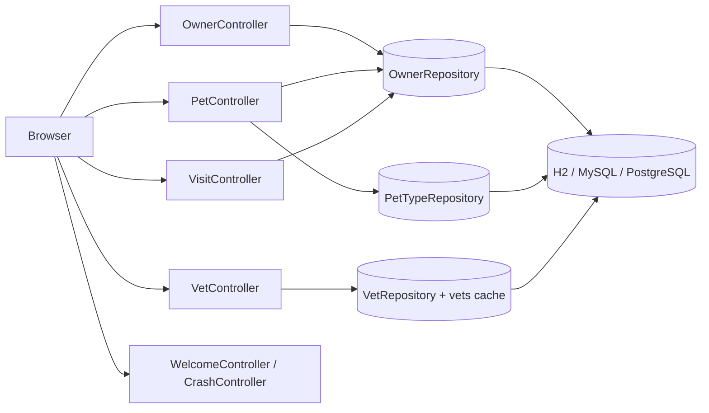
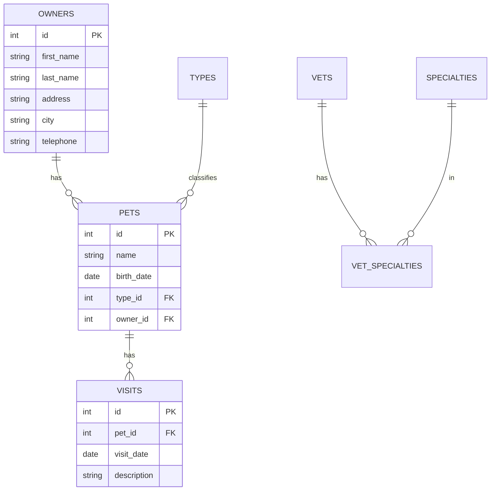
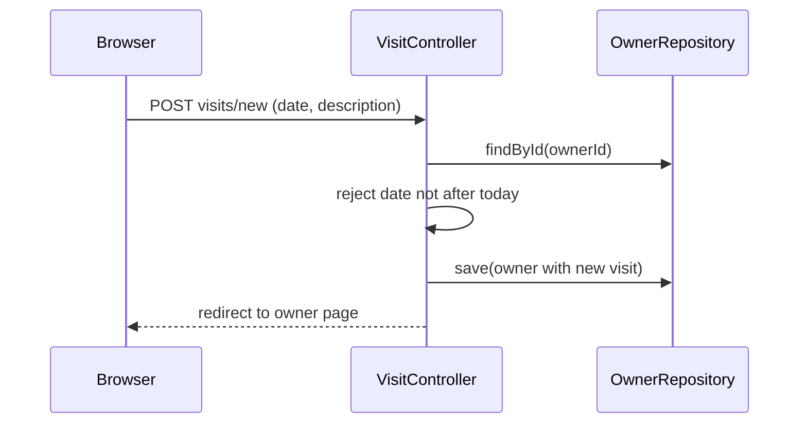
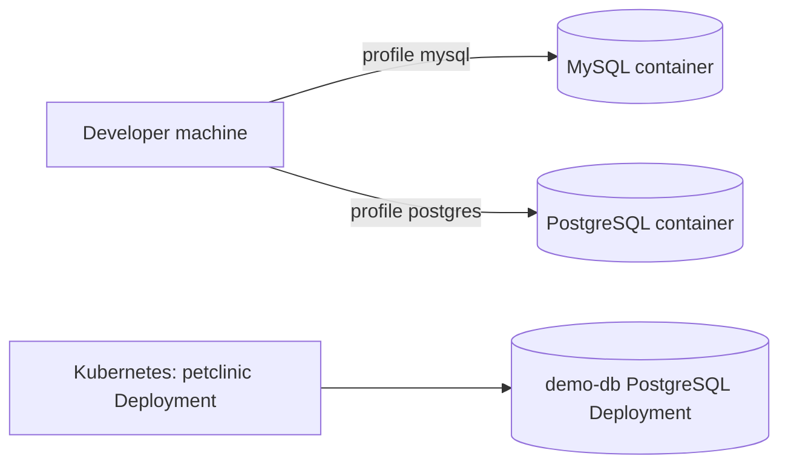

# spring-petclinic Documentation
<!-- appdoc:template 2.4 -->

**Target:** spring-petclinic | **Commit:** 500158f732419217507c7656904b8e6aa1bcc0d6 | **Evidence date:** 2026-11-11

**How to read this document.** *Cited* claims carry a path-and-line Citation. **Inferred:** marks reasoning from cited evidence. *Unknown* items are listed in section 14 and must not be assumed. Secret values are never reproduced; their locations are cited with "value omitted". The Evidence Register (source-to-claim audit) is rendered as Appendix A.

## 1. Application Index

| Support need | Primary screen or file | Workflow |
|---|---|---|
| An owner cannot be found by last name | UI-2 `findOwners.html:9-31`; `OwnerController.java:94-130` | [7.1 Find an owner](#71-find-an-owner) |
| Register a new owner | UI-5 `createOrUpdateOwnerForm.html:8-22`; `OwnerController.java:77-87` | [7.2 Register an owner](#72-register-an-owner) |
| Correct an owner's address or telephone | UI-5; `OwnerController.java:153-171` | [7.3 Edit an owner](#73-edit-an-owner) |
| Add a pet or fix a pet name, birth date or type | UI-6 `createOrUpdatePetForm.html:11-30`; `PetController.java:107-179` | [7.4 Add a pet](#74-add-a-pet) and [7.5 Edit a pet](#75-edit-a-pet) |
| Book a visit | UI-7 `createOrUpdateVisitForm.html:30-42`; `VisitController.java:97-112` | [7.6 Book a visit](#76-book-a-visit) |
| See the veterinarians and their specialties | UI-8 `vetList.html:9-25`; `VetController.java:45-54` | [7.7 Browse veterinarians](#77-browse-veterinarians) |
| Switch the display language | `WebConfiguration.java:44-58` (`lang` parameter) | [7.8 Switch language](#78-switch-language) |
| Switch the database (H2, MySQL, PostgreSQL) | `src/main/resources/application.properties:2-4`; `src/main/resources/application-mysql.properties:2-7` | [16.2 Data stores](#162-data-stores) |
| An error page appears | UI-9 `error.html:11-18`; `messages.properties:50-52` | [9. Troubleshooting Matrix](#9-troubleshooting-matrix) |
| Check what is exposed for operations | `src/main/resources/application.properties:21` | [10.1 Verified findings](#101-verified-findings) |

## 2. Coverage and Overview

### 2.1 What was inspected
Not read: the static assets (CSS, fonts, images) under `src/main/resources/static/`, the SCSS sources under `src/main/scss/`, the localized message files other than `messages.properties`, and the JMeter test plan `petclinic_test_plan.jmx`. No application was run, so runtime behavior was not observed. AppDoc extracts Facts only for the java-spring Stack; the Kubernetes manifests, Thymeleaf templates, SQL scripts and CI workflows are covered by generic Facts (files, config keys) plus manual reading, and the UI pages Facts list is empty (`src/main/resources/templates/`). No unsupported Stack was found: the only Stack present is java-spring (`pom.xml:1-12`, `build.gradle:1-10`).

<!-- appdoc:generated scan-coverage -->
| Stack | Supported | Files read |
|---|---|---|
| java-spring | yes | 53 |

Files found: 132 = scanned 131 + pruned 1 + ignored by .appdocignore 0.

| Top folder | Files scanned |
|---|---|
| `src/` | 107 |
| `.github/` | 4 |
| `.devcontainer/` | 2 |
| `gradle/` | 2 |
| `k8s/` | 2 |

| Folder not scanned | Rule | Files |
|---|---|---|
| `.mvn/` | always | 1 |
<!-- /appdoc:generated scan-coverage -->

### 2.2 Purpose and users
Spring PetClinic is a sample application for a veterinary clinic. It lets a user find and register pet owners, add and edit their pets, book visits and list the clinic's veterinarians (`README.md:1`, `OwnerController.java:72-186`, `VetController.java:45-79`). The README describes it as a "Sample Application" and the sources show no business context beyond that; real users, owners and environments are Unknown - see Open questions. Overall risk posture: the application has no authentication or authorization and exposes all actuator endpoints by default, so V-1 and V-2 dominate, followed by committed database credentials in V-3 (`pom.xml:44-64`, `src/main/resources/application.properties:21`, `k8s/db.yml:14`).

### 2.3 System boundary
Inside the boundary: one Spring Boot web application (`PetClinicApplication.java:28-34`) with server-side Thymeleaf pages, JPA persistence and an in-process cache (`pom.xml:44-64`, `CacheConfiguration.java:31-38`). Outside the boundary: a relational database, H2 in memory by default or MySQL or PostgreSQL when the `mysql` or `postgres` profile is active (`src/main/resources/application.properties:2-4`, `src/main/resources/application-mysql.properties:2-3`, `src/main/resources/application-postgres.properties:2-3`). No outbound HTTP, queue, mail or file-share call exists in application code: the only `external_call` Facts are in test code (`PetClinicIntegrationTests.java:55`, `I18nPropertiesSyncTest.java:44`).

## 3. Architecture

### 3.1 Components
- **Owner area** holds owner, pet and visit entities, their controllers, repositories, a pet validator and a pet-type formatter (`src/main/java/org/springframework/samples/petclinic/owner/`, `PetValidator.java:32-67`, `PetTypeFormatter.java:36-60`).
- **Vet area** holds the read-only veterinarian list, a cached repository and the `Vets` wrapper returned by `/vets` (JSON tested; XML not established, see F-11) (`src/main/java/org/springframework/samples/petclinic/vet/`, `VetRepository.java:38-58`, `Vets.java:30-43`).
- **System area** holds the welcome and crash controllers, the cache configuration and the locale configuration (`src/main/java/org/springframework/samples/petclinic/system/`, `WelcomeController.java:22-28`, `CrashController.java:28-37`).
- **Model base classes** `BaseEntity`, `NamedEntity` and `Person` give entities an identity, a name or a first and last name (`BaseEntity.java:32-51`, `NamedEntity.java:30-51`, `Person.java:28-57`).
- **Resources** hold Thymeleaf templates, per-database SQL scripts, i18n message bundles and application properties (`src/main/resources/templates/`, `src/main/resources/db/`, `src/main/resources/messages/`, `src/main/resources/application.properties:1-29`).
- **Runtime hints** register resources and serialization for native images (`PetClinicRuntimeHints.java:25-36`).

### 3.2 Diagram

Caption: controller-to-repository wiring, from `OwnerController.java:53-57`, `PetController.java:53-60`, `VisitController.java:45-49`, `VetController.java:39-43` and `CacheConfiguration.java:36-37`.

### 3.3 Authentication and authorization
There is no authentication or authorization. The dependency manifests list no security starter (`pom.xml:44-64`, `build.gradle:34-48`), and no controller or configuration class reads a user, role or principal (`OwnerController.java:48-188`, `WebConfiguration.java:23-60`). Every route is therefore public, including routes that create and change data (`OwnerController.java:77`, `PetController.java:107`, `VisitController.java:97`). The `Auth checks` Facts list is empty, which agrees with the source.

## 4. Functional Inventory

<!-- appdoc:generated entry-points -->
6 route handler files; 17 routes; 0 pages; 0 commands; 0 jobs.

| Handler file | Kinds | Routes | Pages | Jobs | Commands |
|---|---|---|---|---|---|
| `src/main/java/org/springframework/samples/petclinic/owner/OwnerController.java` | route | 7 | 0 | 0 | 0 |
| `src/main/java/org/springframework/samples/petclinic/owner/PetController.java` | route | 4 | 0 | 0 | 0 |
| `src/main/java/org/springframework/samples/petclinic/owner/VisitController.java` | route | 2 | 0 | 0 | 0 |
| `src/main/java/org/springframework/samples/petclinic/vet/VetController.java` | route | 2 | 0 | 0 | 0 |
| `src/main/java/org/springframework/samples/petclinic/system/CrashController.java` | route | 1 | 0 | 0 | 0 |
| `src/main/java/org/springframework/samples/petclinic/system/WelcomeController.java` | route | 1 | 0 | 0 | 0 |
<!-- /appdoc:generated entry-points -->

| ID | Area | Feature | Entry point | Inputs, outputs and rules | Dependencies | Status |
|---|---|---|---|---|---|---|
| F-1 | Home | Welcome page | `GET /` `WelcomeController.java:25-28` | Returns the `welcome` view (`welcome.html:7-12`). | Layout fragment `layout.html:3-88` | Cited |
| F-2 | Owners | Find-owners form | `GET /owners/find` `OwnerController.java:89-92` | Returns the search form with one last-name field (`findOwners.html:9-31`). | None | Cited |
| F-3 | Owners | Search and list owners | `GET /owners` `OwnerController.java:94-130` | Input `lastName` (stripped, empty means all) and `page` (default 1); prefix match on last name, 5 per page; zero results re-show the form with the field error "has not been found" (`messages.properties:3`); exactly one result redirects to that owner; out-of-range page redirects to page 1 (`OwnerController.java:98-126`, `OwnerController.java:141-146`). | `OwnerRepository.java:45` | Cited |
| F-4 | Owners | Create owner | `GET` and `POST /owners/new` `OwnerController.java:72-87` | Fields first name, last name, address, city, telephone; all required, name fields at most 30 characters, address at most 255, city at most 80, telephone exactly 10 digits (`Person.java:31-39`, `Owner.java:52-65`). Success redirects to the new owner. | `OwnerRepository.java:36` | Cited |
| F-5 | Owners | Show owner with pets and visits | `GET /owners/{ownerId}` `OwnerController.java:178-186` | Unknown id raises `IllegalArgumentException` (`OwnerController.java:182-183`). Page shows owner, pets and visits (`ownerDetails.html:17-79`). | `OwnerRepository.java:60` | Cited |
| F-6 | Owners | Edit owner | `GET` and `POST /owners/{ownerId}/edit` `OwnerController.java:148-171` | Same validation as F-4; a form id that differs from the URL id is refused and redirects back to the edit form (`OwnerController.java:161-165`). **Inferred:** this branch is effectively unreachable from the browser form, because `id` is not bindable (`OwnerController.java:59-62`) and the owner is loaded from the path id (`OwnerController.java:64-70`); the test reaches it by stubbing `findById(1)` to return an owner whose id is 2 and passing that owner as `flashAttr` (`OwnerControllerTests.java:303`, `OwnerControllerTests.java:310`, `OwnerControllerTests.java:312`). | `OwnerRepository.java:36` | Cited |
| F-7 | Pets | Add pet to an owner | `GET` and `POST /owners/{ownerId}/pets/new` `PetController.java:100-137` | Name required and at most 30 characters, type required for a new pet, birth date required and not in the future, name unique per owner ignoring case (`PetValidator.java:43-58`, `PetController.java:111-118`, `Owner.java:147-157`). | `PetTypeRepository.java:36`, `OwnerRepository.java:36` | Cited |
| F-8 | Pets | Edit pet | `GET` and `POST /owners/{ownerId}/pets/{petId}/edit` `PetController.java:139-179` | Same rules as F-7; a name used by a different pet of the same owner is refused (`PetController.java:151-156`). | `OwnerRepository.java:36` | Cited |
| F-9 | Visits | Book visit for a pet | `GET` and `POST /owners/{ownerId}/pets/{petId}/visits/new` `VisitController.java:90-112` | Date must be after today (default tomorrow), description required and at most 255 characters (`VisitController.java:100-102`, `Visit.java:43-52`). | `OwnerRepository.java:36` | Cited |
| F-10 | Veterinarians | Vet list page | `GET /vets.html` `VetController.java:45-54` | Paged list, 5 per page, out-of-range page redirects to page 1 (`VetController.java:49-52`, `VetController.java:65-70`). | `VetRepository.java:54-56` | Cited |
| F-11 | Veterinarians | Vet list as a resource | `GET /vets` `VetController.java:72-79` | Returns all vets in the `Vets` wrapper as JSON (`Vets.java:30-43`; a JSON request is tested in `VetControllerTests.java:103-109`). **Inferred:** XML output is not established: `pom.xml` has `jakarta.xml.bind-api` (`pom.xml:72-73`) but no XML message-converter dependency, and no test requests XML. | `VetRepository.java:44-46` | Cited |
| F-12 | Diagnostics | Forced exception | `GET /oups` `CrashController.java:31-35` | Always throws `RuntimeException` to demonstrate the error page (`CrashController.java:33-34`). | `error.html:11-18` | Cited |
| F-13 | Localization | Language switch | `?lang=` on any page `WebConfiguration.java:44-58` | `lang` request parameter changes the session locale; default English (`WebConfiguration.java:33-36`, `WebConfiguration.java:46-47`). | `messages.properties:1-52` | Cited |
| F-14 | Operations | Actuator endpoints | `/actuator/*` (not in Facts) | **Inferred:** all actuator endpoints are exposed because `management.endpoints.web.exposure.include` is `*` and the actuator starter is a dependency (`src/main/resources/application.properties:21`, `pom.xml:44-45`). | Spring Boot actuator | Inferred |

### 4.1 Subsystem inventory

| Subsystem | Files | Features | Primary data and dependencies | Purpose | Status |
|---|---|---|---|---|---|
| `src/` | 107 | F-1 to F-13 | JPA entities, SQL scripts, templates, tests (`src/main/resources/db/h2/schema.sql:10-65`) | Application source, resources and tests | Cited |
| (root) | 14 | None | Build files `pom.xml:1-12`, `build.gradle:1-10`, wrappers and `docker-compose.yml:1-21` | Build and local database set-up | Cited |
| `.github/` | 4 | None | `maven-build.yml:6-29`, `gradle-build.yml:6-31`, `deploy-and-test-cluster.yml:3-30` | CI workflows and DCO bot config | Cited |
| `.devcontainer/` | 2 | None | `devcontainer.json:1-25` | Development container definition | Cited |
| `gradle/` | 2 | None | `gradle-wrapper.properties:1-1` | Gradle wrapper | Cited |
| `k8s/` | 2 | F-14 | `k8s/petclinic.yml:15-64`, `k8s/db.yml:28-73` | Kubernetes demo manifests for the app and PostgreSQL | Cited |
| `.mvn/` | 0 | None | Maven wrapper folder pruned from the scan (see 2.1); contents not read | Maven wrapper | Unknown |

## 5. Roles and Access Model

### 5.1 Observed role concepts
No roles, groups, scopes or client names were observed. The dependency manifests contain no security library and no source file refers to a principal or role (`pom.xml:44-64`, `build.gradle:34-48`, `OwnerController.java:48-188`, `VetController.java:36-81`).

### 5.2 Authorization enforcement
No enforcement exists. Where it would sit (a servlet filter chain or method annotations) nothing is registered: the only web configuration adds a locale interceptor (`WebConfiguration.java:55-58`). Every route in section 4 has no check, including all create and edit routes (`OwnerController.java:77`, `OwnerController.java:153`, `PetController.java:107`, `PetController.java:144`, `VisitController.java:97`). The only binding restriction is a binder that forbids binding `id` and `*.id` (`OwnerController.java:59-62`, `PetController.java:89-98`, `VisitController.java:51-54`); it does not stop nested fields such as `pets[0].name` on the owner, pet and visit forms, because each of the three controllers binds the owner graph (V-9). Value checks come from bean validation and `PetValidator` (section 10.2, input validation).

### 5.3 Role-to-capability matrix

| Capability | Any HTTP client (no role) | Named role (none exists) |
|---|---|---|
| Home | Y `WelcomeController.java:25` | |
| Owners (search, view, create, edit) | Y `OwnerController.java:94`, `OwnerController.java:153` | |
| Pets (add, edit) | Y `PetController.java:107`, `PetController.java:144` | |
| Visits (book) | Y `VisitController.java:97` | |
| Veterinarians (list HTML and JSON; XML not established, see F-11) | Y `VetController.java:45`, `VetController.java:72` | |
| Diagnostics (`/oups`) | Y `CrashController.java:31` | |
| Localization (`lang`) | Y `WebConfiguration.java:46-47` | |
| Operations (actuator) | **Inferred:** Y `src/main/resources/application.properties:21` | |
| Delete any owner, pet or visit | No such route (no delete mapping in `OwnerController.java:48-188`, `PetController.java:47-207`, `VisitController.java:42-114`) | |
| Any action restricted to a role | None exists (`WebConfiguration.java:55-58`) | |

**Restriction:** do not infer a permission from a visible control or a granted scope; enforcement is the code cited in 5.2.

## 6. UI Catalog
Source-only catalog; no screenshots or live session. Templates live in `src/main/resources/templates/` and all share the layout fragment `layout.html:3-88`. 9 of 9 screens catalogued.

| ID | Page | Route or entry | Reached from | Visible controls and data | States and effects | Roles and evidence |
|---|---|---|---|---|---|---|
| UI-1 | Welcome | `/` | Navbar Home, brand link (`layout.html:22`, `layout.html:41`) | Heading and a picture (`welcome.html:7-12`) | Static | Public (`WelcomeController.java:25-28`) |
| UI-2 | Find Owners | `/owners/find` | Navbar "Find owners" (`layout.html:46`) | Last-name field, Find Owner button, Add Owner link (`findOwners.html:9-29`) | Shows the field error "has not been found" when no owner matches; an empty last name lists all owners, so this happens only on an empty result (`OwnerController.java:116-119`, `messages.properties:3`, `findOwners.html:15-19`) | Public (`OwnerController.java:89-92`) |
| UI-3 | Owners list | `/owners?page=n` | UI-2 submit | Table of name, address, city, telephone and pets; page links (`ownersList.html:9-58`) | Hidden when one owner matches, which redirects to UI-4 (`OwnerController.java:122-126`) | Public (`OwnerController.java:94-130`) |
| UI-4 | Owner Information | `/owners/{ownerId}` | UI-3 name link; redirects after saves | Owner table, Edit Owner and Add New Pet buttons, pets with visits, Edit Pet and Add Visit links (`ownerDetails.html:17-77`) | Shows a flash `message` or `error` banner and hides it after 3 seconds (`ownerDetails.html:9-15`, `ownerDetails.html:80-91`) | Public (`OwnerController.java:178-186`) |
| UI-5 | Owner form | `/owners/new`, `/owners/{ownerId}/edit` | UI-2, UI-4 | Five text fields, Add Owner or Update Owner button (`createOrUpdateOwnerForm.html:8-22`) | Field errors rendered by the input fragment (`inputField.html:1-27`) | Public (`OwnerController.java:72-87`, `OwnerController.java:148-171`) |
| UI-6 | Pet form | `/owners/{ownerId}/pets/new`, `.../pets/{petId}/edit` | UI-4 | Read-only owner, name, birth date, type select, Add Pet or Update Pet (`createOrUpdatePetForm.html:11-30`) | Type list from `PetTypeRepository.java:36-37` | Public (`PetController.java:100-179`) |
| UI-7 | Visit form | `/owners/{ownerId}/pets/{petId}/visits/new` | UI-4 Add Visit | Pet summary, date, description, previous visits (`createOrUpdateVisitForm.html:12-55`) | Date defaults to tomorrow (`Visit.java:50-52`) | Public (`VisitController.java:90-112`) |
| UI-8 | Veterinarians | `/vets.html?page=n` | Navbar "Veterinarians" (`layout.html:51`) | Table of name and specialties, page links (`vetList.html:9-54`) | "none" shown when a vet has no specialty (`vetList.html:20-22`) | Public (`VetController.java:45-54`) |
| UI-9 | Error | any failing request | Navbar "Error" link goes to `/oups` (`layout.html:56-57`) | Heading, text chosen by status 404, 500 or other, and the exception message (`error.html:8-18`) | Message text depends on Spring Boot error attributes (`error.html:18`) | Public (`CrashController.java:31-35`) |

## 7. Workflows

### 7.1 Find an owner
1. The user opens the form at `/owners/find` and submits a last name (`OwnerController.java:89-92`, `findOwners.html:9-25`).
2. The controller strips the last name, treats null as empty, and queries owners whose last name starts with it, 5 per page (`OwnerController.java:98-107`, `OwnerController.java:141-146`, `OwnerRepository.java:45`).
3. A page below 1 or above the last page redirects to page 1 keeping the last name (`OwnerController.java:108-114`).
4. No result re-shows the form with the field error "has not been found" (the code's default text is "not found"; the bundle text is shown, `messages.properties:3`); one result redirects to that owner; several results render the list (`OwnerController.java:116-129`, `ownersList.html:20-30`).
5. **Inferred:** match case depends on the database. H2 declares `last_name` as ignore-case while PostgreSQL declares it as plain text (`src/main/resources/db/h2/schema.sql:39`, `src/main/resources/db/postgres/schema.sql:29`).

Failure and escalation: a search with no hits shows the "has not been found" field error and needs no escalation; escalate only if every search errors with HTTP 500, which points at the database connection (`OwnerController.java:116-119`, `src/main/resources/application.properties:2-4`).

### 7.2 Register an owner
1. `GET /owners/new` returns an empty form (`OwnerController.java:72-75`, `createOrUpdateOwnerForm.html:8-22`).
2. `POST /owners/new` validates the bean; on errors it sets a flash `error` and returns the form view (`OwnerController.java:77-82`, `Owner.java:52-65`).
3. On success the owner is saved with cascade to pets, a flash `message` is set and the browser is redirected to the new owner (`OwnerController.java:84-86`, `Owner.java:67-70`).
4. The `id` form field is never bound (`OwnerController.java:59-62`).

Failure and escalation: validation errors appear next to the field, for example the telephone message "Telephone must be a 10-digit number"; a database error produces the generic error page and goes to the database owner (Unknown - see Open questions) (`messages.properties:34`, `error.html:11-18`).

### 7.3 Edit an owner
1. `GET /owners/{ownerId}/edit` loads the owner through the model attribute method and shows the form (`OwnerController.java:64-70`, `OwnerController.java:148-151`).
2. `POST` validates; on errors it sets a flash `error` and returns the form (`OwnerController.java:153-159`).
3. If the owner id in the form differs from the URL id, the update is refused and the browser is redirected back to the edit form (`OwnerController.java:161-165`). **Inferred:** this branch is effectively unreachable over HTTP, because `id` is not bindable (`OwnerController.java:59-62`) and the owner is loaded from the path id (`OwnerController.java:64-70`); the test reaches it by stubbing `findById(1)` to return an owner whose id is 2 and passing that owner as `flashAttr` (`OwnerControllerTests.java:303`, `OwnerControllerTests.java:310`, `OwnerControllerTests.java:312`).
4. Otherwise the id is set from the URL, the owner is saved and the browser is redirected to the owner page with "Owner Values Updated" (`OwnerController.java:167-170`).
5. **Inferred:** any other posted parameter that matches an owner property is also bound, including nested pet and visit fields such as `pets[0].name`; they are saved through the cascade (`OwnerController.java:59-62`, `Owner.java:67-70`, see V-9).

Failure and escalation: an unknown owner id raises `IllegalArgumentException` and shows the 500 error page; verify the id in the URL before escalating (`OwnerController.java:65-69`, `messages.properties:51`).

### 7.4 Add a pet
1. `GET /owners/{ownerId}/pets/new` adds an empty pet to the loaded owner and shows the form with the pet-type list (`PetController.java:62-65`, `PetController.java:100-105`).
2. `POST` rejects a duplicate name for the same owner (case-insensitive, through `Owner.getPet`), and a birth date after today (`PetController.java:111-118`, `Owner.java:147-157`).
3. `PetValidator` rejects a blank name, a name longer than 30 characters, a missing type on a new pet and a missing birth date (`PetValidator.java:43-58`).
4. On success the pet is added and the owner saved with `saveAndFlush`; a database unique-constraint violation on `unique_owner_pet_name` is converted into the `duplicate` field error, which users see as "is already in use" (the code's default text "already exists" is replaced by the bundle text, `messages.properties:4`; the concurrency test counts a response containing that text as a blocked attempt and asserts exactly one success, `PetClinicConcurrencyTests.java:86-92`, `PetClinicConcurrencyTests.java:124`); any other integrity violation is re-thrown (`PetController.java:124-134`, `PetController.java:202-205`).
5. The browser is redirected to the owner page with "New Pet has been Added" (`PetController.java:135-136`).
6. The pet type posted as text is parsed by the formatter; an unknown type raises `ParseException` (`PetTypeFormatter.java:51-60`).

Failure and escalation: two simultaneous submissions of the same name are resolved by the unique index, and exactly one succeeds (`PetClinicConcurrencyTests.java:123-131`, `src/main/resources/db/postgres/schema.sql:45`); escalate if a duplicate pet name ever appears for one owner, which means the constraint is missing in that database.

### 7.5 Edit a pet
1. `GET .../pets/{petId}/edit` shows the form for the pet loaded from the owner's pet list (`PetController.java:75-87`, `PetController.java:139-142`).
2. `POST` applies the same duplicate-name and future-date checks, treating the pet's own name as allowed (`PetController.java:148-161`).
3. On success name, birth date and type are copied onto the stored pet and the owner is saved (`PetController.java:186-200`).
4. The browser is redirected to the owner page with "Pet details has been edited" (`PetController.java:177-178`).

Failure and escalation: the same duplicate-name handling as 7.4 applies; a `petId` that does not belong to the owner is Unknown - see Open questions (`PetController.java:86`, `Owner.java:129-139`).

### 7.6 Book a visit
1. The model attribute method loads the owner and pet, throws `IllegalArgumentException` when either is missing, and attaches a new visit to the pet (`VisitController.java:63-81`).
2. `GET` shows the form with a minimum date of tomorrow (`VisitController.java:83-93`).
3. `POST` rejects a date that is not after today and any bean-validation error such as a blank or over-long description (`VisitController.java:100-106`, `Visit.java:43-45`).
4. On success the visit is added to the pet through the owner, the owner is saved and the browser is redirected to the owner page with "Your visit has been booked" (`VisitController.java:108-111`, `Owner.java:176-186`).

Failure and escalation: a missing owner or pet gives the generic 500 page with the message "Pet with id ... not found for owner with id ..."; confirm the ids in the URL before escalating (`VisitController.java:67-74`).

### 7.7 Browse veterinarians
1. `GET /vets.html?page=n` reads a page of 5 vets through the cached repository and renders the table (`VetController.java:45-70`, `VetRepository.java:54-56`).
2. `GET /vets` returns all vets in the `Vets` wrapper as JSON (tested); **Inferred:** XML output is not established, see F-11 (`VetController.java:72-79`, `Vets.java:30-43`, `VetControllerTests.java:103-109`).
3. Specialties are sorted by name inside each vet (`Vet.java:59-64`).
4. The repository methods are cached in the `vets` cache, which the JCache configuration creates with statistics enabled (`CacheConfiguration.java:36-37`, `CacheConfiguration.java:49-51`). **Inferred:** that configuration applies only if Spring Boot selects a JCache provider; `caffeine` is also a dependency (`pom.xml:82-83`), so the runtime cache implementation was not observed and no expiry or eviction is set in source.

Failure and escalation: there is no write path, so stale data is only possible through the cache; restart the application if the `vets` data changes in the database, because no eviction is configured in source (`VetRepository.java:44-46`, `CacheConfiguration.java:35-38`).

### 7.8 Switch language
1. Any request with `?lang=xx` changes the session locale through the locale interceptor (`WebConfiguration.java:44-49`, `WebConfiguration.java:55-58`).
2. The default is English and the locale is stored in the session (`WebConfiguration.java:33-36`).
3. Message bundles are loaded from `messages/messages` (`src/main/resources/application.properties:16`).

Failure and escalation: **Inferred:** a locale with no bundle falls back to the default `messages.properties` (framework behavior, not shown in the cited lines); the test `I18nPropertiesSyncTest.java:87-90` only checks that bundles stay in sync, so escalate to the developers if that test fails (`src/main/resources/application.properties:16`).

## 8. Data and Integrations

### 8.1 Connections

| ID | Name | Kind | Configured at | Used by |
|---|---|---|---|---|
| C-1 | H2 in-memory database (default) | Relational database | `src/main/resources/application.properties:2-4` | All repositories (`OwnerRepository.java:36`, `VetRepository.java:38`) |
| C-2 | MySQL (profile `mysql`) | Relational database | `src/main/resources/application-mysql.properties:3` (URL overridable by environment variable; value omitted) | All repositories |
| C-3 | PostgreSQL (profile `postgres`) | Relational database | `src/main/resources/application-postgres.properties:3` (URL overridable by environment variable; value omitted) | All repositories |
| C-4 | `vets` cache (in process; declared through JCache, provider not observed) | Cache | `CacheConfiguration.java:36-37` | `VetRepository.java:45`, `VetRepository.java:55` |

C-1 has no datasource URL in the properties, so **Inferred:** Spring Boot creates its default embedded database; the README says the H2 database is in memory (`src/main/resources/application.properties:2-4`, `README.md:64-66`). The Kubernetes manifest activates the `postgres` profile and mounts the credentials as a service binding (`k8s/petclinic.yml:35-38`, `k8s/petclinic.yml:55-64`).

### 8.2 Stored procedures and SQL
No stored procedure exists in source. Data access is Spring Data JPA: derived query `findByLastNameStartingWith`, `findById`, the JPQL query `SELECT ptype FROM PetType ptype ORDER BY ptype.name` and cached `findAll` methods (`OwnerRepository.java:45`, `OwnerRepository.java:60`, `PetTypeRepository.java:36-37`, `VetRepository.java:44-56`). Hibernate does not create the schema (`spring.jpa.hibernate.ddl-auto=none`); SQL scripts are run at start-up from the per-database folders under the `db` resource folder (`src/main/resources/application.properties:3-4`, `src/main/resources/application.properties:10`, `src/main/resources/db/h2/schema.sql:1-65`, `src/main/resources/db/postgres/schema.sql:1-53`, `src/main/resources/db/mysql/schema.sql:1-56`). Seed data is 47 INSERT statements in each of the h2, mysql and postgres seed scripts (`src/main/resources/db/h2/data.sql:1-53`, `src/main/resources/db/mysql/data.sql:1-53`, `src/main/resources/db/postgres/data.sql:1-53`).

### 8.3 External calls
No external call exists in application code; the `external_call` Facts are all test-only (RestTemplate calls to the application itself and reads of properties files) (`PetClinicIntegrationTests.java:55`, `PetClinicConcurrencyTests.java:80`, `I18nPropertiesSyncTest.java:44`).

| ID | Call | Direction | Caller | Notes |
|---|---|---|---|---|

### 8.4 Data entities and sensitivity

| Entity | Key fields | Defined at | Sensitivity |
|---|---|---|---|
| Owner (`owners`) | id, first_name, last_name, address, city, telephone | `Owner.java:48-70`, `src/main/resources/db/h2/schema.sql:36-43` | PII: name, home address, telephone |
| Pet (`pets`) | id, name, birth_date, type_id, owner_id | `Pet.java:44-59`, `src/main/resources/db/h2/schema.sql:46-52` | Low: pet name and birth date tied to an owner |
| Visit (`visits`) | id, pet_id, visit_date, description | `Visit.java:35-45`, `src/main/resources/db/h2/schema.sql:58-63` | Medium: free-text description may hold health information (**Inferred** from the field purpose) |
| Vet (`vets`) | id, first_name, last_name | `Vet.java:43-50`, `src/main/resources/db/h2/schema.sql:10-14` | Public in the application: shown to every visitor |
| Specialty (`specialties`) | id, name | `Specialty.java:28-30`, `src/main/resources/db/h2/schema.sql:17-20` | Public |
| PetType (`types`) | id, name | `PetType.java:26-28`, `src/main/resources/db/h2/schema.sql:30-33` | Public |
| Vet-specialty join (`vet_specialties`) | vet_id, specialty_id | `Vet.java:47-50`, `src/main/resources/db/h2/schema.sql:23-28` | Public |

Owner (`owners`; types as in the H2 script, PostgreSQL uses TEXT for strings):

| Field | Type | Null | Key/FK | Sensitivity | Citation |
|---|---|---|---|---|---|
| id | INTEGER identity | No | Primary key | None | `src/main/resources/db/h2/schema.sql:37` |
| first_name | VARCHAR(30) | Yes in DB; required by bean validation | | PII | `src/main/resources/db/h2/schema.sql:38`, `Person.java:31-34` |
| last_name | VARCHAR_IGNORECASE(30) | Yes in DB; required by bean validation | Indexed | PII | `src/main/resources/db/h2/schema.sql:39`, `src/main/resources/db/h2/schema.sql:44`, `Person.java:36-39` |
| address | VARCHAR(255) | Yes in DB; required by bean validation | | PII | `src/main/resources/db/h2/schema.sql:40`, `Owner.java:52-55` |
| city | VARCHAR(80) | Yes in DB; required by bean validation | | PII | `src/main/resources/db/h2/schema.sql:41`, `Owner.java:57-60` |
| telephone | VARCHAR(20) | Yes in DB; 10 digits by bean validation | | PII | `src/main/resources/db/h2/schema.sql:42`, `Owner.java:62-65` |

Pet (`pets`):

| Field | Type | Null | Key/FK | Sensitivity | Citation |
|---|---|---|---|---|---|
| id | INTEGER identity | No | Primary key | None | `src/main/resources/db/h2/schema.sql:47` |
| name | VARCHAR_IGNORECASE(30) | Yes in DB; required by validator | Unique with owner_id | Low | `src/main/resources/db/h2/schema.sql:48`, `src/main/resources/db/h2/schema.sql:55`, `NamedEntity.java:33-35` |
| birth_date | DATE | Yes in DB; required by validator | | Low | `src/main/resources/db/h2/schema.sql:49`, `PetValidator.java:56-58` |
| type_id | INTEGER | No | FK to types(id) | None | `src/main/resources/db/h2/schema.sql:50`, `src/main/resources/db/h2/schema.sql:54` |
| owner_id | INTEGER | Yes | FK to owners(id) | None | `src/main/resources/db/h2/schema.sql:51`, `src/main/resources/db/h2/schema.sql:53` |

Visit (`visits`):

| Field | Type | Null | Key/FK | Sensitivity | Citation |
|---|---|---|---|---|---|
| id | INTEGER identity | No | Primary key | None | `src/main/resources/db/h2/schema.sql:59` |
| pet_id | INTEGER | Yes | FK to pets(id), indexed | None | `src/main/resources/db/h2/schema.sql:60`, `src/main/resources/db/h2/schema.sql:64-65` |
| visit_date | DATE | Yes | | Low | `src/main/resources/db/h2/schema.sql:61`, `Visit.java:39-41` |
| description | VARCHAR(255) | Yes in DB; required by bean validation | | Possible health information (**Inferred**) | `src/main/resources/db/h2/schema.sql:62`, `Visit.java:43-45` |

Vet (`vets`):

| Field | Type | Null | Key/FK | Sensitivity | Citation |
|---|---|---|---|---|---|
| id | INTEGER identity | No | Primary key | None | `src/main/resources/db/h2/schema.sql:11` |
| first_name | VARCHAR(30) | Yes | | Public | `src/main/resources/db/h2/schema.sql:12` |
| last_name | VARCHAR(30) | Yes | Indexed | Public | `src/main/resources/db/h2/schema.sql:13`, `src/main/resources/db/h2/schema.sql:15` |

Specialty (`specialties`) and PetType (`types`):

| Field | Type | Null | Key/FK | Sensitivity | Citation |
|---|---|---|---|---|---|
| specialties.id | INTEGER identity | No | Primary key | None | `src/main/resources/db/h2/schema.sql:18` |
| specialties.name | VARCHAR(80) | Yes | Indexed | Public | `src/main/resources/db/h2/schema.sql:19`, `src/main/resources/db/h2/schema.sql:21` |
| types.id | INTEGER identity | No | Primary key | None | `src/main/resources/db/h2/schema.sql:31` |
| types.name | VARCHAR(80) | Yes | Indexed | Public | `src/main/resources/db/h2/schema.sql:32`, `src/main/resources/db/h2/schema.sql:34` |

### 8.5 Failure, fallback and observability

| ID | Timeout and retry | On failure | Observability |
|---|---|---|---|
| C-1 | None configured: no timeout or retry property in source (`src/main/resources/application.properties:1-29`) | **Inferred:** a persistence exception ends in the error page with HTTP 500 (`error.html:11-18`); only the duplicate pet-name violation is handled (`PetController.java:128-134`) | Logging level INFO for `org.springframework`; all actuator endpoints exposed (`src/main/resources/application.properties:21`, `src/main/resources/application.properties:24`) |
| C-2 | None configured (`src/main/resources/application-mysql.properties:1-7`) | Same as C-1 | Same as C-1 |
| C-3 | None configured (`src/main/resources/application-postgres.properties:1-7`) | Same as C-1; the Kubernetes database has readiness and startup probes but the application pod does not wait for it in source (`k8s/db.yml:65-73`, `k8s/petclinic.yml:47-54`) | Same as C-1 |
| C-4 | None: in-process cache without retry (`CacheConfiguration.java:49-51`) | **Inferred:** cache miss reads the database (`VetRepository.java:44-56`) | Statistics enabled (`CacheConfiguration.java:50`) |

## 9. Troubleshooting Matrix

| Symptom | Checks | Known response | Escalate when |
|---|---|---|---|
| 500 page "Owner not found with id" | Check the owner id in the URL (`OwnerController.java:68-69`, `PetController.java:70-71`) | Use the owner list to find the correct id; the message is shown only if Spring Boot includes it (`error.html:18`) | The id exists in the database but is still reported missing, which points at the wrong database or profile (`src/main/resources/application.properties:2-4`) |
| 500 page "Pet with id ... not found for owner" | Check that the pet belongs to the owner in the URL (`VisitController.java:70-74`) | Open the visit form from the owner page link (`ownerDetails.html:73`) | The link on the owner page itself fails |
| Search says "has not been found" (the code's default text is "not found") | Last name spelling; prefix match only (`OwnerController.java:116-119`, `OwnerRepository.java:45`, `messages.properties:3`) | Retry with a shorter prefix or an empty last name to list all (`OwnerController.java:99-101`) | An existing owner never matches after one retry with an empty search |
| Telephone rejected | Value must be exactly 10 digits (`Owner.java:62-65`) | Re-enter without spaces or dashes; message "Telephone must be a 10-digit number" (`messages.properties:34`) | A valid 10-digit number is rejected |
| Pet name "is already in use" (the code's default text is "already exists") | Another pet of the same owner has the name, case ignored (`PetController.java:111-113`, `PetController.java:129-133`, `messages.properties:4`) | Choose another name | No pet with that name is listed for the owner. **Inferred:** the database may hold a conflicting row that the page does not show; source shows only the unique constraint, not the cause (`src/main/resources/db/h2/schema.sql:55`) |
| Pet birth date "invalid date" | Date is in the future (`PetController.java:115-118`, `messages.properties:8`) | Enter a past date | A past date is rejected |
| Pet type error | Type text does not match a stored type name; the formatter raises `ParseException` "type not found" (`PetTypeFormatter.java:51-60`). **Inferred:** the on-screen text may be Spring's default conversion message, because `messages.properties` has no `typeMismatch.type` key (`messages.properties:7-9`) | Pick a value from the list (`PetController.java:62-65`) | The list is empty, meaning seed data was not loaded (`src/main/resources/db/h2/data.sql:18-23`) |
| Visit date "must be in the future" | Date must be after today (`VisitController.java:100-102`, `messages.properties:9`) | Use tomorrow or later | A future date is rejected |
| Visit description rejected | Blank or over 255 characters (`Visit.java:43-45`) | Shorten the text | A valid text is rejected |
| Owner update refused, "Owner ID mismatch" | Form id differs from URL id (`OwnerController.java:161-165`); **Inferred:** hard to reach from the browser form, because `id` is not bindable and the owner is loaded from the path id (`OwnerController.java:59-70`); the test triggers it by stubbing `findById(1)` to return an owner whose id is 2 (`OwnerControllerTests.java:303`, `OwnerControllerTests.java:310`) | Reload the edit page and resubmit | It repeats after a reload |
| Page number out of range sends the user to page 1 | `page` below 1 or above the last page (`OwnerController.java:108-114`, `VetController.java:49-52`) | None needed, this is intended | Page 1 itself shows no rows while the database has rows |
| Error page after clicking Error in the menu | `/oups` always throws (`CrashController.java:31-35`, `layout.html:56-57`) | Expected; return to Home | The same page appears on other routes |
| 500 on pet save with another integrity error | Only the `unique_owner_pet_name` violation is converted; others are re-thrown (`PetController.java:128-131`, `PetController.java:202-205`) | Read the application log for the constraint name | After one retry the error repeats |

## 10. Security and Operational Risks

### 10.1 Verified findings

| ID | Severity | Finding | Evidence | Impact |
|---|---|---|---|---|
| V-1 | Critical | No authentication or authorization: every route is public, including the owner list with names, addresses and telephone numbers and every create and edit route | `pom.xml:44-64`, `OwnerController.java:94-130`, `OwnerController.java:153-171`, `PetController.java:107-137`, `VisitController.java:97-112` | Condition: the default configuration with no profile and no gateway. Anyone who can reach port 8080 can read owner PII (`Owner.java:52-65`) and create or change owners, pets and visits. Critical per the rubric (exposes data without authentication) |
| V-2 | High | All actuator endpoints are exposed; the property's own comment says not to do this in production | `src/main/resources/application.properties:19-21`, `pom.xml:44-45` | Condition: key `management.endpoints.web.exposure.include` is `*` (`src/main/resources/application.properties:21`) and no authentication exists (V-1). The deployed manifest sets no override (`k8s/petclinic.yml:34-43`). **Inferred:** the endpoint set follows the Spring Boot 4.1.0 version in `pom.xml:8`. High rather than Critical because which endpoints return sensitive values was not observed |
| V-3 | High | Database credentials are committed in clear text: Kubernetes secret, default values in the profile properties, Compose settings and the MySQL user script (values omitted) | `k8s/db.yml:14`, `src/main/resources/application-mysql.properties:5`, `src/main/resources/application-postgres.properties:5`, `docker-compose.yml:10`, `docker-compose.yml:19`, `src/main/resources/db/mysql/user.sql:7` | Condition: any deployment that keeps the defaults. An exposed credential is High per the rubric; the MySQL script also grants all privileges on the petclinic database (`src/main/resources/db/mysql/user.sql:9`) |
| V-4 | Medium | The Compose MySQL service allows an empty root password and publishes port 3306 | `docker-compose.yml:4-8` | Condition: the host network is reachable by others. Anyone connecting to port 3306 can log in as root without a password |
| V-5 | Medium | The Kubernetes PostgreSQL deployment has no volume, so data lives in the container filesystem | `k8s/db.yml:28-73` | Condition: the pod restarts or is rescheduled. All owner, pet and visit data is lost (data-integrity loss). **Inferred** from the absence of any volume mount |
| V-9 | Medium | The owner graph is bound from request parameters on the owner edit, add-pet, edit-pet and add-visit routes: each binder disallows only `id` and `*.id`, `Owner.pets` is exposed through `getPets()` and cascades on save, so a post with fields such as `pets[0].name`, `pets[0].birthDate` or `pets[0].visits[0].description` is applied to the loaded owner's pets and saved | `OwnerController.java:59-62`, `OwnerController.java:64-70`, `OwnerController.java:153-171`, `Owner.java:67-70`, `Owner.java:96`, `PetController.java:89-92`, `PetController.java:94-98`, `PetController.java:108`, `PetController.java:126`, `PetController.java:145`, `PetController.java:199`, `VisitController.java:51-54`, `VisitController.java:98`, `VisitController.java:109` | Condition: a caller can post to `/owners/{ownerId}/edit`, `/owners/{ownerId}/pets/new`, `/owners/{ownerId}/pets/{petId}/edit` or `/owners/{ownerId}/pets/{petId}/visits/new`, which any HTTP client can (V-1). The pet and visit routes bind the loaded owner as a model attribute with no allow-list and save it (`PetController.java:108`, `PetController.java:145`, `VisitController.java:98`), so restricting the owner form alone does not close the gap (R-13). Pet names, birth dates, types and visit text can be changed without the checks in `PetController`: `PetValidator` is registered only for the `pet` binder (`PetController.java:94-98`) and `Owner.pets` carries no `@Valid` (`Owner.java:67-70`). The database unique rule on pet names still applies (`src/main/resources/db/h2/schema.sql:55`). **Inferred** from source reading and Spring data-binding behavior (including the reach through the pet and visit routes); not run against an instance. Medium per the rubric: it needs a reachable edit route (V-1) and adds a validation bypass rather than new data exposure |
| V-6 | Low | Owner create and update set a flash error and then return the form view instead of redirecting; the form template never reads `error`, so the message is not shown by that page | `OwnerController.java:80`, `OwnerController.java:157`, `createOrUpdateOwnerForm.html:8-22` | Condition: validation fails on create or update. **Inferred:** the failed attempt reports no banner text; the field errors still render. Hygiene only |
| V-7 | Low | A public diagnostic route always throws an exception and is linked from the navigation bar | `CrashController.java:31-35`, `layout.html:56-57` | Anyone can trigger server errors that appear in logs (hygiene) |
| V-8 | Low | Missing owners and pets are reported with `IllegalArgumentException`, which gives a 500 page instead of 404, and the error template prints the exception message | `OwnerController.java:68`, `PetController.java:70`, `VisitController.java:67`, `VisitController.java:71-74`, `PetController.java:86`, `error.html:18` | The missing-pet `IllegalArgumentException` exists only on the visit route (`VisitController.java:71-74`); `PetController.findPet` returns `Owner.getPet(petId)`, which is null for an unknown `petId` (`PetController.java:86`, `Owner.java:129-139`, Q-6), so the pet half applies to the visit route only. Condition: `spring.web.error.include-message` set to always, as the integration test does (`CrashControllerIntegrationTests.java:51`); the application properties do not set it (`src/main/resources/application.properties:1-29`). **Inferred:** the Spring Boot default hides the message (framework behavior, not shown in the repository) |

### 10.2 Unknowns that must not be treated as controls

| Control | Status | Where looked |
|---|---|---|
| TLS | Not established | No `server.ssl` key in `src/main/resources/application.properties:1-29`; k8s Service is plain port 80 to 8080 (`k8s/petclinic.yml:7-10`); termination outside the cluster is not shown |
| CSRF protection | Verified absent | No security library (`pom.xml:44-64`); forms carry no token field (`createOrUpdateOwnerForm.html:8-22`, `createOrUpdatePetForm.html:11-30`) |
| Authentication and MFA | Verified absent | `pom.xml:44-64`, `OwnerController.java:48-188`, `WebConfiguration.java:55-58` |
| Cookie flags | Not established | Only the session locale and flash data use the session; no cookie or session property is set (`WebConfiguration.java:33-36`, `src/main/resources/application.properties:1-29`) |
| Rate limiting | Verified absent | No filter or interceptor other than locale (`WebConfiguration.java:44-58`); no limiter dependency (`pom.xml:44-178`) |
| Audit-log integrity | Verified absent | No audit logging in controllers (`OwnerController.java:48-188`, `PetController.java:47-207`); only a log level is set (`src/main/resources/application.properties:24`) |
| Backup and recovery | Verified absent | The only database manifests have no volume or backup job (`k8s/db.yml:28-73`, `docker-compose.yml:1-21`) |
| Production secret management | Not established | The Kubernetes manifest mounts a secret binding (`k8s/petclinic.yml:55-64`) but the secret itself is committed (`k8s/db.yml:14`); how production gets credentials is not shown |
| Input validation | Present | Bean validation and `PetValidator` (`Owner.java:52-65`, `PetValidator.java:43-58`, `Visit.java:43-45`); `PetValidator` is not applied to nested pet fields posted through the owner, pet or visit routes (V-9) |

## 11. Ownership and Maintenance

| Area | Evidence | Status |
|---|---|---|
| Business owner | No owner file and no owner-context file exist in the Target; the repository is a sample (`README.md:1`) | Unknown |
| Technical owner | No ownership file in Facts; `README.md:60` only links the upstream issue tracker, and the clone is shallow so authorship is not available from git history; source files carry `@author` tags, which name authors, not owners (`README.md:58-60`, `OwnerController.java:44-46`) | Unknown |
| Process owner | A contributing process is documented: the issue tracker for bug reports, feature requests and pull requests, editor preferences in `.editorconfig`, and a Signed-off-by trailer (Developer Certificate of Origin) on every commit; no owner is named (`README.md:58-60`, `README.md:172-177`) | Unknown |
| Data and integration owners | No owner named for the databases (`src/main/resources/db/mysql/petclinic_db_setup_mysql.txt:1-9`) | Unknown |
| Documentation owner | Not named (`README.md:1-181`) | Unknown |
| Release and change process | Pull requests and pushes to main run a Maven and a Gradle build; the version is a snapshot; a DCO bot is configured (`maven-build.yml:6-10`, `gradle-build.yml:6-10`, `pom.xml:13`, `dco.yml:1-2`) | Cited |
| Test suite: controllers | `OwnerControllerTests.java:60-63` covers F-2 to F-6, `PetControllerTests.java:51-55` covers F-7 and F-8, `VisitControllerTests.java:44-47` covers F-9, `VetControllerTests.java:45-48` covers F-10 and F-11, `WelcomeControllerTests.java:30-33` covers F-1, `CrashControllerTests.java:31` covers F-12 | Cited |
| Test suite: units | `OwnerTests.java:23`, `ValidatorTests.java:35`, `PetValidatorTests.java:41` and `PetTypeFormatterTests.java:42-43` check entities, validation and formatting for F-4 to F-8; `VetTests.java:26` only checks `Vet` serialization and covers none of F-1 to F-14 | Cited |
| Test suite: repositories | `ClinicServiceTests.java:72-76` runs against a JPA slice and asserts that a duplicate pet name for one owner fails at line 255 | Cited |
| Test suite: integration | `PetClinicIntegrationTests.java:34`, `MySqlIntegrationTests.java:41-44` and `PostgresIntegrationTests.java:51-54` start the full application on H2, MySQL (Testcontainers) and PostgreSQL (Docker Compose); all three request `GET /owners/1` (F-5, `PetClinicIntegrationTests.java:55`, `MySqlIntegrationTests.java:70`, `PostgresIntegrationTests.java:90`), only the H2 test requests the owner list (F-3, `PetClinicIntegrationTests.java:62`), and none requests `GET /vets` (F-11): they call `VetRepository.findAll` directly (`PetClinicIntegrationTests.java:48-49`, `MySqlIntegrationTests.java:63-64`, `PostgresIntegrationTests.java:83-84`) | Cited |
| Test suite: concurrency | `PetClinicConcurrencyTests.java:41-131` posts the same pet name from two threads and asserts exactly one success, covering F-7 | Cited |
| Test suite: error page and i18n | `CrashControllerIntegrationTests.java:61-93` covers F-12 in JSON and HTML; `I18nPropertiesSyncTest.java:87` keeps message bundles in sync for F-13, while `I18nPropertiesSyncTest.java:40` is the check for hard-coded (non-internationalized) strings | Cited |

Recommended maintenance minimum:
- Keep the three database schema scripts aligned, because H2, MySQL and PostgreSQL differ in column types and in the pet-name unique rule (`src/main/resources/db/h2/schema.sql:55`, `src/main/resources/db/mysql/schema.sql:47`, `src/main/resources/db/postgres/schema.sql:45`).
- Keep message bundles in sync, enforced by `I18nPropertiesSyncTest.java:87-90`.
- Re-check the Java and Spring Boot versions in `pom.xml:8` and `pom.xml:19` together with `build.gradle:4` and `build.gradle:19`.

## 12. Architecture and Data-Flow Diagrams


Caption: entity relationships from `src/main/resources/db/h2/schema.sql:10-65`.


Caption: booking a visit, from `VisitController.java:63-112`.


Caption: local Compose services and the Kubernetes demo topology, from `docker-compose.yml:1-21`, `k8s/petclinic.yml:15-64` and `k8s/db.yml:28-73`.

## 13. Glossary

| Term | Meaning | Citation |
|---|---|---|
| Owner | A pet owner with contact details and a list of pets | `Owner.java:48-70` |
| Pet | An animal that belongs to one owner, with a type and visits | `Pet.java:44-59` |
| PetType | Species of a pet (for example cat), kept in the `types` table | `PetType.java:26-28` |
| Visit | A booked clinic visit for a pet with a date and description | `Visit.java:35-45` |
| Vet | A veterinarian, with zero or more specialties | `Vet.java:43-50` |
| Specialty | A veterinary specialty linked to vets | `Specialty.java:28-30` |
| Vets | Wrapper that lists vets for the `/vets` resource (JSON tested; XML not established) | `Vets.java:30-43` |
| PetValidator | Custom validator for pet name, type and birth date | `PetValidator.java:32-67` |
| PetTypeFormatter | Converts between a pet type object and its name text | `PetTypeFormatter.java:36-60` |
| minVisitDate | Model attribute holding tomorrow's date for the visit form | `VisitController.java:83-86` |
| Flash attribute | One-request message (`message`, `error`) carried across a redirect | `OwnerController.java:85` |
| Profile (`mysql`, `postgres`) | Spring profile that switches the database and its scripts | `src/main/resources/application-mysql.properties:2-7` |
| `database` property | Selects the folder of SQL scripts under the `db` resource folder | `src/main/resources/application.properties:2-4` |
| Actuator | Spring Boot operations endpoints (health, metrics and so on) | `src/main/resources/application.properties:19-21` |
| `vets` cache | In-process cache for vet queries, declared through JCache configuration (provider not observed) | `CacheConfiguration.java:36-37` |
| Service binding | Kubernetes secret mounted as credentials for the database | `k8s/petclinic.yml:35-38`, `k8s/petclinic.yml:55-64` |
| `unique_owner_pet_name` | Database rule that an owner cannot have two pets with the same name | `src/main/resources/db/postgres/schema.sql:45` |
| `lang` | Request parameter that changes the display language | `WebConfiguration.java:46-47` |
| Thymeleaf | Server-side template engine for the HTML pages | `pom.xml:56-57` |

## 14. Open Questions and Documentation Gaps

| ID | Question | Why it matters | How to close | Owner | Priority |
|---|---|---|---|---|---|
| Q-1 | Who are the business, technical, process, data and documentation owners? | Nobody can be contacted for decisions or incidents (section 11) | Owner supplies an owner-context file | Unknown | High |
| Q-2 | Where is the application deployed and who runs `dsyer/petclinic`? | The manifest uses an external image name (`k8s/petclinic.yml:33`) and no environment is described | Owner describes environments | Unknown | High |
| Q-3 | What are the upgrade, rollback, backup, restore and secret-rotation procedures? | None is in the repository (section 16.5) | Owner provides runbooks | Unknown | High |
| Q-4 | Is the H2 console reachable in the default run? | The README says it is exposed (`README.md:65`) but no property enables it in `src/main/resources/application.properties:1-29`; devtools is optional (`pom.xml:117-118`) | Run the application and request the console path, or read the Spring Boot defaults | Unknown | Medium |
| Q-6 | What happens when the `petId` in a pet edit URL does not belong to the owner? | `findPet` returns the result of `Owner.getPet` which can be null (`PetController.java:86`, `Owner.java:129-139`) | Test against a running instance | Unknown | Low |
| Q-7 | What are the production session timeout, cookie flags and TLS termination? | Not set in source (`src/main/resources/application.properties:1-29`) | Owner or platform team states them | Unknown | Medium |
| Q-8 | Which actuator endpoints return data in the deployed environment and is the port network-restricted? | Decides the real severity of V-2 | Request `/actuator` in the deployed environment | Unknown | High |
| Q-9 | Who are the real users and what is the business purpose beyond the sample? | The README describes a sample (`README.md:1`) | Owner supplies context | Unknown | Low |

## 15. Recommendations

| ID | Severity | Effort | Recommendation | Addresses |
|---|---|---|---|---|
| R-1 | Critical | M | Add authentication and authorization, or keep the application off any untrusted network | V-1, Authentication and MFA, CSRF protection |
| R-2 | High | S | Expose only the needed actuator endpoints and protect them | V-2, Q-8 |
| R-3 | High | S | Remove committed credentials, rotate them and load them from a secret store | V-3, Production secret management |
| R-4 | Medium | S | Require a root password and bind database ports to loopback in the Compose file | V-4 |
| R-5 | Medium | M | Add a persistent volume or a managed database for the Kubernetes demo, with a backup | V-5, Backup and recovery |
| R-6 | Low | S | Redirect after setting flash messages, or render the error in the form | V-6 |
| R-7 | Low | S | Remove or protect the `/oups` route and its menu link in non-demo use | V-7 |
| R-8 | Low | S | Map missing owners and pets to 404 and keep error messages hidden | V-8 |
| R-9 | Medium | M | Terminate TLS, set cookie flags and add rate limiting at the application or the gateway | TLS, Cookie flags, Rate limiting, Q-7 |
| R-10 | Low | M | Add audit logging for owner and visit changes | Audit-log integrity |
| R-11 | High | S | Name owners and environments and record upgrade, rollback and restore steps | Q-1, Q-2, Q-3, Q-9 |
| R-12 | Medium | S | Confirm the H2 console and unknown-`petId` behavior on a running instance | Q-4, Q-6 |
| R-13 | Medium | S | Restrict the owner binding in all three controllers that bind and save the owner graph (`OwnerController`, `PetController` and `VisitController`), through one shared allow-list (for example first name, last name, address, city and telephone on the owner form, and none on the pet and visit routes) or dedicated form objects, and add a test per route that posting `pets[0].name` is ignored | V-9 |

### 15.1 Coverage summary
Verified by reading source: all controllers, entities, repositories, configuration classes, templates in section 6, the database scripts, the Maven and Gradle build files, the Compose file, the Kubernetes manifests and the CI workflows. Not inspected: static assets, SCSS, the localized message files other than the default, the JMeter plan and anything at runtime. A reader must confirm the actuator, H2 console and error-message behavior on a running instance (Q-4, Q-8) and must not treat the Check result as a statement of accuracy. An independent source-to-claim audit was performed and is recorded in Appendix A; it sampled rows in several sections rather than every row (10.2 has 9 controls, 4 of them covered including the Present Input validation row, and 7 of the 13 recommendations are covered), and it did not run the application. A later delta audit covered V-8, V-9, R-8, R-12 and R-13 and corrected this document accordingly.

## 16. Operations Runbook

### 16.1 Platform requirements
Java 17 or newer is required: the Maven enforcer checks `java.version` 17 and the Gradle toolchain asks for 17 (`pom.xml:19`, `pom.xml:187-199`, `build.gradle:17-21`). The framework is Spring Boot 4.1.0 (`pom.xml:8`, `build.gradle:4`). CI builds with Java 17 (`maven-build.yml:17-18`, `gradle-build.yml:17-18`); the development container installs Java 21 (`devcontainer.json:5-8`). Container images in Compose and Kubernetes are `mysql:9.7` and `postgres:18.4` (`docker-compose.yml:3`, `docker-compose.yml:15`, `k8s/db.yml:44`).

### 16.2 Data stores
Default: H2 in memory; the scripts under `db/h2` drop and recreate all tables and then load seed data at each start (`src/main/resources/application.properties:2-4`, `src/main/resources/db/h2/schema.sql:1-7`). MySQL and PostgreSQL: set `spring.profiles.active` to `mysql` or `postgres` (`README.md:68`); the profile sets `spring.sql.init.mode` to always, and the scripts are written to be idempotent (`src/main/resources/application-mysql.properties:2-7`, `src/main/resources/application-postgres.properties:2-7`, `src/main/resources/db/mysql/schema.sql:1`, `src/main/resources/db/postgres/schema.sql:1`). MySQL needs the database and user created once with `user.sql` unless the Compose service is used (`src/main/resources/db/mysql/user.sql:1-11`, `src/main/resources/db/mysql/petclinic_db_setup_mysql.txt:21-24`). Seed data uses `INSERT IGNORE` on MySQL and `WHERE NOT EXISTS` on PostgreSQL (`src/main/resources/db/mysql/data.sql:1-3`, `src/main/resources/db/postgres/data.sql:1-3`).

### 16.3 Session and authentication behavior
There is no authentication. The session is used for the locale (`WebConfiguration.java:33-36`) and **Inferred:** for flash attributes across redirects. No session timeout or cookie property is configured; the value is Unknown - see Open questions (`src/main/resources/application.properties:1-29`).

### 16.4 Known failure modes and operator responses

| Failure mode | Signal | Operator response |
|---|---|---|
| Database not reachable at start-up with `mysql` or `postgres` profile | Application fails to start; the URL defaults to localhost (`src/main/resources/application-mysql.properties:3`, `src/main/resources/application-postgres.properties:3`) | Start the Compose service or point the URL environment variable at a running database (`docker-compose.yml:1-21`) |
| MySQL database `petclinic` missing | Start-up SQL fails | Run `user.sql` as root (`src/main/resources/db/mysql/petclinic_db_setup_mysql.txt:33-36`) |
| Kubernetes database pod restarts | All data and the tables themselves are lost; **Inferred:** a running application errors (HTTP 500) on database access until it is restarted, because the schema and seed scripts run only at application start (`spring.sql.init.mode=always`, `src/main/resources/application-postgres.properties:6-7`) | Restart the application pod so the scripts run again, then reload data; the manifest has no volume (`k8s/db.yml:28-73`) |
| Application pod not ready | Probes on `/livez` and `/readyz` fail (`k8s/petclinic.yml:47-54`) | Check the application log and the `demo-db` pod |
| Duplicate pet name under load | Field error "is already in use" (`messages.properties:4`, `PetClinicConcurrencyTests.java:87`) | Expected; the unique rule works (`PetController.java:128-134`) |
| Stale vet list | Old vets still shown | Restart; no cache eviction in source (`VetRepository.java:44-56`) |

### 16.5 Deployment and change process

| Step | Procedure | Evidence |
|---|---|---|
| Build | `./mvnw -B verify` in CI, or `./gradlew build` | `maven-build.yml:28-29`, `gradle-build.yml:30-31` |
| Test | **Inferred:** unit and integration tests run as part of the same Maven and Gradle builds; MySQL and PostgreSQL integration tests need Docker | `maven-build.yml:29`, `MySqlIntegrationTests.java:43`, `PostgresIntegrationTests.java:51` |
| Deploy | `kubectl apply -f k8s/` against a Kind cluster in CI; no production deploy job exists | `deploy-and-test-cluster.yml:23-30`, `k8s/petclinic.yml:15-64` |
| Upgrade | Unknown - see Open questions | `pom.xml:13` |
| Rollback | Unknown - see Open questions | `k8s/petclinic.yml:22` |
| Backup | Unknown - see Open questions | `k8s/db.yml:28-73` |
| Restore | Unknown - see Open questions | `k8s/db.yml:28-73` |
| Secret rotation | Unknown - see Open questions | `k8s/db.yml:14` |

### 16.6 Configuration reference

<!-- appdoc:generated config-reference -->
| Key | Defined at | Secret location |
|---|---|---|
| spring.datasource.password | `src/main/resources/application-mysql.properties:5` | yes |
| database | `src/main/resources/application-mysql.properties:2` | no |
| spring.datasource.url | `src/main/resources/application-mysql.properties:3` | no |
| spring.datasource.username | `src/main/resources/application-mysql.properties:4` | no |
| spring.sql.init.mode | `src/main/resources/application-mysql.properties:7` | no |
| spring.sql.init.schema-locations | `src/main/resources/application.properties:3` | no |
| spring.sql.init.data-locations | `src/main/resources/application.properties:4` | no |
| spring.thymeleaf.mode | `src/main/resources/application.properties:7` | no |
| spring.jpa.hibernate.ddl-auto | `src/main/resources/application.properties:10` | no |
| spring.jpa.open-in-view | `src/main/resources/application.properties:11` | no |
| spring.jpa.hibernate.naming.physical-strategy | `src/main/resources/application.properties:12` | no |
| spring.jpa.properties.hibernate.default_batch_fetch_size | `src/main/resources/application.properties:13` | no |
| spring.messages.basename | `src/main/resources/application.properties:16` | no |
| management.endpoints.web.exposure.include | `src/main/resources/application.properties:21` | no |
| logging.level.org.springframework | `src/main/resources/application.properties:24` | no |
| spring.web.resources.cache.cachecontrol.max-age | `src/main/resources/application.properties:29` | no |

Shown 16 of 16 application keys.

0 env-var keys and 14 CI keys are excluded from the application table (see facts.json).
<!-- /appdoc:generated config-reference -->

| Key | Effect | Evidence |
|---|---|---|
| `management.endpoints.web.exposure.include` | Exposes every actuator endpoint (V-2) | `src/main/resources/application.properties:21` |
| `spring.jpa.open-in-view` | Disabled, so lazy loading outside a transaction is not available to views | `src/main/resources/application.properties:11` |
| `spring.jpa.hibernate.ddl-auto` | None: the schema comes from the SQL scripts only | `src/main/resources/application.properties:10` |
| `spring.sql.init.mode` | Set to always for MySQL and PostgreSQL so scripts run at every start | `src/main/resources/application-mysql.properties:7` |
| `spring.datasource.url` | Database URL for the MySQL profile, with an environment override (value omitted) | `src/main/resources/application-mysql.properties:3` |

### 16.7 Scheduled and background jobs

<!-- appdoc:generated scheduled-jobs -->
No scheduled or background jobs were extracted. Stacks that report jobs: `java-spring`.
<!-- /appdoc:generated scheduled-jobs -->

## Appendix A. Evidence Register and Verification

<!-- appdoc:generated appendix-a -->
### A.1 Audit state

**Auditor:** independent. **Scope:** All sections that make claims were covered: 2, 3, 4 (11 of 14 features sampled), 4.1 (sampled), 5.2-5.3, 6 (all 9 screens), 7.1-7.8 (all), 8.1-8.5 (entity tables checked in full, rows grouped), 9 (6 of 12 rows), 10.1 (all 8), 10.2 (3 of 9 controls), 11 (all owner rows, test-suite rows), 12-13 (sampled), 14 (all 9), 15 (5 of 12 plus 15.1), 16.1-16.7 (sampled). 16.6 generated table not compared line by line. Smell candidates 4b908b79, 3d09653b and 1562fac5 are covered by V-6 and V-2, so no Dismissed rows. Not run: no application was executed.

Generated blocks written by AppDoc 2.6.0 (bundle 2b80067ff022).
Generated blocks were regenerated after the audit and are not covered by it.

### A.2 Coverage

123 rows: 103 Supported, 18 Corrected, 1 Downgraded, 1 Answerable. Each Supported or Corrected row's anchor text was found in its cited lines by the Check.

| Section | IDs with a register row |
|---|---|
| 4 | 11 of 14 |
| 6 | 9 of 9 |
| 8.1 | 0 of 4 |
| 10.1 | 9 of 9 |
| 14 | 8 of 8 |
| 15 | 7 of 13 |
| 7 (workflows) | 8 of 8 |

### A.3 Register

| ID | Ref | Claim | Result | Cites | Limitation |
|---|---|---|---|---|---|
| E-1 | 2.1 | The only Stack present is java-spring (Maven and Gradle markers). | Supported | `pom.xml:5-9` `build.gradle:1-10` |  |
| E-2 | 2.2 | The README titles the project 'Spring PetClinic Sample Application'; the controllers let a user find and register owners, add and edit pets, book visits and list vets. | Supported | `README.md:1` `src/main/java/org/springframework/samples/petclinic/owner/OwnerController.java:72-186` `src/main/java/org/springframework/samples/petclinic/vet/VetController.java:45-79` |  |
| E-3 | 2.3 | No outbound HTTP, queue, mail or file-share call exists in application code; the external_call Facts are test code calling the application itself. | Supported | `src/test/java/org/springframework/samples/petclinic/PetClinicIntegrationTests.java:55` `src/test/java/org/springframework/samples/petclinic/PetClinicConcurrencyTests.java:80` | Absence confirmed by reading every main Java class; no runtime observation. |
| E-4 | 3.1 | The vet area holds a cached read-only repository (Cacheable vets). | Supported | `src/main/java/org/springframework/samples/petclinic/vet/VetRepository.java:38-58` `src/main/java/org/springframework/samples/petclinic/vet/Vets.java:30-43` | All six component bullets checked against the cited classes; sampled here. |
| E-5 | 3.2 | Controller-to-repository wiring: PetController uses OwnerRepository and PetTypeRepository; VisitController and OwnerController use OwnerRepository; VetController uses VetRepository. | Supported | `src/main/java/org/springframework/samples/petclinic/owner/PetController.java:53-60` `src/main/java/org/springframework/samples/petclinic/owner/OwnerController.java:53-57` `src/main/java/org/springframework/samples/petclinic/owner/VisitController.java:45-49` `src/main/java/org/springframework/samples/petclinic/vet/VetController.java:39-43` |  |
| E-6 | 3.3 | There is no authentication or authorization: no security starter in the dependencies and no principal or role in any main class. | Supported | `pom.xml:44-64` `build.gradle:34-48` | Whole pom.xml and all main Java classes were read; no Principal, role or security import found. |
| E-8 | 4/F-4 | Create owner: name fields at most 30 characters, address at most 255, city at most 80, telephone exactly 10 digits, all required. | Supported | `src/main/java/org/springframework/samples/petclinic/model/Person.java:31-39` `src/main/java/org/springframework/samples/petclinic/owner/Owner.java:52-65` |  |
| E-9 | 4/F-5 | Show owner: an unknown id raises IllegalArgumentException. | Supported | `src/main/java/org/springframework/samples/petclinic/owner/OwnerController.java:178-186` | The 500 status is Spring's default for an unhandled exception, not shown in the cited lines. |
| E-12 | 4/F-9 | Book visit: date must be after today (default tomorrow), description required and at most 255 characters. | Supported | `src/main/java/org/springframework/samples/petclinic/owner/VisitController.java:100-102` `src/main/java/org/springframework/samples/petclinic/owner/Visit.java:43-52` |  |
| E-13 | 4/F-10 | Vet list page: 5 per page, out-of-range page redirects to page 1. | Supported | `src/main/java/org/springframework/samples/petclinic/vet/VetController.java:49-52` `src/main/java/org/springframework/samples/petclinic/vet/VetController.java:65-70` |  |
| E-15 | 4/F-12 | GET /oups always throws RuntimeException. | Supported | `src/main/java/org/springframework/samples/petclinic/system/CrashController.java:31-35` |  |
| E-16 | 4/F-13 | The lang request parameter changes the session locale; default English. | Supported | `src/main/java/org/springframework/samples/petclinic/system/WebConfiguration.java:33-36` `src/main/java/org/springframework/samples/petclinic/system/WebConfiguration.java:44-58` |  |
| E-17 | 4/F-14 | All actuator endpoints are exposed (exposure.include is *) and the actuator starter is a dependency. | Supported | `src/main/resources/application.properties:21` `pom.xml:44-45` | Inferred in the document; endpoint set is Spring Boot behavior, not observed. |
| E-18 | 4.1 | Subsystem rows (CI workflows, k8s manifests, build files) point at real content. | Supported | `.github/workflows/maven-build.yml:6-29` `k8s/petclinic.yml:15-64` | Sampled. |
| E-19 | 5.2 | Binder forbids binding the id field in all three controllers. | Supported | `src/main/java/org/springframework/samples/petclinic/owner/OwnerController.java:59-62` `src/main/java/org/springframework/samples/petclinic/owner/PetController.java:89-98` `src/main/java/org/springframework/samples/petclinic/owner/VisitController.java:51-54` | 'The only input restriction' is imprecise: bean validation and PetValidator also restrict input (10.2 lists it as Present). |
| E-20 | 5.3 | No delete route exists for owners, pets or visits; no role-restricted action exists. | Supported | `src/main/java/org/springframework/samples/petclinic/owner/OwnerController.java:48-188` `src/main/java/org/springframework/samples/petclinic/owner/PetController.java:47-207` `src/main/java/org/springframework/samples/petclinic/owner/VisitController.java:42-114` | Controller files read in full; only Get and Post mappings present. |
| E-21 | 6/UI-1 | Welcome page: heading and a picture; reached from navbar Home and brand link. | Supported | `src/main/resources/templates/welcome.html:7-12` `src/main/resources/templates/fragments/layout.html:22` `src/main/resources/templates/fragments/layout.html:41` |  |
| E-23 | 6/UI-3 | Owners list: table of name, address, city, telephone and pets with page links. | Supported | `src/main/resources/templates/owners/ownersList.html:9-58` |  |
| E-24 | 6/UI-4 | Owner Information: flash message or error banner hidden after 3 seconds. | Supported | `src/main/resources/templates/owners/ownerDetails.html:9-15` `src/main/resources/templates/owners/ownerDetails.html:80-91` |  |
| E-25 | 6/UI-5 | Owner form: five text fields and an Add Owner or Update Owner button. | Supported | `src/main/resources/templates/owners/createOrUpdateOwnerForm.html:8-22` |  |
| E-26 | 6/UI-6 | Pet form: read-only owner, name, birth date, type select, Add Pet or Update Pet. | Supported | `src/main/resources/templates/pets/createOrUpdatePetForm.html:11-30` |  |
| E-27 | 6/UI-7 | Visit form: pet summary, date, description, previous visits; date defaults to tomorrow. | Supported | `src/main/resources/templates/pets/createOrUpdateVisitForm.html:12-55` `src/main/java/org/springframework/samples/petclinic/owner/Visit.java:50-52` |  |
| E-28 | 6/UI-8 | Veterinarians page: name and specialties table; 'none' when a vet has no specialty. | Supported | `src/main/resources/templates/vets/vetList.html:9-54` |  |
| E-29 | 6/UI-9 | Error page: text chosen by status 404, 500 or other, plus the exception message. | Supported | `src/main/resources/templates/error.html:8-18` |  |
| E-31 | 7.2 | Register an owner: GET form; POST validates, flash error and form on errors, otherwise save with cascade and redirect to the new owner. | Supported | `src/main/java/org/springframework/samples/petclinic/owner/OwnerController.java:72-87` `src/main/java/org/springframework/samples/petclinic/owner/Owner.java:67-70` |  |
| E-34 | 7.5 | Edit a pet: same duplicate-name and future-date checks (own name allowed), then name, birth date and type are copied onto the stored pet. | Supported | `src/main/java/org/springframework/samples/petclinic/owner/PetController.java:148-161` `src/main/java/org/springframework/samples/petclinic/owner/PetController.java:186-200` | Behavior for a petId not owned by the owner is not established (see 14/Q-6). |
| E-35 | 7.6 | Book a visit: model attribute loads owner and pet or throws; POST rejects a date not after today and bean-validation errors, then saves and redirects. | Supported | `src/main/java/org/springframework/samples/petclinic/owner/VisitController.java:63-81` `src/main/java/org/springframework/samples/petclinic/owner/VisitController.java:100-111` `src/main/java/org/springframework/samples/petclinic/owner/Owner.java:176-186` |  |
| E-38 | 8.1 | C-1 is the default in-memory H2 database; the README says H2 is in memory. | Supported | `src/main/resources/application.properties:2-4` `README.md:64-66` |  |
| E-39 | 8.1 | C-2 MySQL URL is overridable by an environment variable (value omitted). | Supported | `src/main/resources/application-mysql.properties:3` |  |
| E-40 | 8.2 | Seed data is 47 INSERT statements in each of the h2, mysql and postgres data.sql files (lines 1-53); the document cited only lines 1-3, which show the first vets inserts. | Corrected | `src/main/resources/db/h2/data.sql:1-53` | Count of 47 verified for all three dialect files. |
| E-41 | 8.2 | Data access is Spring Data JPA including a JPQL query for pet types; ddl-auto is none. | Supported | `src/main/java/org/springframework/samples/petclinic/owner/PetTypeRepository.java:36-37` `src/main/resources/application.properties:10` | No stored procedure found in any main file or SQL script. |
| E-42 | 8.3 | All external_call Facts are test-only (RestTemplate calls to the app itself). | Supported | `src/test/java/org/springframework/samples/petclinic/PetClinicConcurrencyTests.java:80` |  |
| E-43 | 8.4 | Owner table columns, types, indexed last_name and PII sensitivity match the H2 schema and entity. | Supported | `src/main/resources/db/h2/schema.sql:36-44` `src/main/java/org/springframework/samples/petclinic/owner/Owner.java:48-70` |  |
| E-44 | 8.4 | Pet table: type_id not null, owner_id nullable FK, unique with owner_id. | Supported | `src/main/resources/db/h2/schema.sql:46-56` |  |
| E-45 | 8.4 | Visit table: id, pet_id FK and index, visit_date, description VARCHAR(255). | Supported | `src/main/resources/db/h2/schema.sql:58-65` |  |
| E-46 | 8.4 | Vet, Specialty and PetType tables and their indexes match the schema. | Supported | `src/main/resources/db/h2/schema.sql:10-34` |  |
| E-47 | 8.5 | C-1: only the duplicate pet-name violation is handled; log level INFO; all actuator endpoints exposed. | Supported | `src/main/resources/application.properties:21` `src/main/resources/application.properties:24` `src/main/java/org/springframework/samples/petclinic/owner/PetController.java:128-134` | 'Persistence exception ends in HTTP 500' is Inferred in the document. |
| E-48 | 8.5 | C-3: the Kubernetes database has readiness and startup probes; the application pod has no init wait. | Supported | `k8s/db.yml:65-73` `k8s/petclinic.yml:47-54` | Absence of an init container inferred from the manifest. |
| E-49 | 9 | Search 'not found' row: the text a user sees is 'has not been found' (messages.properties:3); 'not found' is the code's default text. | Corrected | `src/main/java/org/springframework/samples/petclinic/owner/OwnerController.java:116-119` `src/main/resources/messages/messages.properties:3` `src/main/resources/templates/owners/findOwners.html:15-19` | Prefix-match and empty-search advice in the row is correct. |
| E-50 | 9 | Telephone must be exactly 10 digits; message 'Telephone must be a 10-digit number'. | Supported | `src/main/resources/messages/messages.properties:34` `src/main/java/org/springframework/samples/petclinic/owner/Owner.java:62-65` |  |
| E-51 | 9 | Pet name 'already exists' or 'is already in use': same-owner duplicate, case ignored. | Supported | `src/main/resources/messages/messages.properties:4` `src/main/java/org/springframework/samples/petclinic/owner/PetController.java:111-113` `src/main/java/org/springframework/samples/petclinic/owner/PetController.java:129-133` |  |
| E-52 | 9 | Visit date must be after today; message 'Visit date must be in the future'. | Supported | `src/main/resources/messages/messages.properties:9` `src/main/java/org/springframework/samples/petclinic/owner/VisitController.java:100-102` |  |
| E-53 | 9 | Unknown pet type text raises ParseException 'type not found'. | Supported | `src/main/java/org/springframework/samples/petclinic/owner/PetTypeFormatter.java:51-60` | messages.properties has no typeMismatch.type key, so the on-screen text may be Spring's default conversion message rather than 'type not found'; not run. |
| E-54 | 9 | Owner update refused with 'Owner ID mismatch'. | Supported | `src/main/java/org/springframework/samples/petclinic/owner/OwnerController.java:161-165` `src/test/java/org/springframework/samples/petclinic/owner/OwnerControllerTests.java:312-315` | Same reachability caveat as 7.3: only reachable when the model owner id differs from the path id; the form cannot bind id. |
| E-55 | 10.1/V-1 | No authentication or authorization: every route is public, including owner list and all create and edit routes. | Supported | `pom.xml:44-64` `src/main/java/org/springframework/samples/petclinic/owner/OwnerController.java:94-130` `src/main/java/org/springframework/samples/petclinic/owner/OwnerController.java:153-171` `src/main/java/org/springframework/samples/petclinic/owner/PetController.java:107-137` `src/main/java/org/springframework/samples/petclinic/owner/VisitController.java:97-112` | Severity per rubric not re-derived. |
| E-56 | 10.1/V-2 | All actuator endpoints are exposed; the property's comment says not to do this in production; the k8s manifest sets no override. | Supported | `src/main/resources/application.properties:19-21` `pom.xml:44-45` `k8s/petclinic.yml:34-43` | Which endpoints return data at runtime not observed (Q-8). Covers smell 1562fac5. |
| E-57 | 10.1/V-3 | Database credentials are committed in clear text (k8s secret, profile defaults, Compose, MySQL user script); script grants all privileges on petclinic. | Supported | `k8s/db.yml:14` `src/main/resources/application-mysql.properties:5` `src/main/resources/application-postgres.properties:5` `docker-compose.yml:10` `docker-compose.yml:19` `src/main/resources/db/mysql/user.sql:7` `src/main/resources/db/mysql/user.sql:9` | Values deliberately not copied. |
| E-58 | 10.1/V-4 | The Compose MySQL service allows an empty root password and publishes port 3306. | Supported | `docker-compose.yml:4-8` | Remote root login also depends on the mysql image defaults; not run. |
| E-59 | 10.1/V-5 | The Kubernetes PostgreSQL deployment has no volume, so data lives in the container filesystem. | Supported | `k8s/db.yml:28-73` | Based on the absence of any volume or volumeMount in the cited span. |
| E-60 | 10.1/V-6 | Owner create and update set a flash error then return the form view; the form template never reads error. | Supported | `src/main/java/org/springframework/samples/petclinic/owner/OwnerController.java:80` `src/main/java/org/springframework/samples/petclinic/owner/OwnerController.java:157` `src/main/resources/templates/owners/createOrUpdateOwnerForm.html:8-22` | Flash attribute being dropped on a non-redirect return is Spring behavior, not shown in the cited lines. Covers smells 4b908b79 (line 80) and 3d09653b (line 157). |
| E-61 | 10.1/V-7 | A public diagnostic route always throws and is linked from the navbar. | Supported | `src/main/java/org/springframework/samples/petclinic/system/CrashController.java:31-35` `src/main/resources/templates/fragments/layout.html:56-57` |  |
| E-63 | 10.2 | CSRF protection verified absent: no security library and no token field in the forms. | Supported | `pom.xml:44-64` `src/main/resources/templates/owners/createOrUpdateOwnerForm.html:8-22` |  |
| E-64 | 10.2 | TLS not established: k8s Service is plain port 80 to 8080. | Supported | `k8s/petclinic.yml:7-10` |  |
| E-65 | 10.2 | Backup and recovery verified absent in the database manifests. | Supported | `k8s/db.yml:28-73` `docker-compose.yml:1-21` | Absence reading only. |
| E-66 | 11 | Business owner Unknown: README names the project but no owner. | Supported | `README.md:1` |  |
| E-67 | 11 | Technical owner Unknown. The cited README.md:60 only links the upstream issue tracker; 'git history is shallow' comes from facts-summary.md, not from README.md. | Corrected | `README.md:58-60` |  |
| E-68 | 11 | Process owner: README.md:58-60 do give a bug and improvement process (upstream issue tracker) with no owner named, so 'no process documentation found' is imprecise. | Corrected | `README.md:58-60` |  |
| E-69 | 11 | Data and integration owners Unknown: the cited MySQL setup note lists code authors, not owners. | Supported | `src/main/resources/db/mysql/petclinic_db_setup_mysql.txt:1-9` | Authors are not owners; status Unknown stands. |
| E-70 | 11 | Release process: pushes and pull requests to main run Maven and Gradle builds; snapshot version; DCO bot. | Supported | `.github/workflows/maven-build.yml:6-10` `.github/workflows/gradle-build.yml:6-10` |  |
| E-71 | 11 | Controller test classes exist for F-1 to F-12 (F-11 is tested for JSON only). | Supported | `src/test/java/org/springframework/samples/petclinic/owner/OwnerControllerTests.java:60-63` `src/test/java/org/springframework/samples/petclinic/vet/VetControllerTests.java:45-48` | Test method names read in OwnerControllerTests, PetControllerTests, VisitControllerTests, VetControllerTests and CrashControllerTests. |
| E-72 | 11 | Unit tests row: VetTests only checks Vet serialization, so it does not cover F-4 to F-8; the other four classes do cover entity, validation or formatting behavior. | Corrected | `src/test/java/org/springframework/samples/petclinic/vet/VetTests.java:26-39` |  |
| E-73 | 11 | Repository test fails a case-insensitive duplicate pet name for one owner; the method starts at line 255 and the assertion is at lines 274-276. | Supported | `src/test/java/org/springframework/samples/petclinic/service/ClinicServiceTests.java:255-277` |  |
| E-74 | 11 | Integration tests: only the H2 test calls the owner list (F-3); all three call /owners/1 (F-5); none calls GET /vets (F-11) - they call VetRepository.findAll directly. | Corrected | `src/test/java/org/springframework/samples/petclinic/PetClinicIntegrationTests.java:46-64` `src/test/java/org/springframework/samples/petclinic/MySqlIntegrationTests.java:61-72` `src/test/java/org/springframework/samples/petclinic/PostgresIntegrationTests.java:81-92` |  |
| E-75 | 11 | Concurrency test posts the same pet name from two threads and asserts exactly one success (F-7). | Supported | `src/test/java/org/springframework/samples/petclinic/PetClinicConcurrencyTests.java:123-131` |  |
| E-76 | 11 | I18nPropertiesSyncTest.java:40 is the hard-coded-string check; only line 87 (checkI18nPropertyFilesAreInSync) keeps bundles in sync. | Corrected | `src/test/java/org/springframework/samples/petclinic/system/I18nPropertiesSyncTest.java:39-40` `src/test/java/org/springframework/samples/petclinic/system/I18nPropertiesSyncTest.java:86-90` |  |
| E-77 | 12 | Booking sequence: find owner, reject date not after today, save owner with new visit, redirect. | Supported | `src/main/java/org/springframework/samples/petclinic/owner/VisitController.java:63-112` |  |
| E-78 | 13 | Glossary sample: minVisitDate is tomorrow's date; flash attribute carried across redirect. | Supported | `src/main/java/org/springframework/samples/petclinic/owner/VisitController.java:83-86` `src/main/java/org/springframework/samples/petclinic/owner/OwnerController.java:85` |  |
| E-79 | 14/Q-1 | Owners (business, technical, process, data, documentation) are not named in the repository. | Supported | `README.md:1` | needs owner |
| E-80 | 14/Q-2 | Deployment environment and who runs dsyer/petclinic. | Supported | `k8s/petclinic.yml:33` | needs owner |
| E-81 | 14/Q-3 | Upgrade, rollback, backup, restore and secret-rotation procedures; CI only applies the manifests. | Supported | `.github/workflows/deploy-and-test-cluster.yml:23-26` | needs owner |
| E-82 | 14/Q-4 | Whether the H2 console is reachable in a default run; README says it is, no property enables it, devtools is optional. | Supported | `README.md:64-66` `pom.xml:115-119` | needs owner (runtime check) |
| E-83 | 14/Q-5 | Nested-field mass assignment on the owner edit form: the binder disallows only id and *.id, and Owner.pets is a getter-bindable list with cascade ALL, so pets[n].name and similar fields can be bound and saved; yes in principle (from source reading, not run). If confirmed it should become a 10.1 finding. | Answerable | `src/main/java/org/springframework/samples/petclinic/owner/OwnerController.java:59-62` `src/main/java/org/springframework/samples/petclinic/owner/OwnerController.java:153-171` `src/main/java/org/springframework/samples/petclinic/owner/Owner.java:67-70` | From source reading; not run against an instance. |
| E-84 | 14/Q-6 | Behavior when petId is not one of the owner's pets: Owner.getPet returns null and findPet returns it; what Spring does next is not in the repository. | Supported | `src/main/java/org/springframework/samples/petclinic/owner/PetController.java:75-87` `src/main/java/org/springframework/samples/petclinic/owner/Owner.java:129-139` | needs owner (runtime check) |
| E-85 | 14/Q-7 | Production session timeout, cookie flags and TLS termination are not set in source. | Supported | `src/main/resources/application.properties:28-29` | needs owner |
| E-86 | 14/Q-8 | Which actuator endpoints return data in the deployed environment and network restrictions. | Supported | `src/main/resources/application.properties:21` | needs owner (deployed environment) |
| E-87 | 14/Q-9 | Real users and business purpose beyond the sample. | Supported | `README.md:1` | needs owner |
| E-88 | 15/R-2 | Restrict actuator exposure (addresses V-2, Q-8). | Supported | `src/main/resources/application.properties:21` |  |
| E-89 | 15/R-4 | Require a root password and bind Compose ports to loopback (addresses V-4). | Supported | `docker-compose.yml:4-8` |  |
| E-90 | 15/R-5 | Add a persistent volume for the Kubernetes PostgreSQL (addresses V-5). | Supported | `k8s/db.yml:28-73` |  |
| E-91 | 15/R-6 | Redirect after setting flash messages or render the error in the form (addresses V-6). | Supported | `src/main/java/org/springframework/samples/petclinic/owner/OwnerController.java:80` `src/main/java/org/springframework/samples/petclinic/owner/OwnerController.java:157` |  |
| E-93 | 15.1 | The statement that the source-to-claim audit has not been performed (evidence.jsonl) is stale once this independent audit is recorded; the 'Verified by reading source' coverage list matches what was read. | Corrected | `docs/appdoc/evidence.jsonl:1` | Writer should rewrite 15.1 after fill regenerates Appendix A. |
| E-94 | 16.1 | Java 17 or newer: Maven enforcer on java.version 17 and Gradle toolchain 17; Spring Boot 4.1.0; CI Java 17; devcontainer Java 21. | Supported | `pom.xml:19` `pom.xml:187-199` `build.gradle:17-21` `.github/workflows/maven-build.yml:17-18` `.devcontainer/devcontainer.json:5-8` |  |
| E-95 | 16.2 | MySQL and PostgreSQL profiles set sql init mode always with idempotent scripts; MySQL needs user.sql once unless Compose is used. | Supported | `src/main/resources/application-mysql.properties:6-7` `src/main/resources/db/mysql/schema.sql:1` `src/main/resources/db/mysql/petclinic_db_setup_mysql.txt:21-24` | 'Set spring.profiles.active' instruction comes from README.md:68, not the cited properties. |
| E-96 | 16.3 | No authentication; session is used for the locale. | Supported | `src/main/java/org/springframework/samples/petclinic/system/WebConfiguration.java:33-36` | Flash attributes in the session is Inferred in the document. |
| E-97 | 16.4 | Kubernetes database pod restart: the document says data is lost and the app 'shows no owners'. Correction: the tables are lost too and schema/seed scripts only run at application start (sql init mode always), so a running app errors (HTTP 500, Inferred) until restarted; 'Reload data' alone is not enough. | Corrected | `k8s/db.yml:28-73` `src/main/resources/application-postgres.properties:6-7` | Inferred from manifest and init-mode; not run. |
| E-98 | 16.4 | Duplicate pet name under load: the signal is the field error 'is already in use' (messages.properties:4), not 'already exists'. | Corrected | `src/main/java/org/springframework/samples/petclinic/owner/PetController.java:128-134` `src/main/resources/messages/messages.properties:4` `src/test/java/org/springframework/samples/petclinic/PetClinicConcurrencyTests.java:87` |  |
| E-99 | 16.4 | Application pod not ready: probes on /livez and /readyz. | Supported | `k8s/petclinic.yml:47-54` |  |
| E-100 | 16.5 | Build runs ./mvnw -B verify in CI or ./gradlew build. | Supported | `.github/workflows/maven-build.yml:28-29` `.github/workflows/gradle-build.yml:30-31` |  |
| E-101 | 16.5 | Deploy: kubectl apply against a Kind cluster in CI; no production deploy job. | Supported | `.github/workflows/deploy-and-test-cluster.yml:23-30` | Absence of a production job based on the three workflows present. |
| E-102 | 16.6 | spring.jpa.open-in-view is disabled; ddl-auto is none; generated key table matches properties files. | Supported | `src/main/resources/application.properties:10-11` | Generated table sampled, not exhaustively compared. |
| E-103 | 16.7 | No scheduled or background jobs. | Supported | `src/main/java/org/springframework/samples/petclinic/PetClinicApplication.java:28-30` | No @Scheduled or @EnableScheduling found in any main class. |
| E-104 | 10.1/V-9 | The owner edit form binds nested pet and visit fields: the owner binder disallows only id and *.id; the owner is loaded as a model attribute from the path id; Owner.pets is exposed through getPets() with cascade ALL and no @Valid, and Pet.visits (a Set with cascade ALL) is reachable by index; PetValidator is registered only on the pet binder; save() merges the detached owner (open-in-view is false), so pets[0].name, pets[0].birthDate or pets[0].visits[0].description are applied and persisted. | Supported | `src/main/java/org/springframework/samples/petclinic/owner/OwnerController.java:59-62` `src/main/java/org/springframework/samples/petclinic/owner/OwnerController.java:64-70` `src/main/java/org/springframework/samples/petclinic/owner/OwnerController.java:153-171` `src/main/java/org/springframework/samples/petclinic/owner/Owner.java:67-70` `src/main/java/org/springframework/samples/petclinic/owner/Owner.java:96-98` `src/main/java/org/springframework/samples/petclinic/owner/PetController.java:94-98` `src/main/java/org/springframework/samples/petclinic/owner/Pet.java:56-59` `src/main/resources/application.properties:11` | Binder, cascade and merge behaviour read from source and Spring data-binding rules; not run (no JDK on the audit machine, so the application tests were not run either). Visits are reachable only by index of an existing visit; a higher pets[n] index may also auto-grow the list and add new pets (Inferred). JPA-level bean validation may still reject blank names or over-long values at flush (Inferred). The same nested binding is reachable through the pet and visit routes, not only the owner edit form (see 15/R-13). Medium per the rubric: needs a reachable route (V-1) and bypasses PetValidator only. |
| E-105 | 5.2 | The binders in all three controllers disallow only id and *.id; nothing blocks nested fields such as pets[0].name on the owner form. | Supported | `src/main/java/org/springframework/samples/petclinic/owner/OwnerController.java:59-62` `src/main/java/org/springframework/samples/petclinic/owner/PetController.java:89-98` `src/main/java/org/springframework/samples/petclinic/owner/VisitController.java:51-54` `src/main/java/org/springframework/samples/petclinic/owner/Owner.java:96-98` | The sentence says 'on the owner form', but the same gap exists on the pet and visit routes (PetController.java:108 and :145, VisitController.java:98 bind the owner too); see 15/R-13. |
| E-106 | 15/R-13 | R-13 (restrict the owner form binder, add a test) does not close V-9 alone: the owner is also bound by PetController (owner binder at 89-92; unannotated Owner parameters at 108 and 145, no allow-list, saved at 126) and by VisitController (binder at 51-54; @ModelAttribute Owner at 98, saved at 109), so pets[n].* and owner fields posted to the pet or visit routes are bound and saved too. The recommendation must cover all three controllers or use one shared allow-list. | Corrected | `src/main/java/org/springframework/samples/petclinic/owner/PetController.java:89-92` `src/main/java/org/springframework/samples/petclinic/owner/PetController.java:108-109` `src/main/java/org/springframework/samples/petclinic/owner/PetController.java:126` `src/main/java/org/springframework/samples/petclinic/owner/PetController.java:145-146` `src/main/java/org/springframework/samples/petclinic/owner/VisitController.java:51-54` `src/main/java/org/springframework/samples/petclinic/owner/VisitController.java:98-99` `src/main/java/org/springframework/samples/petclinic/owner/VisitController.java:109` | Reach through the pet and visit routes is Inferred from Spring model-attribute binding; not run. Severity and effort in the row are otherwise consistent with V-9. |
| E-107 | 15/R-8 | Map missing owners and pets to 404 and keep error messages hidden (addresses V-8; the earlier Q-6 reference is gone). | Supported | `src/main/java/org/springframework/samples/petclinic/owner/OwnerController.java:68` `src/main/java/org/springframework/samples/petclinic/owner/PetController.java:70` `src/main/java/org/springframework/samples/petclinic/owner/VisitController.java:67` `src/main/java/org/springframework/samples/petclinic/owner/VisitController.java:71-74` | Missing-pet IllegalArgumentException exists only on the visit route (VisitController.java:71-74); an unknown petId on the pet routes yields null (Q-6). Message hiding is the Spring Boot default, not set in the repository. |
| E-108 | 15/R-12 | Confirm the H2 console and unknown-petId behavior on a running instance (Q-4, Q-6): the README says the console is exposed, no property enables it, devtools is optional; findPet returns Owner.getPet(petId), which can be null. | Supported | `README.md:64-66` `pom.xml:115-119` `src/main/java/org/springframework/samples/petclinic/owner/PetController.java:75-87` `src/main/java/org/springframework/samples/petclinic/owner/Owner.java:129-139` | Medium covers Q-4 (Medium) and Q-6 (Low); both need a running instance, which was not available. |
| E-109 | 10.1/V-8 | V-8 cites only owner lookups (OwnerController.java:68, PetController.java:70, VisitController.java:67). The missing-pet IllegalArgumentException is at VisitController.java:71-74; PetController.findPet returns null for an unknown petId (PetController.java:86, Q-6), so the pet half applies to the visit route only. Correct: the integration test sets include-message to ALWAYS, error.html prints the message, and application.properties sets no error property. | Corrected | `src/main/java/org/springframework/samples/petclinic/owner/VisitController.java:71-74` `src/main/java/org/springframework/samples/petclinic/owner/PetController.java:75-87` `src/test/java/org/springframework/samples/petclinic/system/CrashControllerIntegrationTests.java:51` `src/main/resources/templates/error.html:18` `src/main/resources/application.properties:1-29` | That the Spring Boot default hides the message is framework behaviour, not in the repository. |
| E-110 | 10.2 | Input validation is Present: bean validation on owner, pet-name type, visit fields and PetValidator on the pet binder; PetValidator is not applied to nested pet fields posted through the owner form (V-9). | Supported | `src/main/java/org/springframework/samples/petclinic/owner/Owner.java:52-65` `src/main/java/org/springframework/samples/petclinic/owner/PetValidator.java:43-58` `src/main/java/org/springframework/samples/petclinic/owner/Visit.java:43-45` `src/main/java/org/springframework/samples/petclinic/owner/PetController.java:94-98` | Present means the form fields are validated; JPA-level bean validation at flush on nested entities is Inferred and not shown. |
| E-111 | 4/F-3 | GET /owners: lastName stripped (empty = all), page default 1, prefix match, 5 per page, zero results re-show the form with the field error whose bundle text is 'has not been found', one result redirects, out-of-range page redirects to page 1. | Supported | `src/main/java/org/springframework/samples/petclinic/owner/OwnerController.java:94-126` `src/main/java/org/springframework/samples/petclinic/owner/OwnerController.java:141-146` `src/main/java/org/springframework/samples/petclinic/owner/OwnerRepository.java:45` `src/main/resources/messages/messages.properties:3` | Message text assumes the default locale bundle; localized bundles were not read. |
| E-112 | 4/F-6 | Edit owner: id mismatch redirects back to the edit form and the branch is unreachable from the browser form (id not bindable, owner loaded from the path id) - verified. Correction: the 'only through flashAttr' wording is imprecise: the test stubs findById(1) to return an owner whose id is 2 (OwnerControllerTests.java:303, 310) and also passes it as flashAttr (312), so the mismatch comes from the stubbed repository and test data, not from a form field. | Corrected | `src/main/java/org/springframework/samples/petclinic/owner/OwnerController.java:59-62` `src/main/java/org/springframework/samples/petclinic/owner/OwnerController.java:64-70` `src/main/java/org/springframework/samples/petclinic/owner/OwnerController.java:153-171` `src/test/java/org/springframework/samples/petclinic/owner/OwnerControllerTests.java:299-315` | Whether flashAttr alone would also trigger the branch was not run. |
| E-113 | 4/F-7 | Add pet: name required and at most 30 characters, type required for a new pet, birth date required and not in the future, name unique per owner ignoring case. | Supported | `src/main/java/org/springframework/samples/petclinic/owner/PetValidator.java:43-58` `src/main/java/org/springframework/samples/petclinic/owner/PetController.java:100-137` `src/main/java/org/springframework/samples/petclinic/owner/Owner.java:147-157` | Database side: H2 uses VARCHAR_IGNORECASE and PostgreSQL a LOWER(name) index; MySQL case handling depends on collation, not established. |
| E-114 | 4/F-11 | GET /vets returns all vets in the Vets wrapper as JSON (a JSON request is tested); XML output is not established: pom.xml has only jakarta.xml.bind-api and no XML converter dependency, and no test requests XML. | Supported | `src/main/java/org/springframework/samples/petclinic/vet/VetController.java:72-79` `src/test/java/org/springframework/samples/petclinic/vet/VetControllerTests.java:103-109` `src/main/java/org/springframework/samples/petclinic/vet/Vets.java:30-43` `pom.xml:72-73` | Vets carries @XmlRootElement and build.gradle:40 also lists only the API; whether Spring Boot 4.1 serves XML is framework behaviour, not observed. |
| E-115 | 6/UI-2 | Find Owners: last-name field, Find Owner button, Add Owner link; shows the field error 'has not been found' only on an empty result because an empty last name lists all owners. | Supported | `src/main/java/org/springframework/samples/petclinic/owner/OwnerController.java:98-101` `src/main/java/org/springframework/samples/petclinic/owner/OwnerController.java:116-119` `src/main/resources/messages/messages.properties:3` `src/main/resources/templates/owners/findOwners.html:9-29` | Rendering goes through #fields.allErrors (findOwners.html:16-18); message resolution is by code, localized bundles not read. |
| E-116 | 8.1 | C-4 is the in-process vets cache: createCache("vets") in the JCache customizer, used by the two @Cacheable repository methods; provider not observed. | Supported | `src/main/java/org/springframework/samples/petclinic/system/CacheConfiguration.java:36-37` `src/main/java/org/springframework/samples/petclinic/vet/VetRepository.java:45` `src/main/java/org/springframework/samples/petclinic/vet/VetRepository.java:55` `pom.xml:68-70` `pom.xml:82-83` | pom.xml lists cache-api and caffeine only, so which cache provider Spring Boot selects is not shown. |
| E-117 | 11 | Technical owner Unknown: no ownership file in Facts; README.md:58-60 only links the issue tracker; the Facts summary records a shallow git history. | Supported | `README.md:58-60` | 'Authorship is not available' holds for git history only; source files carry @author tags (for example OwnerController.java:44-46), which name authors, not owners. No CODEOWNERS or CONTRIBUTING file exists. |
| E-118 | 11 | Process owner: README.md:58-60 gives the bug route and README.md:172-177 gives a Contributing process (issue tracker for bugs, feature requests and pull requests; Signed-off-by DCO trailer; editorconfig); no owner is named, so Unknown stands, but 'no other process documentation was found' is wrong. | Corrected | `README.md:58-60` `README.md:172-177` | The document row cites only README.md:58-60. |
| E-119 | 11 | Unit tests: OwnerTests, ValidatorTests, PetValidatorTests and PetTypeFormatterTests check entity, validation and formatting behavior for F-4 to F-8; VetTests only checks Java serialization of Vet and covers none of F-1 to F-14. | Supported | `src/test/java/org/springframework/samples/petclinic/owner/OwnerTests.java:23` `src/test/java/org/springframework/samples/petclinic/model/ValidatorTests.java:35` `src/test/java/org/springframework/samples/petclinic/owner/PetValidatorTests.java:40-41` `src/test/java/org/springframework/samples/petclinic/owner/PetTypeFormatterTests.java:42-43` `src/test/java/org/springframework/samples/petclinic/vet/VetTests.java:26-39` | The document cites PetValidatorTests.java:40, which is the annotation line; the class is declared on line 41. ValidatorTests covers Person name validation only. |
| E-120 | 11 | Integration tests: PetClinicIntegrationTests (H2), MySqlIntegrationTests (Testcontainers) and PostgresIntegrationTests (Docker Compose properties) start the full application; all three request GET /owners/1; only the H2 test requests the owner list; none requests GET /vets and they call VetRepository.findAll directly. | Supported | `src/test/java/org/springframework/samples/petclinic/PetClinicIntegrationTests.java:34-64` `src/test/java/org/springframework/samples/petclinic/MySqlIntegrationTests.java:41-72` `src/test/java/org/springframework/samples/petclinic/PostgresIntegrationTests.java:51-92` | Docker Compose use is inferred from the spring.docker.compose properties at PostgresIntegrationTests.java:51-52. |
| E-121 | 11 | Error page and i18n tests: CrashControllerIntegrationTests covers F-12 in JSON and HTML; I18nPropertiesSyncTest line 87 keeps message bundles in sync (F-13) and line 40 is the hard-coded string check. | Supported | `src/test/java/org/springframework/samples/petclinic/system/CrashControllerIntegrationTests.java:61-93` `src/test/java/org/springframework/samples/petclinic/system/I18nPropertiesSyncTest.java:39-40` `src/test/java/org/springframework/samples/petclinic/system/I18nPropertiesSyncTest.java:86-90` | CrashControllerIntegrationTests excludes datasource and JPA auto-configuration (lines 95-96), so it exercises the error page only. |
| E-122 | 9 | Search 'has not been found': prefix match only; retry with a shorter prefix or an empty last name to list all. | Supported | `src/main/java/org/springframework/samples/petclinic/owner/OwnerController.java:99-101` `src/main/java/org/springframework/samples/petclinic/owner/OwnerController.java:116-119` `src/main/java/org/springframework/samples/petclinic/owner/OwnerRepository.java:45` `src/main/resources/messages/messages.properties:3` |  |
| E-123 | 9 | Pet name 'is already in use': another pet of the same owner has the name, case ignored; the bundle text replaces the code default 'already exists'. | Supported | `src/main/java/org/springframework/samples/petclinic/owner/PetController.java:111-113` `src/main/java/org/springframework/samples/petclinic/owner/PetController.java:129-133` `src/main/resources/messages/messages.properties:4` |  |
| E-124 | 9 | Pet-name escalation cell: 'no pet with that name is listed ... which means the constraint holds stale data' cites h2/schema.sql:55, which shows only the UNIQUE constraint; the 'stale data' reading is not shown by source and should be marked Inferred. | Downgraded | `src/main/resources/db/h2/schema.sql:55` | Case-variant duplicates are listed in the owner's pet list, so a hidden duplicate would be unusual; cause not established. |
| E-125 | 9 | Pet type error: the formatter raises ParseException 'type not found' and messages.properties has no typeMismatch.type key (Inferred on-screen text) - verified. Correction: the escalate cell cites db/h2/data.sql:1-3, which are vet rows; the pet-type seed rows are db/h2/data.sql:18-23. | Corrected | `src/main/java/org/springframework/samples/petclinic/owner/PetTypeFormatter.java:51-60` `src/main/resources/messages/messages.properties:7-9` `src/main/resources/db/h2/data.sql:18-23` | mysql and postgres data.sql carry the same seed in their own dialect; only the H2 file was re-read for the line numbers. |
| E-126 | 9 | Owner update refused, 'Owner ID mismatch': form id differs from URL id (OwnerController.java:161-165) and is hard to reach from the browser form - verified. Correction: the 'only through flashAttr' wording is imprecise; the test also stubs findById(1) to return an owner whose id is 2 (OwnerControllerTests.java:303, 310) in addition to flashAttr (312). | Corrected | `src/main/java/org/springframework/samples/petclinic/owner/OwnerController.java:59-70` `src/main/java/org/springframework/samples/petclinic/owner/OwnerController.java:161-165` `src/test/java/org/springframework/samples/petclinic/owner/OwnerControllerTests.java:299-315` |  |
| E-127 | 16.4 | Kubernetes database pod restart: the deployment has no volume, so data and tables are lost; schema and seed scripts run only at application start (sql init mode always on the postgres profile that the manifest activates), so a running app errors until restarted - marked Inferred in the document. | Supported | `k8s/db.yml:28-73` `src/main/resources/application-postgres.properties:6-7` `k8s/petclinic.yml:35-36` | HTTP 500 and recovery by restarting the application pod are framework behaviour, not run. Seed scripts restore vets, types and the sample owners, not data entered by users. |
| E-128 | 16.4 | Duplicate pet name under load: the signal is the field error 'is already in use'; the unique rule is enforced by the handled constraint violation. | Supported | `src/main/resources/messages/messages.properties:4` `src/test/java/org/springframework/samples/petclinic/PetClinicConcurrencyTests.java:80-92` `src/main/java/org/springframework/samples/petclinic/owner/PetController.java:128-134` | The concurrency test counts a response containing 'is already in use' as blocked (lines 86-92) and asserts exactly one success (line 124); it does not assert the text directly. |
| E-129 | 7.1 | Find an owner: strip, prefix match, 5 per page, page-1 redirect, no result re-shows the form with the bundle text 'has not been found', one result redirects, several render the list; match case depends on the database (H2 ignore-case column, PostgreSQL plain text). | Supported | `src/main/java/org/springframework/samples/petclinic/owner/OwnerController.java:98-129` `src/main/java/org/springframework/samples/petclinic/owner/OwnerController.java:141-146` `src/main/java/org/springframework/samples/petclinic/owner/OwnerRepository.java:45` `src/main/resources/messages/messages.properties:3` `src/main/resources/templates/owners/ownersList.html:20-30` `src/main/resources/db/h2/schema.sql:39` `src/main/resources/db/postgres/schema.sql:29` | Case behaviour per database is Inferred in the document and not run. |
| E-131 | 7.3 | Edit an owner step 5 (Inferred): any other posted parameter that matches an owner property is bound, including nested pet and visit fields such as pets[0].name, and saved through the cascade. | Supported | `src/main/java/org/springframework/samples/petclinic/owner/OwnerController.java:59-62` `src/main/java/org/springframework/samples/petclinic/owner/OwnerController.java:153-171` `src/main/java/org/springframework/samples/petclinic/owner/Owner.java:67-70` `src/main/java/org/springframework/samples/petclinic/owner/Owner.java:96-98` | Not run; see 10.1/V-9. |
| E-132 | 7.4 | Add a pet: duplicate name and future date rejected; PetValidator rules; saveAndFlush with a unique-constraint violation on unique_owner_pet_name converted to the duplicate field error (users see 'is already in use'), other integrity violations re-thrown; redirect with 'New Pet has been Added'; unknown type text raises ParseException; concurrency resolved by the unique index. | Supported | `src/main/java/org/springframework/samples/petclinic/owner/PetController.java:62-65` `src/main/java/org/springframework/samples/petclinic/owner/PetController.java:100-105` `src/main/java/org/springframework/samples/petclinic/owner/PetController.java:111-118` `src/main/java/org/springframework/samples/petclinic/owner/PetController.java:124-136` `src/main/java/org/springframework/samples/petclinic/owner/PetController.java:202-205` `src/main/java/org/springframework/samples/petclinic/owner/PetValidator.java:43-58` `src/main/java/org/springframework/samples/petclinic/owner/PetTypeFormatter.java:51-60` `src/main/resources/messages/messages.properties:4` `src/test/java/org/springframework/samples/petclinic/PetClinicConcurrencyTests.java:87` `src/test/java/org/springframework/samples/petclinic/PetClinicConcurrencyTests.java:123-131` `src/main/resources/db/postgres/schema.sql:45` | 'The concurrency test asserts it' is loose: the test treats a response with that text as a blocked attempt and asserts exactly one success. Escalation reading for a missing constraint is Inferred. |
| E-133 | 7.7 | Browse veterinarians: paged HTML list and full /vets JSON through the cached repository, specialties sorted by name, vets cache created with statistics enabled only if a JCache provider is selected; no eviction or expiry in source, so restart after database changes. | Supported | `src/main/java/org/springframework/samples/petclinic/vet/VetController.java:45-79` `src/main/java/org/springframework/samples/petclinic/vet/VetRepository.java:44-56` `src/main/java/org/springframework/samples/petclinic/vet/Vet.java:59-64` `src/main/java/org/springframework/samples/petclinic/system/CacheConfiguration.java:36-37` `src/main/java/org/springframework/samples/petclinic/system/CacheConfiguration.java:49-51` `pom.xml:82-83` `src/test/java/org/springframework/samples/petclinic/vet/VetControllerTests.java:103-109` | No @CacheEvict, @CachePut or expiry setting exists in src/main; runtime cache provider not observed. |
| E-134 | 7.8 | Switch language: ?lang=xx changes the session locale through the locale interceptor, default English, bundles from messages/messages; fallback to the default bundle is Inferred and the sync test only checks bundles stay aligned. | Supported | `src/main/java/org/springframework/samples/petclinic/system/WebConfiguration.java:32-37` `src/main/java/org/springframework/samples/petclinic/system/WebConfiguration.java:44-49` `src/main/java/org/springframework/samples/petclinic/system/WebConfiguration.java:55-58` `src/main/resources/application.properties:16` `src/test/java/org/springframework/samples/petclinic/system/I18nPropertiesSyncTest.java:86-90` | Fallback behaviour is framework default, marked Inferred in the document. |
| E-135 | 8.2 | Seed data is 47 INSERT statements in each of the h2, mysql and postgres data.sql files (53 lines each): count verified for all three. Correction: the document still cites mysql and postgres data.sql only at lines 1-3 (vets rows), which do not show the count; cite lines 1-53 for each. | Corrected | `src/main/resources/db/h2/data.sql:1-53` `src/main/resources/db/mysql/data.sql:1-53` `src/main/resources/db/postgres/data.sql:1-53` | Counted with a line-start INSERT match per file: 47, 47, 47. |
| E-136 | 15.1 | 15.1 says V-9 and R-13 are 'not yet covered' by the audit and that the audit sampled 3 of 9 10.2 controls and 5 of 12 recommendations; after this delta audit V-9, R-13, R-8, R-12 and the 10.2 Input validation row have rows, so the sentence is stale (10.2 now 4 of 9 controls, 15 now 7 of 13 recommendations). The 'Verified by reading source' list matches what was read and the application was still not run. | Corrected | `docs/appdoc/evidence.jsonl:1` | Writer should reword 15.1 after fill regenerates Appendix A; the audit record on line 1 was not changed, so A.1 scope does not describe this delta audit. |

### A.4 Verification commands

Run from the Target root. Each block names the expected line, then a PowerShell command and a POSIX command.

- **E-1** (section 2), expect `pom.xml:7`

```text
Select-String -LiteralPath 'pom.xml' -SimpleMatch -CaseSensitive -Pattern 'spring-boot-starter-parent'
grep -nF -- 'spring-boot-starter-parent' 'pom.xml'
```

- **E-2** (section 2), expect `README.md:1`

```text
Select-String -LiteralPath 'README.md' -SimpleMatch -CaseSensitive -Pattern '# Spring PetClinic Sample Application'
grep -nF -- '# Spring PetClinic Sample Application' 'README.md'
```

- **E-3** (section 2), expect `src/test/java/org/springframework/samples/petclinic/PetClinicConcurrencyTests.java:80`

```text
Select-String -LiteralPath 'src/test/java/org/springframework/samples/petclinic/PetClinicConcurrencyTests.java' -SimpleMatch -CaseSensitive -Pattern 'template.postForEntity("/owners/" + ownerId + "/pets/new",'
grep -nF -- 'template.postForEntity("/owners/" + ownerId + "/pets/new",' 'src/test/java/org/springframework/samples/petclinic/PetClinicConcurrencyTests.java'
```

- **E-4** (section 3), expect `src/main/java/org/springframework/samples/petclinic/vet/VetRepository.java:45`

```text
Select-String -LiteralPath 'src/main/java/org/springframework/samples/petclinic/vet/VetRepository.java' -SimpleMatch -CaseSensitive -Pattern '@Cacheable("vets")'
grep -nF -- '@Cacheable("vets")' 'src/main/java/org/springframework/samples/petclinic/vet/VetRepository.java'
```

- **E-5** (section 3), expect `src/main/java/org/springframework/samples/petclinic/owner/PetController.java:55`

```text
Select-String -LiteralPath 'src/main/java/org/springframework/samples/petclinic/owner/PetController.java' -SimpleMatch -CaseSensitive -Pattern 'private final PetTypeRepository types;'
grep -nF -- 'private final PetTypeRepository types;' 'src/main/java/org/springframework/samples/petclinic/owner/PetController.java'
```

- **E-6** (section 3), expect `pom.xml:64`

```text
Select-String -LiteralPath 'pom.xml' -SimpleMatch -CaseSensitive -Pattern 'spring-boot-starter-webmvc'
grep -nF -- 'spring-boot-starter-webmvc' 'pom.xml'
```

- **E-8** (section 4), expect `src/main/java/org/springframework/samples/petclinic/owner/Owner.java:54`

```text
Select-String -LiteralPath 'src/main/java/org/springframework/samples/petclinic/owner/Owner.java' -SimpleMatch -CaseSensitive -Pattern '@Size(max = 255)'
grep -nF -- '@Size(max = 255)' 'src/main/java/org/springframework/samples/petclinic/owner/Owner.java'
```

- **E-9** (section 4), expect `src/main/java/org/springframework/samples/petclinic/owner/OwnerController.java:182`

```text
Select-String -LiteralPath 'src/main/java/org/springframework/samples/petclinic/owner/OwnerController.java' -SimpleMatch -CaseSensitive -Pattern 'orElseThrow(() -> new IllegalArgumentException('
grep -nF -- 'orElseThrow(() -> new IllegalArgumentException(' 'src/main/java/org/springframework/samples/petclinic/owner/OwnerController.java'
```

- **E-12** (section 4), expect `src/main/java/org/springframework/samples/petclinic/owner/Visit.java:51`

```text
Select-String -LiteralPath 'src/main/java/org/springframework/samples/petclinic/owner/Visit.java' -SimpleMatch -CaseSensitive -Pattern 'this.date = LocalDate.now().plusDays(1);'
grep -nF -- 'this.date = LocalDate.now().plusDays(1);' 'src/main/java/org/springframework/samples/petclinic/owner/Visit.java'
```

- **E-13** (section 4), expect `src/main/java/org/springframework/samples/petclinic/vet/VetController.java:50`

```text
Select-String -LiteralPath 'src/main/java/org/springframework/samples/petclinic/vet/VetController.java' -SimpleMatch -CaseSensitive -Pattern 'redirectAttributes.addAttribute("page", 1);'
grep -nF -- 'redirectAttributes.addAttribute("page", 1);' 'src/main/java/org/springframework/samples/petclinic/vet/VetController.java'
```

- **E-15** (section 4), expect `src/main/java/org/springframework/samples/petclinic/system/CrashController.java:31`

```text
Select-String -LiteralPath 'src/main/java/org/springframework/samples/petclinic/system/CrashController.java' -SimpleMatch -CaseSensitive -Pattern '@GetMapping("/oups")'
grep -nF -- '@GetMapping("/oups")' 'src/main/java/org/springframework/samples/petclinic/system/CrashController.java'
```

- **E-16** (section 4), expect `src/main/java/org/springframework/samples/petclinic/system/WebConfiguration.java:47`

```text
Select-String -LiteralPath 'src/main/java/org/springframework/samples/petclinic/system/WebConfiguration.java' -SimpleMatch -CaseSensitive -Pattern 'interceptor.setParamName("lang");'
grep -nF -- 'interceptor.setParamName("lang");' 'src/main/java/org/springframework/samples/petclinic/system/WebConfiguration.java'
```

- **E-17** (section 4), expect `src/main/resources/application.properties:21`

```text
Select-String -LiteralPath 'src/main/resources/application.properties' -SimpleMatch -CaseSensitive -Pattern 'management.endpoints.web.exposure.include=*'
grep -nF -- 'management.endpoints.web.exposure.include=*' 'src/main/resources/application.properties'
```

- **E-18** (section 4), expect `.github/workflows/maven-build.yml:29`

```text
Select-String -LiteralPath '.github/workflows/maven-build.yml' -SimpleMatch -CaseSensitive -Pattern 'run: ./mvnw -B verify'
grep -nF -- 'run: ./mvnw -B verify' '.github/workflows/maven-build.yml'
```

- **E-19** (section 5), expect `src/main/java/org/springframework/samples/petclinic/owner/OwnerController.java:61`

```text
Select-String -LiteralPath 'src/main/java/org/springframework/samples/petclinic/owner/OwnerController.java' -SimpleMatch -CaseSensitive -Pattern 'dataBinder.setDisallowedFields("id", "*.id");'
grep -nF -- 'dataBinder.setDisallowedFields("id", "*.id");' 'src/main/java/org/springframework/samples/petclinic/owner/OwnerController.java'
```

- **E-20** (section 5), expect `src/main/java/org/springframework/samples/petclinic/owner/OwnerController.java:49`

```text
Select-String -LiteralPath 'src/main/java/org/springframework/samples/petclinic/owner/OwnerController.java' -SimpleMatch -CaseSensitive -Pattern 'class OwnerController {'
grep -nF -- 'class OwnerController {' 'src/main/java/org/springframework/samples/petclinic/owner/OwnerController.java'
```

- **E-21** (section 6), expect `src/main/resources/templates/welcome.html:10`

```text
Select-String -LiteralPath 'src/main/resources/templates/welcome.html' -SimpleMatch -CaseSensitive -Pattern 'th:src="@{/resources/images/pets.png}"'
grep -nF -- 'th:src="@{/resources/images/pets.png}"' 'src/main/resources/templates/welcome.html'
```

- **E-23** (section 6), expect `src/main/resources/templates/owners/ownersList.html:31`

```text
Select-String -LiteralPath 'src/main/resources/templates/owners/ownersList.html' -SimpleMatch -CaseSensitive -Pattern 'th:if="${totalPages > 1}"'
grep -nF -- 'th:if="${totalPages > 1}"' 'src/main/resources/templates/owners/ownersList.html'
```

- **E-24** (section 6), expect `src/main/resources/templates/owners/ownerDetails.html:86`

```text
Select-String -LiteralPath 'src/main/resources/templates/owners/ownerDetails.html' -SimpleMatch -CaseSensitive -Pattern '// 3000 milliseconds (3 seconds)'
grep -nF -- '// 3000 milliseconds (3 seconds)' 'src/main/resources/templates/owners/ownerDetails.html'
```

- **E-25** (section 6), expect `src/main/resources/templates/owners/createOrUpdateOwnerForm.html:14`

```text
Select-String -LiteralPath 'src/main/resources/templates/owners/createOrUpdateOwnerForm.html' -SimpleMatch -CaseSensitive -Pattern '''telephone'', ''text'''
grep -nF -- ''\''telephone'\'', '\''text'\''' 'src/main/resources/templates/owners/createOrUpdateOwnerForm.html'
```

- **E-26** (section 6), expect `src/main/resources/templates/pets/createOrUpdatePetForm.html:26`

```text
Select-String -LiteralPath 'src/main/resources/templates/pets/createOrUpdatePetForm.html' -SimpleMatch -CaseSensitive -Pattern '''Update Pet'''
grep -nF -- ''\''Update Pet'\''' 'src/main/resources/templates/pets/createOrUpdatePetForm.html'
```

- **E-27** (section 6), expect `src/main/resources/templates/pets/createOrUpdateVisitForm.html:45`

```text
Select-String -LiteralPath 'src/main/resources/templates/pets/createOrUpdateVisitForm.html' -SimpleMatch -CaseSensitive -Pattern '<b th:text="#{previousVisits}">Previous Visits</b>'
grep -nF -- '<b th:text="#{previousVisits}">Previous Visits</b>' 'src/main/resources/templates/pets/createOrUpdateVisitForm.html'
```

- **E-28** (section 6), expect `src/main/resources/templates/vets/vetList.html:21`

```text
Select-String -LiteralPath 'src/main/resources/templates/vets/vetList.html' -SimpleMatch -CaseSensitive -Pattern 'th:text="#{none}">none</span>'
grep -nF -- 'th:text="#{none}">none</span>' 'src/main/resources/templates/vets/vetList.html'
```

- **E-29** (section 6), expect `src/main/resources/templates/error.html:13`

```text
Select-String -LiteralPath 'src/main/resources/templates/error.html' -SimpleMatch -CaseSensitive -Pattern '<span th:case="500" th:text="#{error.500}">An internal server error occurred.</span>'
grep -nF -- '<span th:case="500" th:text="#{error.500}">An internal server error occurred.</span>' 'src/main/resources/templates/error.html'
```

- **E-31** (section 7), expect `src/main/java/org/springframework/samples/petclinic/owner/OwnerController.java:85`

```text
Select-String -LiteralPath 'src/main/java/org/springframework/samples/petclinic/owner/OwnerController.java' -SimpleMatch -CaseSensitive -Pattern 'redirectAttributes.addFlashAttribute("message", "New Owner Created");'
grep -nF -- 'redirectAttributes.addFlashAttribute("message", "New Owner Created");' 'src/main/java/org/springframework/samples/petclinic/owner/OwnerController.java'
```

- **E-34** (section 7), expect `src/main/java/org/springframework/samples/petclinic/owner/PetController.java:194`

```text
Select-String -LiteralPath 'src/main/java/org/springframework/samples/petclinic/owner/PetController.java' -SimpleMatch -CaseSensitive -Pattern 'existingPet.setType(pet.getType());'
grep -nF -- 'existingPet.setType(pet.getType());' 'src/main/java/org/springframework/samples/petclinic/owner/PetController.java'
```

- **E-35** (section 7), expect `src/main/java/org/springframework/samples/petclinic/owner/VisitController.java:110`

```text
Select-String -LiteralPath 'src/main/java/org/springframework/samples/petclinic/owner/VisitController.java' -SimpleMatch -CaseSensitive -Pattern 'redirectAttributes.addFlashAttribute("message", "Your visit has been booked");'
grep -nF -- 'redirectAttributes.addFlashAttribute("message", "Your visit has been booked");' 'src/main/java/org/springframework/samples/petclinic/owner/VisitController.java'
```

- **E-38** (section 8), expect `README.md:64`

```text
Select-String -LiteralPath 'README.md' -SimpleMatch -CaseSensitive -Pattern 'uses an in-memory database (H2)'
grep -nF -- 'uses an in-memory database (H2)' 'README.md'
```

- **E-39** (section 8), expect `src/main/resources/application-mysql.properties:3`

```text
Select-String -LiteralPath 'src/main/resources/application-mysql.properties' -SimpleMatch -CaseSensitive -Pattern 'spring.datasource.url=${MYSQL_URL:'
grep -nF -- 'spring.datasource.url=${MYSQL_URL:' 'src/main/resources/application-mysql.properties'
```

- **E-40** (section 8), expect `src/main/resources/db/h2/data.sql:1`

```text
Select-String -LiteralPath 'src/main/resources/db/h2/data.sql' -SimpleMatch -CaseSensitive -Pattern 'INSERT INTO vets VALUES (default, ''James'', ''Carter'');'
grep -nF -- 'INSERT INTO vets VALUES (default, '\''James'\'', '\''Carter'\'');' 'src/main/resources/db/h2/data.sql'
```

- **E-41** (section 8), expect `src/main/java/org/springframework/samples/petclinic/owner/PetTypeRepository.java:36`

```text
Select-String -LiteralPath 'src/main/java/org/springframework/samples/petclinic/owner/PetTypeRepository.java' -SimpleMatch -CaseSensitive -Pattern '@Query("SELECT ptype FROM PetType ptype ORDER BY ptype.name")'
grep -nF -- '@Query("SELECT ptype FROM PetType ptype ORDER BY ptype.name")' 'src/main/java/org/springframework/samples/petclinic/owner/PetTypeRepository.java'
```

- **E-42** (section 8), expect `src/test/java/org/springframework/samples/petclinic/PetClinicConcurrencyTests.java:80`

```text
Select-String -LiteralPath 'src/test/java/org/springframework/samples/petclinic/PetClinicConcurrencyTests.java' -SimpleMatch -CaseSensitive -Pattern 'template.postForEntity("/owners/" + ownerId + "/pets/new",'
grep -nF -- 'template.postForEntity("/owners/" + ownerId + "/pets/new",' 'src/test/java/org/springframework/samples/petclinic/PetClinicConcurrencyTests.java'
```

- **E-43** (section 8), expect `src/main/resources/db/h2/schema.sql:39`

```text
Select-String -LiteralPath 'src/main/resources/db/h2/schema.sql' -SimpleMatch -CaseSensitive -Pattern 'VARCHAR_IGNORECASE(30)'
grep -nF -- 'VARCHAR_IGNORECASE(30)' 'src/main/resources/db/h2/schema.sql'
```

- **E-44** (section 8), expect `src/main/resources/db/h2/schema.sql:55`

```text
Select-String -LiteralPath 'src/main/resources/db/h2/schema.sql' -SimpleMatch -CaseSensitive -Pattern 'UNIQUE (owner_id, name)'
grep -nF -- 'UNIQUE (owner_id, name)' 'src/main/resources/db/h2/schema.sql'
```

- **E-45** (section 8), expect `src/main/resources/db/h2/schema.sql:62`

```text
Select-String -LiteralPath 'src/main/resources/db/h2/schema.sql' -SimpleMatch -CaseSensitive -Pattern 'description VARCHAR(255)'
grep -nF -- 'description VARCHAR(255)' 'src/main/resources/db/h2/schema.sql'
```

- **E-46** (section 8), expect `src/main/resources/db/h2/schema.sql:21`

```text
Select-String -LiteralPath 'src/main/resources/db/h2/schema.sql' -SimpleMatch -CaseSensitive -Pattern 'CREATE INDEX specialties_name ON specialties (name);'
grep -nF -- 'CREATE INDEX specialties_name ON specialties (name);' 'src/main/resources/db/h2/schema.sql'
```

- **E-47** (section 8), expect `src/main/resources/application.properties:24`

```text
Select-String -LiteralPath 'src/main/resources/application.properties' -SimpleMatch -CaseSensitive -Pattern 'logging.level.org.springframework=INFO'
grep -nF -- 'logging.level.org.springframework=INFO' 'src/main/resources/application.properties'
```

- **E-48** (section 8), expect `k8s/db.yml:71`

```text
Select-String -LiteralPath 'k8s/db.yml' -SimpleMatch -CaseSensitive -Pattern 'startupProbe:'
grep -nF -- 'startupProbe:' 'k8s/db.yml'
```

- **E-49** (section 9), expect `src/main/java/org/springframework/samples/petclinic/owner/OwnerController.java:118`

```text
Select-String -LiteralPath 'src/main/java/org/springframework/samples/petclinic/owner/OwnerController.java' -SimpleMatch -CaseSensitive -Pattern 'result.rejectValue("lastName", "notFound", "not found");'
grep -nF -- 'result.rejectValue("lastName", "notFound", "not found");' 'src/main/java/org/springframework/samples/petclinic/owner/OwnerController.java'
```

- **E-50** (section 9), expect `src/main/resources/messages/messages.properties:34`

```text
Select-String -LiteralPath 'src/main/resources/messages/messages.properties' -SimpleMatch -CaseSensitive -Pattern 'telephone.invalid=Telephone must be a 10-digit number'
grep -nF -- 'telephone.invalid=Telephone must be a 10-digit number' 'src/main/resources/messages/messages.properties'
```

- **E-51** (section 9), expect `src/main/resources/messages/messages.properties:4`

```text
Select-String -LiteralPath 'src/main/resources/messages/messages.properties' -SimpleMatch -CaseSensitive -Pattern 'duplicate=is already in use'
grep -nF -- 'duplicate=is already in use' 'src/main/resources/messages/messages.properties'
```

- **E-52** (section 9), expect `src/main/resources/messages/messages.properties:9`

```text
Select-String -LiteralPath 'src/main/resources/messages/messages.properties' -SimpleMatch -CaseSensitive -Pattern 'typeMismatch.visitDate=Visit date must be in the future'
grep -nF -- 'typeMismatch.visitDate=Visit date must be in the future' 'src/main/resources/messages/messages.properties'
```

- **E-53** (section 9), expect `src/main/java/org/springframework/samples/petclinic/owner/PetTypeFormatter.java:59`

```text
Select-String -LiteralPath 'src/main/java/org/springframework/samples/petclinic/owner/PetTypeFormatter.java' -SimpleMatch -CaseSensitive -Pattern 'throw new ParseException("type not found: " + text, 0);'
grep -nF -- 'throw new ParseException("type not found: " + text, 0);' 'src/main/java/org/springframework/samples/petclinic/owner/PetTypeFormatter.java'
```

- **E-54** (section 9), expect `src/main/java/org/springframework/samples/petclinic/owner/OwnerController.java:163`

```text
Select-String -LiteralPath 'src/main/java/org/springframework/samples/petclinic/owner/OwnerController.java' -SimpleMatch -CaseSensitive -Pattern 'Owner ID mismatch. Please try again.'
grep -nF -- 'Owner ID mismatch. Please try again.' 'src/main/java/org/springframework/samples/petclinic/owner/OwnerController.java'
```

- **E-55** (section 10), expect `src/main/java/org/springframework/samples/petclinic/owner/OwnerController.java:153`

```text
Select-String -LiteralPath 'src/main/java/org/springframework/samples/petclinic/owner/OwnerController.java' -SimpleMatch -CaseSensitive -Pattern '@PostMapping("/owners/{ownerId}/edit")'
grep -nF -- '@PostMapping("/owners/{ownerId}/edit")' 'src/main/java/org/springframework/samples/petclinic/owner/OwnerController.java'
```

- **E-56** (section 10), expect `src/main/resources/application.properties:20`

```text
Select-String -LiteralPath 'src/main/resources/application.properties' -SimpleMatch -CaseSensitive -Pattern '# Don''t do this in production, only for development and testing'
grep -nF -- '# Don'\''t do this in production, only for development and testing' 'src/main/resources/application.properties'
```

- **E-57** (section 10), expect `src/main/resources/db/mysql/user.sql:9`

```text
Select-String -LiteralPath 'src/main/resources/db/mysql/user.sql' -SimpleMatch -CaseSensitive -Pattern 'GRANT ALL PRIVILEGES ON petclinic.*'
grep -nF -- 'GRANT ALL PRIVILEGES ON petclinic.*' 'src/main/resources/db/mysql/user.sql'
```

- **E-58** (section 10), expect `docker-compose.yml:5`

```text
Select-String -LiteralPath 'docker-compose.yml' -SimpleMatch -CaseSensitive -Pattern '"3306:3306"'
grep -nF -- '"3306:3306"' 'docker-compose.yml'
```

- **E-59** (section 10), expect `k8s/db.yml:44`

```text
Select-String -LiteralPath 'k8s/db.yml' -SimpleMatch -CaseSensitive -Pattern 'image: postgres:18.4'
grep -nF -- 'image: postgres:18.4' 'k8s/db.yml'
```

- **E-60** (section 10), expect `src/main/java/org/springframework/samples/petclinic/owner/OwnerController.java:80`

```text
Select-String -LiteralPath 'src/main/java/org/springframework/samples/petclinic/owner/OwnerController.java' -SimpleMatch -CaseSensitive -Pattern 'redirectAttributes.addFlashAttribute("error", "There was an error in creating the owner.");'
grep -nF -- 'redirectAttributes.addFlashAttribute("error", "There was an error in creating the owner.");' 'src/main/java/org/springframework/samples/petclinic/owner/OwnerController.java'
```

- **E-61** (section 10), expect `src/main/java/org/springframework/samples/petclinic/system/CrashController.java:31`

```text
Select-String -LiteralPath 'src/main/java/org/springframework/samples/petclinic/system/CrashController.java' -SimpleMatch -CaseSensitive -Pattern '@GetMapping("/oups")'
grep -nF -- '@GetMapping("/oups")' 'src/main/java/org/springframework/samples/petclinic/system/CrashController.java'
```

- **E-63** (section 10), expect `pom.xml:64`

```text
Select-String -LiteralPath 'pom.xml' -SimpleMatch -CaseSensitive -Pattern 'spring-boot-starter-webmvc'
grep -nF -- 'spring-boot-starter-webmvc' 'pom.xml'
```

- **E-64** (section 10), expect `k8s/petclinic.yml:10`

```text
Select-String -LiteralPath 'k8s/petclinic.yml' -SimpleMatch -CaseSensitive -Pattern 'targetPort: 8080'
grep -nF -- 'targetPort: 8080' 'k8s/petclinic.yml'
```

- **E-65** (section 10), expect `k8s/db.yml:44`

```text
Select-String -LiteralPath 'k8s/db.yml' -SimpleMatch -CaseSensitive -Pattern 'image: postgres:18.4'
grep -nF -- 'image: postgres:18.4' 'k8s/db.yml'
```

- **E-66** (section 11), expect `README.md:1`

```text
Select-String -LiteralPath 'README.md' -SimpleMatch -CaseSensitive -Pattern '# Spring PetClinic Sample Application'
grep -nF -- '# Spring PetClinic Sample Application' 'README.md'
```

- **E-67** (section 11), expect `README.md:60`

```text
Select-String -LiteralPath 'README.md' -SimpleMatch -CaseSensitive -Pattern 'Our issue tracker is available'
grep -nF -- 'Our issue tracker is available' 'README.md'
```

- **E-68** (section 11), expect `README.md:58`

```text
Select-String -LiteralPath 'README.md' -SimpleMatch -CaseSensitive -Pattern '## In case you find a bug/suggested improvement for Spring Petclinic'
grep -nF -- '## In case you find a bug/suggested improvement for Spring Petclinic' 'README.md'
```

- **E-69** (section 11), expect `src/main/resources/db/mysql/petclinic_db_setup_mysql.txt:5`

```text
Select-String -LiteralPath 'src/main/resources/db/mysql/petclinic_db_setup_mysql.txt' -SimpleMatch -CaseSensitive -Pattern '@author Sam Brannen'
grep -nF -- '@author Sam Brannen' 'src/main/resources/db/mysql/petclinic_db_setup_mysql.txt'
```

- **E-70** (section 11), expect `.github/workflows/maven-build.yml:8`

```text
Select-String -LiteralPath '.github/workflows/maven-build.yml' -SimpleMatch -CaseSensitive -Pattern 'branches: [ main ]'
grep -nF -- 'branches: [ main ]' '.github/workflows/maven-build.yml'
```

- **E-71** (section 11), expect `src/test/java/org/springframework/samples/petclinic/owner/OwnerControllerTests.java:60`

```text
Select-String -LiteralPath 'src/test/java/org/springframework/samples/petclinic/owner/OwnerControllerTests.java' -SimpleMatch -CaseSensitive -Pattern '@WebMvcTest(OwnerController.class)'
grep -nF -- '@WebMvcTest(OwnerController.class)' 'src/test/java/org/springframework/samples/petclinic/owner/OwnerControllerTests.java'
```

- **E-72** (section 11), expect `src/test/java/org/springframework/samples/petclinic/vet/VetTests.java:29`

```text
Select-String -LiteralPath 'src/test/java/org/springframework/samples/petclinic/vet/VetTests.java' -SimpleMatch -CaseSensitive -Pattern 'void serialization() {'
grep -nF -- 'void serialization() {' 'src/test/java/org/springframework/samples/petclinic/vet/VetTests.java'
```

- **E-73** (section 11), expect `src/test/java/org/springframework/samples/petclinic/service/ClinicServiceTests.java:274`

```text
Select-String -LiteralPath 'src/test/java/org/springframework/samples/petclinic/service/ClinicServiceTests.java' -SimpleMatch -CaseSensitive -Pattern 'assertThrows(DataIntegrityViolationException.class, () -> {'
grep -nF -- 'assertThrows(DataIntegrityViolationException.class, () -> {' 'src/test/java/org/springframework/samples/petclinic/service/ClinicServiceTests.java'
```

- **E-74** (section 11), expect `src/test/java/org/springframework/samples/petclinic/PetClinicIntegrationTests.java:49`

```text
Select-String -LiteralPath 'src/test/java/org/springframework/samples/petclinic/PetClinicIntegrationTests.java' -SimpleMatch -CaseSensitive -Pattern 'vets.findAll(); // served from cache'
grep -nF -- 'vets.findAll(); // served from cache' 'src/test/java/org/springframework/samples/petclinic/PetClinicIntegrationTests.java'
```

- **E-75** (section 11), expect `src/test/java/org/springframework/samples/petclinic/PetClinicConcurrencyTests.java:124`

```text
Select-String -LiteralPath 'src/test/java/org/springframework/samples/petclinic/PetClinicConcurrencyTests.java' -SimpleMatch -CaseSensitive -Pattern 'assertThat(successCount.get()).isEqualTo(1);'
grep -nF -- 'assertThat(successCount.get()).isEqualTo(1);' 'src/test/java/org/springframework/samples/petclinic/PetClinicConcurrencyTests.java'
```

- **E-76** (section 11), expect `src/test/java/org/springframework/samples/petclinic/system/I18nPropertiesSyncTest.java:40`

```text
Select-String -LiteralPath 'src/test/java/org/springframework/samples/petclinic/system/I18nPropertiesSyncTest.java' -SimpleMatch -CaseSensitive -Pattern 'void checkNonInternationalizedStrings() throws Exception {'
grep -nF -- 'void checkNonInternationalizedStrings() throws Exception {' 'src/test/java/org/springframework/samples/petclinic/system/I18nPropertiesSyncTest.java'
```

- **E-77** (section 12), expect `src/main/java/org/springframework/samples/petclinic/owner/VisitController.java:100`

```text
Select-String -LiteralPath 'src/main/java/org/springframework/samples/petclinic/owner/VisitController.java' -SimpleMatch -CaseSensitive -Pattern 'if (visit.getDate() != null && !visit.getDate().isAfter(LocalDate.now())) {'
grep -nF -- 'if (visit.getDate() != null && !visit.getDate().isAfter(LocalDate.now())) {' 'src/main/java/org/springframework/samples/petclinic/owner/VisitController.java'
```

- **E-78** (section 13), expect `src/main/java/org/springframework/samples/petclinic/owner/VisitController.java:85`

```text
Select-String -LiteralPath 'src/main/java/org/springframework/samples/petclinic/owner/VisitController.java' -SimpleMatch -CaseSensitive -Pattern 'return LocalDate.now().plusDays(1);'
grep -nF -- 'return LocalDate.now().plusDays(1);' 'src/main/java/org/springframework/samples/petclinic/owner/VisitController.java'
```

- **E-79** (section 14), expect `README.md:1`

```text
Select-String -LiteralPath 'README.md' -SimpleMatch -CaseSensitive -Pattern '# Spring PetClinic Sample Application'
grep -nF -- '# Spring PetClinic Sample Application' 'README.md'
```

- **E-80** (section 14), expect `k8s/petclinic.yml:33`

```text
Select-String -LiteralPath 'k8s/petclinic.yml' -SimpleMatch -CaseSensitive -Pattern 'image: dsyer/petclinic'
grep -nF -- 'image: dsyer/petclinic' 'k8s/petclinic.yml'
```

- **E-81** (section 14), expect `.github/workflows/deploy-and-test-cluster.yml:25`

```text
Select-String -LiteralPath '.github/workflows/deploy-and-test-cluster.yml' -SimpleMatch -CaseSensitive -Pattern 'kubectl apply -f k8s/'
grep -nF -- 'kubectl apply -f k8s/' '.github/workflows/deploy-and-test-cluster.yml'
```

- **E-82** (section 14), expect `README.md:65`

```text
Select-String -LiteralPath 'README.md' -SimpleMatch -CaseSensitive -Pattern 'The h2 console is exposed at'
grep -nF -- 'The h2 console is exposed at' 'README.md'
```

- **E-84** (section 14), expect `src/main/java/org/springframework/samples/petclinic/owner/PetController.java:86`

```text
Select-String -LiteralPath 'src/main/java/org/springframework/samples/petclinic/owner/PetController.java' -SimpleMatch -CaseSensitive -Pattern 'return owner.getPet(petId);'
grep -nF -- 'return owner.getPet(petId);' 'src/main/java/org/springframework/samples/petclinic/owner/PetController.java'
```

- **E-85** (section 14), expect `src/main/resources/application.properties:29`

```text
Select-String -LiteralPath 'src/main/resources/application.properties' -SimpleMatch -CaseSensitive -Pattern 'spring.web.resources.cache.cachecontrol.max-age=12h'
grep -nF -- 'spring.web.resources.cache.cachecontrol.max-age=12h' 'src/main/resources/application.properties'
```

- **E-86** (section 14), expect `src/main/resources/application.properties:21`

```text
Select-String -LiteralPath 'src/main/resources/application.properties' -SimpleMatch -CaseSensitive -Pattern 'management.endpoints.web.exposure.include=*'
grep -nF -- 'management.endpoints.web.exposure.include=*' 'src/main/resources/application.properties'
```

- **E-87** (section 14), expect `README.md:1`

```text
Select-String -LiteralPath 'README.md' -SimpleMatch -CaseSensitive -Pattern '# Spring PetClinic Sample Application'
grep -nF -- '# Spring PetClinic Sample Application' 'README.md'
```

- **E-88** (section 15), expect `src/main/resources/application.properties:21`

```text
Select-String -LiteralPath 'src/main/resources/application.properties' -SimpleMatch -CaseSensitive -Pattern 'management.endpoints.web.exposure.include=*'
grep -nF -- 'management.endpoints.web.exposure.include=*' 'src/main/resources/application.properties'
```

- **E-89** (section 15), expect `docker-compose.yml:5`

```text
Select-String -LiteralPath 'docker-compose.yml' -SimpleMatch -CaseSensitive -Pattern '"3306:3306"'
grep -nF -- '"3306:3306"' 'docker-compose.yml'
```

- **E-90** (section 15), expect `k8s/db.yml:44`

```text
Select-String -LiteralPath 'k8s/db.yml' -SimpleMatch -CaseSensitive -Pattern 'image: postgres:18.4'
grep -nF -- 'image: postgres:18.4' 'k8s/db.yml'
```

- **E-91** (section 15), expect `src/main/java/org/springframework/samples/petclinic/owner/OwnerController.java:80`

```text
Select-String -LiteralPath 'src/main/java/org/springframework/samples/petclinic/owner/OwnerController.java' -SimpleMatch -CaseSensitive -Pattern 'redirectAttributes.addFlashAttribute("error", "There was an error in creating the owner.");'
grep -nF -- 'redirectAttributes.addFlashAttribute("error", "There was an error in creating the owner.");' 'src/main/java/org/springframework/samples/petclinic/owner/OwnerController.java'
```

- **E-93** (section 15), expect `docs/appdoc/evidence.jsonl:1`

```text
Select-String -LiteralPath 'docs/appdoc/evidence.jsonl' -SimpleMatch -CaseSensitive -Pattern '"performed": true'
grep -nF -- '"performed": true' 'docs/appdoc/evidence.jsonl'
```

- **E-94** (section 16), expect `pom.xml:19`

```text
Select-String -LiteralPath 'pom.xml' -SimpleMatch -CaseSensitive -Pattern '<java.version>17</java.version>'
grep -nF -- '<java.version>17</java.version>' 'pom.xml'
```

- **E-95** (section 16), expect `src/main/resources/db/mysql/petclinic_db_setup_mysql.txt:21`

```text
Select-String -LiteralPath 'src/main/resources/db/mysql/petclinic_db_setup_mysql.txt' -SimpleMatch -CaseSensitive -Pattern '(Once only) create the PetClinic database and user'
grep -nF -- '(Once only) create the PetClinic database and user' 'src/main/resources/db/mysql/petclinic_db_setup_mysql.txt'
```

- **E-96** (section 16), expect `src/main/java/org/springframework/samples/petclinic/system/WebConfiguration.java:35`

```text
Select-String -LiteralPath 'src/main/java/org/springframework/samples/petclinic/system/WebConfiguration.java' -SimpleMatch -CaseSensitive -Pattern 'resolver.setDefaultLocale(Locale.ENGLISH);'
grep -nF -- 'resolver.setDefaultLocale(Locale.ENGLISH);' 'src/main/java/org/springframework/samples/petclinic/system/WebConfiguration.java'
```

- **E-97** (section 16), expect `src/main/resources/application-postgres.properties:7`

```text
Select-String -LiteralPath 'src/main/resources/application-postgres.properties' -SimpleMatch -CaseSensitive -Pattern 'spring.sql.init.mode=always'
grep -nF -- 'spring.sql.init.mode=always' 'src/main/resources/application-postgres.properties'
```

- **E-98** (section 16), expect `src/main/resources/messages/messages.properties:4`

```text
Select-String -LiteralPath 'src/main/resources/messages/messages.properties' -SimpleMatch -CaseSensitive -Pattern 'duplicate=is already in use'
grep -nF -- 'duplicate=is already in use' 'src/main/resources/messages/messages.properties'
```

- **E-99** (section 16), expect `k8s/petclinic.yml:53`

```text
Select-String -LiteralPath 'k8s/petclinic.yml' -SimpleMatch -CaseSensitive -Pattern 'path: /readyz'
grep -nF -- 'path: /readyz' 'k8s/petclinic.yml'
```

- **E-100** (section 16), expect `.github/workflows/maven-build.yml:29`

```text
Select-String -LiteralPath '.github/workflows/maven-build.yml' -SimpleMatch -CaseSensitive -Pattern 'run: ./mvnw -B verify'
grep -nF -- 'run: ./mvnw -B verify' '.github/workflows/maven-build.yml'
```

- **E-101** (section 16), expect `.github/workflows/deploy-and-test-cluster.yml:25`

```text
Select-String -LiteralPath '.github/workflows/deploy-and-test-cluster.yml' -SimpleMatch -CaseSensitive -Pattern 'kubectl apply -f k8s/'
grep -nF -- 'kubectl apply -f k8s/' '.github/workflows/deploy-and-test-cluster.yml'
```

- **E-102** (section 16), expect `src/main/resources/application.properties:11`

```text
Select-String -LiteralPath 'src/main/resources/application.properties' -SimpleMatch -CaseSensitive -Pattern 'spring.jpa.open-in-view=false'
grep -nF -- 'spring.jpa.open-in-view=false' 'src/main/resources/application.properties'
```

- **E-103** (section 16), expect `src/main/java/org/springframework/samples/petclinic/PetClinicApplication.java:28`

```text
Select-String -LiteralPath 'src/main/java/org/springframework/samples/petclinic/PetClinicApplication.java' -SimpleMatch -CaseSensitive -Pattern '@SpringBootApplication'
grep -nF -- '@SpringBootApplication' 'src/main/java/org/springframework/samples/petclinic/PetClinicApplication.java'
```

- **E-104** (section 10), expect `src/main/java/org/springframework/samples/petclinic/owner/OwnerController.java:61`

```text
Select-String -LiteralPath 'src/main/java/org/springframework/samples/petclinic/owner/OwnerController.java' -SimpleMatch -CaseSensitive -Pattern 'dataBinder.setDisallowedFields("id", "*.id");'
grep -nF -- 'dataBinder.setDisallowedFields("id", "*.id");' 'src/main/java/org/springframework/samples/petclinic/owner/OwnerController.java'
```

- **E-105** (section 5), expect `src/main/java/org/springframework/samples/petclinic/owner/OwnerController.java:61`

```text
Select-String -LiteralPath 'src/main/java/org/springframework/samples/petclinic/owner/OwnerController.java' -SimpleMatch -CaseSensitive -Pattern 'dataBinder.setDisallowedFields("id", "*.id");'
grep -nF -- 'dataBinder.setDisallowedFields("id", "*.id");' 'src/main/java/org/springframework/samples/petclinic/owner/OwnerController.java'
```

- **E-106** (section 15), expect `src/main/java/org/springframework/samples/petclinic/owner/PetController.java:89`

```text
Select-String -LiteralPath 'src/main/java/org/springframework/samples/petclinic/owner/PetController.java' -SimpleMatch -CaseSensitive -Pattern '@InitBinder("owner")'
grep -nF -- '@InitBinder("owner")' 'src/main/java/org/springframework/samples/petclinic/owner/PetController.java'
```

- **E-107** (section 15), expect `src/main/java/org/springframework/samples/petclinic/owner/OwnerController.java:68`

```text
Select-String -LiteralPath 'src/main/java/org/springframework/samples/petclinic/owner/OwnerController.java' -SimpleMatch -CaseSensitive -Pattern 'Owner not found with id: " + ownerId'
grep -nF -- 'Owner not found with id: " + ownerId' 'src/main/java/org/springframework/samples/petclinic/owner/OwnerController.java'
```

- **E-108** (section 15), expect `src/main/java/org/springframework/samples/petclinic/owner/PetController.java:86`

```text
Select-String -LiteralPath 'src/main/java/org/springframework/samples/petclinic/owner/PetController.java' -SimpleMatch -CaseSensitive -Pattern 'return owner.getPet(petId);'
grep -nF -- 'return owner.getPet(petId);' 'src/main/java/org/springframework/samples/petclinic/owner/PetController.java'
```

- **E-109** (section 10), expect `src/main/java/org/springframework/samples/petclinic/owner/VisitController.java:73`

```text
Select-String -LiteralPath 'src/main/java/org/springframework/samples/petclinic/owner/VisitController.java' -SimpleMatch -CaseSensitive -Pattern '"Pet with id " + petId'
grep -nF -- '"Pet with id " + petId' 'src/main/java/org/springframework/samples/petclinic/owner/VisitController.java'
```

- **E-110** (section 10), expect `src/main/java/org/springframework/samples/petclinic/owner/PetValidator.java:44`

```text
Select-String -LiteralPath 'src/main/java/org/springframework/samples/petclinic/owner/PetValidator.java' -SimpleMatch -CaseSensitive -Pattern 'errors.rejectValue("name", REQUIRED, REQUIRED);'
grep -nF -- 'errors.rejectValue("name", REQUIRED, REQUIRED);' 'src/main/java/org/springframework/samples/petclinic/owner/PetValidator.java'
```

- **E-111** (section 4), expect `src/main/resources/messages/messages.properties:3`

```text
Select-String -LiteralPath 'src/main/resources/messages/messages.properties' -SimpleMatch -CaseSensitive -Pattern 'notFound=has not been found'
grep -nF -- 'notFound=has not been found' 'src/main/resources/messages/messages.properties'
```

- **E-112** (section 4), expect `src/main/java/org/springframework/samples/petclinic/owner/OwnerController.java:163`

```text
Select-String -LiteralPath 'src/main/java/org/springframework/samples/petclinic/owner/OwnerController.java' -SimpleMatch -CaseSensitive -Pattern 'Owner ID mismatch. Please try again.'
grep -nF -- 'Owner ID mismatch. Please try again.' 'src/main/java/org/springframework/samples/petclinic/owner/OwnerController.java'
```

- **E-113** (section 4), expect `src/main/java/org/springframework/samples/petclinic/owner/Owner.java:150`

```text
Select-String -LiteralPath 'src/main/java/org/springframework/samples/petclinic/owner/Owner.java' -SimpleMatch -CaseSensitive -Pattern 'compName.equalsIgnoreCase(name)'
grep -nF -- 'compName.equalsIgnoreCase(name)' 'src/main/java/org/springframework/samples/petclinic/owner/Owner.java'
```

- **E-114** (section 4), expect `src/main/java/org/springframework/samples/petclinic/vet/VetController.java:73`

```text
Select-String -LiteralPath 'src/main/java/org/springframework/samples/petclinic/vet/VetController.java' -SimpleMatch -CaseSensitive -Pattern 'public @ResponseBody Vets showResourcesVetList() {'
grep -nF -- 'public @ResponseBody Vets showResourcesVetList() {' 'src/main/java/org/springframework/samples/petclinic/vet/VetController.java'
```

- **E-115** (section 6), expect `src/main/resources/messages/messages.properties:3`

```text
Select-String -LiteralPath 'src/main/resources/messages/messages.properties' -SimpleMatch -CaseSensitive -Pattern 'notFound=has not been found'
grep -nF -- 'notFound=has not been found' 'src/main/resources/messages/messages.properties'
```

- **E-116** (section 8), expect `src/main/java/org/springframework/samples/petclinic/vet/VetRepository.java:45`

```text
Select-String -LiteralPath 'src/main/java/org/springframework/samples/petclinic/vet/VetRepository.java' -SimpleMatch -CaseSensitive -Pattern '@Cacheable("vets")'
grep -nF -- '@Cacheable("vets")' 'src/main/java/org/springframework/samples/petclinic/vet/VetRepository.java'
```

- **E-117** (section 11), expect `README.md:60`

```text
Select-String -LiteralPath 'README.md' -SimpleMatch -CaseSensitive -Pattern 'Our issue tracker is available'
grep -nF -- 'Our issue tracker is available' 'README.md'
```

- **E-118** (section 11), expect `README.md:176`

```text
Select-String -LiteralPath 'README.md' -SimpleMatch -CaseSensitive -Pattern 'All commits must include a __Signed-off-by__ trailer'
grep -nF -- 'All commits must include a __Signed-off-by__ trailer' 'README.md'
```

- **E-119** (section 11), expect `src/test/java/org/springframework/samples/petclinic/vet/VetTests.java:29`

```text
Select-String -LiteralPath 'src/test/java/org/springframework/samples/petclinic/vet/VetTests.java' -SimpleMatch -CaseSensitive -Pattern 'void serialization() {'
grep -nF -- 'void serialization() {' 'src/test/java/org/springframework/samples/petclinic/vet/VetTests.java'
```

- **E-120** (section 11), expect `src/test/java/org/springframework/samples/petclinic/PetClinicIntegrationTests.java:49`

```text
Select-String -LiteralPath 'src/test/java/org/springframework/samples/petclinic/PetClinicIntegrationTests.java' -SimpleMatch -CaseSensitive -Pattern 'vets.findAll(); // served from cache'
grep -nF -- 'vets.findAll(); // served from cache' 'src/test/java/org/springframework/samples/petclinic/PetClinicIntegrationTests.java'
```

- **E-121** (section 11), expect `src/test/java/org/springframework/samples/petclinic/system/I18nPropertiesSyncTest.java:40`

```text
Select-String -LiteralPath 'src/test/java/org/springframework/samples/petclinic/system/I18nPropertiesSyncTest.java' -SimpleMatch -CaseSensitive -Pattern 'void checkNonInternationalizedStrings() throws Exception {'
grep -nF -- 'void checkNonInternationalizedStrings() throws Exception {' 'src/test/java/org/springframework/samples/petclinic/system/I18nPropertiesSyncTest.java'
```

- **E-122** (section 9), expect `src/main/resources/messages/messages.properties:3`

```text
Select-String -LiteralPath 'src/main/resources/messages/messages.properties' -SimpleMatch -CaseSensitive -Pattern 'notFound=has not been found'
grep -nF -- 'notFound=has not been found' 'src/main/resources/messages/messages.properties'
```

- **E-123** (section 9), expect `src/main/resources/messages/messages.properties:4`

```text
Select-String -LiteralPath 'src/main/resources/messages/messages.properties' -SimpleMatch -CaseSensitive -Pattern 'duplicate=is already in use'
grep -nF -- 'duplicate=is already in use' 'src/main/resources/messages/messages.properties'
```

- **E-125** (section 9), expect `src/main/resources/db/h2/data.sql:18`

```text
Select-String -LiteralPath 'src/main/resources/db/h2/data.sql' -SimpleMatch -CaseSensitive -Pattern 'INSERT INTO types VALUES (default, ''cat'');'
grep -nF -- 'INSERT INTO types VALUES (default, '\''cat'\'');' 'src/main/resources/db/h2/data.sql'
```

- **E-126** (section 9), expect `src/main/java/org/springframework/samples/petclinic/owner/OwnerController.java:163`

```text
Select-String -LiteralPath 'src/main/java/org/springframework/samples/petclinic/owner/OwnerController.java' -SimpleMatch -CaseSensitive -Pattern 'Owner ID mismatch. Please try again.'
grep -nF -- 'Owner ID mismatch. Please try again.' 'src/main/java/org/springframework/samples/petclinic/owner/OwnerController.java'
```

- **E-127** (section 16), expect `src/main/resources/application-postgres.properties:7`

```text
Select-String -LiteralPath 'src/main/resources/application-postgres.properties' -SimpleMatch -CaseSensitive -Pattern 'spring.sql.init.mode=always'
grep -nF -- 'spring.sql.init.mode=always' 'src/main/resources/application-postgres.properties'
```

- **E-128** (section 16), expect `src/main/resources/messages/messages.properties:4`

```text
Select-String -LiteralPath 'src/main/resources/messages/messages.properties' -SimpleMatch -CaseSensitive -Pattern 'duplicate=is already in use'
grep -nF -- 'duplicate=is already in use' 'src/main/resources/messages/messages.properties'
```

- **E-129** (section 7), expect `src/main/resources/db/h2/schema.sql:39`

```text
Select-String -LiteralPath 'src/main/resources/db/h2/schema.sql' -SimpleMatch -CaseSensitive -Pattern 'VARCHAR_IGNORECASE(30)'
grep -nF -- 'VARCHAR_IGNORECASE(30)' 'src/main/resources/db/h2/schema.sql'
```

- **E-131** (section 7), expect `src/main/java/org/springframework/samples/petclinic/owner/OwnerController.java:61`

```text
Select-String -LiteralPath 'src/main/java/org/springframework/samples/petclinic/owner/OwnerController.java' -SimpleMatch -CaseSensitive -Pattern 'dataBinder.setDisallowedFields("id", "*.id");'
grep -nF -- 'dataBinder.setDisallowedFields("id", "*.id");' 'src/main/java/org/springframework/samples/petclinic/owner/OwnerController.java'
```

- **E-132** (section 7), expect `src/main/java/org/springframework/samples/petclinic/owner/PetController.java:112`

```text
Select-String -LiteralPath 'src/main/java/org/springframework/samples/petclinic/owner/PetController.java' -SimpleMatch -CaseSensitive -Pattern 'result.rejectValue("name", "duplicate", "already exists");'
grep -nF -- 'result.rejectValue("name", "duplicate", "already exists");' 'src/main/java/org/springframework/samples/petclinic/owner/PetController.java'
```

- **E-133** (section 7), expect `src/main/java/org/springframework/samples/petclinic/vet/Vet.java:62`

```text
Select-String -LiteralPath 'src/main/java/org/springframework/samples/petclinic/vet/Vet.java' -SimpleMatch -CaseSensitive -Pattern '.sorted(Comparator.comparing(NamedEntity::getName))'
grep -nF -- '.sorted(Comparator.comparing(NamedEntity::getName))' 'src/main/java/org/springframework/samples/petclinic/vet/Vet.java'
```

- **E-134** (section 7), expect `src/main/java/org/springframework/samples/petclinic/system/WebConfiguration.java:47`

```text
Select-String -LiteralPath 'src/main/java/org/springframework/samples/petclinic/system/WebConfiguration.java' -SimpleMatch -CaseSensitive -Pattern 'interceptor.setParamName("lang");'
grep -nF -- 'interceptor.setParamName("lang");' 'src/main/java/org/springframework/samples/petclinic/system/WebConfiguration.java'
```

- **E-135** (section 8), expect `src/main/resources/db/h2/data.sql:1`

```text
Select-String -LiteralPath 'src/main/resources/db/h2/data.sql' -SimpleMatch -CaseSensitive -Pattern 'INSERT INTO vets VALUES (default, ''James'', ''Carter'');'
grep -nF -- 'INSERT INTO vets VALUES (default, '\''James'\'', '\''Carter'\'');' 'src/main/resources/db/h2/data.sql'
```

- **E-136** (section 15), expect `docs/appdoc/evidence.jsonl:1`

```text
Select-String -LiteralPath 'docs/appdoc/evidence.jsonl' -SimpleMatch -CaseSensitive -Pattern '"performed": true'
grep -nF -- '"performed": true' 'docs/appdoc/evidence.jsonl'
```
<!-- /appdoc:generated appendix-a -->
