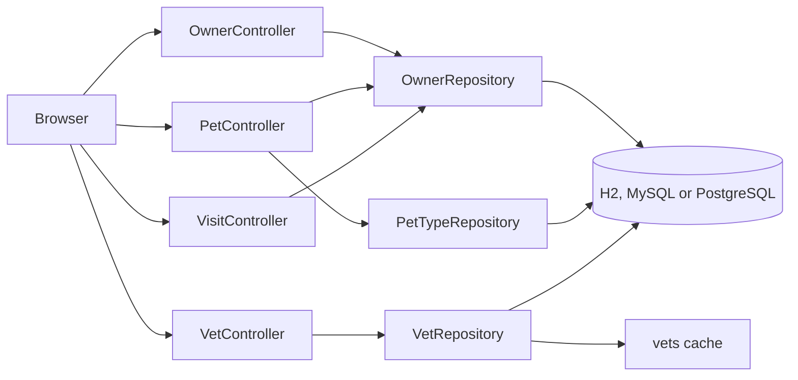
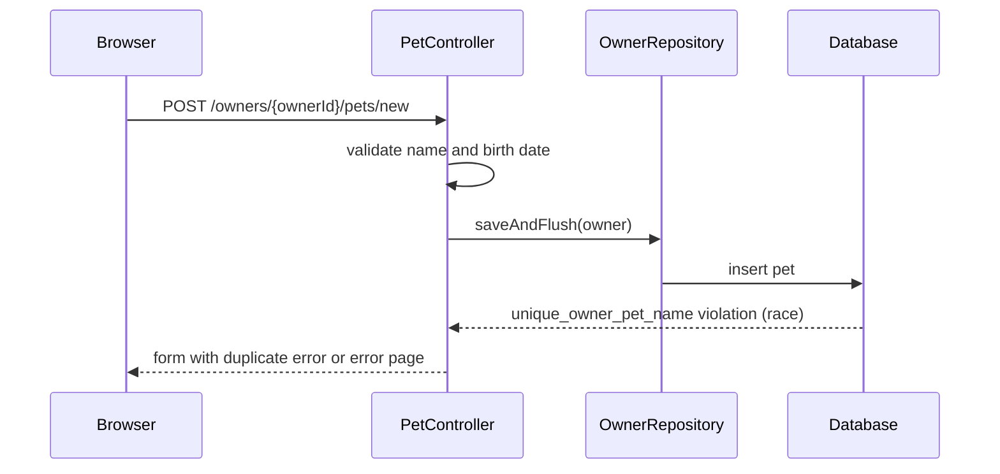
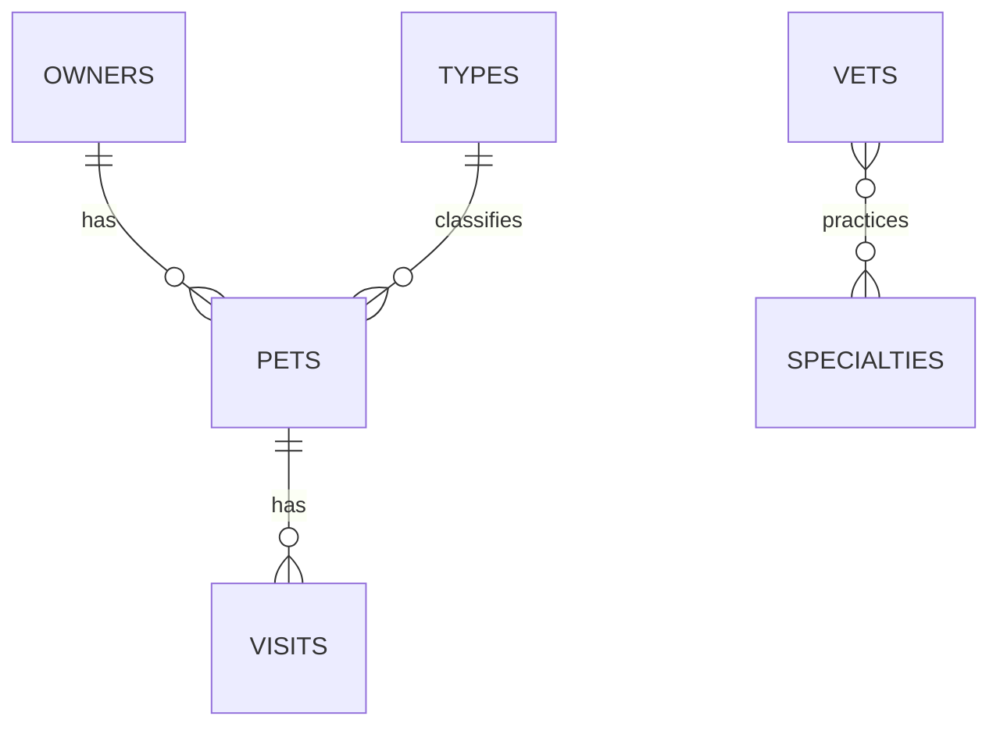
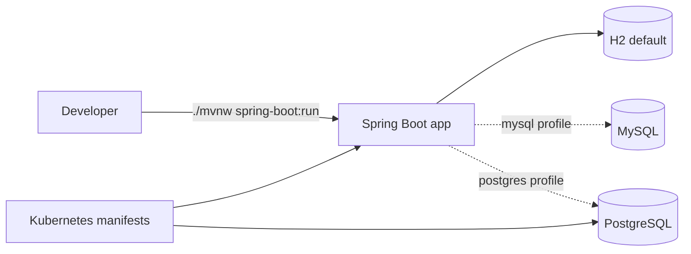

# spring-petclinic Documentation
<!-- appdoc:template 2.7 -->

**Target:** spring-petclinic | **Commit:** 500158f732419217507c7656904b8e6aa1bcc0d6 | **Evidence date:** 2026-11-23

**How to read this document.** *Cited* claims carry a path-and-line Citation. **Inferred:** marks reasoning from cited evidence. *Unknown* items are listed in section 14 and must not be assumed. Secret values are never reproduced; their locations are cited with "value omitted". The Evidence Register (source-to-claim audit) is rendered as Appendix A.

## 1. Application Index

| Support need | Primary screen or file | Workflow |
|---|---|---|
| Find an owner by last name | `src/main/java/org/springframework/samples/petclinic/owner/OwnerController.java:94` | [7.1 Find an owner](#71-find-an-owner) |
| Register a new owner | `src/main/java/org/springframework/samples/petclinic/owner/OwnerController.java:77` | [7.2 Register an owner](#72-register-an-owner) |
| Change an owner's address or telephone | `src/main/java/org/springframework/samples/petclinic/owner/OwnerController.java:153` | [7.3 Edit an owner](#73-edit-an-owner) |
| Add a pet to an owner | `src/main/java/org/springframework/samples/petclinic/owner/PetController.java:107` | [7.4 Add a pet](#74-add-a-pet) |
| Rename or retype a pet | `src/main/java/org/springframework/samples/petclinic/owner/PetController.java:144` | [7.5 Edit a pet](#75-edit-a-pet) |
| Book a visit for a pet | `src/main/java/org/springframework/samples/petclinic/owner/VisitController.java:97` | [7.6 Book a visit](#76-book-a-visit) |
| List veterinarians and specialties | `src/main/java/org/springframework/samples/petclinic/vet/VetController.java:45` | [7.7 Browse veterinarians](#77-browse-veterinarians) |
| See how an unhandled exception renders | `src/main/java/org/springframework/samples/petclinic/system/CrashController.java:31` | [7.8 Trigger the demo error page](#78-trigger-the-demo-error-page) |
| Choose between H2, MySQL and PostgreSQL | `src/main/resources/application.properties:2` | [7.9 Start the application](#79-start-the-application) |
| Understand a failure message | `src/main/java/org/springframework/samples/petclinic/owner/OwnerController.java:68` | [9 Troubleshooting Matrix](#9-troubleshooting-matrix) |

## 2. Coverage and Overview

### 2.1 What was inspected

The Java Spring Stack is supported, so Facts for controllers, entities, repositories and configuration come from its extractor (`pom.xml:1-10`). I read every controller, entity, repository, validator and configuration class under `src/main/java/org/springframework/samples/petclinic/`, the Thymeleaf templates under `src/main/resources/templates/`, the three application properties files, the H2, MySQL and PostgreSQL schema scripts, the Maven and Gradle build files, the three CI workflows, the Kubernetes manifests, `docker-compose.yml` and `README.md`. I did not read the static assets (CSS, fonts and images) under `src/main/resources/static/`, the SCSS source `src/main/scss/petclinic.scss`, the JMeter plan `src/test/jmeter/petclinic_test_plan.jmx`, the message bundles other than `src/main/resources/messages/messages.properties`, the devcontainer files, or any runtime behavior (the application was not started).

The scan pruned one folder, `.mvn/`, which holds only the Maven wrapper properties (`.mvn/wrapper/maven-wrapper.properties:1-3`); the wrapper scripts `mvnw` and `mvnw.cmd` are at the root. The scan lists no folder that looks retired by name and no folder that duplicates another folder, so no copy-versus-live question arises (`src/main/java/org/springframework/samples/petclinic/PetClinicApplication.java:28-34` is the single entry class).

<!-- appdoc:generated scan-coverage -->
| Stack | Supported | Files read |
|---|---|---|
| java-spring | yes | 53 |

Files found: 132 = scanned 131 + pruned 1 + ignored by .appdocignore 0.

| Top folder | Files scanned |
|---|---|
| `src/` | 107 |
| `.github/` | 4 |
| `.devcontainer/` | 2 |
| `gradle/` | 2 |
| `k8s/` | 2 |

| Folder not scanned | Rule | Files |
|---|---|---|
| `.mvn/` | always | 1 |
<!-- /appdoc:generated scan-coverage -->

### 2.2 Purpose and users

The Target is the Spring PetClinic sample: a Spring Boot web application that manages pet owners, their pets, visits and a read-only list of veterinarians (`README.md:1-16`, `src/main/java/org/springframework/samples/petclinic/owner/OwnerController.java:48-49`). Its intended users are clinic staff working in a browser, and the README presents it as a sample to learn from, not a production system (`README.md:5-12`). Whether any organization runs it as a business application is Unknown - see Open questions. The posture is that of an unauthenticated demo: the most severe findings are V-1 and V-2, with the credential defaults in V-3 behind them, and <!-- appdoc:count V -->6<!-- /appdoc:count --> verified findings are listed in 10.1 (`pom.xml:41-66`).

### 2.3 System boundary

Inside the Target are the Spring MVC controllers, the JPA entities and repositories, the Thymeleaf views and the SQL scripts that create and seed the schema (`src/main/java/org/springframework/samples/petclinic/PetClinicApplication.java:28-34`, `src/main/resources/db/h2/schema.sql:1-10`). The Target touches one relational database, chosen by Spring profile among H2 (default), MySQL and PostgreSQL (`src/main/resources/application.properties:2-4`, `src/main/resources/application-mysql.properties:2-3`, `src/main/resources/application-postgres.properties:2-3`), and an in-process JCache cache named `vets` (`src/main/java/org/springframework/samples/petclinic/system/CacheConfiguration.java:35-38`). **Inferred:** it makes no outbound HTTP, queue or email calls in application code, because the extracted external calls are all in test code (`src/test/java/org/springframework/samples/petclinic/PetClinicIntegrationTests.java:55`).

## 3. Architecture

### 3.1 Components

- **Owner module** (`src/main/java/org/springframework/samples/petclinic/owner/`): the controllers `OwnerController`, `PetController` and `VisitController`, the entities `Owner`, `Pet`, `PetType` and `Visit`, the repositories `OwnerRepository` and `PetTypeRepository`, a `PetValidator` and a `PetTypeFormatter` (`src/main/java/org/springframework/samples/petclinic/owner/OwnerController.java:48-49`, `src/main/java/org/springframework/samples/petclinic/owner/PetController.java:47-49`, `src/main/java/org/springframework/samples/petclinic/owner/VisitController.java:42-43`, `src/main/java/org/springframework/samples/petclinic/owner/OwnerRepository.java:36`, `src/main/java/org/springframework/samples/petclinic/owner/PetTypeRepository.java:30`).
- **Vet module** (`src/main/java/org/springframework/samples/petclinic/vet/`): `VetController`, the entities `Vet` and `Specialty`, a `Vets` wrapper returned as JSON (it also carries JAXB annotations, see F-10), and a cached read-only `VetRepository` (`src/main/java/org/springframework/samples/petclinic/vet/VetController.java:36-37`, `src/main/java/org/springframework/samples/petclinic/vet/VetRepository.java:38-56`, `src/main/java/org/springframework/samples/petclinic/vet/Vets.java:30-31`).
- **Model base classes** (`src/main/java/org/springframework/samples/petclinic/model/`): `BaseEntity` supplies the identity column and `Person` supplies first and last name (`src/main/java/org/springframework/samples/petclinic/model/BaseEntity.java:32-37`, `src/main/java/org/springframework/samples/petclinic/model/Person.java:28-39`).
- **System module** (`src/main/java/org/springframework/samples/petclinic/system/`): `WelcomeController`, `CrashController`, `CacheConfiguration` and `WebConfiguration` (locale switching through the `lang` parameter) (`src/main/java/org/springframework/samples/petclinic/system/WelcomeController.java:22-23`, `src/main/java/org/springframework/samples/petclinic/system/CrashController.java:28-29`, `src/main/java/org/springframework/samples/petclinic/system/WebConfiguration.java:44-49`).
- **Views** (`src/main/resources/templates/`): Thymeleaf pages that all use the shared layout fragment (`src/main/resources/templates/fragments/layout.html:1-20`).
- **Persistence scripts** (`src/main/resources/db/`): one schema script and one seed script per database dialect, selected through the `database` property (`src/main/resources/application.properties:2-4`).
- **Build and deployment files**: `pom.xml`, `build.gradle`, `docker-compose.yml`, `k8s/petclinic.yml` and `k8s/db.yml` (`pom.xml:1-10`, `build.gradle:1-10`, `docker-compose.yml:1-3`, `k8s/petclinic.yml:15-33`).

### 3.2 Diagram



Caption: controllers call Spring Data repositories, and only the vet repository is cached (`src/main/java/org/springframework/samples/petclinic/vet/VetRepository.java:44-56`, `src/main/java/org/springframework/samples/petclinic/owner/OwnerRepository.java:36-45`).

### 3.3 Authentication and authorization

The Target has no authentication or authorization. The dependency manifest declares no security starter among its starters (`pom.xml:41-66`), the Gradle build declares none either (`build.gradle:33-40`), and no controller reads a principal or role (`src/main/java/org/springframework/samples/petclinic/owner/OwnerController.java:48-188`). The Facts list no `auth_check` entries. Every route in section 4 is therefore reachable by any client that can reach the port.

## 4. Functional Inventory

<!-- appdoc:generated entry-points -->
6 route handler files; 17 routes; 0 pages; 0 commands; 0 jobs.

| Handler file | Kinds | Routes | Pages | Jobs | Commands |
|---|---|---|---|---|---|
| `src/main/java/org/springframework/samples/petclinic/owner/OwnerController.java` | route | 7 | 0 | 0 | 0 |
| `src/main/java/org/springframework/samples/petclinic/owner/PetController.java` | route | 4 | 0 | 0 | 0 |
| `src/main/java/org/springframework/samples/petclinic/owner/VisitController.java` | route | 2 | 0 | 0 | 0 |
| `src/main/java/org/springframework/samples/petclinic/vet/VetController.java` | route | 2 | 0 | 0 | 0 |
| `src/main/java/org/springframework/samples/petclinic/system/CrashController.java` | route | 1 | 0 | 0 | 0 |
| `src/main/java/org/springframework/samples/petclinic/system/WelcomeController.java` | route | 1 | 0 | 0 | 0 |
<!-- /appdoc:generated entry-points -->

The table lists <!-- appdoc:count F -->13<!-- /appdoc:count --> feature rows, one per route group, drawn from the controllers (`src/main/java/org/springframework/samples/petclinic/owner/OwnerController.java:72-130`).

| ID | Area | Feature | Entry point | Inputs, outputs and rules | Dependencies | Status |
|---|---|---|---|---|---|---|
| F-1 | Home | Welcome page | `GET /` in `src/main/java/org/springframework/samples/petclinic/system/WelcomeController.java:25-28` | Returns the `welcome` view with no data | `src/main/resources/templates/welcome.html:1-12` | Cited |
| F-2 | Owners | Find owners by last name (prefix match, 5 per page) | `GET /owners/find` and `GET /owners` in `src/main/java/org/springframework/samples/petclinic/owner/OwnerController.java:89-130` | Input `lastName` and `page`; one hit redirects to the owner, none re-shows the form with a `notFound` error, several show a paged list; an out-of-range page redirects to page 1 | `src/main/java/org/springframework/samples/petclinic/owner/OwnerRepository.java:45` | Cited |
| F-3 | Owners | Create an owner | `GET` and `POST /owners/new` in `src/main/java/org/springframework/samples/petclinic/owner/OwnerController.java:72-87` | Bean validation on first name, last name, address, city and a 10-digit telephone; the `id` field is never bound | `src/main/java/org/springframework/samples/petclinic/owner/Owner.java:52-65`, `src/main/java/org/springframework/samples/petclinic/model/Person.java:31-39`, `src/main/java/org/springframework/samples/petclinic/owner/OwnerController.java:59-62` | Cited |
| F-4 | Owners | Edit an owner | `GET` and `POST /owners/{ownerId}/edit` in `src/main/java/org/springframework/samples/petclinic/owner/OwnerController.java:148-171` | Same validation as F-3; the controller has a guard that rejects a form `id` differing from the URL id and redirects back to the form; **Inferred:** the id binder (`src/main/java/org/springframework/samples/petclinic/owner/OwnerController.java:59-62`) and the load by path id (`src/main/java/org/springframework/samples/petclinic/owner/OwnerController.java:64-70`) make that branch unreachable from a form post, and no test exercises it | `src/main/java/org/springframework/samples/petclinic/owner/OwnerController.java:161-165` | Cited |
| F-5 | Owners | Show an owner with pets and visits | `GET /owners/{ownerId}` in `src/main/java/org/springframework/samples/petclinic/owner/OwnerController.java:178-186` | Unknown id throws `IllegalArgumentException` | `src/main/resources/templates/owners/ownerDetails.html:9-14` | Cited |
| F-6 | Pets | Add a pet to an owner | `GET` and `POST /owners/{ownerId}/pets/new` in `src/main/java/org/springframework/samples/petclinic/owner/PetController.java:100-135` | Name, birth date and type are required; a name already used by the owner (case-insensitive) and a future birth date are rejected | `src/main/java/org/springframework/samples/petclinic/owner/PetValidator.java:38-59`, `src/main/java/org/springframework/samples/petclinic/owner/PetController.java:111-118`, `src/main/java/org/springframework/samples/petclinic/owner/Owner.java:150` | Cited |
| F-7 | Pets | Edit a pet | `GET` and `POST /owners/{ownerId}/pets/{petId}/edit` in `src/main/java/org/springframework/samples/petclinic/owner/PetController.java:139-177` | Same rules as F-6 except that the type is only required for a new pet | `src/main/java/org/springframework/samples/petclinic/owner/PetController.java:148-156`, `src/main/java/org/springframework/samples/petclinic/owner/PetValidator.java:51-53` | Cited |
| F-8 | Visits | Book a visit for a pet | `GET` and `POST /owners/{ownerId}/pets/{petId}/visits/new` in `src/main/java/org/springframework/samples/petclinic/owner/VisitController.java:90-111` | Description is required (max 255) and the date must be after today | `src/main/java/org/springframework/samples/petclinic/owner/VisitController.java:100-102`, `src/main/java/org/springframework/samples/petclinic/owner/Visit.java:43-45` | Cited |
| F-9 | Vets | Paged veterinarian list (HTML) | `GET /vets.html` in `src/main/java/org/springframework/samples/petclinic/vet/VetController.java:45-54` | `page` parameter, 5 per page, out-of-range pages redirect to page 1 | `src/main/java/org/springframework/samples/petclinic/vet/VetRepository.java:54-56` | Cited |
| F-10 | Vets | Veterinarian list (JSON) | `GET /vets` in `src/main/java/org/springframework/samples/petclinic/vet/VetController.java:72-79` | Returns every vet wrapped in `Vets`; a test requests it as JSON (`src/test/java/org/springframework/samples/petclinic/vet/VetControllerTests.java:105-108`). **Inferred:** XML output is only suggested by the JAXB annotations, and the dependency list shows no XML mapper or JAXB runtime (`pom.xml:71-74`) | `src/main/java/org/springframework/samples/petclinic/vet/Vets.java:30-41` | Cited |
| F-11 | System | Demo error trigger | `GET /oups` in `src/main/java/org/springframework/samples/petclinic/system/CrashController.java:31-35` | Always throws `RuntimeException` | `src/main/resources/templates/error.html:5-18` | Cited |
| F-12 | System | Language switch | `lang` request parameter in `src/main/java/org/springframework/samples/petclinic/system/WebConfiguration.java:44-58` | Session-held locale, English by default, ten message bundles shipped | `src/main/resources/application.properties:16` | Cited |
| F-13 | System | Actuator management endpoints | `/actuator/*` configured in `src/main/resources/application.properties:21` | **Inferred:** with exposure set to `*` every endpoint of Spring Boot 4.1.0 that the actuator starter provides is served over HTTP, with no authentication | `pom.xml:5-9`, `pom.xml:43-46` | Inferred |

### 4.1 Subsystem inventory

| Subsystem | Files | Features | Primary data and dependencies | Purpose | Status |
|---|---|---|---|---|---|
| `src/` | 107 | F-1 to F-13 | JPA entities, Thymeleaf, SQL scripts, tests | Application code, views, schema scripts and test suites | Cited |
| Root files (`pom.xml`) | 14 | None | Maven and Gradle wrappers, README, license | Build definition and project documentation | Cited |
| `.github/` | 4 | None | GitHub Actions | CI builds for Maven and Gradle and a Kubernetes smoke deployment | Cited |
| `.devcontainer/` | 2 | None | Dockerfile, devcontainer.json | Development container (not read in detail) | Cited |
| `gradle/` | 2 | None | Gradle wrapper | Gradle wrapper files (not read in detail) | Cited |
| `k8s/` | 2 | None | PostgreSQL deployment and secret | Cluster manifests | Cited |

## 5. Roles and Access Model

### 5.1 Observed role concepts

No roles, groups, scopes or clients were observed. The only people concepts in source are the data entities `Owner` (a pet's owner, not a login) and `Vet` (`src/main/java/org/springframework/samples/petclinic/owner/Owner.java:48-50`, `src/main/java/org/springframework/samples/petclinic/vet/Vet.java:43-45`), and no security dependency exists (`pom.xml:41-66`).

### 5.2 Authorization enforcement

Nothing enforces access. No controller method, interceptor or filter checks identity (`src/main/java/org/springframework/samples/petclinic/owner/OwnerController.java:59-62`, `src/main/java/org/springframework/samples/petclinic/system/WebConfiguration.java:55-58`); the only interceptor registered switches the locale. The only request-level protection in the controllers is a data binder that refuses to bind the `id` fields (`src/main/java/org/springframework/samples/petclinic/owner/OwnerController.java:59-62`, `src/main/java/org/springframework/samples/petclinic/owner/PetController.java:89-98`, `src/main/java/org/springframework/samples/petclinic/owner/VisitController.java:51-54`). Every route has no check.

### 5.3 Role-to-capability matrix

No role exists, so the single column `Anonymous client` stands for every caller (`pom.xml:41-66`). Y means the code cited in 5.2 allows it with no check.

| Capability | Anonymous client |
|---|---|
| Home (F-1) | Y (`src/main/java/org/springframework/samples/petclinic/system/WelcomeController.java:25`) |
| Owners: find, view, create, edit (F-2 to F-5) | Y (`src/main/java/org/springframework/samples/petclinic/owner/OwnerController.java:72-130`) |
| Pets: add, edit (F-6, F-7) | Y (`src/main/java/org/springframework/samples/petclinic/owner/PetController.java:100-177`) |
| Visits: book (F-8) | Y (`src/main/java/org/springframework/samples/petclinic/owner/VisitController.java:90-111`) |
| Vets: list (F-9, F-10) | Y (`src/main/java/org/springframework/samples/petclinic/vet/VetController.java:45-79`) |
| System: error trigger, language switch, actuator (F-11 to F-13) | Y (`src/main/java/org/springframework/samples/petclinic/system/CrashController.java:31`) |
| Delete an owner, pet or visit | Blank: no delete route exists (`src/main/java/org/springframework/samples/petclinic/owner/OwnerController.java:72-130`) |
| Edit or add a vet | Blank: `VetController` has only read routes (`src/main/java/org/springframework/samples/petclinic/vet/VetController.java:45-79`) |

**Restriction:** do not infer a permission from a visible control or a granted scope; enforcement is the code cited in 5.2.

## 6. UI Catalog

Source-only catalog; no screenshots or live session. All <!-- appdoc:count UI -->9<!-- /appdoc:count --> templates under `src/main/resources/templates/` are catalogued except the three fragments, which are part of the pages (`src/main/resources/templates/fragments/layout.html:1-20`).

| ID | Page | Route or entry | Reached from | Visible controls and data | States and effects | Roles and evidence |
|---|---|---|---|---|---|---|
| UI-1 | Welcome | `/` | Navigation brand link | Welcome heading and an image | Static | Anonymous (`src/main/resources/templates/welcome.html:7-12`, `src/main/resources/templates/fragments/layout.html:22`) |
| UI-2 | Find Owners | `/owners/find` | Navigation menu | Last name input, Find Owner button, Add Owner link | Shows field errors such as not found | Anonymous (`src/main/resources/templates/owners/findOwners.html:9-29`) |
| UI-3 | Owners list | `/owners` | UI-2 submit | Table of owners, first/previous/next/last paging links | Shown only when several owners match | Anonymous (`src/main/resources/templates/owners/ownersList.html:20-54`) |
| UI-4 | Owner Information | `/owners/{ownerId}` | UI-3, redirects after create, edit, pet and visit changes | Owner fields, Edit Owner and Add New Pet links, pets with visits, Edit Pet and Add Visit links, success and error banners | Banners read flash attributes `message` and `error` | Anonymous (`src/main/resources/templates/owners/ownerDetails.html:9-73`) |
| UI-5 | Owner form | `/owners/new`, `/owners/{ownerId}/edit` | UI-2, UI-4 | Five text inputs, submit button labelled Add or Update | Re-shown with field errors on invalid input | Anonymous (`src/main/resources/templates/owners/createOrUpdateOwnerForm.html:8-20`) |
| UI-6 | Pet form | `/owners/{ownerId}/pets/new`, `.../pets/{petId}/edit` | UI-4 | Name, birth date, type select | Re-shown with errors for duplicate name or future date | Anonymous (`src/main/resources/templates/pets/createOrUpdatePetForm.html:11-31`) |
| UI-7 | Visit form | `/owners/{ownerId}/pets/{petId}/visits/new` | UI-4 | Pet summary, date and description inputs, list of previous visits | Re-shown with error when the date is not in the future | Anonymous (`src/main/resources/templates/pets/createOrUpdateVisitForm.html:30-54`) |
| UI-8 | Veterinarians | `/vets.html` | Navigation menu | Table of vets and specialties, paging links | Shows `none` for a vet without specialties | Anonymous (`src/main/resources/templates/vets/vetList.html:17-50`) |
| UI-9 | Error page | Any failing request, `/oups` | Navigation menu item Error | Status-specific text for 404 and 500 and a paragraph bound to the exception message (`src/main/resources/templates/error.html:11-18`) | Rendered by Spring's error handling; the message text is shown only if error message inclusion is enabled, which nothing in `src/main/resources/application.properties:1-29` does (a test enables it, `src/test/java/org/springframework/samples/petclinic/system/CrashControllerIntegrationTests.java:51`). **Inferred:** by default Spring Boot omits the message | Anonymous (`src/main/resources/templates/error.html:18`) |

## 7. Workflows

### 7.1 Find an owner

1. The Find Owners page posts a GET with `lastName` (`src/main/resources/templates/owners/findOwners.html:9`).
2. `processFindForm` strips the name, treats null as empty, and queries owners whose last name starts with it, five per page (`src/main/java/org/springframework/samples/petclinic/owner/OwnerController.java:94-107`, `src/main/java/org/springframework/samples/petclinic/owner/OwnerController.java:141-146`).
3. A page outside the range redirects to page 1 (`src/main/java/org/springframework/samples/petclinic/owner/OwnerController.java:108-114`); no result re-renders the form with a `notFound` error (`src/main/java/org/springframework/samples/petclinic/owner/OwnerController.java:116-120`); exactly one result redirects to that owner (`src/main/java/org/springframework/samples/petclinic/owner/OwnerController.java:122-126`); otherwise the paged list is shown (`src/main/java/org/springframework/samples/petclinic/owner/OwnerController.java:129`).

Failure and escalation: a database failure surfaces as the default error page; escalate to the database owner if it persists after one retry (`src/main/java/org/springframework/samples/petclinic/owner/OwnerRepository.java:45`, `src/main/resources/templates/error.html:11-14`).

### 7.2 Register an owner

1. `GET /owners/new` shows the empty form (`src/main/java/org/springframework/samples/petclinic/owner/OwnerController.java:72-75`).
2. `POST /owners/new` validates the bound `Owner`; with errors it sets an `error` flash attribute and returns the form (`src/main/java/org/springframework/samples/petclinic/owner/OwnerController.java:78-82`).
3. Otherwise it saves the owner, sets a `message` flash attribute and redirects to the new owner (`src/main/java/org/springframework/samples/petclinic/owner/OwnerController.java:84-86`).

Failure and escalation: validation errors are shown beside the fields and the flash message is lost (V-5); an exception from `save` is unhandled and renders the error page, so escalate to the database owner if it repeats (`src/main/java/org/springframework/samples/petclinic/owner/OwnerController.java:80-84`).

### 7.3 Edit an owner

1. `GET /owners/{ownerId}/edit` loads the owner through the `findOwner` model attribute, which throws when the id is unknown (`src/main/java/org/springframework/samples/petclinic/owner/OwnerController.java:64-70`).
2. `POST` validates the form; on errors it returns the form (`src/main/java/org/springframework/samples/petclinic/owner/OwnerController.java:153-159`).
3. The controller has a guard that adds an error and redirects back to the edit page when the form id differs from the path id; **Inferred:** it cannot be triggered, because `id` is never bound (`src/main/java/org/springframework/samples/petclinic/owner/OwnerController.java:59-62`) and the owner is loaded by path id (`src/main/java/org/springframework/samples/petclinic/owner/OwnerController.java:64-70`), so no test covers it (`src/main/java/org/springframework/samples/petclinic/owner/OwnerController.java:161-165`).
4. Otherwise it saves and redirects to the owner page with the message "Owner Values Updated" (`src/main/java/org/springframework/samples/petclinic/owner/OwnerController.java:167-170`).

Failure and escalation: an unknown id makes the controller throw `IllegalArgumentException` with the text "Owner not found with id:" and the error page is returned (`src/main/java/org/springframework/samples/petclinic/owner/OwnerController.java:68-69`). The page renders the text only if error message inclusion is enabled; nothing in `src/main/resources/application.properties:1-29` enables it and a test does (`src/main/resources/templates/error.html:18`, `src/test/java/org/springframework/samples/petclinic/system/CrashControllerIntegrationTests.java:51`). **Inferred:** with the default setting the page returns HTTP 500 without the message text. Check the id first, escalate to the database owner if the owner should exist.

### 7.4 Add a pet

1. `GET .../pets/new` adds an empty pet to the owner model and shows the form (`src/main/java/org/springframework/samples/petclinic/owner/PetController.java:100-105`).
2. `POST` rejects a name the owner already uses (case-insensitive) and a birth date after today (`src/main/java/org/springframework/samples/petclinic/owner/PetController.java:111-118`).
3. With no errors it adds the pet and flushes the owner, so the unique index is checked immediately (`src/main/java/org/springframework/samples/petclinic/owner/PetController.java:124-127`).
4. A `DataIntegrityViolationException` whose message contains `unique_owner_pet_name` becomes a duplicate-name field error; any other violation is rethrown (`src/main/java/org/springframework/samples/petclinic/owner/PetController.java:128-134`, `src/main/java/org/springframework/samples/petclinic/owner/PetController.java:202-205`).
5. Success redirects to the owner with "New Pet has been Added" (`src/main/java/org/springframework/samples/petclinic/owner/PetController.java:135-136`).

Failure and escalation: on MySQL the unique constraint is unnamed in the schema, so (**Inferred:** MySQL's own message does not contain `unique_owner_pet_name`, as in V-4) a concurrent duplicate becomes an error page instead of a field error; escalate to the application team if users report it (`src/main/resources/db/mysql/schema.sql:47`, `src/main/java/org/springframework/samples/petclinic/owner/PetController.java:204`).

### 7.5 Edit a pet

1. `GET .../pets/{petId}/edit` loads the pet from the owner's pet list (`src/main/java/org/springframework/samples/petclinic/owner/PetController.java:75-87`, `src/main/java/org/springframework/samples/petclinic/owner/PetController.java:139-142`).
2. `POST` rejects a name used by another pet of the owner and a future birth date (`src/main/java/org/springframework/samples/petclinic/owner/PetController.java:148-156`, `src/main/java/org/springframework/samples/petclinic/owner/PetController.java:158-161`).
3. `updatePetDetails` copies name, birth date and type onto the stored pet and flushes (`src/main/java/org/springframework/samples/petclinic/owner/PetController.java:186-200`).
4. Success redirects with "Pet details has been edited" (`src/main/java/org/springframework/samples/petclinic/owner/PetController.java:177-178`).

Failure and escalation: the same duplicate-name handling and MySQL caveat as 7.4 apply, including its **Inferred:** MySQL message (`src/main/java/org/springframework/samples/petclinic/owner/PetController.java:167-176`); an unknown owner id raises "Owner not found with id:" and the error page shows that text only if error message inclusion is enabled, as in 7.3 (`src/main/java/org/springframework/samples/petclinic/owner/PetController.java:70`).

### 7.6 Book a visit

1. The `loadPetWithVisit` model attribute loads the owner and pet and attaches a new `Visit` dated tomorrow (`src/main/java/org/springframework/samples/petclinic/owner/VisitController.java:63-81`, `src/main/java/org/springframework/samples/petclinic/owner/Visit.java:50-52`).
2. `POST` rejects a date that is not after today and any bean-validation errors (`src/main/java/org/springframework/samples/petclinic/owner/VisitController.java:100-106`).
3. Otherwise it adds the visit to the pet, saves the owner, and redirects with "Your visit has been booked" (`src/main/java/org/springframework/samples/petclinic/owner/VisitController.java:108-111`).

Failure and escalation: an unknown owner or pet raises `IllegalArgumentException` and the error page is returned (`src/main/java/org/springframework/samples/petclinic/owner/VisitController.java:67-72`); the message text is shown only if error message inclusion is enabled, which nothing in `src/main/resources/application.properties:1-29` does (`src/main/resources/templates/error.html:18`). **Inferred:** by default the page returns HTTP 500 without the message. Check the ids, then escalate to the application team.

### 7.7 Browse veterinarians

1. `GET /vets.html` reads a page of five vets from the cached repository and renders the list (`src/main/java/org/springframework/samples/petclinic/vet/VetController.java:45-69`).
2. `GET /vets` returns all vets wrapped in `Vets` as JSON (`src/main/java/org/springframework/samples/petclinic/vet/VetController.java:72-79`, `src/test/java/org/springframework/samples/petclinic/vet/VetControllerTests.java:105-108`); **Inferred:** XML is only suggested by the JAXB annotations in `src/main/java/org/springframework/samples/petclinic/vet/Vets.java:30-41` and no XML mapper or runtime is declared (`pom.xml:71-74`).
3. Results come from the `vets` cache after the first read (`src/main/java/org/springframework/samples/petclinic/vet/VetRepository.java:44-56`).

Failure and escalation: out-of-range pages redirect to page 1 (`src/main/java/org/springframework/samples/petclinic/vet/VetController.java:49-52`); the cache has no expiry or eviction configured, so a vets change in the database is not shown until restart, and the application team should restart the service when that is reported (`src/main/java/org/springframework/samples/petclinic/system/CacheConfiguration.java:35-51`).

### 7.8 Trigger the demo error page

1. The Error menu item links to `/oups` (`src/main/resources/templates/fragments/layout.html:56-57`).
2. `triggerException` throws a `RuntimeException` that Spring renders with the error template (`src/main/java/org/springframework/samples/petclinic/system/CrashController.java:31-35`, `src/main/resources/templates/error.html:5-18`).

Failure and escalation: this route fails by design and needs no escalation; a test asserts the status and message text, with error message inclusion enabled for that test only (`src/test/java/org/springframework/samples/petclinic/system/CrashControllerIntegrationTests.java:62-93`, `src/test/java/org/springframework/samples/petclinic/system/CrashControllerIntegrationTests.java:51`).

### 7.9 Start the application

1. With no profile, `src/main/resources/application.properties` sets `database=h2` and runs `src/main/resources/db/h2/schema.sql` and `src/main/resources/db/h2/data.sql` at startup (`src/main/resources/application.properties:2-4`).
2. With the `mysql` or `postgres` profile, the profile file overrides the datasource URL, user and password from environment variables with local defaults (values omitted) and sets `spring.sql.init.mode=always` (`src/main/resources/application-mysql.properties:2-7`, `src/main/resources/application-postgres.properties:2-7`).
3. JPA schema generation is off, so the SQL scripts are the only schema source (`src/main/resources/application.properties:10`).

Failure and escalation: **Inferred:** if the database is unreachable startup fails and the log shows the datasource error (default Spring Boot behavior; `docker-compose.yml:1-20` only defines the database containers). Recommendation, not from source: start the database container first and escalate to the operator after one restart.

## 8. Data and Integrations

### 8.1 Connections

| ID | Name | Kind | Configured at | Used by |
|---|---|---|---|---|
| C-1 | H2 in-memory database (default) | Database | `src/main/resources/application.properties:2-4`, `README.md:64` | All repositories when no profile is active |
| C-2 | MySQL | Database | `src/main/resources/application-mysql.properties:3` | All repositories under the `mysql` profile |
| C-3 | PostgreSQL | Database | `src/main/resources/application-postgres.properties:3` | All repositories under the `postgres` profile |
| C-4 | `vets` JCache cache | Cache | `src/main/java/org/springframework/samples/petclinic/system/CacheConfiguration.java:35-38` | `src/main/java/org/springframework/samples/petclinic/vet/VetRepository.java:44-56` |

The H2 URL is not set in any properties file, so Spring Boot's embedded default applies (**Inferred:** from the H2 runtime dependency at `pom.xml:76-80` and the absence of a `spring.datasource.url` for the default profile in `src/main/resources/application.properties:1-29`).

### 8.2 Stored procedures and SQL

No stored procedures exist in the schema scripts (`src/main/resources/db/h2/schema.sql:1-65`). Data access is Spring Data JPA: one derived query, `findByLastNameStartingWith`, and one JPQL query, `findPetTypes` (`src/main/java/org/springframework/samples/petclinic/owner/OwnerRepository.java:45`, `src/main/java/org/springframework/samples/petclinic/owner/PetTypeRepository.java:36-37`); the vet repository relies on inherited `findAll` methods (`src/main/java/org/springframework/samples/petclinic/vet/VetRepository.java:46`, `src/main/java/org/springframework/samples/petclinic/vet/VetRepository.java:56`).

### 8.3 External calls

| ID | Call | Direction | Caller | Notes |
|---|---|---|---|---|
| X-1 | HTTP requests to the application's own routes through `RestTemplate` | Outbound from tests | `src/test/java/org/springframework/samples/petclinic/PetClinicIntegrationTests.java:55-62` | Test-only; **Inferred:** the application code makes no external calls (no extracted external call lies outside test code) |

### 8.4 Data entities and sensitivity

| Entity | Key fields | Defined at | Sensitivity |
|---|---|---|---|
| `owners` (Owner) | id, first_name, last_name, address, city, telephone | `src/main/java/org/springframework/samples/petclinic/owner/Owner.java:48-65`, `src/main/resources/db/h2/schema.sql:36-43` | PII: name, address, telephone |
| `pets` (Pet) | id, name, birth_date, type_id, owner_id | `src/main/java/org/springframework/samples/petclinic/owner/Pet.java:44-54`, `src/main/resources/db/h2/schema.sql:46-52` | Low: pet data linked to a person |
| `types` (PetType) | id, name | `src/main/java/org/springframework/samples/petclinic/owner/PetType.java:26`, `src/main/resources/db/h2/schema.sql:30-33` | Public reference data |
| `visits` (Visit) | id, pet_id, visit_date, description | `src/main/java/org/springframework/samples/petclinic/owner/Visit.java:35-45`, `src/main/resources/db/h2/schema.sql:58-63` | Free-text description may hold health details (**Inferred:** from the field's purpose) |
| `vets` (Vet) | id, first_name, last_name | `src/main/java/org/springframework/samples/petclinic/vet/Vet.java:43-45`, `src/main/resources/db/h2/schema.sql:10-14` | Public staff names |
| `specialties` and `vet_specialties` | id, name; vet_id, specialty_id | `src/main/java/org/springframework/samples/petclinic/vet/Specialty.java:28`, `src/main/resources/db/h2/schema.sql:17-28` | Public reference data |

Field table for `owners`:

| Field | Type | Null | Key/FK | Sensitivity | Citation |
|---|---|---|---|---|---|
| id | INTEGER identity | No | PK | Identifier | `src/main/resources/db/h2/schema.sql:37` |
| first_name | VARCHAR(30) | Yes in schema, required by validation | None | PII | `src/main/resources/db/h2/schema.sql:38`, `src/main/java/org/springframework/samples/petclinic/model/Person.java:31-34` |
| last_name | VARCHAR_IGNORECASE(30) | Yes in schema, required by validation | Indexed | PII | `src/main/resources/db/h2/schema.sql:39` |
| address | VARCHAR(255) | Yes in schema, required by validation | None | PII | `src/main/resources/db/h2/schema.sql:40`, `src/main/java/org/springframework/samples/petclinic/owner/Owner.java:52-55` |
| city | VARCHAR(80) | Yes in schema, required by validation | None | PII | `src/main/resources/db/h2/schema.sql:41`, `src/main/java/org/springframework/samples/petclinic/owner/Owner.java:57-60` |
| telephone | VARCHAR(20) | Yes in schema, 10 digits by validation | None | PII | `src/main/resources/db/h2/schema.sql:42`, `src/main/java/org/springframework/samples/petclinic/owner/Owner.java:62-65` |

Field table for `pets`:

| Field | Type | Null | Key/FK | Sensitivity | Citation |
|---|---|---|---|---|---|
| id | INTEGER identity | No | PK | Identifier | `src/main/resources/db/h2/schema.sql:47` |
| name | VARCHAR_IGNORECASE(30) | Yes | Unique with owner_id | Low | `src/main/resources/db/h2/schema.sql:48`, `src/main/resources/db/h2/schema.sql:55` |
| birth_date | DATE | Yes | None | Low | `src/main/resources/db/h2/schema.sql:49` |
| type_id | INTEGER | No | FK to types | Public | `src/main/resources/db/h2/schema.sql:50`, `src/main/resources/db/h2/schema.sql:54` |
| owner_id | INTEGER | Yes | FK to owners | Low | `src/main/resources/db/h2/schema.sql:51`, `src/main/resources/db/h2/schema.sql:53` |

Field table for `visits`:

| Field | Type | Null | Key/FK | Sensitivity | Citation |
|---|---|---|---|---|---|
| id | INTEGER identity | No | PK | Identifier | `src/main/resources/db/h2/schema.sql:59` |
| pet_id | INTEGER | Yes | FK to pets | Low | `src/main/resources/db/h2/schema.sql:60`, `src/main/resources/db/h2/schema.sql:64` |
| visit_date | DATE | Yes | None | Low | `src/main/resources/db/h2/schema.sql:61` |
| description | VARCHAR(255) | Yes in schema, required by validation | None | Possible health detail (**Inferred**) | `src/main/resources/db/h2/schema.sql:62`, `src/main/java/org/springframework/samples/petclinic/owner/Visit.java:43-45` |

### 8.5 Failure, fallback and observability

| ID | Timeout and retry | On failure | Observability |
|---|---|---|---|
| C-1 | None configured; in-process database (`src/main/resources/application.properties:1-29`) | Startup fails if the SQL scripts fail | Default Spring Boot logs at INFO (`src/main/resources/application.properties:24`) |
| C-2 | None configured (`src/main/resources/application-mysql.properties:2-7`) | Startup fails when the database is unreachable (**Inferred:** from default Spring Boot datasource initialization) | Same logging and the actuator endpoints (`src/main/resources/application.properties:21`) |
| C-3 | None configured (`src/main/resources/application-postgres.properties:2-7`) | Same as C-2 | Same as C-2; the Kubernetes probes call `/livez` and `/readyz` (`k8s/petclinic.yml:47-54`) |
| C-4 | None; entries never expire in the configuration (`src/main/java/org/springframework/samples/petclinic/system/CacheConfiguration.java:49-51`) | Not applicable: in-process | Statistics are enabled on the cache (`src/main/java/org/springframework/samples/petclinic/system/CacheConfiguration.java:50`) |
| X-1 | None: tests only (`src/test/java/org/springframework/samples/petclinic/PetClinicIntegrationTests.java:55`) | None; no application dependency | None |

## 9. Troubleshooting Matrix

| Symptom | Checks | Known response | Escalate when |
|---|---|---|---|
| Error page after opening or editing an unknown owner (the text "Owner not found with id:" appears only if error message inclusion is enabled) | Confirm the id in the URL exists | The controllers throw `IllegalArgumentException` for an unknown id (`src/main/java/org/springframework/samples/petclinic/owner/OwnerController.java:68-69`, `src/main/java/org/springframework/samples/petclinic/owner/OwnerController.java:182-183`) and the page renders the message only when inclusion is enabled (`src/main/resources/templates/error.html:18`); **Inferred:** by default Spring Boot omits the message text, and nothing in `src/main/resources/application.properties:1-29` enables it (a test does, `src/test/java/org/springframework/samples/petclinic/system/CrashControllerIntegrationTests.java:51`) | The owner is known to exist and the error repeats after one retry |
| Same error page from the pet pages (message text only if inclusion is enabled) | Confirm owner id and pet id | `PetController` throws for an unknown owner (`src/main/java/org/springframework/samples/petclinic/owner/PetController.java:70`, `src/main/java/org/springframework/samples/petclinic/owner/PetController.java:84`); **Inferred:** by default Spring Boot omits the message text, and nothing in `src/main/resources/application.properties:1-29` enables it (a test does, `src/test/java/org/springframework/samples/petclinic/system/CrashControllerIntegrationTests.java:51`) | The ids are correct and the owner page loads |
| Error page when booking a visit for a pet the owner does not have (the text "Pet with id ... not found for owner" appears only if error message inclusion is enabled) | Check that the pet belongs to the owner in the URL | `VisitController` throws when the owner has no pet with that id (`src/main/java/org/springframework/samples/petclinic/owner/VisitController.java:72`); **Inferred:** by default Spring Boot omits the message text, and nothing in `src/main/resources/application.properties:1-29` enables it (a test does, `src/test/java/org/springframework/samples/petclinic/system/CrashControllerIntegrationTests.java:51`) | The pet is listed on the owner page |
| Pet form shows "is already in use" | Check the owner's pets for the same name, ignoring case | Choose another name; the check sets the error code `duplicate`, which `src/main/resources/messages/messages.properties:4` resolves to "is already in use", and the unique index also rejects duplicates (`src/main/java/org/springframework/samples/petclinic/owner/PetController.java:111-113`, `src/main/resources/messages/messages.properties:4`, `src/main/resources/db/h2/schema.sql:55`) | The pet name is not in use |
| Pet form shows an invalid date | The birth date must not be after today | `typeMismatch.birthDate` is set (`src/main/java/org/springframework/samples/petclinic/owner/PetController.java:115-118`, `src/main/resources/messages/messages.properties:8`) | The date is in the past and the error remains |
| Visit form says the date must be in the future | The date must be after today | `typeMismatch.visitDate` is set (`src/main/java/org/springframework/samples/petclinic/owner/VisitController.java:100-102`, `src/main/resources/messages/messages.properties:9`) | The date is later than today and the error remains |
| Owner form shows a telephone message | The telephone must be exactly 10 digits | Bean validation message `telephone.invalid` (`src/main/java/org/springframework/samples/petclinic/owner/Owner.java:62-64`) | A valid 10-digit number is rejected |
| Owner form re-shown with no banner | Expected: the flash message is lost (V-5) | None needed; fix the field errors (`src/main/java/org/springframework/samples/petclinic/owner/OwnerController.java:80-81`) | Never |
| Pet type fails to parse | The submitted type name must exist | `PetTypeFormatter` throws `ParseException` "type not found:" (`src/main/java/org/springframework/samples/petclinic/owner/PetTypeFormatter.java:59`) | The type exists in the `types` table |
| Error page after opening `/oups` (it shows "Expected: controller used to showcase what happens when an exception is thrown" only if error message inclusion is enabled) | You opened the Error menu item | This is intentional (`src/main/java/org/springframework/samples/petclinic/system/CrashController.java:33-34`); **Inferred:** by default Spring Boot omits the message text, and nothing in `src/main/resources/application.properties:1-29` enables it (a test does, `src/test/java/org/springframework/samples/petclinic/system/CrashControllerIntegrationTests.java:51`) | Never |
| Duplicate pet name produces an error page on MySQL | Check the active profile | **Inferred:** the constraint-name match fails on MySQL because its unnamed unique constraint is not reported under the expected name (`src/main/java/org/springframework/samples/petclinic/owner/PetController.java:202-205`, `src/main/resources/db/mysql/schema.sql:47`) | It happens under concurrent requests on MySQL |

## 10. Security and Operational Risks

### 10.1 Verified findings

| ID | Severity | Finding | Evidence | Impact |
|---|---|---|---|---|
| V-1 | Critical | Every actuator endpoint is exposed over HTTP with no authentication | `src/main/resources/application.properties:19-21`, `pom.xml:43-46` | Critical because the setting is in the default configuration and no security dependency exists (`pom.xml:41-66`); the comment itself says not to do this in production |
| V-2 | Critical | The application has no authentication or authorization, so all owner personal data can be read and changed by any client | `src/main/java/org/springframework/samples/petclinic/owner/OwnerController.java:72-130`, `pom.xml:41-66` | Critical because owner names, addresses and telephone numbers are exposed to unauthenticated callers in the default configuration (`src/main/java/org/springframework/samples/petclinic/owner/Owner.java:52-65`, `src/main/java/org/springframework/samples/petclinic/model/Person.java:31-39`); the README presents the application as a sample (`README.md:1`, `README.md:5-12`) |
| V-3 | High | Database credentials ship in the repository: local defaults in the profile files (values omitted), a Kubernetes secret in plain text (values omitted) and an empty MySQL root password in compose | `src/main/resources/application-mysql.properties:4-5`, `src/main/resources/application-postgres.properties:4-5`, `k8s/db.yml:5-14`, `docker-compose.yml:7-8` | High because an exposed credential gives database access wherever these defaults are deployed; it needs network reach to the database (`docker-compose.yml:4-5`) |
| V-4 | Medium | Duplicate-pet detection on a database error depends on the constraint name `unique_owner_pet_name`, which the MySQL schema does not define | `src/main/java/org/springframework/samples/petclinic/owner/PetController.java:202-205`, `src/main/resources/db/mysql/schema.sql:47`, `src/main/resources/db/postgres/schema.sql:45` | Medium because it needs the `mysql` profile and a concurrent or racing duplicate; the data stays consistent but the user gets an error page instead of a field error (**Inferred:** MySQL's own message does not contain that name) |
| V-5 | Low | Owner create and update set an `error` flash attribute and then return the view, so the banner never shows and the invalid-form message is lost (finding candidates 4b908b79 and 3d09653b) | `src/main/java/org/springframework/samples/petclinic/owner/OwnerController.java:80-81`, `src/main/java/org/springframework/samples/petclinic/owner/OwnerController.java:157-158` | Low: hygiene only; field errors still display (`src/main/resources/templates/owners/createOrUpdateOwnerForm.html:10-14`, `src/main/resources/templates/fragments/inputField.html:19`) |
| V-6 | Low | The demo route `/oups` throws an exception on any unauthenticated GET and is linked from the main menu | `src/main/java/org/springframework/samples/petclinic/system/CrashController.java:31-35`, `src/main/resources/templates/fragments/layout.html:56-57` | Low: a trivially triggered 500 response with no data exposure |

### 10.2 Unknowns that must not be treated as controls

| Control | Status | Where looked |
|---|---|---|
| Authentication and authorization | Verified absent | `pom.xml:41-66`, `build.gradle:33-40` |
| TLS | Not established | `src/main/resources/application.properties:1-29` sets no server TLS key; `k8s/petclinic.yml:7-10` serves plain port 80 to 8080 |
| CSRF protection | Verified absent | No security dependency (`pom.xml:41-66`); the forms post without a token field (`src/main/resources/templates/owners/createOrUpdateOwnerForm.html:8-20`) |
| MFA | Verified absent | No authentication exists (`pom.xml:41-66`) |
| Cookie flags | Not established | The locale resolver stores the locale in the session, and no cookie settings exist (`src/main/java/org/springframework/samples/petclinic/system/WebConfiguration.java:32-37`, `src/main/resources/application.properties:1-29`) |
| Rate limiting | Not established | No limiter in the dependencies or configuration (`pom.xml:41-66`) |
| Audit-log integrity | Not established | No audit logging code in `src/main/java/org/springframework/samples/petclinic/owner/OwnerController.java:48-188`; logging is plain INFO (`src/main/resources/application.properties:24`) |
| Backup and recovery | Not established | Compose and Kubernetes files define no data volume or backup job; compose mounts only a read-only conf.d configuration directory (`docker-compose.yml:12-13`, `docker-compose.yml:1-20`, `k8s/db.yml:15-70`) |
| Production secret management | Not established | The only secret handling shown is the demo secret in `k8s/db.yml:5-14` and environment overrides in `src/main/resources/application-postgres.properties:3-5` |
| Input validation | Present | `src/main/java/org/springframework/samples/petclinic/owner/Owner.java:52-65`, `src/main/java/org/springframework/samples/petclinic/owner/PetValidator.java:38-59`, `src/main/java/org/springframework/samples/petclinic/owner/VisitController.java:100-102` |
| Mass-assignment guard on `id` | Present | `src/main/java/org/springframework/samples/petclinic/owner/OwnerController.java:59-62`, `src/main/java/org/springframework/samples/petclinic/owner/PetController.java:89-98`, `src/main/java/org/springframework/samples/petclinic/owner/VisitController.java:51-54` |

## 11. Ownership and Maintenance

| Area | Evidence | Status |
|---|---|---|
| Business owner | No owner file or appdoc-context.md exists in the Target; `LICENSE.txt:1-5` names the license, not an owner | Unknown |
| Technical owner | The Facts list no ownership files and the clone is shallow, so git history cannot name one; `pom.xml:5-14` names the Spring samples group only | Unknown |
| Process owner | No owner files found (`README.md:58-60` points to an issue tracker) | Unknown |
| Data and integration owners | No owner files found; database setup notes are in `src/main/resources/db/mysql/petclinic_db_setup_mysql.txt:1-10` | Unknown |
| Documentation owner | `README.md:1-16` is the only documentation; no named owner | Unknown |
| Release and change process | Pull requests and pushes to `main` trigger CI builds (`.github/workflows/maven-build.yml:6-11`, `.github/workflows/gradle-build.yml:6-11`); `pom.xml` fixes the build timestamp for reproducible builds (`pom.xml:23`) | Cited |
| Test suite: web layer (F-2 to F-11) | `WebMvcTest` classes for owners, pets, visits, vets, welcome (`src/test/java/org/springframework/samples/petclinic/owner/OwnerControllerTests.java:60-63`) | Cited |
| Test suite: data layer (F-2, F-3, F-9) | `ClinicServiceTests` with `DataJpaTest` (`src/test/java/org/springframework/samples/petclinic/service/ClinicServiceTests.java:72-76`) | Cited |
| Test suite: integration, MySQL, PostgreSQL (F-2, F-5) | Full-context tests on random ports (`src/test/java/org/springframework/samples/petclinic/PetClinicIntegrationTests.java:34-35`, `src/test/java/org/springframework/samples/petclinic/MySqlIntegrationTests.java:41-46`, `src/test/java/org/springframework/samples/petclinic/PostgresIntegrationTests.java:51-55`) | Cited |
| Test suite: concurrency (F-6) | Duplicate-pet race test (`src/test/java/org/springframework/samples/petclinic/PetClinicConcurrencyTests.java:28-41`) | Cited |
| Test suite: i18n sync | Checks that message bundles stay in sync (`src/test/java/org/springframework/samples/petclinic/system/I18nPropertiesSyncTest.java:25-44`) | Cited |

Recommended maintenance minimum:

- Name an owner in an appdoc-context.md file so that sections 11 and 14 can be closed.
- Keep the Maven and Gradle builds in step, since both run in CI (`.github/workflows/maven-build.yml:28-29`, `.github/workflows/gradle-build.yml:30-31`).
- Re-run the integration tests after any schema change, because the three dialects are maintained by hand (`src/main/resources/db/h2/schema.sql:1-65`, `src/main/resources/db/mysql/schema.sql:1-50`, `src/main/resources/db/postgres/schema.sql:1-47`).

## 12. Architecture and Data-Flow Diagrams



Caption: the add-pet flow checks duplicates in memory and again at the database (`src/main/java/org/springframework/samples/petclinic/owner/PetController.java:107-136`).



Caption: entity relationships from the H2 schema foreign keys (`src/main/resources/db/h2/schema.sql:28-64`).



Caption: deployment topology as the repository shows it; the production topology is Unknown (`README.md:25-34`, `k8s/petclinic.yml:15-64`, `docker-compose.yml:1-20`).

## 13. Glossary

| Term | Meaning | Citation |
|---|---|---|
| Owner | A pet owner record with contact details and a list of pets | `src/main/java/org/springframework/samples/petclinic/owner/Owner.java:48-50` |
| Pet | An animal belonging to one owner, with a type and visits | `src/main/java/org/springframework/samples/petclinic/owner/Pet.java:44-46` |
| PetType | The species lookup (for example dog), ordered by name | `src/main/java/org/springframework/samples/petclinic/owner/PetTypeRepository.java:36-37` |
| Visit | A booked appointment for a pet with a date and description | `src/main/java/org/springframework/samples/petclinic/owner/Visit.java:35-37` |
| Vet and Specialty | A veterinarian and the specialties linked through `vet_specialties` | `src/main/java/org/springframework/samples/petclinic/vet/Vet.java:43-50` |
| Vets | The wrapper object returned by the `/vets` route | `src/main/java/org/springframework/samples/petclinic/vet/Vets.java:30-41` |
| BaseEntity | Mapped superclass supplying the generated integer id and `isNew` | `src/main/java/org/springframework/samples/petclinic/model/BaseEntity.java:32-49` |
| Flash attribute | A one-redirect message (`message` or `error`) shown on the owner page | `src/main/resources/templates/owners/ownerDetails.html:9-14` |
| Profile | A Spring profile (`mysql`, `postgres`) selecting the database configuration | `src/main/resources/application-mysql.properties:1-3` |
| `unique_owner_pet_name` | The constraint that stops an owner having two pets with one name | `src/main/resources/db/h2/schema.sql:55` |
| `vets` cache | The JCache cache for veterinarian reads | `src/main/java/org/springframework/samples/petclinic/system/CacheConfiguration.java:37` |
| Actuator | Spring Boot's management endpoints, all exposed here | `src/main/resources/application.properties:21` |

## 14. Open Questions and Documentation Gaps

| ID | Question | Why it matters | How to close | Owner | Priority |
|---|---|---|---|---|---|
| Q-1 | Who owns the application, its data and its releases? | Sections 11 and 15 cannot name a responsible party | Add an appdoc-context.md with owners and environments | Unknown | High |
| Q-2 | Is the actuator exposure in `src/main/resources/application.properties:21` overridden in any deployed environment? | It decides whether V-1 applies outside development | Inspect the deployed configuration and environment | Unknown | High |
| Q-3 | Is any real deployment, TLS or reverse proxy in front of the application? | The Target shows only a demo Kubernetes manifest with a third-party image (`k8s/petclinic.yml:33`) | Ask the operator for the deployment diagram | Unknown | Medium |
| Q-4 | What are the Upgrade, Rollback, Backup, Restore and Secret rotation procedures? | No repository file defines them (`README.md:14-56`) | Ask the operator or add runbook files | Unknown | Medium |
| Q-5 | Does the H2 console mentioned in the README actually work? | The README says it is exposed (`README.md:65`), but no `spring.h2.console` property is set in `src/main/resources/application.properties:1-29`; the H2 runtime dependency is at `pom.xml:76-80`, `spring-boot-devtools` is at `pom.xml:117` (optional) and `build.gradle:49` (developmentOnly), and `README.md:99` mentions Devtools; whether these enable the console cannot be determined from source | Start the application and request the console path | Unknown | Low |
| Q-6 | Are the production database credentials different from the repository defaults (V-3)? | It decides whether V-3 is exploitable in practice | Inspect the deployed secrets | Unknown | High |

<!-- appdoc:generated closed-questions -->
No questions were closed by the audit.
<!-- /appdoc:generated closed-questions -->

## 15. Recommendations

| ID | Severity | Effort | Recommendation | Addresses |
|---|---|---|---|---|
| R-1 | Critical | S | Restrict actuator exposure to the health endpoint outside development, and secure the rest | V-1, Q-2 |
| R-2 | Critical | L | Add authentication and role-based authorization in front of every route, with CSRF protection | V-2, Authentication and authorization, CSRF protection, MFA |
| R-3 | High | M | Replace repository-held credentials with a secret store and remove the empty MySQL root password | V-3, Q-6, Production secret management |
| R-4 | Medium | S | Name the unique constraint on the MySQL pets table and match the violation by cause, not message text | V-4 |
| R-7 | Medium | M | Enable TLS at the ingress or server, set secure cookie flags, and add rate limiting | TLS, Cookie flags, Rate limiting, Q-3 |
| R-8 | Medium | M | Add audit logging and a database backup and restore procedure | Audit-log integrity, Backup and recovery, Q-4 |
| R-5 | Low | S | Show the owner-form error banner on the form view or drop the flash attribute | V-5 |
| R-6 | Low | S | Remove or protect the `/oups` demo route and its menu link | V-6 |
| R-9 | Low | S | Record owners in appdoc-context.md and confirm the H2 console claim | Q-1, Q-5 |

### 15.1 Coverage summary

This document verified from source: <!-- appdoc:count F -->13<!-- /appdoc:count --> functional rows, <!-- appdoc:count V -->6<!-- /appdoc:count --> findings and the schema, build and CI files named in section 2.1 (`pom.xml:1-10`). It did not run the application, inspect static assets, other message bundles or deployed environments. An independent audit with delta passes covered the planned IDs, and its findings were applied to this Narrative by hand; the evidence register holds <!-- appdoc:count rows -->61<!-- /appdoc:count --> live rows, and Appendix A gives the audit state and counts (`docs/appdoc/evidence.jsonl:1`). A reader must confirm the unknowns in section 14, in particular Q-2 and Q-6, before relying on the severity of V-1 and V-3.

## 16. Operations Runbook

### 16.1 Platform requirements

Java 17 is the toolchain level for both builds (`pom.xml:19`, `build.gradle:17-21`) and the README says Java 17 or later is needed (`README.md:17`). The parent is Spring Boot 4.1.0 (`pom.xml:5-9`). CI uses JDK 17 (`.github/workflows/maven-build.yml:22-25`). Maven 3.9.16 is pinned through the wrapper (`.mvn/wrapper/maven-wrapper.properties:3`).

### 16.2 Data stores

The H2 database is created in memory and populated from the H2 `src/main/resources/db/h2/schema.sql` and `src/main/resources/db/h2/data.sql` at startup (`src/main/resources/application.properties:2-4`). MySQL and PostgreSQL run the same kind of scripts with `spring.sql.init.mode=always`, and the scripts are written to be idempotent (`src/main/resources/application-mysql.properties:6-7`, `src/main/resources/db/postgres/schema.sql:1-6`). Containers for both databases are defined in compose (`docker-compose.yml:1-20`); the MySQL setup notes are in `src/main/resources/db/mysql/petclinic_db_setup_mysql.txt:1-20`.

### 16.3 Session and authentication behavior

There is no authentication. The only session state is the locale chosen with the `lang` parameter, held by a session locale resolver defaulting to English (`src/main/java/org/springframework/samples/petclinic/system/WebConfiguration.java:32-49`). Session timeout and cookie settings are not configured in the properties files (`src/main/resources/application.properties:1-29`).

### 16.4 Known failure modes and operator responses

| Failure mode | Signal | Operator response |
|---|---|---|
| Database unreachable at startup (MySQL or PostgreSQL profile) | Startup fails with a datasource error (**Inferred:** default Spring Boot behavior) | Start the container with `docker compose up mysql` or `docker compose up postgres` and restart (`README.md:85-95`) |
| Stale vet list after a database change | Old data on `/vets.html` | Restart the application; the cache has no expiry (`src/main/java/org/springframework/samples/petclinic/system/CacheConfiguration.java:35-51`) |
| Kubernetes pods not ready | `kubectl wait` times out in CI | Check the `demo-db` and `petclinic` pods (`.github/workflows/deploy-and-test-cluster.yml:29-31`) |
| Unknown owner id | Error page; the text "Owner not found with id:" is shown only if error message inclusion is enabled (`src/main/resources/templates/error.html:18`) | Check the id (`src/main/java/org/springframework/samples/petclinic/owner/OwnerController.java:68-69`) |

### 16.5 Deployment and change process

| Step | Procedure | Evidence |
|---|---|---|
| Build | `./mvnw -B verify` in CI, or `./gradlew build` | `.github/workflows/maven-build.yml:28-29`, `.github/workflows/gradle-build.yml:30-31` |
| Test | Tests run inside the same CI build commands | `.github/workflows/maven-build.yml:29`, `.github/workflows/gradle-build.yml:31` |
| Deploy | The `deploy-and-test-cluster` workflow applies `k8s/` to a throwaway Kind cluster; a production deploy is Unknown - see Open questions. | `.github/workflows/deploy-and-test-cluster.yml:20-26` |
| Upgrade | Unknown - see Open questions. | `README.md:14-56` |
| Rollback | Unknown - see Open questions. | `README.md:14-56` |
| Backup | Unknown - see Open questions. | `docker-compose.yml:1-20` |
| Restore | Unknown - see Open questions. | `docker-compose.yml:1-20` |
| Secret rotation | Unknown - see Open questions. | `k8s/db.yml:5-14` |

### 16.6 Configuration reference

<!-- appdoc:generated config-reference -->
| Key | Defined at | Secret location |
|---|---|---|
| spring.datasource.password | `src/main/resources/application-mysql.properties:5` | yes |
| database | `src/main/resources/application-mysql.properties:2` | no |
| spring.datasource.url | `src/main/resources/application-mysql.properties:3` | no |
| spring.datasource.username | `src/main/resources/application-mysql.properties:4` | no |
| spring.sql.init.mode | `src/main/resources/application-mysql.properties:7` | no |
| spring.sql.init.schema-locations | `src/main/resources/application.properties:3` | no |
| spring.sql.init.data-locations | `src/main/resources/application.properties:4` | no |
| spring.thymeleaf.mode | `src/main/resources/application.properties:7` | no |
| spring.jpa.hibernate.ddl-auto | `src/main/resources/application.properties:10` | no |
| spring.jpa.open-in-view | `src/main/resources/application.properties:11` | no |
| spring.jpa.hibernate.naming.physical-strategy | `src/main/resources/application.properties:12` | no |
| spring.jpa.properties.hibernate.default_batch_fetch_size | `src/main/resources/application.properties:13` | no |
| spring.messages.basename | `src/main/resources/application.properties:16` | no |
| management.endpoints.web.exposure.include | `src/main/resources/application.properties:21` | no |
| logging.level.org.springframework | `src/main/resources/application.properties:24` | no |
| spring.web.resources.cache.cachecontrol.max-age | `src/main/resources/application.properties:29` | no |

Shown 16 of 16 application keys.

0 env-var keys and 14 CI keys are excluded from the application table (see facts.json).
<!-- /appdoc:generated config-reference -->

| Key | Effect | Evidence |
|---|---|---|
| `management.endpoints.web.exposure.include` | Exposes every actuator endpoint over HTTP (V-1) | `src/main/resources/application.properties:21` |
| `spring.sql.init.mode` | Runs schema and data scripts on every start for MySQL and PostgreSQL | `src/main/resources/application-mysql.properties:7` |
| `spring.jpa.hibernate.ddl-auto` | `none`: the SQL scripts own the schema | `src/main/resources/application.properties:10` |

### 16.7 Scheduled and background jobs

<!-- appdoc:generated scheduled-jobs -->
No scheduled or background jobs were extracted. Stacks that report jobs: `java-spring`.
<!-- /appdoc:generated scheduled-jobs -->

No scheduled jobs exist in application source; the Facts list <!-- appdoc:count jobs -->0<!-- /appdoc:count --> jobs (`src/main/java/org/springframework/samples/petclinic/PetClinicApplication.java:28-34`).

## 17. Build, Run and Test Locally

| Step | Command | Working directory | Evidence |
|---|---|---|---|
| Prerequisites | Not applicable | `.` | Java 17 or later is required and no setup command is defined: `README.md:17`, `pom.xml:19` |
| Restore dependencies | Not applicable | `.` | The build resolves dependencies itself and CI has no separate restore step: `.github/workflows/maven-build.yml:28-29` |
| Build | `./mvnw -B verify` | `.` | `.github/workflows/maven-build.yml:29` |
| Run | `./mvnw spring-boot:run` | `.` | `README.md:28` |
| Test | `./gradlew build` | `.` | `.github/workflows/gradle-build.yml:31` |

The Gradle equivalent of the run command is `./gradlew bootRun` (`README.md:33`). Both CI build commands compile, run checkstyle and format validation, and run the tests (`pom.xml:205-247`, `build.gradle:61-62`, `build.gradle:70-73`). The application then listens on port 8080 (`README.md:36`). Tests that need Docker are skipped when Docker is unavailable (`src/test/java/org/springframework/samples/petclinic/MySqlIntegrationTests.java:43`).

## Appendix A. Evidence Register and Verification

<!-- appdoc:generated appendix-a -->
### A.1 Audit state

**Auditor:** independent. **Scope:** Each planned claim was read against its cited lines and then traced through the code that controls the result: callers, templates, configuration, schema scripts, workflows and tests. Only files inside the Target were opened. The auditor had no writer notes and did not build or run the application.

Generated blocks written by AppDoc 2.7.0 (bundle 25b4b70e8137).

Audited on 2026-11-23 with AppDoc 2.7.0 (bundle 25b4b70e8137).

Register rows cover: 4 F-1–F-13 (13 of 13) · 6 UI-1–UI-9 (9 of 9) · 8.1 C-1–C-4 (4 of 4) · 8.3 X-1 (1 of 1) · 10.1 V-1–V-6 (6 of 6) · 14 Q-1–Q-6 (6 of 6) · 15 R-1–R-4, R-7, R-8, R-5, R-6, R-9 (9 of 9) · workflows 7.1–7.9 (9 of 9).

Not covered by the audit: 2.1: generated scan coverage block; 3.2: diagram not audited; 4: generated entry point list block only; the sampled feature rows were audited; 12: diagrams not audited; 16.6: generated configuration reference block; 16.7: generated scheduled jobs block.

### A.2 Coverage

87 rows (26 superseded). Current: 61 Supported, 0 Corrected, 0 Downgraded. As first audited: 52 Supported, 8 Corrected, 1 Downgraded. Each Supported or Corrected row's anchor text was found in its cited lines by the Check.

| Section | IDs with a register row |
|---|---|
| 4 | 13 of 13 |
| 6 | 9 of 9 |
| 8.1 | 4 of 4 |
| 8.3 | 1 of 1 |
| 10.1 | 6 of 6 |
| 14 | 6 of 6 |
| 15 | 9 of 9 |
| 7 (workflows) | 9 of 9 |

| Section | Planned | Audited | Extra |
|---|---|---|---|
| 10.1 | 6 | 6 | 0 |
| 7 | 9 | 9 | 0 |
| 14 | 6 | 6 | 0 |
| candidates | 0 | 0 | 0 |
| 10.2 | 1 | 1 | 0 |
| 16.5 | 1 | 1 | 0 |
| 17 | 1 | 1 | 0 |
| 4 | 5 | 5 | 8 |
| 6 | 5 | 5 | 4 |
| 8.1 | 4 | 4 | 0 |
| 8.3 | 1 | 1 | 0 |
| 9 | 1 | 1 | 0 |
| 15 | 5 | 5 | 4 |

### A.3 Register

| ID | Ref | Claim | Result | Cites | Limitation |
|---|---|---|---|---|---|
| E-1 | 10.1/V-1 | Every actuator endpoint is exposed over HTTP with no authentication; the comment says not to do this in production | Supported | `src/main/resources/application.properties:19-21` `pom.xml:43-46` | No security dependency found by searching pom.xml and build.gradle; the Critical severity is a judgement and was not audited |
| E-2 | 10.1/V-2 | The application has no authentication or authorization, so owner personal data can be read and changed by any client | Supported (superseded by E-62) | `src/main/java/org/springframework/samples/petclinic/owner/OwnerController.java:49` `src/main/java/org/springframework/samples/petclinic/owner/OwnerController.java:72-130` `src/main/java/org/springframework/samples/petclinic/owner/OwnerController.java:148-171` `pom.xml:41-66` `src/main/java/org/springframework/samples/petclinic/owner/Owner.java:52-65` `README.md:1` | Owner names live in Person.java:31-39, not Owner.java:52-65 (address, city, telephone). The README sample wording is at README.md:1; README.md:5-12 only names the legacy slides. Severity not audited |
| E-3 | 10.1/V-3 | Credentials ship in the repository: profile-file defaults, a plain-text Kubernetes secret and an empty MySQL root password in compose; database reach needed | Supported | `src/main/resources/application-mysql.properties:4-5` `src/main/resources/application-postgres.properties:4-5` `k8s/db.yml:5-14` `docker-compose.yml:4-8` | Secret values deliberately not copied; whether these defaults are deployed is Unknown (Q-6) |
| E-4 | 10.1/V-4 | Duplicate-pet detection after a database error depends on the constraint name unique_owner_pet_name, which the MySQL schema does not define | Supported | `src/main/java/org/springframework/samples/petclinic/owner/PetController.java:202-205` `src/main/resources/db/mysql/schema.sql:47` `src/main/resources/db/postgres/schema.sql:45` | The text of MySQL's own violation message was not verified; the document marks that part Inferred, which is correct |
| E-5 | 10.1/V-5 | Owner create and update set an error flash attribute then return the view, so the banner never shows; field errors still display | Supported (superseded by E-63) | `src/main/java/org/springframework/samples/petclinic/owner/OwnerController.java:80-81` `src/main/java/org/springframework/samples/petclinic/owner/OwnerController.java:157-158` `src/main/resources/templates/fragments/inputField.html:19` `src/main/resources/templates/owners/ownerDetails.html:13-15` | Flash attributes are only carried on a redirect, a framework rule outside the repository; the cited template lines 10-14 only call the input fragment, the field-error markup is in inputField.html:19. The error banner exists only in ownerDetails.html. Both candidate ids sit on the cited lines |
| E-6 | 10.1/V-6 | The demo route /oups throws on any unauthenticated GET and is linked from the main menu | Supported | `src/main/java/org/springframework/samples/petclinic/system/CrashController.java:31-35` `src/main/resources/templates/fragments/layout.html:56-57` | No data exposure was verified in a running application; with the default error settings the exception text is not rendered (see the row for section 9) |
| E-7 | 7.1 | Find an owner: GET with lastName, strip, prefix match five per page, out-of-range page redirects, none re-shows form, one redirects, several list | Supported | `src/main/resources/templates/owners/findOwners.html:9` `src/main/java/org/springframework/samples/petclinic/owner/OwnerController.java:94-146` `src/main/java/org/springframework/samples/petclinic/owner/OwnerRepository.java:45` | A database failure rendering the default error page is inferred from the absence of any exception handler (searched src/main); retry and escalation advice is not from source and the database owner is not named anywhere (section 11 Unknown) |
| E-8 | 7.2 | Register an owner: GET shows form; POST validates, on errors sets an error flash and returns the form, otherwise saves, sets message flash and redirects | Supported | `src/main/java/org/springframework/samples/petclinic/owner/OwnerController.java:72-87` | An unhandled save exception rendering the error page is inferred from the absence of a try block and any exception handler |
| E-9 | 7.3 | Edit an owner: flow and messages as written; an unknown id returns the error page with the message Owner not found with id: | Corrected (superseded by E-52) | `src/main/java/org/springframework/samples/petclinic/owner/OwnerController.java:64-70` `src/main/java/org/springframework/samples/petclinic/owner/OwnerController.java:153-171` `src/main/resources/templates/error.html:18` `src/test/java/org/springframework/samples/petclinic/system/CrashControllerIntegrationTests.java:51` | Steps 1 to 4 are supported. The failure line overstates: the controller throws IllegalArgumentException with that text, but error.html:18 only renders the message attribute, the main configuration never enables error message inclusion, and only CrashControllerIntegrationTests.java:51 sets spring.web.error.include-message=ALWAYS. Spring Boot's default is not to include it, so the error page shows no message text by default (framework default is outside the repository). Correct to say an error page is returned and the message appears only if inclusion is enabled |
| E-10 | 7.4 | Add a pet: duplicate-name and future-date rejection, saveAndFlush, unique-name violation handling, success message; MySQL caveat | Supported (superseded by E-70) | `src/main/java/org/springframework/samples/petclinic/owner/PetController.java:100-136` `src/main/java/org/springframework/samples/petclinic/owner/PetController.java:202-205` `src/main/resources/db/mysql/schema.sql:47` | That a MySQL violation message lacks the constraint name is an inference (V-4 marks it Inferred; 7.4 states it flatly); escalation advice is not from source |
| E-11 | 7.5 | Edit a pet: pet loaded from the owner list, duplicate and future-date rejection, updatePetDetails copies name, birth date and type, success message, unknown owner raises Owner not found | Supported (superseded by E-71) | `src/main/java/org/springframework/samples/petclinic/owner/PetController.java:70` `src/main/java/org/springframework/samples/petclinic/owner/PetController.java:75-87` `src/main/java/org/springframework/samples/petclinic/owner/PetController.java:139-200` | The claim says the controller raises the exception, which is supported; it does not claim the message is displayed, so the error-message-inclusion caveat does not apply here |
| E-12 | 7.6 | Book a visit: new Visit dated tomorrow, date must be after today, saved, success message; an unknown owner or pet raises IllegalArgumentException and the error page shows the message | Corrected (superseded by E-53) | `src/main/java/org/springframework/samples/petclinic/owner/VisitController.java:63-81` `src/main/java/org/springframework/samples/petclinic/owner/VisitController.java:100-111` `src/main/java/org/springframework/samples/petclinic/owner/Visit.java:50-52` `src/main/resources/templates/error.html:18` `src/test/java/org/springframework/samples/petclinic/system/CrashControllerIntegrationTests.java:51` | Steps 1 to 3 are supported. The failure line says the error page shows the message; the exceptions are thrown (VisitController.java:67-73) but the message is rendered only when error message inclusion is enabled, which main configuration does not do (only the test at CrashControllerIntegrationTests.java:51 does). Correct to say an error page is returned |
| E-13 | 7.7 | Browse veterinarians: paged HTML list from the cached repository, /vets returns all vets wrapped in Vets for JSON or XML clients, cache has no expiry so changes need a restart | Corrected (superseded by E-54) | `src/main/java/org/springframework/samples/petclinic/vet/VetController.java:45-79` `src/main/java/org/springframework/samples/petclinic/vet/VetRepository.java:44-56` `src/main/java/org/springframework/samples/petclinic/system/CacheConfiguration.java:35-51` `src/test/java/org/springframework/samples/petclinic/vet/VetControllerTests.java:105-108` | JSON output is shown (VetControllerTests.java:105-108); XML output is not: the cited lines show only @ResponseBody and Vets carries JAXB annotations, pom.xml has only the jakarta.xml.bind API and no XML mapper or JAXB runtime. Correct to JSON, or mark XML Inferred. No-expiry is read from a MutableConfiguration with only statistics set, a default of the JCache provider, not shown in source |
| E-14 | 7.8 | Trigger the demo error page: menu links /oups, triggerException throws RuntimeException rendered with the error template, by design, a test asserts the behavior | Supported (superseded by E-60) | `src/main/resources/templates/fragments/layout.html:56-57` `src/main/java/org/springframework/samples/petclinic/system/CrashController.java:31-35` `src/main/resources/templates/error.html:5-18` `src/test/java/org/springframework/samples/petclinic/system/CrashControllerIntegrationTests.java:76-93` | The document cites CrashControllerIntegrationTests.java:50-53, which are only the class annotations; the assertions are at lines 62-93. Suggest citing 62-93 |
| E-15 | 7.9 | Start the application: profile selection and scripts, overrides from environment, schema generation off; if the database is unreachable startup fails and the log shows the datasource error | Downgraded (superseded by E-55) | `src/main/resources/application.properties:2-4` `src/main/resources/application.properties:10` `src/main/resources/application-mysql.properties:2-7` `src/main/resources/application-postgres.properties:2-7` `docker-compose.yml:1-21` | Steps 1 to 3 are supported. The failure line (startup fails, log shows the datasource error) is framework behavior not shown by docker-compose.yml:1-20, which only defines the database containers, and it is not marked Inferred (16.4 and 8.5 mark the same behavior Inferred). Mark it Inferred; the escalate-after-one-restart advice is not from source |
| E-16 | 14/Q-1 | Ownership of the application, data and releases cannot be answered from source (Needs owner) | Supported | `README.md:58-60` | Needs owner: no owner file, appdoc-context.md or ownership Fact exists; the README names only a public issue tracker |
| E-17 | 14/Q-2 | Whether the actuator exposure is overridden in a deployed environment cannot be answered from source (Needs owner) | Supported | `k8s/petclinic.yml:39-43` | Needs owner: the only environment override in the repository sets a health-probe path and leaves the exposure setting alone; deployed configuration is not in the Target |
| E-18 | 14/Q-3 | Whether a real deployment, TLS or reverse proxy fronts the application cannot be answered from source (Needs owner) | Supported | `k8s/petclinic.yml:33` | Needs owner: the only deployment manifest uses a third-party demo image and a plain NodePort service |
| E-19 | 14/Q-4 | Upgrade, rollback, backup, restore and secret rotation procedures are not defined in source (Needs owner) | Supported | `README.md:14-56` | Needs owner: README covers run and image build only; no runbook file found in the Target |
| E-20 | 14/Q-5 | The H2 console named in the README cannot be confirmed from source; no property or dependency for it was found in pom.xml or application.properties | Corrected (superseded by E-56) | `pom.xml:117` `build.gradle:49` `README.md:65` | Stays a Needs owner question (confirming needs a running application). The document's evidence statement is incomplete: pom.xml:76-80 has the H2 runtime dependency and pom.xml:117 (optional) and build.gradle:49 (developmentOnly) add spring-boot-devtools, which README.md:99 mentions; no spring.h2.console property is set. Whether that enables the console was not determinable from source |
| E-21 | 14/Q-6 | Whether production database credentials differ from the repository defaults cannot be answered from source (Needs owner) | Supported | `k8s/db.yml:1-14` | Needs owner: the Target holds only demo credentials; deployed secrets are outside it |
| E-22 | 10.2 | Input validation is Present and Mass-assignment guard on id is Present (the two planned control rows) | Supported (superseded by E-61) | `src/main/java/org/springframework/samples/petclinic/owner/Owner.java:52-65` `src/main/java/org/springframework/samples/petclinic/owner/PetValidator.java:38-59` `src/main/java/org/springframework/samples/petclinic/owner/VisitController.java:100-102` `src/main/java/org/springframework/samples/petclinic/owner/OwnerController.java:59-62` `src/main/java/org/springframework/samples/petclinic/owner/PetController.java:89-98` `src/main/java/org/springframework/samples/petclinic/owner/VisitController.java:51-54` | Planned items: Input validation (bean constraints, PetValidator, visit date check) and Mass-assignment guard on id (setDisallowedFields for id and nested id in three controllers) both verified. Not planned but noticed: the Backup row says compose and Kubernetes files define no volume, yet docker-compose.yml:12-13 mounts a read-only configuration directory; it is not a data volume, so the wording should say no data volume |
| E-23 | 16.5 | Build is ./mvnw -B verify in CI or ./gradlew build; Test runs inside the same CI build commands; Deploy workflow applies k8s/ to a throwaway Kind cluster and a production deploy is Unknown | Supported | `.github/workflows/maven-build.yml:28-29` `.github/workflows/gradle-build.yml:30-31` `.github/workflows/deploy-and-test-cluster.yml:20-26` `build.gradle:61-62` | Planned items Build, Test and Deploy each checked against the job that runs them. That verify and build include the test phase is tool convention: the cited workflow lines show only the commands, and build.gradle:61-62 only configures the Gradle test task; no Maven surefire setting exists in pom.xml. The deploy workflow is a smoke deployment of the k8s manifests with a third-party image, not a deployment of this build |
| E-24 | 17 | Build ./mvnw -B verify, Run ./mvnw spring-boot:run from the repository root, Test ./gradlew build (the planned items) | Supported (superseded by E-68) | `.github/workflows/maven-build.yml:29` `README.md:28` `.github/workflows/gradle-build.yml:31` `build.gradle:61-62` | Planned items Build, Run and Test verified. Build and Test are the commands CI runs, not commands the README prescribes; that ./gradlew build runs the tests is Gradle convention (test task configured at build.gradle:61-62). The narrative sentence that both builds run checkstyle cites build.gradle:61-62, which shows only the test task; checkstyle configuration is at build.gradle:70-73 |
| E-25 | 4/F-3 | Create an owner: bean validation on first name, last name, address, city and a ten-digit telephone; the id field is never bound | Supported (superseded by E-64) | `src/main/java/org/springframework/samples/petclinic/owner/OwnerController.java:59-62` `src/main/java/org/springframework/samples/petclinic/owner/OwnerController.java:72-87` `src/main/java/org/springframework/samples/petclinic/owner/Owner.java:52-65` `src/main/java/org/springframework/samples/petclinic/model/Person.java:31-39` | The id binder (OwnerController.java:59-62) is outside the lines the document cites for F-3; suggest adding it |
| E-26 | 4/F-6 | Add a pet: name, birth date and type required; a name already used by the owner (case-insensitive) and a future birth date are rejected | Supported (superseded by E-65) | `src/main/java/org/springframework/samples/petclinic/owner/PetController.java:107-118` `src/main/java/org/springframework/samples/petclinic/owner/PetValidator.java:38-59` `src/main/java/org/springframework/samples/petclinic/owner/Owner.java:141-153` | Case-insensitivity comes from equalsIgnoreCase in Owner.java:150, outside the cited lines |
| E-27 | 4/F-8 | Book a visit: description required (max 255) and the date must be after today | Supported | `src/main/java/org/springframework/samples/petclinic/owner/VisitController.java:100-102` `src/main/java/org/springframework/samples/petclinic/owner/Visit.java:43-45` |  |
| E-28 | 4/F-10 | GET /vets returns every vet wrapped in Vets as JSON or XML | Corrected (superseded by E-57) | `src/main/java/org/springframework/samples/petclinic/vet/VetController.java:72-79` `src/main/java/org/springframework/samples/petclinic/vet/Vets.java:30-41` `src/test/java/org/springframework/samples/petclinic/vet/VetControllerTests.java:105-108` | Returning all vets wrapped in Vets is supported and JSON is shown by VetControllerTests.java:105-108. XML is not demonstrated: Vets only carries JAXB annotations and pom.xml has only the jakarta.xml.bind API, no XML mapper or JAXB runtime. Correct the title to JSON or mark XML Inferred |
| E-29 | 4/F-11 | GET /oups always throws RuntimeException | Supported | `src/main/java/org/springframework/samples/petclinic/system/CrashController.java:31-35` `src/main/resources/templates/error.html:5-18` |  |
| E-30 | 6/UI-1 | Welcome page: heading and an image, static, reached from the navigation brand link | Supported (superseded by E-66) | `src/main/resources/templates/welcome.html:7-12` `src/main/resources/templates/fragments/layout.html:22` | The brand link is at layout.html:22, outside the cited lines |
| E-31 | 6/UI-2 | Find Owners page: last name input, Find Owner button, Add Owner link, shows field errors such as not found | Supported | `src/main/resources/templates/owners/findOwners.html:9-29` | The navigation menu origin is in layout.html, outside the cited lines |
| E-32 | 6/UI-3 | Owners list: table of owners and first, previous, next, last paging links, shown only when several owners match | Supported | `src/main/resources/templates/owners/ownersList.html:20-54` `src/main/java/org/springframework/samples/petclinic/owner/OwnerController.java:122-129` | The only-when-several-match condition comes from OwnerController.java:122-129, not the template |
| E-33 | 6/UI-5 | Owner form: five text inputs, submit button labelled Add or Update, re-shown with field errors on invalid input | Supported | `src/main/resources/templates/owners/createOrUpdateOwnerForm.html:8-20` `src/main/resources/templates/fragments/inputField.html:17-20` | Field-error display is in inputField.html, outside the cited lines |
| E-34 | 6/UI-9 | Error page: status-specific text for 404 and 500 and the exception message | Corrected (superseded by E-58) | `src/main/resources/templates/error.html:11-18` `src/test/java/org/springframework/samples/petclinic/system/CrashControllerIntegrationTests.java:51` | Status-specific text is supported. The template reserves a paragraph for the message attribute, but the main configuration never enables error message inclusion; only the integration test sets spring.web.error.include-message=ALWAYS (CrashControllerIntegrationTests.java:51), so by default the message is not shown. Correct to say the message appears only when inclusion is enabled |
| E-35 | 8.1/C-1 | H2 in-memory database (default), configured in application.properties, used by all repositories when no profile is active | Supported (superseded by E-67) | `src/main/resources/application.properties:2-4` | In-memory comes from README.md:64, not the cited lines; the document marks the missing datasource URL Inferred |
| E-36 | 8.1/C-2 | MySQL database configured in the mysql profile file | Supported | `src/main/resources/application-mysql.properties:3` | Profile name taken from the file name suffix |
| E-37 | 8.1/C-3 | PostgreSQL database configured in the postgres profile file | Supported | `src/main/resources/application-postgres.properties:3` | Profile name taken from the file name suffix |
| E-38 | 8.1/C-4 | vets JCache cache configured in CacheConfiguration and used by VetRepository | Supported | `src/main/java/org/springframework/samples/petclinic/system/CacheConfiguration.java:35-38` `src/main/java/org/springframework/samples/petclinic/vet/VetRepository.java:44-56` |  |
| E-39 | 8.3/X-1 | HTTP requests to the application's own routes through RestTemplate, outbound from tests only; the application code makes no external calls | Supported (superseded by E-69) | `src/test/java/org/springframework/samples/petclinic/PetClinicIntegrationTests.java:55-62` | The test-only part is shown; that application code makes no external calls is a negative claim resting on the Facts and a search of src/main, not on the cited lines |
| E-40 | 9 | Troubleshooting symptoms: Owner not found error page; same error from pet pages; visit date message; owner form with no banner; Expected controller message page (the five planned rows) | Corrected (superseded by E-59) | `src/main/java/org/springframework/samples/petclinic/owner/OwnerController.java:68-69` `src/main/java/org/springframework/samples/petclinic/owner/OwnerController.java:80-81` `src/main/java/org/springframework/samples/petclinic/owner/PetController.java:70` `src/main/java/org/springframework/samples/petclinic/owner/PetController.java:84` `src/main/java/org/springframework/samples/petclinic/owner/VisitController.java:100-102` `src/main/resources/messages/messages.properties:9` `src/main/java/org/springframework/samples/petclinic/system/CrashController.java:33-34` `src/main/resources/templates/error.html:18` `src/test/java/org/springframework/samples/petclinic/system/CrashControllerIntegrationTests.java:51` | Items 3 (visit date message) and 4 (owner form no banner, V-5) are supported. Items 1, 2 and 5 quote exception text as the symptom shown on the error page; the controllers throw those messages but main configuration does not enable error message inclusion (only CrashControllerIntegrationTests.java:51 does), so by default the page shows no message text. Correct the symptoms to a generic error page, or add that the text shows only when inclusion is enabled; the same applies to the Pet with id row and 16.4 |
| E-41 | 15/R-3 | Replace repository-held credentials with a secret store and remove the empty MySQL root password (addresses V-3, Q-6, production secret management) | Supported | `docker-compose.yml:7-8` `k8s/db.yml:5-14` `src/main/resources/application-postgres.properties:3-5` | Premises verified; the recommendation and its Addresses mapping are judgement |
| E-42 | 15/R-4 | Name the unique constraint on the MySQL pets table and match the violation by cause, not message text (addresses V-4) | Supported | `src/main/resources/db/mysql/schema.sql:47` `src/main/java/org/springframework/samples/petclinic/owner/PetController.java:202-205` | Premises verified: the constraint is unnamed and the match is on message text |
| E-43 | 15/R-7 | Enable TLS, set secure cookie flags and add rate limiting (addresses TLS, Cookie flags, Rate limiting, Q-3) | Supported | `k8s/petclinic.yml:7-10` `src/main/resources/application.properties:1-29` `src/main/java/org/springframework/samples/petclinic/system/WebConfiguration.java:32-37` | Premises verified: no TLS, cookie or rate-limit configuration in the Target; TLS may be handled outside the Target (Q-3) |
| E-44 | 15/R-8 | Add audit logging and a database backup and restore procedure (addresses Audit-log integrity, Backup and recovery, Q-4) | Supported | `docker-compose.yml:12-13` `k8s/db.yml:27-70` | Premises verified: no logging statements in src/main, no backup job, the only compose volume is a read-only configuration mount and k8s/db.yml has no volume |
| E-45 | 15/R-9 | Record owners in appdoc-context.md and confirm the H2 console claim (addresses Q-1, Q-5) | Supported | `README.md:65` | The README claim exists; see the row for Q-5 on the incomplete evidence statement there |
| E-46 | 4/F-1 | Welcome page: GET / returns the welcome view with no data | Supported | `src/main/java/org/springframework/samples/petclinic/system/WelcomeController.java:25-28` `src/main/resources/templates/welcome.html:7-12` |  |
| E-47 | 4/F-2 | Find owners by last name (prefix match, five per page); one hit redirects, none re-shows the form with a notFound error, several show a paged list; out-of-range page redirects to page one | Supported | `src/main/java/org/springframework/samples/petclinic/owner/OwnerController.java:89-146` `src/main/java/org/springframework/samples/petclinic/owner/OwnerRepository.java:45` | The empty-last-name case lists every owner (OwnerController.java:97-100), which the row does not mention |
| E-48 | 4/F-7 | Edit a pet: same rules as F-6 except the type is only required for a new pet | Supported | `src/main/java/org/springframework/samples/petclinic/owner/PetController.java:144-161` `src/main/java/org/springframework/samples/petclinic/owner/PetValidator.java:51-53` | The edit duplicate check excludes the pet itself (PetController.java:153), a small difference from the add rule that is consistent with the row |
| E-49 | 4/F-12 | Language switch by the lang request parameter; session-held locale, English by default, ten message bundles shipped | Supported | `src/main/java/org/springframework/samples/petclinic/system/WebConfiguration.java:32-58` `src/main/resources/application.properties:16` | The cited application.properties:16 only sets the bundle base name. The session resolver and English default are at WebConfiguration.java:32-37, outside the cited 44-58. The count: messages directory holds one default file plus ten locale files (de, en, es, fa, hi, ja, ko, pt, ru, tr), so ten is correct only as ten locale bundles beside the default; suggest citing the directory |
| E-50 | 6/UI-4 | Owner Information page: owner fields, Edit Owner and Add New Pet links, pets with visits, Edit Pet and Add Visit links, success and error banners reading flash attributes message and error | Supported | `src/main/resources/templates/owners/ownerDetails.html:9-73` `src/main/java/org/springframework/samples/petclinic/owner/OwnerController.java:84-86` `src/main/resources/templates/owners/ownersList.html:22` | Reached-from claims (list page link; redirects after create, edit, pet and visit changes) are shown by ownersList.html:22 and the redirect returns in the three controllers, outside the cited template lines |
| E-51 | 15/R-2 | Add authentication and role-based authorization in front of every route, with CSRF protection (addresses V-2, Authentication and authorization, CSRF protection, MFA) | Supported | `pom.xml:41-66` `src/main/resources/templates/owners/createOrUpdateOwnerForm.html:8-20` | Premises verified: no security starter in pom.xml or build.gradle (searched), no principal or role use in controllers, the forms carry no token field. The recommendation itself is judgement |
| E-52 | 7.3 | Edit an owner: flow as written; an unknown id throws IllegalArgumentException with the text Owner not found with id: and an error page is returned; the text renders only if error message inclusion is enabled (Inferred: default omits it) | Supported (superseded by E-73) | `src/main/java/org/springframework/samples/petclinic/owner/OwnerController.java:64-70` `src/main/java/org/springframework/samples/petclinic/owner/OwnerController.java:153-171` `src/main/resources/templates/error.html:18` `src/test/java/org/springframework/samples/petclinic/system/CrashControllerIntegrationTests.java:51` | Supersedes E-9, which was Corrected: the earlier text said the error page shows the message unconditionally. The document now states the condition and marks the default Inferred, which matches the source; the Spring Boot default itself is framework knowledge outside the repository |
| E-53 | 7.6 | Book a visit: new Visit dated tomorrow, date must be after today, saved, success message; an unknown owner or pet raises IllegalArgumentException and an error page is returned, message shown only if inclusion is enabled (Inferred: default omits it) | Supported | `src/main/java/org/springframework/samples/petclinic/owner/VisitController.java:63-81` `src/main/java/org/springframework/samples/petclinic/owner/VisitController.java:100-111` `src/main/java/org/springframework/samples/petclinic/owner/Visit.java:50-52` `src/main/resources/templates/error.html:18` | Supersedes E-12 (Corrected: the earlier text said the page shows the message). The current text matches the source; default omission is Inferred as the document says |
| E-54 | 7.7 | Browse veterinarians: paged HTML list from the cached repository; /vets returns all vets wrapped in Vets as JSON (a test requests JSON), XML Inferred only; cache has no expiry so changes need a restart | Supported | `src/main/java/org/springframework/samples/petclinic/vet/VetController.java:45-79` `src/main/java/org/springframework/samples/petclinic/vet/VetRepository.java:44-56` `src/main/java/org/springframework/samples/petclinic/system/CacheConfiguration.java:35-51` `src/test/java/org/springframework/samples/petclinic/vet/VetControllerTests.java:105-108` `pom.xml:71-74` | Supersedes E-13 (Corrected: XML was stated as fact). JSON is shown, XML is now marked Inferred. No-expiry is read from a configuration that sets only statistics; the provider default is not in source |
| E-55 | 7.9 | Start the application: profile selection and scripts, environment overrides, schema generation off; Inferred: an unreachable database fails startup; escalation advice marked as not from source | Supported | `src/main/resources/application.properties:2-4` `src/main/resources/application.properties:10` `src/main/resources/application-mysql.properties:2-7` `src/main/resources/application-postgres.properties:2-7` `docker-compose.yml:1-21` | Supersedes E-15 (Downgraded: the startup-failure line was unmarked). The document now marks it Inferred and labels the advice as not from source |
| E-56 | 14/Q-5 | H2 console question stays open: README says it is exposed, no spring.h2.console property is set, H2 runtime dependency and devtools are present, whether they enable the console cannot be determined from source (Needs owner) | Supported | `README.md:65` `pom.xml:76-80` `pom.xml:117` `build.gradle:49` `README.md:99` | Supersedes E-20 (Corrected: the earlier text said no dependency was found). The rewritten question lists the H2 and devtools dependencies accurately and keeps the Needs owner classification |
| E-57 | 4/F-10 | GET /vets returns every vet wrapped in Vets; a test requests it as JSON; XML output is Inferred only (JAXB annotations, no XML mapper or runtime in the dependency list) | Supported | `src/main/java/org/springframework/samples/petclinic/vet/VetController.java:72-79` `src/main/java/org/springframework/samples/petclinic/vet/Vets.java:30-41` `src/test/java/org/springframework/samples/petclinic/vet/VetControllerTests.java:105-108` `pom.xml:71-74` | Supersedes E-28 (Corrected: XML was stated as fact). Absence of an XML runtime is judged from the declared dependencies only; transitive dependencies were not resolved, which is why Inferred is the right label |
| E-58 | 6/UI-9 | Error page: status-specific text for 404 and 500 and a paragraph bound to the exception message; the message shows only if inclusion is enabled, which main configuration does not do (a test does); Inferred: default omits it | Supported | `src/main/resources/templates/error.html:11-18` `src/main/resources/application.properties:1-29` `src/test/java/org/springframework/samples/petclinic/system/CrashControllerIntegrationTests.java:51` | Supersedes E-34 (Corrected: the earlier text said the page shows the exception message). The current wording matches the source |
| E-59 | 9 | Troubleshooting rows sampled: pet-pages error (message only if inclusion enabled); visit Pet with id not found (text only if inclusion enabled); Pet form shows already exists; Owner form telephone message; Pet type fails to parse | Corrected (superseded by E-77) | `src/main/resources/messages/messages.properties:4` `src/main/java/org/springframework/samples/petclinic/owner/PetController.java:111-113` `src/main/java/org/springframework/samples/petclinic/owner/PetController.java:70` `src/main/java/org/springframework/samples/petclinic/owner/PetController.java:84` `src/main/java/org/springframework/samples/petclinic/owner/VisitController.java:72` `src/main/java/org/springframework/samples/petclinic/owner/Owner.java:62-64` `src/main/resources/messages/messages.properties:34` `src/main/java/org/springframework/samples/petclinic/owner/PetTypeFormatter.java:59` `src/test/java/org/springframework/samples/petclinic/PetClinicConcurrencyTests.java:87` | Items checked. (1) Pet pages: PetController.java:70 and 84 throw; message condition and Inferred default are now stated, supported. (2) Visit Pet with id row: VisitController.java:72-73 throws with that text; condition stated, supported. (3) FAILS: the symptom says the pet form shows "already exists", but that string is only the default message in PetController.java:112; the error code duplicate resolves to messages.properties:4 "is already in use" (the concurrency test checks for that text at PetClinicConcurrencyTests.java:87), so the form shows "is already in use". Correct the symptom text. (4) Telephone: Owner.java:62-64 uses telephone.invalid, which messages.properties:34 defines as a ten-digit message; supported. (5) Type parse: PetTypeFormatter.java:59 throws ParseException with type not found:; supported. Supersedes E-40, whose message-text defects the document has fixed; this row stays Corrected for item 3 |
| E-60 | 7.8 | Trigger the demo error page: menu links /oups, triggerException throws RuntimeException rendered with the error template, by design; a test asserts the status and message text with error message inclusion enabled for that test only | Supported | `src/main/resources/templates/fragments/layout.html:56-57` `src/main/java/org/springframework/samples/petclinic/system/CrashController.java:31-35` `src/main/resources/templates/error.html:5-18` `src/test/java/org/springframework/samples/petclinic/system/CrashControllerIntegrationTests.java:62-93` `src/test/java/org/springframework/samples/petclinic/system/CrashControllerIntegrationTests.java:51` | Supersedes E-14: the test cite now points at the assertions (lines 62-93) and the property line, which support the revised wording |
| E-61 | 10.2 | Input validation is Present and Mass-assignment guard on id is Present (planned rows); Backup row now says no data volume and a read-only conf.d mount | Supported | `src/main/java/org/springframework/samples/petclinic/owner/Owner.java:52-65` `src/main/java/org/springframework/samples/petclinic/owner/PetValidator.java:38-59` `src/main/java/org/springframework/samples/petclinic/owner/VisitController.java:100-102` `src/main/java/org/springframework/samples/petclinic/owner/OwnerController.java:59-62` `src/main/java/org/springframework/samples/petclinic/owner/PetController.java:89-98` `src/main/java/org/springframework/samples/petclinic/owner/VisitController.java:51-54` `docker-compose.yml:12-13` | Supersedes E-22. Planned items Input validation and Mass-assignment guard on id re-verified; the Backup wording fix matches docker-compose.yml:12-13 and k8s/db.yml having no volume |
| E-62 | 10.1/V-2 | The application has no authentication or authorization, so owner personal data can be read and changed by any client; names, addresses and telephone numbers exposed; README presents it as a sample | Supported | `src/main/java/org/springframework/samples/petclinic/owner/OwnerController.java:49` `src/main/java/org/springframework/samples/petclinic/owner/OwnerController.java:72-130` `pom.xml:41-66` `src/main/java/org/springframework/samples/petclinic/owner/Owner.java:52-65` `src/main/java/org/springframework/samples/petclinic/model/Person.java:31-39` `README.md:1` | Supersedes E-2: the document now cites Person.java for names and README.md:1 for the sample wording. Severity is judgement and not audited |
| E-63 | 10.1/V-5 | Owner create and update set an error flash attribute then return the view, so the banner never shows and the invalid-form message is lost; field errors still display | Supported | `src/main/java/org/springframework/samples/petclinic/owner/OwnerController.java:80-81` `src/main/java/org/springframework/samples/petclinic/owner/OwnerController.java:157-158` `src/main/resources/templates/fragments/inputField.html:19` `src/main/resources/templates/owners/ownerDetails.html:13-15` | Supersedes E-5: the document now cites inputField.html:19. Flash attributes carry only on a redirect, a framework rule outside the repository |
| E-64 | 4/F-3 | Create an owner: bean validation on first name, last name, address, city and a ten-digit telephone; the id field is never bound | Supported | `src/main/java/org/springframework/samples/petclinic/owner/OwnerController.java:59-62` `src/main/java/org/springframework/samples/petclinic/owner/OwnerController.java:72-87` `src/main/java/org/springframework/samples/petclinic/owner/Owner.java:52-65` `src/main/java/org/springframework/samples/petclinic/model/Person.java:31-39` | Supersedes E-25: the document now cites the id binder |
| E-65 | 4/F-6 | Add a pet: name, birth date and type required; a name already used by the owner (case-insensitive) and a future birth date are rejected | Supported | `src/main/java/org/springframework/samples/petclinic/owner/PetController.java:107-118` `src/main/java/org/springframework/samples/petclinic/owner/PetValidator.java:38-59` `src/main/java/org/springframework/samples/petclinic/owner/Owner.java:150` | Supersedes E-26: the document now cites Owner.java:150 for the case-insensitive match |
| E-66 | 6/UI-1 | Welcome page: heading and an image, static, reached from the navigation brand link | Supported | `src/main/resources/templates/welcome.html:7-12` `src/main/resources/templates/fragments/layout.html:22` | Supersedes E-30: the document now cites the brand link at layout.html:22 |
| E-67 | 8.1/C-1 | H2 in-memory database (default), configured in application.properties, used by all repositories when no profile is active | Supported | `src/main/resources/application.properties:2-4` `README.md:64` | Supersedes E-35: the document now cites README.md:64 for in-memory |
| E-68 | 17 | Build ./mvnw -B verify, Run ./mvnw spring-boot:run, Test ./gradlew build from the repository root; both CI builds run checkstyle, format validation and tests | Supported | `.github/workflows/maven-build.yml:29` `README.md:28` `.github/workflows/gradle-build.yml:31` `build.gradle:61-62` `build.gradle:70-73` `pom.xml:205-247` | Supersedes E-24: the narrative now also cites build.gradle:70-73 for checkstyle. Planned items Build, Run, Test re-verified; that build commands run the tests is tool convention, as before |
| E-69 | 8.3/X-1 | HTTP requests to the application's own routes through RestTemplate, outbound from tests only; Inferred: the application code makes no external calls (no extracted external call lies outside test code) | Supported | `src/test/java/org/springframework/samples/petclinic/PetClinicIntegrationTests.java:55-62` | Supersedes E-39: the negative claim is now marked Inferred and its basis checked: every external_call Fact in facts.json lies under src/test |
| E-70 | 7.4 | Add a pet: duplicate-name and future-date rejection, saveAndFlush, unique-name violation handling, success message; MySQL constraint unnamed in the schema, Inferred that its message lacks the name | Supported | `src/main/java/org/springframework/samples/petclinic/owner/PetController.java:100-136` `src/main/java/org/springframework/samples/petclinic/owner/PetController.java:202-205` `src/main/resources/db/mysql/schema.sql:47` | Supersedes E-10: the MySQL message point is now marked Inferred, as V-4 does |
| E-71 | 7.5 | Edit a pet: pet loaded from the owner list, duplicate and future-date rejection, updatePetDetails copies name, birth date and type, success message; MySQL caveat Inferred; unknown owner raises the exception and the text shows only if inclusion is enabled | Supported | `src/main/java/org/springframework/samples/petclinic/owner/PetController.java:70` `src/main/java/org/springframework/samples/petclinic/owner/PetController.java:75-87` `src/main/java/org/springframework/samples/petclinic/owner/PetController.java:139-200` `src/main/resources/templates/error.html:18` | Supersedes E-11: the document now carries the inclusion condition and the Inferred MySQL marker |
| E-72 | 4/F-4 | Edit an owner: same validation as F-3; a form id that differs from the URL id is rejected and redirects back to the form | Corrected (superseded by E-78) | `src/main/java/org/springframework/samples/petclinic/owner/OwnerController.java:59-62` `src/main/java/org/springframework/samples/petclinic/owner/OwnerController.java:64-70` `src/main/java/org/springframework/samples/petclinic/owner/OwnerController.java:153-171` | The check exists at OwnerController.java:161-165 and the redirect is as described, but the same controller disallows binding of id and nested id (lines 59-62) and loads the owner by the path id (lines 64-70), so owner.getId() always equals the path id and a differing form id is never bound. The branch is defensive and unreachable through a form post, which also contradicts F-3 (the id field is never bound). No test exercises it. Correct to say the controller has a mismatch guard that the id binder makes unreachable, or drop the claim |
| E-73 | 7.3 | Edit an owner: step 3 says a form id that differs from the path id adds an error and redirects back to the edit page; unknown id throws with the conditional message text | Corrected (superseded by E-79) | `src/main/java/org/springframework/samples/petclinic/owner/OwnerController.java:59-62` `src/main/java/org/springframework/samples/petclinic/owner/OwnerController.java:64-70` `src/main/java/org/springframework/samples/petclinic/owner/OwnerController.java:161-165` | Supersedes E-52, which missed the reachability point found while auditing F-4. Steps 1, 2 and 4 and the failure paragraph remain supported. Step 3 is overstated: the id binder (lines 59-62) and the path-id model attribute (lines 64-70) make owner.getId() equal the path id on every request, so the mismatch branch (lines 161-165) cannot be triggered by a form post. Correct step 3 to describe it as an unreachable guard, or remove it |
| E-74 | 6/UI-6 | Pet form: name, birth date and type select, reached from the owner page, re-shown with errors for duplicate name or future date | Supported | `src/main/resources/templates/pets/createOrUpdatePetForm.html:11-31` `src/main/resources/templates/fragments/selectField.html:13-19` `src/main/java/org/springframework/samples/petclinic/owner/PetController.java:111-121` | Error display is in inputField.html and selectField.html (th:errors), and the re-show on error is the controller return at PetController.java:120-121, all outside the cited template lines; the reached-from link is at ownerDetails.html:38 and 72 |
| E-75 | 6/UI-8 | Veterinarians page: table of vets and specialties, paging links, shows none for a vet without specialties | Supported | `src/main/resources/templates/vets/vetList.html:17-50` `src/main/resources/messages/messages.properties:24` `src/main/resources/templates/fragments/layout.html:50-54` | The none text is the message key none (messages.properties:24); the navigation menu entry is at layout.html:50-54, outside the cited lines |
| E-76 | 15/R-1 | Restrict actuator exposure to the health endpoint outside development, and secure the rest (addresses V-1, Q-2) | Supported | `src/main/resources/application.properties:19-21` `pom.xml:43-46` | Premise verified: all endpoints are exposed by default configuration. The recommendation is judgement; whether deployed environments override it is Q-2 |
| E-77 | 9 | Troubleshooting rows sampled: same error page from the pet pages (message text only if inclusion enabled); Pet form shows is already in use; Pet form shows an invalid date; Owner form re-shown with no banner; /oups error page showing Expected text only if inclusion enabled | Supported (superseded by E-86) | `src/main/java/org/springframework/samples/petclinic/owner/PetController.java:70` `src/main/java/org/springframework/samples/petclinic/owner/PetController.java:84` `src/main/java/org/springframework/samples/petclinic/owner/PetController.java:111-118` `src/main/resources/messages/messages.properties:4` `src/main/resources/messages/messages.properties:8` `src/main/java/org/springframework/samples/petclinic/owner/OwnerController.java:80-81` `src/main/java/org/springframework/samples/petclinic/system/CrashController.java:33-34` `src/test/java/org/springframework/samples/petclinic/PetClinicConcurrencyTests.java:87` `src/test/java/org/springframework/samples/petclinic/system/CrashControllerIntegrationTests.java:51` | Supersedes E-59, which was Corrected for the already exists text. Items checked: (1) pet pages throw at PetController.java:70 and 84, default omission Inferred as stated; (2) code duplicate set at PetController.java:112 resolves to messages.properties:4, matching the concurrency test at line 87 (the resolution order is Spring framework behavior outside the repository); (3) invalid date: code typeMismatch.birthDate set at PetController.java:117 and defined as invalid date at messages.properties:8, check text (not after today) matches line 116; (4) no banner: flash set at OwnerController.java:80-81 then the form view returned, V-5; (5) CrashController.java:33-34 throws the text, shown only when inclusion is enabled (test line 51), default Inferred |
| E-78 | 4/F-4 | Edit an owner: same validation as F-3; the controller has a guard that rejects a form id differing from the URL id and redirects back; Inferred: the id binder and load by path id make the branch unreachable from a form post, and no test exercises it | Supported | `src/main/java/org/springframework/samples/petclinic/owner/OwnerController.java:59-62` `src/main/java/org/springframework/samples/petclinic/owner/OwnerController.java:64-70` `src/main/java/org/springframework/samples/petclinic/owner/OwnerController.java:148-171` | Supersedes E-72, which was Corrected: the earlier text called the guard live. The document now describes it as an unreachable guard and marks that Inferred, matching the source; no test references the mismatch code (searched src/test) |
| E-79 | 7.3 | Edit an owner: step 3 is a guard that is Inferred unreachable because id is never bound and the owner is loaded by path id; other steps and the conditional error-page wording as before | Supported | `src/main/java/org/springframework/samples/petclinic/owner/OwnerController.java:59-62` `src/main/java/org/springframework/samples/petclinic/owner/OwnerController.java:64-70` `src/main/java/org/springframework/samples/petclinic/owner/OwnerController.java:153-171` `src/main/resources/templates/error.html:18` | Supersedes E-73, which was Corrected for step 3. Steps 1, 2 and 4 and the failure paragraph re-read against the current text and supported. Minor wording: step 3 ends 'so no test covers it', which does not follow from the preceding clause; the fact (no test) is true |
| E-80 | 4/F-5 | Show an owner with pets and visits: GET /owners/{ownerId}; an unknown id throws IllegalArgumentException | Supported | `src/main/java/org/springframework/samples/petclinic/owner/OwnerController.java:178-186` `src/main/resources/templates/owners/ownerDetails.html:9-14` |  |
| E-81 | 4/F-9 | Paged veterinarian list (HTML): GET /vets.html with a page parameter, five per page, out-of-range pages redirect to page one | Supported | `src/main/java/org/springframework/samples/petclinic/vet/VetController.java:45-70` `src/main/java/org/springframework/samples/petclinic/vet/VetRepository.java:54-56` | The page size of five is at VetController.java:66, outside the cited 45-54 |
| E-82 | 4/F-13 | Actuator management endpoints: Inferred that with exposure set to * every endpoint of Spring Boot 4.1.0 that the starter provides is served over HTTP with no authentication | Supported | `src/main/resources/application.properties:19-21` `pom.xml:5-9` `pom.xml:43-46` | Exposure and absence of authentication are shown; 'every endpoint the starter provides' is Inferred, as marked. Framework knowledge suggests some endpoints (for example shutdown) are not enabled by default even when exposed, so 'every' is probably too strong; not verifiable from the repository |
| E-83 | 6/UI-7 | Visit form: pet summary, date and description inputs, list of previous visits, re-shown with error when the date is not in the future | Supported | `src/main/resources/templates/pets/createOrUpdateVisitForm.html:30-54` `src/main/java/org/springframework/samples/petclinic/owner/VisitController.java:100-106` | The pet summary table is above the cited lines (before line 30) and the re-show on a date error is the controller return at VisitController.java:104-106 |
| E-84 | 15/R-5 | Show the owner-form error banner on the form view or drop the flash attribute (addresses V-5) | Supported | `src/main/java/org/springframework/samples/petclinic/owner/OwnerController.java:80-81` `src/main/resources/templates/owners/ownerDetails.html:13-15` | Premise verified (the flash is set and the form view returned; the banner exists only on the owner details page). Recommendation is judgement |
| E-85 | 15/R-6 | Remove or protect the /oups demo route and its menu link (addresses V-6) | Supported | `src/main/java/org/springframework/samples/petclinic/system/CrashController.java:31-35` `src/main/resources/templates/fragments/layout.html:56-57` | Premise verified: the route and the menu link exist. Recommendation is judgement |
| E-86 | 9 | Troubleshooting matrix, every row: unknown owner error page; pet pages; visit Pet with id not found; Pet form is already in use; Pet form invalid date; Visit form date in the future; Owner telephone message; Owner form no banner; Pet type fails to parse; /oups Expected text; Duplicate pet name error page on MySQL | Downgraded (superseded by E-87) | `src/main/java/org/springframework/samples/petclinic/owner/OwnerController.java:68-69` `src/main/java/org/springframework/samples/petclinic/owner/OwnerController.java:80-81` `src/main/java/org/springframework/samples/petclinic/owner/OwnerController.java:182-183` `src/main/java/org/springframework/samples/petclinic/owner/PetController.java:70` `src/main/java/org/springframework/samples/petclinic/owner/PetController.java:84` `src/main/java/org/springframework/samples/petclinic/owner/PetController.java:111-118` `src/main/java/org/springframework/samples/petclinic/owner/PetController.java:202-205` `src/main/java/org/springframework/samples/petclinic/owner/VisitController.java:72` `src/main/java/org/springframework/samples/petclinic/owner/VisitController.java:100-102` `src/main/java/org/springframework/samples/petclinic/owner/Owner.java:62-64` `src/main/java/org/springframework/samples/petclinic/owner/PetTypeFormatter.java:59` `src/main/java/org/springframework/samples/petclinic/system/CrashController.java:33-34` `src/main/resources/messages/messages.properties:4` `src/main/resources/messages/messages.properties:8` `src/main/resources/messages/messages.properties:9` `src/main/resources/messages/messages.properties:34` `src/main/resources/db/mysql/schema.sql:47` | Supersedes E-77. All eleven rows checked. Rows 1 to 10 are supported: owner and pet and visit exceptions are thrown at the cited lines with the inclusion condition and Inferred default stated; duplicate resolves to messages.properties:4; typeMismatch.birthDate and typeMismatch.visitDate are defined at messages.properties:8 and 9; telephone.invalid is defined at messages.properties:34; the parse error is thrown at PetTypeFormatter.java:59; the flash is lost per V-5. Row 11 (Duplicate pet name produces an error page on MySQL, response 'The constraint-name match fails on MySQL') states as fact something that depends on MySQL's own violation message lacking the constraint name; the source shows only that the MySQL constraint is unnamed (schema.sql:47) and that the match is on message text (PetController.java:202-205). V-4 and 7.4 mark this Inferred; this row does not. Mark it Inferred |
| E-87 | 9 | Troubleshooting matrix, every row: unknown owner error page; pet pages; visit Pet with id not found; Pet form is already in use; Pet form invalid date; Visit form date in the future; Owner telephone message; Owner form no banner; Pet type fails to parse; /oups Expected text; Duplicate pet name error page on MySQL, now marked Inferred | Supported | `src/main/java/org/springframework/samples/petclinic/owner/OwnerController.java:68-69` `src/main/java/org/springframework/samples/petclinic/owner/OwnerController.java:80-81` `src/main/java/org/springframework/samples/petclinic/owner/OwnerController.java:182-183` `src/main/java/org/springframework/samples/petclinic/owner/PetController.java:70` `src/main/java/org/springframework/samples/petclinic/owner/PetController.java:84` `src/main/java/org/springframework/samples/petclinic/owner/PetController.java:111-118` `src/main/java/org/springframework/samples/petclinic/owner/PetController.java:202-205` `src/main/java/org/springframework/samples/petclinic/owner/VisitController.java:72` `src/main/java/org/springframework/samples/petclinic/owner/VisitController.java:100-102` `src/main/java/org/springframework/samples/petclinic/owner/Owner.java:62-64` `src/main/java/org/springframework/samples/petclinic/owner/PetTypeFormatter.java:59` `src/main/java/org/springframework/samples/petclinic/system/CrashController.java:33-34` `src/main/resources/messages/messages.properties:4` `src/main/resources/messages/messages.properties:8` `src/main/resources/messages/messages.properties:9` `src/main/resources/messages/messages.properties:34` `src/main/resources/db/mysql/schema.sql:47` | Supersedes E-86, which was Downgraded because the MySQL row stated an inference as fact. The row is now marked Inferred and cites the unnamed constraint (schema.sql:47) and the message-text match (PetController.java:202-205), which matches the source. The other ten rows were re-read against the current document and still hold as recorded in E-86; the MySQL message content itself remains unverified, which is why Inferred is correct |

### A.4 Verification commands

Run from the Target root. Each block names the expected line, then a PowerShell command and a POSIX command.

- **E-1** (section 10), expect `src/main/resources/application.properties:21`

```text
Select-String -LiteralPath 'src/main/resources/application.properties' -SimpleMatch -CaseSensitive -Pattern 'management.endpoints.web.exposure.include=*'
grep -nF -- 'management.endpoints.web.exposure.include=*' 'src/main/resources/application.properties'
```

- **E-3** (section 10), expect `docker-compose.yml:7`

```text
Select-String -LiteralPath 'docker-compose.yml' -SimpleMatch -CaseSensitive -Pattern 'MYSQL_ROOT_PASSWORD='
grep -nF -- 'MYSQL_ROOT_PASSWORD=' 'docker-compose.yml'
```

- **E-4** (section 10), expect `src/main/resources/db/mysql/schema.sql:47`

```text
Select-String -LiteralPath 'src/main/resources/db/mysql/schema.sql' -SimpleMatch -CaseSensitive -Pattern 'UNIQUE (owner_id, name)'
grep -nF -- 'UNIQUE (owner_id, name)' 'src/main/resources/db/mysql/schema.sql'
```

- **E-6** (section 10), expect `src/main/java/org/springframework/samples/petclinic/system/CrashController.java:32`

```text
Select-String -LiteralPath 'src/main/java/org/springframework/samples/petclinic/system/CrashController.java' -SimpleMatch -CaseSensitive -Pattern 'public String triggerException()'
grep -nF -- 'public String triggerException()' 'src/main/java/org/springframework/samples/petclinic/system/CrashController.java'
```

- **E-7** (section 7), expect `src/main/java/org/springframework/samples/petclinic/owner/OwnerController.java:103`

```text
Select-String -LiteralPath 'src/main/java/org/springframework/samples/petclinic/owner/OwnerController.java' -SimpleMatch -CaseSensitive -Pattern 'lastName.strip()'
grep -nF -- 'lastName.strip()' 'src/main/java/org/springframework/samples/petclinic/owner/OwnerController.java'
```

- **E-8** (section 7), expect `src/main/java/org/springframework/samples/petclinic/owner/OwnerController.java:85`

```text
Select-String -LiteralPath 'src/main/java/org/springframework/samples/petclinic/owner/OwnerController.java' -SimpleMatch -CaseSensitive -Pattern 'New Owner Created'
grep -nF -- 'New Owner Created' 'src/main/java/org/springframework/samples/petclinic/owner/OwnerController.java'
```

- **E-16** (section 14), expect `README.md:60`

```text
Select-String -LiteralPath 'README.md' -SimpleMatch -CaseSensitive -Pattern 'Our issue tracker is available'
grep -nF -- 'Our issue tracker is available' 'README.md'
```

- **E-17** (section 14), expect `k8s/petclinic.yml:42`

```text
Select-String -LiteralPath 'k8s/petclinic.yml' -SimpleMatch -CaseSensitive -Pattern 'management.endpoint.health.probes.add-additional-paths'
grep -nF -- 'management.endpoint.health.probes.add-additional-paths' 'k8s/petclinic.yml'
```

- **E-18** (section 14), expect `k8s/petclinic.yml:33`

```text
Select-String -LiteralPath 'k8s/petclinic.yml' -SimpleMatch -CaseSensitive -Pattern 'image: dsyer/petclinic'
grep -nF -- 'image: dsyer/petclinic' 'k8s/petclinic.yml'
```

- **E-19** (section 14), expect `README.md:43`

```text
Select-String -LiteralPath 'README.md' -SimpleMatch -CaseSensitive -Pattern 'Building a Container'
grep -nF -- 'Building a Container' 'README.md'
```

- **E-21** (section 14), expect `k8s/db.yml:3`

```text
Select-String -LiteralPath 'k8s/db.yml' -SimpleMatch -CaseSensitive -Pattern 'kind: Secret'
grep -nF -- 'kind: Secret' 'k8s/db.yml'
```

- **E-23** (section 16), expect `.github/workflows/maven-build.yml:29`

```text
Select-String -LiteralPath '.github/workflows/maven-build.yml' -SimpleMatch -CaseSensitive -Pattern './mvnw -B verify'
grep -nF -- './mvnw -B verify' '.github/workflows/maven-build.yml'
```

- **E-27** (section 4), expect `src/main/java/org/springframework/samples/petclinic/owner/VisitController.java:100`

```text
Select-String -LiteralPath 'src/main/java/org/springframework/samples/petclinic/owner/VisitController.java' -SimpleMatch -CaseSensitive -Pattern '!visit.getDate().isAfter(LocalDate.now())'
grep -nF -- '!visit.getDate().isAfter(LocalDate.now())' 'src/main/java/org/springframework/samples/petclinic/owner/VisitController.java'
```

- **E-29** (section 4), expect `src/main/java/org/springframework/samples/petclinic/system/CrashController.java:33`

```text
Select-String -LiteralPath 'src/main/java/org/springframework/samples/petclinic/system/CrashController.java' -SimpleMatch -CaseSensitive -Pattern 'throw new RuntimeException('
grep -nF -- 'throw new RuntimeException(' 'src/main/java/org/springframework/samples/petclinic/system/CrashController.java'
```

- **E-31** (section 6), expect `src/main/resources/templates/owners/findOwners.html:9`

```text
Select-String -LiteralPath 'src/main/resources/templates/owners/findOwners.html' -SimpleMatch -CaseSensitive -Pattern 'search-owner-form'
grep -nF -- 'search-owner-form' 'src/main/resources/templates/owners/findOwners.html'
```

- **E-32** (section 6), expect `src/main/resources/templates/owners/ownersList.html:20`

```text
Select-String -LiteralPath 'src/main/resources/templates/owners/ownersList.html' -SimpleMatch -CaseSensitive -Pattern 'listOwners'
grep -nF -- 'listOwners' 'src/main/resources/templates/owners/ownersList.html'
```

- **E-33** (section 6), expect `src/main/resources/templates/owners/createOrUpdateOwnerForm.html:8`

```text
Select-String -LiteralPath 'src/main/resources/templates/owners/createOrUpdateOwnerForm.html' -SimpleMatch -CaseSensitive -Pattern 'add-owner-form'
grep -nF -- 'add-owner-form' 'src/main/resources/templates/owners/createOrUpdateOwnerForm.html'
```

- **E-36** (section 8), expect `src/main/resources/application-mysql.properties:3`

```text
Select-String -LiteralPath 'src/main/resources/application-mysql.properties' -SimpleMatch -CaseSensitive -Pattern 'jdbc:mysql'
grep -nF -- 'jdbc:mysql' 'src/main/resources/application-mysql.properties'
```

- **E-37** (section 8), expect `src/main/resources/application-postgres.properties:3`

```text
Select-String -LiteralPath 'src/main/resources/application-postgres.properties' -SimpleMatch -CaseSensitive -Pattern 'jdbc:postgresql'
grep -nF -- 'jdbc:postgresql' 'src/main/resources/application-postgres.properties'
```

- **E-38** (section 8), expect `src/main/java/org/springframework/samples/petclinic/system/CacheConfiguration.java:37`

```text
Select-String -LiteralPath 'src/main/java/org/springframework/samples/petclinic/system/CacheConfiguration.java' -SimpleMatch -CaseSensitive -Pattern 'cm.createCache'
grep -nF -- 'cm.createCache' 'src/main/java/org/springframework/samples/petclinic/system/CacheConfiguration.java'
```

- **E-41** (section 15), expect `docker-compose.yml:7`

```text
Select-String -LiteralPath 'docker-compose.yml' -SimpleMatch -CaseSensitive -Pattern 'MYSQL_ROOT_PASSWORD='
grep -nF -- 'MYSQL_ROOT_PASSWORD=' 'docker-compose.yml'
```

- **E-42** (section 15), expect `src/main/resources/db/mysql/schema.sql:47`

```text
Select-String -LiteralPath 'src/main/resources/db/mysql/schema.sql' -SimpleMatch -CaseSensitive -Pattern 'UNIQUE (owner_id, name)'
grep -nF -- 'UNIQUE (owner_id, name)' 'src/main/resources/db/mysql/schema.sql'
```

- **E-43** (section 15), expect `k8s/petclinic.yml:10`

```text
Select-String -LiteralPath 'k8s/petclinic.yml' -SimpleMatch -CaseSensitive -Pattern 'targetPort: 8080'
grep -nF -- 'targetPort: 8080' 'k8s/petclinic.yml'
```

- **E-44** (section 15), expect `docker-compose.yml:13`

```text
Select-String -LiteralPath 'docker-compose.yml' -SimpleMatch -CaseSensitive -Pattern './conf.d:/etc/mysql/conf.d:ro'
grep -nF -- './conf.d:/etc/mysql/conf.d:ro' 'docker-compose.yml'
```

- **E-45** (section 15), expect `README.md:65`

```text
Select-String -LiteralPath 'README.md' -SimpleMatch -CaseSensitive -Pattern 'h2 console is exposed'
grep -nF -- 'h2 console is exposed' 'README.md'
```

- **E-46** (section 4), expect `src/main/java/org/springframework/samples/petclinic/system/WelcomeController.java:27`

```text
Select-String -LiteralPath 'src/main/java/org/springframework/samples/petclinic/system/WelcomeController.java' -SimpleMatch -CaseSensitive -Pattern 'return "welcome";'
grep -nF -- 'return "welcome";' 'src/main/java/org/springframework/samples/petclinic/system/WelcomeController.java'
```

- **E-47** (section 4), expect `src/main/java/org/springframework/samples/petclinic/owner/OwnerRepository.java:45`

```text
Select-String -LiteralPath 'src/main/java/org/springframework/samples/petclinic/owner/OwnerRepository.java' -SimpleMatch -CaseSensitive -Pattern 'findByLastNameStartingWith(String lastName, Pageable pageable)'
grep -nF -- 'findByLastNameStartingWith(String lastName, Pageable pageable)' 'src/main/java/org/springframework/samples/petclinic/owner/OwnerRepository.java'
```

- **E-48** (section 4), expect `src/main/java/org/springframework/samples/petclinic/owner/PetValidator.java:51`

```text
Select-String -LiteralPath 'src/main/java/org/springframework/samples/petclinic/owner/PetValidator.java' -SimpleMatch -CaseSensitive -Pattern 'pet.isNew() && pet.getType() == null'
grep -nF -- 'pet.isNew() && pet.getType() == null' 'src/main/java/org/springframework/samples/petclinic/owner/PetValidator.java'
```

- **E-49** (section 4), expect `src/main/java/org/springframework/samples/petclinic/system/WebConfiguration.java:47`

```text
Select-String -LiteralPath 'src/main/java/org/springframework/samples/petclinic/system/WebConfiguration.java' -SimpleMatch -CaseSensitive -Pattern 'interceptor.setParamName'
grep -nF -- 'interceptor.setParamName' 'src/main/java/org/springframework/samples/petclinic/system/WebConfiguration.java'
```

- **E-50** (section 6), expect `src/main/resources/templates/owners/ownerDetails.html:13`

```text
Select-String -LiteralPath 'src/main/resources/templates/owners/ownerDetails.html' -SimpleMatch -CaseSensitive -Pattern 'id="error-message"'
grep -nF -- 'id="error-message"' 'src/main/resources/templates/owners/ownerDetails.html'
```

- **E-51** (section 15), expect `pom.xml:64`

```text
Select-String -LiteralPath 'pom.xml' -SimpleMatch -CaseSensitive -Pattern 'spring-boot-starter-webmvc'
grep -nF -- 'spring-boot-starter-webmvc' 'pom.xml'
```

- **E-53** (section 7), expect `src/main/java/org/springframework/samples/petclinic/owner/VisitController.java:110`

```text
Select-String -LiteralPath 'src/main/java/org/springframework/samples/petclinic/owner/VisitController.java' -SimpleMatch -CaseSensitive -Pattern 'Your visit has been booked'
grep -nF -- 'Your visit has been booked' 'src/main/java/org/springframework/samples/petclinic/owner/VisitController.java'
```

- **E-54** (section 7), expect `src/main/java/org/springframework/samples/petclinic/vet/VetRepository.java:56`

```text
Select-String -LiteralPath 'src/main/java/org/springframework/samples/petclinic/vet/VetRepository.java' -SimpleMatch -CaseSensitive -Pattern 'Page<Vet> findAll(Pageable pageable)'
grep -nF -- 'Page<Vet> findAll(Pageable pageable)' 'src/main/java/org/springframework/samples/petclinic/vet/VetRepository.java'
```

- **E-55** (section 7), expect `src/main/resources/application.properties:10`

```text
Select-String -LiteralPath 'src/main/resources/application.properties' -SimpleMatch -CaseSensitive -Pattern 'spring.jpa.hibernate.ddl-auto=none'
grep -nF -- 'spring.jpa.hibernate.ddl-auto=none' 'src/main/resources/application.properties'
```

- **E-56** (section 14), expect `pom.xml:117`

```text
Select-String -LiteralPath 'pom.xml' -SimpleMatch -CaseSensitive -Pattern 'spring-boot-devtools'
grep -nF -- 'spring-boot-devtools' 'pom.xml'
```

- **E-57** (section 4), expect `src/main/java/org/springframework/samples/petclinic/vet/VetController.java:73`

```text
Select-String -LiteralPath 'src/main/java/org/springframework/samples/petclinic/vet/VetController.java' -SimpleMatch -CaseSensitive -Pattern 'public @ResponseBody Vets showResourcesVetList()'
grep -nF -- 'public @ResponseBody Vets showResourcesVetList()' 'src/main/java/org/springframework/samples/petclinic/vet/VetController.java'
```

- **E-58** (section 6), expect `src/main/resources/templates/error.html:18`

```text
Select-String -LiteralPath 'src/main/resources/templates/error.html' -SimpleMatch -CaseSensitive -Pattern '${message}'
grep -nF -- '${message}' 'src/main/resources/templates/error.html'
```

- **E-60** (section 7), expect `src/main/java/org/springframework/samples/petclinic/system/CrashController.java:33`

```text
Select-String -LiteralPath 'src/main/java/org/springframework/samples/petclinic/system/CrashController.java' -SimpleMatch -CaseSensitive -Pattern 'throw new RuntimeException('
grep -nF -- 'throw new RuntimeException(' 'src/main/java/org/springframework/samples/petclinic/system/CrashController.java'
```

- **E-61** (section 10), expect `src/main/java/org/springframework/samples/petclinic/owner/OwnerController.java:61`

```text
Select-String -LiteralPath 'src/main/java/org/springframework/samples/petclinic/owner/OwnerController.java' -SimpleMatch -CaseSensitive -Pattern 'dataBinder.setDisallowedFields'
grep -nF -- 'dataBinder.setDisallowedFields' 'src/main/java/org/springframework/samples/petclinic/owner/OwnerController.java'
```

- **E-62** (section 10), expect `src/main/java/org/springframework/samples/petclinic/owner/OwnerController.java:49`

```text
Select-String -LiteralPath 'src/main/java/org/springframework/samples/petclinic/owner/OwnerController.java' -SimpleMatch -CaseSensitive -Pattern 'class OwnerController'
grep -nF -- 'class OwnerController' 'src/main/java/org/springframework/samples/petclinic/owner/OwnerController.java'
```

- **E-63** (section 10), expect `src/main/java/org/springframework/samples/petclinic/owner/OwnerController.java:80`

```text
Select-String -LiteralPath 'src/main/java/org/springframework/samples/petclinic/owner/OwnerController.java' -SimpleMatch -CaseSensitive -Pattern 'There was an error in creating the owner.'
grep -nF -- 'There was an error in creating the owner.' 'src/main/java/org/springframework/samples/petclinic/owner/OwnerController.java'
```

- **E-64** (section 4), expect `src/main/java/org/springframework/samples/petclinic/owner/OwnerController.java:61`

```text
Select-String -LiteralPath 'src/main/java/org/springframework/samples/petclinic/owner/OwnerController.java' -SimpleMatch -CaseSensitive -Pattern 'dataBinder.setDisallowedFields'
grep -nF -- 'dataBinder.setDisallowedFields' 'src/main/java/org/springframework/samples/petclinic/owner/OwnerController.java'
```

- **E-65** (section 4), expect `src/main/java/org/springframework/samples/petclinic/owner/PetController.java:111`

```text
Select-String -LiteralPath 'src/main/java/org/springframework/samples/petclinic/owner/PetController.java' -SimpleMatch -CaseSensitive -Pattern 'owner.getPet(pet.getName(), true)'
grep -nF -- 'owner.getPet(pet.getName(), true)' 'src/main/java/org/springframework/samples/petclinic/owner/PetController.java'
```

- **E-66** (section 6), expect `src/main/resources/templates/welcome.html:10`

```text
Select-String -LiteralPath 'src/main/resources/templates/welcome.html' -SimpleMatch -CaseSensitive -Pattern 'img-responsive'
grep -nF -- 'img-responsive' 'src/main/resources/templates/welcome.html'
```

- **E-67** (section 8), expect `src/main/resources/application.properties:2`

```text
Select-String -LiteralPath 'src/main/resources/application.properties' -SimpleMatch -CaseSensitive -Pattern 'database=h2'
grep -nF -- 'database=h2' 'src/main/resources/application.properties'
```

- **E-68** (section 17), expect `README.md:28`

```text
Select-String -LiteralPath 'README.md' -SimpleMatch -CaseSensitive -Pattern './mvnw spring-boot:run'
grep -nF -- './mvnw spring-boot:run' 'README.md'
```

- **E-69** (section 8), expect `src/test/java/org/springframework/samples/petclinic/PetClinicIntegrationTests.java:55`

```text
Select-String -LiteralPath 'src/test/java/org/springframework/samples/petclinic/PetClinicIntegrationTests.java' -SimpleMatch -CaseSensitive -Pattern 'template.exchange'
grep -nF -- 'template.exchange' 'src/test/java/org/springframework/samples/petclinic/PetClinicIntegrationTests.java'
```

- **E-70** (section 7), expect `src/main/java/org/springframework/samples/petclinic/owner/PetController.java:135`

```text
Select-String -LiteralPath 'src/main/java/org/springframework/samples/petclinic/owner/PetController.java' -SimpleMatch -CaseSensitive -Pattern 'New Pet has been Added'
grep -nF -- 'New Pet has been Added' 'src/main/java/org/springframework/samples/petclinic/owner/PetController.java'
```

- **E-71** (section 7), expect `src/main/java/org/springframework/samples/petclinic/owner/PetController.java:177`

```text
Select-String -LiteralPath 'src/main/java/org/springframework/samples/petclinic/owner/PetController.java' -SimpleMatch -CaseSensitive -Pattern 'Pet details has been edited'
grep -nF -- 'Pet details has been edited' 'src/main/java/org/springframework/samples/petclinic/owner/PetController.java'
```

- **E-74** (section 6), expect `src/main/resources/templates/pets/createOrUpdatePetForm.html:22`

```text
Select-String -LiteralPath 'src/main/resources/templates/pets/createOrUpdatePetForm.html' -SimpleMatch -CaseSensitive -Pattern 'fragments/selectField :: select'
grep -nF -- 'fragments/selectField :: select' 'src/main/resources/templates/pets/createOrUpdatePetForm.html'
```

- **E-75** (section 6), expect `src/main/resources/templates/vets/vetList.html:21`

```text
Select-String -LiteralPath 'src/main/resources/templates/vets/vetList.html' -SimpleMatch -CaseSensitive -Pattern 'vet.nrOfSpecialties == 0'
grep -nF -- 'vet.nrOfSpecialties == 0' 'src/main/resources/templates/vets/vetList.html'
```

- **E-76** (section 15), expect `src/main/resources/application.properties:21`

```text
Select-String -LiteralPath 'src/main/resources/application.properties' -SimpleMatch -CaseSensitive -Pattern 'management.endpoints.web.exposure.include=*'
grep -nF -- 'management.endpoints.web.exposure.include=*' 'src/main/resources/application.properties'
```

- **E-78** (section 4), expect `src/main/java/org/springframework/samples/petclinic/owner/OwnerController.java:161`

```text
Select-String -LiteralPath 'src/main/java/org/springframework/samples/petclinic/owner/OwnerController.java' -SimpleMatch -CaseSensitive -Pattern '!Objects.equals(owner.getId(), ownerId)'
grep -nF -- '!Objects.equals(owner.getId(), ownerId)' 'src/main/java/org/springframework/samples/petclinic/owner/OwnerController.java'
```

- **E-79** (section 7), expect `src/main/java/org/springframework/samples/petclinic/owner/OwnerController.java:169`

```text
Select-String -LiteralPath 'src/main/java/org/springframework/samples/petclinic/owner/OwnerController.java' -SimpleMatch -CaseSensitive -Pattern 'Owner Values Updated'
grep -nF -- 'Owner Values Updated' 'src/main/java/org/springframework/samples/petclinic/owner/OwnerController.java'
```

- **E-80** (section 4), expect `src/main/java/org/springframework/samples/petclinic/owner/OwnerController.java:179`

```text
Select-String -LiteralPath 'src/main/java/org/springframework/samples/petclinic/owner/OwnerController.java' -SimpleMatch -CaseSensitive -Pattern 'public ModelAndView showOwner'
grep -nF -- 'public ModelAndView showOwner' 'src/main/java/org/springframework/samples/petclinic/owner/OwnerController.java'
```

- **E-81** (section 4), expect `src/main/java/org/springframework/samples/petclinic/vet/VetController.java:46`

```text
Select-String -LiteralPath 'src/main/java/org/springframework/samples/petclinic/vet/VetController.java' -SimpleMatch -CaseSensitive -Pattern 'public String showVetList'
grep -nF -- 'public String showVetList' 'src/main/java/org/springframework/samples/petclinic/vet/VetController.java'
```

- **E-82** (section 4), expect `src/main/resources/application.properties:21`

```text
Select-String -LiteralPath 'src/main/resources/application.properties' -SimpleMatch -CaseSensitive -Pattern 'management.endpoints.web.exposure.include=*'
grep -nF -- 'management.endpoints.web.exposure.include=*' 'src/main/resources/application.properties'
```

- **E-83** (section 6), expect `src/main/resources/templates/pets/createOrUpdateVisitForm.html:32`

```text
Select-String -LiteralPath 'src/main/resources/templates/pets/createOrUpdateVisitForm.html' -SimpleMatch -CaseSensitive -Pattern 'fragments/inputField :: input (''Date'', ''date'', ''date'')'
grep -nF -- 'fragments/inputField :: input ('\''Date'\'', '\''date'\'', '\''date'\'')' 'src/main/resources/templates/pets/createOrUpdateVisitForm.html'
```

- **E-84** (section 15), expect `src/main/java/org/springframework/samples/petclinic/owner/OwnerController.java:80`

```text
Select-String -LiteralPath 'src/main/java/org/springframework/samples/petclinic/owner/OwnerController.java' -SimpleMatch -CaseSensitive -Pattern 'There was an error in creating the owner.'
grep -nF -- 'There was an error in creating the owner.' 'src/main/java/org/springframework/samples/petclinic/owner/OwnerController.java'
```

- **E-85** (section 15), expect `src/main/java/org/springframework/samples/petclinic/system/CrashController.java:32`

```text
Select-String -LiteralPath 'src/main/java/org/springframework/samples/petclinic/system/CrashController.java' -SimpleMatch -CaseSensitive -Pattern 'public String triggerException()'
grep -nF -- 'public String triggerException()' 'src/main/java/org/springframework/samples/petclinic/system/CrashController.java'
```

- **E-87** (section 9), expect `src/main/resources/messages/messages.properties:4`

```text
Select-String -LiteralPath 'src/main/resources/messages/messages.properties' -SimpleMatch -CaseSensitive -Pattern 'duplicate=is already in use'
grep -nF -- 'duplicate=is already in use' 'src/main/resources/messages/messages.properties'
```
<!-- /appdoc:generated appendix-a -->
