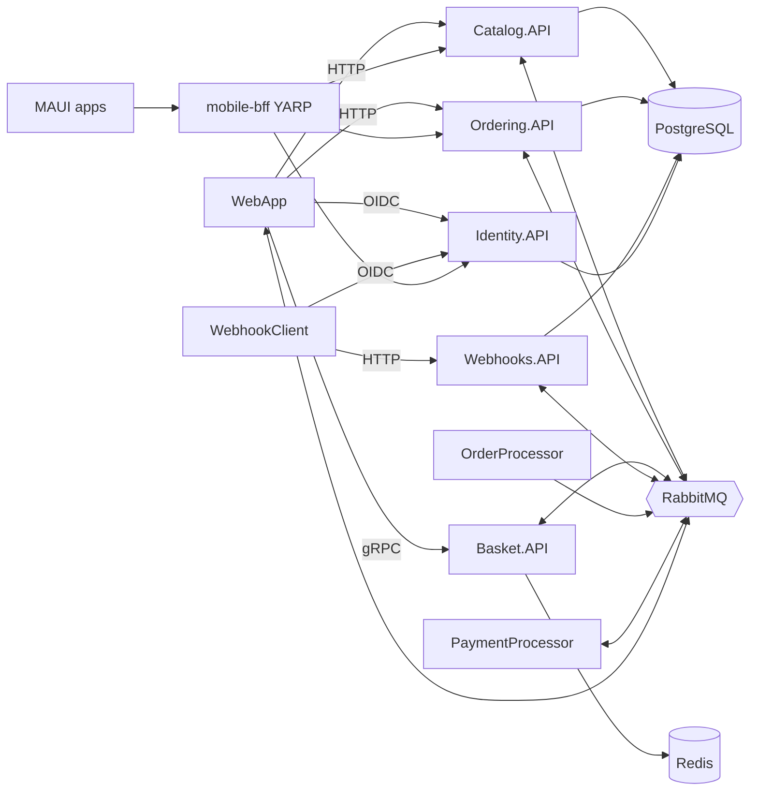
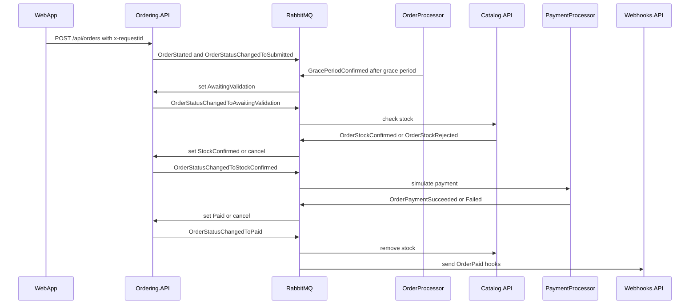
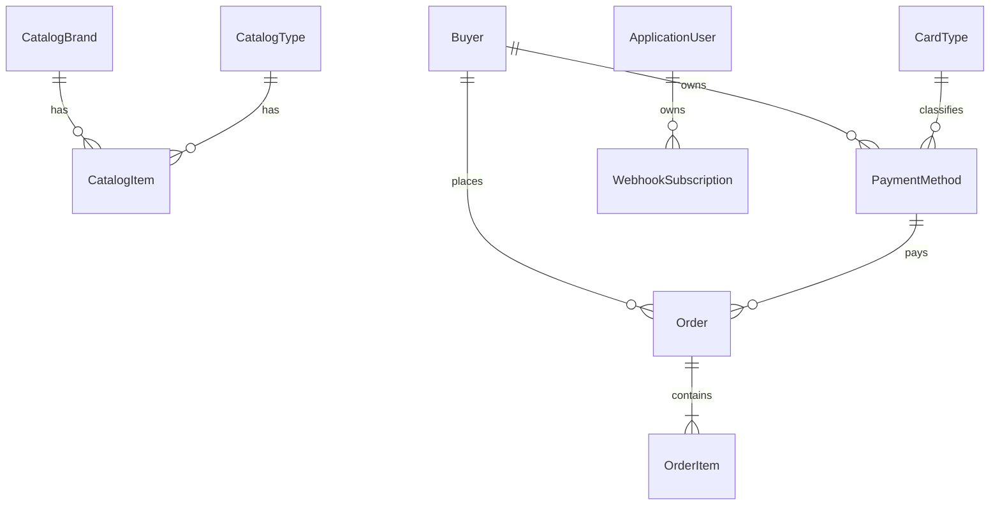
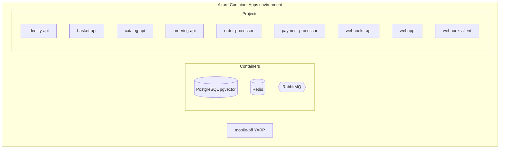

# eShop Documentation
<!-- appdoc:template 2.3 -->

**Target:** eShop | **Commit:** 913acea66708a59595351174cee9b29f37179d29 | **Evidence date:** 2026-11-11

**How to read this document.** *Cited* claims carry a path-and-line Citation. **Inferred:** marks reasoning from cited evidence. *Unknown* items are listed in section 14 and must not be assumed. Secret values are never reproduced; their locations are cited with "value omitted". The Evidence Register (source-to-claim audit) is rendered as Appendix A.

## 1. Application Index

| Support need | Primary screen or file | Workflow |
|---|---|---|
| A customer cannot sign in | Identity login page UI-13 (`src/Identity.API/Quickstart/Account/AccountController.cs:61`) | [7.1 Sign in to the storefront](#71-sign-in-to-the-storefront) |
| A basket does not update | Item and cart pages UI-2, UI-3 (`src/WebApp/Services/BasketState.cs:33-76`) | [7.2 Add items to the basket and change the cart](#72-add-items-to-the-basket-and-change-the-cart) |
| An order was placed but is missing | Checkout page UI-4 and Ordering.API (`src/Ordering.API/Apis/OrdersApi.cs:118-168`) | [7.3 Place an order](#73-place-an-order) |
| An order is stuck in a status | OrderProcessor and the event handlers (`src/OrderProcessor/Services/GracePeriodManagerService.cs:7`) | [7.4 Process an order automatically](#74-process-an-order-automatically) |
| An order must be cancelled | Cancel route and MAUI order detail UI-37 (`src/Ordering.API/Apis/OrdersApi.cs:22-49`) | [7.5 Cancel an order](#75-cancel-an-order) |
| An order must be shipped | Ship route (`src/Ordering.API/Apis/OrdersApi.cs:51-78`) | [7.6 Ship an order](#76-ship-an-order) |
| A product price, stock or description is wrong | Catalog.API routes (`src/Catalog.API/Apis/CatalogApi.cs:100-116`) | [7.7 Create, update or delete a catalog item](#77-create-update-or-delete-a-catalog-item) |
| A webhook cannot be registered | Add webhook page UI-10 (`src/WebhookClient/Components/Pages/AddWebhook.razor:41-58`) | [7.8 Register a webhook subscription](#78-register-a-webhook-subscription) |
| A webhook subscription must be removed | Webhooks.API delete route (`src/Webhooks.API/Apis/WebHooksApi.cs:66-82`) | [7.9 Delete a webhook subscription](#79-delete-a-webhook-subscription) |
| A webhook did not arrive | Webhook sender and receiver (`src/Webhooks.API/Services/WebhooksSender.cs:5-33`) | [7.10 Deliver an order webhook](#710-deliver-an-order-webhook) |
| A service does not start | Migration and seed hosted service (`src/Shared/MigrateDbContextExtensions.cs:48-82`) | [7.11 Start a service: migrate and seed the database](#711-start-a-service-migrate-and-seed-the-database) |
| Find the owner of a risk or a control | Sections 10 and 11 (`CONTRIBUTING.md:1-10`) | Not a workflow; see 10.1 and 11 |
| Find a configuration key | Section 16.6 (`src/Identity.API/appsettings.json:10-11`) | Not a workflow; see 16.6 |

## 2. Coverage and Overview

### 2.1 What was inspected
The Target is a .NET solution (`eShop.slnx`) with services, two Blazor web apps and two .NET MAUI client apps. The aspnet-core Stack is supported. The node Stack (only `package.json`, which holds Playwright end-to-end test dependencies) is unsupported, so it has generic Facts only: files, dependencies and config keys. No Facts exist for it beyond that, and the Playwright suite under `e2e/` was read by hand, not extracted.

The two MAUI projects (`src/ClientApp/` and `src/HybridApp/`) are recognised only as XAML or Razor pages; their service code was read by hand and is described in sections 4 and 6 as Cited or Inferred. This document covers the runtime topology declared in `src/eShop.AppHost/AppHost.cs`; no running environment, database contents, container image or cloud deployment was inspected.

Not reviewed: image, font and webp assets (for example `src/Catalog.API/Pics/` and `src/Identity.API/wwwroot/`), EF migration designer files, the agent-skill documents under `.github/skills/`, the folder `docs/`, the file `src/Identity.API/tempkey.jwk` (deliberately not opened because it may hold key material) and platform-specific MAUI folders. Git history is shallow, so ownership Facts are absent (see section 11). An independent source-to-claim audit sampled this document by risk (every finding, workflow and open question, plus a sample of the other sections); its scope and results are in Appendix A.

<!-- appdoc:generated scan-coverage -->
| Stack | Supported | Files read |
|---|---|---|
| node | no (generic only) | 1 |
| aspnet-core | yes | 630 |

Files found: 1157 = scanned 1157 + pruned 0 + ignored by .appdocignore 0.

| Top folder | Files scanned |
|---|---|
| `src/` | 990 |
| `tests/` | 61 |
| `.github/` | 54 |
| `docs/` | 12 |
| `e2e/` | 5 |
| `.config/` | 4 |
| `img/` | 3 |
| `build/` | 2 |
| `.aspire/` | 1 |
| `.devcenter/` | 1 |
| `.vscode/` | 1 |

No folders were pruned.
<!-- /appdoc:generated scan-coverage -->

### 2.2 Purpose and users
eShop is a reference e-commerce application branded "AdventureWorks" that demonstrates a services-based .NET architecture orchestrated by Aspire (`README.md:1-3`). Its sample catalog data is fictional (`README.md:150-152`). The business purpose beyond a sample is Unknown - see Open questions.

Observed user groups: shoppers using the web storefront (`src/WebApp/Components/Pages/Catalog/Catalog.razor:1`), shoppers using the MAUI mobile app (`src/ClientApp/AppShell.xaml:3`) or the hybrid catalog app (`src/HybridApp/MainPage.xaml:2`), and developers who register webhooks through the WebhookClient site (`src/WebhookClient/Components/Pages/AddWebhook.razor:1`). No administrator role or back-office UI exists in source (see section 5).

Overall risk posture: the unauthenticated catalog write endpoints (V-1) are the most severe finding, followed by credential and token-signing material committed to source (V-2, V-3, V-4) and missing order-level authorization (V-5, V-6).

### 2.3 System boundary
Inside the Target: the Catalog, Basket, Ordering, Webhooks and Identity services, the OrderProcessor and PaymentProcessor background workers, the WebApp and WebhookClient Blazor sites, the MAUI apps, and the shared libraries, all wired by the AppHost (`src/eShop.AppHost/AppHost.cs:4-105`). The AppHost also starts PostgreSQL, Redis and RabbitMQ containers (`src/eShop.AppHost/AppHost.cs:9-15`).

Outside the Target: an optional Microsoft Foundry or Ollama model host for embeddings and chat (`src/eShop.AppHost/Extensions.cs:50-86`), an OTLP telemetry collector (`src/eShop.ServiceDefaults/Extensions.cs:87-93`), an Azure Container Apps environment for deployment (`src/eShop.AppHost/AppHost.cs:7`), and any URL a user registers as a webhook receiver (`src/Webhooks.API/Services/WebhooksSender.cs:17`). Identity registers no third-party login provider (`src/Identity.API/Program.cs:14-41`).

## 3. Architecture

### 3.1 Components
- **AppHost** wires projects, containers, service references and the mobile gateway (`src/eShop.AppHost/AppHost.cs:4-105`).
- **ServiceDefaults** adds health checks, OpenTelemetry, service discovery and resilience (`src/eShop.ServiceDefaults/Extensions.cs:16-32`). JWT bearer authentication (`AddDefaultAuthentication`) and OpenAPI (`AddDefaultOpenApi`) are separate opt-in calls that a service must make itself; Catalog.API makes neither authentication call (`src/eShop.ServiceDefaults/AuthenticationExtensions.cs:10-14`, `src/Basket.API/Extensions/Extensions.cs:12`, `src/Catalog.API/Program.cs:3-6`).
- **Catalog.API** is a versioned minimal-API CRUD and search service over PostgreSQL with pgvector (`src/Catalog.API/Apis/CatalogApi.cs:13-118`, `src/Catalog.API/Infrastructure/CatalogContext.cs:8-28`).
- **Basket.API** is a gRPC service that stores one basket per user in Redis (`src/Basket.API/Program.cs:6-12`, `src/Basket.API/Repositories/RedisBasketRepository.cs:6-49`).
- **Ordering.API**, **Ordering.Domain** and **Ordering.Infrastructure** implement orders with MediatR commands, a domain model and EF Core persistence (`src/Ordering.API/Extensions/Extensions.cs:5-49`, `src/Ordering.Domain/AggregatesModel/OrderAggregate/Order.cs:5-186`, `src/Ordering.Infrastructure/OrderingContext.cs:12-95`).
- **OrderProcessor** is a background worker that polls for orders past the grace period (`src/OrderProcessor/Services/GracePeriodManagerService.cs:7-62`). **PaymentProcessor** simulates payment from a config flag (`src/PaymentProcessor/IntegrationEvents/EventHandling/OrderStatusChangedToStockConfirmedIntegrationEventHandler.cs:9-33`).
- **Webhooks.API** stores per-user webhook subscriptions and posts events to them (`src/Webhooks.API/Apis/WebHooksApi.cs:7-86`, `src/Webhooks.API/Services/WebhooksSender.cs:5-33`).
- **Identity.API** is a Duende IdentityServer plus ASP.NET Identity login site (`src/Identity.API/Program.cs:14-41`, `src/Identity.API/Configuration/Config.cs:5-191`).
- **WebApp** is the Blazor Server storefront with an optional AI chatbot (`src/WebApp/Program.cs:4-26`, `src/WebApp/Components/Chatbot/ChatState.cs:9-60`). **WebAppComponents** holds shared catalog UI and client code (`src/WebAppComponents/Services/CatalogService.cs:1-71`).
- **WebhookClient** is a Blazor Server site that registers a webhook and receives callbacks (`src/WebhookClient/Program.cs:4-31`).
- **ClientApp** (MAUI) and **HybridApp** (MAUI Blazor) are mobile and desktop clients (`src/ClientApp/MauiProgram.cs:1-167`, `src/HybridApp/MauiProgram.cs:8-30`).
- **EventBus**, **EventBusRabbitMQ** and **IntegrationEventLogEF** provide the RabbitMQ event bus and the transactional outbox (`src/EventBusRabbitMQ/RabbitMQEventBus.cs:13-262`, `src/IntegrationEventLogEF/Services/IntegrationEventLogService.cs:3-72`).

### 3.2 Diagram

Component view of the services and their stores, as wired in `src/eShop.AppHost/AppHost.cs:9-103` and `src/eShop.AppHost/Extensions.cs:88-153`. Mobile apps reach the gateway through the endpoints in `src/ClientApp/Services/Settings/SettingsService.cs:99-124`; the exact gateway wiring of the full MAUI app is Inferred from those settings.

### 3.3 Authentication and authorization
Users sign in at Identity.API, which runs IdentityServer with ASP.NET Identity users in PostgreSQL (`src/Identity.API/Program.cs:14-37`). Login uses a username and password with lockout on failure (`src/Identity.API/Quickstart/Account/AccountController.cs:95`). The web apps use the OpenID Connect code flow and keep tokens in the session (`src/WebApp/Extensions/Extensions.cs:72-87`, `src/WebhookClient/Extensions/Extensions.cs:48-61`) and forward the access token to backend calls (`src/eShop.ServiceDefaults/HttpClientExtensions.cs:11-50`).

Backend services validate JWT bearer tokens only when an `Identity` config section exists, with audience validation and HTTPS metadata disabled (`src/eShop.ServiceDefaults/AuthenticationExtensions.cs:24-50`). Ordering.API and Webhooks.API apply `.RequireAuthorization()` to every route of their groups (`src/Ordering.API/Program.cs:21-22`, `src/Webhooks.API/Program.cs:20-21`). Basket.API checks the caller inside each gRPC method and leaves `GetBasket` anonymous (`src/Basket.API/Grpc/BasketService.cs:12-13`, `src/Basket.API/Grpc/BasketService.cs:36-42`). Catalog.API never registers authentication or authorization, so none of its routes is protected (`src/Catalog.API/Extensions/Extensions.cs:5-50`, `src/Catalog.API/Program.cs:3-29`).

The API scope names `orders`, `basket` and `webhooks` are defined as API scopes (`src/Identity.API/Configuration/Config.cs:22-24`), but no service policy requires a scope (`src/eShop.ServiceDefaults/AuthenticationExtensions.cs:52`).

## 4. Functional Inventory

<!-- appdoc:generated entry-points -->
13 route handler files; 48 routes; 46 pages; 0 commands; 3 jobs.

| Handler file | Kinds | Routes | Pages | Jobs | Commands |
|---|---|---|---|---|---|
| `src/Catalog.API/Apis/CatalogApi.cs` | route | 17 | 0 | 0 | 0 |
| `src/Ordering.API/Apis/OrdersApi.cs` | route | 7 | 0 | 0 | 0 |
| `src/Identity.API/Quickstart/Account/AccountController.cs` | page, route | 5 | 5 | 0 | 0 |
| `src/Webhooks.API/Apis/WebHooksApi.cs` | route | 4 | 0 | 0 | 0 |
| `src/Identity.API/Quickstart/Device/DeviceController.cs` | page, route | 3 | 7 | 0 | 0 |
| `src/Identity.API/Quickstart/Account/ExternalController.cs` | route | 2 | 0 | 0 | 0 |
| `src/Identity.API/Quickstart/Consent/ConsentController.cs` | page, route | 2 | 4 | 0 | 0 |
| `src/Identity.API/Quickstart/Grants/GrantsController.cs` | page, route | 2 | 1 | 0 | 0 |
| `src/Identity.API/Quickstart/Home/HomeController.cs` | page, route | 2 | 2 | 0 | 0 |
| `src/Identity.API/Quickstart/Diagnostics/DiagnosticsController.cs` | page, route | 1 | 1 | 0 | 0 |
| `src/WebhookClient/Endpoints/AuthenticationEndpoints.cs` | route | 1 | 0 | 0 | 0 |
| `src/WebhookClient/Endpoints/WebhookEndpoints.cs` | route | 1 | 0 | 0 | 0 |
| `src/eShop.ServiceDefaults/OpenApi.Extensions.cs` | route | 1 | 0 | 0 | 0 |
| `src/EventBusRabbitMQ/RabbitMQEventBus.cs` | job | 0 | 0 | 1 | 0 |
| `src/HybridApp/Components/Pages/Catalog/Catalog.razor` | page | 0 | 1 | 0 | 0 |
| `src/HybridApp/Components/Pages/Item/ItemPage.razor` | page | 0 | 1 | 0 | 0 |
| `src/Identity.API/Views/Account/AccessDenied.cshtml` | page | 0 | 1 | 0 | 0 |
| `src/Identity.API/Views/Account/LoggedOut.cshtml` | page | 0 | 1 | 0 | 0 |
| `src/Identity.API/Views/Account/Login.cshtml` | page | 0 | 1 | 0 | 0 |
| `src/Identity.API/Views/Account/Logout.cshtml` | page | 0 | 1 | 0 | 0 |
| `src/Identity.API/Views/Consent/Index.cshtml` | page | 0 | 1 | 0 | 0 |
| `src/Identity.API/Views/Device/Success.cshtml` | page | 0 | 1 | 0 | 0 |
| `src/Identity.API/Views/Device/UserCodeCapture.cshtml` | page | 0 | 1 | 0 | 0 |
| `src/Identity.API/Views/Device/UserCodeConfirmation.cshtml` | page | 0 | 1 | 0 | 0 |
| `src/Identity.API/Views/Diagnostics/Index.cshtml` | page | 0 | 1 | 0 | 0 |
| `src/Identity.API/Views/Grants/Index.cshtml` | page | 0 | 1 | 0 | 0 |
| `src/Identity.API/Views/Home/Index.cshtml` | page | 0 | 1 | 0 | 0 |
| `src/Identity.API/Views/Shared/Error.cshtml` | page | 0 | 1 | 0 | 0 |
| `src/Identity.API/Views/Shared/Redirect.cshtml` | page | 0 | 1 | 0 | 0 |
| `src/OrderProcessor/Services/GracePeriodManagerService.cs` | job | 0 | 0 | 1 | 0 |
| `src/Shared/MigrateDbContextExtensions.cs` | job | 0 | 0 | 1 | 0 |
| `src/WebApp/Components/Pages/Cart/CartPage.razor` | page | 0 | 1 | 0 | 0 |
| `src/WebApp/Components/Pages/Catalog/Catalog.razor` | page | 0 | 1 | 0 | 0 |
| `src/WebApp/Components/Pages/Checkout/Checkout.razor` | page | 0 | 1 | 0 | 0 |
| `src/WebApp/Components/Pages/Item/ItemPage.razor` | page | 0 | 1 | 0 | 0 |
| `src/WebApp/Components/Pages/User/LogIn.razor` | page | 0 | 1 | 0 | 0 |
| `src/WebApp/Components/Pages/User/LogOut.razor` | page | 0 | 1 | 0 | 0 |
| `src/WebApp/Components/Pages/User/Orders.razor` | page | 0 | 1 | 0 | 0 |
| `src/WebhookClient/Components/Pages/AddWebhook.razor` | page | 0 | 1 | 0 | 0 |
| `src/WebhookClient/Components/Pages/Error.razor` | page | 0 | 1 | 0 | 0 |
| `src/WebhookClient/Components/Pages/Home/Home.razor` | page | 0 | 1 | 0 | 0 |
| `src/WebhookClient/Components/Pages/LogIn.razor` | page | 0 | 1 | 0 | 0 |
<!-- /appdoc:generated entry-points -->

The block above counts entry points found by the extractor. Basket.API's gRPC methods are not among them because they come from a `.proto` service (`src/Basket.API/Proto/basket.proto:7-11`), so they are listed here by hand.

| ID | Area | Feature | Entry point | Inputs, outputs and rules | Dependencies | Status |
|---|---|---|---|---|---|---|
| F-1 | Catalog | List and filter catalog items in API v1 and v2, by id list, by name, by type and brand | `GET /api/catalog/items` (`src/Catalog.API/Apis/CatalogApi.cs:22`, `src/Catalog.API/Apis/CatalogApi.cs:27`, `src/Catalog.API/Apis/CatalogApi.cs:32`, `src/Catalog.API/Apis/CatalogApi.cs:42`, `src/Catalog.API/Apis/CatalogApi.cs:74`) | Page size defaults to 10 and page index to 0 (`src/Catalog.API/Model/PaginationRequest.cs:5-13`); optional name prefix, type and brand filters; results ordered by name (`src/Catalog.API/Apis/CatalogApi.cs:131-166`) | PostgreSQL catalog tables (`src/Catalog.API/Infrastructure/CatalogContext.cs:14-16`) | Cited |
| F-2 | Catalog | Facet counts per brand and type for the current filter | `GET /api/catalog/items/facets` (`src/Catalog.API/Apis/CatalogApi.cs:53`) | Brand counts honour the type filter and type counts honour the brand filter (`src/Catalog.API/Apis/CatalogApi.cs:169-205`) | PostgreSQL | Cited |
| F-3 | Catalog | Item detail, item picture, item types and brands | `GET /api/catalog/items/{id}` and `/pic`, `catalogtypes`, `catalogbrands` (`src/Catalog.API/Apis/CatalogApi.cs:37`, `src/Catalog.API/Apis/CatalogApi.cs:47`, `src/Catalog.API/Apis/CatalogApi.cs:84`, `src/Catalog.API/Apis/CatalogApi.cs:91`) | Id of 0 or less returns 400 and an unknown id returns 404 (`src/Catalog.API/Apis/CatalogApi.cs:217-238`); the picture is streamed from the Pics folder and a missing file returns 404 (`src/Catalog.API/Apis/CatalogApi.cs:251-274`) | PostgreSQL, Pics file provider (`src/Catalog.API/Program.cs:7-9`) | Cited |
| F-4 | Catalog | Semantic search | `GET /api/catalog/items/withsemanticrelevance` (`src/Catalog.API/Apis/CatalogApi.cs:60`, `src/Catalog.API/Apis/CatalogApi.cs:67`) | Falls back to a name-prefix search when AI is disabled or no embedding is returned (`src/Catalog.API/Apis/CatalogApi.cs:294-306`); otherwise orders by cosine distance (`src/Catalog.API/Apis/CatalogApi.cs:313-337`) | pgvector, embedding model (`src/Catalog.API/Services/CatalogAI.cs:7-75`) | Cited |
| F-5 | Catalog | Create a catalog item | `POST /api/catalog/items` (`src/Catalog.API/Apis/CatalogApi.cs:110`) | Copies the body into a new item, generates an embedding when AI is enabled and returns 201 (`src/Catalog.API/Apis/CatalogApi.cs:415-437`); only `Name` is marked required (`src/Catalog.API/Model/CatalogItem.cs:11-12`) | PostgreSQL, embedding model | Cited |
| F-6 | Catalog | Update a catalog item | `PUT /api/catalog/items` in v1 and `PUT /api/catalog/items/{id}` in v2 (`src/Catalog.API/Apis/CatalogApi.cs:100`, `src/Catalog.API/Apis/CatalogApi.cs:105`) | 404 for an unknown id; a changed price saves a `ProductPriceChangedIntegrationEvent` to the outbox and publishes it (`src/Catalog.API/Apis/CatalogApi.cs:373-411`) | PostgreSQL, RabbitMQ outbox (`src/Catalog.API/IntegrationEvents/CatalogIntegrationEventService.cs:28-40`) | Cited |
| F-7 | Catalog | Delete a catalog item | `DELETE /api/catalog/items/{id}` (`src/Catalog.API/Apis/CatalogApi.cs:114`) | 404 for an unknown id, otherwise 204 (`src/Catalog.API/Apis/CatalogApi.cs:439-453`) | PostgreSQL | Cited |
| F-8 | Basket | Get, replace and delete the signed-in user's basket | gRPC `GetBasket`, `UpdateBasket`, `DeleteBasket` (`src/Basket.API/Proto/basket.proto:7-11`) | The user id is the `sub` claim; `GetBasket` returns an empty basket without a user, `UpdateBasket` and `DeleteBasket` return Unauthenticated (`src/Basket.API/Grpc/BasketService.cs:13-19`, `src/Basket.API/Grpc/BasketService.cs:36-42`, `src/Basket.API/Grpc/BasketService.cs:59-65`); only product id and quantity are stored (`src/Basket.API/Proto/basket.proto:20-23`) | Redis (`src/Basket.API/Repositories/RedisBasketRepository.cs:18-48`) | Cited |
| F-9 | Ordering | Place an order | `POST /api/orders` (`src/Ordering.API/Apis/OrdersApi.cs:17`) | Requires an `x-requestid` GUID and masks the card number before building the command (`src/Ordering.API/Apis/OrdersApi.cs:132-146`); always returns 200 when the command is sent (`src/Ordering.API/Apis/OrdersApi.cs:155-166`) | PostgreSQL, outbox, RabbitMQ (`src/Ordering.API/Application/Commands/CreateOrderCommandHandler.cs:29-52`) | Cited |
| F-10 | Ordering | Price an order draft without saving it | `POST /api/orders/draft` (`src/Ordering.API/Apis/OrdersApi.cs:16`) | Builds a draft order from the items and returns items and total (`src/Ordering.API/Application/Commands/CreateOrderDraftCommandHandler.cs:10-20`) | None persisted | Cited |
| F-11 | Ordering | List the caller's orders, read one order, list card types | `GET /api/orders`, `GET /api/orders/{orderId}`, `GET /api/orders/cardtypes` (`src/Ordering.API/Apis/OrdersApi.cs:14`, `src/Ordering.API/Apis/OrdersApi.cs:13`, `src/Ordering.API/Apis/OrdersApi.cs:15`) | The list filters by the caller's `sub` claim (`src/Ordering.API/Apis/OrdersApi.cs:93-98`, `src/Ordering.API/Application/Queries/OrderQueries.cs:37-40`); the single read filters only by order id (`src/Ordering.API/Application/Queries/OrderQueries.cs:6-13`) | PostgreSQL | Cited |
| F-12 | Ordering | Cancel an order | `PUT /api/orders/cancel` (`src/Ordering.API/Apis/OrdersApi.cs:11`) | Needs `x-requestid`; returns 500 when the command fails (`src/Ordering.API/Apis/OrdersApi.cs:22-48`); the domain refuses cancelling a Paid or Shipped order (`src/Ordering.Domain/AggregatesModel/OrderAggregate/Order.cs:142-148`) | PostgreSQL, idempotency table (`src/Ordering.Infrastructure/Idempotency/RequestManager.cs:1-29`) | Cited |
| F-13 | Ordering | Ship an order | `PUT /api/orders/ship` (`src/Ordering.API/Apis/OrdersApi.cs:12`) | Needs `x-requestid` (`src/Ordering.API/Apis/OrdersApi.cs:51-78`); only a Paid order can be shipped (`src/Ordering.Domain/AggregatesModel/OrderAggregate/Order.cs:130-140`) | PostgreSQL, RabbitMQ | Cited |
| F-14 | Order automation | Move a submitted order through grace period, stock check, payment and paid | Background job `GracePeriodManagerService` and the integration-event handlers (`src/OrderProcessor/Services/GracePeriodManagerService.cs:7`, `src/Ordering.API/Extensions/Extensions.cs:55-59`, `src/Catalog.API/Extensions/Extensions.cs:31-33`, `src/PaymentProcessor/Program.cs:5-6`) | Poll interval and grace period come from `BackgroundTaskOptions` (`src/OrderProcessor/appsettings.json:14-17`); payment outcome comes from `PaymentSucceeded` (`src/PaymentProcessor/appsettings.json:14-16`) | RabbitMQ, PostgreSQL | Cited |
| F-15 | Webhooks | List and read the caller's webhook subscriptions | `GET /api/webhooks` and `GET /api/webhooks/{id}` (`src/Webhooks.API/Apis/WebHooksApi.cs:13`, `src/Webhooks.API/Apis/WebHooksApi.cs:20`) | Both filter by the caller's `sub` claim (`src/Webhooks.API/Apis/WebHooksApi.cs:15-16`, `src/Webhooks.API/Apis/WebHooksApi.cs:25-27`) | PostgreSQL (`src/Webhooks.API/Infrastructure/WebhooksContext.cs:8-19`) | Cited |
| F-16 | Webhooks | Register a webhook subscription | `POST /api/webhooks` (`src/Webhooks.API/Apis/WebHooksApi.cs:35`) | Validates URLs and event name, then sends an OPTIONS grant check to the grant URL before saving (`src/Webhooks.API/Model/WebhookSubscriptionRequest.cs:10-27`, `src/Webhooks.API/Apis/WebHooksApi.cs:41-62`) | Grant URL host, PostgreSQL | Cited |
| F-17 | Webhooks | Delete a webhook subscription | `DELETE /api/webhooks/{id}` (`src/Webhooks.API/Apis/WebHooksApi.cs:66`) | Deletes only the caller's own row; 404 otherwise (`src/Webhooks.API/Apis/WebHooksApi.cs:71-81`) | PostgreSQL | Cited |
| F-18 | Webhooks | Deliver order-paid and order-shipped hooks | Integration-event handlers (`src/Webhooks.API/Extensions/Extensions.cs:19-24`) | Posts the event as JSON to every subscription of that type, adding the token header when present (`src/Webhooks.API/Services/WebhooksSender.cs:5-33`); the price-change handler does nothing (`src/Webhooks.API/IntegrationEvents/ProductPriceChangedIntegrationEventHandler.cs:5-8`) | RabbitMQ, receiver URLs | Cited |
| F-19 | Webhook receiver | Answer the grant check and accept pushed hooks | `OPTIONS /check`, `POST /webhook-received`, `POST /logout` (`src/WebhookClient/Endpoints/WebhookEndpoints.cs:16`, `src/WebhookClient/Endpoints/WebhookEndpoints.cs:31`, `src/WebhookClient/Endpoints/AuthenticationEndpoints.cs:12`) | Stores accepted hooks in an in-memory queue (`src/WebhookClient/Services/HooksRepository.cs:7-12`) | None | Cited |
| F-20 | Identity | Sign in, sign out, access denied | `/Account/Login`, `/Account/Logout`, `/Account/AccessDenied` (`src/Identity.API/Quickstart/Account/AccountController.cs:40`, `src/Identity.API/Quickstart/Account/AccountController.cs:61`, `src/Identity.API/Quickstart/Account/AccountController.cs:147`, `src/Identity.API/Quickstart/Account/AccountController.cs:167`, `src/Identity.API/Quickstart/Account/AccountController.cs:197`) | Username and password with lockout (`src/Identity.API/Quickstart/Account/AccountController.cs:95`) | PostgreSQL | Cited |
| F-21 | Identity | External login challenge and callback | `/External/Challenge`, `/External/Callback` (`src/Identity.API/Quickstart/Account/ExternalController.cs:34`, `src/Identity.API/Quickstart/Account/ExternalController.cs:64`) | No external provider is registered in this Target (`src/Identity.API/Program.cs:14-41`) | None | Cited |
| F-22 | Identity | Consent, device authorization, granted-access list and revoke, diagnostics, home and error pages | `/Consent/Index`, `/Device/Index`, `/Grants/Index`, `/Diagnostics/Index`, `/Home/Index` (`src/Identity.API/Quickstart/Consent/ConsentController.cs:33`, `src/Identity.API/Quickstart/Device/DeviceController.cs:28`, `src/Identity.API/Quickstart/Grants/GrantsController.cs:33`, `src/Identity.API/Quickstart/Diagnostics/DiagnosticsController.cs:11`, `src/Identity.API/Quickstart/Home/HomeController.cs:24`) | Diagnostics answers 404 unless the request comes from a local address (`src/Identity.API/Quickstart/Diagnostics/DiagnosticsController.cs:13-17`); the home page answers 404 outside Development (`src/Identity.API/Quickstart/Home/HomeController.cs:24-34`); all clients set `RequireConsent = false` for the first-party apps (`src/Identity.API/Configuration/Config.cs:55`, `src/Identity.API/Configuration/Config.cs:87`) | PostgreSQL | Cited |
| F-23 | Storefront | Browse the catalog, view an item and add it to the basket | `/` and `/item/{itemId}` (`src/WebApp/Components/Pages/Catalog/Catalog.razor:1`, `src/WebApp/Components/Pages/Item/ItemPage.razor:1`) | Anonymous users can browse; adding to the basket redirects an anonymous user to login (`src/WebApp/Components/Pages/Item/ItemPage.razor:113`, `src/WebApp/Components/Pages/Item/ItemPage.razor:149`) | Catalog.API, Basket.API (`src/WebApp/Extensions/Extensions.cs:31-36`) | Cited |
| F-24 | Storefront | View and change the cart, check out | `/cart`, `/checkout` (`src/WebApp/Components/Pages/Cart/CartPage.razor:1`, `src/WebApp/Components/Pages/Checkout/Checkout.razor:1`) | Both require sign-in (`src/WebApp/Components/Pages/Cart/CartPage.razor:6`, `src/WebApp/Components/Pages/Checkout/Checkout.razor:6`); checkout asks only for the shipping address and sends fixed card values (`src/WebApp/Services/BasketState.cs:78-109`) | Basket.API, Ordering.API | Cited |
| F-25 | Storefront | List my orders with live status refresh, sign in and sign out | `/user/orders`, `/user/login`, `/user/logout` (`src/WebApp/Components/Pages/User/Orders.razor:1`, `src/WebApp/Components/Pages/User/LogIn.razor:1`, `src/WebApp/Components/Pages/User/LogOut.razor:1`) | Orders page re-renders when an order-status event for the same buyer arrives (`src/WebApp/Services/OrderStatus/OrderStatusNotificationService.cs:9-35`) | Ordering.API, RabbitMQ | Cited |
| F-26 | Chatbot | AI shopping assistant with tools to read the user profile, search the catalog and use the cart | Chat dock in the storefront (`src/WebApp/Components/Chatbot/Chatbot.razor:5-11`) | Four tools are offered to the model (`src/WebApp/Components/Chatbot/ChatState.cs:43-46`); enabled only when a chat model is configured (`src/WebApp/Extensions/Extensions.cs:94-108`) | Chat model, Catalog.API, Basket.API | Cited |
| F-27 | Mobile apps | MAUI app: catalog, basket, checkout, orders, profile, settings, map; hybrid catalog app | Pages listed in the generated block (`src/ClientApp/AppShell.xaml:3`, `src/HybridApp/MainPage.xaml:2`) | The MAUI app starts in mock mode by default (`src/ClientApp/Services/Settings/SettingsService.cs:25`) and switches between mock and real services (`src/ClientApp/MauiProgram.cs:100-113`) | Mobile gateway, Identity.API, Basket gRPC | Cited |
| F-28 | Gateway | Mobile BFF reverse proxy for catalog, ordering and identity | YARP routes (`src/eShop.AppHost/AppHost.cs:62-64`, `src/eShop.AppHost/Extensions.cs:88-153`) | The catalog and ordering routes require an `api-version` query value (`src/eShop.AppHost/Extensions.cs:97-98`, `src/eShop.AppHost/Extensions.cs:146-147`), while the identity route has no query-parameter match (`src/eShop.AppHost/Extensions.cs:150-151`); a catch-all forwards `/api/catalog/{*any}` (`src/eShop.AppHost/Extensions.cs:142-143`) | Catalog.API, Ordering.API, Identity.API | Cited |
| F-29 | Platform | Startup migration and seeding, event-bus consumer, health and API-reference endpoints | Hosted services and dev-only endpoints (`src/Shared/MigrateDbContextExtensions.cs:76`, `src/EventBusRabbitMQ/RabbitMQEventBus.cs:13`, `src/eShop.ServiceDefaults/Extensions.cs:108-128`, `src/eShop.ServiceDefaults/OpenApi.Extensions.cs:41`) | Migrations and seed run when each service starts (`src/Shared/MigrateDbContextExtensions.cs:58-74`); `/health` and `/alive` exist only in Development (`src/eShop.ServiceDefaults/Extensions.cs:115-125`) | PostgreSQL, RabbitMQ | Cited |

### 4.1 Subsystem inventory
Rows for `src/` and its project folders overlap on purpose: the first row is the top folder from the scan, the rows after it split it by project. The `(root)` row lists the 23 files at the repository root, for example `README.md`, `global.json` and `Directory.Packages.props`.

| Subsystem | Files | Features | Primary data and dependencies | Purpose | Status |
|---|---|---|---|---|---|
| `src/` | 990 | F-1, F-2, F-3, F-4, F-5, F-6, F-7, F-8, F-9, F-10, F-11, F-12, F-13, F-14, F-15, F-16, F-17, F-18, F-19, F-20, F-21, F-22, F-23, F-24, F-25, F-26, F-27, F-28, F-29 | All application projects | Source of every service, site, library and client (`src/eShop.AppHost/AppHost.cs:4-105`) | Cited |
| `src/Catalog.API/` | 150 | F-1, F-2, F-3, F-4, F-5, F-6, F-7 | PostgreSQL with pgvector, RabbitMQ, embedding model | Product catalog service (`src/Catalog.API/Apis/CatalogApi.cs:13-118`) | Cited |
| `src/Basket.API/` | 16 | F-8 | Redis, RabbitMQ | Per-user basket over gRPC (`src/Basket.API/Program.cs:6-12`) | Cited |
| `src/Ordering.API/` | 72 | F-9, F-10, F-11, F-12, F-13, F-14 | PostgreSQL, RabbitMQ, MediatR | Order commands, queries and event handlers (`src/Ordering.API/Extensions/Extensions.cs:5-49`) | Cited |
| `src/Ordering.Domain/` | 24 | F-9, F-12, F-13, F-14 | None | Order and buyer aggregates and status rules (`src/Ordering.Domain/AggregatesModel/OrderAggregate/Order.cs:5-186`) | Cited |
| `src/Ordering.Infrastructure/` | 24 | F-9, F-12 | PostgreSQL schema `ordering` | EF Core context, repositories, idempotency (`src/Ordering.Infrastructure/OrderingContext.cs:12-95`) | Cited |
| `src/OrderProcessor/` | 11 | F-14 | PostgreSQL (raw SQL), RabbitMQ | Grace-period poller (`src/OrderProcessor/Services/GracePeriodManagerService.cs:7-62`) | Cited |
| `src/PaymentProcessor/` | 11 | F-14 | RabbitMQ | Simulated payment (`src/PaymentProcessor/Program.cs:5-6`) | Cited |
| `src/Webhooks.API/` | 31 | F-15, F-16, F-17, F-18 | PostgreSQL, RabbitMQ, outbound HTTP | Webhook subscriptions and delivery (`src/Webhooks.API/Apis/WebHooksApi.cs:7-86`) | Cited |
| `src/WebhookClient/` | 33 | F-19 | OIDC, Webhooks.API | Sample webhook receiver site (`src/WebhookClient/Program.cs:4-31`) | Cited |
| `src/Identity.API/` | 175 | F-20, F-21, F-22 | PostgreSQL, IdentityServer | Login and token issuing (`src/Identity.API/Program.cs:14-41`) | Cited |
| `src/WebApp/` | 110 | F-23, F-24, F-25, F-26 | Catalog, Basket, Ordering, RabbitMQ, chat model | Blazor Server storefront (`src/WebApp/Program.cs:4-26`) | Cited |
| `src/WebAppComponents/` | 13 | F-23 | Catalog.API | Shared catalog components and client (`src/WebAppComponents/Services/CatalogService.cs:1-71`) | Cited |
| `src/ClientApp/` | 198 | F-27 | Gateway, Basket gRPC, Identity.API | MAUI mobile client (`src/ClientApp/MauiProgram.cs:1-167`) | Cited |
| `src/HybridApp/` | 84 | F-27 | Mobile gateway | MAUI Blazor catalog client (`src/HybridApp/MauiProgram.cs:8-30`) | Cited |
| `src/EventBus/` | 9 | F-14, F-18, F-29 | None | Event bus abstractions (`src/EventBus/Abstractions/IEventBus.cs:1-5`) | Cited |
| `src/EventBusRabbitMQ/` | 6 | F-14, F-18, F-29 | RabbitMQ | RabbitMQ event bus (`src/EventBusRabbitMQ/RabbitMQEventBus.cs:13-262`) | Cited |
| `src/IntegrationEventLogEF/` | 8 | F-6, F-9 | PostgreSQL outbox table | Transactional outbox (`src/IntegrationEventLogEF/Services/IntegrationEventLogService.cs:3-72`) | Cited |
| `src/Shared/` | 2 | F-29 | EF Core | Migration hosted service (`src/Shared/MigrateDbContextExtensions.cs:76`) | Cited |
| `src/eShop.AppHost/` | 5 | F-28 | Aspire, YARP | Topology and gateway (`src/eShop.AppHost/AppHost.cs:4-105`) | Cited |
| `src/eShop.ServiceDefaults/` | 8 | F-29 | OpenTelemetry, JWT | Shared service setup (`src/eShop.ServiceDefaults/Extensions.cs:16-48`) | Cited |
| `tests/` | 61 | F-1, F-5, F-6, F-7, F-8, F-9, F-12, F-13, F-16, F-17, F-18, F-19 | Aspire test hosts, Docker | Unit and functional tests (`tests/README.md:1-5`) | Cited |
| `.github/` | 54 | F-29 | GitHub Actions | CI workflows and agent-skill documents (`.github/workflows/pr-validation.yml:1-29`) | Cited |
| (root) | 23 | F-29 | .NET SDK, Playwright | Solution, build props, CI file, README (`README.md:1-8`) | Cited |
| `docs/` | 12 | None | None | Not reviewed (see 2.1) | Unknown |
| `e2e/` | 5 | F-23, F-24, F-25 | Playwright | Browser journeys (`e2e/CheckoutTest.spec.ts:1-10`) | Cited |
| `.config/` | 4 | None | None | Tooling and scan-suppression settings (`.config/tsaoptions.json:1-5`) | Cited |
| `img/` | 3 | None | None | README images (`README.md:5-7`) | Cited |
| `build/` | 2 | None | Azure Container Registry | Image build and manifest scripts (`build/acr-build/queue-all.ps1:1-10`) | Cited |
| `.aspire/` | 1 | F-28 | Aspire CLI | AppHost path setting (`.aspire/settings.json:2`) | Cited |
| `.devcenter/` | 1 | None | None | Dev Center image definition (`.devcenter/catalog/definitions/imagedefinition.yaml:1`) | Cited |
| `.vscode/` | 1 | None | None | Editor default solution (`.vscode/settings.json:2`) | Cited |
## 5. Roles and Access Model

### 5.1 Observed role concepts
No role, group or policy is enforced anywhere in source. The only role type referenced is `IdentityRole`, registered with ASP.NET Identity but never checked (`src/Identity.API/Program.cs:14`). The word "administrator" appears only in a comment on the ship-order handler (`src/Ordering.API/Application/Commands/ShipOrderCommandHandler.cs:13-15`).

The access concepts that do exist are:
- **Anonymous** and **signed-in user**, distinguished by the presence of a `sub` claim (`src/Basket.API/Extensions/ServerCallContextIdentityExtensions.cs:7`, `src/Ordering.API/Infrastructure/Services/IdentityService.cs:5-6`).
- **API scopes** `orders`, `basket` and `webhooks`, defined as scopes and API resources (`src/Identity.API/Configuration/Config.cs:10-12`, `src/Identity.API/Configuration/Config.cs:22-24`).
- **OAuth clients** `maui`, `webapp`, `webhooksclient` and three Swagger UI clients with fixed scope lists (`src/Identity.API/Configuration/Config.cs:46`, `src/Identity.API/Configuration/Config.cs:78`, `src/Identity.API/Configuration/Config.cs:114`, `src/Identity.API/Configuration/Config.cs:146`, `src/Identity.API/Configuration/Config.cs:161`, `src/Identity.API/Configuration/Config.cs:176`).
- Scope names `mobileshoppingagg` and `webshoppingagg` are granted to clients but are not defined as API scopes (`src/Identity.API/Configuration/Config.cs:66`, `src/Identity.API/Configuration/Config.cs:106`).

### 5.2 Authorization enforcement
- Ordering.API: every route in the orders group requires an authenticated caller and nothing more (`src/Ordering.API/Program.cs:21-22`). Handlers take the user id from the `sub` claim only for the order list (`src/Ordering.API/Apis/OrdersApi.cs:93-98`); cancel, ship and read-by-id do not compare the order's owner to the caller (`src/Ordering.API/Application/Commands/CancelOrderCommandHandler.cs:19-29`, `src/Ordering.API/Application/Commands/ShipOrderCommandHandler.cs:19-29`, `src/Ordering.API/Application/Queries/OrderQueries.cs:6-13`).
- Webhooks.API: the group requires an authenticated caller, and every handler filters or stamps rows with the caller's `sub` claim (`src/Webhooks.API/Program.cs:20-21`, `src/Webhooks.API/Apis/WebHooksApi.cs:15-16`, `src/Webhooks.API/Apis/WebHooksApi.cs:51`, `src/Webhooks.API/Apis/WebHooksApi.cs:71-72`).
- Basket.API: enforcement is inside each gRPC method; `GetBasket` is marked anonymous and returns an empty basket without a user (`src/Basket.API/Grpc/BasketService.cs:12-19`, `src/Basket.API/Grpc/BasketService.cs:36-42`, `src/Basket.API/Grpc/BasketService.cs:59-65`).
- Catalog.API: no route has any check (`src/Catalog.API/Program.cs:20-29`).
- WebApp: the cart, checkout, login and orders pages carry `[Authorize]` (`src/WebApp/Components/Pages/Cart/CartPage.razor:6`, `src/WebApp/Components/Pages/Checkout/Checkout.razor:6`, `src/WebApp/Components/Pages/User/LogIn.razor:3`, `src/WebApp/Components/Pages/User/Orders.razor:2`). Catalog and item pages are anonymous (`src/WebApp/Components/Pages/Catalog/Catalog.razor:1-4`).
- WebhookClient: only the login page requires authentication; `/check` and `/webhook-received` have no check except an optional token compare (`src/WebhookClient/Components/Pages/LogIn.razor:3`, `src/WebhookClient/Endpoints/WebhookEndpoints.cs:16-52`).
- Identity.API: account and home controllers are anonymous; consent, device, diagnostics and grants controllers require a signed-in user (`src/Identity.API/Quickstart/Account/AccountController.cs:7`, `src/Identity.API/Quickstart/Consent/ConsentController.cs:10`, `src/Identity.API/Quickstart/Grants/GrantsController.cs:10`, `src/Identity.API/Quickstart/Home/HomeController.cs:7`).
- Token validation does not check the audience or require a scope, so a valid token issued to any client is accepted by every service that validates tokens (`src/eShop.ServiceDefaults/AuthenticationExtensions.cs:49-52`).

### 5.3 Role-to-capability matrix
The Y marks below come from the enforcement points in 5.2. A scope view follows from the client list in 5.1: the `webapp` and `maui` clients may request `orders`, `basket` and `webhooks`; `webhooksclient` may request only `webhooks` (`src/Identity.API/Configuration/Config.cs:61-67`, `src/Identity.API/Configuration/Config.cs:101-107`, `src/Identity.API/Configuration/Config.cs:136-139`). No service requires any of these scopes (`src/eShop.ServiceDefaults/AuthenticationExtensions.cs:52`).

| Capability | Anonymous | Signed-in user |
|---|---|---|
| Catalog: read items, facets, pictures, types, brands (F-1 to F-4; `src/Catalog.API/Program.cs:20-29`) | Y | Y |
| Catalog: create, update or delete items (F-5 to F-7); no check exists, see V-1 (`src/Catalog.API/Apis/CatalogApi.cs:100-116`) | Y | Y |
| Basket: read or change the own basket (F-8; `src/Basket.API/Grpc/BasketService.cs:36-42`) | | Y |
| Ordering: place an order, price a draft, list own orders (F-9 to F-11; `src/Ordering.API/Program.cs:21-22`) | | Y |
| Ordering: read any order by id; no owner check, see V-6 (F-11; `src/Ordering.API/Application/Queries/OrderQueries.cs:6-13`) | | Y |
| Ordering: cancel or ship any order; no owner or role check, see V-5 (F-12, F-13; `src/Ordering.API/Application/Commands/CancelOrderCommandHandler.cs:19-29`) | | Y |
| Order automation: trigger lifecycle steps over HTTP (F-14); events only, no HTTP entry (`src/Ordering.API/Extensions/Extensions.cs:55-59`) | | |
| Webhooks: list, register or delete own subscriptions (F-15 to F-17; `src/Webhooks.API/Apis/WebHooksApi.cs:13-82`) | | Y |
| Webhooks: read or delete another user's subscription (F-15, F-17; `src/Webhooks.API/Apis/WebHooksApi.cs:25-27`) | | |
| Webhook receiver: answer the grant check and push hooks (F-19); token check off by default, see V-12 (`src/WebhookClient/Endpoints/WebhookEndpoints.cs:13-18`) | Y | Y |
| Identity: sign in and sign out (F-20; `src/Identity.API/Quickstart/Account/AccountController.cs:7`) | Y | Y |
| Identity: consent, device, grants and diagnostics pages (F-22; `src/Identity.API/Quickstart/Grants/GrantsController.cs:10`) | | Y |
| Storefront: browse the catalog and view an item (F-23; `src/WebApp/Components/Pages/Catalog/Catalog.razor:1-4`) | Y | Y |
| Storefront: cart, checkout and my orders (F-24, F-25; `src/WebApp/Components/Pages/Cart/CartPage.razor:6`) | | Y |
| Chatbot: ask product questions (F-26); the button is in the shared layout for every visitor, the cart tool needs sign-in (`src/WebApp/Components/Layout/MainLayout.razor:9`, `src/WebApp/Components/Chatbot/ChatState.cs:145-147`) | Y | Y |
| Mobile apps: browse the catalog through the gateway (F-27); the catalog calls carry no token (`src/ClientApp/Services/Catalog/CatalogService.cs:26-34`) | Y | Y |
| Mobile apps: basket and orders through the real services (F-27); without a token the basket call returns an empty basket and the order call sends nothing (`src/ClientApp/Services/Basket/BasketService.cs:36-41`, `src/ClientApp/Services/Order/OrderService.cs:28-35`) | | Y |
| Gateway: reach catalog, ordering and identity routes (F-28; `src/eShop.AppHost/Extensions.cs:142-151`) | Y | Y |
| Platform: health and API reference pages, Development only (F-29; `src/eShop.ServiceDefaults/Extensions.cs:115-125`) | Y | Y |

**Restriction:** do not infer a permission from a visible control or a granted scope; enforcement is the code cited in 5.2.

## 6. UI Catalog
Source-only catalog; no screenshots or live session. Every page or view that the Facts list (for example `src/WebApp/Components/Pages/Catalog/Catalog.razor:1`), plus the Identity views and the Blazor chat dock, has a row. Small partial components (headers, footers, templates) are not listed separately.

| ID | Page | Route or entry | Reached from | Visible controls and data | States and effects | Roles and evidence |
|---|---|---|---|---|---|---|
| UI-1 | Storefront catalog | `/` (`src/WebApp/Components/Pages/Catalog/Catalog.razor:1`) | Header "Shop all" link (`src/WebApp/Components/Layout/HeaderBar.razor:9`) | Item grid, filter and search component, page links, "Clear all filters" button (`src/WebApp/Components/Pages/Catalog/Catalog.razor:43`, `src/WebApp/Components/Pages/Catalog/Catalog.razor:101-134`) | Streams results and paginates through query parameters (`src/WebApp/Components/Pages/Catalog/Catalog.razor:4`, `src/WebApp/Components/Pages/Catalog/Catalog.razor:187`) | Anonymous allowed (`src/WebApp/Components/Pages/Catalog/Catalog.razor:1-4`) |
| UI-2 | Item detail | `/item/{itemId}` (`src/WebApp/Components/Pages/Item/ItemPage.razor:1`) | Catalog cards | Back link, add-to-cart form, "in your shopping bag" count (`src/WebApp/Components/Pages/Item/ItemPage.razor:15`, `src/WebApp/Components/Pages/Item/ItemPage.razor:39`, `src/WebApp/Components/Pages/Item/ItemPage.razor:68`) | An anonymous user who adds an item is sent to login (`src/WebApp/Components/Pages/Item/ItemPage.razor:147-149`) | Anonymous may view; the add action needs sign-in (`src/WebApp/Components/Pages/Item/ItemPage.razor:113`) |
| UI-3 | Cart | `/cart` (`src/WebApp/Components/Pages/Cart/CartPage.razor:1`) | Cart icon (`src/WebApp/Components/Layout/CartMenu.razor:10`) | Line items with quantity update form, "Check out" link, "Start shopping" link when empty (`src/WebApp/Components/Pages/Cart/CartPage.razor:27`, `src/WebApp/Components/Pages/Cart/CartPage.razor:97`, `src/WebApp/Components/Pages/Cart/CartPage.razor:107`) | Quantity change updates the basket through Basket.API (`src/WebApp/Services/BasketState.cs:58-76`) | Signed-in only (`src/WebApp/Components/Pages/Cart/CartPage.razor:6`) |
| UI-4 | Checkout | `/checkout` (`src/WebApp/Components/Pages/Checkout/Checkout.razor:1`) | Cart "Check out" link | Address, city, state, zip and country inputs prefilled from claims, "Place order" button (`src/WebApp/Components/Pages/Checkout/Checkout.razor:12-57`, `src/WebApp/Components/Pages/Checkout/Checkout.razor:91-106`) | Submit validates, sets card type 1, places the order and navigates to my orders (`src/WebApp/Components/Pages/Checkout/Checkout.razor:113-115`) | Signed-in only (`src/WebApp/Components/Pages/Checkout/Checkout.razor:6`) |
| UI-5 | My orders | `/user/orders` (`src/WebApp/Components/Pages/User/Orders.razor:1`) | User menu "My orders" (`src/WebApp/Components/Layout/UserMenu.razor:16`) | Order number, date, status, total, "Start shopping" link when empty (`src/WebApp/Services/OrderingService.cs:21-25`, `src/WebApp/Components/Pages/User/Orders.razor:26`) | Refreshes when a status event arrives for the buyer (`src/WebApp/Components/Pages/User/OrdersRefreshOnStatusChange.razor:27`) | Signed-in only (`src/WebApp/Components/Pages/User/Orders.razor:2`) |
| UI-6 | Storefront login | `/user/login` (`src/WebApp/Components/Pages/User/LogIn.razor:1`) | User menu sign-in icon (`src/WebApp/Components/Layout/UserMenu.razor:25`) | No visible controls; triggers the OIDC challenge | After sign-in navigates to the return URL, or `/` when it is absolute (`src/WebApp/Components/Pages/User/LogIn.razor:15`) | `[Authorize]` forces the challenge (`src/WebApp/Components/Pages/User/LogIn.razor:3`) |
| UI-7 | Storefront logout | `/user/logout` (`src/WebApp/Components/Pages/User/LogOut.razor:1`) | User menu logout form (`src/WebApp/Components/Layout/UserMenu.razor:17`) | Logout button | Ends the cookie and OIDC session (`src/WebApp/Services/LogOutService.cs:1-12`) | Shown inside `AuthorizeView` (`src/WebApp/Components/Layout/UserMenu.razor:8`) |
| UI-8 | Chat dock | Floating dock in the storefront layout (`src/WebApp/Components/Layout/MainLayout.razor:9`, `src/WebApp/Components/Chatbot/Chatbot.razor:101-107`) | Chat button (`src/WebApp/Components/Chatbot/ShowChatbotButton.razor:1-18`) | Message list and input; the system prompt limits answers to the AdventureWorks catalog (`src/WebApp/Components/Chatbot/ChatState.cs:52-58`) | Errors show a fixed apology message (`src/WebApp/Components/Chatbot/ChatState.cs:78-92`) | Anonymous users can open it; the cart tool answers that a login is needed (`src/WebApp/Components/Layout/MainLayout.razor:9`, `src/WebApp/Components/Chatbot/ChatState.cs:145-147`) |
| UI-9 | Webhook client home | `/` (`src/WebhookClient/Components/Pages/Home/Home.razor:1`) | Site root | Registered hooks list, received messages list, "Add webhook registration" link (`src/WebhookClient/Components/Pages/Home/RegisteredHooks.razor:1`, `src/WebhookClient/Components/Pages/Home/ReceivedMessages.razor:1`, `src/WebhookClient/Components/Pages/Home/Home.razor:11`) | Received list updates when a hook arrives (`src/WebhookClient/Services/HooksRepository.cs:10-28`) | Signed-in content inside `AuthorizeView` (`src/WebhookClient/Components/Pages/Home/Home.razor:8`) |
| UI-10 | Add webhook | `/add-webhook` (`src/WebhookClient/Components/Pages/AddWebhook.razor:1`) | Home link | Token input and Register button; error text on rejection (`src/WebhookClient/Components/Pages/AddWebhook.razor:14-21`) | Registers the OrderPaid hook with this site's `/check` and `/webhook-received` URLs (`src/WebhookClient/Components/Pages/AddWebhook.razor:41-58`) | Page has no `[Authorize]`; the API call needs a token (`src/Webhooks.API/Program.cs:20-21`) |
| UI-11 | Webhook client login | `/login` (`src/WebhookClient/Components/Pages/LogIn.razor:1`) | Sign-in link | No visible controls | Redirects to the return URL after sign-in (`src/WebhookClient/Components/Pages/LogIn.razor:10`) | `[Authorize]` (`src/WebhookClient/Components/Pages/LogIn.razor:3`) |
| UI-12 | Webhook client error | `/Error` (`src/WebhookClient/Components/Pages/Error.razor:1`) | Exception handler (`src/WebhookClient/Program.cs:16`) | Error text | Shown outside Development | Anonymous (`src/WebhookClient/Program.cs:14-19`) |
| UI-13 | Identity login | `/Account/Login` (`src/Identity.API/Views/Account/Login.cshtml:1`) | OIDC redirect from a client | Username, password, remember-me, Login button (`src/Identity.API/Views/Account/Login.cshtml:23-48`) | Failed sign-in shows a generic error and counts toward lockout (`src/Identity.API/Quickstart/Account/AccountController.cs:95`, `src/Identity.API/Quickstart/Account/AccountOptions.cs:15`) | Anonymous (`src/Identity.API/Quickstart/Account/AccountController.cs:7`) |
| UI-14 | Identity logout prompt | `/Account/Logout` (`src/Identity.API/Views/Account/Logout.cshtml:1`) | Client sign-out | Confirmation form with Yes button (`src/Identity.API/Views/Account/Logout.cshtml:9-12`) | The prompt is skipped when `ShowLogoutPrompt` is false, which is the configured value (`src/Identity.API/Quickstart/Account/AccountOptions.cs:12`, `src/Identity.API/Quickstart/Account/AccountController.cs:147-159`) | Anonymous |
| UI-15 | Identity logged out | Shown after logout (`src/Identity.API/Views/Account/LoggedOut.cshtml:1`) | Logout action | Link back to the client (`src/Identity.API/Views/Account/LoggedOut.cshtml:17`) | May redirect automatically (`src/Identity.API/Quickstart/Account/AccountOptions.cs:13`) | Anonymous |
| UI-16 | Identity access denied | `/Account/AccessDenied` (`src/Identity.API/Views/Account/AccessDenied.cshtml:1`) | Authorization failure | Static message | None | Anonymous (`src/Identity.API/Quickstart/Account/AccountController.cs:196-199`) |
| UI-17 | Identity consent | `/Consent/Index` (`src/Identity.API/Views/Consent/Index.cshtml:1`) | Authorization request needing consent | Scope checkboxes, remember-consent, Yes and No buttons (`src/Identity.API/Views/Consent/Index.cshtml:22-96`) | Not used by the first-party clients that set `RequireConsent = false` (`src/Identity.API/Configuration/Config.cs:55`) | Signed-in only (`src/Identity.API/Quickstart/Consent/ConsentController.cs:10`) |
| UI-18 | Device code entry | `/Device/Index` (`src/Identity.API/Views/Device/UserCodeCapture.cshtml:1`) | Device flow | User-code input and Submit button (`src/Identity.API/Views/Device/UserCodeCapture.cshtml:13-19`) | Invalid code renders the error view (`src/Identity.API/Quickstart/Device/DeviceController.cs:43-48`) | Signed-in only (`src/Identity.API/Quickstart/Device/DeviceController.cs:6`) |
| UI-19 | Device confirmation | `/Device/UserCodeCapture` result (`src/Identity.API/Views/Device/UserCodeConfirmation.cshtml:1`) | After code entry | Scope list, device name, Yes and No buttons (`src/Identity.API/Views/Device/UserCodeConfirmation.cshtml:26-95`) | Posts to the Callback action (`src/Identity.API/Quickstart/Device/DeviceController.cs:53-60`) | Signed-in only |
| UI-20 | Device success | After device approval (`src/Identity.API/Views/Device/Success.cshtml:1`) | Device callback | Success text | None | Signed-in only (`src/Identity.API/Quickstart/Device/DeviceController.cs:60`) |
| UI-21 | Granted access list | `/Grants/Index` (`src/Identity.API/Views/Grants/Index.cshtml:1`) | Home page link (`src/Identity.API/Views/Home/Index.cshtml:24`) | Per-client grant and Revoke Access button (`src/Identity.API/Views/Grants/Index.cshtml:35-37`) | Revoke posts to the Revoke action (`src/Identity.API/Quickstart/Grants/GrantsController.cs:43`) | Signed-in only (`src/Identity.API/Quickstart/Grants/GrantsController.cs:10`) |
| UI-22 | Session diagnostics | `/Diagnostics/Index` (`src/Identity.API/Views/Diagnostics/Index.cshtml:1`) | Home page link (`src/Identity.API/Views/Home/Index.cshtml:21`) | Claims and properties of the current session | Returns 404 unless the caller is local (`src/Identity.API/Quickstart/Diagnostics/DiagnosticsController.cs:13-17`) | Signed-in and local only (`src/Identity.API/Quickstart/Diagnostics/DiagnosticsController.cs:8`) |
| UI-23 | Identity home | `/Home/Index` (`src/Identity.API/Views/Home/Index.cshtml:1`) | Site root | Links to the discovery document, diagnostics and grants (`src/Identity.API/Views/Home/Index.cshtml:17-24`) | Returns 404 outside Development (`src/Identity.API/Quickstart/Home/HomeController.cs:24-34`) | Anonymous (`src/Identity.API/Quickstart/Home/HomeController.cs:7`) |
| UI-24 | Identity error | `/Home/Error` (`src/Identity.API/Views/Shared/Error.cshtml:1`) | Failed requests | Error message and request id | Detail shown only for a known error id (`src/Identity.API/Quickstart/Home/HomeController.cs:39-56`) | Anonymous |
| UI-25 | Native redirect page | Loading page used for native clients (`src/Identity.API/Views/Shared/Redirect.cshtml:1`) | Login action (cancel and successful sign-in), external callback and consent action, for native clients only (`src/Identity.API/Quickstart/Account/AccountController.cs:81`, `src/Identity.API/Quickstart/Account/AccountController.cs:107`, `src/Identity.API/Quickstart/Account/ExternalController.cs:128`, `src/Identity.API/Quickstart/Consent/ConsentController.cs:60`) | Auto-redirect script | None | Anonymous |
| UI-26 | Hybrid shell | MAUI main page (`src/HybridApp/MainPage.xaml:2`) | App start | Hosts the Blazor web view | None | Not applicable |
| UI-27 | Hybrid catalog | `/` in the hybrid app (`src/HybridApp/Components/Pages/Catalog/Catalog.razor:1`) | Hybrid shell | Catalog list and search (`src/HybridApp/Components/Pages/Catalog/CatalogSearch.razor:1-69`) | Reads the catalog through the mobile gateway at a fixed local address (`src/HybridApp/MauiProgram.cs:9`, `src/HybridApp/Services/CatalogService.cs:16-50`) | No sign-in in this app (no auth code in `src/HybridApp/MauiProgram.cs:8-30`) |
| UI-28 | Hybrid item | `/item/{itemId}` in the hybrid app (`src/HybridApp/Components/Pages/Item/ItemPage.razor:1`) | Hybrid catalog | Item name, price and description | Read-only | No sign-in in this app |
| UI-29 | MAUI app shell | Shell with Login route and Main tab bar (`src/ClientApp/AppShell.xaml:36-39`) | App start | Tabs CATALOG, MAP (Android, iOS and Mac Catalyst only) and ORDERS (the profile view); Basket is a registered route opened from the catalog page, not a tab (`src/ClientApp/AppShell.xaml:39-59`, `src/ClientApp/AppShell.xaml.cs:33`) | Starts on Login | Not applicable |
| UI-30 | MAUI login | `Login` (`src/ClientApp/Views/LoginView.xaml:13`) | App start | Sign-in and settings buttons (`src/ClientApp/Views/LoginView.xaml:63`, `src/ClientApp/Views/LoginView.xaml:73`) | Starts the OIDC sign-in (`src/ClientApp/Services/Identity/IdentityService.cs:133-152`) | Anonymous |
| UI-31 | MAUI catalog | Catalog tab (`src/ClientApp/Views/CatalogView.xaml:12`) | Main tab bar | Item list, filter button, basket button with badge (`src/ClientApp/Views/CatalogView.xaml:30`, `src/ClientApp/Views/CatalogView.xaml:119-126`) | Selecting an item opens its detail view (`src/ClientApp/Views/CatalogView.xaml:75`) | Mock data by default (`src/ClientApp/Services/Settings/SettingsService.cs:25`) |
| UI-32 | MAUI filters | Filter panel (`src/ClientApp/Views/FiltersView.xaml:9`) | Catalog filter button | Brand and type pickers, Apply and Clear buttons (`src/ClientApp/Views/FiltersView.xaml:28-57`) | Applies or clears the filter | As UI-31 |
| UI-33 | MAUI item detail | Dialog (`src/ClientApp/Views/CatalogItemView.xaml:12`) | Catalog item selection | Name, brand, description, price, add-to-basket button (`src/ClientApp/Views/CatalogItemView.xaml:71-96`) | Add button runs `AddCatalogItemCommand` | As UI-31 |
| UI-34 | MAUI basket | Registered `Basket` route, not a tab (`src/ClientApp/Views/BasketView.xaml:9`, `src/ClientApp/AppShell.xaml.cs:33`) | Catalog basket button | Line items, total, checkout button (`src/ClientApp/Views/BasketView.xaml:87-93`) | Selecting a row runs the add command (`src/ClientApp/Views/BasketView.xaml:19`) | Needs a token for the real service (`src/ClientApp/Services/Basket/BasketService.cs:36-41`) |
| UI-35 | MAUI checkout | Checkout page (`src/ClientApp/Views/CheckoutView.xaml:10`) | Basket checkout button | Order number, total, status, shipping address, items, confirm button (`src/ClientApp/Views/CheckoutView.xaml:74-149`) | Posts the order, clears the basket and navigates to the catalog (`src/ClientApp/ViewModels/CheckoutViewModel.cs:104-133`) | Needs a token (`src/ClientApp/Services/Order/OrderService.cs:28-35`) |
| UI-36 | MAUI profile and orders | ORDERS tab showing the profile view (`src/ClientApp/Views/ProfileView.xaml:10`, `src/ClientApp/AppShell.xaml:54-58`) | Main tab bar | Order list and LOGOUT toolbar item (`src/ClientApp/Views/ProfileView.xaml:26-43`) | Selecting an order opens its detail | Needs a token (`src/ClientApp/Services/Order/OrderService.cs:42-57`) |
| UI-37 | MAUI order detail | Order detail page (`src/ClientApp/Views/OrderDetailView.xaml:12`) | Profile order selection | Order data, shipping address, items, cancel toggle (`src/ClientApp/Views/OrderDetailView.xaml:77-78`, `src/ClientApp/Views/OrderDetailView.xaml:116-185`) | Cancel calls the cancel API and returns false on a 400 (`src/ClientApp/Services/Order/OrderService.cs:83-110`) | Needs a token |
| UI-38 | MAUI settings | Settings page (`src/ClientApp/Views/SettingsView.xaml:12`) | Login settings button | Mock toggle, identity and gateway endpoint inputs, fake-location and GPS toggles (`src/ClientApp/Views/SettingsView.xaml:116-252`) | Endpoints are stored in device preferences (`src/ClientApp/Services/Settings/SettingsService.cs:55-124`) | Anonymous |
| UI-39 | MAUI map | Map tab (`src/ClientApp/Views/MapView.xaml:11`) | Main tab bar | Map of a store location | Uses fake or GPS location settings (`src/ClientApp/Services/Settings/SettingsService.cs:127-148`) | Anonymous |
| UI-40 | MAUI navigation bar | Custom navigation view (`src/ClientApp/Views/CustomNavigationView.xaml:3`) | Page chrome | Navigation container | None | Not applicable |

## 7. Workflows
These 11 workflows cover every create, edit and delete flow in section 4 (F-5 to F-9, F-12, F-13, F-16, F-17) plus the sign-in, the automated order lifecycle (F-14), webhook delivery (F-18) and start-up (F-29) that those flows depend on. Read-only flows (F-1 to F-4, F-10, F-11, F-15) are not repeated here (`src/Catalog.API/Apis/CatalogApi.cs:22-74`, `src/Ordering.API/Apis/OrdersApi.cs:13-16`, `src/Webhooks.API/Apis/WebHooksApi.cs:13-33`).

### 7.1 Sign in to the storefront
1. A visitor opens a protected page or the sign-in link; `[Authorize]` on the login page triggers an OpenID Connect challenge against Identity.API (`src/WebApp/Components/Pages/User/LogIn.razor:3`, `src/WebApp/Extensions/Extensions.cs:66-70`).
2. Identity.API shows the login form with username, password and remember-me (`src/Identity.API/Views/Account/Login.cshtml:23-48`).
3. The form posts to the login action, which checks the password and counts a failure toward lockout (`src/Identity.API/Quickstart/Account/AccountController.cs:61`, `src/Identity.API/Quickstart/Account/AccountController.cs:95`). After a successful sign-in, native clients are sent through a redirect page (`src/Identity.API/Quickstart/Account/AccountController.cs:103-108`).
4. The web app exchanges the code, stores the tokens in the session and reads the user-info claims (`src/WebApp/Extensions/Extensions.cs:79-81`); the session cookie lives for `SessionCookieLifetimeMinutes`, default 60 (`src/WebApp/Extensions/Extensions.cs:62`, `src/WebApp/Extensions/Extensions.cs:71`). Access and identity tokens for the `webapp` client last two hours (`src/Identity.API/Configuration/Config.cs:109-110`).
5. Sign-out goes through the logout page, which skips the confirmation prompt because `ShowLogoutPrompt` is false (`src/Identity.API/Quickstart/Account/AccountController.cs:147-159`, `src/Identity.API/Quickstart/Account/AccountOptions.cs:12`).

Failure and escalation: a wrong user or password shows one generic error and counts toward lockout (`src/Identity.API/Quickstart/Account/AccountController.cs:95`, `src/Identity.API/Quickstart/Account/AccountOptions.cs:15`); escalate when correct credentials still fail and the account is not locked, using the Login row in section 9. If Identity.API cannot reach its database, login fails with no fallback (8.5 C-6, `src/Identity.API/Program.cs:7`).

### 7.2 Add items to the basket and change the cart
1. An anonymous visitor who adds an item is sent to login; a signed-in user's add runs `BasketState.AddAsync` (`src/WebApp/Components/Pages/Item/ItemPage.razor:113`, `src/WebApp/Components/Pages/Item/ItemPage.razor:147-149`, `src/WebApp/Services/BasketState.cs:33-56`).
2. The state reads the current basket, adds one to an existing line or appends a new line, and writes the whole list back through the Basket gRPC `UpdateBasket` (`src/WebApp/Services/BasketState.cs:35-54`, `src/Basket.API/Grpc/BasketService.cs:36-42`).
3. Basket.API stores product ids and quantities in Redis under the caller's `sub` value (`src/Basket.API/Repositories/RedisBasketRepository.cs:12-16`, `src/Basket.API/Repositories/RedisBasketRepository.cs:37-43`).
4. On the cart page, a quantity of zero or less removes the line; a positive quantity replaces it (`src/WebApp/Services/BasketState.cs:58-76`). The whole basket is deleted by `DeleteBasket` after checkout (`src/WebApp/Services/BasketState.cs:18-19`, `src/Basket.API/Grpc/BasketService.cs:59-65`).

Failure and escalation: when Redis does not confirm the write, Basket.API answers gRPC NotFound (`src/Basket.API/Repositories/RedisBasketRepository.cs:39-43`, `src/Basket.API/Grpc/BasketService.cs:51-54`); a missing `sub` gives Unauthenticated (`src/Basket.API/Grpc/BasketService.cs:72`). Escalate with the Basket rows in section 9 when Redis is up and updates still fail.

### 7.3 Place an order
1. On `/checkout` the address is prefilled from identity claims and the card type is set to 1 (`src/WebApp/Components/Pages/Checkout/Checkout.razor:89-94`, `src/WebApp/Components/Pages/Checkout/Checkout.razor:113`). An empty cart fails validation with "Your cart is empty" (`src/WebApp/Components/Pages/Checkout/Checkout.razor:118-125`).
2. `BasketState.CheckoutAsync` builds the order request from the basket, the form address and fixed card values (values omitted), and posts it with an `x-requestid` GUID header (`src/WebApp/Services/BasketState.cs:78-107`, `src/WebApp/Services/OrderingService.cs:12-18`, finding V-9).
3. Ordering.API rejects an empty request id with 400, masks the card number and wraps the command in an `IdentifiedCommand` (`src/Ordering.API/Apis/OrdersApi.cs:132-146`).
4. The identified-command handler records the request id first, then runs the inner command (`src/Ordering.API/Application/Commands/IdentifiedCommandHandler.cs:41-48`). The create handler saves an `OrderStartedIntegrationEvent` to the outbox, builds the order with its items and saves (`src/Ordering.API/Application/Commands/CreateOrderCommandHandler.cs:29-51`).
5. Basket.API consumes the order-started event and deletes the basket; the storefront also deletes it and navigates to "My orders" (`src/Basket.API/IntegrationEvents/EventHandling/OrderStartedIntegrationEventHandler.cs:14`, `src/WebApp/Services/BasketState.cs:107-108`, `src/WebApp/Components/Pages/Checkout/Checkout.razor:115`).
6. The new order continues in 7.4 (`src/Ordering.API/Extensions/Extensions.cs:55-59`).

Failure and escalation: the API answers 200 even when the command returns false or throws, the storefront does not read the response and clears the basket, and a retry with the same request id is treated as a duplicate success (`src/Ordering.API/Apis/OrdersApi.cs:155-166`, `src/WebApp/Services/OrderingService.cs:17`, `src/WebApp/Services/BasketState.cs:107-108`, `src/Ordering.API/Application/Commands/CreateOrderCommandHandler.cs:67-70`). Escalate immediately when a customer reports a missing order (V-8; section 9 row "Order placed in the UI but no order appears").

### 7.4 Process an order automatically
1. OrderProcessor polls every `CheckUpdateTime` seconds for orders still Submitted after `GracePeriodTime` minutes and publishes a `GracePeriodConfirmedIntegrationEvent` for each (`src/OrderProcessor/Services/GracePeriodManagerService.cs:17`, `src/OrderProcessor/Services/GracePeriodManagerService.cs:25-35`, `src/OrderProcessor/Services/GracePeriodManagerService.cs:50-60`, `src/OrderProcessor/appsettings.json:14-17`).
2. Ordering.API moves the order to AwaitingValidation and publishes an event listing item ids and units (`src/Ordering.API/Application/IntegrationEvents/EventHandling/GracePeriodConfirmedIntegrationEventHandler.cs:19-28`, `src/Ordering.Domain/AggregatesModel/OrderAggregate/Order.cs:99-106`, `src/Ordering.API/Application/DomainEventHandlers/OrderStatusChangedToAwaitingValidationDomainEventHandler.cs:30-34`).
3. Catalog.API compares each item's available stock with the ordered units and publishes either `OrderStockConfirmedIntegrationEvent` or `OrderStockRejectedIntegrationEvent` (`src/Catalog.API/IntegrationEvents/EventHandling/OrderStatusChangedToAwaitingValidationIntegrationEventHandler.cs:15-32`).
4. On confirmation Ordering.API waits 10 seconds and sets StockConfirmed; on rejection it waits 10 seconds and cancels the order with the list of items lacking stock (`src/Ordering.API/Application/Commands/SetStockConfirmedOrderStatusCommandHandler.cs:22-30`, `src/Ordering.API/Application/Commands/SetStockRejectedOrderStatusCommandHandler.cs:22`, `src/Ordering.Domain/AggregatesModel/OrderAggregate/Order.cs:155-167`).
5. The StockConfirmed event reaches PaymentProcessor, which publishes payment succeeded or failed according to `PaymentSucceeded` (`src/Ordering.API/Application/DomainEventHandlers/OrderStatusChangedToStockConfirmedDomainEventHandler.cs:30-31`, `src/PaymentProcessor/IntegrationEvents/EventHandling/OrderStatusChangedToStockConfirmedIntegrationEventHandler.cs:21-28`).
6. Success sets the order to Paid; failure cancels it (`src/Ordering.API/Application/IntegrationEvents/EventHandling/OrderPaymentSucceededIntegrationEventHandler.cs:12-21`, `src/Ordering.Domain/AggregatesModel/OrderAggregate/Order.cs:119-128`, `src/Ordering.API/Application/IntegrationEvents/EventHandling/OrderPaymentFailedIntegrationEventHandler.cs:12-21`).
7. The Paid event makes Catalog.API subtract the ordered units from stock and feeds webhook delivery (7.10) (`src/Ordering.API/Application/DomainEventHandlers/OrderStatusChangedToPaidDomainEventHandler.cs:29-39`, `src/Catalog.API/IntegrationEvents/EventHandling/OrderStatusChangedToPaidIntegrationEventHandler.cs:13-20`).

Failure and escalation: a handler that throws still acknowledges its message and there is no dead-letter queue, so the order stays in its last status (`src/EventBusRabbitMQ/RabbitMQEventBus.cs:170-180`); a database error in the poller returns no orders and tries again at the next interval (`src/OrderProcessor/Services/GracePeriodOrdersRepository.cs:41-45`). Escalate with the "Order stays Submitted" and "Order stays AwaitingValidation or StockConfirmed" rows in section 9 (V-14).

### 7.5 Cancel an order
1. A client sends `PUT /api/orders/cancel` with the order number and an `x-requestid` GUID; the MAUI order detail page does this (`src/Ordering.API/Apis/OrdersApi.cs:11`, `src/Ordering.API/Apis/OrdersApi.cs:22-32`, `src/ClientApp/Services/Order/OrderService.cs:83-110`).
2. A request id seen before returns success without running the command (`src/Ordering.API/Application/Commands/IdentifiedCommandHandler.cs:41-45`, `src/Ordering.API/Application/Commands/CancelOrderCommandHandler.cs:44-47`).
3. The handler loads the order by number with no check that the caller owns it, then sets Cancelled, which the domain refuses for Paid and Shipped orders (`src/Ordering.API/Application/Commands/CancelOrderCommandHandler.cs:19-29`, `src/Ordering.Domain/AggregatesModel/OrderAggregate/Order.cs:142-148`, finding V-5).
4. A cancel raises an event that is published as `OrderStatusChangedToCancelledIntegrationEvent` (`src/Ordering.API/Application/DomainEventHandlers/OrderCancelledDomainEventHandler.cs:30-31`).

Failure and escalation: an unknown order id or a domain refusal becomes a 500 "Cancel order failed to process." (`src/Ordering.API/Application/Commands/CancelOrderCommandHandler.cs:21-25`, `src/Ordering.API/Apis/OrdersApi.cs:43-46`, `src/Ordering.API/Application/Commands/IdentifiedCommandHandler.cs:99-102`). The request id is recorded before the command runs, so retrying with the same id answers success without cancelling (`src/Ordering.API/Application/Commands/IdentifiedCommandHandler.cs:48`). Escalate using the cancel rows in section 9.

### 7.6 Ship an order
1. A caller sends `PUT /api/orders/ship` with the order number and an `x-requestid` GUID (`src/Ordering.API/Apis/OrdersApi.cs:12`, `src/Ordering.API/Apis/OrdersApi.cs:51-61`). **Inferred:** no screen in this repository calls it; only tests do (`tests/Ordering.FunctionalTests/OrderingApiTests.cs:91`).
2. The handler loads the order with no owner or role check, although its comment names an administrator (`src/Ordering.API/Application/Commands/ShipOrderCommandHandler.cs:13-29`, finding V-5).
3. Only a Paid order can be shipped; the new status raises an event published as `OrderStatusChangedToShippedIntegrationEvent`, which feeds webhook delivery (`src/Ordering.Domain/AggregatesModel/OrderAggregate/Order.cs:130-140`, `src/Ordering.API/Application/DomainEventHandlers/OrderShippedDomainEventHandler.cs:30-31`).

Failure and escalation: an unknown order or a status other than Paid yields a 500 "Ship order failed to process." (`src/Ordering.API/Apis/OrdersApi.cs:72-75`, `src/Ordering.Domain/AggregatesModel/OrderAggregate/Order.cs:132-135`); escalate with the ship row in section 9.

### 7.7 Create, update or delete a catalog item
1. A caller sends `POST /api/catalog/items`, `PUT /api/catalog/items` (v1) or `PUT /api/catalog/items/{id}` (v2), or `DELETE /api/catalog/items/{id}`; none of these routes requires authentication (`src/Catalog.API/Apis/CatalogApi.cs:100-116`, `src/Catalog.API/Program.cs:20-29`, finding V-1).
2. Create copies the body into a new item, generates an embedding when AI is enabled, saves and returns 201 (`src/Catalog.API/Apis/CatalogApi.cs:415-437`).
3. Update returns 404 for an unknown id; when the price changed it saves a `ProductPriceChangedIntegrationEvent` with the catalog change in one transaction and publishes it (`src/Catalog.API/Apis/CatalogApi.cs:373-411`, `src/Catalog.API/IntegrationEvents/CatalogIntegrationEventService.cs:28-40`). The webhook handler for that event does nothing (`src/Webhooks.API/IntegrationEvents/ProductPriceChangedIntegrationEventHandler.cs:5-8`).
4. Delete returns 404 for an unknown id and otherwise removes the row and answers 204 (`src/Catalog.API/Apis/CatalogApi.cs:439-453`).

Failure and escalation: a missing item gives 404 and an id of 0 or less gives 400 (`src/Catalog.API/Apis/CatalogApi.cs:217-238`); because there is no access check, an unexpected price or stock change cannot be traced to a caller from source (Unknown - see Open questions, Q-8). Escalate unexpected catalog edits as a V-1 incident.

### 7.8 Register a webhook subscription
1. In the receiver site, the Add webhook page posts the OrderPaid registration with this site's `/check` and `/webhook-received` URLs and the entered token (`src/WebhookClient/Components/Pages/AddWebhook.razor:41-58`, `src/WebhookClient/Services/WebHooksClient.cs:5-13`).
2. Webhooks.API validates that the URLs are well formed and the event name is known (`src/Webhooks.API/Apis/WebHooksApi.cs:35-64`, `src/Webhooks.API/Model/WebhookSubscriptionRequest.cs:10-27`).
3. Webhooks.API sends an OPTIONS request to the grant URL with the token in a header and accepts a 2xx response whose echoed header equals the expected token; the API does not require a token, and with an empty token the expected value is null, so any 2xx response without the header passes (`src/Webhooks.API/Services/GrantUrlTesterService.cs:22-27`, `src/Webhooks.API/Model/WebhookSubscriptionRequest.cs:10-27`, `src/Webhooks.API/Apis/WebHooksApi.cs:41`). The sample receiver page refuses to submit an empty token, the API does not (`src/WebhookClient/Components/Pages/AddWebhook.razor:35-38`).
4. On success it saves the subscription with the caller's `sub` as owner and returns 201 (`src/Webhooks.API/Apis/WebHooksApi.cs:43-57`).

Failure and escalation: a failed grant check returns 400 "Invalid grant URL" and nothing is saved (`src/Webhooks.API/Apis/WebHooksApi.cs:59-62`, `src/Webhooks.API/Services/GrantUrlTesterService.cs:29-34`). Escalate using the "Webhook registration returns 400" row in section 9; findings V-10 and V-11 apply to this flow.

### 7.9 Delete a webhook subscription
1. A caller sends `DELETE /api/webhooks/{id}` (`src/Webhooks.API/Apis/WebHooksApi.cs:66`). **Inferred:** no page of the sample receiver calls it, because its client only registers and lists subscriptions (`src/WebhookClient/Services/WebHooksClient.cs:5-13`).
2. The handler looks up the row by id and caller `sub`, removes it and answers 202 Accepted (`src/Webhooks.API/Apis/WebHooksApi.cs:71-78`).

Failure and escalation: a row that does not exist or belongs to another user gives 404 "Subscriptions {id} not found" (`src/Webhooks.API/Apis/WebHooksApi.cs:81`); escalate with the 404 row in section 9 when the row exists for the same user.

### 7.10 Deliver an order webhook
1. When an order becomes Paid or Shipped, Webhooks.API receives the integration event (`src/Webhooks.API/Extensions/Extensions.cs:19-24`).
2. The handler loads every subscription of that type, whoever owns it, and passes them to the sender (`src/Webhooks.API/IntegrationEvents/OrderStatusChangedToPaidIntegrationEventHandler.cs:10-16`, `src/Webhooks.API/Services/WebhooksRetriever.cs:5-8`).
3. The sender posts the event as JSON to each destination URL, adding the token header when one is set (`src/Webhooks.API/Services/WebhooksSender.cs:5-33`).
4. The sample receiver checks the token only when `ValidateToken` is on, then queues the hook for display (`src/WebhookClient/Endpoints/WebhookEndpoints.cs:13-52`, `src/WebhookClient/Services/HooksRepository.cs:7-12`).

Failure and escalation: sends are awaited together with no timeout or retry, so one failing receiver faults the whole batch, and the bus logs the error and acknowledges the event (`src/Webhooks.API/Services/WebhooksSender.cs:5-11`, `src/EventBusRabbitMQ/RabbitMQEventBus.cs:170-180`). Escalate with the "No webhook arrives for an event" row in section 9.

### 7.11 Start a service: migrate and seed the database
1. Each service that calls `AddMigration` registers a hosted service that runs the database migration when the service starts (`src/Shared/MigrateDbContextExtensions.cs:58-82`).
2. When the tables are empty, the seed adds sample catalog rows, card types or the two sample users (`src/Catalog.API/Infrastructure/CatalogContextSeed.cs:23-74`, `src/Ordering.API/Infrastructure/OrderingContextSeed.cs:19-24`, `src/Identity.API/UsersSeed.cs:6-97`).
3. In the AppHost, order-processor waits for ordering-api because that service owns the migrations (`src/eShop.AppHost/AppHost.cs:48-51`).

Failure and escalation: a migration exception is logged and rethrown, so the service does not start (`src/Shared/MigrateDbContextExtensions.cs:48-55`). Escalate using the "Service exits at startup with a migration error" row in section 9 (V-19).

## 8. Data and Integrations

### 8.1 Connections
Connection values are injected by the AppHost through service references (`src/eShop.AppHost/AppHost.cs:9-60`). Development settings files hold fallback connection strings; their credentials are value omitted.

| ID | Name | Kind | Configured at | Used by |
|---|---|---|---|---|
| C-1 | redis | Redis | `src/Basket.API/appsettings.json:14`, `src/Basket.API/Extensions/Extensions.cs:14` | Basket.API (`src/Basket.API/Repositories/RedisBasketRepository.cs:6-9`) |
| C-2 | eventbus | RabbitMQ | `src/Basket.API/appsettings.json:15`, `src/Catalog.API/appsettings.json:19`, `src/Ordering.API/appsettings.json:24`, `src/Webhooks.API/appsettings.json:24`, `src/OrderProcessor/appsettings.json:9`, `src/PaymentProcessor/appsettings.json:9` | Every service that calls `AddRabbitMqEventBus` (`src/EventBusRabbitMQ/RabbitMqDependencyInjectionExtensions.cs:17-40`) |
| C-3 | catalogdb | PostgreSQL with pgvector | `src/Catalog.API/Extensions/Extensions.cs:15`, `src/Catalog.API/appsettings.Development.json:3` (value omitted) | Catalog.API (`src/Catalog.API/Infrastructure/CatalogContext.cs:8-28`) |
| C-4 | orderingdb | PostgreSQL | `src/Ordering.API/Extensions/Extensions.cs:17`, `src/Ordering.API/appsettings.Development.json:3` (value omitted), `src/OrderProcessor/appsettings.Development.json:10` (value omitted) | Ordering.API and OrderProcessor (`src/OrderProcessor/Extensions/Extensions.cs:13`) |
| C-5 | webhooksdb | PostgreSQL | `src/Webhooks.API/Extensions/Extensions.cs:10`, `src/Webhooks.API/appsettings.Development.json:10` (value omitted) | Webhooks.API (`src/Webhooks.API/Infrastructure/WebhooksContext.cs:8-19`) |
| C-6 | identitydb | PostgreSQL | `src/Identity.API/Program.cs:7`, `src/Identity.API/appsettings.Development.json:3` (value omitted) | Identity.API (`src/Identity.API/Data/ApplicationDbContext.cs:8-22`) |
| C-7 | textEmbeddingModel or Ollama `embedding` | Embedding model endpoint | `src/Catalog.API/Extensions/Extensions.cs:38-47` | Catalog.API semantic search (`src/Catalog.API/Services/CatalogAI.cs:7-75`) |
| C-8 | chatModel or Ollama `chat` | Chat model endpoint | `src/WebApp/Extensions/Extensions.cs:97-108` | WebApp chatbot (`src/WebApp/Components/Chatbot/ChatState.cs:9-60`) |
| C-9 | Identity authority | HTTP (OIDC metadata and keys) | `src/eShop.ServiceDefaults/AuthenticationExtensions.cs:35-38`, `src/Webhooks.API/appsettings.json:30` | Every service that calls `AddDefaultAuthentication` (`src/Basket.API/Extensions/Extensions.cs:12`, `src/Ordering.API/Extensions/Extensions.cs:9`, `src/Webhooks.API/Extensions/Extensions.cs:5`) |
| C-10 | OTLP collector | OpenTelemetry export | `src/eShop.ServiceDefaults/Extensions.cs:87-93` | All services that call `AddBasicServiceDefaults` (`src/eShop.ServiceDefaults/Extensions.cs:40-48`) |

### 8.2 Stored procedures and SQL
No stored procedure, trigger or view is defined in source; data access is EF Core everywhere except one raw SQL query (`src/Ordering.Infrastructure/OrderingContext.cs:12-95`). The raw query selects order ids still in status `Submitted` after the grace period, with the period passed as a parameter (`src/OrderProcessor/Services/GracePeriodOrdersRepository.cs:24-29`). Schemas come from EF migrations (`src/Catalog.API/Infrastructure/Migrations/20231009153249_Initial.cs:1-104`, `src/Ordering.Infrastructure/Migrations/20230925222426_Initial.cs:1-250`, `src/Webhooks.API/Migrations/20230925222606_Initial.cs:1-37`, `src/Identity.API/Data/Migrations/20230925223402_InitialMigration.cs:1-213`).

### 8.3 External calls
Two further external-call Facts come from test code and are test-only (`tests/Application.UnitTests/WebhookTests.cs:43`, `tests/Catalog.FunctionalTests/CatalogApiTests.cs:243`); they are not listed.

| ID | Call | Direction | Caller | Notes |
|---|---|---|---|---|
| X-1 | Basket gRPC at `http://basket-api` | Outbound | WebApp (`src/WebApp/Extensions/Extensions.cs:31`) | Forwards the user's access token (`src/eShop.ServiceDefaults/HttpClientExtensions.cs:11-50`) |
| X-2 | Catalog HTTP at `https+http://catalog-api`, API version 2.0 | Outbound | WebApp (`src/WebApp/Extensions/Extensions.cs:34-36`) | Also used by the WebAppComponents `CatalogService` (`src/WebAppComponents/Services/CatalogService.cs:1-71`) |
| X-3 | Ordering HTTP at `https+http://ordering-api`, API version 1.0 | Outbound | WebApp (`src/WebApp/Extensions/Extensions.cs:38-40`) | Create order sends an `x-requestid` header (`src/WebApp/Services/OrderingService.cs:12-18`) |
| X-4 | Webhooks HTTP at `http://webhooks-api` | Outbound | WebhookClient (`src/WebhookClient/Extensions/Extensions.cs:19-21`) | Registers and lists subscriptions (`src/WebhookClient/Services/WebHooksClient.cs:5-13`) |
| X-5 | OPTIONS grant check to the subscriber's grant URL | Outbound | Webhooks.API (`src/Webhooks.API/Services/GrantUrlTesterService.cs:13-27`) | Sends the token in a header and compares the echoed value with it when a token was supplied; logs the token (`src/Webhooks.API/Services/GrantUrlTesterService.cs:17`) |
| X-6 | POST of order-paid or order-shipped JSON to each subscriber URL | Outbound | Webhooks.API (`src/Webhooks.API/Services/WebhooksSender.cs:13-32`) | Awaited together with `Task.WhenAll`, no timeout or retry set here (`src/Webhooks.API/Services/WebhooksSender.cs:5-11`) |
| X-7 | OIDC code flow and user-info request | Outbound | WebApp and WebhookClient (`src/WebApp/Extensions/Extensions.cs:72-87`, `src/WebhookClient/Extensions/Extensions.cs:48-61`) | Authority from `IdentityUrl` (`src/WebApp/Extensions/Extensions.cs:60`) |
| X-8 | Integration events on exchange `eshop_event_bus` | Both | All event-bus users (`src/EventBusRabbitMQ/RabbitMQEventBus.cs:20`) | Direct exchange, routing key is the event type name (`src/EventBusRabbitMQ/RabbitMQEventBus.cs:33`, `src/EventBusRabbitMQ/RabbitMQEventBus.cs:47-49`) |
| X-9 | Embedding generation request | Outbound | Catalog.API (`src/Catalog.API/Services/CatalogAI.cs:34-69`) | Skipped when no model is configured (`src/Catalog.API/Services/CatalogAI.cs:25`) |
| X-10 | Chat completion with function calling | Outbound | WebApp (`src/WebApp/Components/Chatbot/ChatState.cs:78-92`) | The model can call tools that read profile claims and the cart (`src/WebApp/Components/Chatbot/ChatState.cs:43-46`) |
| X-11 | Gateway REST and gRPC calls | Outbound | ClientApp (`src/ClientApp/Services/Order/OrderService.cs:37-39`, `src/ClientApp/Services/Basket/BasketService.cs:118-129`) | Endpoints come from device settings (`src/ClientApp/Services/Settings/SettingsService.cs:99-124`) |
| X-12 | Gateway REST calls | Outbound | HybridApp (`src/HybridApp/Services/CatalogService.cs:16-50`) | Fixed gateway address (`src/HybridApp/MauiProgram.cs:9`) |

### 8.4 Data entities and sensitivity
| Entity | Key fields | Defined at | Sensitivity |
|---|---|---|---|
| CatalogItem | Id, Name, Price, CatalogBrandId, CatalogTypeId, AvailableStock | `src/Catalog.API/Model/CatalogItem.cs:7-47` | Public |
| CatalogBrand and CatalogType | Id, Brand or Type | `src/Catalog.API/Model/CatalogBrand.cs:5-15`, `src/Catalog.API/Model/CatalogType.cs:5-15` | Public |
| Order | Id, OrderDate, OrderStatus, BuyerId, PaymentMethodId, Address | `src/Ordering.Domain/AggregatesModel/OrderAggregate/Order.cs:5-35` | PII (address) |
| OrderItem | Id, ProductId, ProductName, UnitPrice, Units | `src/Ordering.Domain/AggregatesModel/OrderAggregate/OrderItem.cs:5-19` | Business |
| Buyer | Id, IdentityGuid, Name | `src/Ordering.Domain/AggregatesModel/BuyerAggregate/Buyer.cs:5-15` | PII |
| PaymentMethod | Id, CardNumber, CardHolderName, Expiration, CardTypeId | `src/Ordering.Domain/AggregatesModel/BuyerAggregate/PaymentMethod.cs:5-16` | Financial |
| WebhookSubscription | Id, Type, DestUrl, Token, UserId | `src/Webhooks.API/Model/WebhookSubscription.cs:3-14` | Credential (token) and user id |
| ApplicationUser (Identity) | Id, UserName, Email, card fields, address fields | `src/Identity.API/Models/ApplicationUser.cs:4-30` | PII, credentials and financial |
| IntegrationEventLogEntry | EventId, EventTypeName, Content, State | `src/IntegrationEventLogEF/IntegrationEventLogEntry.cs:5-33` | Contains event payloads |
| ClientRequest | Id, Name, Time | `src/Ordering.Infrastructure/Idempotency/ClientRequest.cs:5-11` | Operational |

Field tables for the core entities follow (`src/Catalog.API/Model/CatalogItem.cs:7-47`). Types are taken from the model classes; nullability is from the C# type or `[Required]` and is Inferred where EF configuration was not read.

**CatalogItem** (table `Catalog`, `src/Catalog.API/Infrastructure/EntityConfigurations/CatalogItemEntityTypeConfiguration.cs:8-22`)

| Field | Type | Null | Key/FK | Sensitivity | Citation |
|---|---|---|---|---|---|
| Id | int | No | PK | Public | `src/Catalog.API/Model/CatalogItem.cs:9` |
| Name | string, max 50 | No | Indexed | Public | `src/Catalog.API/Model/CatalogItem.cs:11-12`, `src/Catalog.API/Infrastructure/EntityConfigurations/CatalogItemEntityTypeConfiguration.cs:10-11` |
| Description | string | Yes | | Public | `src/Catalog.API/Model/CatalogItem.cs:14` |
| Price | decimal | No | | Public | `src/Catalog.API/Model/CatalogItem.cs:16` |
| PictureFileName | string | Yes | | Public | `src/Catalog.API/Model/CatalogItem.cs:18` |
| CatalogTypeId | int | No | FK to CatalogType | Public | `src/Catalog.API/Model/CatalogItem.cs:20` |
| CatalogBrandId | int | No | FK to CatalogBrand | Public | `src/Catalog.API/Model/CatalogItem.cs:24` |
| AvailableStock, RestockThreshold, MaxStockThreshold | int | No | | Business | `src/Catalog.API/Model/CatalogItem.cs:29-36` |
| Embedding | vector(384) | Yes | | Public | `src/Catalog.API/Model/CatalogItem.cs:40`, `src/Catalog.API/Infrastructure/EntityConfigurations/CatalogItemEntityTypeConfiguration.cs:13-14` |
| OnReorder | bool | No | | Business | `src/Catalog.API/Model/CatalogItem.cs:45` |

**Order** (table `orders`, schema `ordering`, `src/Ordering.Infrastructure/EntityConfigurations/OrderEntityTypeConfiguration.cs:7-34`)

| Field | Type | Null | Key/FK | Sensitivity | Citation |
|---|---|---|---|---|---|
| Id | int, HiLo sequence | No | PK | Operational | `src/Ordering.Infrastructure/EntityConfigurations/OrderEntityTypeConfiguration.cs:11-12` |
| OrderDate | DateTime | No | | Operational | `src/Ordering.Domain/AggregatesModel/OrderAggregate/Order.cs:8` |
| Address (Street, City, State, Country, ZipCode) | owned value object | No | | PII | `src/Ordering.Domain/AggregatesModel/OrderAggregate/Address.cs:7-11`, `src/Ordering.Infrastructure/EntityConfigurations/OrderEntityTypeConfiguration.cs:15-16` |
| BuyerId | int | Yes | FK to buyers | PII link | `src/Ordering.Domain/AggregatesModel/OrderAggregate/Order.cs:14`, `src/Ordering.Infrastructure/EntityConfigurations/OrderEntityTypeConfiguration.cs:32-34` |
| OrderStatus | string, max 30 | No | | Operational | `src/Ordering.Infrastructure/EntityConfigurations/OrderEntityTypeConfiguration.cs:18-21` |
| Description | string | Yes | | Operational | `src/Ordering.Domain/AggregatesModel/OrderAggregate/Order.cs:20` |
| PaymentMethodId | int | Yes | FK to paymentmethods | Financial link | `src/Ordering.Infrastructure/EntityConfigurations/OrderEntityTypeConfiguration.cs:23-30` |

**OrderItem** (`src/Ordering.Domain/AggregatesModel/OrderAggregate/OrderItem.cs:5-19`)

| Field | Type | Null | Key/FK | Sensitivity | Citation |
|---|---|---|---|---|---|
| Id | int | No | PK | Operational | `src/Ordering.Domain/SeedWork/Entity.cs:7` |
| ProductName | string | No | | Business | `src/Ordering.Domain/AggregatesModel/OrderAggregate/OrderItem.cs:8-9` |
| PictureUrl | string | Yes | | Public | `src/Ordering.Domain/AggregatesModel/OrderAggregate/OrderItem.cs:11` |
| UnitPrice, Discount | decimal | No | | Business | `src/Ordering.Domain/AggregatesModel/OrderAggregate/OrderItem.cs:13-15` |
| Units | int | No | | Business | `src/Ordering.Domain/AggregatesModel/OrderAggregate/OrderItem.cs:17` |
| ProductId | int | No | Logical link to Catalog item (no database FK across services) | Business | `src/Ordering.Domain/AggregatesModel/OrderAggregate/OrderItem.cs:19` |

**Buyer** (table `buyers`, `src/Ordering.Infrastructure/EntityConfigurations/BuyerEntityTypeConfiguration.cs:8-22`)

| Field | Type | Null | Key/FK | Sensitivity | Citation |
|---|---|---|---|---|---|
| Id | int, HiLo sequence | No | PK | Operational | `src/Ordering.Infrastructure/EntityConfigurations/BuyerEntityTypeConfiguration.cs:12-13` |
| IdentityGuid | string, max 200 | No | Unique index | PII link | `src/Ordering.Domain/AggregatesModel/BuyerAggregate/Buyer.cs:8-9`, `src/Ordering.Infrastructure/EntityConfigurations/BuyerEntityTypeConfiguration.cs:15-19` |
| Name | string | Yes | | PII | `src/Ordering.Domain/AggregatesModel/BuyerAggregate/Buyer.cs:11` |

**PaymentMethod** (table `paymentmethods`, `src/Ordering.Infrastructure/EntityConfigurations/PaymentMethodEntityTypeConfiguration.cs:8-41`)

| Field | Type | Null | Key/FK | Sensitivity | Citation |
|---|---|---|---|---|---|
| Id | int, HiLo sequence | No | PK | Operational | `src/Ordering.Infrastructure/EntityConfigurations/PaymentMethodEntityTypeConfiguration.cs:12-13` |
| BuyerId | int | No | FK to buyers | PII link | `src/Ordering.Infrastructure/EntityConfigurations/PaymentMethodEntityTypeConfiguration.cs:15` |
| CardNumber | string, max 25 | No | | Financial; the stored value is the masked number that Ordering.API builds before the command (see V-7), and the mapping adds no encryption | `src/Ordering.API/Apis/OrdersApi.cs:140`, `src/Ordering.Infrastructure/EntityConfigurations/PaymentMethodEntityTypeConfiguration.cs:28-31` |
| CardHolderName | string, max 200 | No | | PII | `src/Ordering.Infrastructure/Migrations/20230925222426_Initial.cs:99` |
| Alias | string, max 200 | No | | Operational | `src/Ordering.Infrastructure/Migrations/20230925222426_Initial.cs:98` |
| Expiration | DateTime, timestamp with time zone | No | | Financial | `src/Ordering.Infrastructure/Migrations/20230925222426_Initial.cs:101`, `src/Ordering.Domain/AggregatesModel/BuyerAggregate/PaymentMethod.cs:14` |
| CardTypeId | int | No | FK to CardType | Operational | `src/Ordering.Infrastructure/EntityConfigurations/PaymentMethodEntityTypeConfiguration.cs:39-45` |
| Security number | private field | Not stored: the initial migration creates `paymentmethods` without a security column and the mapping configures none, so the domain object receives the value but it is not persisted | | Credential | `src/Ordering.Infrastructure/Migrations/20230925222426_Initial.cs:97-102`, `src/Ordering.Domain/AggregatesModel/BuyerAggregate/PaymentMethod.cs:11`, `src/Ordering.Domain/AggregatesModel/BuyerAggregate/PaymentMethod.cs:24` |

**WebhookSubscription** (`src/Webhooks.API/Model/WebhookSubscription.cs:3-14`)

| Field | Type | Null | Key/FK | Sensitivity | Citation |
|---|---|---|---|---|---|
| Id | int | No | PK | Operational | `src/Webhooks.API/Model/WebhookSubscription.cs:5` |
| Type | WebhookType enum | No | Indexed | Operational | `src/Webhooks.API/Model/WebhookSubscription.cs:7`, `src/Webhooks.API/Infrastructure/WebhooksContext.cs:17` |
| Date | DateTime | No | | Operational | `src/Webhooks.API/Model/WebhookSubscription.cs:8` |
| DestUrl | string | No | | Operational | `src/Webhooks.API/Model/WebhookSubscription.cs:9-10` |
| Token | string | Yes | | Credential, stored as text and returned to its owner | `src/Webhooks.API/Model/WebhookSubscription.cs:11` |
| UserId | string | No | Indexed | PII link | `src/Webhooks.API/Model/WebhookSubscription.cs:12-13`, `src/Webhooks.API/Infrastructure/WebhooksContext.cs:16` |

**ApplicationUser** (ASP.NET Identity user plus profile, `src/Identity.API/Models/ApplicationUser.cs:4-30`)

| Field | Type | Null | Key/FK | Sensitivity | Citation |
|---|---|---|---|---|---|
| Id, UserName, Email, PhoneNumber and password hash | from `IdentityUser` | Per ASP.NET Identity | PK Id | PII and credential | `src/Identity.API/Models/ApplicationUser.cs:4` |
| CardNumber | string | No | | Financial | `src/Identity.API/Models/ApplicationUser.cs:6-7` |
| SecurityNumber | string | No | | Credential | `src/Identity.API/Models/ApplicationUser.cs:8-9` |
| Expiration | string, MM/YY pattern | No | | Financial | `src/Identity.API/Models/ApplicationUser.cs:10-12` |
| CardHolderName | string | No | | PII | `src/Identity.API/Models/ApplicationUser.cs:13-14` |
| CardType | int | No | | Operational | `src/Identity.API/Models/ApplicationUser.cs:15` |
| Street, City, State, Country, ZipCode | string | No | | PII | `src/Identity.API/Models/ApplicationUser.cs:16-25` |
| Name, LastName | string | No | | PII | `src/Identity.API/Models/ApplicationUser.cs:26-29` |

### 8.5 Failure, fallback and observability
Only the resilience handler added by ServiceDefaults applies to outgoing HTTP calls made through `AddServiceDefaults` (`src/eShop.ServiceDefaults/Extensions.cs:22-29`); its limits are library defaults and are Unknown here.

| ID | Timeout and retry | On failure | Observability |
|---|---|---|---|
| C-1 | None set in source (`src/Basket.API/Repositories/RedisBasketRepository.cs:18-48`) | A failed write returns null and the gRPC method answers NotFound (`src/Basket.API/Repositories/RedisBasketRepository.cs:39-43`, `src/Basket.API/Grpc/BasketService.cs:51-54`) | Information log lines (`src/Basket.API/Repositories/RedisBasketRepository.cs:41-46`) |
| C-2 | Publish retries `RetryCount` times, default 10 (`src/EventBusRabbitMQ/EventBusOptions.cs:6`, `src/EventBusRabbitMQ/RabbitMQEventBus.cs:302-308`) | A failed consumer is logged and the message is still acknowledged (`src/EventBusRabbitMQ/RabbitMQEventBus.cs:170-180`) | Trace spans per publish and receive (`src/EventBusRabbitMQ/RabbitMQEventBus.cs:55-59`, `src/EventBusRabbitMQ/RabbitMQEventBus.cs:150-152`) |
| C-3 | EF execution strategy applied during migration (`src/Shared/MigrateDbContextExtensions.cs:44-46`) | Startup migration exceptions are logged and rethrown (`src/Shared/MigrateDbContextExtensions.cs:48-55`) | Migration trace spans (`src/Shared/MigrateDbContextExtensions.cs:38-61`) |
| C-4 | Transaction behavior wraps commands in an execution strategy (`src/Ordering.API/Application/Behaviors/TransactionBehavior.cs:34-47`) | The poller returns an empty list on a database error (`src/OrderProcessor/Services/GracePeriodOrdersRepository.cs:41-45`) | Error log on the poll failure (`src/OrderProcessor/Services/GracePeriodOrdersRepository.cs:43`) |
| C-5 | Same migration strategy as C-3 (`src/Shared/MigrateDbContextExtensions.cs:44-46`) | Unhandled exceptions surface as 500; no handler catches database errors in the API (`src/Webhooks.API/Apis/WebHooksApi.cs:13-82`) | Default ASP.NET logging only (`src/Webhooks.API/appsettings.json:2-7`) |
| C-6 | Same migration strategy as C-3 (`src/Shared/MigrateDbContextExtensions.cs:44-46`) | Login fails when the database is down; no fallback in source (`src/Identity.API/Quickstart/Account/AccountController.cs:95`) | Identity events enabled for success, failure, information and error (`src/Identity.API/Program.cs:23-26`) |
| C-7 | None set in source (`src/Catalog.API/Services/CatalogAI.cs:55-73`) | Semantic search falls back to name search when no embedding is produced (`src/Catalog.API/Apis/CatalogApi.cs:294-306`) | Trace-level timing logs (`src/Catalog.API/Services/CatalogAI.cs:43-46`) |
| C-8 | None set in source (`src/WebApp/Components/Chatbot/ChatState.cs:78-92`) | The chat shows a fixed apology and logs the error (`src/WebApp/Components/Chatbot/ChatState.cs:78-92`) | Error log (`src/WebApp/Components/Chatbot/ChatState.cs:78-92`) |
| C-9 | Library defaults; Unknown | Requests with tokens that cannot be validated are rejected by the JWT handler (`src/eShop.ServiceDefaults/AuthenticationExtensions.cs:33-50`) | Unknown - see Open questions. |
| C-10 | Unknown | Export is skipped when the endpoint variable is empty (`src/eShop.ServiceDefaults/Extensions.cs:87-94`) | This is the observability channel itself |
| X-1 | Resilience handler for HTTP clients only; gRPC client has no explicit timeout (`src/WebApp/Extensions/Extensions.cs:31-32`) | Chat tool maps Unauthenticated to a login hint (`src/WebApp/Components/Chatbot/ChatState.cs:145-148`) | OpenTelemetry gRPC client tracing (`src/eShop.ServiceDefaults/Extensions.cs:75`) |
| X-2 | Standard resilience handler (`src/eShop.ServiceDefaults/Extensions.cs:22-26`) | Chat search returns an error string on `HttpRequestException` (`src/WebApp/Components/Chatbot/ChatState.cs:130-133`) | HTTP client tracing (`src/eShop.ServiceDefaults/Extensions.cs:76`) |
| X-3 | Standard resilience handler (`src/eShop.ServiceDefaults/Extensions.cs:22-26`) | The response status is ignored, so a failed order creation is not noticed (`src/WebApp/Services/OrderingService.cs:12-18`) | HTTP client tracing (`src/eShop.ServiceDefaults/Extensions.cs:76`) |
| X-4 | Standard resilience handler (`src/eShop.ServiceDefaults/Extensions.cs:22-26`) | The add page shows the status code and reason (`src/WebhookClient/Components/Pages/AddWebhook.razor:55-63`) | HTTP client tracing (`src/eShop.ServiceDefaults/Extensions.cs:76`) |
| X-5 | No explicit timeout set (`src/Webhooks.API/Services/GrantUrlTesterService.cs:13-21`) | Any exception makes the grant fail and the subscription is rejected (`src/Webhooks.API/Services/GrantUrlTesterService.cs:29-34`) | Warning and information logs (`src/Webhooks.API/Services/GrantUrlTesterService.cs:25-31`) |
| X-6 | No timeout or retry set; one failing receiver faults the combined task (`src/Webhooks.API/Services/WebhooksSender.cs:5-11`) | The event bus logs the exception and acknowledges the message anyway (`src/EventBusRabbitMQ/RabbitMQEventBus.cs:170-180`) | Debug log of each send (`src/Webhooks.API/Services/WebhooksSender.cs:27-30`) |
| X-7 | Library defaults; Unknown | A failed sign-in redirects to the error flow; no custom handling in source (`src/WebApp/Extensions/Extensions.cs:72-87`) | Unknown - see Open questions. |
| X-8 | See C-2 | See C-2; failed outbox publishes are marked failed and no retry loop was found (`src/Ordering.API/Application/IntegrationEvents/OrderingIntegrationEventService.cs:27-32`) | Event state is stored in the outbox table (`src/IntegrationEventLogEF/IntegrationEventLogEntry.cs:28-29`) |
| X-9 | None set in source (`src/Catalog.API/Services/CatalogAI.cs:55-73`) | Falls back as in C-7 (`src/Catalog.API/Apis/CatalogApi.cs:294-306`) | Trace logs as in C-7 (`src/Catalog.API/Services/CatalogAI.cs:43-46`) |
| X-10 | None set in source (`src/WebApp/Components/Chatbot/ChatState.cs:78`) | See C-8 (`src/WebApp/Components/Chatbot/ChatState.cs:84-91`) | See C-8 (`src/WebApp/Components/Chatbot/ChatState.cs:88`) |
| X-11 | Token refresh when fewer than five minutes remain (`src/ClientApp/Services/Identity/IdentityService.cs:98-130`) | Basket read failure returns null and writes to the console (`src/ClientApp/Services/Basket/BasketService.cs:56-60`) | Console output only (`src/ClientApp/Services/Basket/BasketService.cs:58`) |
| X-12 | None set in source (`src/HybridApp/Services/CatalogService.cs:16-50`) | None in source; exceptions propagate to the page | None in source |

## 9. Troubleshooting Matrix
Rows come from the error messages and failure branches read in source, for example `src/Ordering.API/Apis/OrdersApi.cs:29`. "Known response" is what the code does, not an operator procedure.

| Symptom | Checks | Known response | Escalate when |
|---|---|---|---|
| Place order returns 400 "RequestId is missing." | Confirm the caller sends an `x-requestid` header holding a non-empty GUID (`src/Ordering.API/Apis/OrdersApi.cs:132-135`) | The request is rejected before any command runs | A first-party client still fails after sending a fresh GUID, which means the header is stripped between client and API |
| Cancel or ship returns 400 "Empty GUID is not valid for request ID" | Same header check (`src/Ordering.API/Apis/OrdersApi.cs:27-29`, `src/Ordering.API/Apis/OrdersApi.cs:56-58`) | Request rejected | As above |
| Cancel returns 500 "Cancel order failed to process." | Read the order's status: Paid or Shipped orders cannot be cancelled and an unknown order id also fails (`src/Ordering.Domain/AggregatesModel/OrderAggregate/Order.cs:142-148`, `src/Ordering.API/Application/Commands/CancelOrderCommandHandler.cs:21-25`) | The handler's exception or false result becomes a 500 problem (`src/Ordering.API/Apis/OrdersApi.cs:43-46`, `src/Ordering.API/Application/Commands/IdentifiedCommandHandler.cs:99-102`) | The order is in Submitted or AwaitingValidation and still fails, which means the failure is not a status rule |
| Ship returns 500 "Ship order failed to process." | Only a Paid order can be shipped (`src/Ordering.Domain/AggregatesModel/OrderAggregate/Order.cs:130-135`) | Same 500 problem as cancel (`src/Ordering.API/Apis/OrdersApi.cs:72-75`) | The order is Paid and the call still fails |
| Order placed in the UI but no order appears | The API answers 200 even when the command fails, for example on a validation error or a domain exception (`src/Ordering.API/Apis/OrdersApi.cs:155-166`, `src/Ordering.API/Application/Behaviors/ValidatorBehavior.cs:30-34`); Ordering logs the failure as "CreateOrderCommand failed" (`src/Ordering.API/Apis/OrdersApi.cs:161-164`) | The basket is already cleared by the storefront (`src/WebApp/Services/BasketState.cs:107-108`) | Immediately: this loses the customer's order and basket, see V-8 |
| Retrying a failed order does nothing | The request id is recorded before the command runs, so a retry with the same id is treated as a duplicate and returns success (`src/Ordering.API/Application/Commands/IdentifiedCommandHandler.cs:41-49`, `src/Ordering.API/Application/Commands/CreateOrderCommandHandler.cs:67-70`) | No second attempt is made | The customer retries with a new request id and the order still fails |
| Order stays Submitted | Check that OrderProcessor is running and polling every `CheckUpdateTime` seconds after `GracePeriodTime` minutes (`src/OrderProcessor/appsettings.json:14-17`, `src/OrderProcessor/Services/GracePeriodManagerService.cs:15-35`); a database error makes the poll return no orders (`src/OrderProcessor/Services/GracePeriodOrdersRepository.cs:41-45`) | The poller logs an error and tries again at the next interval | The order is still Submitted several poll intervals after the grace period and the OrderProcessor log shows no database error |
| Order stays AwaitingValidation or StockConfirmed | Look for dropped events: a handler failure still acknowledges the message (`src/EventBusRabbitMQ/RabbitMQEventBus.cs:170-180`); stock and payment steps each wait 10 seconds (`src/Ordering.API/Application/Commands/SetStockConfirmedOrderStatusCommandHandler.cs:22`) | No retry or dead-letter queue exists | The order is unchanged after one minute and the Catalog.API or PaymentProcessor log shows a handler error |
| Order cancelled with "The product items don't have stock" | Check item stock in the catalog (`src/Ordering.Domain/AggregatesModel/OrderAggregate/Order.cs:155-167`, `src/Catalog.API/IntegrationEvents/EventHandling/OrderStatusChangedToAwaitingValidationIntegrationEventHandler.cs:15-29`) | The order is cancelled with that description | Stock shows enough units but the order was still rejected |
| Every order is cancelled after validation | Check `PaymentSucceeded`; false makes the payment worker publish a failure event (`src/PaymentProcessor/appsettings.json:14-16`, `src/PaymentProcessor/IntegrationEvents/EventHandling/OrderStatusChangedToStockConfirmedIntegrationEventHandler.cs:21-28`, `src/Ordering.API/Application/IntegrationEvents/EventHandling/OrderPaymentFailedIntegrationEventHandler.cs:12-21`) | The failure event cancels the order | The flag is true and orders are still cancelled |
| Webhook registration returns 400 "Invalid grant URL" | The grant URL must share scheme, host and port with the hook URL and answer OPTIONS with a 2xx status; when a token was supplied the response must also echo it in the same header, and with an empty token any 2xx response without the header passes (`src/Webhooks.API/Services/GrantUrlTesterService.cs:22-27`, `src/Webhooks.API/Apis/WebHooksApi.cs:59-62`) | Subscription is not saved | The receiver is reachable and echoes the token but the grant still fails |
| Webhook read or delete returns 404 "Subscriptions {id} not found" | Confirm the subscription belongs to the signed-in user (`src/Webhooks.API/Apis/WebHooksApi.cs:25-32`, `src/Webhooks.API/Apis/WebHooksApi.cs:71-81`) | 404 for other users' rows as well as missing rows | The row exists for the same user and 404 persists |
| Webhook receiver answers 400 "Invalid token" | Token validation applies only when `ValidateToken` is true; compare the header with the configured token (`src/WebhookClient/Endpoints/WebhookEndpoints.cs:13-28`) | The hook or grant check is rejected | The tokens match and the receiver still rejects |
| No webhook arrives for an event | A hook needs a subscription of the matching type; the price-change type has no sender logic (`src/Webhooks.API/Services/WebhooksRetriever.cs:5-8`, `src/Webhooks.API/IntegrationEvents/ProductPriceChangedIntegrationEventHandler.cs:5-8`); send failures are only logged by the bus (`src/EventBusRabbitMQ/RabbitMQEventBus.cs:170-172`) | Nothing is retried | A subscription of type OrderPaid exists, the receiver is up and no hook arrives after a paid order |
| Catalog item picture returns 404 | The item must have a picture file name and the file must exist in the Pics folder (`src/Catalog.API/Apis/CatalogApi.cs:256-267`) | 404 | The file exists on disk and 404 persists |
| Catalog item request returns 400 "Id is not valid" | Id must be greater than zero (`src/Catalog.API/Apis/CatalogApi.cs:222-226`) | 400 problem response | Id is valid and 400 persists |
| Semantic search returns only name matches | AI is disabled when no embedding model is configured, and the search falls back to name matching (`src/Catalog.API/Apis/CatalogApi.cs:294-306`, `src/Catalog.API/Services/CatalogAI.cs:25`) | Fallback result | A model is configured and the fallback still happens |
| Basket calls fail with "The caller is not authenticated." | Check the access token reaches Basket.API and carries a `sub` claim (`src/Basket.API/Grpc/BasketService.cs:36-42`, `src/Basket.API/Extensions/ServerCallContextIdentityExtensions.cs:7`) | gRPC Unauthenticated (`src/Basket.API/Grpc/BasketService.cs:72`) | A signed-in user still fails after a fresh sign-in |
| Basket update fails with "Basket with buyer id ... does not exist" | Check Redis availability; the repository returns null when the write is not confirmed (`src/Basket.API/Repositories/RedisBasketRepository.cs:37-43`) | gRPC NotFound (`src/Basket.API/Grpc/BasketService.cs:75`) | Redis is up and updates still fail |
| Login shows "Invalid username or password" | The generic message hides wrong user, wrong password and lockout, since failures count toward lockout (`src/Identity.API/Quickstart/Account/AccountOptions.cs:15`, `src/Identity.API/Quickstart/Account/AccountController.cs:95`) | Form redisplayed with the error | The credentials are right and the user is not locked out |
| Service exits at startup with a migration error | Read the logged database error; migrations run on start and any exception is rethrown (`src/Shared/MigrateDbContextExtensions.cs:48-55`) | Process fails to start | The database is reachable and the same error repeats |
| Chatbot replies "My apologies, but I encountered an unexpected error." | Check the chat model connection and the application log (`src/WebApp/Components/Chatbot/ChatState.cs:84-91`) | The error is logged and a fixed apology is shown | The model endpoint is healthy and the error repeats |

## 10. Security and Operational Risks

### 10.1 Verified findings
Severity follows the rubric in the template; the Impact cell states the condition that sets each level. Findings marked Inferred rest on reasoning stated in the Impact cell, for example V-1 on the route in `src/eShop.AppHost/Extensions.cs:142-143`.

| ID | Severity | Finding | Evidence | Impact |
|---|---|---|---|---|
| V-1 | Critical | Catalog.API has no authentication or authorization, so its create, update and delete endpoints are open to any caller that can reach the service | `src/Catalog.API/Apis/CatalogApi.cs:100-116`, `src/Catalog.API/Program.cs:26`, `src/Catalog.API/Extensions/Extensions.cs:5-50`, `src/eShop.AppHost/AppHost.cs:62-64`, `src/eShop.AppHost/Extensions.cs:142-143` | Critical in the default topology. **Inferred:** the externally exposed mobile gateway has a catch-all route for `/api/catalog/{*any}` that names no HTTP method, so unauthenticated callers can change prices, stock and descriptions, and price changes publish events to webhook subscribers (F-6). Tests exercise the same endpoints without credentials (`tests/Catalog.FunctionalTests/CatalogApiTests.cs:397-460`) |
| V-2 | High | The developer token-signing credential is used, key management is disabled, and the file `src/Identity.API/tempkey.jwk:1` is tracked | `src/Identity.API/Program.cs:28-29`, `src/Identity.API/Program.cs:36-37`, `src/Identity.API/tempkey.jwk:1`, `src/Identity.API/.gitignore:1-2` | High: an exposed credential. **Inferred:** the developer signing credential persists its key in this file, so anyone with the repository can mint tokens that services trust (see V-13). The file was deliberately not opened, so its content is Unknown - see Open questions. |
| V-3 | High | The same client secret literal is hard-coded for three confidential OAuth clients and in two web apps and the mobile app (value omitted) | `src/Identity.API/Configuration/Config.cs:52`, `src/Identity.API/Configuration/Config.cs:82`, `src/Identity.API/Configuration/Config.cs:118`, `src/WebApp/Extensions/Extensions.cs:78`, `src/WebhookClient/Extensions/Extensions.cs:54`, `src/ClientApp/Services/Settings/SettingsService.cs:15` | High: an exposed credential. Anyone with the source can use it with a captured authorization code; the `webapp` client does not require PKCE (V-16), so the secret is its only binding |
| V-4 | High | Two seeded accounts with a known shared password (value omitted) are created at every start in any environment, and the password is also in a CI workflow | `src/Identity.API/UsersSeed.cs:33`, `src/Identity.API/UsersSeed.cs:78`, `src/Identity.API/Program.cs:12`, `.github/workflows/playwright.yml:37-38` | High: an exposed credential. In any deployment that keeps the default seed, anyone who knows the sample credentials signs in as a user and reaches V-6 and V-7 data |
| V-5 | High | Any signed-in user can cancel or ship any order; there is no owner or role check, although a comment says shipping is an administrator action | `src/Ordering.API/Program.cs:21-22`, `src/Ordering.API/Apis/OrdersApi.cs:22-78`, `src/Ordering.API/Application/Commands/CancelOrderCommandHandler.cs:19-29`, `src/Ordering.API/Application/Commands/ShipOrderCommandHandler.cs:13-29` | High: authenticated privilege escalation. Needs a valid token and an order number; the gateway forwards these routes (`src/eShop.AppHost/Extensions.cs:146`) |
| V-6 | High | Any signed-in user can read any order by number | `src/Ordering.API/Apis/OrdersApi.cs:80-91`, `src/Ordering.API/Application/Queries/OrderQueries.cs:6-35` | High: exposes other users' shipping address and items. **Inferred:** order numbers are small integers from a sequence (`src/Ordering.Infrastructure/EntityConfigurations/OrderEntityTypeConfiguration.cs:11-12`), so they are easy to guess |
| V-7 | High | Card number, holder, expiry and security number are stored in the identity profile and issued as claims in plain form; the Ordering database receives only the masked card number and has no security-number column | `src/Identity.API/Models/ApplicationUser.cs:6-15`, `src/Identity.API/Services/ProfileService.cs:22-23`, `src/Identity.API/Services/ProfileService.cs:70-80`, `src/Identity.API/Configuration/Config.cs:72`, `src/ClientApp/Services/Identity/IdentityService.cs:85-88`, `src/Ordering.API/Apis/OrdersApi.cs:140`, `src/Ordering.Infrastructure/Migrations/20230925222426_Initial.cs:97-101` | High: exposes financial data. The profile service sets the issued claims directly (`src/Identity.API/Services/ProfileService.cs:23`); **Inferred:** a client holding a token or user-info response therefore receives card data whenever the profile holds it. The plain card number stays in the Identity database and the issued claims; Ordering.API masks it to its last four digits before the order is stored (`src/Ordering.API/Apis/OrdersApi.cs:140`), and the security number is not persisted in the Ordering schema |
| V-8 | High | Placing an order reports success even when the order command fails, the storefront does not check the response, and it clears the basket anyway | `src/Ordering.API/Apis/OrdersApi.cs:155-166`, `src/Ordering.API/Application/Commands/IdentifiedCommandHandler.cs:99-102`, `src/WebApp/Services/OrderingService.cs:12-18`, `src/WebApp/Services/BasketState.cs:107-108`, `src/Ordering.API/Application/Commands/CreateOrderCommandHandler.cs:67-70` | High: data-integrity loss. A validation or persistence failure loses the customer's basket without an error, and a retry with the same request id is treated as a duplicate success |
| V-9 | Medium | Storefront checkout sends fixed card values and card type 1 instead of the shopper's payment data (values omitted) | `src/WebApp/Services/BasketState.cs:100-103`, `src/WebApp/Components/Pages/Checkout/Checkout.razor:113` | Medium: every web order records the same card, so payment data is wrong once a real payment step exists |
| V-10 | Medium | A signed-in user chooses the URLs that Webhooks.API calls; only well-formedness and same origin of the two supplied URLs are checked | `src/Webhooks.API/Apis/WebHooksApi.cs:41`, `src/Webhooks.API/Model/WebhookSubscriptionRequest.cs:10-27`, `src/Webhooks.API/Services/GrantUrlTesterService.cs:22-27`, `src/Webhooks.API/Services/GrantUrlTesterService.cs:37-45`, `src/Webhooks.API/Services/WebhooksSender.cs:13-32` | Medium: needs an account. The service sends an OPTIONS request to any host it can reach, and later POSTs order data to the registered URL; saving requires a 2xx response and, only when a non-empty token is supplied, the echoed token header; the API does not require a token, and with an empty token any 2xx response without the header passes. The echo check therefore limits data exfiltration to cooperating hosts only when a token is supplied, and it never limits the blind request |
| V-11 | Medium | The webhook token is written to logs by both Webhooks.API and the sample receiver, and a default token is committed (value omitted) | `src/Webhooks.API/Services/GrantUrlTesterService.cs:17`, `src/Webhooks.API/Services/GrantUrlTesterService.cs:25`, `src/WebhookClient/Endpoints/WebhookEndpoints.cs:35`, `src/WebhookClient/appsettings.json:10` | Medium: needs log access; the token is the only secret protecting the receiver when `ValidateToken` is on (V-12) |
| V-12 | Medium | The sample receiver's token check is off by default, because `ValidateToken` is read from a top-level key that the options class does not use, and accepted hooks fill an unbounded in-memory queue | `src/WebhookClient/Endpoints/WebhookEndpoints.cs:13`, `src/WebhookClient/Endpoints/WebhookEndpoints.cs:18`, `src/WebhookClient/Endpoints/WebhookEndpoints.cs:37`, `src/WebhookClient/Services/WebhookClientOptions.cs:7`, `src/WebhookClient/Services/HooksRepository.cs:7-12` | Medium: any caller who can reach the site can post fake order hooks and grow memory until restart; limited to the sample site. The unit test sets `ValidateToken` as a top-level key (`tests/Application.UnitTests/WebhookClientTests.cs:62`) |
| V-13 | Medium | Token validation ignores the audience, allows HTTP metadata and requires no scope | `src/eShop.ServiceDefaults/AuthenticationExtensions.cs:39`, `src/eShop.ServiceDefaults/AuthenticationExtensions.cs:49`, `src/eShop.ServiceDefaults/AuthenticationExtensions.cs:52`, `src/Ordering.API/Program.cs:21-22` | Medium: needs a valid token from the same issuer; any such token works on every API, and forged tokens would pass if V-2 holds |
| V-14 | Medium | The event consumer acknowledges messages even when the handler throws, has no dead-letter queue, and treats the text `throw-fake-exception` in a message as a forced failure | `src/EventBusRabbitMQ/RabbitMQEventBus.cs:161-163`, `src/EventBusRabbitMQ/RabbitMQEventBus.cs:170-180` | Medium: a handler failure silently drops the event, leaving orders in an intermediate state (section 9); forcing failures needs access to publish on the bus. The full message is also stored as a trace tag (`src/EventBusRabbitMQ/RabbitMQEventBus.cs:161`) |
| V-15 | Medium | The create-order endpoint logs the whole order request, including the unmasked card number and security number, when the `x-requestid` header is missing | `src/Ordering.API/Apis/OrdersApi.cs:132-134`, `src/Ordering.API/Apis/OrdersApi.cs:171-185`, `src/Ordering.API/Apis/OrdersApi.cs:126-130` | Medium: needs a request without the header. The call at line 134 passes the `CreateOrderRequest` record, which holds the card fields before the masking at line 140, and a record's text form lists its members; the comment at line 130 shows the authors meant to avoid logging card data. **Inferred:** from C# record semantics, because no log output was inspected. The `{@Command}` logs elsewhere (`src/Ordering.API/Application/Behaviors/LoggingBehavior.cs:9-11`, `src/Ordering.API/Application/Commands/IdentifiedCommandHandler.cs:79-84`) are not a card leak: the repository configures only the default logging providers and OpenTelemetry logging, which do not destructure `{@...}` (`src/eShop.ServiceDefaults/Extensions.cs:52-56`), and `CreateOrderCommand` and `IdentifiedCommand` are classes without a custom text form (`src/Ordering.API/Application/Commands/CreateOrderCommand.cs:16`, `src/Ordering.API/Application/Commands/IdentifiedCommand.cs:3`) |
| V-16 | Low | The three Swagger UI clients use the implicit grant with tokens allowed in the browser, and the `webapp` client does not require PKCE | `src/Identity.API/Configuration/Config.cs:90`, `src/Identity.API/Configuration/Config.cs:148-149`, `src/Identity.API/Configuration/Config.cs:163-164`, `src/Identity.API/Configuration/Config.cs:178-179` | Low: weaker flows that need a user action or a captured code; see V-3 |
| V-17 | Low | The `CatalogItemPriceChange` webhook type exists but its event handler does nothing | `src/Webhooks.API/Model/WebhookType.cs:5`, `src/Webhooks.API/IntegrationEvents/ProductPriceChangedIntegrationEventHandler.cs:5-8` | Low: subscribers of that type never receive hooks; no data exposure |
| V-18 | Low | Two classes take a logger typed to a different type (finding candidates `1a9e722a` and `4f05c1b3`): the order-paid handler takes `ILogger<OrderStatusChangedToShippedIntegrationEventHandler>` and its log text names the shipped event, and `GrantUrlTesterService`, a service rather than a handler, takes an interface-typed `ILogger<IGrantUrlTesterService>` | `src/Webhooks.API/IntegrationEvents/OrderStatusChangedToPaidIntegrationEventHandler.cs:6`, `src/Webhooks.API/IntegrationEvents/OrderStatusChangedToPaidIntegrationEventHandler.cs:12`, `src/Webhooks.API/Services/GrantUrlTesterService.cs:3` | Low: paid-handler log entries are filed under the shipped handler's category and name the wrong event, which can hide paid-hook problems when filtering by category or message; the service's interface-typed category is a naming inconsistency only |
| V-19 | Low | Database migrations and seeding run at every service start, with code comments saying this is not for production | `src/Catalog.API/Extensions/Extensions.cs:23-24`, `src/Identity.API/Program.cs:9-12`, `src/Shared/MigrateDbContextExtensions.cs:76-82` | Low: schema changes and seed data run with the app's database rights in any environment |
| V-20 | Low | Development settings files commit PostgreSQL connection strings with a password (value omitted) | `src/Catalog.API/appsettings.Development.json:3`, `src/Identity.API/appsettings.Development.json:3`, `src/Ordering.API/appsettings.Development.json:3`, `src/Webhooks.API/appsettings.Development.json:10`, `src/OrderProcessor/appsettings.Development.json:10` | Low: development-only files; risk arises if the same password is used elsewhere |
| V-21 | Low | Host filtering is disabled with `AllowedHosts` set to a wildcard in four services (Ordering.API, Webhooks.API, WebApp and WebhookClient), and the identity logout page signs the user out on a plain GET | `src/Ordering.API/appsettings.json:8`, `src/Webhooks.API/appsettings.json:8`, `src/WebApp/appsettings.json:8`, `src/WebhookClient/appsettings.json:8`, `src/Identity.API/Quickstart/Account/AccountController.cs:147-159`, `src/Identity.API/Quickstart/Account/AccountOptions.cs:12` | Low: hygiene. **Inferred:** a cross-site GET can force a sign-out because the logout prompt is disabled |

### 10.2 Unknowns that must not be treated as controls
| Control | Status | Where looked |
|---|---|---|
| TLS and HTTPS enforcement | Not established | WebApp redirects to HTTPS and sets HSTS outside Development (`src/WebApp/Program.cs:17-26`); WebhookClient also sets HSTS outside Development (`src/WebhookClient/Program.cs:14-19`); no other service sets HTTPS redirection or HSTS and metadata over HTTP is allowed (`src/eShop.ServiceDefaults/AuthenticationExtensions.cs:39`); transport at deployment is not in source |
| CSRF protection | Present | `src/WebApp/Program.cs:24`, `src/WebhookClient/Program.cs:21`, `src/Identity.API/Quickstart/Account/AccountController.cs:60`; the GET logout is the exception (V-21) |
| Multi-factor authentication | Verified absent | No two-factor sign-in code exists; only an unused view model mentions it (`src/Identity.API/Models/ManageViewModels/ConfigureTwoFactorViewModel.cs:3`, `src/Identity.API/Quickstart/Account/AccountController.cs:95`) |
| Cookie flags (Secure, HttpOnly, SameSite) | Not established | WebApp sets only the lifetime and WebhookClient only the name and lifetime (`src/WebApp/Extensions/Extensions.cs:71`, `src/WebhookClient/Extensions/Extensions.cs:40-47`); Identity sets a Lax same-site minimum (`src/Identity.API/Program.cs:50`) |
| Rate limiting | Verified absent | No rate-limiter registration in any service start-up (`src/Catalog.API/Program.cs:3-29`, `src/Ordering.API/Program.cs:1-23`, `src/Identity.API/Program.cs:3-55`) |
| Account lockout | Present | `src/Identity.API/Quickstart/Account/AccountController.cs:95` |
| Security headers on Identity pages | Present | `src/Identity.API/Quickstart/SecurityHeadersAttribute.cs:9-50` |
| Security headers on WebApp and APIs | Not established | No header middleware in `src/WebApp/Program.cs:4-26` or `src/Ordering.API/Program.cs:1-23` |
| Audit-log integrity | Not established | Identity raises login and error events (`src/Identity.API/Program.cs:23-26`); where they are stored and whether they are tamper-evident is not in source |
| Backup and recovery | Not established | Containers use a persistent lifetime (`src/eShop.AppHost/AppHost.cs:10-15`); the repository's image build scripts are the only operations scripts (`build/acr-build/queue-all.ps1:1-10`) |
| Production secret management | Not established | Local secrets use the Aspire secret store for Azure settings (`README.md:99-101`); all other secrets are inline (V-3, V-4, V-20) and deployment-time handling is not in source |
| Dependency update automation | Present | `.github/dependabot.yml:1-13` |

## 11. Ownership and Maintenance
Git history is shallow, so no ownership Facts exist; the only ownership file is `CONTRIBUTING.md`, which describes how to contribute and names no owner (`CONTRIBUTING.md:1-10`).

| Area | Evidence | Status |
|---|---|---|
| Business owner | No owner is named in source; `es-metadata.yml:3-4` lists an accountable owner by service identifier only, not a person or team name | Unknown |
| Technical owner | No `CODEOWNERS` or maintainers file exists; `CONTRIBUTING.md:1-10` invites contributions without naming reviewers | Unknown |
| Process owner | **Inferred:** work-item routing to an area path suggests a team-level process owner, but no person is named (`es-metadata.yml:5-8`) | Inferred |
| Data and integration owners | The data stores and the event bus are declared in the AppHost without owners (`src/eShop.AppHost/AppHost.cs:9-20`) | Unknown |
| Documentation owner | The README points to contribution guidance and does not name a documentation owner (`README.md:146-148`) | Unknown |
| Release and change process | Pull-request validation builds and tests the web solution (`.github/workflows/pr-validation.yml:1-29`); an internal pipeline builds `eShop.Web.slnf` on pushes to main (`ci.yml:2-6`, `ci.yml:44`); browser tests run in a separate workflow (`.github/workflows/playwright.yml:17-44`); dependency updates are proposed weekly (`.github/dependabot.yml:6-13`) | Cited |
| Test suite: Catalog.FunctionalTests (F-1 to F-7) | Page size, id lookups, name search, picture serving including a check that files outside the Pics folder are not served, type and brand filters, create, update with and without a price change, delete and not-found cases (`tests/Catalog.FunctionalTests/CatalogApiTests.cs:32-492`, `tests/Catalog.FunctionalTests/CatalogApiTests.cs:237-271`) | Cited |
| Test suite: Ordering.FunctionalTests (F-9 to F-13) | Order list, card types, order by id, empty and unknown request ids for cancel and ship, new order and draft; the host adds a fixed signed-in identity, so real token validation is not exercised (`tests/Ordering.FunctionalTests/OrderingApiTests.cs:27-189`, `tests/Ordering.FunctionalTests/AutoAuthorizeMiddleware.cs:14-25`) | Cited |
| Test suite: Ordering.UnitTests (F-9, F-12, F-13, F-14) | Idempotent command handling, order creation, stock-rejected handling, order and buyer aggregates and value objects (`tests/Ordering.UnitTests/Application/IdentifiedCommandHandlerTest.cs:1-10`, `tests/Ordering.UnitTests/Application/NewOrderCommandHandlerTest.cs:1-10`, `tests/Ordering.UnitTests/Application/SetStockRejectedOrderStatusCommandTest.cs:1-10`, `tests/Ordering.UnitTests/Domain/OrderAggregateTest.cs:1-10`, `tests/Ordering.UnitTests/Domain/BuyerAggregateTest.cs:1-10`) | Cited |
| Test suite: Basket.UnitTests and Basket.FunctionalTests (F-8) | Empty basket for no user, anonymous update rejected, NotFound when the repository cannot persist, delete, and the order-started event clearing the basket; Redis repository tests use a Redis fixture (`tests/Basket.UnitTests/BasketServiceTests.cs:20-130`, `tests/Basket.FunctionalTests/RedisBasketRepositoryTests.cs:1-10`) | Cited |
| Test suite: Webhooks.FunctionalTests (F-15 to F-17) | Subscription lifecycle scoped to the user, and rejection of an invalid grant or payload (`tests/Webhooks.FunctionalTests/WebhooksApiTests.cs:19-59`) | Cited |
| Test suite: Application.UnitTests (F-4, F-14, F-16, F-18, F-19, F-20) | Disabled AI returns no embeddings, grace-period events, configured payment outcome, receiver repository and token endpoints, subscription validation and sender, identity scope and callback configuration (`tests/Application.UnitTests/CatalogAITests.cs:12`, `tests/Application.UnitTests/OrderProcessorTests.cs:16`, `tests/Application.UnitTests/PaymentProcessorTests.cs:16`, `tests/Application.UnitTests/WebhookClientTests.cs:18-58`, `tests/Application.UnitTests/WebhookTests.cs:16-33`, `tests/Application.UnitTests/IdentityConfigurationTests.cs:11-45`) | Cited |
| Test suite: ClientApp.UnitTests (F-27) | MAUI services and view models with mock services (`tests/ClientApp.UnitTests/Services/BasketServiceTests.cs:1-10`, `tests/ClientApp.UnitTests/ViewModels/CatalogViewModelTests.cs:1-10`) | Cited |
| Test suite: eShop.AppHost.UnitTests (F-28, F-26) | Forwarded-headers setup, the Foundry opt-in default and the model deployments that the Foundry and Ollama extensions add (`tests/eShop.AppHost.UnitTests/AppHostConfigurationTests.cs:18-82`) | Cited |
| Test suite: Playwright journeys (F-23 to F-25) | Browse an item, cart and checkout journeys against a locally started AppHost (`e2e/BrowseItemTest.spec.ts:1-10`, `e2e/CartTest.spec.ts:1-10`, `e2e/CheckoutTest.spec.ts:4-19`, `playwright.config.ts:86-87`) | Cited |

Recommended maintenance minimum:
- Name a technical owner and a documentation owner, since none exists in source (`CONTRIBUTING.md:1-10`).
- Keep the weekly dependency updates enabled and review the Duende and Aspire groups first (`.github/dependabot.yml:14-23`, `.github/dependabot.yml:56-58`).
- Re-run the functional suites after any change to authorization, because the Ordering suite bypasses real authentication (`tests/Ordering.FunctionalTests/AutoAuthorizeMiddleware.cs:14-25`).
- Recommendation (a practice for this document, not a Target fact): re-run the documentation tool after each release, because the generated blocks depend on the extractor output.

## 12. Architecture and Data-Flow Diagrams


Sequence of an order after checkout, from `src/WebApp/Services/BasketState.cs:78-109`, `src/OrderProcessor/Services/GracePeriodManagerService.cs:43-62`, `src/Ordering.API/Extensions/Extensions.cs:55-59`, `src/Catalog.API/Extensions/Extensions.cs:31-33` and `src/PaymentProcessor/Program.cs:5-6`.


Entity relationships from `src/Catalog.API/Infrastructure/EntityConfigurations/CatalogItemEntityTypeConfiguration.cs:16-20`, `src/Ordering.Infrastructure/EntityConfigurations/OrderEntityTypeConfiguration.cs:27-34`, `src/Ordering.Infrastructure/EntityConfigurations/PaymentMethodEntityTypeConfiguration.cs:39-41`; the link between users and subscriptions is by user id string only, with no database foreign key (`src/Webhooks.API/Model/WebhookSubscription.cs:12-13`).


Deployment topology as declared in the AppHost; externally exposed resources are identity-api, webapp and mobile-bff, and webhooksclient is wired with its callback URL (`src/eShop.AppHost/AppHost.cs:7-103`). Whether this exact topology is used in any real environment is Unknown - see Open questions.

## 13. Glossary
| Term | Meaning | Citation |
|---|---|---|
| AdventureWorks | The retail brand shown in the storefront and used in the chatbot's instructions | `README.md:1`, `src/WebApp/Components/Chatbot/ChatState.cs:52-58` |
| Aspire and AppHost | The orchestration framework and the project that declares every service, container and gateway route | `src/eShop.AppHost/AppHost.cs:4-105` |
| Basket | A user's list of product ids and quantities stored in Redis under a per-user key | `src/Basket.API/Repositories/RedisBasketRepository.cs:12-16`, `src/Basket.API/Proto/basket.proto:20-23` |
| Buyer | The Ordering-side record of a user, keyed by the identity `sub` value | `src/Ordering.Domain/AggregatesModel/BuyerAggregate/Buyer.cs:5-15` |
| CardType | One of the seeded card brands used by orders and payment methods | `src/Ordering.API/Infrastructure/OrderingContextSeed.cs:19-24` |
| Catalog item | A sellable product with brand, type, price and stock | `src/Catalog.API/Model/CatalogItem.cs:7-47` |
| Dead-letter queue | A queue for messages that failed processing; none is configured | `src/EventBusRabbitMQ/RabbitMQEventBus.cs:177-180` |
| Developer signing credential | A development-only token-signing key that Duende generates and persists to a file | `src/Identity.API/Program.cs:36-37` |
| Domain event | An in-process MediatR notification raised by an aggregate and dispatched before saving | `src/Ordering.Domain/SeedWork/Entity.cs:19-26`, `src/Ordering.Infrastructure/OrderingContext.cs:60-67` |
| Embedding | A 384-dimension vector of an item's name and description used for semantic search | `src/Catalog.API/Services/CatalogAI.cs:9`, `src/Catalog.API/Services/CatalogAI.cs:75` |
| Foundry and Ollama | The two optional model hosts the AppHost can start for embeddings and chat | `src/eShop.AppHost/Extensions.cs:50-86` |
| Grace period | The wait after an order is submitted before it moves to validation | `src/OrderProcessor/appsettings.json:14-17` |
| Grant URL | The subscriber URL that Webhooks.API calls with OPTIONS to verify a subscription | `src/Webhooks.API/Apis/WebHooksApi.cs:41` |
| HiLo sequence | An EF Core key generator used for order, buyer and payment ids | `src/Ordering.Infrastructure/EntityConfigurations/OrderEntityTypeConfiguration.cs:11-12` |
| IdentifiedCommand and request id | A wrapper that records the `x-requestid` GUID so a command runs once | `src/Ordering.API/Application/Commands/IdentifiedCommandHandler.cs:41-49` |
| Implicit grant | An OAuth flow that returns tokens to the browser, used by the three Swagger UI clients | `src/Identity.API/Configuration/Config.cs:148-149` |
| Integration event | A message published on the event bus between services | `src/EventBus/Events/IntegrationEvent.cs:1-10` |
| Key management | The IdentityServer automatic signing-key feature, switched off here | `src/Identity.API/Program.cs:28-29` |
| MAUI ClientApp and HybridApp | The native mobile client and the Blazor-in-MAUI catalog client | `src/ClientApp/MauiProgram.cs:1-30`, `src/HybridApp/MauiProgram.cs:8-30` |
| MediatR behavior | A pipeline step that logs, validates or wraps a command in a transaction | `src/Ordering.API/Extensions/Extensions.cs:35-41` |
| Mobile gateway (mobile-bff) | The YARP reverse proxy that exposes catalog, ordering and identity routes | `src/eShop.AppHost/AppHost.cs:62-64`, `src/eShop.AppHost/Extensions.cs:88-153` |
| Mock services | Fake in-app data providers the MAUI app uses by default | `src/ClientApp/Services/Settings/SettingsService.cs:25` |
| Order status | The states Submitted, AwaitingValidation, StockConfirmed, Paid, Shipped and Cancelled | `src/Ordering.Domain/AggregatesModel/OrderAggregate/OrderStatus.cs:6-13` |
| Outbox (integration event log) | A table written in the same transaction as the data change and published afterwards | `src/IntegrationEventLogEF/IntegrationEventLogEntry.cs:5-33`, `src/IntegrationEventLogEF/Services/IntegrationEventLogService.cs:34-44` |
| pgvector | The PostgreSQL extension that stores and compares embeddings | `src/Catalog.API/Infrastructure/CatalogContext.cs:20` |
| PKCE | A code-exchange protection; required for the MAUI client and off for the web app client | `src/Identity.API/Configuration/Config.cs:56`, `src/Identity.API/Configuration/Config.cs:90` |
| Seed | Data written at start-up when a table is empty: catalog rows, card types and two users | `src/Catalog.API/Infrastructure/CatalogContextSeed.cs:23-74`, `src/Identity.API/UsersSeed.cs:6-97` |
| Semantic relevance | The catalog search that ranks items by embedding distance | `src/Catalog.API/Apis/CatalogApi.cs:60`, `src/Catalog.API/Apis/CatalogApi.cs:313-337` |
| Service defaults | The shared start-up setup for health, telemetry, discovery and resilience; authentication and OpenAPI are separate opt-in calls | `src/eShop.ServiceDefaults/Extensions.cs:16-32`, `src/eShop.ServiceDefaults/AuthenticationExtensions.cs:10-14` |
| `sub` claim | The token claim that identifies the user; used as buyer id, basket key and subscription owner | `src/Basket.API/Extensions/ServerCallContextIdentityExtensions.cs:7`, `src/Webhooks.API/Apis/WebHooksApi.cs:15` |
| ValidateToken | The receiver setting that turns webhook token checking on; off by default | `src/WebhookClient/Endpoints/WebhookEndpoints.cs:13` |
| Webhook subscription | A user's registration of a URL, event type and token | `src/Webhooks.API/Model/WebhookSubscription.cs:3-14` |
| X-eshop-whtoken | The header that carries the webhook token on the grant check and on each hook | `src/WebhookClient/Endpoints/WebhookEndpoints.cs:10`, `src/Webhooks.API/Services/WebhooksSender.cs:24` |
| AllowedHosts | The ASP.NET host-filtering setting, a wildcard in four services (Ordering.API, Webhooks.API, WebApp and WebhookClient) | `src/Ordering.API/appsettings.json:8`, `src/WebhookClient/appsettings.json:8` |

## 14. Open Questions and Documentation Gaps
| ID | Question | Why it matters | How to close | Owner | Priority |
|---|---|---|---|---|---|
| Q-1 | Who owns the business purpose, the product and the sample's roadmap? | Ownership decides who accepts risks V-1 to V-21 | Name owners in a `CODEOWNERS` file or in an owner-context file | Unknown | High |
| Q-2 | Who is the technical owner and who reviews changes? | No reviewers are named in source (`CONTRIBUTING.md:1-10`) | Add a `CODEOWNERS` file | Unknown | Medium |
| Q-3 | Who owns the data stores, the event bus and this documentation? | Needed for incident routing and for refreshing this document | Record owners in the repository | Unknown | Medium |
| Q-4 | Does `src/Identity.API/tempkey.jwk` contain private signing key material, and is it used by any deployed Identity.API? | Decides whether V-2 allows token forgery | Open the file under controlled conditions and compare with the deployed key | Unknown | High |
| Q-5 | Is transport encryption enforced in front of each service in real deployments? | Services do not enforce HTTPS themselves (10.2 TLS row) | Inspect the deployment's ingress and the container app settings | Unknown | High |
| Q-6 | How are production secrets, client secrets and database passwords stored and rotated? | Source holds inline values (V-3, V-4, V-20) | Inspect the deployment pipeline and secret store | Unknown | High |
| Q-7 | What backup, restore and rollback procedures exist for PostgreSQL, Redis and RabbitMQ? | None are in source (16.5) | Ask the operator of each environment | Unknown | High |
| Q-8 | Where do identity events and application logs go, and are they tamper-evident? | Audit integrity is Not established (10.2) | Inspect the telemetry and log sinks | Unknown | Medium |
| Q-9 | Which cookie flags are in effect in practice for the web apps and Identity? | Defaults were not read (10.2 cookie row) | Inspect a response from a running instance | Unknown | Medium |
| Q-10 | What are the effective timeouts, retries and circuit-breaker limits of the standard resilience handler? | They come from a library default and bound the outage behaviour of X-1 to X-4 | Read the library version's defaults or measure | Unknown | Low |
| Q-13 | What is in the `docs/` folder and the `.github/skills/` documents, and do they describe the deployed system? | They were not reviewed (2.1) | Review them as a separate task | Unknown | Low |
| Q-14 | Which environments exist, and does any use the AppHost topology shown in section 12? | Environments cannot be inferred from source (12) | Ask the owners in Q-1 | Unknown | Medium |
| Q-15 | Is the mobile gateway's catch-all catalog route reachable with write methods in a running instance? | Confirms the Inferred part of V-1 | Send an unauthenticated write to the gateway in a test environment | Unknown | High |
| Q-16 | Are monitoring and alerting configured for the failure modes in 16.4? | Only telemetry export is configured (8.5 C-10) | Inspect the telemetry backend | Unknown | Medium |

## 15. Recommendations
| ID | Severity | Effort | Recommendation | Addresses |
|---|---|---|---|---|
| R-1 | Critical | S | Require authentication and an authorization policy on the Catalog.API create, update and delete routes, and remove those methods from the gateway's catch-all route (`src/Catalog.API/Apis/CatalogApi.cs:100-116`, `src/eShop.AppHost/Extensions.cs:142-143`) | V-1, Q-15 |
| R-2 | High | M | Remove the tracked signing file, turn on IdentityServer key management and use a managed signing key; treat any key that was in the repository as compromised (`src/Identity.API/Program.cs:28-37`) | V-2, Q-4, Production secret management |
| R-3 | High | S | Replace the hard-coded client secrets with per-environment values from a secret store and require PKCE for the web app client (`src/Identity.API/Configuration/Config.cs:52`, `src/Identity.API/Configuration/Config.cs:90`) | V-3, V-16, Q-6 |
| R-4 | High | S | Seed sample users only in Development and move the CI password and the development connection strings to secrets (`src/Identity.API/UsersSeed.cs:33`, `.github/workflows/playwright.yml:38`) | V-4, V-20 |
| R-5 | High | M | Compare the order's buyer to the caller for read, cancel and ship, and add an explicit role for shipping (`src/Ordering.API/Apis/OrdersApi.cs:22-91`) | V-5, V-6 |
| R-6 | High | L | Stop storing card number and security number in the identity profile and token claims, use a payment provider token, and encrypt any stored card data (`src/Identity.API/Services/ProfileService.cs:70-80`) | V-7, V-9 |
| R-7 | High | S | Return a failure status when the order command fails, check the response in the storefront before clearing the basket, and do not record a request id as processed when the command throws (`src/Ordering.API/Apis/OrdersApi.cs:155-166`, `src/WebApp/Services/BasketState.cs:107-108`) | V-8 |
| R-8 | Medium | M | Restrict webhook destinations with an allow-list or private-address block and set request timeouts (`src/Webhooks.API/Services/GrantUrlTesterService.cs:7-21`) | V-10 |
| R-9 | Medium | S | Stop logging webhook tokens and remove the committed default token (`src/Webhooks.API/Services/GrantUrlTesterService.cs:17`, `src/WebhookClient/Endpoints/WebhookEndpoints.cs:35`) | V-11 |
| R-10 | Medium | S | Bind `ValidateToken` from the options class, default it to on, and bound the received-hook queue (`src/WebhookClient/Endpoints/WebhookEndpoints.cs:13`, `src/WebhookClient/Services/HooksRepository.cs:7-12`) | V-12 |
| R-11 | Medium | M | Validate token audience and required scope, require HTTPS metadata outside Development and enforce HTTPS at every service (`src/eShop.ServiceDefaults/AuthenticationExtensions.cs:39-52`) | V-13, TLS and HTTPS enforcement, Q-5 |
| R-12 | Medium | M | Add a dead-letter exchange with bounded retries and remove the fake-exception trigger from the consumer (`src/EventBusRabbitMQ/RabbitMQEventBus.cs:161-180`) | V-14 |
| R-13 | Low | S | Fix the paid handler's logger type and its log text, which names the shipped event, and implement or remove the price-change webhook; optionally type the webhook tester's logger to its own class (`src/Webhooks.API/IntegrationEvents/OrderStatusChangedToPaidIntegrationEventHandler.cs:6`, `src/Webhooks.API/IntegrationEvents/OrderStatusChangedToPaidIntegrationEventHandler.cs:12`, `src/Webhooks.API/Services/GrantUrlTesterService.cs:3`, `src/Webhooks.API/IntegrationEvents/ProductPriceChangedIntegrationEventHandler.cs:5-8`) | V-17, V-18 |
| R-14 | Low | S | Run migrations and seeding only from a deployment step, set `AllowedHosts` explicitly in Ordering.API, Webhooks.API, WebApp and WebhookClient and make logout a POST (`src/Shared/MigrateDbContextExtensions.cs:76-82`, `src/Identity.API/Quickstart/Account/AccountOptions.cs:12`, `src/WebhookClient/appsettings.json:8`) | V-19, V-21 |
| R-15 | Medium | M | Add multi-factor sign-in, rate limiting on login and write routes, explicit cookie flags and security headers on the web apps and APIs (`src/Identity.API/Quickstart/Account/AccountController.cs:95`, `src/WebApp/Extensions/Extensions.cs:71`) | Multi-factor authentication, Rate limiting, Cookie flags (Secure, HttpOnly, SameSite), Security headers on WebApp and APIs, Q-9 |
| R-16 | Medium | M | Define log and audit storage, backup and restore, and a secret rotation procedure for every data store and client secret (`src/eShop.AppHost/AppHost.cs:9-15`) | Audit-log integrity, Backup and recovery, Production secret management, Q-7, Q-8, Q-16 |
| R-17 | Medium | S | Name business, technical, data and documentation owners and close the remaining open questions (`CONTRIBUTING.md:1-10`) | Q-1, Q-2, Q-3, Q-10, Q-13, Q-14 |
| R-18 | Medium | S | Stop logging the whole order request in the missing-request-id branch; log only the user id and request id, as the preceding log call does (`src/Ordering.API/Apis/OrdersApi.cs:126-134`) | V-15 |

### 15.1 Coverage summary
Verified by reading source: the routes, handlers, domain rules, event handlers, identity configuration, gateway routes and AppHost topology cited in sections 3 to 12, and the tests named in section 11 (`src/eShop.AppHost/AppHost.cs:4-105`, `src/Ordering.Domain/AggregatesModel/OrderAggregate/Order.cs:5-186`, `tests/README.md:1-5`).

Not inspected: any running system, database contents, container images, the Azure deployment, the file `src/Identity.API/tempkey.jwk`, the `docs/` folder, binary assets and most XAML layout detail of the MAUI apps (`src/ClientApp/Views/SettingsView.xaml:1-12`). Unknown - see Open questions.

Before relying on this document: an independent audit sampled it by risk (every finding, workflow and open question in full, and a sample of the other sections; Appendix A lists the scope and what was not audited), and the rows it corrected are fixed here. Claims outside the audited sample carry Citations that resolve but are not independently confirmed. Findings marked Inferred, V-1 in particular, should be confirmed on a running instance (Q-15).

## 16. Operations Runbook
Environments are not named in source, so this runbook describes the local and Azure Container Apps paths that the README and AppHost show and leaves everything else Unknown (`README.md:44-144`, `src/eShop.AppHost/AppHost.cs:7`).

### 16.1 Platform requirements
- .NET 10 SDK that satisfies the pinned version, with the Microsoft Testing Platform as the test runner and `MSTest.Sdk` 4.0.2 (`global.json:2-12`, `README.md:11`, `README.md:19`). Server projects target `net10.0` (`src/Catalog.API/Catalog.API.csproj:4`), and warnings are errors (`Directory.Build.props:5`).
- Aspire CLI and an OCI-compatible container runtime such as Docker Desktop or Podman; the AppHost uses `Aspire.AppHost.Sdk` 13.6.0 (`README.md:20-26`, `src/eShop.AppHost/eShop.AppHost.csproj:1`).
- The MAUI client targets Android, iOS, Mac Catalyst and, on Windows, a Windows target, and needs the MAUI workload (`src/ClientApp/ClientApp.csproj:4-5`, `README.md:40`).
- Node.js and Playwright for the browser journeys; CI uses the latest long-term-support Node release (`README.md:86-92`, `.github/workflows/playwright.yml:26-32`).
- Azure CLI and an Azure subscription for Foundry models or Azure Container Apps deployment (`README.md:96-102`, `README.md:120-123`).

### 16.2 Data stores
- One PostgreSQL container from the `ankane/pgvector` image holds the `catalogdb`, `identitydb`, `orderingdb` and `webhooksdb` databases; PostgreSQL and RabbitMQ use a persistent container lifetime, and Redis uses the default (`src/eShop.AppHost/AppHost.cs:9-20`). Volume and storage configuration is not set in source, so durability beyond the container lifetime is Unknown - see Open questions (Q-7).
- Schemas are created by EF migrations that run at each service start, and the seeds fill empty tables (`src/Shared/MigrateDbContextExtensions.cs:58-82`, `src/Catalog.API/Extensions/Extensions.cs:24`, `src/Identity.API/Program.cs:12`, `src/Webhooks.API/Extensions/Extensions.cs:12`). The Ordering migrations are owned by ordering-api, and order-processor waits for it (`src/eShop.AppHost/AppHost.cs:48-51`).
- The README states that the Azure sample deploys these stores as containers and is meant for evaluation, not production data (`README.md:117-118`).

### 16.3 Session and authentication behavior
- Identity.API's own sign-in cookie lasts two hours (`src/Identity.API/Program.cs:21`). The constant `RememberMeLoginDuration` (30 days) is declared but referenced nowhere in source, and the password sign-in passes only the remember-me flag, so the effect of "remember me" is Unknown (`src/Identity.API/Quickstart/Account/AccountOptions.cs:10`, `src/Identity.API/Quickstart/Account/AccountController.cs:95`).
- The storefront and the sample receiver keep a cookie session whose lifetime is `SessionCookieLifetimeMinutes`, default 60 (`src/WebApp/Extensions/Extensions.cs:62`, `src/WebApp/Extensions/Extensions.cs:71`, `src/WebhookClient/Extensions/Extensions.cs:31`, `src/WebhookClient/Extensions/Extensions.cs:42`). Tokens are kept in that session (`src/WebApp/Extensions/Extensions.cs:80`).
- Access and identity tokens last two hours for the `maui`, `webapp` and `webhooksclient` clients (`src/Identity.API/Configuration/Config.cs:73-74`, `src/Identity.API/Configuration/Config.cs:109-110`, `src/Identity.API/Configuration/Config.cs:141-142`). The MAUI app refreshes a token when fewer than five minutes remain (`src/ClientApp/Services/Identity/IdentityService.cs:98-130`).
- **Inferred:** the settings `TokenLifetimeMinutes` and `PermanentTokenLifetimeDays` have no effect, because no source file other than the settings file names them (`src/Identity.API/appsettings.json:10-11`).
- Cookie `Secure`, `HttpOnly` and `SameSite` flags are not set explicitly apart from a Lax minimum on Identity.API; the effective flags are Unknown - see Open questions (`src/Identity.API/Program.cs:50`, Q-9).

### 16.4 Known failure modes and operator responses
| Failure mode | Signal | Operator response |
|---|---|---|
| Order stays Submitted | Status unchanged after the grace period | Confirm OrderProcessor is running and its database connection works; the poll logs an error and tries again at the next interval (`src/OrderProcessor/Services/GracePeriodOrdersRepository.cs:41-45`, `src/OrderProcessor/appsettings.json:14-17`) |
| Event handler throws and the event is dropped | Error log from the event bus; order stuck in AwaitingValidation or StockConfirmed | The message is acknowledged and no dead-letter queue exists, so no automatic retry happens; no replay tool is in source (`src/EventBusRabbitMQ/RabbitMQEventBus.cs:170-180`) |
| Order placed but missing | Warning log "CreateOrderCommand failed" with the request id | Look up the request id in the Ordering log; the customer must place the order again with a new request id (`src/Ordering.API/Apis/OrdersApi.cs:161-164`, `src/Ordering.API/Application/Commands/CreateOrderCommandHandler.cs:67-70`) |
| Every order cancelled after validation | Cancelled orders with a payment-failed event in the log | Check the `PaymentSucceeded` setting of PaymentProcessor (`src/PaymentProcessor/appsettings.json:14-16`, `src/PaymentProcessor/IntegrationEvents/EventHandling/OrderStatusChangedToStockConfirmedIntegrationEventHandler.cs:21-28`) |
| Service does not start after a deploy | Migration exception in the start-up log | Fix the database connection or schema problem and start the service again; migrations run on every start (`src/Shared/MigrateDbContextExtensions.cs:48-55`) |
| Redis unavailable | Basket update answers NotFound | Restore Redis and ask users to retry (`src/Basket.API/Repositories/RedisBasketRepository.cs:37-43`, `src/Basket.API/Grpc/BasketService.cs:51-54`) |
| Identity.API database unavailable | Logins fail | Restore the database; there is no fallback sign-in (`src/Identity.API/Quickstart/Account/AccountController.cs:95`, `src/Identity.API/Program.cs:7`) |
| Embedding model not configured or failing | Search results are name matches only | Configure a model for the Catalog.API embedding connection; fallback is automatic (`src/Catalog.API/Apis/CatalogApi.cs:294-306`, `src/Catalog.API/Extensions/Extensions.cs:38-47`) |
| Chat model failing | Chat shows the fixed apology message | Check the chat model connection and the WebApp error log (`src/WebApp/Components/Chatbot/ChatState.cs:84-91`) |
| Webhook receiver unreachable | Debug log of the send, then an error from the bus | Restore the receiver; deliveries are not retried (`src/Webhooks.API/Services/WebhooksSender.cs:5-33`, `src/EventBusRabbitMQ/RabbitMQEventBus.cs:170-180`) |
| No telemetry in the dashboard | No traces or metrics arrive | Set the OTLP endpoint variable; export is skipped when it is empty (`src/eShop.ServiceDefaults/Extensions.cs:87-94`) |

### 16.5 Deployment and change process
| Step | Procedure | Evidence |
|---|---|---|
| Build | `dotnet build eShop.Web.slnf` in GitHub Actions and in the internal Windows pipeline; the MAUI client has a separate Windows job that installs workloads and builds `src/ClientApp/ClientApp.csproj`; `build/acr-build/queue-all.ps1` queues image builds but names the old `eShopOnContainers` repository and Dockerfile paths, so **Inferred:** it is stale | `.github/workflows/pr-validation.yml:26-27`, `ci.yml:44`, `.github/workflows/pr-validation-maui.yml:27-39`, `build/acr-build/queue-all.ps1:4`, `build/acr-build/queue-all.ps1:12` |
| Test | `dotnet test --solution eShop.Web.slnf --no-build` in the PR job; Playwright journeys in their own workflow with `ESHOP_USE_HTTP_ENDPOINTS` set; MAUI unit tests in the MAUI job | `.github/workflows/pr-validation.yml:28-29`, `.github/workflows/playwright.yml:33-38`, `.github/workflows/pr-validation-maui.yml:41-42` |
| Deploy | `aspire deploy` (optionally `aspire deploy --list-steps` first) to Azure Container Apps from the AppHost model; no workflow in the repository runs it, so a pipeline deployment is Unknown - see Open questions | `README.md:113-140`, `src/eShop.AppHost/AppHost.cs:7`, `ci.yml:35-45` |
| Upgrade | The SDK is pinned in `global.json`; Dependabot proposes weekly package updates; the database schema upgrades by EF migration at service start. No written upgrade procedure exists | `global.json:2-6`, `.github/dependabot.yml:6-13`, `src/Shared/MigrateDbContextExtensions.cs:58-82` |
| Rollback | Unknown. The repository has no rollback script or document; `aspire destroy` deletes the whole resource group and is a teardown, not a rollback | `README.md:144` |
| Backup | Unknown. Persistent container lifetime is not a backup | `src/eShop.AppHost/AppHost.cs:10-15` |
| Restore | Unknown. No restore procedure or script is in the repository | `README.md:117-118` |
| Secret rotation | Unknown. Local Azure settings are stored with `aspire secret set`; client secrets, seeded passwords and development connection strings are inline values in source, so **Inferred:** changing them needs a code change and a redeploy (value omitted) | `README.md:98-102`, `src/Identity.API/Configuration/Config.cs:52`, `src/Identity.API/UsersSeed.cs:33`, `src/Catalog.API/appsettings.Development.json:3` |

### 16.6 Configuration reference

<!-- appdoc:generated config-reference -->
| Key | Defined at | Secret location |
|---|---|---|
| TokenLifetimeMinutes | `src/Identity.API/appsettings.json:10` | yes |
| PermanentTokenLifetimeDays | `src/Identity.API/appsettings.json:11` | yes |
| ClientSecret | `src/WebApp/Extensions/Extensions.cs:78` | yes |
| ValidateToken | `src/WebhookClient/Endpoints/WebhookEndpoints.cs:13` | yes |
| WebhookClientOptions:Token | `src/WebhookClient/appsettings.json:10` | yes |
| appHostPath | `.aspire/settings.json:2` | no |
| dotnet.defaultSolution | `.vscode/settings.json:2` | no |
| trigger.batch | `ci.yml:3` | no |
| variables.value | `ci.yml:10` | no |
| resources.repositories.type | `ci.yml:16` | no |
| resources.repositories.name | `ci.yml:17` | no |
| resources.repositories.ref | `ci.yml:18` | no |
| extends.template | `ci.yml:20` | no |
| extends.parameters.sdl.policheck.enabled | `ci.yml:24` | no |
| extends.parameters.sdl.tsa.enabled | `ci.yml:26` | no |
| extends.parameters.pool.name | `ci.yml:28` | no |
| extends.parameters.pool.image | `ci.yml:29` | no |
| extends.parameters.pool.os | `ci.yml:30` | no |
| extends.parameters.stages.displayName | `ci.yml:33` | no |
| extends.parameters.stages.jobs.displayName | `ci.yml:36` | no |
| extends.parameters.stages.jobs.timeoutInMinutes | `ci.yml:37` | no |
| extends.parameters.stages.jobs.workspace.clean | `ci.yml:39` | no |
| extends.parameters.stages.jobs.steps.inputs.useGlobalJson | `ci.yml:43` | no |
| extends.parameters.stages.jobs.steps.displayName | `ci.yml:45` | no |
| schemaVersion | `es-metadata.yml:1` | no |
| isProduction | `es-metadata.yml:2` | no |
| accountableOwners.service | `es-metadata.yml:4` | no |
| routing.defaultAreaPath.org | `es-metadata.yml:7` | no |
| routing.defaultAreaPath.path | `es-metadata.yml:8` | no |
| Logging:LogLevel:Default | `src/Basket.API/appsettings.json:4` | no |
| Logging:LogLevel:Microsoft.AspNetCore | `src/Basket.API/appsettings.json:5` | no |
| Kestrel:EndpointDefaults:Protocols | `src/Basket.API/appsettings.json:10` | no |
| Identity:Audience | `src/Basket.API/appsettings.json:18` | no |
| EventBus:SubscriptionClientName | `src/Basket.API/appsettings.json:21` | no |
| OllamaEnabled | `src/Catalog.API/Extensions/Extensions.cs:38` | no |
| OpenApi:Endpoint:Name | `src/Catalog.API/appsettings.json:10` | no |
| OpenApi:Document:Description | `src/Catalog.API/appsettings.json:13` | no |
| OpenApi:Document:Title | `src/Catalog.API/appsettings.json:14` | no |
| OpenApi:Document:Version | `src/Catalog.API/appsettings.json:15` | no |
| CatalogOptions:UseCustomizationData | `src/Catalog.API/appsettings.json:25` | no |
| WebAppClient | `src/Identity.API/Configuration/Config.cs:84` | no |
| WebhooksWebClient | `src/Identity.API/Configuration/Config.cs:120` | no |
| BasketApiClient | `src/Identity.API/Configuration/Config.cs:151` | no |
| OrderingApiClient | `src/Identity.API/Configuration/Config.cs:166` | no |
| WebhooksApiClient | `src/Identity.API/Configuration/Config.cs:181` | no |
| MauiCallback | `src/Identity.API/appsettings.json:8` | no |
| UseCustomizationData | `src/Identity.API/appsettings.json:9` | no |
| Logging:LogLevel:System | `src/OrderProcessor/appsettings.Development.json:5` | no |
| Logging:LogLevel:Microsoft | `src/OrderProcessor/appsettings.Development.json:6` | no |
| BackgroundTaskOptions:GracePeriodTime | `src/OrderProcessor/appsettings.json:15` | no |
| BackgroundTaskOptions:CheckUpdateTime | `src/OrderProcessor/appsettings.json:16` | no |
| AllowedHosts | `src/Ordering.API/appsettings.json:8` | no |
| OpenApi:Auth:ClientId | `src/Ordering.API/appsettings.json:19` | no |
| OpenApi:Auth:AppName | `src/Ordering.API/appsettings.json:20` | no |
| Identity:Scopes:orders | `src/Ordering.API/appsettings.json:30` | no |
| Logging:Console:IncludeScopes | `src/PaymentProcessor/appsettings.Development.json:4` | no |
| PaymentOptions:PaymentSucceeded | `src/PaymentProcessor/appsettings.json:15` | no |
| IdentityUrl | `src/WebApp/Extensions/Extensions.cs:60` | no |
| CallBackUrl | `src/WebApp/Extensions/Extensions.cs:61` | no |
| SessionCookieLifetimeMinutes | `src/WebApp/appsettings.json:12` | no |
| Identity:Url | `src/Webhooks.API/appsettings.json:30` | no |
| Identity:Scopes:webhooks | `src/Webhooks.API/appsettings.json:31` | no |
| UseFoundry | `src/eShop.AppHost/Extensions.cs:15` | no |
| Logging:LogLevel:Aspire.Hosting.Dcp | `src/eShop.AppHost/appsettings.json:6` | no |
| Identity | `src/eShop.ServiceDefaults/AuthenticationExtensions.cs:22` | no |
| Url | `src/eShop.ServiceDefaults/AuthenticationExtensions.cs:35` | no |
| Audience | `src/eShop.ServiceDefaults/AuthenticationExtensions.cs:36` | no |
| OTEL_EXPORTER_OTLP_ENDPOINT | `src/eShop.ServiceDefaults/Extensions.cs:87` | no |
| OpenApi | `src/eShop.ServiceDefaults/OpenApi.Extensions.cs:17` | no |
| Scopes | `src/eShop.ServiceDefaults/OpenApi.Extensions.cs:55` | no |
| Document:Description | `src/eShop.ServiceDefaults/OpenApi.Extensions.cs:77` | no |
| Document:Title | `src/eShop.ServiceDefaults/OpenApi.Extensions.cs:77` | no |

Shown 72 of 72 application keys.
<!-- /appdoc:generated config-reference -->

Known extractor limitation: the generated table attributes the `Identity:Scopes:*` keys to the line of the `Audience` entry in the same `Identity` section, not to the `Scopes` lines (for example `src/Ordering.API/appsettings.json:32` holds the `orders` scope, not line 30).

| Key | Effect | Evidence |
|---|---|---|
| ValidateToken | Turns webhook token checking on in the sample receiver; read from a top-level key, so the options class does not set it (V-12) | `src/WebhookClient/Endpoints/WebhookEndpoints.cs:13`, `src/WebhookClient/Services/WebhookClientOptions.cs:7` |
| BackgroundTaskOptions:GracePeriodTime | Minutes an order stays Submitted before validation starts (7.4) | `src/OrderProcessor/Services/GracePeriodManagerService.cs:50-52`, `src/OrderProcessor/appsettings.json:15` |
| BackgroundTaskOptions:CheckUpdateTime | Seconds between polls of the grace-period job (7.4) | `src/OrderProcessor/Services/GracePeriodManagerService.cs:17`, `src/OrderProcessor/appsettings.json:16` |
| PaymentOptions:PaymentSucceeded | Decides whether the simulated payment succeeds; false cancels every order (7.4) | `src/PaymentProcessor/IntegrationEvents/EventHandling/OrderStatusChangedToStockConfirmedIntegrationEventHandler.cs:21-28`, `src/PaymentProcessor/appsettings.json:15` |
| AllowedHosts | Host filtering; a wildcard in four services (V-21) | `src/Ordering.API/appsettings.json:8`, `src/WebhookClient/appsettings.json:8` |
| SessionCookieLifetimeMinutes | Lifetime of the storefront and receiver cookie session, default 60 (16.3) | `src/WebApp/Extensions/Extensions.cs:62`, `src/WebApp/appsettings.json:12` |
| TokenLifetimeMinutes | **Inferred:** no effect; nothing in source reads it (16.3) | `src/Identity.API/appsettings.json:10` |
| OllamaEnabled | Chooses the Ollama embedding client for Catalog.API instead of the OpenAI-style client | `src/Catalog.API/Extensions/Extensions.cs:38-47` |
| UseFoundry | Provisions Foundry models for chat and embeddings in the AppHost | `src/eShop.AppHost/AppHost.cs:81-86`, `src/eShop.AppHost/Extensions.cs:15` |

### 16.7 Scheduled and background jobs

<!-- appdoc:generated scheduled-jobs -->
| Job | Schedule | Enabled by default | Defined at | Stack |
|---|---|---|---|---|
| RabbitMQEventBus | Unknown | Unknown | `src/EventBusRabbitMQ/RabbitMQEventBus.cs:13` | aspnet-core |
| GracePeriodManagerService | Unknown | Unknown | `src/OrderProcessor/Services/GracePeriodManagerService.cs:7` | aspnet-core |
| MigrationHostedService | Unknown | Unknown | `src/Shared/MigrateDbContextExtensions.cs:76` | aspnet-core |
<!-- /appdoc:generated scheduled-jobs -->

The table shows Unknown for schedule because none of the three jobs uses a cron-style declaration. **Inferred:** each runs whenever its host process runs. `GracePeriodManagerService` loops with a delay taken from `CheckUpdateTime` (`src/OrderProcessor/Services/GracePeriodManagerService.cs:17-35`), `MigrationHostedService` runs the migration once at each start (`src/Shared/MigrateDbContextExtensions.cs:58-82`) and `RabbitMQEventBus` consumes events for as long as the service runs (`src/EventBusRabbitMQ/RabbitMQEventBus.cs:13`).

## Appendix A. Evidence Register and Verification

<!-- appdoc:generated appendix-a -->
### A.1 Audit state

**Auditor:** independent. **Scope:** Independent audit, read-only. Fully covered: all 21 findings in 10.1 (V-1 to V-21), all 11 workflows (7.1 to 7.11), all 17 questions in 14 (Q-1 to Q-17), and both finding candidates (1a9e722a and 4f05c1b3, both cited in V-18). Sampled by risk (counts, enumerations, auth statements, status progressions): section 3 (3.1 to 3.3); section 4 rows F-1, F-4, F-8, F-9, F-11, F-12, F-13, F-18, F-19, F-21, F-22, F-26, F-27, F-28, F-29 (15 of 29); 5.1 to 5.3; section 6 rows UI-4, UI-8, UI-14, UI-23, UI-25, UI-29 (6 of 40); section 8 (C-2, 8.2, X-5, X-6, entity tables for CatalogItem, Order, PaymentMethod, ApplicationUser and WebhookSubscription, 8.5 C-2); 5 of 22 rows in section 9; section 10.2 (TLS, MFA, rate limiting, lockout); section 11 (ownership, 3 test and process rows, maintenance bullet); section 15 (R-1, R-6, coverage paragraph); section 16 (16.1, 16.2, 16.3, 16.5 build, deploy and rollback, one 16.6 effect row, 16.7). Not audited: generated blocks (2.1 coverage, 4 entry points, 16.6 key table, 16.7 jobs; only the Check covers them), 4.1 file counts, section 13 glossary, section 12 diagrams beyond 3.2, MAUI XAML layout detail, remaining UI, workflow-adjacent test rows, and the other sections 9 and 16.4 rows. Absence and count claims were verified by repository text searches (raw SQL, roles and policies, rate limiting, TwoFactor, LoadingPage, AllowedHosts, token lifetime settings, HSTS). src/Identity.API/tempkey.jwk was not opened (git metadata and size only). No secret values are copied into this register.

### A.2 Coverage

114 rows: 94 Supported, 16 Corrected, 1 Downgraded, 3 Answerable. Each Supported or Corrected row's anchor text was found in its cited lines by the Check.

| Section | IDs with a register row |
|---|---|
| 4 | 15 of 29 |
| 6 | 6 of 40 |
| 8.1 | 1 of 10 |
| 8.3 | 2 of 12 |
| 10.1 | 21 of 21 |
| 14 | 14 of 14 |
| 15 | 2 of 18 |
| 7 (workflows) | 11 of 11 |

### A.3 Register

| ID | Ref | Claim | Result | Cites | Limitation |
|---|---|---|---|---|---|
| E-1 | 10.1/V-1 | Catalog.API registers no authentication or authorization, so create, update and delete routes are open; the mobile-bff catch-all route names no HTTP method | Supported | `src/Catalog.API/Apis/CatalogApi.cs:100-116` `src/Catalog.API/Program.cs:26` `src/Catalog.API/Extensions/Extensions.cs:5-50` `src/eShop.AppHost/Extensions.cs:142-143` `src/eShop.AppHost/AppHost.cs:62-64` | Exposure through the gateway is inferred from the YARP route definition; no running instance was inspected |
| E-2 | 10.1/V-2 | Developer signing credential is used and key management is disabled; tempkey.jwk is tracked in git | Supported | `src/Identity.API/Program.cs:28-37` | Tracked status established from git metadata only (file size 2018 bytes); content was not opened, so whether it is a private key and whether any deployment uses it is Unknown. The cited .gitignore lines only show that no ignore rule names the file |
| E-3 | 10.1/V-3 | The same client secret literal is used by the maui, webapp and webhooksclient clients and by the WebApp, WebhookClient and ClientApp code (value omitted); webapp does not require PKCE | Supported | `src/Identity.API/Configuration/Config.cs:82` `src/Identity.API/Configuration/Config.cs:52` `src/Identity.API/Configuration/Config.cs:118` `src/Identity.API/Configuration/Config.cs:90` `src/WebApp/Extensions/Extensions.cs:78` `src/WebhookClient/Extensions/Extensions.cs:54` `src/ClientApp/Services/Settings/SettingsService.cs:15` | Secret value deliberately not copied |
| E-4 | 10.1/V-4 | Two seeded users with a shared password (value omitted) are created at start in every environment when missing; the same password appears in the Playwright workflow | Supported | `src/Identity.API/Program.cs:12` `src/Identity.API/UsersSeed.cs:33` `src/Identity.API/UsersSeed.cs:78` `.github/workflows/playwright.yml:37-38` | Secret value deliberately not copied |
| E-5 | 10.1/V-5 | Cancel and ship load the order by number with no owner or role check; the group only requires an authenticated caller; a comment says shipping is an administrator action | Supported | `src/Ordering.API/Application/Commands/CancelOrderCommandHandler.cs:19-29` `src/Ordering.API/Application/Commands/ShipOrderCommandHandler.cs:13-29` `src/Ordering.API/Program.cs:21-22` `src/Ordering.API/Apis/OrdersApi.cs:22-78` |  |
| E-6 | 10.1/V-6 | GET /api/orders/{orderId} returns any order by id; the query has no caller filter | Supported | `src/Ordering.API/Application/Queries/OrderQueries.cs:6-13` `src/Ordering.API/Apis/OrdersApi.cs:80-91` `src/Ordering.Infrastructure/EntityConfigurations/OrderEntityTypeConfiguration.cs:11-12` | Guessability of order numbers is Inferred from the HiLo sequence |
| E-7 | 10.1/V-7 | Card number, holder, expiry and security number are held in the Identity profile and issued as claims. CORRECTION: the Ordering API masks the card number before building the command, so the Ordering database does not store the card number as plain text (it stores the masked value); the security number has no column in the Ordering schema | Corrected | `src/Ordering.API/Apis/OrdersApi.cs:140` `src/Identity.API/Services/ProfileService.cs:70-80` `src/Identity.API/Models/ApplicationUser.cs:6-15` `src/Identity.API/Configuration/Config.cs:72` `src/ClientApp/Services/Identity/IdentityService.cs:85-88` `src/Ordering.Infrastructure/Migrations/20230925222426_Initial.cs:97-101` | The Evidence and Impact text of V-7 and the 8.4 PaymentMethod CardNumber row ("stored as the received text") should say masked; the plain card number stays in the Identity database and the issued claims. The workflow in 7.3 already states the masking correctly |
| E-8 | 10.1/V-8 | The order API returns 200 when the command fails or throws, the storefront ignores the response and clears the basket, and a retry with the same request id is treated as a duplicate success | Supported | `src/Ordering.API/Apis/OrdersApi.cs:155-166` `src/Ordering.API/Application/Commands/IdentifiedCommandHandler.cs:41-48` `src/Ordering.API/Application/Commands/IdentifiedCommandHandler.cs:99-102` `src/WebApp/Services/OrderingService.cs:12-18` `src/WebApp/Services/BasketState.cs:107-108` `src/Ordering.API/Application/Commands/CreateOrderCommandHandler.cs:67-70` `src/Ordering.Infrastructure/Idempotency/RequestManager.cs:21-37` |  |
| E-9 | 10.1/V-9 | Storefront checkout sends fixed card values (omitted) and card type 1 | Supported | `src/WebApp/Components/Pages/Checkout/Checkout.razor:113` `src/WebApp/Services/BasketState.cs:100-103` | Fixed card values deliberately not copied |
| E-10 | 10.1/V-10 | Webhooks.API sends an OPTIONS request to a caller-chosen URL. CORRECTION: the statement that saving requires the target to echo the token header holds only for a non-empty token; with an empty token the expected value is null and any 2xx response without the header passes, and the API does not require a token | Corrected | `src/Webhooks.API/Services/GrantUrlTesterService.cs:22-27` `src/Webhooks.API/Model/WebhookSubscriptionRequest.cs:10-27` `src/Webhooks.API/Apis/WebHooksApi.cs:41` `src/Webhooks.API/Services/GrantUrlTesterService.cs:37-45` | Same-origin check and well-formedness are as stated. The "limits exfiltration to cooperating hosts" sentence should be conditioned on a token being supplied |
| E-11 | 10.1/V-11 | The webhook token is logged by Webhooks.API (grant test) and by the sample receiver; a default token is committed (value omitted) | Supported | `src/Webhooks.API/Services/GrantUrlTesterService.cs:17` `src/Webhooks.API/Services/GrantUrlTesterService.cs:25` `src/WebhookClient/Endpoints/WebhookEndpoints.cs:35` `src/WebhookClient/appsettings.json:10` | Token value deliberately not copied |
| E-12 | 10.1/V-12 | The receiver reads ValidateToken from a top-level key (false when absent), so token checking is off by default, and accepted hooks go to an unbounded in-memory queue | Supported | `src/WebhookClient/Endpoints/WebhookEndpoints.cs:13` `src/WebhookClient/Endpoints/WebhookEndpoints.cs:18` `src/WebhookClient/Endpoints/WebhookEndpoints.cs:37` `src/WebhookClient/Services/WebhookClientOptions.cs:7` `src/WebhookClient/Services/HooksRepository.cs:7-12` `tests/Application.UnitTests/WebhookClientTests.cs:62` | The options class does declare ValidateToken but the endpoints never read it |
| E-13 | 10.1/V-13 | Token validation sets ValidateAudience false, allows HTTP metadata and registers no scope policy | Supported | `src/eShop.ServiceDefaults/AuthenticationExtensions.cs:49` `src/eShop.ServiceDefaults/AuthenticationExtensions.cs:39` `src/eShop.ServiceDefaults/AuthenticationExtensions.cs:52` `src/Ordering.API/Program.cs:21-22` | Issuer is still checked against the configured identity URL |
| E-14 | 10.1/V-14 | The event consumer acknowledges the message even when the handler throws, no dead-letter exchange is configured, and a message containing throw-fake-exception forces a failure | Supported | `src/EventBusRabbitMQ/RabbitMQEventBus.cs:170-180` `src/EventBusRabbitMQ/RabbitMQEventBus.cs:161-166` |  |
| E-15 | 10.1/V-15 | Order commands are logged with {@Command} placeholders. CORRECTION: the repository configures only the default Microsoft.Extensions.Logging providers and OpenTelemetry logging (no Serilog or NLog), which do not destructure {@...}; CreateOrderCommand and IdentifiedCommand are classes without ToString, so their card fields are not rendered. The card-exposing log is OrdersApi.cs:134, which logs the CreateOrderRequest record (unmasked card number and security number) when x-requestid is empty | Corrected | `src/Ordering.API/Apis/OrdersApi.cs:134` `src/Ordering.API/Apis/OrdersApi.cs:171-185` `src/Ordering.API/Application/Commands/CreateOrderCommand.cs:16` `src/Ordering.API/Application/Commands/IdentifiedCommand.cs:3` `src/eShop.ServiceDefaults/Extensions.cs:52-56` `src/Ordering.API/Application/Commands/IdentifiedCommandHandler.cs:79-84` | Record ToString output follows from C# record semantics; no running log was inspected. V-15 should be re-pointed at OrdersApi.cs:134 (and Q-11 closed) |
| E-16 | 10.1/V-16 | The three Swagger UI clients use the implicit grant with tokens via browser, and the webapp client sets RequirePkce false | Supported | `src/Identity.API/Configuration/Config.cs:90` `src/Identity.API/Configuration/Config.cs:148-149` `src/Identity.API/Configuration/Config.cs:163-164` `src/Identity.API/Configuration/Config.cs:178-179` |  |
| E-17 | 10.1/V-17 | CatalogItemPriceChange webhook type exists but its integration event handler does nothing | Supported | `src/Webhooks.API/IntegrationEvents/ProductPriceChangedIntegrationEventHandler.cs:5-8` `src/Webhooks.API/Model/WebhookType.cs:5` |  |
| E-18 | 10.1/V-18 | Logger category mismatch (finding candidates 1a9e722a and 4f05c1b3). CORRECTION: the Paid handler takes ILogger<OrderStatusChangedToShippedIntegrationEventHandler> and its log text names the Shipped event; the second hit is GrantUrlTesterService, which is a service, not a handler, and its logger is typed to the interface IGrantUrlTesterService, not a different class | Corrected | `src/Webhooks.API/IntegrationEvents/OrderStatusChangedToPaidIntegrationEventHandler.cs:6` `src/Webhooks.API/IntegrationEvents/OrderStatusChangedToPaidIntegrationEventHandler.cs:12` `src/Webhooks.API/Services/GrantUrlTesterService.cs:3` | The Paid-handler logger and log-text issue the Facts flag is addressed by V-18 and R-13; R-13 should also name the wrong log text on line 12 |
| E-19 | 10.1/V-19 | Migrations and seeding run at every service start, with code comments saying this is not for production | Supported | `src/Catalog.API/Extensions/Extensions.cs:23-24` `src/Identity.API/Program.cs:9-12` `src/Shared/MigrateDbContextExtensions.cs:76-82` |  |
| E-20 | 10.1/V-20 | Development settings files commit PostgreSQL connection strings with a password (value omitted) for Catalog, Identity, Ordering, Webhooks and OrderProcessor | Supported | `src/Catalog.API/appsettings.Development.json:3` `src/Identity.API/appsettings.Development.json:3` `src/Ordering.API/appsettings.Development.json:3` `src/Webhooks.API/appsettings.Development.json:10` `src/OrderProcessor/appsettings.Development.json:10` | Password value deliberately not copied |
| E-21 | 10.1/V-21 | AllowedHosts is a wildcard in FOUR services (Ordering.API, Webhooks.API, WebApp and WebhookClient), not three; the identity logout page signs the user out on a plain GET when the prompt is off. CORRECTION: V-21, the Glossary row, the 16.6 AllowedHosts row and R-14 say three and omit WebhookClient | Corrected | `src/WebhookClient/appsettings.json:8` `src/Ordering.API/appsettings.json:8` `src/Webhooks.API/appsettings.json:8` `src/WebApp/appsettings.json:8` `src/Identity.API/Quickstart/Account/AccountController.cs:147-159` `src/Identity.API/Quickstart/Account/AccountOptions.cs:12` | Count confirmed by searching every appsettings*.json under src; Catalog, Basket, Identity, OrderProcessor and PaymentProcessor do not set it |
| E-22 | 7.1 | Sign-in flow. CORRECTION: step 3 cites AccountController.cs:74-80, which is the cancel-button branch and ends before its LoadingPage return (line 81); the native-client redirect on successful sign-in is at lines 103-108. The rest of the workflow is supported | Corrected | `src/Identity.API/Quickstart/Account/AccountController.cs:103-108` `src/Identity.API/Quickstart/Account/AccountController.cs:95` `src/WebApp/Extensions/Extensions.cs:66-70` `src/WebApp/Extensions/Extensions.cs:79-81` `src/Identity.API/Configuration/Config.cs:109-110` |  |
| E-23 | 7.2 | Basket add/update/delete flow through BasketState, the Basket gRPC service and Redis | Supported | `src/WebApp/Services/BasketState.cs:33-56` `src/WebApp/Services/BasketState.cs:58-76` `src/Basket.API/Repositories/RedisBasketRepository.cs:12-16` `src/Basket.API/Repositories/RedisBasketRepository.cs:37-43` `src/Basket.API/Grpc/BasketService.cs:36-42` `src/Basket.API/Grpc/BasketService.cs:51-54` |  |
| E-24 | 7.3 | Place-order flow: x-requestid check, card masking, IdentifiedCommand records the request id first, create handler saves outbox event and order, basket cleared by event and by the storefront; failure line (200 on failure, duplicate treated as success) is supported | Supported | `src/Ordering.API/Application/Commands/IdentifiedCommandHandler.cs:41-48` `src/Ordering.API/Apis/OrdersApi.cs:132-146` `src/Ordering.API/Application/Commands/CreateOrderCommandHandler.cs:29-51` `src/WebApp/Components/Pages/Checkout/Checkout.razor:113-125` `src/Basket.API/IntegrationEvents/EventHandling/OrderStartedIntegrationEventHandler.cs:14` |  |
| E-25 | 7.4 | Automatic order lifecycle: poll, AwaitingValidation, stock check, 10 second waits, payment outcome from PaymentSucceeded, Paid or Cancelled, stock removal on Paid | Supported | `src/OrderProcessor/Services/GracePeriodManagerService.cs:50-52` `src/Ordering.API/Application/Commands/SetStockConfirmedOrderStatusCommandHandler.cs:22` `src/Ordering.API/Application/Commands/SetStockRejectedOrderStatusCommandHandler.cs:22` `src/Catalog.API/IntegrationEvents/EventHandling/OrderStatusChangedToAwaitingValidationIntegrationEventHandler.cs:15-32` `src/PaymentProcessor/IntegrationEvents/EventHandling/OrderStatusChangedToStockConfirmedIntegrationEventHandler.cs:21-28` `src/Ordering.Domain/AggregatesModel/OrderAggregate/Order.cs:99-128` `src/Catalog.API/IntegrationEvents/EventHandling/OrderStatusChangedToPaidIntegrationEventHandler.cs:13-20` | A stock-rejected cancel (Order.cs:155-167) raises no domain event, so no cancelled integration event is published for it; the workflow does not claim one |
| E-26 | 7.5 | Cancel flow: request id check, duplicate returns success, load without owner check, domain refuses Paid and Shipped, failure becomes 500 | Supported | `src/Ordering.API/Application/Commands/CancelOrderCommandHandler.cs:44-47` `src/Ordering.API/Application/Commands/CancelOrderCommandHandler.cs:19-29` `src/Ordering.Domain/AggregatesModel/OrderAggregate/Order.cs:142-148` `src/Ordering.API/Apis/OrdersApi.cs:43-46` `src/Ordering.API/Application/Commands/IdentifiedCommandHandler.cs:99-102` `src/Ordering.API/Application/DomainEventHandlers/OrderCancelledDomainEventHandler.cs:30-31` |  |
| E-27 | 7.6 | Ship flow: only a Paid order can be shipped; unknown order or other status gives 500; no owner or role check; only tests call the route | Supported | `src/Ordering.API/Apis/OrdersApi.cs:72-75` `src/Ordering.Domain/AggregatesModel/OrderAggregate/Order.cs:130-140` `src/Ordering.API/Application/Commands/ShipOrderCommandHandler.cs:13-29` `tests/Ordering.FunctionalTests/OrderingApiTests.cs:91` `src/Ordering.API/Application/DomainEventHandlers/OrderShippedDomainEventHandler.cs:30-31` | Statement that no screen calls the route is Inferred and marked so in the document |
| E-28 | 7.7 | Catalog create, update (v1 body id, v2 path id) and delete flows, price-change outbox event, 404 and 400 responses, no authentication | Supported | `src/Catalog.API/Apis/CatalogApi.cs:439-453` `src/Catalog.API/Apis/CatalogApi.cs:373-411` `src/Catalog.API/Apis/CatalogApi.cs:415-437` `src/Catalog.API/Apis/CatalogApi.cs:217-238` `src/Webhooks.API/IntegrationEvents/ProductPriceChangedIntegrationEventHandler.cs:5-8` |  |
| E-29 | 7.8 | Webhook registration flow. CORRECTION: step 3 says the grant URL must echo a matching token; with an empty token the expected value is null and a 2xx response without the header passes (the sample receiver page refuses to submit an empty token, the API does not). Section 9 row "Webhook registration returns 400" repeats the same simplification | Corrected | `src/Webhooks.API/Services/GrantUrlTesterService.cs:22-27` `src/Webhooks.API/Apis/WebHooksApi.cs:41-62` `src/Webhooks.API/Model/WebhookSubscriptionRequest.cs:10-27` `src/WebhookClient/Components/Pages/AddWebhook.razor:41-58` `src/WebhookClient/Components/Pages/AddWebhook.razor:35-38` | Expected-token logic is at GrantUrlTesterService.cs:23 |
| E-30 | 7.9 | Delete webhook flow: lookup by id and caller sub, remove, 202 Accepted; 404 for missing or foreign rows; the sample client does not call it | Supported | `src/Webhooks.API/Apis/WebHooksApi.cs:66-82` `src/WebhookClient/Services/WebHooksClient.cs:5-13` |  |
| E-31 | 7.10 | Webhook delivery: every subscription of the type regardless of owner, token header when set, receiver checks token only when ValidateToken is on, failure handling | Supported | `src/Webhooks.API/Services/WebhooksSender.cs:5-11` `src/Webhooks.API/IntegrationEvents/OrderStatusChangedToPaidIntegrationEventHandler.cs:10-16` `src/Webhooks.API/Services/WebhooksRetriever.cs:5-8` `src/WebhookClient/Endpoints/WebhookEndpoints.cs:13-52` `src/EventBusRabbitMQ/RabbitMQEventBus.cs:170-180` | The batch faults only on transport exceptions; a receiver that answers with a non-2xx status is neither retried nor logged because the SendAsync result is not checked (WebhooksSender.cs:32) |
| E-32 | 7.11 | Start-up migration and seeding by a hosted service; exceptions are logged and rethrown so the service does not start; order-processor waits for ordering-api | Supported | `src/Shared/MigrateDbContextExtensions.cs:48-55` `src/Shared/MigrateDbContextExtensions.cs:58-82` `src/eShop.AppHost/AppHost.cs:48-51` `src/Identity.API/UsersSeed.cs:8-10` | Step 2 says seeds run "when the tables are empty"; the Identity seed instead checks for each user by name |
| E-33 | 3.1 | ServiceDefaults bullet. CORRECTION: AddServiceDefaults adds health checks, OpenTelemetry, service discovery and resilience; JWT bearer authentication (AddDefaultAuthentication) and OpenAPI (AddDefaultOpenApi) are separate opt-in calls and Catalog.API makes neither authentication call, so ServiceDefaults does not add JWT authentication "to each service" | Corrected | `src/eShop.ServiceDefaults/Extensions.cs:16-32` `src/eShop.ServiceDefaults/AuthenticationExtensions.cs:10-14` `src/Catalog.API/Program.cs:3-6` `src/Basket.API/Extensions/Extensions.cs:12` |  |
| E-34 | 3.2 | Mobile apps reach Catalog, Ordering and Identity through the mobile-bff YARP routes; no basket route exists in the gateway | Supported | `src/eShop.AppHost/Extensions.cs:150-151` `src/eShop.AppHost/Extensions.cs:142-147` | Mobile basket gRPC path uses a separate GatewayBasketEndpointBase setting (ClientApp SettingsService.cs:121-125); its real target is Unknown, as the caption already says |
| E-35 | 3.3 | Authentication: JWT validation only when an Identity section exists, with audience off; RequireAuthorization on Ordering and Webhooks groups; Basket checks inside methods; Catalog never registers auth; scopes defined but never required | Supported | `src/eShop.ServiceDefaults/AuthenticationExtensions.cs:24-28` `src/Ordering.API/Program.cs:21-22` `src/Webhooks.API/Program.cs:20-21` `src/Basket.API/Grpc/BasketService.cs:12-13` `src/Catalog.API/Program.cs:3-29` `src/Identity.API/Configuration/Config.cs:22-24` |  |
| E-36 | 4/F-1 | Catalog list is ordered by name with optional name-prefix, type and brand filters; default page size 10, index 0 | Supported | `src/Catalog.API/Apis/CatalogApi.cs:131-166` `src/Catalog.API/Model/PaginationRequest.cs:5-13` |  |
| E-37 | 4/F-4 | Semantic search falls back to a name-prefix search when AI is disabled or no embedding is returned; otherwise orders by cosine distance | Supported | `src/Catalog.API/Apis/CatalogApi.cs:294-306` `src/Catalog.API/Apis/CatalogApi.cs:143-146` `src/Catalog.API/Apis/CatalogApi.cs:313-337` |  |
| E-38 | 4/F-8 | GetBasket returns an empty basket without a user; UpdateBasket and DeleteBasket throw Unauthenticated; Redis stores the basket | Supported | `src/Basket.API/Grpc/BasketService.cs:36-42` `src/Basket.API/Grpc/BasketService.cs:13-19` `src/Basket.API/Grpc/BasketService.cs:59-65` `src/Basket.API/Proto/basket.proto:20-23` |  |
| E-39 | 4/F-9 | POST /api/orders requires a non-empty x-requestid, masks the card number and always returns 200 after sending the command | Supported | `src/Ordering.API/Apis/OrdersApi.cs:132-146` `src/Ordering.API/Apis/OrdersApi.cs:155-166` |  |
| E-40 | 4/F-11 | The order list filters by the caller sub claim; the single read filters only by order id | Supported | `src/Ordering.API/Application/Queries/OrderQueries.cs:37-40` `src/Ordering.API/Apis/OrdersApi.cs:93-98` `src/Ordering.API/Infrastructure/Services/IdentityService.cs:5-6` `src/Ordering.API/Application/Queries/OrderQueries.cs:6-13` |  |
| E-41 | 4/F-12 | Cancel refuses Paid and Shipped orders in the domain and returns 500 on failure | Supported | `src/Ordering.Domain/AggregatesModel/OrderAggregate/Order.cs:142-148` `src/Ordering.API/Apis/OrdersApi.cs:22-48` |  |
| E-42 | 4/F-13 | Only a Paid order can be shipped | Supported | `src/Ordering.Domain/AggregatesModel/OrderAggregate/Order.cs:130-140` `src/Ordering.API/Apis/OrdersApi.cs:51-78` |  |
| E-43 | 4/F-18 | Order-paid and order-shipped hooks are posted to every subscription of the type, with the token header when present; the price-change handler does nothing | Supported | `src/Webhooks.API/Services/WebhooksSender.cs:22-25` `src/Webhooks.API/Extensions/Extensions.cs:19-24` `src/Webhooks.API/IntegrationEvents/ProductPriceChangedIntegrationEventHandler.cs:5-8` |  |
| E-44 | 4/F-19 | The receiver exposes OPTIONS /check, POST /webhook-received and POST /logout and keeps hooks in an in-memory queue | Supported | `src/WebhookClient/Endpoints/WebhookEndpoints.cs:31` `src/WebhookClient/Endpoints/WebhookEndpoints.cs:16` `src/WebhookClient/Endpoints/AuthenticationEndpoints.cs:12` `src/WebhookClient/Services/HooksRepository.cs:7-12` |  |
| E-45 | 4/F-21 | No external login provider is registered in Identity.API start-up | Supported | `src/Identity.API/Program.cs:14-37` | Absence read from Program.cs only; no AddGoogle or AddOpenIdConnect call appears there |
| E-46 | 4/F-22 | Diagnostics returns 404 unless the caller is local; the three first-party clients set RequireConsent false | Supported | `src/Identity.API/Quickstart/Diagnostics/DiagnosticsController.cs:13-17` `src/Identity.API/Configuration/Config.cs:55` `src/Identity.API/Configuration/Config.cs:87` `src/Identity.API/Configuration/Config.cs:123` | The three Swagger UI clients (Config.cs:144-188) do not set RequireConsent, so "all clients" in the row is limited to the first-party apps as the row says |
| E-47 | 4/F-26 | The chatbot exposes four tools to the model and exists only when a chat client is configured | Supported | `src/WebApp/Extensions/Extensions.cs:94-108` `src/WebApp/Components/Chatbot/ChatState.cs:43-46` `src/WebApp/Components/Chatbot/Chatbot.razor:101-108` | The GetUserInfo tool returns name, address, email and phone claims to the model host; not stated in the document |
| E-48 | 4/F-27 | The MAUI app defaults to mock services and switches between mock and real services | Supported | `src/ClientApp/Services/Settings/SettingsService.cs:25` `src/ClientApp/MauiProgram.cs:100-113` |  |
| E-49 | 4/F-28 | Mobile BFF routes. CORRECTION: "Each route requires an api-version query value" is wrong for the identity route, which has no query-parameter match; the catalog routes and the ordering route do require it | Corrected | `src/eShop.AppHost/Extensions.cs:150-151` `src/eShop.AppHost/Extensions.cs:97-98` `src/eShop.AppHost/Extensions.cs:146-147` |  |
| E-50 | 4/F-29 | Health endpoints exist only in Development | Supported | `src/eShop.ServiceDefaults/Extensions.cs:115-125` `src/eShop.ServiceDefaults/OpenApi.Extensions.cs:28-41` |  |
| E-51 | 5.1 | No role, group or policy is enforced; IdentityRole is registered and never checked; "administrator" appears only in the ship-handler comment | Supported | `src/Identity.API/Program.cs:14` `src/Ordering.API/Application/Commands/ShipOrderCommandHandler.cs:13-15` | Absence confirmed by searching src (*.cs, *.razor, *.cshtml, *.json) for IsInRole, RequireRole, AddPolicy and "administrator"; only the comment matched |
| E-52 | 5.2 | Authorization enforcement per service: authenticated-only group on Ordering and Webhooks, per-user filtering in Webhooks, in-method checks in Basket, none in Catalog, [Authorize] pages in WebApp | Supported | `src/Ordering.API/Program.cs:21-22` `src/Webhooks.API/Program.cs:20-21` `src/Webhooks.API/Apis/WebHooksApi.cs:15-16` `src/Webhooks.API/Apis/WebHooksApi.cs:71-72` `src/WebApp/Components/Pages/Cart/CartPage.razor:6` `src/WebApp/Components/Pages/Checkout/Checkout.razor:6` `src/WebApp/Components/Pages/User/Orders.razor:2` |  |
| E-53 | 5.2 | Identity controllers: account and home are anonymous; consent, device, diagnostics and grants require sign-in | Supported | `src/Identity.API/Quickstart/Account/AccountController.cs:7` `src/Identity.API/Quickstart/Home/HomeController.cs:7` `src/Identity.API/Quickstart/Consent/ConsentController.cs:10` `src/Identity.API/Quickstart/Device/DeviceController.cs:6` `src/Identity.API/Quickstart/Diagnostics/DiagnosticsController.cs:8` `src/Identity.API/Quickstart/Grants/GrantsController.cs:10` |  |
| E-54 | 5.3 | Matrix row "Gateway: reach catalog, ordering and identity routes" is Y for anonymous callers: the gateway routes carry no authorization policy | Supported | `src/eShop.AppHost/Extensions.cs:146-151` `src/Ordering.API/Program.cs:21-22` | Anonymous callers are forwarded but receive 401 from Ordering.API; the Y means reachable, not usable |
| E-55 | 5.3 | Scope view: webapp and maui may request orders, basket and webhooks; webhooksclient only webhooks; no service requires a scope | Supported | `src/Identity.API/Configuration/Config.cs:61-67` `src/Identity.API/Configuration/Config.cs:101-107` `src/Identity.API/Configuration/Config.cs:136-139` `src/eShop.ServiceDefaults/AuthenticationExtensions.cs:52` |  |
| E-56 | 6/UI-4 | Checkout sets card type 1, places the order and navigates to my orders | Supported | `src/WebApp/Components/Pages/Checkout/Checkout.razor:111-116` `src/WebApp/Components/Pages/Checkout/Checkout.razor:118-125` |  |
| E-57 | 6/UI-8 | Chat dock shows a fixed apology on error; the system prompt limits answers to AdventureWorks | Supported | `src/WebApp/Components/Chatbot/ChatState.cs:84-91` `src/WebApp/Components/Chatbot/ChatState.cs:52-58` |  |
| E-58 | 6/UI-14 | The logout prompt is skipped because ShowLogoutPrompt is false | Supported | `src/Identity.API/Quickstart/Account/AccountOptions.cs:12` `src/Identity.API/Quickstart/Account/AccountController.cs:147-159` |  |
| E-59 | 6/UI-23 | Identity home page. CORRECTION: "States and effects: None" is wrong; the action returns 404 outside Development (also relevant to F-22 and the UI-23 route) | Corrected | `src/Identity.API/Quickstart/Home/HomeController.cs:24-34` `src/Identity.API/Views/Home/Index.cshtml:17-24` |  |
| E-60 | 6/UI-25 | Native redirect page. CORRECTION: it is rendered by the login action (cancel branch line 81 and success branch line 107), by the external callback and by the consent controller; DeviceController never renders it, so "device actions" is unsupported | Corrected | `src/Identity.API/Quickstart/Account/AccountController.cs:107` `src/Identity.API/Quickstart/Account/AccountController.cs:81` `src/Identity.API/Quickstart/Account/ExternalController.cs:128` `src/Identity.API/Quickstart/Consent/ConsentController.cs:60` | Usage found by searching src for LoadingPage |
| E-61 | 6/UI-29 | MAUI shell. CORRECTION: the TabBar has CATALOG, MAP (Android, iOS and Mac Catalyst only) and ORDERS (ProfileView); Basket is a registered route opened from the catalog page, not a tab. UI-34 ("Basket tab") and UI-36 ("Profile tab") repeat the mistake | Corrected | `src/ClientApp/AppShell.xaml:39-59` `src/ClientApp/AppShell.xaml.cs:33` |  |
| E-62 | 8.1/C-2 | Event bus connection string is configured in the Basket, Catalog, Ordering, Webhooks, OrderProcessor and PaymentProcessor settings files | Supported | `src/Basket.API/appsettings.json:15` `src/Catalog.API/appsettings.json:19` `src/Ordering.API/appsettings.json:24` `src/Webhooks.API/appsettings.json:24` `src/OrderProcessor/appsettings.json:9` `src/PaymentProcessor/appsettings.json:9` |  |
| E-63 | 8.2 | Data access is EF Core except one raw SQL query in OrderProcessor that selects Submitted orders past the grace period with a parameter | Supported | `src/OrderProcessor/Services/GracePeriodOrdersRepository.cs:24-29` | Uniqueness confirmed by searching src *.cs for FromSql, ExecuteSql, CommandText and SqlQuery; one hit |
| E-64 | 8.3/X-5 | Grant check sends OPTIONS with the token header, compares the echoed value and logs the token | Supported | `src/Webhooks.API/Services/GrantUrlTesterService.cs:13-27` | See V-10 for the empty-token case |
| E-65 | 8.3/X-6 | Hooks are posted together with Task.WhenAll, no timeout or retry set in this class | Supported | `src/Webhooks.API/Services/WebhooksSender.cs:5-11` |  |
| E-66 | 8.4 | PaymentMethod field table. CORRECTION: Alias and CardHolderName are NOT NULL (table says Null Yes) and Expiration is a DateTime stored as timestamp with time zone (table says string, max 25, Null Yes) | Corrected | `src/Ordering.Infrastructure/Migrations/20230925222426_Initial.cs:97-101` `src/Ordering.Infrastructure/EntityConfigurations/PaymentMethodEntityTypeConfiguration.cs:17-37` `src/Ordering.Domain/AggregatesModel/BuyerAggregate/PaymentMethod.cs:14` | CardNumber max 25 NOT NULL and CardHolderName max 200 are correct; the CardNumber sensitivity note should say the stored value is masked (see V-7) |
| E-67 | 8.4 | CatalogItem: name max 50 and indexed, embedding vector(384), table Catalog | Supported | `src/Catalog.API/Infrastructure/EntityConfigurations/CatalogItemEntityTypeConfiguration.cs:13-14` `src/Catalog.API/Infrastructure/EntityConfigurations/CatalogItemEntityTypeConfiguration.cs:8-11` `src/Catalog.API/Model/CatalogItem.cs:11-12` |  |
| E-68 | 8.4 | Order: OrderStatus stored as string with max length 30, payment method and buyer foreign keys | Supported | `src/Ordering.Infrastructure/EntityConfigurations/OrderEntityTypeConfiguration.cs:18-34` |  |
| E-69 | 8.4 | ApplicationUser holds card number, security number, expiry and holder name as required string properties | Supported | `src/Identity.API/Models/ApplicationUser.cs:6-15` |  |
| E-70 | 8.4 | WebhookSubscription is indexed by UserId and Type; token stored as text | Supported | `src/Webhooks.API/Infrastructure/WebhooksContext.cs:16-17` `src/Webhooks.API/Model/WebhookSubscription.cs:3-14` |  |
| E-71 | 8.5/C-2 | Publish retries RetryCount times (default 10); a failed consumer is logged and acknowledged | Supported | `src/EventBusRabbitMQ/EventBusOptions.cs:6` `src/EventBusRabbitMQ/RabbitMQEventBus.cs:302-308` `src/EventBusRabbitMQ/RabbitMQEventBus.cs:170-180` | The retry policy handles only BrokerUnreachableException and SocketException (RabbitMQEventBus.cs:307); other publish errors are not retried |
| E-72 | 9 | Row "Place order returns 400 RequestId is missing." | Supported | `src/Ordering.API/Apis/OrdersApi.cs:132-135` |  |
| E-73 | 9 | Row "Order placed in the UI but no order appears": a validation or domain exception becomes a false result and the API still answers 200 | Supported | `src/Ordering.API/Application/Behaviors/ValidatorBehavior.cs:30-34` `src/Ordering.API/Application/Commands/IdentifiedCommandHandler.cs:99-102` `src/Ordering.API/Apis/OrdersApi.cs:155-166` |  |
| E-74 | 9 | Row "Order stays AwaitingValidation or StockConfirmed": stock and payment steps each wait 10 seconds | Supported | `src/Ordering.API/Application/Commands/SetStockConfirmedOrderStatusCommandHandler.cs:22` `src/Ordering.API/Application/Commands/SetPaidOrderStatusCommandHandler.cs:20-23` | The payment wait is in SetPaidOrderStatusCommandHandler, which the row does not cite |
| E-75 | 9 | Row "Login shows Invalid username or password": the generic message covers wrong user, wrong password and lockout | Supported | `src/Identity.API/Quickstart/Account/AccountController.cs:95` `src/Identity.API/Quickstart/Account/AccountController.cs:131` `src/Identity.API/Quickstart/Account/AccountOptions.cs:15` |  |
| E-76 | 9 | Row "Webhook receiver answers 400 Invalid token": validation applies only when ValidateToken is true | Supported | `src/WebhookClient/Endpoints/WebhookEndpoints.cs:13-28` |  |
| E-77 | 10.2 | TLS row. CORRECTION: WebApp redirects to HTTPS and sets HSTS, but WebhookClient also calls UseHsts outside Development, so "only WebApp ... sets HSTS" is wrong; no other service sets HTTPS redirection or HSTS | Corrected | `src/WebhookClient/Program.cs:14-19` `src/WebApp/Program.cs:17-26` | Other services confirmed by searching src for UseHttpsRedirection, UseHsts and UseExceptionHandler |
| E-78 | 10.2 | Multi-factor authentication is absent: the password sign-in does not handle a two-factor result and only unused view models mention it | Supported | `src/Identity.API/Quickstart/Account/AccountController.cs:95` `src/Identity.API/Models/ManageViewModels/ConfigureTwoFactorViewModel.cs:3` | Absence confirmed by searching src *.cs for TwoFactor; only view models and migrations matched |
| E-79 | 10.2 | Rate limiting is absent from every service start-up | Supported | `src/Catalog.API/Program.cs:3-29` `src/Ordering.API/Program.cs:1-23` | Absence confirmed by searching src *.cs for AddRateLimiter and RateLimit; no match |
| E-80 | 10.2 | Account lockout is on for password sign-in | Supported | `src/Identity.API/Quickstart/Account/AccountController.cs:95` | Thresholds are ASP.NET Identity defaults, not set in source |
| E-81 | 11 | Business owner row: es-metadata.yml names an accountable owner by service identifier only | Supported | `es-metadata.yml:3-4` |  |
| E-82 | 11 | Ordering.FunctionalTests row: the host adds a fixed signed-in identity, so token validation is not exercised | Supported | `tests/Ordering.FunctionalTests/AutoAuthorizeMiddleware.cs:14-25` |  |
| E-83 | 11 | Catalog.FunctionalTests row: a test checks that files outside the Pics folder are not served | Supported | `tests/Catalog.FunctionalTests/CatalogApiTests.cs:237-268` |  |
| E-84 | 11 | Release and change process: PR job builds and tests eShop.Web.slnf; internal pipeline builds it on main; Dependabot runs weekly | Supported | `.github/workflows/pr-validation.yml:26-29` `ci.yml:2-6` `ci.yml:44` `.github/dependabot.yml:6-13` |  |
| E-85 | 11 | Maintenance bullet "Re-run this documentation after each release; the generated blocks depend on the extractor output" cites README.md:42-52, which only describes running the sample with aspire run; the claim is a recommendation about the documentation tool, not a Target fact | Downgraded | `README.md:42-52` | Should be written as a recommendation without a Citation or removed |
| E-86 | 15/R-1 | R-1 targets the unauthenticated Catalog write routes and the gateway catch-all route | Supported | `src/Catalog.API/Apis/CatalogApi.cs:100-116` `src/eShop.AppHost/Extensions.cs:142-143` |  |
| E-87 | 15/R-6 | R-6 cites the profile service that issues card number and security number as claims | Supported | `src/Identity.API/Services/ProfileService.cs:70-80` | The Ordering database already receives a masked card number (OrdersApi.cs:140), so "encrypt any stored card data" mainly concerns the Identity database; Q-11 and Q-17 listed under R-6 are answerable (see 14) |
| E-88 | 2.1 | The statements in 2.1, 15.1 and Appendix A that the source-to-claim audit was not performed are now false: an independent audit is recorded in this register (fill regenerates Appendix A; 2.1 and 15.1 are narrative and must be rewritten) | Corrected | `docs/appdoc-2.3/evidence.jsonl:1` |  |
| E-89 | 16.1 | Platform requirements: pinned SDK with Microsoft Testing Platform and MSTest.Sdk 4.0.2, net10.0 server projects, warnings as errors, Aspire.AppHost.Sdk 13.6.0 | Supported | `global.json:2-12` `src/Catalog.API/Catalog.API.csproj:4` `src/eShop.AppHost/eShop.AppHost.csproj:1` |  |
| E-90 | 16.2 | PostgreSQL and RabbitMQ use a persistent container lifetime, Redis does not; four databases on one pgvector container | Supported | `src/eShop.AppHost/AppHost.cs:9-20` |  |
| E-91 | 16.3 | Identity "remember me" lasts 30 days. CORRECTION: RememberMeLoginDuration is declared but referenced nowhere in src, and the password sign-in at AccountController.cs:95 passes only the RememberLogin flag, so its effect is Unknown; the two-hour IdentityServer cookie lifetime (Program.cs:21) is supported | Corrected | `src/Identity.API/Quickstart/Account/AccountOptions.cs:10` `src/Identity.API/Quickstart/Account/AccountController.cs:95` `src/Identity.API/Program.cs:21` | Unused status confirmed by searching src *.cs; only the declaration matched |
| E-92 | 16.3 | TokenLifetimeMinutes and PermanentTokenLifetimeDays are named only in the settings file | Supported | `src/Identity.API/appsettings.json:10-11` | Confirmed by searching src (*.cs, *.json, *.razor, *.cshtml) |
| E-93 | 16.5 | Build row: GitHub and internal pipeline build eShop.Web.slnf, MAUI job builds ClientApp, queue-all.ps1 still names eShopOnContainers | Supported | `build/acr-build/queue-all.ps1:4` `.github/workflows/pr-validation-maui.yml:38-39` `.github/workflows/pr-validation.yml:26-27` `ci.yml:44` |  |
| E-94 | 16.5 | Deploy row: aspire deploy to Azure Container Apps from the README; no workflow runs it | Supported | `README.md:125-131` `src/eShop.AppHost/AppHost.cs:7` | Absence of a pipeline deploy confirmed by searching .github/workflows/*.yml and ci.yml for "aspire deploy" and "azd"; no match |
| E-95 | 16.5 | Rollback row: aspire destroy is a teardown of the whole resource group, not a rollback | Supported | `README.md:144` |  |
| E-96 | 16.6 | Effect table: PaymentSucceeded decides the simulated payment outcome | Supported | `src/PaymentProcessor/appsettings.json:14-16` `src/PaymentProcessor/IntegrationEvents/EventHandling/OrderStatusChangedToStockConfirmedIntegrationEventHandler.cs:21-28` | Generated key table: Identity:Scopes:orders is listed at src/Ordering.API/appsettings.json:30 and Identity:Scopes:webhooks at src/Webhooks.API/appsettings.json:31, but those lines are the Audience keys (the Scopes entries are at lines 32 and 33); extractor line attribution, not a Narrative error |
| E-97 | 16.7 | GracePeriodManagerService loops with a delay taken from CheckUpdateTime | Supported | `src/OrderProcessor/Services/GracePeriodManagerService.cs:17-35` |  |
| E-98 | 14/Q-1 | Business owner and roadmap are not recorded in source; es-metadata.yml names a service id only | Supported | `es-metadata.yml:3-4` | needs owner |
| E-99 | 14/Q-2 | Technical owner and reviewers are not named: CONTRIBUTING.md names none and no CODEOWNERS or MAINTAINERS file exists | Supported | `CONTRIBUTING.md:1-10` | needs owner; absence of ownership files confirmed by a file-name search of the whole Target |
| E-100 | 14/Q-3 | Data-store and event-bus owners are not declared next to the resources | Supported | `src/eShop.AppHost/AppHost.cs:9-20` | needs owner |
| E-101 | 14/Q-4 | tempkey.jwk is loaded by the developer signing credential; whether it holds private key material and is used by a deployed Identity.API is not in source | Supported | `src/Identity.API/Program.cs:36-37` | needs owner; the file is tracked and 2018 bytes (metadata only, not opened) |
| E-102 | 14/Q-5 | Services accept HTTP metadata and do not enforce HTTPS themselves; ingress encryption is deployment-level | Supported | `src/eShop.ServiceDefaults/AuthenticationExtensions.cs:39` | needs owner |
| E-103 | 14/Q-6 | Production secret storage and rotation are not in source; client secrets are inline | Supported | `src/Identity.API/Configuration/Config.cs:82` | needs owner |
| E-104 | 14/Q-7 | Backup, restore and rollback are not in source; the README says the Azure sample is for evaluation | Supported | `README.md:117-118` | needs owner |
| E-105 | 14/Q-8 | Source only shows OTLP export when the endpoint variable is set; log sinks and tamper-evidence are not in source | Supported | `src/eShop.ServiceDefaults/Extensions.cs:87-94` | needs owner |
| E-106 | 14/Q-9 | Identity sets only a Lax same-site minimum; effective cookie flags depend on framework defaults and deployment | Supported | `src/Identity.API/Program.cs:49-50` | needs owner |
| E-107 | 14/Q-10 | Resilience handler uses library defaults, not set in source | Supported | `src/eShop.ServiceDefaults/Extensions.cs:22-26` | needs owner; answered by the library version defaults, not by the repository |
| E-108 | 14/Q-11 | Whether logging renders {@Command} with card fields: the repository configures only default Microsoft.Extensions.Logging and OpenTelemetry logging (no Serilog or NLog), which do not destructure {@...}; command classes without ToString are not expanded; the CreateOrderRequest record logged at OrdersApi.cs:134 would render its members | Answerable | `src/eShop.ServiceDefaults/Extensions.cs:52-56` `src/Ordering.API/Apis/OrdersApi.cs:134` `src/Ordering.API/Apis/OrdersApi.cs:171-185` | See V-15; no running log was inspected |
| E-109 | 14/Q-12 | Anonymous MAUI use of the real services: catalog calls carry no token; basket and order calls return silently (empty basket, no order) when no token is held | Answerable | `src/ClientApp/Services/Catalog/CatalogService.cs:26-34` `src/ClientApp/Services/Basket/BasketService.cs:36-41` `src/ClientApp/Services/Order/OrderService.cs:28-35` | Server-side behaviour of the gateway for anonymous catalog calls follows from V-1 |
| E-110 | 14/Q-13 | docs/ and .github/skills/ were not reviewed; whether they describe the deployed system cannot be answered from the repository | Supported | `README.md:146-148` | needs owner |
| E-111 | 14/Q-14 | Environments are not named in source; the AppHost declares one Azure Container Apps environment | Supported | `src/eShop.AppHost/AppHost.cs:7` | needs owner |
| E-112 | 14/Q-15 | The catch-all route names no HTTP method; only a running instance confirms write methods pass | Supported | `src/eShop.AppHost/Extensions.cs:142-143` | needs owner |
| E-113 | 14/Q-16 | Only telemetry export is configured in source; monitoring and alerting are not | Supported | `src/eShop.ServiceDefaults/Extensions.cs:87-94` | needs owner |
| E-114 | 14/Q-17 | The Ordering schema has no security-number column: the initial migration creates paymentmethods with BuyerId, Alias, CardHolderName, CardNumber, Expiration and CardTypeId only, and no migration or the model snapshot contains a security column | Answerable | `src/Ordering.Infrastructure/Migrations/20230925222426_Initial.cs:97-102` | Absence confirmed by searching all Ordering.Infrastructure migration and snapshot files for "ecurity"; no match |

### A.4 Verification commands

Each block holds a PowerShell command, then a POSIX command. Both print the line that supports the row.

- **E-1** (`10.1/V-1`)

```text
Select-String -Path 'src/Catalog.API/Apis/CatalogApi.cs' -SimpleMatch -Pattern 'api.MapPost("/items", CreateItem)'
grep -nF -- 'api.MapPost("/items", CreateItem)' 'src/Catalog.API/Apis/CatalogApi.cs'
```

- **E-2** (`10.1/V-2`)

```text
Select-String -Path 'src/Identity.API/Program.cs' -SimpleMatch -Pattern '.AddDeveloperSigningCredential();'
grep -nF -- '.AddDeveloperSigningCredential();' 'src/Identity.API/Program.cs'
```

- **E-3** (`10.1/V-3`)

```text
Select-String -Path 'src/Identity.API/Configuration/Config.cs' -SimpleMatch -Pattern '.Sha256())'
grep -nF -- '.Sha256())' 'src/Identity.API/Configuration/Config.cs'
```

- **E-4** (`10.1/V-4`)

```text
Select-String -Path 'src/Identity.API/Program.cs' -SimpleMatch -Pattern 'builder.Services.AddMigration<ApplicationDbContext, UsersSeed>();'
grep -nF -- 'builder.Services.AddMigration<ApplicationDbContext, UsersSeed>();' 'src/Identity.API/Program.cs'
```

- **E-5** (`10.1/V-5`)

```text
Select-String -Path 'src/Ordering.API/Application/Commands/CancelOrderCommandHandler.cs' -SimpleMatch -Pattern 'var orderToUpdate = await _orderRepository.GetAsync(command.OrderNumber);'
grep -nF -- 'var orderToUpdate = await _orderRepository.GetAsync(command.OrderNumber);' 'src/Ordering.API/Application/Commands/CancelOrderCommandHandler.cs'
```

- **E-6** (`10.1/V-6`)

```text
Select-String -Path 'src/Ordering.API/Application/Queries/OrderQueries.cs' -SimpleMatch -Pattern '.FirstOrDefaultAsync(o => o.Id == id);'
grep -nF -- '.FirstOrDefaultAsync(o => o.Id == id);' 'src/Ordering.API/Application/Queries/OrderQueries.cs'
```

- **E-7** (`10.1/V-7`)

```text
Select-String -Path 'src/Ordering.API/Apis/OrdersApi.cs' -SimpleMatch -Pattern '.PadLeft(request.CardNumber.Length, ''X'');'
grep -nF -- '.PadLeft(request.CardNumber.Length, '\''X'\'');' 'src/Ordering.API/Apis/OrdersApi.cs'
```

- **E-8** (`10.1/V-8`)

```text
Select-String -Path 'src/Ordering.API/Apis/OrdersApi.cs' -SimpleMatch -Pattern 'CreateOrderCommand failed - RequestId'
grep -nF -- 'CreateOrderCommand failed - RequestId' 'src/Ordering.API/Apis/OrdersApi.cs'
```

- **E-9** (`10.1/V-9`)

```text
Select-String -Path 'src/WebApp/Components/Pages/Checkout/Checkout.razor' -SimpleMatch -Pattern 'Info.CardTypeId = 1;'
grep -nF -- 'Info.CardTypeId = 1;' 'src/WebApp/Components/Pages/Checkout/Checkout.razor'
```

- **E-10** (`10.1/V-10`)

```text
Select-String -Path 'src/Webhooks.API/Services/GrantUrlTesterService.cs' -SimpleMatch -Pattern 'return response.IsSuccessStatusCode && tokenReceived == tokenExpected;'
grep -nF -- 'return response.IsSuccessStatusCode && tokenReceived == tokenExpected;' 'src/Webhooks.API/Services/GrantUrlTesterService.cs'
```

- **E-11** (`10.1/V-11`)

```text
Select-String -Path 'src/Webhooks.API/Services/GrantUrlTesterService.cs' -SimpleMatch -Pattern 'Sending the OPTIONS message to {Url} with token'
grep -nF -- 'Sending the OPTIONS message to {Url} with token' 'src/Webhooks.API/Services/GrantUrlTesterService.cs'
```

- **E-12** (`10.1/V-12`)

```text
Select-String -Path 'src/WebhookClient/Endpoints/WebhookEndpoints.cs' -SimpleMatch -Pattern 'bool.TryParse(configuration["ValidateToken"], out var validateToken);'
grep -nF -- 'bool.TryParse(configuration["ValidateToken"], out var validateToken);' 'src/WebhookClient/Endpoints/WebhookEndpoints.cs'
```

- **E-13** (`10.1/V-13`)

```text
Select-String -Path 'src/eShop.ServiceDefaults/AuthenticationExtensions.cs' -SimpleMatch -Pattern 'options.TokenValidationParameters.ValidateAudience = false;'
grep -nF -- 'options.TokenValidationParameters.ValidateAudience = false;' 'src/eShop.ServiceDefaults/AuthenticationExtensions.cs'
```

- **E-14** (`10.1/V-14`)

```text
Select-String -Path 'src/EventBusRabbitMQ/RabbitMQEventBus.cs' -SimpleMatch -Pattern 'Even on exception we take the message off the queue.'
grep -nF -- 'Even on exception we take the message off the queue.' 'src/EventBusRabbitMQ/RabbitMQEventBus.cs'
```

- **E-15** (`10.1/V-15`)

```text
Select-String -Path 'src/Ordering.API/Apis/OrdersApi.cs' -SimpleMatch -Pattern '{@IntegrationEvent}'
grep -nF -- '{@IntegrationEvent}' 'src/Ordering.API/Apis/OrdersApi.cs'
```

- **E-16** (`10.1/V-16`)

```text
Select-String -Path 'src/Identity.API/Configuration/Config.cs' -SimpleMatch -Pattern 'RequirePkce = false,'
grep -nF -- 'RequirePkce = false,' 'src/Identity.API/Configuration/Config.cs'
```

- **E-17** (`10.1/V-17`)

```text
Select-String -Path 'src/Webhooks.API/IntegrationEvents/ProductPriceChangedIntegrationEventHandler.cs' -SimpleMatch -Pattern 'return Task.CompletedTask;'
grep -nF -- 'return Task.CompletedTask;' 'src/Webhooks.API/IntegrationEvents/ProductPriceChangedIntegrationEventHandler.cs'
```

- **E-18** (`10.1/V-18`)

```text
Select-String -Path 'src/Webhooks.API/IntegrationEvents/OrderStatusChangedToPaidIntegrationEventHandler.cs' -SimpleMatch -Pattern 'ILogger<OrderStatusChangedToShippedIntegrationEventHandler> logger'
grep -nF -- 'ILogger<OrderStatusChangedToShippedIntegrationEventHandler> logger' 'src/Webhooks.API/IntegrationEvents/OrderStatusChangedToPaidIntegrationEventHandler.cs'
```

- **E-19** (`10.1/V-19`)

```text
Select-String -Path 'src/Catalog.API/Extensions/Extensions.cs' -SimpleMatch -Pattern 'REVIEW: This is done for development ease but shouldn''t be here in production'
grep -nF -- 'REVIEW: This is done for development ease but shouldn'\''t be here in production' 'src/Catalog.API/Extensions/Extensions.cs'
```

- **E-20** (`10.1/V-20`)

```text
Select-String -Path 'src/Catalog.API/appsettings.Development.json' -SimpleMatch -Pattern 'Host=localhost;Database=CatalogDB;Username=postgres'
grep -nF -- 'Host=localhost;Database=CatalogDB;Username=postgres' 'src/Catalog.API/appsettings.Development.json'
```

- **E-21** (`10.1/V-21`)

```text
Select-String -Path 'src/WebhookClient/appsettings.json' -SimpleMatch -Pattern '"AllowedHosts": "*",'
grep -nF -- '"AllowedHosts": "*",' 'src/WebhookClient/appsettings.json'
```

- **E-22** (`7.1`)

```text
Select-String -Path 'src/Identity.API/Quickstart/Account/AccountController.cs' -SimpleMatch -Pattern 'return this.LoadingPage("Redirect", model.ReturnUrl);'
grep -nF -- 'return this.LoadingPage("Redirect", model.ReturnUrl);' 'src/Identity.API/Quickstart/Account/AccountController.cs'
```

- **E-23** (`7.2`)

```text
Select-String -Path 'src/WebApp/Services/BasketState.cs' -SimpleMatch -Pattern 'await basketService.UpdateBasketAsync(items);'
grep -nF -- 'await basketService.UpdateBasketAsync(items);' 'src/WebApp/Services/BasketState.cs'
```

- **E-24** (`7.3`)

```text
Select-String -Path 'src/Ordering.API/Application/Commands/IdentifiedCommandHandler.cs' -SimpleMatch -Pattern 'await _requestManager.CreateRequestForCommandAsync<T>(message.Id);'
grep -nF -- 'await _requestManager.CreateRequestForCommandAsync<T>(message.Id);' 'src/Ordering.API/Application/Commands/IdentifiedCommandHandler.cs'
```

- **E-25** (`7.4`)

```text
Select-String -Path 'src/OrderProcessor/Services/GracePeriodManagerService.cs' -SimpleMatch -Pattern 'TimeSpan.FromMinutes(_options.GracePeriodTime),'
grep -nF -- 'TimeSpan.FromMinutes(_options.GracePeriodTime),' 'src/OrderProcessor/Services/GracePeriodManagerService.cs'
```

- **E-26** (`7.5`)

```text
Select-String -Path 'src/Ordering.API/Application/Commands/CancelOrderCommandHandler.cs' -SimpleMatch -Pattern 'Ignore duplicate requests for processing order'
grep -nF -- 'Ignore duplicate requests for processing order' 'src/Ordering.API/Application/Commands/CancelOrderCommandHandler.cs'
```

- **E-27** (`7.6`)

```text
Select-String -Path 'src/Ordering.API/Apis/OrdersApi.cs' -SimpleMatch -Pattern 'Ship order failed to process.'
grep -nF -- 'Ship order failed to process.' 'src/Ordering.API/Apis/OrdersApi.cs'
```

- **E-28** (`7.7`)

```text
Select-String -Path 'src/Catalog.API/Apis/CatalogApi.cs' -SimpleMatch -Pattern 'return TypedResults.NoContent();'
grep -nF -- 'return TypedResults.NoContent();' 'src/Catalog.API/Apis/CatalogApi.cs'
```

- **E-29** (`7.8`)

```text
Select-String -Path 'src/Webhooks.API/Services/GrantUrlTesterService.cs' -SimpleMatch -Pattern 'return response.IsSuccessStatusCode && tokenReceived == tokenExpected;'
grep -nF -- 'return response.IsSuccessStatusCode && tokenReceived == tokenExpected;' 'src/Webhooks.API/Services/GrantUrlTesterService.cs'
```

- **E-30** (`7.9`)

```text
Select-String -Path 'src/Webhooks.API/Apis/WebHooksApi.cs' -SimpleMatch -Pattern 'return TypedResults.Accepted($"/api/webhooks/{subscription.Id}");'
grep -nF -- 'return TypedResults.Accepted($"/api/webhooks/{subscription.Id}");' 'src/Webhooks.API/Apis/WebHooksApi.cs'
```

- **E-31** (`7.10`)

```text
Select-String -Path 'src/Webhooks.API/Services/WebhooksSender.cs' -SimpleMatch -Pattern 'await Task.WhenAll(tasks);'
grep -nF -- 'await Task.WhenAll(tasks);' 'src/Webhooks.API/Services/WebhooksSender.cs'
```

- **E-32** (`7.11`)

```text
Select-String -Path 'src/Shared/MigrateDbContextExtensions.cs' -SimpleMatch -Pattern 'An error occurred while migrating the database'
grep -nF -- 'An error occurred while migrating the database' 'src/Shared/MigrateDbContextExtensions.cs'
```

- **E-33** (`3.1`)

```text
Select-String -Path 'src/eShop.ServiceDefaults/Extensions.cs' -SimpleMatch -Pattern 'http.AddStandardResilienceHandler();'
grep -nF -- 'http.AddStandardResilienceHandler();' 'src/eShop.ServiceDefaults/Extensions.cs'
```

- **E-34** (`3.2`)

```text
Select-String -Path 'src/eShop.AppHost/Extensions.cs' -SimpleMatch -Pattern '.WithTransformPathRemovePrefix("/identity");'
grep -nF -- '.WithTransformPathRemovePrefix("/identity");' 'src/eShop.AppHost/Extensions.cs'
```

- **E-35** (`3.3`)

```text
Select-String -Path 'src/eShop.ServiceDefaults/AuthenticationExtensions.cs' -SimpleMatch -Pattern '// No identity section, so no authentication'
grep -nF -- '// No identity section, so no authentication' 'src/eShop.ServiceDefaults/AuthenticationExtensions.cs'
```

- **E-36** (`4/F-1`)

```text
Select-String -Path 'src/Catalog.API/Apis/CatalogApi.cs' -SimpleMatch -Pattern '.OrderBy(c => c.Name)'
grep -nF -- '.OrderBy(c => c.Name)' 'src/Catalog.API/Apis/CatalogApi.cs'
```

- **E-37** (`4/F-4`)

```text
Select-String -Path 'src/Catalog.API/Apis/CatalogApi.cs' -SimpleMatch -Pattern 'if (!services.CatalogAI.IsEnabled)'
grep -nF -- 'if (!services.CatalogAI.IsEnabled)' 'src/Catalog.API/Apis/CatalogApi.cs'
```

- **E-38** (`4/F-8`)

```text
Select-String -Path 'src/Basket.API/Grpc/BasketService.cs' -SimpleMatch -Pattern 'ThrowNotAuthenticated();'
grep -nF -- 'ThrowNotAuthenticated();' 'src/Basket.API/Grpc/BasketService.cs'
```

- **E-39** (`4/F-9`)

```text
Select-String -Path 'src/Ordering.API/Apis/OrdersApi.cs' -SimpleMatch -Pattern 'if (requestId == Guid.Empty)'
grep -nF -- 'if (requestId == Guid.Empty)' 'src/Ordering.API/Apis/OrdersApi.cs'
```

- **E-40** (`4/F-11`)

```text
Select-String -Path 'src/Ordering.API/Application/Queries/OrderQueries.cs' -SimpleMatch -Pattern '.Where(o => o.Buyer.IdentityGuid == userId)'
grep -nF -- '.Where(o => o.Buyer.IdentityGuid == userId)' 'src/Ordering.API/Application/Queries/OrderQueries.cs'
```

- **E-41** (`4/F-12`)

```text
Select-String -Path 'src/Ordering.Domain/AggregatesModel/OrderAggregate/Order.cs' -SimpleMatch -Pattern 'OrderStatus == OrderStatus.Shipped)'
grep -nF -- 'OrderStatus == OrderStatus.Shipped)' 'src/Ordering.Domain/AggregatesModel/OrderAggregate/Order.cs'
```

- **E-42** (`4/F-13`)

```text
Select-String -Path 'src/Ordering.Domain/AggregatesModel/OrderAggregate/Order.cs' -SimpleMatch -Pattern 'if (OrderStatus != OrderStatus.Paid)'
grep -nF -- 'if (OrderStatus != OrderStatus.Paid)' 'src/Ordering.Domain/AggregatesModel/OrderAggregate/Order.cs'
```

- **E-43** (`4/F-18`)

```text
Select-String -Path 'src/Webhooks.API/Services/WebhooksSender.cs' -SimpleMatch -Pattern 'request.Headers.Add("X-eshop-whtoken", subs.Token);'
grep -nF -- 'request.Headers.Add("X-eshop-whtoken", subs.Token);' 'src/Webhooks.API/Services/WebhooksSender.cs'
```

- **E-44** (`4/F-19`)

```text
Select-String -Path 'src/WebhookClient/Endpoints/WebhookEndpoints.cs' -SimpleMatch -Pattern 'app.MapPost("/webhook-received"'
grep -nF -- 'app.MapPost("/webhook-received"' 'src/WebhookClient/Endpoints/WebhookEndpoints.cs'
```

- **E-45** (`4/F-21`)

```text
Select-String -Path 'src/Identity.API/Program.cs' -SimpleMatch -Pattern '.AddAspNetIdentity<ApplicationUser>()'
grep -nF -- '.AddAspNetIdentity<ApplicationUser>()' 'src/Identity.API/Program.cs'
```

- **E-46** (`4/F-22`)

```text
Select-String -Path 'src/Identity.API/Quickstart/Diagnostics/DiagnosticsController.cs' -SimpleMatch -Pattern 'return NotFound();'
grep -nF -- 'return NotFound();' 'src/Identity.API/Quickstart/Diagnostics/DiagnosticsController.cs'
```

- **E-47** (`4/F-26`)

```text
Select-String -Path 'src/WebApp/Extensions/Extensions.cs' -SimpleMatch -Pattern 'chatClientBuilder?.UseFunctionInvocation();'
grep -nF -- 'chatClientBuilder?.UseFunctionInvocation();' 'src/WebApp/Extensions/Extensions.cs'
```

- **E-48** (`4/F-27`)

```text
Select-String -Path 'src/ClientApp/Services/Settings/SettingsService.cs' -SimpleMatch -Pattern 'private readonly bool UseMocksDefault = true;'
grep -nF -- 'private readonly bool UseMocksDefault = true;' 'src/ClientApp/Services/Settings/SettingsService.cs'
```

- **E-49** (`4/F-28`)

```text
Select-String -Path 'src/eShop.AppHost/Extensions.cs' -SimpleMatch -Pattern '.WithTransformPathRemovePrefix("/identity");'
grep -nF -- '.WithTransformPathRemovePrefix("/identity");' 'src/eShop.AppHost/Extensions.cs'
```

- **E-50** (`4/F-29`)

```text
Select-String -Path 'src/eShop.ServiceDefaults/Extensions.cs' -SimpleMatch -Pattern 'if (app.Environment.IsDevelopment())'
grep -nF -- 'if (app.Environment.IsDevelopment())' 'src/eShop.ServiceDefaults/Extensions.cs'
```

- **E-51** (`5.1`)

```text
Select-String -Path 'src/Identity.API/Program.cs' -SimpleMatch -Pattern 'builder.Services.AddIdentity<ApplicationUser, IdentityRole>()'
grep -nF -- 'builder.Services.AddIdentity<ApplicationUser, IdentityRole>()' 'src/Identity.API/Program.cs'
```

- **E-52** (`5.2`)

```text
Select-String -Path 'src/Ordering.API/Program.cs' -SimpleMatch -Pattern '.RequireAuthorization();'
grep -nF -- '.RequireAuthorization();' 'src/Ordering.API/Program.cs'
```

- **E-53** (`5.2`)

```text
Select-String -Path 'src/Identity.API/Quickstart/Account/AccountController.cs' -SimpleMatch -Pattern '[AllowAnonymous]'
grep -nF -- '[AllowAnonymous]' 'src/Identity.API/Quickstart/Account/AccountController.cs'
```

- **E-54** (`5.3`)

```text
Select-String -Path 'src/eShop.AppHost/Extensions.cs' -SimpleMatch -Pattern 'yarp.AddRoute("/api/orders/{*any}", orderingApi.GetEndpoint("http"))'
grep -nF -- 'yarp.AddRoute("/api/orders/{*any}", orderingApi.GetEndpoint("http"))' 'src/eShop.AppHost/Extensions.cs'
```

- **E-55** (`5.3`)

```text
Select-String -Path 'src/Identity.API/Configuration/Config.cs' -SimpleMatch -Pattern 'services.AddAuthorization();'
grep -nF -- 'services.AddAuthorization();' 'src/Identity.API/Configuration/Config.cs'
```

- **E-56** (`6/UI-4`)

```text
Select-String -Path 'src/WebApp/Components/Pages/Checkout/Checkout.razor' -SimpleMatch -Pattern 'Info.CardTypeId = 1;'
grep -nF -- 'Info.CardTypeId = 1;' 'src/WebApp/Components/Pages/Checkout/Checkout.razor'
```

- **E-57** (`6/UI-8`)

```text
Select-String -Path 'src/WebApp/Components/Chatbot/ChatState.cs' -SimpleMatch -Pattern 'My apologies, but I encountered an unexpected error.'
grep -nF -- 'My apologies, but I encountered an unexpected error.' 'src/WebApp/Components/Chatbot/ChatState.cs'
```

- **E-58** (`6/UI-14`)

```text
Select-String -Path 'src/Identity.API/Quickstart/Account/AccountOptions.cs' -SimpleMatch -Pattern 'public static bool ShowLogoutPrompt = false;'
grep -nF -- 'public static bool ShowLogoutPrompt = false;' 'src/Identity.API/Quickstart/Account/AccountOptions.cs'
```

- **E-59** (`6/UI-23`)

```text
Select-String -Path 'src/Identity.API/Quickstart/Home/HomeController.cs' -SimpleMatch -Pattern 'Homepage is disabled in production. Returning 404.'
grep -nF -- 'Homepage is disabled in production. Returning 404.' 'src/Identity.API/Quickstart/Home/HomeController.cs'
```

- **E-60** (`6/UI-25`)

```text
Select-String -Path 'src/Identity.API/Quickstart/Account/AccountController.cs' -SimpleMatch -Pattern 'return this.LoadingPage("Redirect", model.ReturnUrl);'
grep -nF -- 'return this.LoadingPage("Redirect", model.ReturnUrl);' 'src/Identity.API/Quickstart/Account/AccountController.cs'
```

- **E-61** (`6/UI-29`)

```text
Select-String -Path 'src/ClientApp/AppShell.xaml' -SimpleMatch -Pattern 'Route="Profile" />'
grep -nF -- 'Route="Profile" />' 'src/ClientApp/AppShell.xaml'
```

- **E-62** (`8.1/C-2`)

```text
Select-String -Path 'src/Basket.API/appsettings.json' -SimpleMatch -Pattern '"EventBus": "amqp://localhost"'
grep -nF -- '"EventBus": "amqp://localhost"' 'src/Basket.API/appsettings.json'
```

- **E-63** (`8.2`)

```text
Select-String -Path 'src/OrderProcessor/Services/GracePeriodOrdersRepository.cs' -SimpleMatch -Pattern 'WHERE CURRENT_TIMESTAMP - "OrderDate" >= @GracePeriodTime AND "OrderStatus" = ''Submitted'''
grep -nF -- 'WHERE CURRENT_TIMESTAMP - "OrderDate" >= @GracePeriodTime AND "OrderStatus" = '\''Submitted'\''' 'src/OrderProcessor/Services/GracePeriodOrdersRepository.cs'
```

- **E-64** (`8.3/X-5`)

```text
Select-String -Path 'src/Webhooks.API/Services/GrantUrlTesterService.cs' -SimpleMatch -Pattern 'msg.Headers.Add("X-eshop-whtoken", token);'
grep -nF -- 'msg.Headers.Add("X-eshop-whtoken", token);' 'src/Webhooks.API/Services/GrantUrlTesterService.cs'
```

- **E-65** (`8.3/X-6`)

```text
Select-String -Path 'src/Webhooks.API/Services/WebhooksSender.cs' -SimpleMatch -Pattern 'await Task.WhenAll(tasks);'
grep -nF -- 'await Task.WhenAll(tasks);' 'src/Webhooks.API/Services/WebhooksSender.cs'
```

- **E-66** (`8.4`)

```text
Select-String -Path 'src/Ordering.Infrastructure/Migrations/20230925222426_Initial.cs' -SimpleMatch -Pattern 'Expiration = table.Column<DateTime>(type: "timestamp with time zone"'
grep -nF -- 'Expiration = table.Column<DateTime>(type: "timestamp with time zone"' 'src/Ordering.Infrastructure/Migrations/20230925222426_Initial.cs'
```

- **E-67** (`8.4`)

```text
Select-String -Path 'src/Catalog.API/Infrastructure/EntityConfigurations/CatalogItemEntityTypeConfiguration.cs' -SimpleMatch -Pattern '.HasColumnType("vector(384)");'
grep -nF -- '.HasColumnType("vector(384)");' 'src/Catalog.API/Infrastructure/EntityConfigurations/CatalogItemEntityTypeConfiguration.cs'
```

- **E-68** (`8.4`)

```text
Select-String -Path 'src/Ordering.Infrastructure/EntityConfigurations/OrderEntityTypeConfiguration.cs' -SimpleMatch -Pattern '.HasMaxLength(30);'
grep -nF -- '.HasMaxLength(30);' 'src/Ordering.Infrastructure/EntityConfigurations/OrderEntityTypeConfiguration.cs'
```

- **E-69** (`8.4`)

```text
Select-String -Path 'src/Identity.API/Models/ApplicationUser.cs' -SimpleMatch -Pattern 'public string SecurityNumber { get; set; }'
grep -nF -- 'public string SecurityNumber { get; set; }' 'src/Identity.API/Models/ApplicationUser.cs'
```

- **E-70** (`8.4`)

```text
Select-String -Path 'src/Webhooks.API/Infrastructure/WebhooksContext.cs' -SimpleMatch -Pattern 'eb.HasIndex(s => s.UserId);'
grep -nF -- 'eb.HasIndex(s => s.UserId);' 'src/Webhooks.API/Infrastructure/WebhooksContext.cs'
```

- **E-71** (`8.5/C-2`)

```text
Select-String -Path 'src/EventBusRabbitMQ/EventBusOptions.cs' -SimpleMatch -Pattern 'public int RetryCount { get; set; } = 10;'
grep -nF -- 'public int RetryCount { get; set; } = 10;' 'src/EventBusRabbitMQ/EventBusOptions.cs'
```

- **E-72** (`9`)

```text
Select-String -Path 'src/Ordering.API/Apis/OrdersApi.cs' -SimpleMatch -Pattern 'return TypedResults.BadRequest("RequestId is missing.");'
grep -nF -- 'return TypedResults.BadRequest("RequestId is missing.");' 'src/Ordering.API/Apis/OrdersApi.cs'
```

- **E-73** (`9`)

```text
Select-String -Path 'src/Ordering.API/Application/Behaviors/ValidatorBehavior.cs' -SimpleMatch -Pattern 'throw new OrderingDomainException('
grep -nF -- 'throw new OrderingDomainException(' 'src/Ordering.API/Application/Behaviors/ValidatorBehavior.cs'
```

- **E-74** (`9`)

```text
Select-String -Path 'src/Ordering.API/Application/Commands/SetStockConfirmedOrderStatusCommandHandler.cs' -SimpleMatch -Pattern 'await Task.Delay(10000, cancellationToken);'
grep -nF -- 'await Task.Delay(10000, cancellationToken);' 'src/Ordering.API/Application/Commands/SetStockConfirmedOrderStatusCommandHandler.cs'
```

- **E-75** (`9`)

```text
Select-String -Path 'src/Identity.API/Quickstart/Account/AccountController.cs' -SimpleMatch -Pattern 'ModelState.AddModelError(string.Empty, AccountOptions.InvalidCredentialsErrorMessage);'
grep -nF -- 'ModelState.AddModelError(string.Empty, AccountOptions.InvalidCredentialsErrorMessage);' 'src/Identity.API/Quickstart/Account/AccountController.cs'
```

- **E-76** (`9`)

```text
Select-String -Path 'src/WebhookClient/Endpoints/WebhookEndpoints.cs' -SimpleMatch -Pattern 'return TypedResults.BadRequest("Invalid token");'
grep -nF -- 'return TypedResults.BadRequest("Invalid token");' 'src/WebhookClient/Endpoints/WebhookEndpoints.cs'
```

- **E-77** (`10.2`)

```text
Select-String -Path 'src/WebhookClient/Program.cs' -SimpleMatch -Pattern 'app.UseHsts();'
grep -nF -- 'app.UseHsts();' 'src/WebhookClient/Program.cs'
```

- **E-78** (`10.2`)

```text
Select-String -Path 'src/Identity.API/Quickstart/Account/AccountController.cs' -SimpleMatch -Pattern 'lockoutOnFailure: true'
grep -nF -- 'lockoutOnFailure: true' 'src/Identity.API/Quickstart/Account/AccountController.cs'
```

- **E-79** (`10.2`)

```text
Select-String -Path 'src/Catalog.API/Program.cs' -SimpleMatch -Pattern 'app.UseStatusCodePages();'
grep -nF -- 'app.UseStatusCodePages();' 'src/Catalog.API/Program.cs'
```

- **E-80** (`10.2`)

```text
Select-String -Path 'src/Identity.API/Quickstart/Account/AccountController.cs' -SimpleMatch -Pattern 'lockoutOnFailure: true'
grep -nF -- 'lockoutOnFailure: true' 'src/Identity.API/Quickstart/Account/AccountController.cs'
```

- **E-81** (`11`)

```text
Select-String -Path 'es-metadata.yml' -SimpleMatch -Pattern 'accountableOwners:'
grep -nF -- 'accountableOwners:' 'es-metadata.yml'
```

- **E-82** (`11`)

```text
Select-String -Path 'tests/Ordering.FunctionalTests/AutoAuthorizeMiddleware.cs' -SimpleMatch -Pattern 'identity.AddClaim(new Claim("sub", IDENTITY_ID));'
grep -nF -- 'identity.AddClaim(new Claim("sub", IDENTITY_ID));' 'tests/Ordering.FunctionalTests/AutoAuthorizeMiddleware.cs'
```

- **E-83** (`11`)

```text
Select-String -Path 'tests/Catalog.FunctionalTests/CatalogApiTests.cs' -SimpleMatch -Pattern 'PictureFileName = "../appsettings.json",'
grep -nF -- 'PictureFileName = "../appsettings.json",' 'tests/Catalog.FunctionalTests/CatalogApiTests.cs'
```

- **E-84** (`11`)

```text
Select-String -Path '.github/workflows/pr-validation.yml' -SimpleMatch -Pattern 'run: dotnet build eShop.Web.slnf'
grep -nF -- 'run: dotnet build eShop.Web.slnf' '.github/workflows/pr-validation.yml'
```

- **E-86** (`15/R-1`)

```text
Select-String -Path 'src/Catalog.API/Apis/CatalogApi.cs' -SimpleMatch -Pattern 'api.MapDelete("/items/{id:int}", DeleteItemById)'
grep -nF -- 'api.MapDelete("/items/{id:int}", DeleteItemById)' 'src/Catalog.API/Apis/CatalogApi.cs'
```

- **E-87** (`15/R-6`)

```text
Select-String -Path 'src/Identity.API/Services/ProfileService.cs' -SimpleMatch -Pattern 'claims.Add(new Claim("card_security_number", user.SecurityNumber));'
grep -nF -- 'claims.Add(new Claim("card_security_number", user.SecurityNumber));' 'src/Identity.API/Services/ProfileService.cs'
```

- **E-88** (`2.1`)

```text
Select-String -Path 'docs/appdoc-2.3/evidence.jsonl' -SimpleMatch -Pattern '"performed": true'
grep -nF -- '"performed": true' 'docs/appdoc-2.3/evidence.jsonl'
```

- **E-89** (`16.1`)

```text
Select-String -Path 'global.json' -SimpleMatch -Pattern '"MSTest.Sdk": "4.0.2"'
grep -nF -- '"MSTest.Sdk": "4.0.2"' 'global.json'
```

- **E-90** (`16.2`)

```text
Select-String -Path 'src/eShop.AppHost/AppHost.cs' -SimpleMatch -Pattern '.WithLifetime(ContainerLifetime.Persistent);'
grep -nF -- '.WithLifetime(ContainerLifetime.Persistent);' 'src/eShop.AppHost/AppHost.cs'
```

- **E-91** (`16.3`)

```text
Select-String -Path 'src/Identity.API/Quickstart/Account/AccountOptions.cs' -SimpleMatch -Pattern 'public static TimeSpan RememberMeLoginDuration = TimeSpan.FromDays(30);'
grep -nF -- 'public static TimeSpan RememberMeLoginDuration = TimeSpan.FromDays(30);' 'src/Identity.API/Quickstart/Account/AccountOptions.cs'
```

- **E-92** (`16.3`)

```text
Select-String -Path 'src/Identity.API/appsettings.json' -SimpleMatch -Pattern '"TokenLifetimeMinutes": 120,'
grep -nF -- '"TokenLifetimeMinutes": 120,' 'src/Identity.API/appsettings.json'
```

- **E-93** (`16.5`)

```text
Select-String -Path 'build/acr-build/queue-all.ps1' -SimpleMatch -Pattern '$repoName="eShopOnContainers"'
grep -nF -- '$repoName="eShopOnContainers"' 'build/acr-build/queue-all.ps1'
```

- **E-94** (`16.5`)

```text
Select-String -Path 'README.md' -SimpleMatch -Pattern 'aspire deploy --list-steps'
grep -nF -- 'aspire deploy --list-steps' 'README.md'
```

- **E-95** (`16.5`)

```text
Select-String -Path 'README.md' -SimpleMatch -Pattern 'aspire destroy'
grep -nF -- 'aspire destroy' 'README.md'
```

- **E-96** (`16.6`)

```text
Select-String -Path 'src/PaymentProcessor/appsettings.json' -SimpleMatch -Pattern '"PaymentSucceeded": true'
grep -nF -- '"PaymentSucceeded": true' 'src/PaymentProcessor/appsettings.json'
```

- **E-97** (`16.7`)

```text
Select-String -Path 'src/OrderProcessor/Services/GracePeriodManagerService.cs' -SimpleMatch -Pattern 'var delayTime = TimeSpan.FromSeconds(_options.CheckUpdateTime);'
grep -nF -- 'var delayTime = TimeSpan.FromSeconds(_options.CheckUpdateTime);' 'src/OrderProcessor/Services/GracePeriodManagerService.cs'
```

- **E-98** (`14/Q-1`)

```text
Select-String -Path 'es-metadata.yml' -SimpleMatch -Pattern 'accountableOwners:'
grep -nF -- 'accountableOwners:' 'es-metadata.yml'
```

- **E-99** (`14/Q-2`)

```text
Select-String -Path 'CONTRIBUTING.md' -SimpleMatch -Pattern '# Contributing to eShop'
grep -nF -- '# Contributing to eShop' 'CONTRIBUTING.md'
```

- **E-100** (`14/Q-3`)

```text
Select-String -Path 'src/eShop.AppHost/AppHost.cs' -SimpleMatch -Pattern 'var redis = builder.AddRedis("redis");'
grep -nF -- 'var redis = builder.AddRedis("redis");' 'src/eShop.AppHost/AppHost.cs'
```

- **E-101** (`14/Q-4`)

```text
Select-String -Path 'src/Identity.API/Program.cs' -SimpleMatch -Pattern '.AddDeveloperSigningCredential();'
grep -nF -- '.AddDeveloperSigningCredential();' 'src/Identity.API/Program.cs'
```

- **E-102** (`14/Q-5`)

```text
Select-String -Path 'src/eShop.ServiceDefaults/AuthenticationExtensions.cs' -SimpleMatch -Pattern 'options.RequireHttpsMetadata = false;'
grep -nF -- 'options.RequireHttpsMetadata = false;' 'src/eShop.ServiceDefaults/AuthenticationExtensions.cs'
```

- **E-103** (`14/Q-6`)

```text
Select-String -Path 'src/Identity.API/Configuration/Config.cs' -SimpleMatch -Pattern '.Sha256())'
grep -nF -- '.Sha256())' 'src/Identity.API/Configuration/Config.cs'
```

- **E-104** (`14/Q-7`)

```text
Select-String -Path 'README.md' -SimpleMatch -Pattern 'not production data'
grep -nF -- 'not production data' 'README.md'
```

- **E-105** (`14/Q-8`)

```text
Select-String -Path 'src/eShop.ServiceDefaults/Extensions.cs' -SimpleMatch -Pattern 'var useOtlpExporter'
grep -nF -- 'var useOtlpExporter' 'src/eShop.ServiceDefaults/Extensions.cs'
```

- **E-106** (`14/Q-9`)

```text
Select-String -Path 'src/Identity.API/Program.cs' -SimpleMatch -Pattern 'MinimumSameSitePolicy = SameSiteMode.Lax'
grep -nF -- 'MinimumSameSitePolicy = SameSiteMode.Lax' 'src/Identity.API/Program.cs'
```

- **E-107** (`14/Q-10`)

```text
Select-String -Path 'src/eShop.ServiceDefaults/Extensions.cs' -SimpleMatch -Pattern 'http.AddStandardResilienceHandler();'
grep -nF -- 'http.AddStandardResilienceHandler();' 'src/eShop.ServiceDefaults/Extensions.cs'
```

- **E-110** (`14/Q-13`)

```text
Select-String -Path 'README.md' -SimpleMatch -Pattern 'contribution documentation'
grep -nF -- 'contribution documentation' 'README.md'
```

- **E-111** (`14/Q-14`)

```text
Select-String -Path 'src/eShop.AppHost/AppHost.cs' -SimpleMatch -Pattern 'builder.AddAzureContainerAppEnvironment("aca");'
grep -nF -- 'builder.AddAzureContainerAppEnvironment("aca");' 'src/eShop.AppHost/AppHost.cs'
```

- **E-112** (`14/Q-15`)

```text
Select-String -Path 'src/eShop.AppHost/Extensions.cs' -SimpleMatch -Pattern 'yarp.AddRoute("/api/catalog/{*any}", catalogCluster)'
grep -nF -- 'yarp.AddRoute("/api/catalog/{*any}", catalogCluster)' 'src/eShop.AppHost/Extensions.cs'
```

- **E-113** (`14/Q-16`)

```text
Select-String -Path 'src/eShop.ServiceDefaults/Extensions.cs' -SimpleMatch -Pattern 'var useOtlpExporter'
grep -nF -- 'var useOtlpExporter' 'src/eShop.ServiceDefaults/Extensions.cs'
```
<!-- /appdoc:generated appendix-a -->
