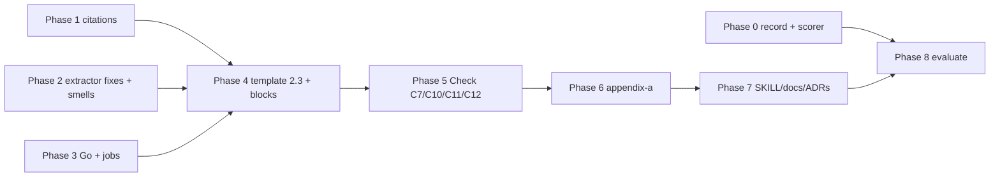

# AppDoc v2.3.0 Implementation Plan — content depth

**Date:** 2026-11-11
**Inputs:** `docs/p7-evaluation-2026-11-11.md`; `docs/comparison-2.2/{flaskr-tdd,spring-petclinic,eShop,gitea}.md`; the seeded-error audit transcript; the blind-regeneration runs (P7.2); `appdoc/{fill,check,citations,template_spec}.py`; `appdoc/stacks/{python_flask,java_spring,aspnet_core,node_express,generic}.py`; gitea `services/cron/tasks_*.go`.
**Baseline:** v2.2.0, 170 tests green, schema `appdoc-facts/3`, template 2.2.
**Status:** Proposed.

---

## 1. What P7 showed

v2.2 achieved its structural goal: every blind-regenerated document (5 of 5, including the held-out helpweb) passes C1–C11, and the independent audit caught 10 of 10 seeded false claims. It did not achieve content depth. Of 19 answer-key items, 2 were fully present (the comparison reports' verdicts, not the P7 report's grep). The four comparisons agree on why:

1. **Writers do not find what Facts do not point to.** Every missed answer-key item is a specific code property (a copy-pasted logger type, a flash attribute lost on a non-redirect return, an index on `LOWER(name)`, 30 cron registrations) that no Fact surfaced, so the writer never opened that line.
2. **Where a Fact exists but is wrong or raw, the document inherits it.** flaskr's 16.6 lists `USERNAME` as "defined at" a read site and omits `SECRET_KEY`; gitea's 16.6 is ~9,000 commented defaults; gitea's primary language is reported as "generic only" while its frontend is labeled a supported `node-express` Stack.
3. **Hand counts and hand enumerations still appear where no generated block covers them** ("five controllers" in §4 while §3.1 lists six).
4. **The audit was never run on the regenerated documents**, so the Evidence Register, Appendix A and anything derived from it are empty in every example.

The v2.2 principle holds: scripts own what can be counted or enumerated. v2.3 extends it from structure to **finding candidates**. The extractor surfaces high-precision code patterns as Facts, and the Check requires each one to be addressed. The writer's judgment still decides severity and wording.

The P7 process also had defects of its own (section 2, group P). These are fixed first so that v2.3 is measured correctly.

---

## 2. Findings register

Cause codes: **X** extractor, **K** Check, **T** template, **R** render/register, **W** writer guidance only (not enforceable), **P** process/evaluation.

| ID | Finding | Source | Cause | Phase |
|----|---------|--------|-------|-------|
| F1 | Go has no Stack; gitea reports `go` as "generic only, 1 file read" | gitea cmp | X | 3 |
| F2 | `node-express` detected on a frontend/tooling workspace with no Express server | gitea cmp | X | 2 |
| F3 | Scheduled tasks are not enumerated (gitea 30 cron tasks; no 7.12) | gitea cmp, answer key | X+T | 3, 4 |
| F4 | Flask config: reads recorded as "Defined at"; `SECRET_KEY` (module constant loaded by `from_object`) missing | flaskr cmp, audit M-1/M-2 | X | 2 |
| F5 | 16.6 is a raw dump (gitea ~9k rows, mostly commented defaults); no curation, no "N of M" | gitea cmp, eShop cmp | R (fill) | 4 |
| F6 | DDL index expressions not extracted (`LOWER(name)`); no DDL entity/column Facts for 8.4 | spring cmp | X | 2 |
| F7 | Finding candidates not surfaced: logger type mismatch (eShop Paid handler), flash lost on non-redirect (spring 7.1/7.2), distinct username/password errors (flaskr enumeration), `\|safe` filter, GET route that deletes, actuator `exposure.include=*` | all cmps, answer key | X+K | 2, 5 |
| F8 | UI surfaces missing: MVC views returned by Identity.API controllers; MAUI XAML pages | eShop cmp | X | 2 |
| F9 | Ownership files (`MAINTAINERS`, `CODEOWNERS`, `CONTRIBUTING.md`) not surfaced; §11 collapsed to one Unknown row | gitea, flaskr cmps | X+T | 2, 4 |
| F10 | Citation parser rejects extensionless files (`Procfile:1`, `Dockerfile`, `Makefile`, `MAINTAINERS`); writer downgraded a correct Cited claim to Inferred to pass C5 | P7.2 flaskr | K | 1 |
| F11 | Hand count contradicts Facts and the document ("five controllers" in §4, six in §3.1) | spring cmp | K+T | 4, 5 |
| F12 | 5.3 omits capability Areas from §4 (gitea projects, wiki, releases, token scopes) | gitea cmp | K | 5 |
| F13 | 5.3 has no Restriction note in some outputs | eShop cmp | T | 4 |
| F14 | Source-answerable open questions left open (eShop Q-15, Q-16, Q-17) | eShop cmp | K+R | 5 |
| F15 | No Verification Appendix (re-run commands) as in the standard's §18 | all cmps | R | 6 |
| F16 | Markdown deliverable has no Appendix A; register only appears in HTML | spring, eShop cmps | R | 6 |
| F17 | Entry points with Facts but never cited (Identity consent/device/grants; gitea route groups) are invisible to the writer and the Check | eShop, gitea cmps | K | 5 |
| F18 | Config not linked to findings (`default_batch_fetch_size=16` absent from V-12); actuator endpoints Unknown instead of an Inferred list; glossary misses finding terms (`safe`) | spring, flaskr cmps | W | 7 |
| F19 | P7 report contradicts the comparisons (F10/`REVERSE_PROXY_TRUSTED_PROXIES` scored YES, comparison says NO; "14 items" vs 16 listed; flaskr username PARTIAL vs NO) | review of P7 report | P | 0 |
| F20 | Answer-key scoring was a substring grep, which scores a key that appears only in 16.6 as present | P7.3b | P | 0 |
| F21 | Seeded-error test used 10 blatant fabrications, no clean control (no false-positive rate) and no register output | P7.4 | P | 8 |
| F22 | Audit never run on regenerated docs; examples not copied to `examples/`; no `--require-audit` run | P7 | P | 8 |
| F23 | helpweb (the like-for-like benchmark) was only Check-scored, never compared with the standard | P7.5 | P | 8 |
| F24 | Writer subagents returned "no response" after writing the file; retries started from scratch | P7.2 | P+W | 7, 8 |

Not adopted, with reason:
- **Move the Evidence Register to numbered §14** (flaskr, gitea cmps). ADR 0007 keeps the register as data and §14 as Open questions. F16 makes it visible in the Markdown instead.
- **Config values / Default column in 16.6** (eShop cmp). The extractor never records values (secret-shape detection is heuristic). Key effects go in a hand table checked by C10 (Phase 4).
- **Glossary coverage rule** (flaskr cmp). "Non-obvious term" is not machine-decidable; it becomes an audit checklist item (Phase 7).

---

## 3. Design decisions

| # | Decision | Choice |
|---|----------|--------|
| D1 | How to close "missed finding" gaps | New Fact kind `smell` (finding candidate). Check rule C12: every `smell` is cited in 10.1 or dismissed in the register. Each pattern ships only with a precision test on all four Targets plus helpweb. |
| D2 | Where enumerations live | Generated blocks: `entry-points` (§4 intro), `scheduled-jobs` (new §16.7), `appendix-a` (end of document). The writer never counts. |
| D3 | 16.6 curation | Generated block lists app-role keys that are not commented defaults. Secret-location keys come first, capped at 150, with a computed "N of M shown" line. Commented defaults are counted, not listed. |
| D4 | Prose counts | C7 checks `<N> <noun>` for a closed noun list against Facts totals in §§2–4. A subset is written as "N of M", which passes when M matches. |
| D5 | Uncited entry points | Advisory list in `check-report.md` in 2.3. `check --strict` fails on it. Decide whether to promote it to the default after the P8 measurement. |
| D6 | Register as single source for Appendix A | `fill` writes the `appendix-a` generated block from `evidence.jsonl`. `render` stops appending its own copy, so the HTML renders the block. |
| D7 | Schema/template versions | Schema `appdoc-facts/4` (new kinds `smell`, `schema_object`, `owner_file`, `ui_page`, `entry_point type=job` fields). Template `2.3` (16.7, 5.3 spec, 11 required rows, new generated blocks). 2.2 docs get one "upgrade" problem, as in 2.2. |

ADRs: **0008** finding candidates (`smell`) and C12; **0009** curated generated config reference and the no-values rule.

---

## 4. Phases

Each phase ends with `python -m unittest discover -s tests -q` and `python tests/check_stdlib_only.py` green. Tests are written first (red), then the code.

### Phase 0 — Correct the record (F19, F20)

1. Fix `docs/p7-evaluation-2026-11-11.md` §4 using the per-item verdicts in `docs/comparison-2.2/*.md`: 19 items, 2 Yes (spring tests, eShop F-18), 4 Partial (flaskr 7.3 client behavior, eShop Identity/MAUI, gitea 5.3, gitea 16.5), 12 No, 1 N/A (eShop E-17). Remove the "14 items" line and the YES for gitea F10. Add a note that the earlier figures came from a substring grep.
2. Add `eval/answer-keys/{flaskr-tdd,spring-petclinic,eShop,gitea}.json`, one object per item:
   ```json
   {"id": "SP-3", "section": "8.2", "alt_sections": ["10.1"],
    "must_cite": "src/main/resources/db/postgres/schema.sql:45",
    "must_contain": ["LOWER(name)"], "note": "Postgres index is case-insensitive via LOWER()"}
   ```
3. Add `eval/score.py` (stdlib, outside the `appdoc` package; not installed with the skill). It uses `appdoc.docmodel.headings` to slice sections. An item is **Present** when a Citation covering `must_cite` and every `must_contain` term occur in the same section block, **Partial** when only one does, and **Absent** otherwise. It prints a table and writes `eval/results/<date>-<repo>.json`.
4. Re-score the 2.2 outputs with `eval/score.py` to set the v2.3 baseline.

Acceptance: the scorer reports gitea F10 as Partial at most (the key appears only in 16.6), and the corrected P7 report matches the scorer.

### Phase 1 — Citation parser (F10)

- `citations.py`: add `KNOWN_BARE_FILES = {"Procfile", "Dockerfile", "Containerfile", "Makefile", "Jenkinsfile", "Vagrantfile", "Gemfile", "Rakefile", "CODEOWNERS", "MAINTAINERS", "OWNERS", "LICENSE", "NOTICE", "AUTHORS"}`. `_looks_like_path` accepts these names and `Dockerfile.*` / `*.Dockerfile`.
- Tests: `Procfile:1`, `docker/Dockerfile.rootless:3` and `MAINTAINERS` parse. `` `Makefile` `` in prose resolves. `` `License` `` (wrong case) does not parse.
- SKILL.md: "Never downgrade a correct Cited claim to satisfy the Check. If a valid Citation does not parse, report it."

### Phase 2 — Extractor fixes for existing Stacks (F2, F4, F6, F7 partial, F8, F9)

| Change | File | Detail |
|---|---|---|
| node-express detection | `stacks/node_express.py` `detect()` | Detect only when a non-test source file matches `express(` / `Router(` **and** `express` is a dependency in a `package.json`. Otherwise the folder stays generic. Fixture: a Vite/pnpm workspace with Playwright tests is not detected. |
| Flask config definitions | `stacks/python_flask.py` `_config()` | When a module calls `app.config.from_object(__name__)` or `from_object("pkg.mod")` (resolved within the Target), record module-level `UPPER_CASE = ...` assignments as `config_key` with `use="define"`. `app.config["X"] = ...` and `app.config.update(X=...)` are also `define`. Existing reads get `use="read"`. `secret_location=True` for names matching the secrets name list (`SECRET_KEY`, `PASSWORD`, …). |
| Generic `use` field | `stacks/generic.py`, `java_spring.py`, `aspnet_core.py` | Config-file keys are `use="define"`; code reads are `use="read"`. |
| DDL objects | `stacks/generic.py` new `_ddl()` for `.sql` | `CREATE TABLE t (...)` → `schema_object` `type=table` with `columns=[{name,type,null,pk}]`. `CREATE [UNIQUE] INDEX n ON t (expr)` → `type=index`, `unique`, `expression` (raw column list, ≤120 chars). `ALTER TABLE ... ADD CONSTRAINT ... FOREIGN KEY` → `type=fk`. Dialect from the path (`db/postgres/`, `mysql`, `h2`). Not a full parser; tests on spring-petclinic's three schema files and on eShop/gitea (which have none, so no false Facts). |
| MVC views | `stacks/aspnet_core.py` | Controller actions returning `View(...)` → `entry_point type=page`, with `view` = resolved `Views/<Controller>/<Action>.cshtml` when the file exists. |
| XAML pages | `stacks/aspnet_core.py` (or new `stacks/maui.py` if detection differs) | `*.xaml` with root `ContentPage`/`Shell` → `ui_page` with `x:Class`. `Shell` `Route="..."` → `ui_page.route`. |
| Ownership files | `stacks/generic.py` | `CODEOWNERS`, `.github/CODEOWNERS`, `MAINTAINERS`, `OWNERS`, `CONTRIBUTING.md` → `owner_file` with `entries` (non-comment line count). No names or emails recorded (personal data). |
| Summary | `summary.py` | New sections: "Schema objects", "UI pages", "Ownership files", "Finding candidates" (count by pattern). |

Bump `SCHEMA = "appdoc-facts/4"`. Update `ci/appdoc-docs-gate.yml` upgrade detection for `/4`.

### Phase 3 — Go Stack and scheduled jobs (F1, F3)

New `stacks/go.py`, regex based and comment-aware, like the other Stacks:

| Fact | Patterns |
|---|---|
| detect | `go.mod` at any depth plus `*.go` files outside `vendor/` |
| `entry_point type=route` | `net/http` `HandleFunc("path"`; chi/gin/echo/gorilla `r.Get("p"`, `.GET("p"`, `.HandleFunc("p"`. Gitea-style `m.Get("p"`, `m.Post`, `m.Group("p"`, `m.Combo("p")`, with group prefixes tracked by brace depth. `handler` = last function argument identifier. |
| `entry_point type=command` | urfave/cli `&cli.Command{ Name: "x"`, cobra `&cobra.Command{ Use: "x"` |
| `entry_point type=job` | `RegisterTask*("name", &...{ ... Schedule: "@every 72h", Enabled: true ...})` (scan the literal up to its matching brace); robfig/cron `AddFunc("spec",`; `time.NewTicker(` in a function named `*Loop`/`run*` is **not** recorded (too noisy). Fields: `schedule`, `enabled` (literal or null), `handler`. |
| `config_key use=read` | `setting.Cfg.Section("s").Key("K")`, `sec.Key("K")`, `os.Getenv("K")`, viper `GetString("k")` |
| `data_access` | xorm `x.Table(`/`db.GetEngine(ctx).` + method, `database/sql` `Query(`/`Exec(` with a literal SQL string |
| `outbound_call` | `http.NewRequest(`, `http.Get(`, `http.Post(`, `(*http.Client).Do` via `.Do(req)` with an `http.Client` in scope (best effort) |
| `auth_check` | middleware identifiers in route registrations matching `req(SignIn|Token|Admin|RepoAdmin|.*Access)`, `RequireAuth`, `jwt`, `basicAuth` |

Scheduled jobs across Stacks share `entry_point type=job` with `schedule` and `enabled`. Gaps to close for consistency:
- `java_spring.py`: already emits `@Scheduled`; add `cron`/`fixedRate` literal as `schedule`.
- `aspnet_core.py`: classes deriving `BackgroundService` or `IHostedService` → `job` (`schedule=null`); Hangfire `RecurringJob.AddOrUpdate("id", ..., "cron")`.
- `node_express.py`: `cron.schedule("spec",` (node-cron), `new CronJob("spec",`.
- `python_flask.py`: APScheduler `add_job(..., trigger="cron"|"interval")`, Celery `beat_schedule` keys.

Acceptance on gitea: route Facts for `routers/web/web.go` and `routers/api/v1/api.go`; **31** `job` Facts whose names match the `RegisterTask*` literals in `services/cron/tasks_*.go` (P7 counted 31 `register*(` calls; the "30 tasks" in the answer key gets re-verified against source and the key fixed if needed); `go` reported as supported in the 2.1 block. Extract time on gitea stays under 2× the 2.2 time (107 s).

### Phase 4 — Template 2.3 and generated blocks (F3, F5, F9, F11, F13, F16 partial)

Template (`assets/template.md`) and `template_spec.py`:
- Stamp `<!-- appdoc:template 2.3 -->`; `UPGRADE_NOTES` for 2.2 → 2.3.
- **§4 intro:** generated block `entry-points`. It lists one row per handler class/file from `entry_point` Facts (non-test): `Handler | Kind | Routes | Defined at`, a total line ("N route handlers in M files; K pages; J commands"), capped at 100 rows with "N of M shown".
- **§5.3:** add to `TABLES` as an open table whose first column is `Capability` (role columns are free). Add a fixed line below the table that is template text, not a guide comment: `**Restriction:** do not infer a permission from a visible control or a granted scope; enforcement is the code cited in 5.2.` C9 checks the line is present.
- **§11:** `required_rows=("Business owner", "Technical owner", "Process owner", "Data and integration owners", "Documentation owner", "Release and change process")`. Test-suite rows stay allowed below them.
- **New §16.7 Scheduled and background jobs:** generated block `scheduled-jobs` with `Job | Schedule | Enabled by default | Defined at | Stack`. No cap; this is the list the answer key asks for. When there are no `job` Facts, it says "No scheduled or background jobs were extracted" (C4 still requires §14 if the writer believes jobs exist).
- **§16.6:** generated block per D3. Below it, an optional hand table `Key | Effect | Evidence`. C10 checks every Key cell names a `config_key` Fact.
- **End of document:** generated block `appendix-a` (Phase 6).
- `REQUIRED_SUBSECTIONS` gains `16.7`. `GENERATED` gains `4: entry-points`, `16.7: scheduled-jobs`, `appendix: appendix-a`.

`fill.py`: add `_entry_points`, `_scheduled_jobs`, `_appendix_a`. Rewrite `_config_reference`:
```
keys = app-role, non-test, use=define (fallback: first read when a key has no define), commented excluded
order: secret_location desc, path, line
cap 150; trailer: "Shown N of M application keys; K commented defaults in <files> are not listed (see facts.json)."
```
Tests: flaskr fixture lists `SECRET_KEY` at `project/app.py:25` (define), `USERNAME` at `:23`, not `:80`. A gitea-like INI fixture with 500 commented keys lists 0 of them and reports the count. Each block is idempotent.

### Phase 5 — Check rules (F7, F11, F12, F14, F17)

| Rule | Change |
|---|---|
| **C7** prose counts | In §§2–4, match `\b(\d+|one|two|…|twenty)\s+(controllers|route handlers|routes|endpoints|scheduled jobs|cron tasks|background jobs)\b` that is not followed by `of \d+`. Compare with the Facts total for that noun (controllers/route handlers = distinct `handler` classes or files of `type=route`; routes/endpoints = `type=route` count; jobs = `type=job` count). Fail on mismatch only when the Target has Facts for that noun. "N of M" passes when M equals the total. |
| **C10** 5.3 coverage | Every distinct `Area` value in the §4 table appears (case-insensitive) in a 5.3 `Capability` cell, or every F-ID of that Area is mentioned in 5.3. |
| **C10** 16.6 effect table | Each `Key` cell matches a `config_key` Fact name. |
| **C11** answerable questions | New register result value `Answerable` for `ref: "14/Q-n"`. A row with `Answerable` fails C11 ("Q-n can be closed from source: <cites>; close it and remove the question"). The audit procedure (SKILL) gets a step to classify every §14 question as `Needs owner` or `Answerable`. Only Q-IDs that are still in §14 are checked, so closing a question clears the problem. |
| **C12 (new) Finding candidates addressed** | Every `smell` Fact (non-test) is (a) cited in a §10.1 row by `path:line` or a range that covers its line, or (b) has a register row `{"ref": "smell/<fact-id>", "result": "Dismissed", "limitation": "<why>"}`. `<fact-id>` is a stable `sha1(kind,pattern,path,line)[:8]`, printed by `facts-summary.md` and `check-report.md`. Capped at `RULE_CAP`. Missing register file → candidates are listed as unaddressed. |
| **Advisory** uncited entry points (D5) | `check-report.md` section "Entry points not cited": `entry_point` Facts (route/page/command/job, non-test) whose file is not cited anywhere in the document, grouped by folder with counts. `check --strict` fails on any. |

`RULE_TITLES["C12"] = "Finding candidates addressed"`. Update the `fired()` test helper, SKILL "What the Check enforces", README Check table, and CONTEXT (**Finding candidate**, **Answerable**, **Dismissed**).

#### Finding-candidate patterns (Phase 2 extractor, enforced by C12)

Each pattern needs a positive test, a negative test, and a precision run on the five Targets. Anything that fires more than 20 times on one Target without a true positive is dropped before release.

| Pattern id | Stack | Detects | Expected hit |
|---|---|---|---|
| `logger-type-mismatch` | aspnet_core | `ILogger<T>` constructor parameter or field in class `C` where `T` is a different class in the same project | eShop `OrderStatusChangedToPaidIntegrationEventHandler` |
| `flash-without-redirect` | java_spring | method calls `addFlashAttribute(` and has a `return "<view>"` that does not start with `redirect:` | spring `OwnerController.java:79-82`, `:155-158` |
| `distinct-auth-errors` | python_flask, node_express, aspnet_core, java_spring, classic_asp | one function holds two message literals matching `/invalid\s+(user(name)?\|login)/i` and `/invalid\s+password/i` (or "user not found" and "wrong password") | flaskr `app.py:80-83` |
| `unescaped-template-output` | python_flask (Jinja `\|safe`, `Markup(`), aspnet_core (`Html.Raw(`), node (`<%-`), java (`th:utext`) | output encoding bypass | flaskr `index.html:74`, `search.html:55` |
| `state-change-on-get` | all route Stacks | a `type=route` with method GET whose handler body (same file, up to the next route) contains a delete/insert/update data access | flaskr `/delete/<id>` |
| `actuator-exposed` | java_spring (properties/yaml) | `management.endpoints.web.exposure.include` = `*` | spring `application.properties` |
| `hardcoded-credential-constant` | python_flask, generic | module constant named `*PASSWORD*`/`*SECRET*`/`*TOKEN*` assigned a string literal (value never recorded) | flaskr `app.py:24-25` |

### Phase 6 — Register rendering (F15, F16)

- `register.py`: `appendix_markdown(reg, facts) -> str` produces Appendix A as Markdown. It has the computed counts, per-section coverage, and the row table (`ID | Ref | Claim | Result | Cites | Limitation`). `fill` writes it into the `appendix-a` block. Before the audit it renders the "audit not performed" banner text.
- **Appendix B — Verification commands**, also in the `appendix-a` block. For each Supported/Corrected row it emits:
  - PowerShell: `Select-String -Path '<path>' -SimpleMatch -Pattern '<anchor>'`
  - POSIX: `grep -nF -- '<anchor>' '<path>'`
  Single quotes are escaped (`''` for PowerShell, `'\''` for sh). Anchors containing a newline or longer than 200 chars are rejected by C11. Because C11 already proves each anchor is in its cited lines, every emitted command is guaranteed to hit, which removes the E-17 class of broken re-run commands.
- `render/page.py`: remove `_with_appendix()` register injection. The HTML renders the block from the Markdown. Keep the banner styling by giving the block's banner line a class via the existing callout syntax.
- Tests: appendix block equality under C7; quoting of an anchor containing `'`, `(`, `$`; `fill` before and after the audit; HTML contains the appendix exactly once.

### Phase 7 — SKILL.md and writer guidance (F18, F24, plus the guidance parts of F3, F7, F9)

Add to Writing rules (short, one line each):
- Finding candidates: "Every `smell` in the Facts summary becomes a 10.1 finding, or the auditor dismisses it with a reason. Do not dismiss your own."
- Config ↔ findings: "When a config key changes the impact of a finding, name it and cite it in that finding's Impact cell."
- Framework defaults: "When config exposes a framework's known set (actuator `*`, Swagger UI, debug toolbars), list the set as **Inferred** from the framework version in the dependency manifest. Do not mark it Unknown."
- Ownership: "Read every `owner_file` before writing §11. Never copy personal email addresses."
- Resume: "If `application-documentation.md` already exists, run `check` first and continue from its problems. Do not start over."
- Large Targets: part agents also own the `entry-points` rows of their subsystem. The merger confirms every handler file is cited or listed as not reviewed in 2.1.

Audit section additions:
- Classify each §14 question as `Needs owner` or `Answerable` (register rows `14/Q-n`).
- Review each undismissed `smell` and either confirm it as a finding (the writer adds it) or record `Dismissed` with a reason.
- Glossary check: every identifier in a 10.1 Finding cell that is not a common word has a §13 row. This is the auditor's judgment; the Check does not enforce it (stated in ADR 0008).

Update CONTEXT.md, README (commands, Check table C1–C12, `--strict`), CHANGELOG 2.3.0 with upgrade notes, `docs/docs-as-code.md`, the CI gate (`ref: v2.3.0`, schema `/4`, add `--require-audit`), and ADRs 0008 and 0009.

### Phase 8 — Evaluate (F21, F22, F23, F24)

1. Install with hash verify. Re-extract all five Targets (gitea, helpweb timed).
2. **Extractor acceptance**, scripted in `eval/extractor_checks.py`:
   - gitea: `go` supported; ≥1 route Fact in `routers/web/web.go`; job count equals the `RegisterTask*` literal count; `node-express` not detected (or detected only where Express is real).
   - flaskr: `SECRET_KEY` define at `project/app.py:25`; smells `distinct-auth-errors`, `unescaped-template-output` ×2, `state-change-on-get`, `hardcoded-credential-constant`.
   - spring: `schema_object type=index expression` contains `LOWER(name)`; smells `flash-without-redirect` ×2, `actuator-exposed`; controllers = 6.
   - eShop: smell `logger-type-mismatch` on the Paid handler; `type=page` Facts for Identity.API views; `ui_page` Facts under `src/ClientApp/`.
   - Precision table: smell count per pattern per Target, with every hit labeled true or false by hand. Patterns below 80% precision are cut before release.
3. **Blind regeneration**: writer gets the skill only. Harness rule (F24): on "no response", inspect the output file and resume with `check`; never restart from the template. Record per Target: iterations, problems per rule, wall time.
4. **Independent audit** on all five (fresh agent per Target, no writer notes) producing `evidence.jsonl`. Then `fill`, then `check --require-audit` must PASS.
5. **Seeded-error test v2** on spring-petclinic (mid-size, more room for subtle errors), with a clean control:
   - Control: audit the clean document first and record findings as the false-positive baseline.
   - 20 seeds, 4 per class: fabricated feature; inverted condition (e.g. "removed only when status is 0"); wrong line (claim true but cites an adjacent unrelated span); wrong count (e.g. "12 of 17 routes" when 13); misattribution (step attributed to the wrong CI job or service).
   - Score catch rate per class from the register (`Corrected`/`Downgraded` rows whose ref matches the seed). Score false positives against the control. Target: ≥ 90% overall and ≥ 75% in every class.
6. **Answer key**: `eval/score.py` on all four public Targets. Target: ≥ 13 of the 18 scorable items Present and no item Absent that has a backing Fact (smell, job, schema_object) after Phases 2–3.
7. **helpweb vs the standard** (like-for-like, private): comparison report at `docs/comparison-2.3/helpweb.md` (not committed to public examples), same format as the other four. Also compare its §10 and §8 inventories item by item against the standard's.
8. Four public comparison reports in `docs/comparison-2.3/`, then copy the four public outputs to `examples/<repo>/`.
9. Write `docs/p8-evaluation-<date>.md`. Every number comes from `eval/` output files, not from memory.

---

## 5. Test plan summary

| Area | New tests (approx.) | File |
|---|---|---|
| Citation bare names | 5 | `tests/test_citations.py` |
| node-express detection, Flask config define/read, DDL, MVC views, XAML, owner files | 18 | `tests/test_facts_*.py`, `tests/test_core.py` |
| Go Stack (routes with groups, commands, jobs, config reads, data access) | 12 | `tests/test_facts_go.py` + `tests/samples/go/` (small chi app + gitea-style router and cron files, written for the test, not copied) |
| Jobs in other Stacks | 6 | existing `test_facts_*` |
| Smell patterns (positive + negative each) | 14 | `tests/test_smells.py` |
| Generated blocks (entry-points, scheduled-jobs, curated config, appendix-a) | 10 | `tests/test_fill.py` (new; move fill tests out of `test_check.py`) |
| Check: C7 counts, C10 5.3/16.6, C11 Answerable, C12, `--strict` advisory, 2.2 upgrade problem | 16 | `tests/test_check.py` |
| Render: appendix single copy, quoting | 4 | `tests/test_render.py` |
| Fixtures | freeze 2.2 outputs for flaskr and spring under `tests/fixtures/docs-2.2/` (must fail C12/C7 when restamped 2.3) | |

---

## 6. Traceability

| Finding | Phase | Enforced by |
|---|---|---|
| F1 Go Stack | 3 | extractor acceptance (P8.2); scan-coverage block |
| F2 node-express | 2 | detection test |
| F3 cron/jobs | 3, 4 | `scheduled-jobs` generated block equality (C7) |
| F4 Flask config | 2, 4 | config-reference block equality (C7) |
| F5 16.6 dump | 4 | block equality; cap + computed N of M |
| F6 DDL | 2 | C12 does not cover it; 8.4 guidance + answer key SP-3 |
| F7 finding candidates | 2, 5 | **C12** |
| F8 UI surfaces | 2, 5 | advisory uncited entry points; `--strict` |
| F9 ownership | 2, 4 | C9 required §11 rows |
| F10 bare names | 1 | citation tests |
| F11 counts | 4, 5 | `entry-points` block; C7 prose counts |
| F12 5.3 coverage | 5 | C10 |
| F13 Restriction | 4 | C9 fixed line |
| F14 answerable Qs | 5, 7 | C11 `Answerable` |
| F15 re-run commands | 6 | generated from register, anchors proven by C11 |
| F16 Appendix A in md | 6 | `appendix-a` block equality (C7) |
| F17 uncited entry points | 5 | advisory; `--strict` |
| F18 config↔finding, actuator, glossary | 7 | not enforced; audit checklist |
| F19 P7 report | 0 | `eval/score.py` output |
| F20 scoring | 0 | `eval/score.py` |
| F21 seeded test | 8 | v2 protocol with control |
| F22 audit not run | 8 | `check --require-audit` |
| F23 helpweb compare | 8 | private report |
| F24 writer resume | 7, 8 | SKILL rule; harness rule |

---

## 7. Order and dependencies



Phases 0–3 are independent and can run in parallel. Phase 3 (Go) is the largest single item. If it slips, ship 2.3 with Phases 0–2 and 4–8, keep `go` generic, and ship the gitea `scheduled-jobs` block from a narrow `RegisterTask*` matcher in `generic.py` (marked as a stopgap in the CHANGELOG).

## 8. Open decisions for the owner

| # | Question | Recommendation |
|---|---|---|
| 1 | Make uncited entry points a failure by default (D5)? | No for 2.3. Measure the count in P8 first. |
| 2 | Is C12 allowed to fail documents for Targets in Stacks with no smell patterns? | It cannot fire there (no Facts). State this in the 2.1 block: "Finding candidates: none extracted for <stack>". |
| 3 | Keep helpweb outputs private? | Yes (rev2 decision 6). Only aggregate numbers go in public reports. |
| 4 | Schema `/4` now, or batch with the performance plan? | Now. Smell and job Facts are needed by Phases 4–5. |
