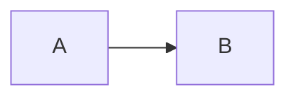

# Demo Documentation
<!-- appdoc:template 2.7 -->
<!-- a comment `nope/missing.py:99` -->

## 1. Application Index

| Support need | Primary screen or file | Workflow |
|---|---|---|
| Service does not start | `app/main.py:2` | [7.1 Start the service](#71-start-the-service) |

## 2. Coverage and Overview

The Target is a small Python service in `app/main.py:1`. Stack: python-flask, classic-asp (unsupported, not extracted).

### 2.1 What was inspected

<!-- appdoc:generated scan-coverage -->
<!-- /appdoc:generated scan-coverage -->

## 3. Architecture

- The entry module wires the handlers in `app/main.py:3-5`.

## 4. Functional Inventory

<!-- appdoc:generated entry-points -->
<!-- /appdoc:generated entry-points -->

| ID | Area | Feature | Entry point | Inputs, outputs and rules | Dependencies | Status |
|---|---|---|---|---|---|---|
| F-1 | Service | Run | `app/main.py:2` | The `run` entry point lives in `app/main.py:2` and starts the service. | C-1 | Cited |

### 4.1 Subsystem inventory

| Subsystem | Files | Features | Primary data and dependencies | Purpose | Status |
|---|---|---|---|---|---|
| `app/` | 1 | F-1 | C-1 | Holds the service code in `app/main.py:1` | Cited |

## 5. Roles and Access Model

### 5.1 Observed role concepts

- An admin role is named at `app/main.py:4`.

### 5.2 Authorization enforcement

- The admin check is made at `app/main.py:4`.

### 5.3 Role-to-capability matrix

| Capability | admin |
|---|---|
| Service: change settings, see `app/main.py:4` | Y |

**Restriction:** do not infer a permission from a visible control or a granted scope; enforcement is the code cited in 5.2.

## 6. UI Catalog

- The landing page is rendered by `main.py:5` for visitors.

| ID | Page | Route or entry | Reached from | Visible controls and data | States and effects | Roles and evidence |
|---|---|---|---|---|---|---|
| UI-1 | Landing | / | direct | Welcome text | Static | everyone, `app/main.py:5` |

## 7. Workflows

### 7.1 Start the service
1. Operators launch the entry point in `app/main.py:2` and wait.
2. Failure and escalation: restart once, as `app/main.py:2` exits on error.

## 8. Data and Integrations

### 8.1 Connections

| ID | Name | Kind | Configured at | Used by |
|---|---|---|---|---|
| C-1 | db | database | `app/main.py:6`, value omitted | F-1 |

### 8.2 Stored procedures and SQL

- No SQL is used; the ORM call is at `app/main.py:7`.

### 8.3 External calls

| ID | Call | Direction | Caller | Notes |
|---|---|---|---|---|
| X-1 | Health ping | Outbound | `app/main.py:8` | none |

### 8.4 Data entities and sensitivity

| Entity | Key fields | Defined at | Sensitivity |
|---|---|---|---|
| Post | id | `app/main.py:9` | public |

### 8.5 Failure, fallback and observability

| ID | Timeout and retry | On failure | Observability |
|---|---|---|---|
| C-1 | none, see `app/main.py:6` | startup fails | none |
| X-1 | none, see `app/main.py:8` | logged | none |

## 9. Troubleshooting Matrix

| Symptom | Checks | Known response | Escalate when |
|---|---|---|---|
| Service will not start | Look at `app/main.py:2` | Restart the process | Twice in a row |

## 10. Security and Operational Risks

### 10.1 Verified findings

| ID | Severity | Finding | Evidence | Impact |
|---|---|---|---|---|
| V-1 | High | A password is set in code | `app/main.py:6`; value omitted. | Credential exposure |

### 10.2 Unknowns that must not be treated as controls

| Control | Status | Where looked |
|---|---|---|
| TLS | Not established | `app/main.py:7` |

## 11. Ownership and Maintenance

| Area | Evidence | Status |
|---|---|---|
| Business owner | `appdoc-context.md:1` | Cited |
| Technical owner | not in the repository | Unknown |
| Process owner | not in the repository | Unknown |
| Data and integration owners | not in the repository | Unknown |
| Documentation owner | not in the repository | Unknown |
| Release and change process | not in the repository | Unknown |
| Test suite | none | Unknown |

## 12. Architecture and Data-Flow Diagrams

## 13. Glossary

| Term | Meaning | Citation |
|---|---|---|
| Handler | a function | `app/main.py:3` |

## 14. Open Questions and Documentation Gaps

| ID | Question | Why it matters | How to close | Owner | Priority |
|---|---|---|---|---|---|
| Q-1 | Unknown: who deploys the service | Releases | Ask the team | Unknown | Medium |

<!-- appdoc:generated closed-questions -->
<!-- /appdoc:generated closed-questions -->

## 15. Recommendations

| ID | Severity | Effort | Recommendation | Addresses |
|---|---|---|---|---|
| R-1 | High | S | Move the password out of `app/main.py:6` and enforce TLS | V-1, TLS |

### 15.1 Coverage summary

- Sections 3 to 10 were audited against `app/main.py:1`.

## 16. Operations Runbook

### 16.1 Platform requirements

- Python, see `app/main.py:1`.

### 16.2 Data stores

- The database configured at `app/main.py:6`.

### 16.3 Session and authentication behavior

- No sessions; see `app/main.py:4`.

### 16.4 Known failure modes and operator responses

| Failure mode | Signal | Operator response |
|---|---|---|
| Crash | exit | restart, `app/main.py:2` |

### 16.5 Deployment and change process

| Step | Procedure | Evidence |
|---|---|---|
| Build | Unknown | not in the repository |
| Test | Unknown | not in the repository |
| Deploy | Unknown | not in the repository |
| Upgrade | Unknown | not in the repository |
| Rollback | Unknown | not in the repository |
| Backup | Unknown | not in the repository |
| Restore | Unknown | not in the repository |
| Secret rotation | Unknown | not in the repository |

### 16.6 Configuration reference

<!-- appdoc:generated config-reference -->
<!-- /appdoc:generated config-reference -->

### 16.7 Scheduled and background jobs

<!-- appdoc:generated scheduled-jobs -->
<!-- /appdoc:generated scheduled-jobs -->

## 17. Build, Run and Test Locally

| Step | Command | Working directory | Evidence |
|---|---|---|---|
| Prerequisites | Unknown - see Open questions. | . | not in the repository |
| Restore dependencies | Unknown - see Open questions. | . | not in the repository |
| Build | Unknown - see Open questions. | . | not in the repository |
| Run | Unknown - see Open questions. | . | not in the repository |
| Test | Unknown - see Open questions. | . | not in the repository |

## Appendix A. Evidence Register and Verification

<!-- appdoc:generated appendix-a -->
<!-- /appdoc:generated appendix-a -->
