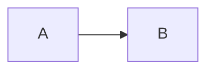

# Demo Documentation

**Target:** demo | **Commit:** none | **Evidence date:** 2026-01-10

**How to read this document.** *Cited* claims carry a path-and-line Citation. **Inferred:** marks reasoning from cited evidence. *Unknown* items are listed in section 14.

## 1. Application Index

| Section | Contents |
|---|---|
| 2 | Coverage and overview |
| 7 | Workflows |

## 2. Coverage and Overview

The Target is a small Python service in `app/main.py:1`.

### 2.1 What was inspected

Only `app/main.py` was read; the runtime was not.

## 3. Architecture

- The entry module wires the handlers in `app/main.py:3-5`.

## 4. Functional Inventory

| ID | Feature | Entry point | Inputs, outputs and rules | Dependencies | Status |
|---|---|---|---|---|---|
| F1 | Run | `app/main.py:2` | The `run` entry point starts the service (`app/main.py:2`). | C1 | Cited |

### 4.1 Subsystem inventory

| Subsystem | Files | Primary data and dependencies | Purpose | Status |
|---|---|---|---|---|
| `app/` | 1 | database | Holds the service code in `app/main.py:1` | Cited |

## 5. Roles and Access Model

### 5.1 Observed role concepts

- An admin role is named at `app/main.py:4`.

### 5.2 Authorization enforcement

- The admin check is made at `app/main.py:4`.

### 5.3 Role-to-capability matrix

| Capability | Admin | Visitor |
|---|---|---|
| Change settings, see `app/main.py:4` | Y | |

## 6. UI Catalog

| Page | Route | Visible controls and data | States and effects | Roles and evidence |
|---|---|---|---|---|
| Landing | `/` | Welcome text | Static | everyone, `app/main.py:5` |

## 7. Workflows

### 7.1 Start the service

1. Operators launch the entry point in `app/main.py:2`.
2. Failure and escalation: restart once, as `app/main.py:2` exits on error.

## 8. Data and Integrations

### 8.1 Connections

| Name | Kind | Configured at | Used by |
|---|---|---|---|
| db | database | `app/main.py:6`, value omitted | F1 |

### 8.2 Stored procedures and SQL

- No SQL is used; the ORM call is at `app/main.py:7`.

### 8.3 External calls

| ID | Call | Direction | Caller | Notes |
|---|---|---|---|---|
| X-1 | Health ping | Outbound | `app/main.py:8` | none |

### 8.4 Data entities and sensitivity

| Entity | Key fields | Defined at | Sensitivity |
|---|---|---|---|
| Post | id | `app/main.py:9` | public |

### 8.5 Failure, fallback and observability

- The database: no retry, startup fails (`app/main.py:6`).
- The health ping: logged, no retry (`app/main.py:8`).

## 9. Troubleshooting Matrix

| Symptom | Checks | Known response | Escalate when |
|---|---|---|---|
| Service will not start | Look at `app/main.py:2` | Restart the process | Twice in a row |

## 10. Security and Operational Risks

### 10.1 Verified findings

| ID | Finding | Evidence | Impact |
|---|---|---|---|
| V1 | A password is set in code | `app/main.py:6`; value omitted. | Credential exposure |

### 10.2 Unknowns that must not be treated as controls

| Control | What the source shows | Where looked |
|---|---|---|
| TLS | not shown | `app/main.py:7` |

## 11. Ownership and Maintenance

| Area | Evidence | Status |
|---|---|---|
| Business owner | `appdoc-context.md:1` | Cited |
| Technical owner | not in the repository | Unknown |

## 12. Architecture and Data-Flow Diagrams

## 13. Glossary

| Term | Meaning | Citation |
|---|---|---|
| Handler | a function | `app/main.py:3` |

## 14. Open Questions and Documentation Gaps

- Who deploys the service? Unknown.
- Is TLS terminated in front of it? Unknown.

## 15. Recommendations

| ID | Severity | Effort | Recommendation | Addresses |
|---|---|---|---|---|
| R-1 | High | S | Move the password out of `app/main.py:6` | V1 |

### 15.1 Coverage summary

- Sections 3 to 10 were read against `app/main.py:1`.

## 16. Operations Runbook

### 16.1 Platform requirements

- Python, see `app/main.py:1`.

### 16.2 Data stores

- The database configured at `app/main.py:6`.

### 16.3 Session and authentication behavior

- No sessions; see `app/main.py:4`.

### 16.4 Known failure modes and operator responses

| Failure mode | Signal | Operator response |
|---|---|---|
| Crash | exit | restart, `app/main.py:2` |

### 16.5 Deployment and change process

- Build and deploy steps are not in the repository. Unknown.
