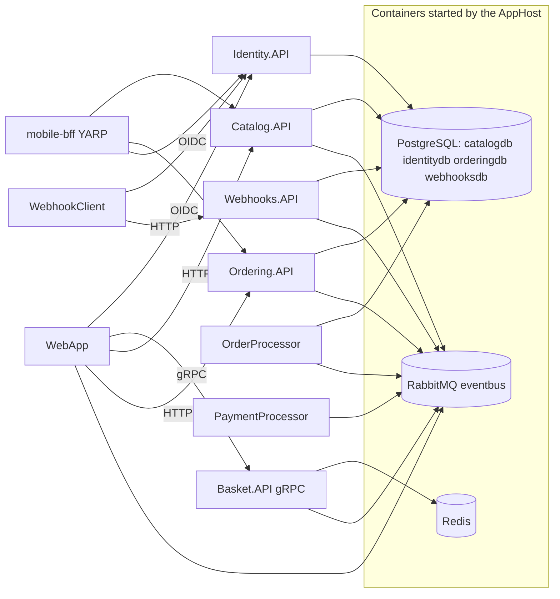
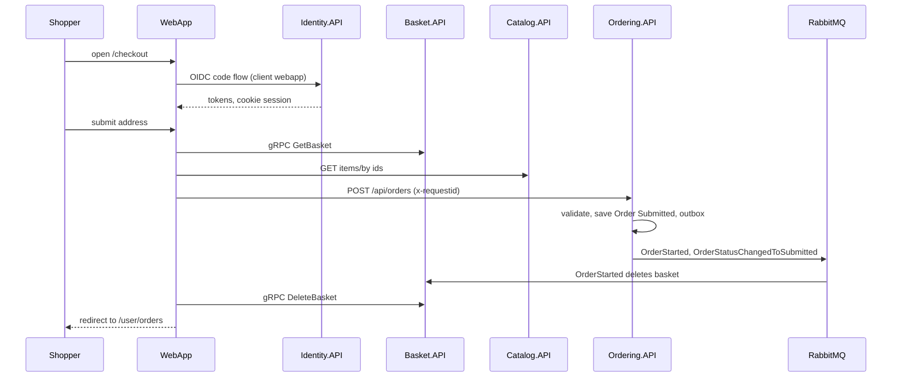
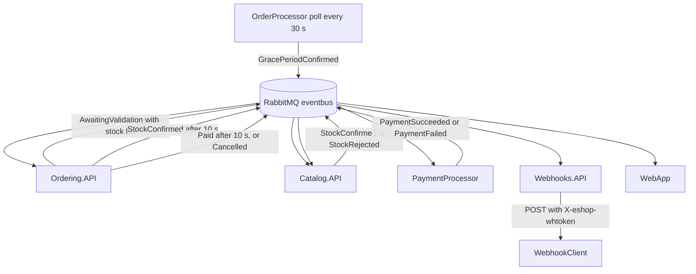
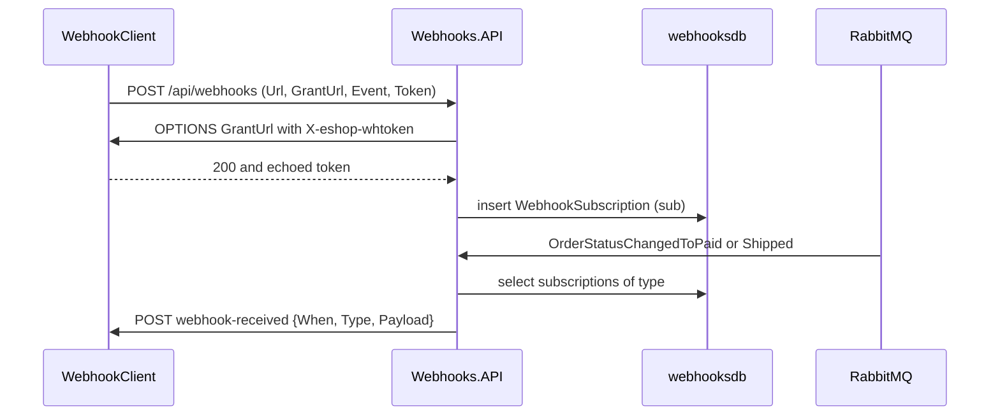
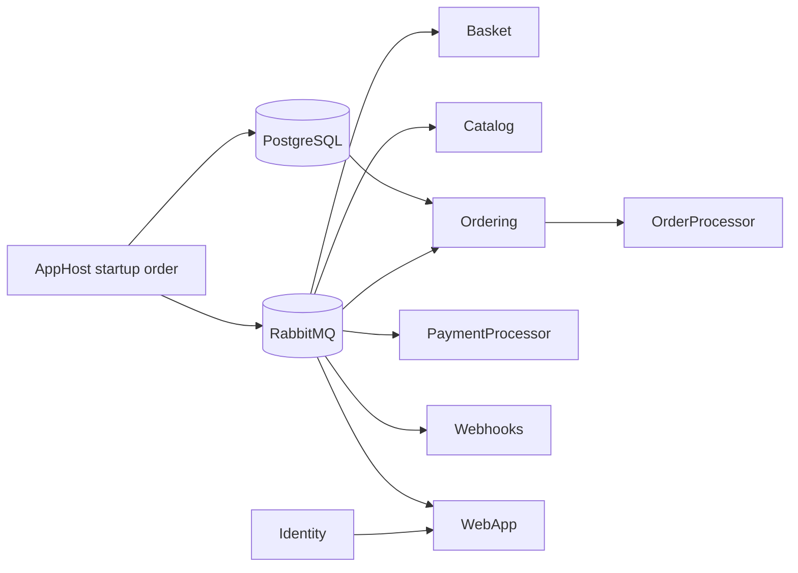

# eShop Documentation
<!-- Replace the title placeholder. Copy this file to docs/appdoc/application-documentation.md and fill every section.
CONVENTIONS (render strips all HTML comments):
- Citation = backticked Target-relative path with optional line or range: `portal/verify.asp:6`, `src/App.java:40-52`. Owner context is cited as `appdoc-context.md`.
- Prefix a reasoned (not directly observed) statement with **Inferred:** and still cite what it rests on.
- Anything you cannot establish is Unknown: list it in section 14; elsewhere write "Unknown - see Open questions."
- NEVER write a secret value. Write "value omitted" and cite the location.
- Diagrams go in ```mermaid fences.
Delete nothing from the headings; the Check requires all 16 sections in order, each with real content,
and every numbered ### subsection below (C8). Fill tables with one cited row each; keep the columns. -->

**Target:** eShop | **Commit:** 913acea66708a59595351174cee9b29f37179d29 | **Evidence date:** 2026-11-10

**How to read this document.** *Cited* claims carry a path-and-line Citation. **Inferred:** marks reasoning from cited evidence. *Unknown* items are listed in section 14 and must not be assumed. Secret values are never reproduced; their locations are cited with "value omitted". The Evidence Register and source-to-claim audit are in verification.md, rendered as Appendix A.

## 1. Application Index
<!-- Links to every section, then the quick cross-reference table below. Fed by all sections. Write last. -->

eShop ("AdventureWorks") is a .NET 10 reference e-commerce application built from Aspire-orchestrated services: Identity, Basket, Catalog, Ordering, OrderProcessor, PaymentProcessor, Webhooks, a Blazor storefront, a webhook demo client and a mobile proxy (`README.md:1-3`, `src/eShop.AppHost/AppHost.cs:25-79`). Sections:

- [2. Coverage and Overview](#2-coverage-and-overview): what was inspected, purpose, boundary
- [3. Architecture](#3-architecture): components, diagram, authentication
- [4. Functional Inventory](#4-functional-inventory) and [4.1 Subsystem inventory](#41-subsystem-inventory)
- [5. Roles and Access Model](#5-roles-and-access-model): OIDC clients and enforcement
- [6. UI Catalog](#6-ui-catalog): pages, controls and states
- [7. Workflows](#7-workflows): browse, sign in, basket, checkout, order progression, cancel or ship, catalog maintenance, webhooks, assistant
- [8. Data and Integrations](#8-data-and-integrations): connections, SQL, external calls, entities, failure behavior
- [9. Troubleshooting Matrix](#9-troubleshooting-matrix)
- [10. Security and Operational Risks](#10-security-and-operational-risks)
- [11. Ownership and Maintenance](#11-ownership-and-maintenance)
- [12. Architecture and Data-Flow Diagrams](#12-architecture-and-data-flow-diagrams)
- [13. Glossary](#13-glossary)
- [14. Open Questions and Documentation Gaps](#14-open-questions-and-documentation-gaps)
- [15. Recommendations](#15-recommendations)
- [16. Operations Runbook](#16-operations-runbook)

| Support need | Primary screen or file | Workflow |
|---|---|---|
| Shopper cannot sign in or is signed out unexpectedly | Identity login page `src/Identity.API/Views/Account/Login.cshtml:22-48`; `src/WebApp/Components/Layout/CartMenu.razor:45-48` | [7.2](#72-sign-in-and-sign-out) |
| Product list or filters look wrong | `src/WebApp/Components/Pages/Catalog/Catalog.razor:150-203`; `src/Catalog.API/Apis/CatalogApi.cs:131-205` | [7.1](#71-browse-the-catalog-and-view-a-product) |
| Item will not add to the bag, or the bag is empty | `src/WebApp/Services/BasketState.cs:33-75`; `src/Basket.API/Grpc/BasketService.cs:36-57` | [7.3](#73-add-to-the-shopping-bag-change-quantity-and-remove) |
| Order placed but missing from My orders | `src/Ordering.API/Apis/OrdersApi.cs:118-168`; `src/WebApp/Services/OrderingService.cs:12-18` | [7.4](#74-check-out-and-place-an-order) |
| Order stuck in a status | `src/OrderProcessor/Services/GracePeriodManagerService.cs:43-62`; `src/PaymentProcessor/appsettings.json:14-16` | [7.5](#75-order-status-progression-event-driven) |
| Cancel or ship an order | `src/Ordering.API/Apis/OrdersApi.cs:11-12`; `src/Ordering.Domain/AggregatesModel/OrderAggregate/Order.cs:130-153` | [7.6](#76-cancel-or-ship-an-order-api-only) |
| Edit products or prices | `src/Catalog.API/Apis/CatalogApi.cs:100-117` | [7.7](#77-create-replace-and-delete-catalog-items-api-only) |
| Webhook registration rejected or hooks not arriving | `src/WebhookClient/Components/Pages/AddWebhook.razor:33-64`; `src/Webhooks.API/Services/GrantUrlTesterService.cs:5-34` | [7.8](#78-register-list-and-delete-webhooks-and-receive-callbacks) |
| Chat assistant missing or erroring | `src/WebApp/Components/Chatbot/Chatbot.razor:50-62`; `src/WebApp/Components/Chatbot/ChatState.cs:84-91` | [7.9](#79-ask-the-shopping-assistant) |
| Services do not start or events do not flow | `src/eShop.AppHost/AppHost.cs:9-105`; `src/EventBusRabbitMQ/RabbitMQEventBus.cs:226-295` | Section 8.5 and section 16.4 |
| Who can call which API | `src/Ordering.API/Program.cs:21-22`; `src/Catalog.API/Apis/CatalogApi.cs:100-117` | Section 5.2 |
| Run, test or deploy | `README.md:42-144`; `.github/workflows/pr-validation.yml:19-29` | Section 16.5 |
| Risks and fixes | `src/Identity.API/tempkey.jwk:1`; `src/Catalog.API/Extensions/Extensions.cs:10-49` | Sections 10 and 15 |

## 2. Coverage and Overview
<!-- Fed by: facts-summary.md, `stack` Facts, Owner context. Name every unsupported Stack here (C7 fails otherwise). -->

### 2.1 What was inspected

The Facts report two supported Stacks: **aspnet-core** (605 files read; marker files include `src/Basket.API/Basket.API.csproj` and `src/Catalog.API/Program.cs`) and **node-express** (20 files read; marker file `package.json`) (`docs/appdoc/facts-summary.md`). No unsupported Stack is listed in the Facts summary, so no Stack is left unextracted (`docs/appdoc/facts-summary.md`).

The node-express label does not mean an Express web server exists. The root `package.json` declares only Playwright scripts and three dev dependencies (`package.json:8-20`), and all 8 node-express Facts are config keys read from `e2e/login.setup.ts` and `playwright.config.ts` (`e2e/login.setup.ts:5`, `playwright.config.ts:15`). The 20 node-express files are therefore the Playwright end-to-end test harness: the test directory is `e2e` and the harness starts the AppHost as its web server (`playwright.config.ts:11`, `playwright.config.ts:86-93`). Which 20 files the extractor counted is not listed in the Facts; see section 14.

The Facts list 1143 files: `src` 990 (44 entry points, 9 data-access sites, 5 external calls), `tests` 61, `.github` 54, repository root 23, `e2e` 5, `.config` 4, `img` 3, and one each in `.aspire`, `.devcenter` and `.vscode` (`docs/appdoc/facts-summary.md`). Source was read service by service: the startup file of each service, the AppHost, ServiceDefaults, API route files, authentication configuration, the order aggregate and command pipeline, event-bus code and all Razor pages in WebApp and WebhookClient. Not reviewed: the 198-file .NET MAUI `src/ClientApp/` (only its project file and folder layout were opened), static assets and fonts under each `wwwroot`, EF `Migrations` folders, the 49 C# files under `tests/` (only project folder names were listed), `.github/skills/` and `src/Catalog.API/Pics/`. The Facts do not say why any of these were left out, and this document does not guess.

### 2.2 Purpose and users

eShop is described by its README as "a reference .NET application implementing an e-commerce website using a services-based architecture" with Aspire, branded "AdventureWorks" (`README.md:1-3`). It is a demonstration, not a production store: the Azure deployment is called "intended for evaluation and demonstrations, not production data" (`README.md:118`). The shopper-facing storefront is the WebApp (`src/WebApp/Components/Pages/Catalog/Catalog.razor:6`). The in-app user population is the two seeded demo users `alice` and `bob` created at Identity startup (`src/Identity.API/UsersSeed.cs:12-14`, `src/Identity.API/UsersSeed.cs:57-59`); the Target does not define any administrator or back-office role (see section 5). The README addresses developers who run or contribute to the sample (`README.md:9-34`, `README.md:146-148`); owners and real end users are Unknown - see Open questions.

### 2.3 System boundary

Inside the Target: the Aspire AppHost, Identity, Basket, Catalog, Ordering, OrderProcessor, PaymentProcessor, Webhooks, the WebApp storefront, the WebhookClient demo receiver, a YARP `mobile-bff` proxy and the two MAUI apps (`src/eShop.AppHost/AppHost.cs:25-79`, `src/HybridApp/HybridApp.csproj:18`, `src/ClientApp/ClientApp.csproj:18`).

Outside the Target but touched at runtime: an OCI container runtime that hosts PostgreSQL (`ankane/pgvector` image), Redis and RabbitMQ (`README.md:26`, `src/eShop.AppHost/AppHost.cs:9-15`); an Azure Container Apps environment when deployed (`src/eShop.AppHost/AppHost.cs:7`, `README.md:115`); and, only when `UseFoundry=true`, a Microsoft Foundry resource with a chat model and a text-embedding model (`src/eShop.AppHost/AppHost.cs:81-86`, `src/eShop.AppHost/Extensions.cs:54-59`). An Ollama alternative is coded but disabled by a hard-coded `useOllama = false` (`src/eShop.AppHost/AppHost.cs:88-92`). No real payment gateway exists: payment is a configuration flag read by the PaymentProcessor (`src/PaymentProcessor/IntegrationEvents/EventHandling/OrderStatusChangedToStockConfirmedIntegrationEventHandler.cs:21-28`).

## 3. Architecture
<!-- Fed by: folders, entry points, `connection` Facts, `auth_check` Facts. Every paragraph/list item needs a Citation, **Inferred:**, or Unknown. -->

### 3.1 Components

The AppHost is the composition root: it declares Redis, a persistent RabbitMQ `eventbus`, one PostgreSQL server with four databases (`catalogdb`, `identitydb`, `orderingdb`, `webhooksdb`) and every service (`src/eShop.AppHost/AppHost.cs:9-20`).

- **Identity.API** issues tokens with Duende IdentityServer and ASP.NET Identity stores on `identitydb`; clients, scopes and API resources are in-memory configuration (`src/Identity.API/Program.cs:7`, `src/Identity.API/Program.cs:14-35`, `src/Identity.API/Configuration/Config.cs:40-189`).
- **Basket.API** is a gRPC service storing each buyer's basket in Redis under `/basket/{id}` and clearing it on `OrderStartedIntegrationEvent` (`src/Basket.API/Program.cs:12`, `src/Basket.API/Repositories/RedisBasketRepository.cs:13`, `src/Basket.API/Extensions/Extensions.cs:18-19`).
- **Catalog.API** is a versioned (1.0 and 2.0) HTTP CRUD API over EF Core and pgvector with optional embedding-based search, and it consumes order events to confirm and deduct stock (`src/Catalog.API/Apis/CatalogApi.cs:16-19`, `src/Catalog.API/Extensions/Extensions.cs:15-33`).
- **Ordering.API** is the authorized order API; it uses MediatR commands with validation, idempotency and transaction behaviors and an Order aggregate (`src/Ordering.API/Program.cs:19-22`, `src/Ordering.API/Extensions/Extensions.cs:35-45`).
- **OrderProcessor** is a worker that polls `ordering.orders` and publishes `GracePeriodConfirmedIntegrationEvent` (`src/OrderProcessor/Services/GracePeriodManagerService.cs:50-60`, `src/OrderProcessor/Services/GracePeriodOrdersRepository.cs:24-28`).
- **PaymentProcessor** is a worker that answers `OrderStatusChangedToStockConfirmedIntegrationEvent` with a payment-succeeded or payment-failed event (`src/PaymentProcessor/Program.cs:5-6`, `src/PaymentProcessor/IntegrationEvents/EventHandling/OrderStatusChangedToStockConfirmedIntegrationEventHandler.cs:21-32`).
- **Webhooks.API** stores per-user webhook subscriptions and posts order-paid, order-shipped and price-change notifications (`src/Webhooks.API/Apis/WebHooksApi.cs:11-82`, `src/Webhooks.API/Extensions/Extensions.cs:19-24`).
- **WebApp** is the Blazor Server storefront; it calls Basket over gRPC, Catalog and Ordering over HTTP and listens for order-status events (`src/WebApp/Extensions/Extensions.cs:31-40`, `src/WebApp/Extensions/Extensions.cs:43-51`).
- **WebhookClient** is a Blazor Server demo app that registers an OrderPaid webhook and receives callbacks (`src/WebhookClient/Components/Pages/AddWebhook.razor:44-55`, `src/WebhookClient/Endpoints/WebhookEndpoints.cs:31-48`).
- **mobile-bff** is a YARP reverse proxy routing catalog, ordering and identity paths for the mobile clients (`src/eShop.AppHost/AppHost.cs:62-64`, `src/eShop.AppHost/Extensions.cs:88-152`).
- **EventBus, EventBusRabbitMQ, IntegrationEventLogEF, eShop.ServiceDefaults, Shared** are shared libraries for messaging, the transactional outbox log, authentication, telemetry and EF migration (`src/EventBusRabbitMQ/RabbitMQEventBus.cs:31-111`, `src/IntegrationEventLogEF/IntegrationEventLogEntry.cs:5-35`, `src/eShop.ServiceDefaults/Extensions.cs:16-48`, `src/Shared/MigrateDbContextExtensions.cs:23-29`).

### 3.2 Diagram



Component topology as wired in the AppHost (`src/eShop.AppHost/AppHost.cs:9-103`); the OrderProcessor reads `ordering.orders` directly with SQL (`src/OrderProcessor/Services/GracePeriodOrdersRepository.cs:24-28`).

### 3.3 Authentication and authorization

Identity.API runs Duende IdentityServer on ASP.NET Identity with EF stores; the IdentityServer cookie lasts 2 hours, key management is switched off and a developer signing credential is used, both marked TODO for production (`src/Identity.API/Program.cs:14-37`). Interactive sign-in is password-based with lockout on failure (`src/Identity.API/Quickstart/Account/AccountController.cs:95`); consent, device, grants and diagnostics controllers are `[Authorize]` (`src/Identity.API/Quickstart/Consent/ConsentController.cs:10`, `src/Identity.API/Quickstart/Diagnostics/DiagnosticsController.cs:8`).

The browser apps use OpenID Connect authorization-code flow plus a cookie. WebApp uses client `webapp` and a 60-minute default cookie lifetime; WebhookClient uses client `webhooksclient` with a distinct cookie name (`src/WebApp/Extensions/Extensions.cs:62-87`, `src/WebhookClient/Extensions/Extensions.cs:31-61`). Both pass the user's access token to downstream calls through the `AddAuthToken` handler (`src/WebApp/Extensions/Extensions.cs:31-40`, `src/eShop.ServiceDefaults/HttpClientExtensions.cs:11-20`).

APIs validate JWT bearer tokens through `AddDefaultAuthentication`, which is a no-op when no `Identity` configuration section exists, disables HTTPS metadata, and sets `ValidateAudience = false` (`src/eShop.ServiceDefaults/AuthenticationExtensions.cs:22-28`, `src/eShop.ServiceDefaults/AuthenticationExtensions.cs:39-49`). Enforcement differs per service: Ordering and Webhooks require authorization on the whole route group (`src/Ordering.API/Program.cs:21-22`, `src/Webhooks.API/Program.cs:20-21`); Basket registers authentication but has no `[Authorize]` and checks the `sub` claim by hand in each gRPC method (`src/Basket.API/Extensions/Extensions.cs:12`, `src/Basket.API/Grpc/BasketService.cs:12-17`, `src/Basket.API/Grpc/BasketService.cs:38-42`); Catalog registers no authentication and no authorization at all, so its create, replace and delete routes are public (`src/Catalog.API/Extensions/Extensions.cs:10-49`, `src/Catalog.API/Apis/CatalogApi.cs:100-117`). A repository search of `src` (excluding `ClientApp`) found no other `RequireAuthorization` or `[Authorize]` use outside the pages and controllers listed in section 5.2.

## 4. Functional Inventory
<!-- Fed by: `entry_point` Facts grouped by folder/subsystem. One cited row per feature or route group.
Status is Cited, Inferred or Unknown. -->

| ID | Feature | Entry point | Inputs, outputs and rules | Dependencies | Status |
|---|---|---|---|---|---|
| F-01 | List and filter catalog items | `GET /api/catalog/items` v1 and v2 (`src/Catalog.API/Apis/CatalogApi.cs:22`, `src/Catalog.API/Apis/CatalogApi.cs:27`) | Input `pageSize` (default 10) and `pageIndex` (default 0); v2 adds `name` (prefix match), repeatable `type` and `brand` (`src/Catalog.API/Model/PaginationRequest.cs:8-12`, `src/Catalog.API/Apis/CatalogApi.cs:131-153`). Output is a page ordered by `Name` with total count (`src/Catalog.API/Apis/CatalogApi.cs:158-166`). | `CatalogContext` on PostgreSQL (`src/Catalog.API/Infrastructure/CatalogContext.cs:14-16`) | Cited |
| F-02 | Catalog lookups: by id, by ids, by name, picture, types, brands | `GET /api/catalog/items/{id:int}`, `/items/by`, `/items/by/{name}`, `/items/{id:int}/pic`, `/catalogtypes`, `/catalogbrands` (`src/Catalog.API/Apis/CatalogApi.cs:32-51`, `src/Catalog.API/Apis/CatalogApi.cs:84-97`) | Id `<= 0` returns 400 "Id is not valid"; unknown id returns 404; picture returns 404 when the item has no picture name or the file is missing (`src/Catalog.API/Apis/CatalogApi.cs:222-234`, `src/Catalog.API/Apis/CatalogApi.cs:256-267`). | `CatalogContext`, a `pics` file provider rooted at the `Pics` folder (`src/Catalog.API/Program.cs:7-9`) | Cited |
| F-03 | Catalog facet counts | `GET /api/catalog/items/facets` (`src/Catalog.API/Apis/CatalogApi.cs:53`) | Input repeatable `type` and `brand`; output per-brand and per-type counts that apply the other facet's filter (`src/Catalog.API/Apis/CatalogApi.cs:169-205`). | `CatalogContext` | Cited |
| F-04 | Semantic search | `GET /api/catalog/items/withsemanticrelevance/{text}` v1 and `/withsemanticrelevance` v2 (`src/Catalog.API/Apis/CatalogApi.cs:60`, `src/Catalog.API/Apis/CatalogApi.cs:67`) | When no embedding generator is configured the call falls back to name search; otherwise items with an embedding are ordered by cosine distance (`src/Catalog.API/Apis/CatalogApi.cs:294-297`, `src/Catalog.API/Apis/CatalogApi.cs:316-333`). | `ICatalogAI` and an embedding model, pgvector (`src/Catalog.API/Services/CatalogAI.cs:25-31`, `src/Catalog.API/Extensions/Extensions.cs:38-47`) | Cited |
| F-05 | Items by type and brand (v1) | `GET /api/catalog/items/type/{typeId}/brand/{brandId?}` and `/type/all/brand/{brandId}` (`src/Catalog.API/Apis/CatalogApi.cs:74`, `src/Catalog.API/Apis/CatalogApi.cs:79`) | Delegates to the list query with a type and/or brand filter (`src/Catalog.API/Apis/CatalogApi.cs:341-356`). | `CatalogContext` | Cited |
| F-06 | Create, replace and delete catalog items | `PUT /api/catalog/items` v1, `PUT /items/{id}` v2, `POST /items`, `DELETE /items/{id}` (`src/Catalog.API/Apis/CatalogApi.cs:100-114`) | v1 PUT without an id returns 400; v2 PUT of an unknown id returns 404; an update recomputes the embedding and, if `Price` changed, saves and publishes `ProductPriceChangedIntegrationEvent`; delete returns 204 or 404 (`src/Catalog.API/Apis/CatalogApi.cs:359-452`). No authorization is declared. | `CatalogContext`, `ICatalogAI`, integration event log, RabbitMQ (`src/Catalog.API/IntegrationEvents/CatalogIntegrationEventService.cs:11-40`) | Cited |
| F-07 | Cancel or ship an order | `PUT /api/orders/cancel` and `/ship` (`src/Ordering.API/Apis/OrdersApi.cs:11-12`) | Requires a non-empty `x-requestid` GUID else 400; a false command result returns 500 "Cancel/Ship order failed to process."; ship only succeeds from `Paid` and cancel fails from `Paid` or `Shipped` (`src/Ordering.API/Apis/OrdersApi.cs:22-78`, `src/Ordering.Domain/AggregatesModel/OrderAggregate/Order.cs:130-153`). | MediatR pipeline, `OrderingContext`, idempotency table (`src/Ordering.API/Application/Commands/IdentifiedCommandHandler.cs:41-48`) | Cited |
| F-08 | Read orders and card types | `GET /api/orders/{orderId}`, `GET /api/orders`, `GET /api/orders/cardtypes` (`src/Ordering.API/Apis/OrdersApi.cs:13-15`) | Single order lookup filters by id only and any exception returns 404; the list filters by the caller's `sub` as buyer identity (`src/Ordering.API/Apis/OrdersApi.cs:80-98`, `src/Ordering.API/Application/Queries/OrderQueries.cs:8-13`, `src/Ordering.API/Application/Queries/OrderQueries.cs:37-40`). | `OrderingContext` | Cited |
| F-09 | Create an order or order draft | `POST /api/orders` and `POST /api/orders/draft` (`src/Ordering.API/Apis/OrdersApi.cs:16-17`) | Requires `x-requestid`; card number is masked to its last four digits; the validator needs address fields, a 12-19 character card number, a 3-character security number, a future expiry and at least one item; the endpoint returns 200 even when the command result is false (`src/Ordering.API/Apis/OrdersApi.cs:118-168`, `src/Ordering.API/Application/Validations/CreateOrderCommandValidator.cs:6-16`). | MediatR, `OrderingContext`, `IntegrationEventLog`, RabbitMQ (`src/Ordering.API/Application/Commands/CreateOrderCommandHandler.cs:29-52`) | Cited |
| F-10 | Manage webhook subscriptions | `GET/POST /api/webhooks`, `GET/DELETE /api/webhooks/{id}` (`src/Webhooks.API/Apis/WebHooksApi.cs:13`, `src/Webhooks.API/Apis/WebHooksApi.cs:20`, `src/Webhooks.API/Apis/WebHooksApi.cs:35`, `src/Webhooks.API/Apis/WebHooksApi.cs:66`) | Rows are scoped to the caller's `sub`; create validates `Url`, `GrantUrl` and `Event`, then requires the grant URL to be same-origin as `Url` and to answer an OPTIONS request echoing the token (`src/Webhooks.API/Model/WebhookSubscriptionRequest.cs:10-26`, `src/Webhooks.API/Services/GrantUrlTesterService.cs:5-34`). | `WebhooksContext`, outbound HTTP (`src/Webhooks.API/Infrastructure/WebhooksContext.cs:10`) | Cited |
| F-11 | Basket operations | gRPC `GetBasket`, `UpdateBasket`, `DeleteBasket` (`src/Basket.API/Proto/basket.proto:7-11`) | Identity is the `sub` claim; `GetBasket` is `[AllowAnonymous]` and returns an empty basket without a user; update and delete throw `Unauthenticated` without one; update throws `NotFound` if Redis did not store (`src/Basket.API/Grpc/BasketService.cs:12-19`, `src/Basket.API/Grpc/BasketService.cs:38-54`, `src/Basket.API/Grpc/BasketService.cs:61-65`). | Redis (`src/Basket.API/Repositories/RedisBasketRepository.cs:34-48`) | Cited |
| F-12 | Browse catalog and product detail (storefront) | `/` and `/item/{itemId:int}` (`src/WebApp/Components/Pages/Catalog/Catalog.razor:1`, `src/WebApp/Components/Pages/Item/ItemPage.razor:1`) | Query `page`, repeatable `brand` and `type`; 9 items per page; unknown item shows "Sorry, we couldn't find any such product." with HTTP 404 (`src/WebApp/Components/Pages/Catalog/Catalog.razor:151-160`, `src/WebApp/Components/Pages/Item/ItemPage.razor:83-121`). | Catalog API through `CatalogService` (`src/WebApp/Extensions/Extensions.cs:34-36`) | Cited |
| F-13 | Cart and checkout (storefront) | `/cart` and `/checkout` (`src/WebApp/Components/Pages/Cart/CartPage.razor:1`, `src/WebApp/Components/Pages/Checkout/Checkout.razor:1`) | Both need a signed-in user; cart updates quantity 0 as remove; checkout needs street, city, state, country, zip and a non-empty cart (`src/WebApp/Components/Pages/Cart/CartPage.razor:133-139`, `src/WebApp/Services/BasketCheckoutInfo.cs:7-20`, `src/WebApp/Components/Pages/Checkout/Checkout.razor:118-126`). | Basket gRPC, Catalog, Ordering (`src/WebApp/Services/BasketState.cs:78-109`) | Cited |
| F-14 | Sign-in, sign-out and order history (storefront) | `/user/login`, `/user/logout`, `/user/orders` (`src/WebApp/Components/Pages/User/LogIn.razor:1`, `src/WebApp/Components/Pages/User/LogOut.razor:1`, `src/WebApp/Components/Pages/User/Orders.razor:1`) | Login challenges via `[Authorize]` then redirects to a relative return URL; orders list refreshes when an order-status event arrives for the buyer (`src/WebApp/Components/Pages/User/LogIn.razor:11-17`, `src/WebApp/Components/Pages/User/OrdersRefreshOnStatusChange.razor:10-21`). | Identity OIDC, Ordering API, RabbitMQ events | Cited |
| F-15 | Shopping assistant chatbot | Chat panel on every page (`src/WebApp/Components/Chatbot/ShowChatbotButton.razor:18-20`) | Disabled with a notice unless a chat client is registered; tools search the catalog, read and add to the basket and read the user's profile claims (`src/WebApp/Components/Chatbot/Chatbot.razor:50-62`, `src/WebApp/Components/Chatbot/ChatState.cs:96-167`). | Foundry or Ollama chat model, Catalog API, Basket (`src/WebApp/Extensions/Extensions.cs:94-109`) | Cited |
| F-16 | Product image forwarding | `GET /product-images/{id}` (`src/WebApp/Program.cs:32`) | Forwarded to the Catalog picture route. | Catalog API | Cited |
| F-17 | Webhook client demo | `/`, `/add-webhook`, `/login`, `/Error`, `POST /logout`, `OPTIONS /check`, `POST /webhook-received` (`src/WebhookClient/Components/Pages/Home/Home.razor:1`, `src/WebhookClient/Components/Pages/AddWebhook.razor:1`, `src/WebhookClient/Endpoints/WebhookEndpoints.cs:16`, `src/WebhookClient/Endpoints/WebhookEndpoints.cs:31`) | Registers an `OrderPaid` webhook with the token typed by the user; the receiver accepts a post when token validation is off or the header matches (`src/WebhookClient/Components/Pages/AddWebhook.razor:33-63`, `src/WebhookClient/Endpoints/WebhookEndpoints.cs:37-52`). | Webhooks API, in-memory `HooksRepository` (`src/WebhookClient/Services/HooksRepository.cs:7-33`) | Cited |
| F-18 | Event-driven order progression | Integration event handlers (`src/Ordering.API/Extensions/Extensions.cs:53-60`) | Grace period, stock confirm or reject, payment success or failure drive status changes; see section 7.3 (`src/Ordering.API/Application/IntegrationEvents/EventHandling/GracePeriodConfirmedIntegrationEventHandler.cs:15-29`). | RabbitMQ, OrderProcessor, Catalog, PaymentProcessor | Cited |
| F-19 | Mobile reverse proxy routes | YARP routes `/catalog-api/...`, `/api/catalog/{*any}`, `/api/orders/{*any}`, `/identity/{*any}` (`src/eShop.AppHost/Extensions.cs:88-152`) | Catalog routes require an `api-version` query value; orders accept 1.0 or 1 only (`src/eShop.AppHost/Extensions.cs:142-147`). | Catalog, Ordering and Identity endpoints | Cited |
| F-20 | Health and API documentation endpoints | `/health`, `/alive`, and `/` redirect to Scalar (`src/eShop.ServiceDefaults/Extensions.cs:115-125`, `src/eShop.ServiceDefaults/OpenApi.Extensions.cs:41`) | Health endpoints exist only in Development; the Scalar UI and the `/` redirect to it are also mapped only in Development, while the OpenAPI document is mapped whenever an `OpenApi` configuration section exists (`src/eShop.ServiceDefaults/OpenApi.Extensions.cs:24-41`). | ASP.NET health checks | Cited |
| F-21 | MAUI HybridApp catalog | `/` and `/item/{itemId:int}` (`src/HybridApp/Components/Pages/Catalog/Catalog.razor:1`, `src/HybridApp/Components/Pages/Item/ItemPage.razor:1`) | Read-only browsing through the mobile-bff host on port 11632 (`src/HybridApp/MauiProgram.cs:9`, `src/HybridApp/MauiProgram.cs:30`). | mobile-bff | Cited |
| F-22 | Native MAUI ClientApp | MAUI shell with Basket, Catalog, Identity and Order services (`src/ClientApp/ClientApp.csproj:18`, `src/ClientApp/Services/`) | Not reviewed beyond folder layout. | Unknown - see Open questions. | Unknown |

### 4.1 Subsystem inventory

| Subsystem | Files | Primary data and dependencies | Purpose | Status |
|---|---|---|---|---|
| Identity.API (`src/Identity.API/`) | 175 | PostgreSQL `identitydb`; Duende IdentityServer (`src/Identity.API/Program.cs:7`, `src/Identity.API/Identity.API.csproj:9-12`) | OIDC provider, login UI, demo user seed | Cited |
| Basket.API (`src/Basket.API/`) | 16 | Redis; RabbitMQ (`src/Basket.API/Extensions/Extensions.cs:14-18`) | gRPC shopping basket | Cited |
| Catalog.API (`src/Catalog.API/`) | 150 | PostgreSQL `catalogdb` with pgvector; RabbitMQ; optional embedding model (`src/Catalog.API/Extensions/Extensions.cs:15-47`) | Product catalog, stock, semantic search | Cited |
| Ordering.API with Ordering.Domain and Ordering.Infrastructure (`src/Ordering.API/`, `src/Ordering.Domain/`, `src/Ordering.Infrastructure/`) | 72, 24, 24 | PostgreSQL `orderingdb` schema `ordering`; RabbitMQ (`src/Ordering.Infrastructure/OrderingContext.cs:35-37`, `src/Ordering.API/Extensions/Extensions.cs:15-29`) | Orders, buyers, payment methods, idempotency, event log | Cited |
| OrderProcessor (`src/OrderProcessor/`) | 11 | Reads `ordering.orders` over Npgsql; RabbitMQ (`src/OrderProcessor/Extensions/Extensions.cs:10-13`) | Grace-period timer | Cited |
| PaymentProcessor (`src/PaymentProcessor/`) | 11 | RabbitMQ only (`src/PaymentProcessor/Program.cs:5-6`) | Simulated payment outcome | Cited |
| Webhooks.API (`src/Webhooks.API/`) | 31 | PostgreSQL `webhooksdb`; RabbitMQ; outbound HTTP (`src/Webhooks.API/Extensions/Extensions.cs:7-16`) | Webhook subscriptions and delivery | Cited |
| WebApp with WebAppComponents (`src/WebApp/`, `src/WebAppComponents/`) | 110, 13 | Basket gRPC, Catalog and Ordering HTTP, RabbitMQ, optional chat model (`src/WebApp/Extensions/Extensions.cs:13-41`) | Blazor Server storefront and shared catalog UI | Cited |
| WebhookClient (`src/WebhookClient/`) | 33 | Webhooks API; in-memory received-hook queue (`src/WebhookClient/Extensions/Extensions.cs:15-21`) | Demo webhook registration and receiver | Cited |
| mobile-bff (defined in `src/eShop.AppHost/AppHost.cs:62-64`) | 0 own files | Proxies Catalog, Ordering, Identity (`src/eShop.AppHost/Extensions.cs:88-152`) | Mobile reverse proxy | Cited |
| HybridApp (`src/HybridApp/`) | 84 | HTTP to mobile-bff (`src/HybridApp/MauiProgram.cs:30`) | MAUI Blazor Hybrid catalog browser | Cited |
| ClientApp (`src/ClientApp/`) | 198 | MAUI app; Basket gRPC proto client (`src/ClientApp/ClientApp.csproj:18`, `src/ClientApp/ClientApp.csproj:81`) | Native mobile client | Inferred - project file only; behavior Unknown. |
| eShop.AppHost and eShop.ServiceDefaults (`src/eShop.AppHost/`, `src/eShop.ServiceDefaults/`) | 5, 8 | Aspire SDK; OpenTelemetry, health checks, JWT auth (`src/eShop.AppHost/eShop.AppHost.csproj:1`, `src/eShop.ServiceDefaults/Extensions.cs:16-48`) | Orchestration and shared defaults | Cited |
| EventBus, EventBusRabbitMQ, IntegrationEventLogEF, Shared (`src/EventBus/`, `src/EventBusRabbitMQ/`, `src/IntegrationEventLogEF/`, `src/Shared/`) | 9, 6, 8, 2 | RabbitMQ `direct` exchange; outbox table (`src/EventBusRabbitMQ/RabbitMQEventBus.cs:47-49`, `src/IntegrationEventLogEF/EventStateEnum.cs:5-8`) | Messaging, outbox, EF migration host | Cited |
| Playwright e2e harness (`e2e/`, `playwright.config.ts`) | 5 in `e2e` (20 "node-express" files in the Facts) | Starts the AppHost; signs in as a seeded user (`playwright.config.ts:86-93`, `e2e/login.setup.ts:8-16`) | Browser journey tests | Cited |
| Server tests (`tests/`) | 61 | 9 test projects (`tests/Basket.FunctionalTests/`, `tests/Ordering.UnitTests/`) | Unit and functional tests | Inferred - folder names only; contents not reviewed. |
| CI workflows (`.github/workflows/`) | 54 under `.github` | GitHub Actions (`.github/workflows/pr-validation.yml:19-29`) | Build, test, e2e, markdown lint | Cited |

## 5. Roles and Access Model
<!-- Fed by: `auth_check` Facts, role names. If the Target has no auth, still fill 5.1-5.3: say no roles were observed and mark every capability public. -->

### 5.1 Observed role concepts

No role-based access exists. The ASP.NET Identity role store is registered (`IdentityRole`) but a search of `src` and `tests` found no role names, `IsInRole`, `RequireRole`, `AddPolicy` or role seeding (`src/Identity.API/Program.cs:14`). Access is expressed through four concepts instead:

- **Authenticated user identified by the `sub` claim.** Basket, Ordering and Webhooks use `sub` as the owner key (`src/Basket.API/Extensions/ServerCallContextIdentityExtensions.cs:7`, `src/Ordering.API/Infrastructure/Services/IdentityService.cs:5-6`, `src/eShop.ServiceDefaults/ClaimsPrincipalExtensions.cs:7-8`).
- **Three API resources and scopes:** `orders`, `basket`, `webhooks`, plus the identity resources `openid` and `profile` (`src/Identity.API/Configuration/Config.cs:8-35`).
- **Six OIDC clients:** `maui`, `webapp`, `webhooksclient` and the Swagger clients `basketswaggerui`, `orderingswaggerui`, `webhooksswaggerui` (`src/Identity.API/Configuration/Config.cs:46`, `src/Identity.API/Configuration/Config.cs:78`, `src/Identity.API/Configuration/Config.cs:114`, `src/Identity.API/Configuration/Config.cs:146`, `src/Identity.API/Configuration/Config.cs:161`, `src/Identity.API/Configuration/Config.cs:176`).
- **Two demo users** `alice` and `bob` with no roles, seeded at Identity startup (`src/Identity.API/UsersSeed.cs:8-33`, `src/Identity.API/UsersSeed.cs:53-78`).

Two scopes granted to clients are not defined anywhere: `webshoppingagg` (webapp) and `mobileshoppingagg` (maui) appear in `AllowedScopes` but not in `GetApiScopes` or `GetApis` (`src/Identity.API/Configuration/Config.cs:66`, `src/Identity.API/Configuration/Config.cs:106`, `src/Identity.API/Configuration/Config.cs:17-24`). A repository search found no other occurrence of either name.

### 5.2 Authorization enforcement

- **Ordering.API:** every route in the `api/orders` group requires an authenticated caller (`src/Ordering.API/Program.cs:21-22`). The code never checks which user owns an order: `GetOrderAsync` looks up by id only, and cancel and ship load the order by id through the repository (`src/Ordering.API/Application/Queries/OrderQueries.cs:8-13`, `src/Ordering.Infrastructure/Repositories/OrderRepository.cs:21-23`). **Inferred:** any authenticated caller can read, cancel or ship any order whose id they know; this rests on the absence of an owner filter in those lines.
- **Webhooks.API:** every route requires an authenticated caller and every query filters by the caller's `sub` (`src/Webhooks.API/Program.cs:20-21`, `src/Webhooks.API/Apis/WebHooksApi.cs:15-16`, `src/Webhooks.API/Apis/WebHooksApi.cs:26-27`, `src/Webhooks.API/Apis/WebHooksApi.cs:72`). Delivery of events is not user-filtered: each handler sends to all subscriptions of a type (`src/Webhooks.API/Services/WebhooksRetriever.cs:5-8`).
- **Basket.API:** JWT bearer validation is registered but no gRPC method is `[Authorize]`; each method reads `sub` and throws `Unauthenticated` when it is empty, except `GetBasket`, which is `[AllowAnonymous]` and returns an empty basket (`src/Basket.API/Extensions/Extensions.cs:12`, `src/Basket.API/Grpc/BasketService.cs:12-19`, `src/Basket.API/Grpc/BasketService.cs:38-42`, `src/Basket.API/Grpc/BasketService.cs:61-65`).
- **Catalog.API:** no authentication and no authorization are configured, so reads and writes (create, replace, delete) are open to any caller who can reach the service (`src/Catalog.API/Extensions/Extensions.cs:10-49`, `src/Catalog.API/Apis/CatalogApi.cs:100-117`). In the default AppHost wiring the service has no external endpoint, but `mobile-bff` forwards catalog routes (`src/eShop.AppHost/AppHost.cs:38-40`, `src/eShop.AppHost/Extensions.cs:142-143`). **Inferred:** whether the write routes are reachable through `mobile-bff` depends on its `/api/catalog/{*any}` catch-all, which does not restrict HTTP methods (`src/eShop.AppHost/Extensions.cs:142-143`).
- **Token audience and scope are not enforced:** JWT validation sets `ValidateAudience = false` and no scope policy exists, so any token issued by Identity.API satisfies `RequireAuthorization` on Ordering and Webhooks regardless of its scopes (`src/eShop.ServiceDefaults/AuthenticationExtensions.cs:49-52`, `src/Ordering.API/Program.cs:22`). **Inferred:** this follows from the absence of `AddPolicy` or scope checks found in `src`.
- **WebApp pages:** `[Authorize]` is on Cart, Checkout, Login and Orders; the catalog and item pages are public and the item page checks `IsAuthenticated` only to decide whether Add to bag works (`src/WebApp/Components/Pages/Cart/CartPage.razor:6`, `src/WebApp/Components/Pages/Checkout/Checkout.razor:6`, `src/WebApp/Components/Pages/User/LogIn.razor:3`, `src/WebApp/Components/Pages/User/Orders.razor:2`, `src/WebApp/Components/Pages/Item/ItemPage.razor:113`).
- **WebhookClient:** only `/login` is `[Authorize]`; the home page uses `AuthorizeView` to hide registrations, `/add-webhook` has no attribute (its API call needs a token), and `/check` and `/webhook-received` are anonymous endpoints (`src/WebhookClient/Components/Pages/LogIn.razor:3`, `src/WebhookClient/Components/Pages/Home/Home.razor:8-17`, `src/WebhookClient/Components/Pages/AddWebhook.razor:1-5`, `src/WebhookClient/Endpoints/WebhookEndpoints.cs:16`, `src/WebhookClient/Endpoints/WebhookEndpoints.cs:31`).
- **Identity.API:** `AccountController`, `ExternalController` and `HomeController` are `[AllowAnonymous]`; consent, device, grants and diagnostics are `[Authorize]`, and diagnostics also answers only local callers (`src/Identity.API/Quickstart/Account/AccountController.cs:7`, `src/Identity.API/Quickstart/Account/ExternalController.cs:4`, `src/Identity.API/Quickstart/Home/HomeController.cs:7`, `src/Identity.API/Quickstart/Diagnostics/DiagnosticsController.cs:8-17`).

### 5.3 Role-to-capability matrix

Because no roles exist, the matrix has two parts. The first is the OIDC client-to-scope matrix from the IdentityServer configuration (Y = listed in the client's `AllowedScopes`; blank = not listed) (`src/Identity.API/Configuration/Config.cs:40-189`).

| Client | Grant type | PKCE required | openid, profile | offline_access | orders | basket | webhooks | Other scopes | Lifetimes |
|---|---|---|---|---|---|---|---|---|---|
| `maui` | Code (`src/Identity.API/Configuration/Config.cs:48`) | Y (`src/Identity.API/Configuration/Config.cs:56`) | Y | Y | Y | Y | Y | `mobileshoppingagg` (`src/Identity.API/Configuration/Config.cs:59-68`) | Access and identity tokens 2 h (`src/Identity.API/Configuration/Config.cs:73-74`) |
| `webapp` | Code (`src/Identity.API/Configuration/Config.cs:85`) | No (`src/Identity.API/Configuration/Config.cs:90`) | Y | Y | Y | Y | Y | `webshoppingagg` (`src/Identity.API/Configuration/Config.cs:99-108`) | 2 h (`src/Identity.API/Configuration/Config.cs:109-110`) |
| `webhooksclient` | Code (`src/Identity.API/Configuration/Config.cs:121`) | Not set - Unknown | Y | Y |  |  | Y (`src/Identity.API/Configuration/Config.cs:134-140`) | none | 2 h (`src/Identity.API/Configuration/Config.cs:141-142`) |
| `basketswaggerui` | Implicit (`src/Identity.API/Configuration/Config.cs:148`) | n/a | | |  | Y (`src/Identity.API/Configuration/Config.cs:154-157`) |  | none | Library defaults - Unknown |
| `orderingswaggerui` | Implicit (`src/Identity.API/Configuration/Config.cs:163`) | n/a | | |  Y (`src/Identity.API/Configuration/Config.cs:169-172`) |  |  | none | Library defaults - Unknown |
| `webhooksswaggerui` | Implicit (`src/Identity.API/Configuration/Config.cs:178`) | n/a | | |  |  | Y (`src/Identity.API/Configuration/Config.cs:184-187`) | none | Library defaults - Unknown |

What the apps actually request is narrower than what the clients may receive: WebApp asks for `openid`, `profile`, `orders` and `basket`, and WebhookClient asks for `openid` and `webhooks` (`src/WebApp/Extensions/Extensions.cs:83-86`, `src/WebhookClient/Extensions/Extensions.cs:59-60`). No MAUI sign-in code was reviewed, so what `maui` actually requests is Unknown - see Open questions (`src/Identity.API/Configuration/Config.cs:59-68`).

The second part maps section 4 capabilities to caller types (Y = allowed by code; ? = depends on evidence noted; blank = refused) (`src/Ordering.API/Program.cs:21-22`, `src/Catalog.API/Apis/CatalogApi.cs:100-117`).

| Capability | Anonymous caller | Authenticated user | Evidence |
|---|---|---|---|
| Browse catalog pages and read Catalog API (F-01 to F-05, F-12) | Y | Y | No auth on Catalog (`src/Catalog.API/Extensions/Extensions.cs:10-49`); public pages (`src/WebApp/Components/Pages/Catalog/Catalog.razor:1`) |
| Create, replace, delete catalog items (F-06) | Y | Y | No auth on routes (`src/Catalog.API/Apis/CatalogApi.cs:100-117`) |
| Read basket (F-11 GetBasket) | Y (empty result) | Y | `[AllowAnonymous]` (`src/Basket.API/Grpc/BasketService.cs:12-19`) |
| Update or delete basket (F-11) |  | Y | `Unauthenticated` thrown without `sub` (`src/Basket.API/Grpc/BasketService.cs:38-42`, `src/Basket.API/Grpc/BasketService.cs:61-65`) |
| Add to bag, cart, checkout, orders pages (F-13, F-14) |  | Y | `[Authorize]` (`src/WebApp/Components/Pages/Cart/CartPage.razor:6`, `src/WebApp/Components/Pages/Checkout/Checkout.razor:6`, `src/WebApp/Components/Pages/User/Orders.razor:2`) |
| Create order, create draft (F-09) |  | Y | Group `RequireAuthorization` (`src/Ordering.API/Program.cs:21-22`) |
| List own orders (F-08) |  | Y | Filtered by `sub` (`src/Ordering.API/Application/Queries/OrderQueries.cs:37-40`) |
| Read, cancel or ship any order by id (F-07, F-08) |  | ? | Authenticated; no owner or admin check seen (`src/Ordering.API/Application/Queries/OrderQueries.cs:8-13`) |
| Manage own webhook subscriptions (F-10) |  | Y | Group `RequireAuthorization`, rows filtered by `sub` (`src/Webhooks.API/Program.cs:20-21`, `src/Webhooks.API/Apis/WebHooksApi.cs:15-16`) |
| Post a webhook callback to the demo receiver (F-17) | Y | Y | Anonymous endpoint (`src/WebhookClient/Endpoints/WebhookEndpoints.cs:31-37`) |
| Use the shopping assistant (F-15) | Y (if a chat model is configured) | Y | Not `[Authorize]`; basket tool needs login (`src/WebApp/Components/Chatbot/ChatState.cs:137-148`) |

## 6. UI Catalog
<!-- Fed by: `entry_point` Facts of type page, their inputs. One cited row per page or screen. Read the page source for controls and states. -->

| Page | Route | Visible controls and data | States and effects | Roles and evidence |
|---|---|---|---|---|
| Catalog (WebApp) | `/` | Header "Ready for a new adventure?"; Filters panel with Brand and Type tags (each "All" plus per-value counts) and "Clear all filters"; product count; Sort control (Name A to Z, Name Z to A, Price Low to High, Price High to Low); product cards with image, brand badge, name, price; Prev, numbered, Next pagination (`src/WebApp/Components/Pages/Catalog/Catalog.razor:7`, `src/WebApp/Components/Pages/Catalog/Catalog.razor:51-80`, `src/WebAppComponents/Catalog/CatalogSearch.razor:6-73`, `src/WebAppComponents/Catalog/CatalogListItem.razor:8-20`) | Loading skeleton cards while the query runs; empty state "No products match these filters" with a Clear all filters button; 9 items per page; tags with zero count get the `is-empty` style and `aria-disabled` (`src/WebApp/Components/Pages/Catalog/Catalog.razor:13-46`, `src/WebApp/Components/Pages/Catalog/Catalog.razor:151`, `src/WebAppComponents/Catalog/CatalogSearch.razor:42-45`) | Public (`src/WebApp/Components/Pages/Catalog/Catalog.razor:1`) |
| Item detail (WebApp) | `/item/{itemId:int}` | "Back to catalog" link; zoom button opening an image dialog with a Close button; description; brand; price; "Add to shopping bag" when signed in or "Log in to purchase" when not; "n in your shopping bag" link (`src/WebApp/Components/Pages/Item/ItemPage.razor:15-23`, `src/WebApp/Components/Pages/Item/ItemPage.razor:39-69`, `src/WebApp/Components/Pages/Item/ItemPage.razor:73-80`) | Submitting while signed out sends the user to login; unknown id shows "Sorry, we couldn't find any such product." and sets HTTP 404; the back link keeps the previous filters when the referrer was the filtered catalog (`src/WebApp/Components/Pages/Item/ItemPage.razor:83-92`, `src/WebApp/Components/Pages/Item/ItemPage.razor:117-121`, `src/WebApp/Components/Pages/Item/ItemPage.razor:129-143`, `src/WebApp/Components/Pages/Item/ItemPage.razor:147-151`) | Viewing public; adding needs sign-in (`src/WebApp/Components/Pages/Item/ItemPage.razor:113`) |
| Shopping bag | `/cart` | Product rows with image, name, unit price; quantity stepper (decrease, number input, increase), Remove button, line total; summary with item count badge, Total, "Check out" and "Continue shopping" links (`src/WebApp/Components/Pages/Cart/CartPage.razor:32-102`) | "Loading..." until the basket loads; empty state "Your shopping bag is empty" with "Start shopping"; decrease is disabled at quantity 1; posting quantity 0 removes the row (`src/WebApp/Components/Pages/Cart/CartPage.razor:12-29`, `src/WebApp/Components/Pages/Cart/CartPage.razor:57-58`, `src/WebApp/Services/BasketState.cs:58-75`) | `[Authorize]` (`src/WebApp/Components/Pages/Cart/CartPage.razor:6`) |
| Checkout | `/checkout` | Shipping address form: Address, City, State, Zip code, Country, validation messages and summary; "Back to the shopping bag" and "Place order" buttons (`src/WebApp/Components/Pages/Checkout/Checkout.razor:12-61`) | Fields prefill from the user's address claims; an empty basket shows "Your cart is empty"; a valid submit sets the card type to 1, creates the order, deletes the basket and navigates to `user/orders`; no card fields are shown (`src/WebApp/Components/Pages/Checkout/Checkout.razor:85-96`, `src/WebApp/Components/Pages/Checkout/Checkout.razor:111-126`) | `[Authorize]` (`src/WebApp/Components/Pages/Checkout/Checkout.razor:6`) |
| My orders | `/user/orders` | List with columns Number, Date, Total, Status and a status badge per order (`src/WebApp/Components/Pages/User/Orders.razor:31-56`) | "Loading your orders..."; empty state "No orders yet" with "Start shopping"; the page reloads itself when an order-status event arrives for the buyer (`src/WebApp/Components/Pages/User/Orders.razor:11-28`, `src/WebApp/Components/Pages/User/OrdersRefreshOnStatusChange.razor:14-27`) | `[Authorize]` (`src/WebApp/Components/Pages/User/Orders.razor:2`) |
| Login redirect (WebApp) | `/user/login` | No visible controls | Challenges via `[Authorize]`, then navigates to a relative return URL or `/` (`src/WebApp/Components/Pages/User/LogIn.razor:11-17`) | `[Authorize]` (`src/WebApp/Components/Pages/User/LogIn.razor:3`) |
| Logout endpoint (WebApp) | `/user/logout` | No visible controls; target of the Log out form post | Exists only to accept the form post handled in the user menu (`src/WebApp/Components/Pages/User/LogOut.razor:2-5`, `src/WebApp/Components/Layout/UserMenu.razor:17-20`) | Public route; effect signs the user out (`src/WebApp/Services/LogOutService.cs:9-13`) |
| Header menus (WebApp) | all pages | Account icon with user name, "My orders" and "Log out" when signed in, or a Sign in icon; cart icon with item count capped at "99+" (`src/WebApp/Components/Layout/UserMenu.razor:8-26`, `src/WebApp/Components/Layout/CartMenu.razor:8-20`) | A 401 while loading the basket signs the user out (`src/WebApp/Components/Layout/CartMenu.razor:45-48`) | Both visible to everyone (`src/WebApp/Components/Layout/UserMenu.razor:8`) |
| Shopping assistant panel | all pages | Toggle button; panel titled "Shopping assistant" with wide-view and close buttons, message list, text area "Ask about products, orders or recommendations..." and Send (`src/WebApp/Components/Chatbot/ShowChatbotButton.razor:3`, `src/WebApp/Components/Chatbot/Chatbot.razor:13-77`) | Without a configured chat client it shows "Assistant isn't switched on" and Send is disabled; "Thinking..." while waiting; a model error becomes "My apologies, but I encountered an unexpected error." (`src/WebApp/Components/Chatbot/Chatbot.razor:50-68`, `src/WebApp/Components/Chatbot/Chatbot.razor:73`, `src/WebApp/Components/Chatbot/ChatState.cs:84-91`) | Public; tools use the signed-in user's claims and basket (`src/WebApp/Components/Chatbot/ChatState.cs:96-115`) |
| Identity login | `/Account/Login` (IdentityServer UI) | Username, Password, "Remember me", Login button, and a hint line that shows the demo users and their password (value omitted) (`src/Identity.API/Views/Account/Login.cshtml:22-48`) | Failed sign-in shows "Invalid username or password" and raises a failure event; success redirects to the return URL (`src/Identity.API/Quickstart/Account/AccountController.cs:96-131`, `src/Identity.API/Quickstart/Account/AccountOptions.cs:15`) | `[AllowAnonymous]` (`src/Identity.API/Quickstart/Account/AccountController.cs:7`) |
| Identity logged out | `/Account/Logout` result | "You are now logged out" with a link back to the client app (`src/Identity.API/Views/Account/LoggedOut.cshtml:8-20`) | A hidden sign-out iframe is rendered when a URL exists (`src/Identity.API/Views/Account/LoggedOut.cshtml:22-25`) | Anonymous (`src/Identity.API/Quickstart/Account/AccountController.cs:7`) |
| Registered webhooks (WebhookClient home) | `/` | Heading "Registered webhooks"; table Date, Destination, Token; "Add webhook registration" link; second table of received messages with When, Data, Token (`src/WebhookClient/Components/Pages/Home/Home.razor:6-22`, `src/WebhookClient/Components/Pages/Home/RegisteredHooks.razor:9-13`, `src/WebhookClient/Components/Pages/Home/ReceivedMessages.razor:10-14`) | Signed out shows "Log in to view or edit webhook registrations"; "None registered"; "None yet received" with an explanatory line; the received list updates live (`src/WebhookClient/Components/Pages/Home/Home.razor:13-17`, `src/WebhookClient/Components/Pages/Home/RegisteredHooks.razor:17`, `src/WebhookClient/Components/Pages/Home/ReceivedMessages.razor:18-21`, `src/WebhookClient/Components/Pages/Home/ReceivedMessages.razor:30`) | Registered table needs sign-in; received messages are shown to everyone (`src/WebhookClient/Components/Pages/Home/Home.razor:8-22`) |
| Add webhook | `/add-webhook` | Token text box prefilled from configuration and a Register button (`src/WebhookClient/Components/Pages/AddWebhook.razor:11-17`) | An empty token does nothing; a rejected registration shows "Registation was rejected with status ..." (spelling as in source); success navigates home (`src/WebhookClient/Components/Pages/AddWebhook.razor:35-38`, `src/WebhookClient/Components/Pages/AddWebhook.razor:56-63`) | No page attribute; API call needs a token (`src/WebhookClient/Components/Pages/AddWebhook.razor:1-5`) |
| WebhookClient login and error | `/login`, `/Error` | Login has no controls; Error shows "An error occurred while processing your request.", an optional Request ID and development-mode advice (`src/WebhookClient/Components/Pages/Error.razor:6-25`) | Login navigates to the relative return URL (`src/WebhookClient/Components/Pages/LogIn.razor:7-11`) | Login `[Authorize]`; Error public (`src/WebhookClient/Components/Pages/LogIn.razor:3`) |
| HybridApp catalog and item | `/`, `/item/{itemId:int}` | Brand and type filters, product cards, numbered page links; item shows image, description, brand and price with the add-to-cart code commented out (`src/HybridApp/Components/Pages/Catalog/Catalog.razor:10-31`, `src/HybridApp/Components/Pages/Item/ItemPage.razor:14-29`) | "Loading..."; not-found text "Sorry, we couldn't find any such product." (`src/HybridApp/Components/Pages/Catalog/Catalog.razor:12-15`, `src/HybridApp/Components/Pages/Item/ItemPage.razor:32-38`) | No auth in the app (`src/HybridApp/MauiProgram.cs:30`) |

## 7. Workflows
<!-- Create one `###` subsection per workflow, named from the Target (e.g. `### 7.1 Submit a help request`).
Start from entry points and data access Facts, read source to explain steps, cite each step.
Cover every create/edit/delete flow listed in section 4. End each workflow with a cited
"Failure and escalation:" line. Write this section last. -->

### 7.1 Browse the catalog and view a product

1. The storefront catalog page reads `page`, `brand` and `type` from the query string and requests 9 items for the selected page from the Catalog API through `CatalogService` (`src/WebApp/Components/Pages/Catalog/Catalog.razor:151-203`, `src/WebAppComponents/Services/CatalogService.cs:17-22`).
2. The Catalog API filters by type and brand, orders by name and returns the page with the total count (`src/Catalog.API/Apis/CatalogApi.cs:131-166`).
3. The filter panel requests brands, types and facet counts in parallel; the counts apply the other facet's selection so each tag previews its result (`src/WebAppComponents/Catalog/CatalogSearch.razor:99-108`, `src/Catalog.API/Apis/CatalogApi.cs:169-205`).
4. Selecting a card opens `/item/{id}`, which loads the item and the user's current quantity in the basket; images are served through the `/product-images/{id}` forwarder to the Catalog picture route (`src/WebApp/Components/Pages/Item/ItemPage.razor:107-115`, `src/WebApp/Program.cs:32`, `src/Catalog.API/Apis/CatalogApi.cs:251-273`).
5. The mobile HybridApp performs the same reads through `mobile-bff` with `api-version=2.0` (`src/HybridApp/Services/CatalogService.cs:13-23`, `src/eShop.AppHost/Extensions.cs:88-139`).

Failure and escalation: an unknown item shows the not-found message with HTTP 404, and a Catalog outage surfaces as an unhandled HTTP error in the page because no catch exists in the list call; see section 9 for escalation triggers (`src/WebApp/Components/Pages/Item/ItemPage.razor:117-121`, `src/WebApp/Components/Pages/Catalog/Catalog.razor:196-203`).

### 7.2 Sign in and sign out

1. Signed-out users see a Sign in icon; opening `/user/login` triggers the `[Authorize]` challenge, which redirects to Identity's login page (`src/WebApp/Components/Layout/UserMenu.razor:24-26`, `src/WebApp/Components/Pages/User/LogIn.razor:1-3`).
2. The Identity login form posts the username and password with an antiforgery token; sign-in uses lockout on failure and raises success or failure events (`src/Identity.API/Quickstart/Account/AccountController.cs:59-60`, `src/Identity.API/Quickstart/Account/AccountController.cs:95-99`, `src/Identity.API/Quickstart/Account/AccountController.cs:130-131`).
3. WebApp completes the code flow for client `webapp`, saves the tokens, reads user-info claims and stores the session in a cookie that lasts 60 minutes by default (`src/WebApp/Extensions/Extensions.cs:62-87`, `src/Identity.API/Configuration/Config.cs:78-111`).
4. After sign-in the login page navigates to a relative return URL, ignoring absolute URLs, or to `/` (`src/WebApp/Components/Pages/User/LogIn.razor:11-17`).
5. Logging out posts the form in the user menu, which signs out of the cookie and the OIDC scheme (`src/WebApp/Components/Layout/UserMenu.razor:17-20`, `src/WebApp/Services/LogOutService.cs:9-13`).

Failure and escalation: bad credentials show "Invalid username or password"; repeated failures lock the account, and a 401 while loading the basket signs the user out; see the sign-in rows in section 9 (`src/Identity.API/Quickstart/Account/AccountOptions.cs:15`, `src/WebApp/Components/Layout/CartMenu.razor:45-48`).

### 7.3 Add to the shopping bag, change quantity and remove

1. A signed-in shopper presses "Add to shopping bag"; a signed-out shopper is sent to login instead (`src/WebApp/Components/Pages/Item/ItemPage.razor:43-63`, `src/WebApp/Components/Pages/Item/ItemPage.razor:145-151`).
2. `BasketState.AddAsync` reads the current basket, increments the quantity or appends the product with quantity 1, and sends the whole list to the Basket gRPC service (`src/WebApp/Services/BasketState.cs:33-55`).
3. Basket.API stores the list as JSON in Redis under `/basket/{sub}`; only product id and quantity are stored, and names and prices are re-read from Catalog each time the bag is shown (`src/Basket.API/Grpc/BasketService.cs:36-57`, `src/Basket.API/Repositories/RedisBasketRepository.cs:34-48`, `src/WebApp/Services/BasketState.cs:129-145`).
4. On the cart page a stepper or number input posts `UpdateQuantityValue`; a value above 0 replaces the quantity and 0 removes the row (`src/WebApp/Components/Pages/Cart/CartPage.razor:133-139`, `src/WebApp/Services/BasketState.cs:58-75`).
5. The assistant can add items too, through the same `AddAsync` call (`src/WebApp/Components/Chatbot/ChatState.cs:136-143`).

Failure and escalation: a failed Redis write throws `NotFound` and there is no fallback; **Inferred:** a product deleted from Catalog makes the dictionary lookup fail when the bag is shown, resting on the unguarded index; see the basket rows in section 9 (`src/Basket.API/Grpc/BasketService.cs:51-54`, `src/WebApp/Services/BasketState.cs:135`).

### 7.4 Check out and place an order

1. `/checkout` prefills street, city, state, country and zip from the user's claims and generates a request GUID (`src/WebApp/Components/Pages/Checkout/Checkout.razor:85-96`).
2. Submit validates the required fields and adds the message "Your cart is empty" if the bag has no rows; a valid form sets the card type to 1 and calls `BasketState.CheckoutAsync` (`src/WebApp/Components/Pages/Checkout/Checkout.razor:101-126`, `src/WebApp/Services/BasketCheckoutInfo.cs:7-20`).
3. `CheckoutAsync` builds `CreateOrderRequest` from the user id and name, the address, fixed test card values (omitted) and the basket items, posts it to `POST /api/orders` with `x-requestid`, then deletes the basket and navigates to `user/orders` (`src/WebApp/Services/BasketState.cs:78-109`, `src/WebApp/Services/OrderingService.cs:12-18`, `src/WebApp/Components/Pages/Checkout/Checkout.razor:111-116`).
4. Ordering.API rejects a missing request id, masks the card number and wraps the command in `IdentifiedCommand`, whose handler records the request id before running the inner command (`src/Ordering.API/Apis/OrdersApi.cs:132-146`, `src/Ordering.API/Application/Commands/IdentifiedCommandHandler.cs:41-48`).
5. The MediatR pipeline logs, validates (address, card number length 12-19, future expiry, items) and opens a transaction; the handler stores an `OrderStartedIntegrationEvent` in the outbox and creates the `Order` with status `Submitted` and its items (`src/Ordering.API/Extensions/Extensions.cs:35-42`, `src/Ordering.API/Application/Validations/CreateOrderCommandValidator.cs:6-16`, `src/Ordering.API/Application/Commands/CreateOrderCommandHandler.cs:29-51`).
6. Saving dispatches the order-started domain event; its handler adds or verifies the buyer and payment method and enqueues `OrderStatusChangedToSubmittedIntegrationEvent` (`src/Ordering.Infrastructure/OrderingContext.cs:47-61`, `src/Ordering.API/Application/DomainEventHandlers/ValidateOrAddBuyerAggregateWhenOrderStartedDomainEventHandler.cs:44-51`).
7. After commit the transaction behavior publishes the pending events; Basket reacts to `OrderStartedIntegrationEvent` by deleting that buyer's basket (`src/Ordering.API/Application/Behaviors/TransactionBehavior.cs:47-52`, `src/Basket.API/IntegrationEvents/EventHandling/OrderStartedIntegrationEventHandler.cs:10-15`).

Failure and escalation: the API returns 200 even if the command failed and WebApp does not check the status, so a failed order looks like success; check the Ordering log lines named in section 9 and escalate when the validator rules are met but "CreateOrderCommand failed" is logged (`src/Ordering.API/Apis/OrdersApi.cs:157-166`, `src/WebApp/Services/OrderingService.cs:17`).

### 7.5 Order status progression (event-driven)

1. OrderProcessor polls every `CheckUpdateTime` seconds (30) for `Submitted` orders older than `GracePeriodTime` minutes (1) and publishes `GracePeriodConfirmedIntegrationEvent` for each (`src/OrderProcessor/appsettings.json:14-17`, `src/OrderProcessor/Services/GracePeriodManagerService.cs:15-35`, `src/OrderProcessor/Services/GracePeriodOrdersRepository.cs:24-28`).
2. Ordering sets the order to `AwaitingValidation` and emits an event listing the stock items; Catalog compares `AvailableStock` with the ordered units and publishes `OrderStockConfirmedIntegrationEvent` or `OrderStockRejectedIntegrationEvent` (`src/Ordering.API/Application/IntegrationEvents/EventHandling/GracePeriodConfirmedIntegrationEventHandler.cs:15-28`, `src/Ordering.Domain/AggregatesModel/OrderAggregate/Order.cs:99-106`, `src/Catalog.API/IntegrationEvents/EventHandling/OrderStatusChangedToAwaitingValidationIntegrationEventHandler.cs:15-32`).
3. On confirmation Ordering waits 10 seconds, sets `StockConfirmed` and emits an event; on rejection it cancels the order and records which products lacked stock (`src/Ordering.API/Application/Commands/SetStockConfirmedOrderStatusCommandHandler.cs:19-30`, `src/Ordering.API/Application/IntegrationEvents/EventHandling/OrderStockRejectedIntegrationEventHandler.cs:10-24`, `src/Ordering.Domain/AggregatesModel/OrderAggregate/Order.cs:155-168`).
4. PaymentProcessor answers `OrderStatusChangedToStockConfirmedIntegrationEvent` with `OrderPaymentSucceededIntegrationEvent` when `PaymentSucceeded` is true, otherwise `OrderPaymentFailedIntegrationEvent` (`src/PaymentProcessor/IntegrationEvents/EventHandling/OrderStatusChangedToStockConfirmedIntegrationEventHandler.cs:21-32`, `src/PaymentProcessor/appsettings.json:14-16`).
5. Ordering handles success by waiting 10 seconds and setting `Paid`, or handles failure by cancelling the order (`src/Ordering.API/Application/Commands/SetPaidOrderStatusCommandHandler.cs:19-30`, `src/Ordering.API/Application/IntegrationEvents/EventHandling/OrderPaymentFailedIntegrationEventHandler.cs:8-21`).
6. The `Paid` event makes Catalog remove the ordered units from stock, notifies WebApp so an open orders page refreshes, and is delivered to `OrderPaid` webhook subscribers (`src/Catalog.API/IntegrationEvents/EventHandling/OrderStatusChangedToPaidIntegrationEventHandler.cs:12-20`, `src/WebApp/Services/OrderStatus/IntegrationEvents/EventHandling/OrderStatusChangedToPaidIntegrationEventHandler.cs:10-14`, `src/Webhooks.API/Extensions/Extensions.cs:23`).

Failure and escalation: handler errors are logged and the message is dropped, and a stuck order has no automatic repair; use the order-status rows in section 9 and escalate when the log shows a handler warning for the same event repeatedly (`src/EventBusRabbitMQ/RabbitMQEventBus.cs:170-180`).

### 7.6 Cancel or ship an order (API only)

1. A caller sends `PUT /api/orders/cancel` or `/ship` with `x-requestid` and an order number; WebApp has no control that does this, and the source comment calls ship an administrator action although no admin role exists (`src/Ordering.API/Apis/OrdersApi.cs:11-12`, `src/WebApp/Components/Pages/User/Orders.razor:31-56`, `src/Ordering.API/Application/Commands/ShipOrderCommandHandler.cs:13-16`).
2. The handler loads the order by id, returns false if it is missing, and calls `SetCancelledStatus` or `SetShippedStatus`; cancel fails from `Paid` or `Shipped` and ship fails unless the order is `Paid` (`src/Ordering.API/Application/Commands/CancelOrderCommandHandler.cs:19-28`, `src/Ordering.API/Application/Commands/ShipOrderCommandHandler.cs:19-28`, `src/Ordering.Domain/AggregatesModel/OrderAggregate/Order.cs:130-153`).
3. The state change raises a domain event whose handler enqueues the cancelled or shipped integration event for Webhooks and WebApp (`src/Ordering.API/Application/DomainEventHandlers/OrderCancelledDomainEventHandler.cs:23-31`, `src/Ordering.API/Application/DomainEventHandlers/OrderShippedDomainEventHandler.cs:23-31`).

Failure and escalation: a false result, including every swallowed exception, becomes HTTP 500 "failed to process"; escalate as described in the cancel and ship row of section 9 (`src/Ordering.API/Apis/OrdersApi.cs:43-46`, `src/Ordering.API/Apis/OrdersApi.cs:72-75`).

### 7.7 Create, replace and delete catalog items (API only)

1. `POST /api/catalog/items` creates an item from the request body, computes an embedding when a model is configured and returns 201 with the new URL (`src/Catalog.API/Apis/CatalogApi.cs:110`, `src/Catalog.API/Apis/CatalogApi.cs:415-436`).
2. `PUT /api/catalog/items/{id}` (v2) or `PUT /api/catalog/items` with the id in the body (v1) overwrites the stored values, recomputes the embedding, and when the price changed saves the change and an outbox event in one transaction before publishing `ProductPriceChangedIntegrationEvent` (`src/Catalog.API/Apis/CatalogApi.cs:359-412`, `src/Catalog.API/IntegrationEvents/CatalogIntegrationEventService.cs:28-40`).
3. `DELETE /api/catalog/items/{id}` removes the row and returns 204, or 404 if it does not exist (`src/Catalog.API/Apis/CatalogApi.cs:439-452`).
4. No UI exists for these operations in the Target, and no authorization protects them (`src/Catalog.API/Apis/CatalogApi.cs:100-117`).

Failure and escalation: unknown ids return 404 and a missing v1 id returns 400; embedding or database exceptions are not handled in these methods, so they surface as server errors; see the catalog rows in section 9 (`src/Catalog.API/Apis/CatalogApi.cs:366-367`, `src/Catalog.API/Apis/CatalogApi.cs:383-384`, `src/Catalog.API/Apis/CatalogApi.cs:392`).

### 7.8 Register, list and delete webhooks, and receive callbacks

1. On `/add-webhook` the user keeps or edits the token and presses Register; the page builds a grant URL `{base}check` and destination `{base}webhook-received` for event `OrderPaid` and posts them to Webhooks.API with the user's access token (`src/WebhookClient/Components/Pages/AddWebhook.razor:33-55`, `src/WebhookClient/Extensions/Extensions.cs:19-21`).
2. Webhooks.API validates the URLs and event name, checks that both URLs share scheme, host and port, sends an OPTIONS request with the token header and requires a 2xx response that echoes the same token; only then does it save the subscription for the caller's `sub` and return 201 (`src/Webhooks.API/Apis/WebHooksApi.cs:35-57`, `src/Webhooks.API/Services/GrantUrlTesterService.cs:7-27`).
3. The receiver answers the OPTIONS probe at `/check` and echoes the token header when validation is off or the value matches (`src/WebhookClient/Endpoints/WebhookEndpoints.cs:16-26`).
4. When Ordering publishes a paid or shipped event, Webhooks.API loads every subscription of that type, regardless of user, and POSTs `{When, Type, Payload}` with the stored token in `X-eshop-whtoken` (`src/Webhooks.API/IntegrationEvents/OrderStatusChangedToShippedIntegrationEventHandler.cs:8-16`, `src/Webhooks.API/Services/WebhooksSender.cs:5-32`, `src/Webhooks.API/Services/WebhooksRetriever.cs:5-8`, `src/Webhooks.API/Model/WebhookData.cs:11-16`).
5. The receiver stores accepted hooks in memory and the home page lists them live; the registered list comes from `GET /api/webhooks` (`src/WebhookClient/Endpoints/WebhookEndpoints.cs:37-48`, `src/WebhookClient/Components/Pages/Home/ReceivedMessages.razor:28-35`, `src/WebhookClient/Components/Pages/Home/RegisteredHooks.razor:23-26`).
6. Deleting a subscription is possible only through `DELETE /api/webhooks/{id}` (202, or 404 when the id is not the caller's); the demo client has no delete control, and the `CatalogItemPriceChange` handler is empty, so price-change hooks are never sent (`src/Webhooks.API/Apis/WebHooksApi.cs:66-82`, `src/WebhookClient/Services/WebHooksClient.cs:5-13`, `src/Webhooks.API/IntegrationEvents/ProductPriceChangedIntegrationEventHandler.cs:5-8`).

Failure and escalation: a refused grant returns 400 "Invalid grant URL" and the page shows "Registation was rejected with status ..."; delivery uses one unretried POST per subscriber, so escalate using the webhook rows in section 9 (`src/Webhooks.API/Apis/WebHooksApi.cs:59-62`, `src/WebhookClient/Components/Pages/AddWebhook.razor:60-63`, `src/Webhooks.API/Services/WebhooksSender.cs:32`).

### 7.9 Ask the shopping assistant

1. The panel is available only if a chat client was registered at startup, which requires `UseFoundry=true` or Ollama; otherwise it shows the "Assistant isn't switched on" notice (`src/WebApp/Components/Chatbot/Chatbot.razor:101-112`, `src/WebApp/Extensions/Extensions.cs:94-109`).
2. The user's text is sent with a system prompt that limits answers to AdventureWorks topics and with four tools: user info, catalog search, add to cart and cart contents (`src/WebApp/Components/Chatbot/ChatState.cs:57-60`, `src/WebApp/Components/Chatbot/ChatState.cs:96-167`).
3. Catalog search calls the semantic-relevance endpoint for 8 results and rewrites picture URLs (`src/WebApp/Components/Chatbot/ChatState.cs:117-128`, `src/WebAppComponents/Services/CatalogService.cs:31-36`).

Failure and escalation: a model failure is replaced by an apology message and tool failures return error text; escalate per the chatbot rows in section 9 (`src/WebApp/Components/Chatbot/ChatState.cs:84-91`, `src/WebApp/Components/Chatbot/ChatState.cs:169-177`).

## 8. Data and Integrations
<!-- Fed by: `connection`, `data_access`, `external_call` Facts. Must have content if any such Facts exist (C4). Never write connection secrets: "value omitted". -->

### 8.1 Connections

| Name | Kind | Configured at | Used by |
|---|---|---|---|
| `identitydb` | PostgreSQL database | Created by the AppHost and referenced by Identity (`src/eShop.AppHost/AppHost.cs:18`, `src/eShop.AppHost/AppHost.cs:27`); opened with `AddNpgsqlDbContext` (`src/Identity.API/Program.cs:7`) | Identity.API |
| `catalogdb` | PostgreSQL database with pgvector | Postgres uses the `ankane/pgvector` image (`src/eShop.AppHost/AppHost.cs:12-17`, `src/eShop.AppHost/AppHost.cs:40`); `UseVector()` (`src/Catalog.API/Extensions/Extensions.cs:15-21`) | Catalog.API |
| `orderingdb` | PostgreSQL database, schema `ordering` | `src/eShop.AppHost/AppHost.cs:19`, `src/eShop.AppHost/AppHost.cs:44`, `src/eShop.AppHost/AppHost.cs:50`; `src/Ordering.API/Extensions/Extensions.cs:15-19`; schema at `src/Ordering.Infrastructure/OrderingContext.cs:37` | Ordering.API; OrderProcessor reads it directly (`src/OrderProcessor/Extensions/Extensions.cs:13`) |
| `webhooksdb` | PostgreSQL database | `src/eShop.AppHost/AppHost.cs:20`, `src/eShop.AppHost/AppHost.cs:58`; `src/Webhooks.API/Extensions/Extensions.cs:10` | Webhooks.API |
| `redis` | Redis cache | `src/eShop.AppHost/AppHost.cs:9`, `src/eShop.AppHost/AppHost.cs:33`; `src/Basket.API/Extensions/Extensions.cs:14`; local default `src/Basket.API/appsettings.json:14` | Basket.API |
| `eventbus` | RabbitMQ, persistent container | `src/eShop.AppHost/AppHost.cs:10-11`; local default `src/Basket.API/appsettings.json:15`, `src/Catalog.API/appsettings.json:19`, `src/Ordering.API/appsettings.json:24`, `src/Webhooks.API/appsettings.json:24`, `src/OrderProcessor/appsettings.json:9`, `src/PaymentProcessor/appsettings.json:9` | Basket, Catalog, Ordering, Webhooks, OrderProcessor, PaymentProcessor register `eventbus` or `EventBus`; WebApp registers `EventBus` (`src/Catalog.API/Extensions/Extensions.cs:31`, `src/PaymentProcessor/Program.cs:5`, `src/WebApp/Extensions/Extensions.cs:17`) |
| `textEmbeddingModel` | Foundry deployment `text-embedding-3-small`, only when `UseFoundry=true` | `src/eShop.AppHost/Extensions.cs:56-58`; read at `src/Catalog.API/Extensions/Extensions.cs:43-47` | Catalog.API |
| `chatModel` | Foundry deployment `gpt-4.1-mini`, only when `UseFoundry=true` | `src/eShop.AppHost/Extensions.cs:55`, `src/eShop.AppHost/Extensions.cs:59`; read at `src/WebApp/Extensions/Extensions.cs:102-105` | WebApp chatbot |
| `Identity__Url` and `IdentityUrl` | Environment variables carrying the Identity endpoint | `src/eShop.AppHost/AppHost.cs:35`, `src/eShop.AppHost/AppHost.cs:46`, `src/eShop.AppHost/AppHost.cs:59`, `src/eShop.AppHost/AppHost.cs:69`, `src/eShop.AppHost/AppHost.cs:79` | Basket, Ordering, Webhooks APIs; WebhookClient; WebApp |
| Development connection strings | Local PostgreSQL strings with a weak password (value omitted) | `src/Catalog.API/appsettings.Development.json:3`, `src/Ordering.API/appsettings.Development.json:3`, `src/Webhooks.API/appsettings.Development.json:10`, `src/OrderProcessor/appsettings.Development.json:10`, `src/Identity.API/appsettings.Development.json:3` | Local runs outside the AppHost |

Connection-string values are not reproduced. The runtime values injected by Aspire in a real run are Unknown - see Open questions.

### 8.2 Stored procedures and SQL

No stored procedures were found. A search of `src` (excluding migrations and `ClientApp`) for `FromSql`, `ExecuteSql`, `CommandType` and `StoredProcedure` found one hand-written SQL statement: the OrderProcessor selects the ids of `Submitted` orders older than the grace period from `ordering.orders` with a bound `@GracePeriodTime` parameter (`src/OrderProcessor/Services/GracePeriodOrdersRepository.cs:24-29`).

All other data access is EF Core LINQ through `CatalogContext` (`CatalogItems`, `CatalogBrands`, `CatalogTypes`), `OrderingContext` (`Orders`, `OrderItems`, `Payments`, `Buyers`, `CardTypes`) and `WebhooksContext` (`Subscriptions`) (`src/Catalog.API/Infrastructure/CatalogContext.cs:14-16`, `src/Ordering.Infrastructure/OrderingContext.cs:12-16`, `src/Webhooks.API/Infrastructure/WebhooksContext.cs:10`). Schema is created by EF migrations applied at service startup: Catalog (3 migration classes), Identity (1), Ordering (4) and Webhooks (1), not counting designer and snapshot files (`src/Catalog.API/Infrastructure/Migrations/`, `src/Identity.API/Data/Migrations/`, `src/Ordering.Infrastructure/Migrations/`, `src/Webhooks.API/Migrations/`, `src/Shared/MigrateDbContextExtensions.cs:65`).

### 8.3 External calls

| ID | Call | Direction | Caller | Notes |
|---|---|---|---|---|
| X-01 | gRPC to `http://basket-api` | Outbound | WebApp | Carries the user's access token through `AddAuthToken` (`src/WebApp/Extensions/Extensions.cs:31-32`) |
| X-02 | HTTP to `https+http://catalog-api`, API version 2.0 | Outbound | WebApp | Standard resilience handler from ServiceDefaults applies (`src/WebApp/Extensions/Extensions.cs:34-36`, `src/eShop.ServiceDefaults/Extensions.cs:22-29`) |
| X-03 | HTTP to `https+http://ordering-api`, API version 1.0 | Outbound | WebApp | `CreateOrder` sends `x-requestid` and does not check the response status (`src/WebApp/Extensions/Extensions.cs:38-40`, `src/WebApp/Services/OrderingService.cs:12-18`) |
| X-04 | HTTP to `http://webhooks-api` | Outbound | WebhookClient | Lists and creates subscriptions (`src/WebhookClient/Extensions/Extensions.cs:19-21`, `src/WebhookClient/Services/WebHooksClient.cs:5-13`) |
| X-05 | OpenID Connect code flow to Identity | Outbound | WebApp, WebhookClient | `RequireHttpsMetadata = false` (`src/WebApp/Extensions/Extensions.cs:72-87`, `src/WebhookClient/Extensions/Extensions.cs:48-61`) |
| X-06 | JWT authority metadata fetch from Identity | Outbound | Basket, Ordering, Webhooks | Authority from `Identity:Url` (`src/eShop.ServiceDefaults/AuthenticationExtensions.cs:35-40`) |
| X-07 | OPTIONS to the user-supplied grant URL, then POST of event payloads to each `DestUrl` | Outbound | Webhooks.API | Grant URL must share scheme, host and port with the hook URL; the token travels in header `X-eshop-whtoken` (`src/Webhooks.API/Services/GrantUrlTesterService.cs:7-21`, `src/Webhooks.API/Services/WebhooksSender.cs:13-32`) |
| X-08 | Embedding generation | Outbound | Catalog.API | Only when a model is registered; text is name plus description, vector cut to 384 dimensions (`src/Catalog.API/Services/CatalogAI.cs:9`, `src/Catalog.API/Services/CatalogAI.cs:61-69`, `src/Catalog.API/Services/CatalogAI.cs:75`) |
| X-09 | Chat completion with function calling | Outbound | WebApp | Only when a chat client is registered (`src/WebApp/Extensions/Extensions.cs:94-108`) |
| X-10 | RabbitMQ publish and consume, `direct` exchange, routing key = event type name | Both | All event-bus services | Messages persistent; queue durable (`src/EventBusRabbitMQ/RabbitMQEventBus.cs:47-49`, `src/EventBusRabbitMQ/RabbitMQEventBus.cs:75-78`, `src/EventBusRabbitMQ/RabbitMQEventBus.cs:258-263`) |
| X-11 | Reverse proxy to Catalog, Ordering and Identity | Outbound | mobile-bff | `src/eShop.AppHost/Extensions.cs:88-152` |
| X-12 | Forwarder `/product-images/{id}` to the Catalog picture route | Outbound | WebApp | `src/WebApp/Program.cs:32` |
| X-13 | HTTP to the mobile-bff host on port 11632 | Outbound | HybridApp | `src/HybridApp/MauiProgram.cs:9`, `src/HybridApp/MauiProgram.cs:30` |
| X-14 | Test-only external calls (2 in the Facts) | Outbound | `tests/` | Not described here because they are test code (`docs/appdoc/facts-summary.md`) |

### 8.4 Data entities and sensitivity

| Entity | Key fields | Defined at | Sensitivity |
|---|---|---|---|
| `ApplicationUser` (Identity table) | Card number, security number, expiry, card holder, street, city, state, country, zip, first and last name, plus ASP.NET Identity email, phone and password hash | `src/Identity.API/Models/ApplicationUser.cs:4-30` | PII, financial and credential data; card and address values are also emitted as token claims (`src/Identity.API/Services/ProfileService.cs:70-95`) |
| `CatalogItem`, `CatalogBrand`, `CatalogType` | Name, description, price, picture file name, type and brand ids, available stock, restock and max thresholds, embedding vector, on-reorder flag | `src/Catalog.API/Model/CatalogItem.cs:9-45`, `src/Catalog.API/Model/CatalogBrand.cs:11-14`, `src/Catalog.API/Model/CatalogType.cs:11-14` | Public product data |
| `Order` and owned `Address` | Order date, address, buyer id, status, description, payment id | `src/Ordering.Domain/AggregatesModel/OrderAggregate/Order.cs:8-35`; table `ordering.orders` (`src/Ordering.Infrastructure/EntityConfigurations/OrderEntityTypeConfiguration.cs:7`) | PII (shipping address) |
| `OrderItem` | Product id and name, picture URL, unit price, discount, units | `src/Ordering.Domain/AggregatesModel/OrderAggregate/OrderItem.cs:9-19` | Commercial order detail |
| `Buyer` | Identity GUID, name | `src/Ordering.Domain/AggregatesModel/BuyerAggregate/Buyer.cs:9-11` | PII |
| `PaymentMethod` | Alias, card number, holder name, expiry, card type | Persisted fields at `src/Ordering.Infrastructure/EntityConfigurations/PaymentMethodEntityTypeConfiguration.cs:18-39`; security number is a private field with no mapping line (`src/Ordering.Domain/AggregatesModel/BuyerAggregate/PaymentMethod.cs:11`) | Financial; the order API masks the card number before it reaches the command (`src/Ordering.API/Apis/OrdersApi.cs:140`). **Inferred:** the security number is not stored, resting on its absence from the mapping |
| `CardType` | Id and name: Amex, Visa, MasterCard | `src/Ordering.API/Infrastructure/OrderingContextSeed.cs:19-23` | Public reference data |
| `ClientRequest` | Request id, command name, time | `src/Ordering.Infrastructure/Idempotency/ClientRequest.cs:7-10` | Low; idempotency keys |
| `IntegrationEventLogEntry` | Event id, type name, state, times sent, creation time, JSON content, transaction id | `src/IntegrationEventLogEF/IntegrationEventLogEntry.cs:21-33` | Event payloads include buyer name and identity GUID (`src/Ordering.API/Application/DomainEventHandlers/OrderCancelledDomainEventHandler.cs:30`) |
| `WebhookSubscription` | Type, date, destination URL, token, user id | `src/Webhooks.API/Model/WebhookSubscription.cs:5-13` | Token is a shared secret; user id is a personal identifier |
| Basket (Redis JSON) | Buyer id; items with product id, name, prices, quantity, picture URL | `src/Basket.API/Model/CustomerBasket.cs:5-7`, `src/Basket.API/Model/BasketItem.cs:5-11`, key prefix `src/Basket.API/Repositories/RedisBasketRepository.cs:13` | Personal identifier plus shopping intent |
| Received webhook (in memory) | Payload, time, token | `src/WebhookClient/Endpoints/WebhookEndpoints.cs:40-45`, `src/WebhookClient/Services/HooksRepository.cs:7` | Contains order-event payloads and the sender token; lost on restart (**Inferred:** held only in a `ConcurrentQueue`) |

### 8.5 Failure, fallback and observability

**RabbitMQ unavailable.**

- At startup the consumer is created on a background thread; if the connection is not open the method returns without logging, so that service has no consumer; other exceptions are logged as "Error starting RabbitMQ connection" (`src/EventBusRabbitMQ/RabbitMQEventBus.cs:226-239`, `src/EventBusRabbitMQ/RabbitMQEventBus.cs:287-290`).
- Publishing retries `BrokerUnreachableException` and `SocketException` with exponential delays up to `RetryCount` (default 10), then throws (`src/EventBusRabbitMQ/RabbitMQEventBus.cs:302-319`, `src/EventBusRabbitMQ/EventBusOptions.cs:6`).
- Ordering and Catalog save events in an outbox table first, then publish; a publish exception is logged and the entry is marked `PublishedFailed` (`src/Ordering.API/Application/IntegrationEvents/OrderingIntegrationEventService.cs:21-32`, `src/Catalog.API/IntegrationEvents/CatalogIntegrationEventService.cs:17-24`, `src/IntegrationEventLogEF/EventStateEnum.cs:5-8`). **Inferred:** nothing republishes `PublishedFailed` rows, because the only retrieval method selects `NotPublished` rows of one transaction (`src/IntegrationEventLogEF/Services/IntegrationEventLogService.cs:19-23`).
- A handler exception is logged as a warning and the message is acknowledged anyway, so the event is dropped; the source comment says a dead-letter exchange is needed in a real system (`src/EventBusRabbitMQ/RabbitMQEventBus.cs:170-180`). An unknown event name is logged and skipped (`src/EventBusRabbitMQ/RabbitMQEventBus.cs:192-196`).
- The AppHost makes Basket, Catalog, Ordering, OrderProcessor, PaymentProcessor, Webhooks and WebApp wait for RabbitMQ before starting (`src/eShop.AppHost/AppHost.cs:34`, `src/eShop.AppHost/AppHost.cs:39`, `src/eShop.AppHost/AppHost.cs:43`, `src/eShop.AppHost/AppHost.cs:49`, `src/eShop.AppHost/AppHost.cs:54`, `src/eShop.AppHost/AppHost.cs:57`, `src/eShop.AppHost/AppHost.cs:77`).

**EF Core and PostgreSQL failures.**

- Migrations and seeders run in a hosted service during startup; an exception is logged ("An error occurred while migrating the database") and rethrown, which stops the host from starting (`src/Shared/MigrateDbContextExtensions.cs:48-55`, `src/Shared/MigrateDbContextExtensions.cs:79-82`).
- Each Ordering command runs in a transaction with an EF execution strategy; failures are logged and rethrown, and a failed commit rolls back (`src/Ordering.API/Application/Behaviors/TransactionBehavior.cs:32-62`, `src/Ordering.Infrastructure/OrderingContext.cs:73-96`).
- Idempotent commands catch every exception from the inner command and return the default value (false), after the request id has already been recorded (`src/Ordering.API/Application/Commands/IdentifiedCommandHandler.cs:48-52`, `src/Ordering.API/Application/Commands/IdentifiedCommandHandler.cs:99-102`). **Inferred:** a validation or database failure inside create-order therefore yields HTTP 200 with no order, and a retry with the same `x-requestid` is treated as a duplicate; this rests on that catch, the unconditional `Ok` and the duplicate result of true (`src/Ordering.API/Apis/OrdersApi.cs:157-166`, `src/Ordering.API/Application/Commands/CreateOrderCommandHandler.cs:67-70`).
- The OrderProcessor catches `NpgsqlException`, logs it and returns an empty list, so the next poll retries (`src/OrderProcessor/Services/GracePeriodOrdersRepository.cs:41-45`).
- Catalog and Webhooks endpoints contain no try/catch around data access (`src/Catalog.API/Apis/CatalogApi.cs:131-452`, `src/Webhooks.API/Apis/WebHooksApi.cs:13-82`).

**Redis and basket failures.**

- The repository has no error handling around Redis calls; a failed write returns null and the gRPC method throws `NotFound` (`src/Basket.API/Repositories/RedisBasketRepository.cs:34-43`, `src/Basket.API/Grpc/BasketService.cs:49-54`).
- The AppHost does not wait for Redis before starting Basket (`src/eShop.AppHost/AppHost.cs:32-35`).
- WebApp's cart menu catches only an HTTP 401 and signs the user out; other failures are not handled there (`src/WebApp/Components/Layout/CartMenu.razor:41-48`).

**AI model (Foundry or Ollama) failures** (`src/eShop.AppHost/Extensions.cs:50-84`).

- With no embedding model registered the Catalog disables embeddings: new items get no vector and semantic search falls back to name search (`src/Catalog.API/Services/CatalogAI.cs:25-31`, `src/Catalog.API/Apis/CatalogApi.cs:294-297`).
- With a model registered, embedding calls have no try/catch in create, update or the startup seeder, so a model outage surfaces as an exception in those paths (`src/Catalog.API/Services/CatalogAI.cs:55-73`, `src/Catalog.API/Apis/CatalogApi.cs:392`, `src/Catalog.API/Apis/CatalogApi.cs:431`, `src/Catalog.API/Infrastructure/CatalogContextSeed.cs:63-67`). **Inferred:** this follows from the absence of exception handling in those lines.
- The chatbot catches model errors and replies "My apologies, but I encountered an unexpected error."; tool failures return short error strings to the model (`src/WebApp/Components/Chatbot/ChatState.cs:84-91`, `src/WebApp/Components/Chatbot/ChatState.cs:130-133`, `src/WebApp/Components/Chatbot/ChatState.cs:169-177`).
- With Foundry on, the AppHost makes Catalog and WebApp wait for their model deployments (`src/eShop.AppHost/Extensions.cs:58-59`).

**AppHost start order.** WebApp waits for Identity; OrderProcessor waits for Ordering because Ordering applies the EF migrations; Ordering also waits for its database; WebhookClient has no wait (`src/eShop.AppHost/AppHost.cs:44`, `src/eShop.AppHost/AppHost.cs:48-51`, `src/eShop.AppHost/AppHost.cs:67-69`, `src/eShop.AppHost/AppHost.cs:78`). Catalog, Webhooks and Identity have no explicit wait for their databases (`src/eShop.AppHost/AppHost.cs:25-28`, `src/eShop.AppHost/AppHost.cs:38-40`, `src/eShop.AppHost/AppHost.cs:56-59`).

**Observability.**

- Logging, metrics (ASP.NET Core, HttpClient, runtime) and traces (ASP.NET Core, gRPC client, HttpClient) go through OpenTelemetry; exporters are added only when `OTEL_EXPORTER_OTLP_ENDPOINT` is set; Development traces use an always-on sampler (`src/eShop.ServiceDefaults/Extensions.cs:50-97`).
- The default health check registered is a single `self` liveness check; `/health` and `/alive` are mapped only in Development; only Identity and Ordering configure an AppHost HTTP health check (`src/eShop.ServiceDefaults/Extensions.cs:99-125`, `src/eShop.AppHost/AppHost.cs:28`, `src/eShop.AppHost/AppHost.cs:45`). Health checks added by client integrations were not reviewed - Unknown.
- RabbitMQ spans record the full message body in a tag named `message`, and the receiver has a built-in fake-exception trigger for messages containing `throw-fake-exception` (`src/EventBusRabbitMQ/RabbitMQEventBus.cs:161-166`).
- Migrations emit a `DbMigrations` activity source (`src/Shared/MigrateDbContextExtensions.cs:7`, `src/Shared/MigrateDbContextExtensions.cs:18`).

## 9. Troubleshooting Matrix
<!-- Fed by: `message` Facts and error branches in source. One cited row per symptom.
"Escalate when" must be a concrete trigger (e.g. "after one retry", "if the queue is down"); use Unknown at most once. -->

| Symptom | Checks | Known response | Escalate when |
|---|---|---|---|
| Cancel or ship returns 400 "Empty GUID is not valid for request ID" | `x-requestid` header present and not the empty GUID | The API refuses before sending any command; callers must generate a new GUID per request (`src/Ordering.API/Apis/OrdersApi.cs:27-30`, `src/Ordering.API/Apis/OrdersApi.cs:56-59`) | A first-party caller that generates a GUID per submission (WebApp checkout does, `src/WebApp/Components/Pages/Checkout/Checkout.razor:94`) still receives this 400 |
| Cancel or ship returns 500 "Cancel order failed to process." or "Ship order failed to process." | Order exists; for ship the status is `Paid`; for cancel the status is not `Paid` or `Shipped`; logs for "Error Handling transaction" | Status violations throw `OrderingDomainException` and the idempotent wrapper turns every exception into false, which the API reports as 500; a repeated `x-requestid` returns true without re-running (`src/Ordering.API/Apis/OrdersApi.cs:43-46`, `src/Ordering.API/Apis/OrdersApi.cs:72-75`, `src/Ordering.Domain/AggregatesModel/OrderAggregate/Order.cs:130-153`, `src/Ordering.API/Application/Commands/IdentifiedCommandHandler.cs:99-102`) | The order is in an allowed status and the call still returns 500, which points to a database or transaction error in the log (`src/Ordering.API/Application/Behaviors/TransactionBehavior.cs:57-62`) |
| Create order returns 400 "RequestId is missing." | `x-requestid` header present | Warning "Invalid IntegrationEvent - RequestId is missing" is logged and nothing is created (`src/Ordering.API/Apis/OrdersApi.cs:132-136`) | WebApp or mobile sends the header and still gets this response |
| Checkout completes and redirects but My orders shows no new order | Ordering log lines "CreateOrderCommand failed" and "Validation errors"; card number 12 to 19 characters, 3-character security number, future expiry, at least one item | The endpoint returns 200 even when the command result is false, and WebApp ignores the response status and clears the basket (`src/Ordering.API/Apis/OrdersApi.cs:161-166`, `src/Ordering.API/Application/Validations/CreateOrderCommandValidator.cs:11-16`, `src/WebApp/Services/OrderingService.cs:17`, `src/WebApp/Services/BasketState.cs:107-108`) | The log shows "CreateOrderCommand failed - RequestId" for a request whose fields satisfy the validator rules, which indicates a persistence failure |
| Order stays `Submitted` | OrderProcessor running; log "Error querying confirmed grace period orders"; poll every 30 seconds and grace period 1 minute | The processor publishes `GracePeriodConfirmedIntegrationEvent` for orders older than the grace period; a database error is logged and the next poll retries (`src/OrderProcessor/appsettings.json:14-17`, `src/OrderProcessor/Services/GracePeriodManagerService.cs:50-60`, `src/OrderProcessor/Services/GracePeriodOrdersRepository.cs:41-45`) | The order is older than about 1.5 minutes and OrderProcessor logs the Npgsql error on consecutive polls, or Ordering never handled the published event (see the RabbitMQ row) |
| Order moves to `Cancelled` with a description starting "The product items don't have stock" | Catalog `AvailableStock` for the listed products | Expected business outcome: Catalog replies with a stock-rejected event and Ordering cancels (`src/Ordering.Domain/AggregatesModel/OrderAggregate/Order.cs:155-168`, `src/Catalog.API/IntegrationEvents/EventHandling/OrderStatusChangedToAwaitingValidationIntegrationEventHandler.cs:20-29`) | Catalog `AvailableStock` is at least the ordered units for every item yet the order was rejected |
| Order stays `StockConfirmed` or becomes `Cancelled` after stock was confirmed | PaymentProcessor running; `PaymentOptions:PaymentSucceeded` value; the status handlers wait 10 seconds before changing state | `PaymentSucceeded: false` makes the processor publish a failure event, which cancels the order; otherwise a success event moves it to `Paid` (`src/PaymentProcessor/appsettings.json:14-16`, `src/PaymentProcessor/IntegrationEvents/EventHandling/OrderStatusChangedToStockConfirmedIntegrationEventHandler.cs:21-28`, `src/Ordering.API/Application/Commands/SetPaidOrderStatusCommandHandler.cs:22`, `src/Ordering.API/Application/IntegrationEvents/EventHandling/OrderPaymentFailedIntegrationEventHandler.cs:12`) | The flag is true, more than 10 seconds have passed and PaymentProcessor logs no "Publishing integration event" line |
| No events flow (orders never advance, webhooks and stock never update) | Logs "Error starting RabbitMQ connection" or "RabbitMQ connection is not open"; the `eventbus` container is running | A service whose connection was not open at start has no consumer and does not log why; publishers retry connection errors up to `RetryCount` (default 10) with 2 to the power of the attempt in seconds, then the outbox entry becomes `PublishedFailed` (`src/EventBusRabbitMQ/RabbitMQEventBus.cs:40`, `src/EventBusRabbitMQ/RabbitMQEventBus.cs:226-239`, `src/EventBusRabbitMQ/RabbitMQEventBus.cs:302-319`, `src/Ordering.API/Application/IntegrationEvents/OrderingIntegrationEventService.cs:27-32`) | A publish error is logged after the retries (up to 10 attempts), because no code republishes `PublishedFailed` rows, or any consumer service was started while RabbitMQ was down and must be restarted (`src/IntegrationEventLogEF/Services/IntegrationEventLogService.cs:19-23`) |
| An event handler fails and the event is lost | Warning "Error Processing message" with the message body | The message is acknowledged after the failure and not retried or dead-lettered (`src/EventBusRabbitMQ/RabbitMQEventBus.cs:170-180`) | The same event type produces the warning repeatedly, which shows a deterministic handler error |
| Add to bag, cart or checkout fails; log "Basket with buyer id ... does not exist" | Redis container running; Basket log "Problem occurred persisting the item." | A failed Redis write makes `UpdateBasket` throw `NotFound`; no retry or fallback exists (`src/Basket.API/Repositories/RedisBasketRepository.cs:39-43`, `src/Basket.API/Grpc/BasketService.cs:51-54`, `src/Basket.API/Grpc/BasketService.cs:75`) | The Redis container is running and the error repeats on every update |
| Basket calls fail with "The caller is not authenticated." or the user is signed out when opening the cart | Access token present and issued by the configured Identity URL; token not expired (2 hours) | Basket methods throw `Unauthenticated` without a `sub`; WebApp signs the user out on an HTTP 401 while loading the basket (`src/Basket.API/Grpc/BasketService.cs:72`, `src/WebApp/Components/Layout/CartMenu.razor:45-48`, `src/Identity.API/Configuration/Config.cs:109`) | Signing in again returns to the same state, which indicates an Identity URL or authority mismatch (`src/eShop.ServiceDefaults/AuthenticationExtensions.cs:35-40`) |
| Every authenticated call fails after Identity is stopped | Identity process and `identitydb` running; `/health` in Development | WebApp waits for Identity at start; APIs fetch the authority metadata for token validation; the sign-in page shows "Invalid username or password" only for bad credentials (`src/eShop.AppHost/AppHost.cs:28`, `src/eShop.AppHost/AppHost.cs:78`, `src/eShop.ServiceDefaults/AuthenticationExtensions.cs:35-40`, `src/Identity.API/Quickstart/Account/AccountOptions.cs:15`) | Identity does not return to healthy after a restart, or `identitydb` migration logs an error (`src/Shared/MigrateDbContextExtensions.cs:50`) |
| Sign-in repeatedly returns "Invalid username or password" | User name and password; lockout state | Sign-in uses lockout on failure and the profile service reports inactive users whose lockout has not ended (`src/Identity.API/Quickstart/Account/AccountController.cs:95`, `src/Identity.API/Services/ProfileService.cs:48-51`) | A seeded demo user is locked and the lockout end time has passed |
| A service does not start and logs "An error occurred while migrating the database" | Database container running and reachable; connection name | The exception is rethrown so the host stops (`src/Shared/MigrateDbContextExtensions.cs:48-55`) | The error persists after the database is confirmed reachable |
| Semantic search returns only name-prefix matches | `textEmbeddingModel` connection or `OllamaEnabled` set; `UseFoundry=true` | With no embedding generator the search falls back to `Name.StartsWith` (`src/Catalog.API/Services/CatalogAI.cs:25`, `src/Catalog.API/Apis/CatalogApi.cs:294-297`, `src/Catalog.API/Apis/CatalogApi.cs:145`) | `UseFoundry` is true and the deployment exists, yet the fallback still occurs |
| Chat panel shows "Assistant isn't switched on" | `UseFoundry=true` or a chat connection configured | No chat client is registered (`src/WebApp/Components/Chatbot/Chatbot.razor:50-62`, `src/WebApp/Extensions/Extensions.cs:96-108`) | Foundry is enabled and the `chatModel` deployment is ready but the notice persists |
| Chat reply "My apologies, but I encountered an unexpected error." | Log "Error getting chat completions."; model deployment status | The model call failed and the reply is replaced by the apology (`src/WebApp/Components/Chatbot/ChatState.cs:84-91`) | The error repeats after the deployment is available |
| Catalog item GET returns 400 "Id is not valid" or 404 | Item id greater than zero; row exists | Ids at or below zero return 400; unknown ids return 404 (`src/Catalog.API/Apis/CatalogApi.cs:222-234`) | An id present in the database returns 404 |
| Catalog PUT returns 400 "Item id must be provided in the request body." or 404 "Item with id {id} not found." | Body contains the `id`; route id exists | v1 requires the id in the body; v2 looks the id up (`src/Catalog.API/Apis/CatalogApi.cs:366-367`, `src/Catalog.API/Apis/CatalogApi.cs:383-384`) | The id exists in `CatalogItems` yet 404 is returned |
| Webhook create returns 400 "Invalid grant URL: ..." | `GrantUrl` has the same scheme, host and port as `Url`; the receiver answers OPTIONS with a 2xx and echoes `X-eshop-whtoken`; logs "do not belong to same origin" or "Url can't be granted" | Registration is refused; the receiver's `/check` returns 400 "Invalid token" when validation is on and the token differs (`src/Webhooks.API/Apis/WebHooksApi.cs:59-62`, `src/Webhooks.API/Services/GrantUrlTesterService.cs:7-34`, `src/WebhookClient/Endpoints/WebhookEndpoints.cs:16-28`) | A manual OPTIONS request to the grant URL returns 200 with the matching header and the API still refuses |
| Webhook create returns 400 with "GrantUrl is not valid", "Url is not valid" or "{event} is invalid event name" | Absolute URLs; event is `CatalogItemPriceChange`, `OrderShipped` or `OrderPaid` | Validation filter returns a problem response before the grant test (`src/Webhooks.API/Model/WebhookSubscriptionRequest.cs:12-26`, `src/Webhooks.API/Model/WebhookType.cs:5-7`, `src/Webhooks.API/Extensions/RouteHandlerBuilderExtensions.cs:16-21`) | A valid event name and absolute URLs are rejected |
| Webhook get or delete returns 404 "Subscriptions {id} not found" | Signed-in user created the subscription (queries filter by `sub`) | Other users' subscriptions are invisible (`src/Webhooks.API/Apis/WebHooksApi.cs:26-32`, `src/Webhooks.API/Apis/WebHooksApi.cs:72-81`) | The same user created the subscription and the id still returns 404 |
| Webhook sender logs a hook but the demo receiver shows nothing | `WebhookClientOptions:Token` equals the subscription token when `ValidateToken` is true; receiver reachable at the registered URL | A mismatched token returns 400 and the hook is not recorded; received hooks live only in memory (`src/WebhookClient/Endpoints/WebhookEndpoints.cs:13-14`, `src/WebhookClient/Endpoints/WebhookEndpoints.cs:37-52`, `src/Webhooks.API/IntegrationEvents/OrderStatusChangedToShippedIntegrationEventHandler.cs:10-16`) | The sender log reports subscriptions to process but the receiver never logs "Received hook" |
| Webhook registration page shows "Registation was rejected with status ..." | Webhooks API reachable; user signed in | The page shows the HTTP status returned by the API (`src/WebhookClient/Components/Pages/AddWebhook.razor:60-63`) | The status is 401 for a signed-in user, which points to the token handler or the Identity authority |

## 10. Security and Operational Risks
<!-- Fed by: `secret_location`, `auth_check` gaps, source reading. EVERY Citation here MUST carry a line (`path:line`). Never write secret values. -->

### 10.1 Verified findings

Every item below cites the lines where the risk is visible, and secret values are not reproduced:

- **V-01 Catalog write routes have no authentication (High).** `PUT`, `POST` and `DELETE` on `/api/catalog/items` are mapped without any authorization, and the service registers no authentication, so any caller that reaches Catalog can create, change or delete products and trigger price-change events (`src/Catalog.API/Apis/CatalogApi.cs:100-117`, `src/Catalog.API/Extensions/Extensions.cs:10-49`, `src/Catalog.API/Apis/CatalogApi.cs:396-405`). **Inferred:** `mobile-bff` exposes the same routes publicly because its `/api/catalog/{*any}` route has no method or auth restriction (`src/eShop.AppHost/Extensions.cs:142-143`).
- **V-02 A 2048-bit RSA private key file is committed (High).** `src/Identity.API/tempkey.jwk:1` is tracked in git, carries a private key (value omitted) and is copied to the build output; Identity also uses a developer signing credential with key management disabled, both marked "not recommended for production" in source (`src/Identity.API/tempkey.jwk:1`, `src/Identity.API/Identity.API.csproj:50`, `src/Identity.API/Program.cs:29`, `src/Identity.API/Program.cs:36-37`). **Inferred:** the file is the developer signing key persisted by that credential, resting on its name and the `AddDeveloperSigningCredential` call. Tokens signed with a key that is public in the repository can be forged by anyone who has it.
- **V-03 Identity puts card data into tokens (High).** The profile service issues claims `card_number`, `card_holder`, `card_security_number` and `card_expiration`, and three clients set `AlwaysIncludeUserClaimsInIdToken = true`, so card details of the user record appear in ID tokens and the user-info response (`src/Identity.API/Services/ProfileService.cs:70-80`, `src/Identity.API/Configuration/Config.cs:72`, `src/Identity.API/Configuration/Config.cs:89`, `src/Identity.API/Configuration/Config.cs:125`).
- **V-04 Hard-coded client secrets (Medium).** The WebApp and WebhookClient OIDC options carry the client secret as a literal (value omitted) and Identity stores its SHA-256 for `maui`, `webapp` and `webhooksclient` (`src/WebApp/Extensions/Extensions.cs:78`, `src/WebhookClient/Extensions/Extensions.cs:54`, `src/Identity.API/Configuration/Config.cs:52`, `src/Identity.API/Configuration/Config.cs:82`, `src/Identity.API/Configuration/Config.cs:118`).
- **V-05 Known demo credentials (Medium).** The seeder creates `alice` and `bob` with a fixed password (value omitted), the login page prints that password in a hint, and the CI workflow sets the same value in an environment variable (`src/Identity.API/UsersSeed.cs:33`, `src/Identity.API/UsersSeed.cs:78`, `src/Identity.API/Views/Account/Login.cshtml:46`, `.github/workflows/playwright.yml:38`). The seeder is registered unconditionally, so it runs in every environment where Identity starts (`src/Identity.API/Program.cs:12`).
- **V-06 Orders are not owner-checked (Medium).** `GET /api/orders/{orderId}` returns any order by id, and cancel and ship load by id with no owner or role check; create-order uses the `UserId` from the request body rather than the token's `sub` (`src/Ordering.API/Application/Queries/OrderQueries.cs:8-13`, `src/Ordering.API/Apis/OrdersApi.cs:11-13`, `src/Ordering.API/Apis/OrdersApi.cs:141`, `src/Ordering.API/Application/Commands/CreateOrderCommandHandler.cs:32`). **Inferred:** any authenticated caller can read, cancel or ship other buyers' orders and create orders for other buyer ids, because no check against `IdentityService` appears in those lines.
- **V-07 Token audience and scope are not validated (Medium).** The shared JWT setup sets `ValidateAudience = false` and `RequireHttpsMetadata = false`, and no scope policy exists, so any Identity-issued token passes `RequireAuthorization` on Ordering and Webhooks (`src/eShop.ServiceDefaults/AuthenticationExtensions.cs:39`, `src/eShop.ServiceDefaults/AuthenticationExtensions.cs:49`, `src/Ordering.API/Program.cs:22`). The browser clients also disable HTTPS metadata (`src/WebApp/Extensions/Extensions.cs:82`, `src/WebhookClient/Extensions/Extensions.cs:58`).
- **V-08 Webhook token is logged and validation is off by default (Medium).** Webhooks.API logs the subscription token when it sends the grant request, WebhookClient logs its expected token on every callback, and the receiver skips token validation unless `ValidateToken` is configured true, which no committed settings file does (`src/Webhooks.API/Services/GrantUrlTesterService.cs:17`, `src/WebhookClient/Endpoints/WebhookEndpoints.cs:13`, `src/WebhookClient/Endpoints/WebhookEndpoints.cs:35`, `src/WebhookClient/Endpoints/WebhookEndpoints.cs:37`, `src/WebhookClient/appsettings.json:9-11`). The configured token itself (value omitted) is committed at `src/WebhookClient/appsettings.json:10`.
- **V-09 Server-side requests to user-supplied URLs (Medium).** Webhooks.API sends an OPTIONS request to the caller's grant URL and later POSTs event payloads to the stored destination URL; the only restriction seen is that grant and hook URLs share scheme, host and port (`src/Webhooks.API/Services/GrantUrlTesterService.cs:7-21`, `src/Webhooks.API/Services/WebhooksSender.cs:15-32`, `src/Webhooks.API/Services/GrantUrlTesterService.cs:37-45`). **Inferred:** internal addresses are not blocked, because no allow-list or address filter appears in these lines.
- **V-10 Anonymous receiver grows without bound (Low).** `/webhook-received` is unauthenticated when validation is off and each call enqueues the payload in an in-memory queue with no size limit (`src/WebhookClient/Endpoints/WebhookEndpoints.cs:31-46`, `src/WebhookClient/Services/HooksRepository.cs:7`, `src/WebhookClient/Services/HooksRepository.cs:12`).
- **V-11 Checkout sends fixed test card values (Medium).** Every order built by WebApp carries a hard-coded card number, holder, expiry and security number (values omitted) instead of data from the shopper; the checkout form collects no card fields (`src/WebApp/Services/BasketState.cs:100-103`, `src/WebApp/Components/Pages/Checkout/Checkout.razor:111-114`). The Ordering API masks the card number before storing it (`src/Ordering.API/Apis/OrdersApi.cs:140`).
- **V-12 Failed order creation looks successful (Medium).** `CreateOrderAsync` returns 200 whether or not the command succeeded, the idempotent wrapper turns any exception into false, and WebApp neither checks the response status nor stops clearing the basket (`src/Ordering.API/Apis/OrdersApi.cs:155-166`, `src/Ordering.API/Application/Commands/IdentifiedCommandHandler.cs:99-102`, `src/WebApp/Services/OrderingService.cs:17`, `src/WebApp/Services/BasketState.cs:107-108`).
- **V-13 Events can be lost silently (Medium).** The consumer acknowledges messages even after handler exceptions, and failed outbox rows are marked `PublishedFailed` with no retrieval path that republishes them (`src/EventBusRabbitMQ/RabbitMQEventBus.cs:170-180`, `src/IntegrationEventLogEF/Services/IntegrationEventLogService.cs:19-23`, `src/Ordering.API/Application/IntegrationEvents/OrderingIntegrationEventService.cs:27-32`). **Inferred:** nothing republishes failed rows, resting on the single retrieval method cited.
- **V-14 Event-bus diagnostics leak payloads and include a test hook (Low).** Receive spans store the whole message in a tag, and a message containing `throw-fake-exception` raises an exception in production code (`src/EventBusRabbitMQ/RabbitMQEventBus.cs:161-166`).
- **V-15 Schema changes applied automatically at startup (Low).** Identity, Catalog and Ordering apply EF migrations and seed data when they start, which the source comments describe as not recommended for production (`src/Identity.API/Program.cs:9-12`, `src/Catalog.API/Extensions/Extensions.cs:23-24`, `src/Ordering.API/Extensions/Extensions.cs:21`).
- **V-16 The chatbot can read the user's profile (Low).** One model tool returns name, address, email and phone from the user's claims to the model provider, and another adds items to the basket (`src/WebApp/Components/Chatbot/ChatState.cs:96-115`, `src/WebApp/Components/Chatbot/ChatState.cs:136-148`). **Inferred:** profile data leaves the application for the configured model, resting on the tool definition.
- **V-17 Health endpoints and consumer start rely on environment (Low).** `/health` and `/alive` exist only in Development, so non-development deployments expose no ServiceDefaults health endpoints, and a consumer that starts while RabbitMQ is down never retries (`src/eShop.ServiceDefaults/Extensions.cs:113-125`, `src/EventBusRabbitMQ/RabbitMQEventBus.cs:236-239`).

### 10.2 Unknowns that must not be treated as controls

Each row names a control that the source does not establish and where it was checked, and none of these may be assumed to exist:

| Control | What the source shows | Where looked |
|---|---|---|
| TLS | Only WebApp redirects to HTTPS and sends HSTS; WebhookClient sends HSTS only; internal service addresses are plain `http://` and CI forces HTTP endpoints. TLS termination in a deployment is Unknown. | `src/WebApp/Program.cs:21`, `src/WebApp/Program.cs:26`, `src/WebhookClient/Program.cs:18`, `src/WebApp/Extensions/Extensions.cs:31`, `src/eShop.AppHost/AppHost.cs:22` |
| CSRF | Antiforgery middleware and tokens exist for WebApp and WebhookClient forms and Identity login posts; the anonymous webhook receiver and bearer APIs have none. Other Identity posts were not reviewed - Unknown. | `src/WebApp/Program.cs:24`, `src/WebhookClient/Program.cs:21`, `src/Identity.API/Quickstart/Account/AccountController.cs:60`, `src/WebhookClient/Endpoints/WebhookEndpoints.cs:31` |
| MFA | Sign-in is password only; two-factor view models exist in the folder but no controller using them was found in the files listed. | `src/Identity.API/Quickstart/Account/AccountController.cs:95`, `src/Identity.API/Models/ManageViewModels/ConfigureTwoFactorViewModel.cs:1` |
| Cookie flags | The cookies set only lifetime (and a distinct name for WebhookClient); Identity sets a minimum SameSite of Lax. Secure and HttpOnly settings are not configured in code, so the effective flags are Unknown. | `src/WebApp/Extensions/Extensions.cs:71`, `src/WebhookClient/Extensions/Extensions.cs:40-47`, `src/Identity.API/Program.cs:50` |
| Rate limiting and lockout of APIs | A search of `src` found no rate limiter or CORS configuration; only the Identity password sign-in enables lockout. | `src/Ordering.API/Program.cs:3-24`, `src/Catalog.API/Program.cs:3-29`, `src/Identity.API/Quickstart/Account/AccountController.cs:95` |
| Audit-log integrity | IdentityServer events are raised, but where they are stored is not shown; the integration event log is a messaging outbox, not an audit trail. | `src/Identity.API/Program.cs:23-26`, `src/IntegrationEventLogEF/IntegrationEventLogEntry.cs:21-33` |
| Backup and recovery | Postgres and RabbitMQ use persistent container lifetimes, but no volume, backup or Redis persistence setting is declared; the README calls the Azure deployment evaluation only. | `src/eShop.AppHost/AppHost.cs:9-15`, `README.md:118` |
| Production secret management | Only the Azure subscription and location are set with `aspire secret set`; application secrets are literals in source (see V-04, V-05, V-08). How a real deployment injects secrets is Unknown. | `README.md:100-101`, `src/WebApp/Extensions/Extensions.cs:78`, `src/WebhookClient/appsettings.json:10` |
| Dependency and vulnerability scanning | The GitHub workflows build, test, lint markdown and run Playwright; the Azure pipeline enables PoliCheck and TSA; no dependency-audit step was found. | `.github/workflows/pr-validation.yml:19-29`, `.github/workflows/playwright.yml:33-34`, `ci.yml:22-26` |
| Input validation on catalog writes | The create and update routes bind a `CatalogItem` directly and no validator is applied in the route handlers. | `src/Catalog.API/Apis/CatalogApi.cs:415-436`, `src/Catalog.API/Apis/CatalogApi.cs:373-390` |

## 11. Ownership and Maintenance
<!-- Fed by: `ownership` Facts and Owner context (cite `appdoc-context.md` only if it exists). Do not invent owners; use Unknown.
End with a short "Recommended maintenance minimum" list. -->

| Area | Evidence | Status |
|---|---|---|
| Per-file authors and code owners | The Facts record `Git history: shallow`, so no ownership Facts exist, and the repository has no CODEOWNERS file in `.github` (`docs/appdoc/facts-summary.md`, `.github/dependabot.yml:1`) | Unknown - see Open questions |
| Accountable owner and routing | `es-metadata.yml` names an accountable-owner service identifier (value omitted), marks the service `isProduction: true` and routes to an area path under DevDiv ASP.NET Core; the meaning of these fields is not explained in the Target (`es-metadata.yml:1-8`) | Inferred - the file is metadata for an internal engineering system, resting on its keys only |
| Contribution process | Contributors are directed to open issues or pull requests; the Code of Conduct is linked (`CONTRIBUTING.md:5-15`, `README.md:148`) | Cited |
| Dependency updates | A Dependabot configuration exists; its schedule and ecosystems were not read (`.github/dependabot.yml:1`) | Unknown - see Open questions |
| Continuous validation | GitHub Actions build and test the web solution, run Playwright, lint markdown and build the MAUI client; an Azure pipeline builds on Windows (`.github/workflows/pr-validation.yml:19-29`, `.github/workflows/playwright.yml:18-34`, `.github/workflows/markdownlint.yml:22-23`, `.github/workflows/pr-validation-maui.yml:38-42`, `ci.yml:35-45`) | Cited |
| Sample data and licensing of generated content | The catalog data and images are described as fictional and AI-generated (`README.md:152`) | Cited |

Recommended maintenance minimum:

- Name an owner for each service folder in a CODEOWNERS or equivalent file, because none exists in the files reviewed (`.github/dependabot.yml:1`).
- Keep `global.json` and the Aspire SDK version in `aspire.config.json` aligned when upgrading (`global.json:2-4`, `aspire.config.json:5-7`).
- Re-run the Playwright journeys after any change to checkout, cart or login pages (`playwright.config.ts:37-48`).

## 12. Architecture and Data-Flow Diagrams
<!-- Mermaid only: component, data-flow and sequence diagrams in ```mermaid fences, with a one-line cited caption each. -->



Checkout sequence, from the checkout page, the basket state and the order endpoint (`src/WebApp/Components/Pages/Checkout/Checkout.razor:111-116`, `src/WebApp/Services/BasketState.cs:78-109`, `src/Ordering.API/Apis/OrdersApi.cs:118-168`).



Order-progression data flow, from the grace-period poller, the Ordering handlers, the payment simulator and the Catalog and Webhooks subscriptions (`src/OrderProcessor/Services/GracePeriodManagerService.cs:50-60`, `src/Ordering.API/Extensions/Extensions.cs:53-60`, `src/PaymentProcessor/Program.cs:5-6`, `src/Catalog.API/Extensions/Extensions.cs:31-33`, `src/Webhooks.API/Extensions/Extensions.cs:19-24`).



Webhook registration and delivery, from the registration endpoint, the grant check and the sender (`src/Webhooks.API/Apis/WebHooksApi.cs:35-57`, `src/Webhooks.API/Services/GrantUrlTesterService.cs:7-27`, `src/Webhooks.API/Services/WebhooksSender.cs:13-32`).



Start-order dependencies declared with `WaitFor` (Redis, Catalog database and Identity database have no wait; Foundry waits are added only when enabled) (`src/eShop.AppHost/AppHost.cs:34-57`, `src/eShop.AppHost/AppHost.cs:77-78`, `src/eShop.AppHost/Extensions.cs:58-59`).

## 13. Glossary
<!-- Every Target-specific term used elsewhere in this document, with a Citation to where it appears. -->

| Term | Meaning | Citation |
|---|---|---|
| AdventureWorks | The storefront brand shown in page titles and the login page | `src/WebApp/Components/Pages/Catalog/Catalog.razor:6`, `src/Identity.API/Views/Account/Login.cshtml:8` |
| Aspire / AppHost | The orchestration model and the project that declares every service and container | `src/eShop.AppHost/AppHost.cs:1-105`, `src/eShop.AppHost/eShop.AppHost.csproj:1` |
| ServiceDefaults | Shared project adding OpenTelemetry, health checks, resilience, service discovery and JWT authentication | `src/eShop.ServiceDefaults/Extensions.cs:16-48`, `src/eShop.ServiceDefaults/AuthenticationExtensions.cs:10` |
| `UseFoundry` | Configuration flag that provisions Microsoft Foundry chat and embedding models | `src/eShop.AppHost/Extensions.cs:14-15`, `src/eShop.AppHost/AppHost.cs:81-86` |
| Foundry | Azure model hosting used for `chatModel` and `textEmbeddingModel` | `src/eShop.AppHost/Extensions.cs:54-56` |
| Ollama | Local-model alternative that is coded but disabled by a constant | `src/eShop.AppHost/AppHost.cs:88-92` |
| mobile-bff | YARP reverse proxy for the mobile clients (backend for frontend) | `src/eShop.AppHost/AppHost.cs:62-64` |
| YARP | The reverse-proxy library behind `mobile-bff` | `src/eShop.AppHost/Extensions.cs:5-6` |
| Identity.API | Duende IdentityServer host with ASP.NET Identity users | `src/Identity.API/Program.cs:14-37` |
| OIDC client | An entry in `Config.GetClients` such as `webapp` or `maui` | `src/Identity.API/Configuration/Config.cs:40-189` |
| Scope (`orders`, `basket`, `webhooks`) | API scope granted to clients and requested by apps | `src/Identity.API/Configuration/Config.cs:17-24` |
| `sub` claim | The user id used as buyer id, basket key and webhook owner | `src/eShop.ServiceDefaults/ClaimsPrincipalExtensions.cs:8`, `src/Basket.API/Extensions/ServerCallContextIdentityExtensions.cs:7` |
| ProfileService | Identity component that builds user claims, including card and address claims | `src/Identity.API/Services/ProfileService.cs:55-116` |
| Quickstart controllers | IdentityServer sample UI controllers for login, consent, grants, device and diagnostics | `src/Identity.API/Quickstart/Account/AccountController.cs:8`, `src/Identity.API/Quickstart/Diagnostics/DiagnosticsController.cs:9` |
| Basket | The per-user shopping bag stored in Redis as product id and quantity | `src/Basket.API/Proto/basket.proto:20-23`, `src/Basket.API/Repositories/RedisBasketRepository.cs:13` |
| BasketState | Scoped WebApp service combining basket, catalog data and checkout | `src/WebApp/Services/BasketState.cs:9-13` |
| Catalog item, brand, type | The product records and their classifications | `src/Catalog.API/Infrastructure/CatalogContext.cs:14-16` |
| Facets | Per-brand and per-type counts used by the filter tags | `src/Catalog.API/Model/CatalogFacets.cs:3-5`, `src/Catalog.API/Apis/CatalogApi.cs:169-205` |
| Embedding / semantic relevance | A vector of the item's name and description used for similarity search | `src/Catalog.API/Services/CatalogAI.cs:75`, `src/Catalog.API/Apis/CatalogApi.cs:316-333` |
| pgvector | PostgreSQL vector extension and image used by the Catalog database | `src/eShop.AppHost/AppHost.cs:12-14`, `src/Catalog.API/Extensions/Extensions.cs:19` |
| `api-version` | Query value selecting API version 1.0 or 2.0 | `src/Catalog.API/Program.cs:12-16`, `src/eShop.AppHost/Extensions.cs:102-104` |
| `x-requestid` | Client-generated GUID header that makes order commands idempotent | `src/Ordering.API/Apis/OrdersApi.cs:23`, `src/Ordering.API/Application/Commands/IdentifiedCommandHandler.cs:41-48` |
| IdentifiedCommand | Wrapper that records the request id before running a command | `src/Ordering.API/Apis/OrdersApi.cs:32` |
| MediatR pipeline | Logging, validation and transaction behaviors around each command | `src/Ordering.API/Extensions/Extensions.cs:35-42` |
| Order aggregate / Buyer | Domain objects for an order with items and for the paying customer | `src/Ordering.Domain/AggregatesModel/OrderAggregate/Order.cs:5-6`, `src/Ordering.Domain/AggregatesModel/BuyerAggregate/Buyer.cs:5` |
| OrderStatus | Enum Submitted, AwaitingValidation, StockConfirmed, Paid, Shipped, Cancelled | `src/Ordering.Domain/AggregatesModel/OrderAggregate/OrderStatus.cs:8-13` |
| Domain event | In-process event raised by the aggregate and dispatched on save | `src/Ordering.Infrastructure/OrderingContext.cs:47-61` |
| Integration event | Message published on the bus after a state change | `src/EventBus/Events/IntegrationEvent.cs:1` |
| Event bus | RabbitMQ `direct` exchange with one durable queue per service | `src/EventBusRabbitMQ/RabbitMQEventBus.cs:254-263` |
| Outbox / IntegrationEventLog | Table storing events in the business transaction before publishing | `src/IntegrationEventLogEF/IntegrationEventLogEntry.cs:5-35`, `src/IntegrationEventLogEF/EventStateEnum.cs:5-8` |
| Grace period | Minutes a `Submitted` order waits before validation (setting `GracePeriodTime`) | `src/OrderProcessor/appsettings.json:15`, `src/OrderProcessor/BackgroundTaskOptions.cs:5` |
| OrderProcessor | Worker that publishes the grace-period event | `src/OrderProcessor/Services/GracePeriodManagerService.cs:7-11` |
| PaymentProcessor / `PaymentSucceeded` | Worker and setting that simulate the payment outcome | `src/PaymentProcessor/PaymentOptions.cs:5`, `src/PaymentProcessor/appsettings.json:14-16` |
| CardType | Reference table Amex, Visa, MasterCard | `src/Ordering.API/Infrastructure/OrderingContextSeed.cs:19-23` |
| Webhook subscription | A user's registered callback with event type, URL and token | `src/Webhooks.API/Model/WebhookSubscription.cs:5-13` |
| Grant URL | URL the API probes with OPTIONS before accepting a subscription | `src/Webhooks.API/Services/GrantUrlTesterService.cs:5-27` |
| `X-eshop-whtoken` | Header carrying the webhook token in probes and deliveries | `src/Webhooks.API/Services/WebhooksSender.cs:24`, `src/WebhookClient/Endpoints/WebhookEndpoints.cs:10` |
| `ValidateToken` | WebhookClient setting that turns on callback token checking | `src/WebhookClient/Endpoints/WebhookEndpoints.cs:13` |
| WebApp / WebAppComponents | Blazor Server storefront and its shared catalog components | `src/WebApp/Program.cs:6-30`, `src/WebAppComponents/Catalog/CatalogSearch.razor:6` |
| WebhookClient | Demo Blazor app that registers and receives webhooks | `src/WebhookClient/Program.cs:5-29` |
| HybridApp / ClientApp | The .NET MAUI Blazor Hybrid app and the native MAUI client | `src/HybridApp/HybridApp.csproj:18`, `src/ClientApp/ClientApp.csproj:18` |
| Shopping assistant / chatbot | WebApp chat panel with catalog, basket and profile tools | `src/WebApp/Components/Chatbot/Chatbot.razor:13-16`, `src/WebApp/Components/Chatbot/ChatState.cs:57-60` |
| Scalar | API reference UI that `/` redirects to in Development | `src/eShop.ServiceDefaults/OpenApi.Extensions.cs:31`, `src/eShop.ServiceDefaults/OpenApi.Extensions.cs:41` |
| Playwright e2e harness | The browser journey tests; the 20 "node-express" files in the Facts | `playwright.config.ts:11`, `package.json:8-11` |
| node-express (Stack label) | Extractor label triggered by the root `package.json`; no Express server exists | `package.json:8-20` |
| `Pics` | Folder of product images served by the Catalog picture route | `src/Catalog.API/Program.cs:7-9` |
| `ESHOP_USE_HTTP_ENDPOINTS` | Test-only environment variable that forces HTTP endpoints | `src/eShop.AppHost/AppHost.cs:22`, `.github/workflows/playwright.yml:36` |

## 14. Open Questions and Documentation Gaps
<!-- Every Unknown, as a bullet. This section must not be empty if Unknown appears anywhere else (C4). -->

- **Ownership and authorship:** Unknown - the clone is shallow, so no ownership Facts exist (`docs/appdoc/facts-summary.md`), and the meaning of the accountable-owner identifier in `es-metadata.yml:1-8` is Unknown.
- **Users and purpose beyond the README:** Unknown - no appdoc-context.md file exists in the Target; real end users and business owners are not stated.
- **Which 20 files the node-express Stack counted:** Unknown - the Facts give only the count and the marker `package.json`; every node-express Fact is a config key from `e2e/login.setup.ts` or `playwright.config.ts`.
- **ClientApp (native MAUI) behavior:** Unknown - only `src/ClientApp/ClientApp.csproj` and folder names were reviewed.
- **Scopes the MAUI clients request:** Unknown - the `maui` client allows `mobileshoppingagg`, which is undefined, and no MAUI sign-in code was read (`src/Identity.API/Configuration/Config.cs:59-68`).
- **PKCE and token lifetimes for `webhooksclient` and the Swagger clients:** Unknown - not set in the client entries (`src/Identity.API/Configuration/Config.cs:112-188`).
- **Contents of the 9 test projects:** Unknown - only their folder names were listed (`tests/Basket.FunctionalTests/`, `tests/Ordering.UnitTests/`).
- **Real connection-string values and Aspire-injected settings in a run:** Unknown - only committed development files and AppHost wiring were read (`src/eShop.AppHost/AppHost.cs:9-103`).
- **Production deployment topology and any environment beyond local and the Azure Container Apps demo:** Unknown - the README describes only these two (`README.md:113-144`).
- **TLS termination, effective cookie Secure and HttpOnly flags, CSRF on other Identity posts:** Unknown - see section 10.2 (`src/WebApp/Extensions/Extensions.cs:71`).
- **Where Identity events are stored and any audit trail:** Unknown (`src/Identity.API/Program.cs:23-26`).
- **Backup, restore and Redis persistence:** Unknown (`src/eShop.AppHost/AppHost.cs:9-15`).
- **Health checks added by client integrations (Npgsql, Redis, RabbitMQ):** Unknown - only the `self` check was read (`src/eShop.ServiceDefaults/Extensions.cs:99-104`).
- **Use of `TokenLifetimeMinutes` and `PermanentTokenLifetimeDays`:** Unknown - the keys exist but no reading code was located (`src/Identity.API/appsettings.json:10-11`).
- **Dependabot ecosystems and schedule:** Unknown - the file was not read (`.github/dependabot.yml:1`).
- **Whether the Webhooks `OrderPaid` handler mirrors the shipped handler:** Unknown beyond its registration - only the shipped handler was read (`src/Webhooks.API/Extensions/Extensions.cs:21-23`).
- **Escalation contacts and on-call process for the section 9 triggers:** Unknown - the Target names no support channel; triggers are derived from code behavior only (`CONTRIBUTING.md:13-15`).
- **Reachability of Catalog write routes through `mobile-bff`:** Unknown - depends on the deployed ingress and proxy exposure (`src/eShop.AppHost/Extensions.cs:142-143`).

## 15. Recommendations
<!-- Prioritized actions for security, technical debt and documentation gaps; each cites the finding it addresses.
Severity: Critical, High, Medium, Low. Effort: S, M, L. -->

| ID | Severity | Effort | Recommendation | Addresses |
|---|---|---|---|---|
| R-01 | High | S | Require authentication and an owner or admin policy on the Catalog create, replace and delete routes, and restrict them at `mobile-bff` (`src/Catalog.API/Apis/CatalogApi.cs:100-117`) | V-01 (`src/Catalog.API/Extensions/Extensions.cs:10-49`) |
| R-02 | High | S | Remove the committed private key and the developer signing credential, rotate any key derived from it, and load signing keys from a secret store with key management enabled (`src/Identity.API/tempkey.jwk:1`, `src/Identity.API/Program.cs:29`, `src/Identity.API/Program.cs:36-37`) | V-02 |
| R-03 | High | S | Stop emitting `card_number`, `card_security_number`, `card_holder` and `card_expiration` as claims, and stop storing card data on the Identity user record (`src/Identity.API/Services/ProfileService.cs:70-80`, `src/Identity.API/Models/ApplicationUser.cs:6-15`) | V-03 |
| R-04 | Medium | M | Check order ownership in `GetOrderAsync`, cancel, ship and create (use the token's `sub`, not the body `UserId`), and add a role or scope policy for ship (`src/Ordering.API/Apis/OrdersApi.cs:11-13`, `src/Ordering.API/Apis/OrdersApi.cs:141`) | V-06 |
| R-05 | Medium | S | Enable audience validation and per-API scope policies, and require HTTPS metadata outside local runs (`src/eShop.ServiceDefaults/AuthenticationExtensions.cs:39`, `src/eShop.ServiceDefaults/AuthenticationExtensions.cs:49`) | V-07 |
| R-06 | Medium | S | Move client secrets, the webhook token and demo credentials out of source and out of the login page hint (`src/WebApp/Extensions/Extensions.cs:78`, `src/WebhookClient/appsettings.json:10`, `src/Identity.API/Views/Account/Login.cshtml:46`) | V-04, V-05, V-08 |
| R-07 | Medium | S | Do not log webhook tokens, and turn `ValidateToken` on by default (`src/Webhooks.API/Services/GrantUrlTesterService.cs:17`, `src/WebhookClient/Endpoints/WebhookEndpoints.cs:13`, `src/WebhookClient/Endpoints/WebhookEndpoints.cs:35`) | V-08 |
| R-08 | Medium | M | Make `CreateOrderAsync` return a failure status when the command fails, make WebApp check the response before clearing the basket, and collect real payment details through a payment provider (`src/Ordering.API/Apis/OrdersApi.cs:157-166`, `src/WebApp/Services/OrderingService.cs:17`, `src/WebApp/Services/BasketState.cs:100-108`) | V-11, V-12 |
| R-09 | Medium | M | Add a retry or dead-letter path for failed handlers and republish `PublishedFailed` outbox rows (`src/EventBusRabbitMQ/RabbitMQEventBus.cs:170-180`, `src/IntegrationEventLogEF/Services/IntegrationEventLogService.cs:19-23`) | V-13 |
| R-10 | Medium | S | Validate webhook destination addresses against an allow-list or block private ranges before sending requests (`src/Webhooks.API/Services/GrantUrlTesterService.cs:14-21`, `src/Webhooks.API/Services/WebhooksSender.cs:15-32`) | V-09 |
| R-11 | Low | S | Bound the in-memory received-hook queue and require the token on `/webhook-received` (`src/WebhookClient/Services/HooksRepository.cs:7`, `src/WebhookClient/Endpoints/WebhookEndpoints.cs:31-37`) | V-10 |
| R-12 | Low | S | Remove the fake-exception hook and the message tag from event-bus telemetry in non-development builds (`src/EventBusRabbitMQ/RabbitMQEventBus.cs:161-166`) | V-14 |
| R-13 | Low | M | Run migrations and seeding as a separate release step and do not seed demo users outside development (`src/Identity.API/Program.cs:9-12`, `src/Catalog.API/Extensions/Extensions.cs:23-24`) | V-05, V-15 |
| R-14 | Low | S | Add health checks for RabbitMQ, PostgreSQL and Redis, expose them outside Development, and log when a consumer cannot start (`src/eShop.ServiceDefaults/Extensions.cs:99-125`, `src/EventBusRabbitMQ/RabbitMQEventBus.cs:236-239`) | V-17, section 8.5 |
| R-15 | Low | S | Implement or remove the empty price-change webhook handler, and define or remove the unused scopes `webshoppingagg` and `mobileshoppingagg` (`src/Webhooks.API/IntegrationEvents/ProductPriceChangedIntegrationEventHandler.cs:5-8`, `src/Identity.API/Configuration/Config.cs:66`, `src/Identity.API/Configuration/Config.cs:106`) | Section 7.8, section 5.1 |
| R-16 | Medium | S | Add CODEOWNERS, a deployed-environment description and a runbook with named escalation contacts to close sections 11, 14 and 16 (`es-metadata.yml:1-8`, `README.md:113-144`) | Section 14 |

### 15.1 Coverage summary
<!-- What this document verified, what it did not inspect, and what a reader must confirm before relying on it. -->

Verified by reading source: the AppHost and ServiceDefaults; the startup file, routes, configuration and event handlers of Identity, Basket, Catalog, Ordering, OrderProcessor, PaymentProcessor, Webhooks, WebApp and WebhookClient; the order aggregate and command pipeline; the RabbitMQ and outbox libraries; all WebApp, WebhookClient and HybridApp pages; and the CI workflows (`src/eShop.AppHost/AppHost.cs:1-105`, `src/Ordering.API/Extensions/Extensions.cs:35-60`, `src/EventBusRabbitMQ/RabbitMQEventBus.cs:31-321`, `.github/workflows/pr-validation.yml:19-29`). Each cited claim was re-checked against the cited lines and recorded in `docs/appdoc/verification.md`.

Not inspected: `src/ClientApp/` beyond its project file, test project contents, EF migration files, static assets, `.github/skills/` and the Dependabot configuration (`src/ClientApp/ClientApp.csproj:18`, `docs/appdoc/facts-summary.md`).

A reader must confirm before relying on this document: the effective runtime configuration of any deployed environment, whether Catalog write routes are reachable externally, TLS and cookie flags in front of the apps, and who owns each service; none of these can be established from the repository alone (`src/eShop.AppHost/Extensions.cs:142-143`, `src/WebApp/Extensions/Extensions.cs:71`). A passing Check shows only that citations resolve and sections exist; it does not certify accuracy (`docs/appdoc/check-report.md`).

## 16. Operations Runbook
<!-- Fed by: config, connections, dependencies, Owner context. Do not invent environments; use Unknown. -->

### 16.1 Platform requirements

- **.NET SDK:** version `10.0.302` with roll-forward to the latest feature band, no prerelease, and the Microsoft.Testing.Platform test runner (`global.json:2-8`). Services target `net10.0` (`src/Identity.API/Identity.API.csproj:4`, `src/eShop.AppHost/eShop.AppHost.csproj:5`).
- **Aspire:** AppHost SDK Aspire.AppHost.Sdk 13.6.0, `aspire.config.json` pinned to 13.6.0, and the Aspire CLI installed (`src/eShop.AppHost/eShop.AppHost.csproj:1`, `aspire.config.json:2-7`, `README.md:20-24`). The Dotnet and Foundry hosting packages are preview versions (`Directory.Packages.props:8`, `Directory.Packages.props:10`).
- **Container runtime:** Docker Desktop or Podman, required because PostgreSQL (`ankane/pgvector`, tag `latest`), Redis and RabbitMQ run as containers (`README.md:26`, `src/eShop.AppHost/AppHost.cs:9-15`).
- **Key libraries:** Duende IdentityServer 7.3.2, EF Core 10.0.12, Npgsql EF provider 10.0.3, pgvector EF 0.3.0 and MediatR 13.1.0 (`Directory.Packages.props:68`, `Directory.Packages.props:42`, `Directory.Packages.props:40`, `Directory.Packages.props:46`, `Directory.Packages.props:90`).
- **Browser tests:** Node LTS and `@playwright/test` ^1.62.1 with Chromium (`package.json:17`, `.github/workflows/playwright.yml:26-32`).
- **MAUI clients:** the .NET MAUI workload for `src/ClientApp/` and `src/HybridApp/` (`README.md:40`, `src/ClientApp/ClientApp.csproj:18`).

### 16.2 Data stores

- **PostgreSQL** is one container with four databases created by the AppHost and kept between runs by a persistent lifetime (`src/eShop.AppHost/AppHost.cs:12-20`). Schemas come from EF migrations that run when each owning service starts: Identity, Catalog, Ordering and Webhooks (`src/Identity.API/Program.cs:12`, `src/Catalog.API/Extensions/Extensions.cs:24`, `src/Ordering.API/Extensions/Extensions.cs:21`, `src/Webhooks.API/Extensions/Extensions.cs:12`). To add an Ordering migration the source comment gives `dotnet ef migrations add --startup-project Ordering.API --context OrderingContext [migration-name]` (`src/Ordering.Infrastructure/OrderingContext.cs:5-9`).
- **Seed data:** Identity creates `alice` and `bob` when absent; Catalog loads brands, types and items from `src/Catalog.API/Setup/catalog.json` only when the items table is empty and adds embeddings when a model is registered; Ordering seeds three card types when none exist; Webhooks has no seeder (`src/Identity.API/UsersSeed.cs:6-33`, `src/Catalog.API/Infrastructure/CatalogContextSeed.cs:23-37`, `src/Catalog.API/Infrastructure/CatalogContextSeed.cs:63-71`, `src/Ordering.API/Infrastructure/OrderingContextSeed.cs:9-11`, `src/Webhooks.API/Extensions/Extensions.cs:12`).
- **Redis** is provisioned by the AppHost with no persistence setting; baskets are written without an expiry (`src/eShop.AppHost/AppHost.cs:9`, `src/Basket.API/Repositories/RedisBasketRepository.cs:37`).
- **RabbitMQ** is a persistent container; each service declares the `direct` exchange and its own durable queue named by `EventBus:SubscriptionClientName`, then binds one routing key per subscribed event (`src/eShop.AppHost/AppHost.cs:10-11`, `src/EventBusRabbitMQ/RabbitMQEventBus.cs:254-285`, `src/Ordering.API/appsettings.json:26-28`).

### 16.3 Session and authentication behavior

- **Browser sessions:** WebApp and WebhookClient keep a cookie session that expires after `SessionCookieLifetimeMinutes` (default 60); Blazor Server holds component state on the server circuit (`src/WebApp/appsettings.json:12`, `src/WebApp/Extensions/Extensions.cs:62`, `src/WebApp/Extensions/Extensions.cs:71`, `src/WebhookClient/Extensions/Extensions.cs:31`, `src/WebhookClient/Extensions/Extensions.cs:42`).
- **Identity cookie:** the IdentityServer cookie lasts 2 hours; "Remember me" is allowed for 30 days (`src/Identity.API/Program.cs:21`, `src/Identity.API/Quickstart/Account/AccountOptions.cs:9-10`).
- **Tokens:** access and identity tokens last 2 hours for `maui`, `webapp` and `webhooksclient` (`src/Identity.API/Configuration/Config.cs:73-74`, `src/Identity.API/Configuration/Config.cs:109-110`, `src/Identity.API/Configuration/Config.cs:141-142`). Refresh is allowed for those clients, but WebApp does not request `offline_access`, so **Inferred:** it holds no refresh token and the user must sign in again when the token expires (`src/Identity.API/Configuration/Config.cs:70`, `src/Identity.API/Configuration/Config.cs:88`, `src/Identity.API/Configuration/Config.cs:124`, `src/WebApp/Extensions/Extensions.cs:83-86`).
- **Basket identity:** a user's basket is tied to the `sub` claim and is not tied to the browser session (`src/Basket.API/Extensions/ServerCallContextIdentityExtensions.cs:7`).
- **Cookie flags:** only lifetime and name are set in code; Secure and HttpOnly values are Unknown - see section 10.2 (`src/WebApp/Extensions/Extensions.cs:71`, `src/WebhookClient/Extensions/Extensions.cs:40-47`).

### 16.4 Known failure modes and operator responses

| Failure mode | Signal | Operator response |
|---|---|---|
| RabbitMQ stopped or not ready when a service starts | No orders advance; "Error starting RabbitMQ connection" or nothing at all from that service | Start the `eventbus` container first (the AppHost waits for it), then restart the service that had no consumer, because the consumer is created only at startup (**Inferred** from `src/EventBusRabbitMQ/RabbitMQEventBus.cs:226-239`, `src/eShop.AppHost/AppHost.cs:34`) |
| RabbitMQ unreachable while publishing | "Error publishing integration event"; outbox row `PublishedFailed` | Retries run up to 10 times with growing delay; after that the row needs manual republishing because no job does it (`src/EventBusRabbitMQ/RabbitMQEventBus.cs:302-319`, `src/Ordering.API/Application/IntegrationEvents/OrderingIntegrationEventService.cs:27-32`) |
| PostgreSQL unreachable at start | "An error occurred while migrating the database used on context ..." and the service exits | Start or fix the database and restart the service; Ordering must be healthy before OrderProcessor starts (`src/Shared/MigrateDbContextExtensions.cs:48-55`, `src/eShop.AppHost/AppHost.cs:48-51`) |
| PostgreSQL unreachable at runtime | OrderProcessor logs "Error querying confirmed grace period orders"; API calls fail | OrderProcessor retries on the next 30-second poll; other services need the database restored (`src/OrderProcessor/Services/GracePeriodOrdersRepository.cs:41-45`, `src/OrderProcessor/appsettings.json:16`) |
| Redis down | Basket calls fail; `UpdateBasket` raises `NotFound` | Restore Redis; there is no fallback and baskets in a non-persistent container are lost with it (`src/Basket.API/Repositories/RedisBasketRepository.cs:34-43`, `src/eShop.AppHost/AppHost.cs:9`) |
| Identity down or unreachable | 401 on API calls; users signed out; sign-in fails | Restore Identity and its database; APIs fetch authority metadata from the configured Identity URL (`src/eShop.ServiceDefaults/AuthenticationExtensions.cs:35-40`, `src/WebApp/Components/Layout/CartMenu.razor:45-48`) |
| Foundry or Ollama model unavailable | Chat apology message; embedding exceptions on item create or update | Restore the model deployment, or run without `UseFoundry` so the catalog falls back to name search (`src/WebApp/Components/Chatbot/ChatState.cs:84-91`, `src/Catalog.API/Apis/CatalogApi.cs:294-297`) |
| Payment simulated as failing | Orders end `Cancelled` after stock confirmation | Set `PaymentOptions:PaymentSucceeded` back to true; the monitor reads current values at each event (`src/PaymentProcessor/appsettings.json:14-16`, `src/PaymentProcessor/IntegrationEvents/EventHandling/OrderStatusChangedToStockConfirmedIntegrationEventHandler.cs:5`, `src/PaymentProcessor/IntegrationEvents/EventHandling/OrderStatusChangedToStockConfirmedIntegrationEventHandler.cs:21`) |
| Handler exception repeated for one event type | Warning "Error Processing message" | The event is acknowledged and lost; fix the handler and re-trigger the business action, because no dead-letter queue exists (`src/EventBusRabbitMQ/RabbitMQEventBus.cs:170-180`) |
| Webhook receiver offline or token mismatch | Registration rejected, or no hooks shown | Fix the receiver URL or token; deliveries are single attempts without retry (`src/Webhooks.API/Services/WebhooksSender.cs:32`, `src/WebhookClient/Endpoints/WebhookEndpoints.cs:37-52`) |
| Order creation fails but WebApp redirects | Orders page shows nothing new; Ordering logs "CreateOrderCommand failed" | Inspect the Ordering log for validation or database errors; the customer is not told (`src/Ordering.API/Apis/OrdersApi.cs:157-166`, `src/WebApp/Services/OrderingService.cs:17`) |

### 16.5 Deployment and change process

- **Run locally:** `aspire run` from the repository root, or start `src/eShop.AppHost/eShop.AppHost.csproj` from Visual Studio; `aspire start`, `aspire ps` and `aspire stop` run it in the background (`README.md:52`, `README.md:72-76`, `README.md:66-70`).
- **Optional AI:** set `UseFoundry=true` after `az login` and `aspire secret set` for subscription and location (`README.md:96-108`).
- **Tests by hand:** `dotnet test --solution eShop.Web.slnf` for server tests; `npm ci`, `npx playwright install chromium` and `npm run test:e2e` for browser journeys, where Playwright starts the AppHost with `dotnet run` (`README.md:83`, `README.md:89-91`, `playwright.config.ts:86-93`).
- **GitHub job `test` in `pr-validation.yml`:** on pull requests and pushes to `main` it checks out, sets up .NET from `global.json`, runs `dotnet build eShop.Web.slnf`, then `dotnet test --solution eShop.Web.slnf --no-build` (`.github/workflows/pr-validation.yml:3-29`).
- **GitHub job `test` in `playwright.yml`:** sets up .NET 10 and Node, runs `npm ci`, installs Chromium, runs `npm run test:e2e` with `ESHOP_USE_HTTP_ENDPOINTS=1` and the seeded user name and password from the workflow, and uploads the report for 30 days (`.github/workflows/playwright.yml:18-44`).
- **Other workflows:** Markdownlint runs on Ubuntu and the MAUI validation builds `src/ClientApp/ClientApp.csproj` and tests `tests/ClientApp.UnitTests/ClientApp.UnitTests.csproj` on Windows (`.github/workflows/markdownlint.yml:14-23`, `.github/workflows/pr-validation-maui.yml:21-42`). The Azure pipeline `ci.yml` has one Windows build job that runs `dotnet build eShop.Web.slnf` (`ci.yml:35-45`).
- **Deploy to Azure Container Apps:** `az login`, optionally `aspire deploy --list-steps`, then `aspire deploy`; non-interactive runs set `Azure__SubscriptionId`, `Azure__Location` and `Azure__ResourceGroup`; `aspire destroy` deletes the whole resource group (`README.md:127-139`, `README.md:144`). No workflow in `.github/workflows` or `ci.yml` runs a deployment, so release automation is Unknown (`.github/workflows/pr-validation.yml:19-29`, `ci.yml:35-45`).
- **Change rules:** contributors open issues or pull requests; migrations are added with `dotnet ef` as noted in the context classes (`CONTRIBUTING.md:5-15`, `src/Webhooks.API/Infrastructure/WebhooksContext.cs:3-7`).
