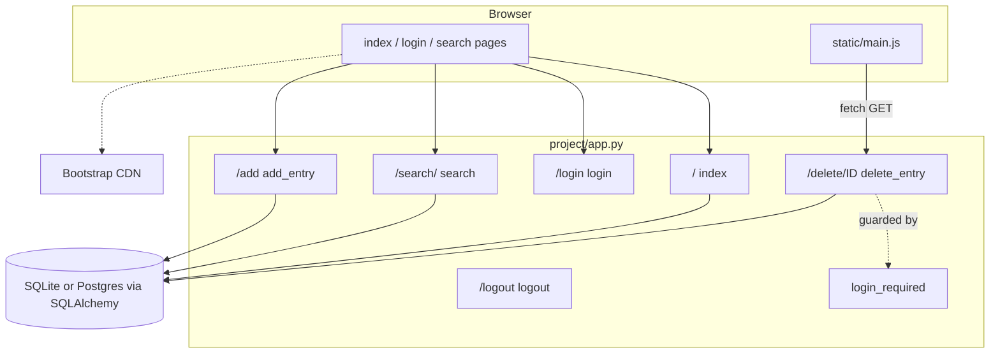
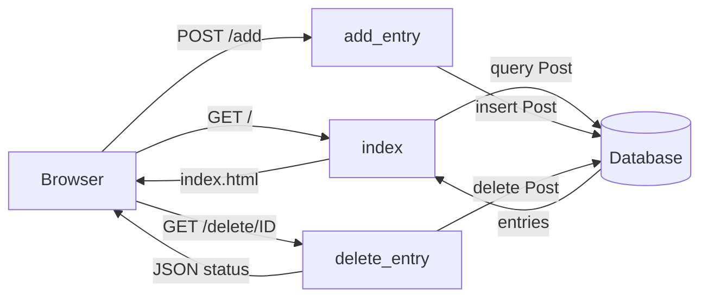
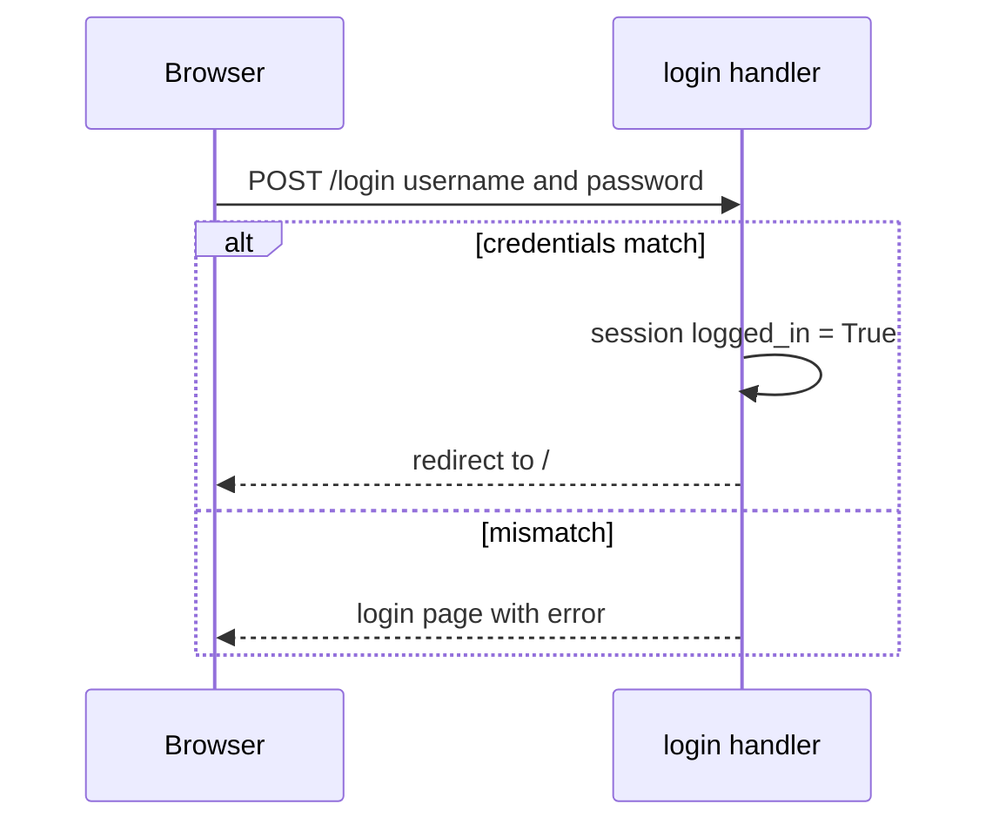
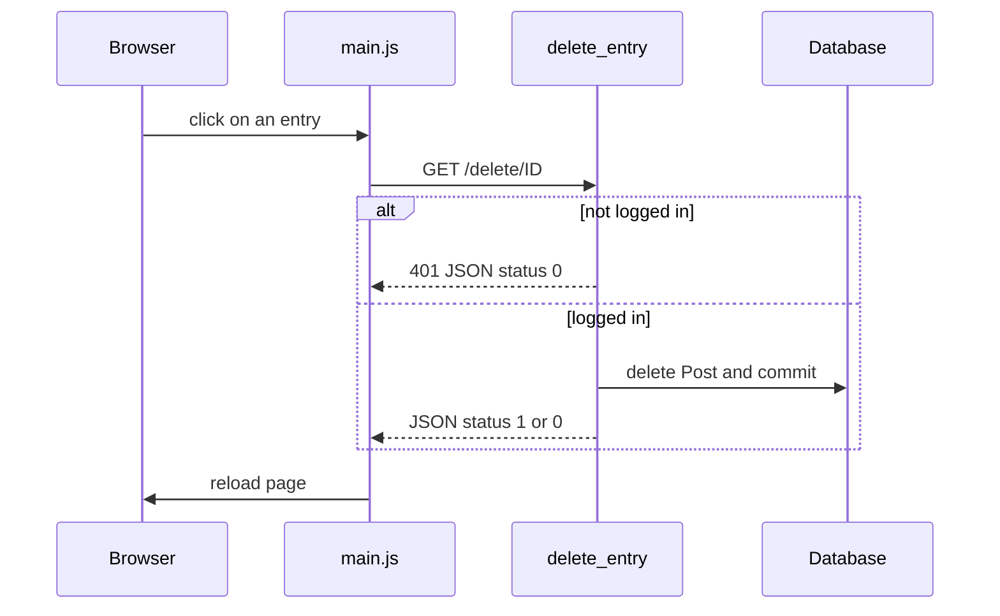

# flaskr-tdd Documentation

**Target:** flaskr-tdd | **Commit:** 305122f48823d98fd7fe8de989af2821b3c5d46d | **Evidence date:** 2026-11-10

**How to read this document.** *Cited* claims carry a path-and-line Citation. **Inferred:** marks reasoning from cited evidence. *Unknown* items are listed in section 14 and must not be assumed. Secret values are never reproduced; their locations are cited with "value omitted". The Evidence Register and source-to-claim audit are in verification.md, rendered as Appendix A.

## 1. Application Index

`flaskr-tdd` is a small Flask message board ("Flaskr") with one shared login, built with Flask-SQLAlchemy (`project/app.py:36-40`). A visitor can read and search posts; the logged-in account can add and delete posts. It is documented here for a developer or operator picking it up.

| Section | Contents |
|---|---|
| [2. Coverage and Overview](#2-coverage-and-overview) | What was inspected, purpose, system boundary |
| [3. Architecture](#3-architecture) | Components, diagram, authentication |
| [4. Functional Inventory](#4-functional-inventory) | Features, routes, subsystem inventory |
| [5. Roles and Access Model](#5-roles-and-access-model) | Roles, enforcement, capability matrix |
| [6. UI Catalog](#6-ui-catalog) | Pages and controls |
| [7. Workflows](#7-workflows) | Log in, log out, view, post, delete, search, initialise the database |
| [8. Data and Integrations](#8-data-and-integrations) | Connections, SQL, external calls, entities, failure behavior |
| [9. Troubleshooting Matrix](#9-troubleshooting-matrix) | Symptoms and responses |
| [10. Security and Operational Risks](#10-security-and-operational-risks) | Verified findings and non-controls |
| [11. Ownership and Maintenance](#11-ownership-and-maintenance) | Owners and maintenance signals |
| [12. Architecture and Data-Flow Diagrams](#12-architecture-and-data-flow-diagrams) | Data-flow and sequence diagrams |
| [13. Glossary](#13-glossary) | Target-specific terms |
| [14. Open Questions and Documentation Gaps](#14-open-questions-and-documentation-gaps) | Unknowns |
| [15. Recommendations](#15-recommendations) | Prioritized actions |
| [16. Operations Runbook](#16-operations-runbook) | Platform, data stores, failure modes, deployment |

Quick cross-reference:

| Support need | Primary screen or file | Workflow |
|---|---|---|
| User cannot log in | Login page `project/templates/login.html:31`; handler `project/app.py:75-88` | [7.1 Log in](#71-log-in) |
| Post does not appear after submitting | Add form `project/templates/index.html:36`; handler `project/app.py:63-72` | [7.4 Post a message](#74-post-a-message) |
| Delete does nothing or says "Please log in." | Click handler `project/static/main.js:7-26`; handler `project/app.py:99-112` | [7.5 Delete a message](#75-delete-a-message) |
| Search shows nothing or odd results | Search page `project/templates/search.html:39-57`; handler `project/app.py:115-121` | [7.6 Search messages](#76-search-messages) |
| Database missing or empty | Bootstrap script `create_db.py:7-12`; URI `project/app.py:26` | [7.7 Initialise the database](#77-initialise-the-database) |
| Deploying or running in production | `Procfile:1`; `runtime.txt:1` | [16.5 Deployment and change process](#165-deployment-and-change-process) |

## 2. Coverage and Overview

### 2.1 What was inspected

The only Stack detected is **python-flask**, which is supported, so Facts were extracted with stack-specific patterns (routes, config keys, the `Post` model, auth checks, messages). The marker file is `requirements.txt` (`requirements.txt:1`). No unsupported Stacks were detected; the Jinja templates and the one JavaScript file were covered by reading source, not by a dedicated extractor.

Facts covered 23 files across four top-level folders: the repository root (10 files), `project/` (9 files: app, model, three templates, two static assets, an empty `project/__init__.py`, and a SQLite file), `.github/` (2 files: `.github/workflows/main.yml` and `.github/FUNDING.yml`), and `tests/` (2 files: `tests/app_test.py` and `tests/__init__.py`). All source files under `project/`, `create_db.py`, `tests/app_test.py`, `.github/workflows/main.yml`, `Procfile`, `runtime.txt`, and `requirements.txt` were read in full.

Not inspected in depth: `project/static/style.css` (styling only; the first rules were read), the binary files `flaskr-app.png`, `tdd.png`, `project/flaskr.db` and `test.db`, and `README.md` (1760 lines, a tutorial). `README.md` was searched for deployment, database and requirement statements only (`README.md:75-86`, `README.md:1015-1086`, `README.md:1652-1677`), and was not used for application behavior.

### 2.2 Purpose and users

**Inferred:** The Target is a minimal message board used to teach test-driven development of a Flask app. It rests on the tutorial opening in `README.md:1-3`, the page titles `project/templates/index.html:4` and `project/templates/login.html:4`, and a test suite that covers each route (`tests/app_test.py:38-88`). Users are one shared account that can post and delete, plus anonymous readers (`project/app.py:56-121`). The business purpose, real user population and any production use are Unknown - see Open questions.

### 2.3 System boundary

Inside the Target: the Flask app (`project/app.py:36`), the `Post` model (`project/models.py:4`), three Jinja templates (`project/templates/index.html`, `project/templates/login.html`, `project/templates/search.html`), one client script (`project/static/main.js`), a database bootstrap script (`create_db.py`), and the test suite (`tests/app_test.py`).

Outside the Target: a relational database, SQLite by default or whatever `DATABASE_URL` points to (`project/app.py:26`), and a Bootstrap stylesheet fetched by the browser from a public CDN (`project/templates/index.html:8`). No outbound HTTP, email, queue or file-share call is made by server code (`project/app.py:1-125`).

## 3. Architecture

### 3.1 Components

- **Web app.** `project/app.py:36` creates the Flask app, `project/app.py:38` loads configuration from the module itself, and `project/app.py:40` initialises SQLAlchemy. All routes and the `login_required` decorator live in this one file (`project/app.py:45-125`).
- **Model.** `project/models.py:4-7` defines `Post` with `id`, `title` and `text` columns.
- **Templates.** `project/templates/index.html` (post list and add form), `project/templates/login.html` (login form), `project/templates/search.html` (search form and results).
- **Static assets.** `project/static/main.js` attaches a click-to-delete handler to every `.entry` element (`project/static/main.js:5-26`); `project/static/style.css` provides styling.
- **Database bootstrap.** `create_db.py:9` calls `db.create_all()` inside an app context.
- **Tests.** `tests/app_test.py:11-21` defines a pytest fixture that creates and drops tables around each test.
- **Process definition.** `Procfile:1` starts the app under gunicorn (`requirements.txt:3`).

### 3.2 Diagram

Caption: routes and handlers as defined at `project/app.py:56-121`; the CDN reference is at `project/templates/index.html:8`.

### 3.3 Authentication and authorization

Authentication is one hardcoded credential pair held in module configuration (`project/app.py:23-24`, values omitted). The `login` handler compares the submitted username and then the password against the app configuration (`project/app.py:80-83`) and on success sets `session["logged_in"] = True` (`project/app.py:85`). There is no user table, no per-user identity and no password hashing (`project/models.py:4-7` defines only `Post`).

Authorization is the `login_required` decorator (`project/app.py:45-53`), which checks `session.get("logged_in")` and returns HTTP 401 with a JSON body when it is falsy (`project/app.py:48-50`). It is applied only to the delete route (`project/app.py:100`). The add route performs its own inline check and calls `abort(401)` (`project/app.py:66-67`). Index, login, logout and search have no check (`project/app.py:56-60`, `project/app.py:75-96`, `project/app.py:115-121`).

## 4. Functional Inventory

| ID | Feature | Entry point | Inputs, outputs and rules | Dependencies | Status |
|---|---|---|---|---|---|
| F1 | List all posts | `project/app.py:56` (GET `/`) | No input. Queries every `Post` and renders `index.html`; shows "No entries yet. Add some!" when empty (`project/app.py:59-60`, `project/templates/index.html:77`). | `Post` model, database | Cited |
| F2 | Add a post | `project/app.py:63` (POST `/add`) | Form fields `title` and `text`. Returns 401 if not logged in; otherwise inserts, flashes a message and redirects to `/` (`project/app.py:66-72`). | `Post` model, database, session | Cited |
| F3 | Log in | `project/app.py:75` (GET and POST `/login`) | Form fields `username` and `password`. Mismatch sets an error string; match sets the session flag and redirects (`project/app.py:79-88`). | Module config, session | Cited |
| F4 | Log out | `project/app.py:91` (GET `/logout`) | Removes the session flag, flashes a message, redirects (`project/app.py:94-96`). | Session | Cited |
| F5 | Delete a post | `project/app.py:99` (GET `/delete/<int:post_id>`) | Requires login. Deletes rows with that id, commits, returns JSON `status` 1 or 0 (`project/app.py:103-112`). | `Post` model, database, `login_required` | Cited |
| F6 | Search posts | `project/app.py:115` (GET `/search/`) | Query argument `query`. With a non-empty query renders all posts and the template filters by case-insensitive substring of title or text (`project/app.py:117-121`, `project/templates/search.html:51-52`). | `Post` model, database | Cited |
| F7 | Click-to-delete in the browser | `project/static/main.js:7-26` | Clicking any `.entry` element calls GET `/delete/<id>` using the id of its `h2`, then reloads the page (`project/static/main.js:9-20`). | F5, browser | Cited |
| F8 | Create database tables | `create_db.py:7-12` | Run manually; calls `db.create_all()` (`create_db.py:9`). | `project/app.py:40` | Cited |

No route updates an existing post: the handlers at `project/app.py:56-121` only read, insert or delete `Post` rows, so there is no edit flow.

### 4.1 Subsystem inventory

| Subsystem | Files | Primary data and dependencies | Purpose | Status |
|---|---|---|---|---|
| Repository root (`Procfile:1`) | 10 | `requirements.txt:1-8`, `runtime.txt:1`, `create_db.py:9`, `.gitignore:1-5` | Dependencies, runtime pin, process definition, database bootstrap, tutorial README (`README.md:1-3`) | Cited |
| `project/` | 9 | `Post` table, Flask, Flask-SQLAlchemy (`project/models.py:4-7`, `requirements.txt:1-2`) | The application: routes, model, templates, static assets (`project/app.py:56-121`) | Cited |
| `.github/` | 2 | GitHub Actions (`.github/workflows/main.yml:1-29`) | CI: lint and tests on every push (`.github/workflows/main.yml:3`) | Cited |
| `tests/` | 2 | pytest, SQLite test file (`tests/app_test.py:8-21`) | Route and login tests | Cited |

## 5. Roles and Access Model

### 5.1 Observed role concepts

No named roles, groups, scopes or permissions exist in source (`project/models.py:4-7`, `project/app.py:1-125`). Two states are observable: anonymous, and logged in, meaning `session["logged_in"]` is set (`project/app.py:85`). The logged-in state belongs to one shared account whose username and password are configuration constants (`project/app.py:23-24`, values omitted).

### 5.2 Authorization enforcement

Enforcement is server-side in two places: the `login_required` decorator on delete (`project/app.py:45-53`, `project/app.py:100`) and an inline check in `add_entry` (`project/app.py:66-67`). The two return different 401 shapes: JSON for delete (`project/app.py:50`) and the default error response for add (`project/app.py:67`).

The home template shows the add form only when `session.logged_in` is set (`project/templates/index.html:35-36`), but this is presentation; the server check at `project/app.py:66` is what blocks the request.

Routes with no check: `/` (`project/app.py:56`), `/login` (`project/app.py:75`), `/logout` (`project/app.py:91`) and `/search/` (`project/app.py:115`). All of them are intentionally or by omission public; the code does not say which.

### 5.3 Role-to-capability matrix

Y = allowed (cited in the Citation column), blank = no. There are no other roles (`project/app.py:56-121`).

| Capability | Anonymous | Shared account (logged in) | Citation |
|---|---|---|---|
| View posts (F1) | Y | Y | `project/app.py:56-60` |
| Search posts (F6) | Y | Y | `project/app.py:115-121` |
| Log in (F3) | Y | Y | `project/app.py:75-88` |
| Log out (F4) | Y | Y | `project/app.py:91-96` |
| Add a post (F2) |  | Y | `project/app.py:66-67` |
| Delete a post (F5) |  | Y | `project/app.py:100` |
| Edit a post | none exists | none exists | `project/app.py:56-121` |
| Create database tables (F8) | not a web capability | not a web capability | `create_db.py:7-12` |

**Inferred:** because exactly one credential pair exists, every logged-in session is the same principal and actions cannot be attributed to a person. This rests on `project/app.py:23-24` and the absence of any user model at `project/models.py:4-7`.

## 6. UI Catalog

| Page | Route | Visible controls and data | States and effects | Roles and evidence |
|---|---|---|---|---|
| Home | `/` | Search button, log in or log out button, flash messages, add form (Title, Text, Share) only when logged in, list of posts with title and text (`project/templates/index.html:17-27`, `project/templates/index.html:31-36`, `project/templates/index.html:70-78`) | Empty list shows "No entries yet. Add some!" (`project/templates/index.html:77`). Post text is rendered unescaped (`project/templates/index.html:74`). Clicking a post triggers delete (`project/static/main.js:7-26`). | Anonymous sees list; logged-in also sees the form (`project/templates/index.html:35`) |
| Login | `/login` | Username and password fields, Login button, an error alert, flash messages, hint text that names the credentials (`project/templates/login.html:25-29`, `project/templates/login.html:31-55`) | Error alert shows the string set by the handler (`project/templates/login.html:27`, `project/app.py:81`, `project/app.py:83`) | Anonymous (`project/app.py:75`) |
| Search | `/search/` | Home button, log in or log out button, flash messages, Search field and button, list of matching posts (`project/templates/search.html:17-29`, `project/templates/search.html:39-48`, `project/templates/search.html:50-57`) | Without a query the list is empty because no entries are passed (`project/app.py:121`). With a query, matching posts show; the heading id is blank because the template reads `post_id` (`project/templates/search.html:54`). | Anonymous (`project/app.py:115`) |

## 7. Workflows

### 7.1 Log in

1. The user opens `/login` and the form renders (`project/app.py:75`, `project/app.py:88`, `project/templates/login.html:31`).
2. Submitting POSTs `username` and `password` to `/login` (`project/templates/login.html:31-50`, `project/app.py:79`).
3. A username mismatch sets "Invalid username"; otherwise a password mismatch sets "Invalid password" (`project/app.py:80-83`).
4. On a match the handler sets `session["logged_in"]`, flashes "You were logged in" and redirects to `/` (`project/app.py:85-87`).

Failure and escalation: a wrong value re-renders the form with the error alert (`project/app.py:88`, `project/templates/login.html:25-29`); there is no lockout or reset path in source (`project/app.py:75-88`). Escalate to the maintainer (Unknown, see Open questions) if correct configured credentials are rejected, since the only inputs are `project/app.py:23-24` and the form.

### 7.2 Log out

1. The user follows the "log out" link, a GET to `/logout` (`project/templates/index.html:24`, `project/app.py:91`).
2. The handler removes `logged_in` from the session, flashes "You were logged out" and redirects to `/` (`project/app.py:94-96`).

Failure and escalation: the handler has no failure branch; `session.pop` with a default never raises (`project/app.py:94`). Escalate if a logged-out user can still add or delete posts, because both server checks depend on this flag (`project/app.py:48`, `project/app.py:66`).

### 7.3 View posts

1. Any visitor requests `/`; the handler queries all `Post` rows (`project/app.py:56-60`).
2. `index.html` renders each entry's title and its text unescaped, or the empty-state message (`project/templates/index.html:71-78`).

Failure and escalation: there is no error handling around the query (`project/app.py:59`), so a database failure surfaces as an unhandled server error (**Inferred:** Flask default 500 behavior, resting on `project/app.py:57-60`). Escalate when `/` returns an error and the database is reachable; see 8.5.

### 7.4 Post a message

1. A logged-in user fills Title and Text on the home page and presses Share (`project/templates/index.html:36-62`).
2. The form POSTs to `/add` (`project/app.py:63`).
3. A non-logged-in request is rejected with 401 (`project/app.py:66-67`).
4. Otherwise the handler builds a `Post` from the two form fields, adds and commits it, flashes "New entry was successfully posted" and redirects to `/` (`project/app.py:68-72`).

Failure and escalation: a missing form field raises on `request.form[...]` (`project/app.py:68`); **Inferred:** Flask returns HTTP 400 for a missing key. Empty strings are accepted (`project/models.py:6-7` only forbids NULL). A commit failure is not caught (`project/app.py:70`). Escalate if a post submitted by a logged-in user is not listed after redirect.

### 7.5 Delete a message

1. On any page that loads `main.js`, clicking an entry reads the `id` attribute of its `h2` and calls `fetch` on `/delete/<id>` (`project/static/main.js:7-11`, `project/templates/index.html:81-84`).
2. The route requires login via `login_required` (`project/app.py:99-100`).
3. The handler deletes rows with that id, commits, flashes "The entry was deleted." and returns `{"status": 1, "message": "Post Deleted"}` (`project/app.py:106-109`).
4. The browser removes the element and reloads the page whenever the call resolves, regardless of status (`project/static/main.js:15-20`).

Failure and escalation: an anonymous request gets 401 JSON `status` 0 and the page reloads (`project/app.py:48-50`, `project/static/main.js:20`). An exception is caught and returned as `status` 0 with the exception text (`project/app.py:110-112`). Deleting an id that does not exist still reports success (`project/app.py:106-109`; the test relies on it at `tests/app_test.py:85-88`). Network or JSON errors are only written to the browser console (`project/static/main.js:22-24`). Escalate if a logged-in delete returns `status` 0 with an exception message.

### 7.6 Search messages

1. The user submits the `query` field to `/search/` as a GET (`project/templates/search.html:39-43`).
2. The handler reads `query` and loads all posts (`project/app.py:117-118`).
3. If `query` is non-empty it renders `search.html` with all entries and the query; otherwise it renders the page with no entries (`project/app.py:119-121`).
4. The template keeps entries whose title or text contains the query, case-insensitively (`project/templates/search.html:51-52`).

Failure and escalation: there is no "no results" message (`project/templates/search.html:50-57`). Each result heading uses `entry.post_id`, which is not a `Post` column (`project/templates/search.html:54`, `project/models.py:5-7`), so the id attribute is blank; **Inferred:** Jinja renders a missing attribute as empty text. Because every result is also an `.entry` element, clicking a result calls delete with an empty id (**Inferred:** `/delete/` matches no route, `project/app.py:99`). Escalate if search results are missing for text that exists in a post.

### 7.7 Initialise the database

1. An operator runs `create_db.py`, which imports the app and opens an app context (`create_db.py:4-7`).
2. It calls `db.create_all()` and commits (`create_db.py:9-12`).

Failure and escalation: the script has no error handling (`create_db.py:7-12`); a connection failure raises to the terminal. The web app does not create tables on start (`project/app.py:36-42`), so if the tables are missing, queries fail (**Inferred**, resting on `project/app.py:59`). Escalate if `create_db.py` fails against the configured `DATABASE_URL`.

## 8. Data and Integrations

### 8.1 Connections

| Name | Kind | Configured at | Used by |
|---|---|---|---|
| Application database (default) | SQLite file named `flaskr.db` next to `project/app.py` | `project/app.py:22`, `project/app.py:26` | All routes via `db.session` (`project/app.py:59`, `project/app.py:69`, `project/app.py:106`, `project/app.py:118`) |
| Application database (override) | Any SQLAlchemy URL from `DATABASE_URL`; `postgres://` is rewritten to `postgresql://` | `project/app.py:26`, `project/app.py:28-29`, `project/app.py:31` | Same as above; Postgres driver is `psycopg2-binary` (`requirements.txt:4`). Value omitted. |
| Test database (test only) | SQLite file named `test.db` in the repository root | `tests/app_test.py:8`, `tests/app_test.py:15-16` | `tests/app_test.py:11-21` |
| Bootstrap stylesheet CDN | Public CDN, fetched by the browser | `project/templates/index.html:8`, `project/templates/login.html:8`, `project/templates/search.html:8` | All three pages |

The default SQLite file `project/flaskr.db` is present in the repository; its contents were not inspected (binary).

### 8.2 Stored procedures and SQL

No stored procedures and no raw SQL appear in source. Data access is the SQLAlchemy ORM against the `Post` table: reads with `db.session.query(models.Post)` (`project/app.py:59`, `project/app.py:118`), insert with `add` and `commit` (`project/app.py:69-70`), delete with `filter_by(id=...).delete()` followed by `commit` (`project/app.py:106-107`), and schema creation with `db.create_all()` (`create_db.py:9`). The `track modifications` option is switched off (`project/app.py:32`).

### 8.3 External calls

| ID | Call | Direction | Caller | Notes |
|---|---|---|---|---|
| X1 | GET Bootstrap 5.3.2 stylesheet from a public CDN | Outbound from the browser | `project/templates/index.html:8`, `project/templates/login.html:8`, `project/templates/search.html:8` | No integrity attribute on the link (`project/templates/index.html:5-9`) |
| X2 | GET `/delete/<id>` on the app's own origin | Browser to the app (internal) | `project/static/main.js:11` | Not an external service; listed because it is a state-changing GET |
| X3 | Postgres connection when `DATABASE_URL` is set | Outbound from the server | `project/app.py:26`, `project/app.py:31` | Conditional on runtime configuration; driver at `requirements.txt:4` |

No outbound HTTP, email or queue call exists in server code (`project/app.py:1-125`). The tests make calls only to the in-process test client (`tests/app_test.py:20`, test-only).

### 8.4 Data entities and sensitivity

| Entity | Key fields | Defined at | Sensitivity |
|---|---|---|---|
| `Post` | `id` (integer primary key), `title`, `text` (both required strings) | `project/models.py:4-7` | User-supplied free text shown to anonymous visitors (`project/app.py:56-60`); no personal-data fields are defined. **Inferred:** classify as public. |
| Session state | `logged_in` flag in the Flask session | `project/app.py:85` | Authentication state; client-held cookie signed with the secret key (**Inferred** from Flask session behavior, resting on `project/app.py:25`, `project/app.py:85`) |
| Application credentials and signing key | `USERNAME`, `PASSWORD`, `SECRET_KEY` constants (values omitted) | `project/app.py:23-25` | Credential; confidential |
| Database connection string | `DATABASE_URL` (value omitted) | `project/app.py:26` | Credential when it names a Postgres server; confidential |

### 8.5 Failure, fallback and observability

- **`DATABASE_URL` unset.** The app silently falls back to a SQLite file named `flaskr.db` under `project/` (`project/app.py:22`, `project/app.py:26`); nothing logs which database was chosen. If a Postgres URL is intended but the variable is missing, the app runs against the local file without error.
- **`DATABASE_URL` set to `postgres://`.** The scheme is rewritten to `postgresql://` before use (`project/app.py:28-29`). Other URLs pass through unchanged (`project/app.py:31`).
- **Database down or unreachable.** Only the delete handler catches exceptions and returns `status` 0 with the exception text (`project/app.py:104-112`). Index, add and search have no handling (`project/app.py:59`, `project/app.py:69-70`, `project/app.py:118`), so **Inferred:** they return Flask's default server error.
- **No rollback.** The code never calls `db.session.rollback()` after a failed commit (`project/app.py:104-112`, `project/app.py:69-70`).
- **Tables missing.** Tables are created only by `create_db.py` (`create_db.py:9`); the web app does not create them at startup (`project/app.py:36-42`). Whether the committed `project/flaskr.db` contains the table is Unknown - see Open questions.
- **CDN unreachable.** **Inferred:** pages render without Bootstrap styling; server behavior is unaffected, since the stylesheet is only a link (`project/templates/index.html:5-9`).
- **Observability.** There is no logging setup, health endpoint or metrics in server code (`project/app.py:1-125`). The only runtime output in the client is `console.log` (`project/static/main.js:2`, `project/static/main.js:18`, `project/static/main.js:23`). **Inferred:** any process-level logs come from gunicorn defaults, since no logging configuration is set (`Procfile:1`, `project/app.py:1-125`).

## 9. Troubleshooting Matrix

| Symptom | Checks | Known response | Escalate when |
|---|---|---|---|
| "Please log in." and nothing is deleted | Is the user logged in? Is the cookie being sent? | `login_required` returns 401 JSON and flashes the message; the page reloads (`project/app.py:48-50`, `project/static/main.js:20`) | A user who just logged in still gets it, which would point to a secret key or cookie problem (`project/app.py:25`, `project/app.py:85`) |
| "Invalid username" on login | Compare the submitted username with the configured one | Error set when the username differs (`project/app.py:80-81`) | The correct configured username is rejected |
| "Invalid password" on login | Compare the submitted password with the configured one | Error set when the password differs (`project/app.py:82-83`) | The correct configured password is rejected |
| HTTP 401 page after pressing Share | Was the session lost between page load and submit? | `add_entry` aborts with 401 when not logged in (`project/app.py:66-67`) | It happens while the user is demonstrably logged in |
| HTTP 400 after pressing Share | Are both `title` and `text` fields present in the request? | **Inferred:** a missing form key raises a bad-request error (`project/app.py:68`) | A normal browser submit lacks a field (template at `project/templates/index.html:47`, `project/templates/index.html:54`) |
| "No entries yet. Add some!" | Were posts added? Which database is in use? | Shown when the query returns no rows (`project/templates/index.html:77`) | Posts exist elsewhere, which suggests the `DATABASE_URL` fallback to the local file (`project/app.py:26`) |
| Delete returns `{"status": 0, ...}` with an exception string | Read the `message` field; check database connectivity | Exception caught and returned as `repr(e)` (`project/app.py:110-112`) | Message names a connection or table error that persists after one retry |
| Delete reports success but the post remains | Is the id from the right page? Search results have a blank id | Success is returned even when no row matches (`project/app.py:106-109`); search headings carry no id (`project/templates/search.html:54`) | The same post id on the home page survives a reload after a success response |
| Search shows no results | Is the query non-empty and spelled as stored? | Empty query renders with no entries (`project/app.py:119-121`); no "no results" text exists (`project/templates/search.html:50-57`) | A known-present word returns nothing |
| Clicking a search result does nothing | Open the browser console | Result headings have an empty id, so the call targets `/delete/` (`project/templates/search.html:54`, `project/static/main.js:9-11`); errors go to the console (`project/static/main.js:22-24`) | Never expected; treat as the known defect in 10.1 |
| Page has no styling | Can the browser reach the CDN? | Stylesheet is a CDN link (`project/templates/index.html:8`) | The CDN is reachable but styling is still missing |
| Server error on `/`, `/add` or `/search/` | Check database reachability and that tables exist | No handler for these (`project/app.py:59`, `project/app.py:69-70`, `project/app.py:118`) | The database is reachable and tables exist |

## 10. Security and Operational Risks

### 10.1 Verified findings

| ID | Finding | Evidence | Impact |
|---|---|---|---|
| S1 | Hardcoded username and password, and a login page that tells visitors the credentials | `project/app.py:23-24` (values omitted), `project/templates/login.html:53` | Anyone with the code or the login page can log in. |
| S2 | Placeholder session signing key in source (value omitted); the tutorial repeats it | `project/app.py:25`, `README.md:722`, `README.md:1338` | Session cookies can be forged by anyone who knows the key, which would grant the logged-in state. |
| S3 | Post text is rendered unescaped | `project/templates/index.html:74`, `project/templates/search.html:55`, `tests/app_test.py:77` | Stored cross-site scripting: HTML or script saved in a post runs for every reader. The test asserts raw HTML is preserved. |
| S4 | State-changing delete and logout use GET; clicking any post deletes it with no confirmation | `project/app.py:91`, `project/app.py:99`, `project/static/main.js:8-11` | A link, prefetch, or an accidental click can delete data or log a user out. |
| S5 | Search template reads `entry.post_id`, which is not a `Post` field | `project/templates/search.html:54`, `project/models.py:5-7` | Defect: result headings have an empty id; **Inferred:** clicking a result sends a delete call with no id that fails. Search itself still lists matches (`project/templates/search.html:51-57`). |
| S6 | Delete returns the exception text to the client and never rolls back | `project/app.py:110-112` | Internal error details leak; a failed commit can leave the session unusable. |
| S7 | Delete of a nonexistent id reports success | `project/app.py:106-109`, `tests/app_test.py:85-88` | Misleading success message; the test encodes this behavior. |
| S8 | No validation of the add form | `project/app.py:68-70`, `project/models.py:6-7` | Empty titles and text are stored; very large inputs are not bounded. |
| S9 | **Inferred:** the database files are committed even though the ignore file lists the test database | `.gitignore:5`, `project/app.py:22`, `tests/app_test.py:8`, git tracks both the test file and the default SQLite file under project, see verification.md E-S9 | Test or runtime data can be published with the source; the contents were not inspected. |
| S10 | A credential-bearing Postgres URL appears in the tutorial text (value omitted) | `README.md:1663` | Source exposure. **Inferred:** it is example output from a short-lived tutorial database, but whether it is live is Unknown. |
| S11 | **Inferred:** the test fixture changes the database URI after the database object was created, so the tests may run against the configured database rather than the test file | `tests/app_test.py:12-21`, `project/app.py:40`, `requirements.txt:2` | If so, `db.drop_all()` at the end of each test would erase data in whatever `DATABASE_URL` selects. Not confirmed by a run; see section 14. |
| S12 | Every request loads all posts and search filters in the template | `project/app.py:59`, `project/app.py:118`, `project/templates/search.html:51-52` | **Inferred:** response time and memory grow with the number of posts; there is no pagination. |
| S13 | The Bootstrap stylesheet is loaded from a CDN without an integrity attribute | `project/templates/index.html:5-9` | If the CDN content were altered, all pages would load the altered stylesheet. |

### 10.2 Unknowns that must not be treated as controls

| Control | Status | Where looked |
|---|---|---|
| TLS or HTTPS enforcement | Not established. Neither the app nor the process definition mentions certificates or redirects. | `project/app.py:36-40`, `Procfile:1` |
| CSRF protection | Not established. The three forms carry no token field and no CSRF library is used. | `project/templates/index.html:36-40`, `project/templates/login.html:31`, `requirements.txt:1-4`, `project/app.py:63-72` |
| Multi-factor authentication | Not established. Login is a single username and password comparison. | `project/app.py:79-87` |
| Session cookie flags and lifetime (Secure, HttpOnly, SameSite, expiry) | Not established. No `SESSION_COOKIE_*` or lifetime setting is defined; Flask defaults apply. | `project/app.py:21-32`, `project/app.py:36-38` |
| Rate limiting or lockout | Not established. The login handler has no throttle and no limiter dependency exists. | `project/app.py:75-88`, `requirements.txt:1-4` |
| Password storage and comparison | Not established. The password is a plain constant compared with `!=`. | `project/app.py:24`, `project/app.py:82` |
| Audit-log integrity | Not established. No audit or application logging exists, so actions cannot be attributed or verified. | `project/app.py:66-72`, `project/app.py:104-112`, `project/app.py:85` |
| Backup and recovery | Not established. No backup, restore or migration script exists; the only data-definition code is `create_all`. | `create_db.py:9`, `Procfile:1` |
| Production secret management | Not established. Credentials and the signing key are literals; only the database URL is read from the environment. | `project/app.py:23-26` |
| Security response headers (CSP, frame options) | Not established. No header-setting code or extension is present. | `project/app.py:36-40`, `requirements.txt:1-4` |

## 11. Ownership and Maintenance

| Area | Evidence | Status |
|---|---|---|
| Code owners and team | Git history is shallow (`Git history: shallow` in facts-summary.md); no owner-context file exists in the Target; the `.github/` folder holds only a workflow and a funding file (`.github/workflows/main.yml:1`, `.github/FUNDING.yml:1`) | Unknown |
| Copyright holder | A named individual is the copyright holder in `LICENSE:3`; this is not an operational owner | Cited, not an owner |
| Continuous integration | One job runs lint and tests on every push across Python 3.8 to 3.12 (`.github/workflows/main.yml:3`, `.github/workflows/main.yml:11`, `.github/workflows/main.yml:23-29`) | Cited |
| Runtime and dependencies | Python pinned at `runtime.txt:1`; dependencies pinned at `requirements.txt:1-8`; no automated dependency update file exists under `.github/` | Cited |
| Deployment | `Procfile:1` runs gunicorn; the tutorial describes a Heroku deployment (`README.md:1015-1086`) | Cited (tutorial); live environment Unknown |
| On-call or support contact | Not present in the Target | Unknown |

Recommended maintenance minimum:

- Name an owner and a support contact in an owner-context file for AppDoc.
- Keep `requirements.txt` and `runtime.txt` in step; the CI matrix still includes Python 3.8 (`.github/workflows/main.yml:11`).
- Re-run the CI job and review pinned dependency versions (`requirements.txt:1-8`) on a regular schedule.

## 12. Architecture and Data-Flow Diagrams

Data flow for reading, adding and deleting posts, per the routes at `project/app.py:56-112`.

Login sequence, per `project/app.py:75-88`.

Delete sequence, per `project/static/main.js:7-26` and `project/app.py:99-112`.

## 13. Glossary

| Term | Meaning | Citation |
|---|---|---|
| Flaskr | The application name shown in page titles | `project/templates/index.html:4` |
| Post | The only data entity: `id`, `title`, `text` | `project/models.py:4-7` |
| Entry | A `Post` as named inside the templates and the CSS class that makes a list item clickable | `project/templates/index.html:71-72`, `project/static/main.js:5` |
| Flash message | One-time notice shown on the next page render | `project/app.py:49`, `project/templates/index.html:31-34` |
| `login_required` | Decorator that returns 401 JSON when the session flag is absent | `project/app.py:45-53` |
| `logged_in` | Session key that marks the authenticated state | `project/app.py:85` |
| Shared account | The single username and password pair that every user of the logged-in state shares | `project/app.py:23-24` |
| `SECRET_KEY` | Flask session signing key constant (value omitted) | `project/app.py:25` |
| `DATABASE_URL` | Environment variable that selects the database; unset means local SQLite | `project/app.py:26` |
| `SQLALCHEMY_DATABASE_URI` | Flask-SQLAlchemy setting assigned from the chosen URL | `project/app.py:31` |
| `flaskr.db` | Name of the default SQLite file | `project/app.py:22` |
| `status` (0 or 1) | Result field in the delete response | `project/app.py:103`, `project/app.py:108` |
| `create_db.py` | One-off script that creates tables | `create_db.py:9` |
| `Procfile` | Heroku-style process definition that runs gunicorn | `Procfile:1` |
| `post_id` | Attribute read by the search template that does not exist on `Post` | `project/templates/search.html:54` |
| `safe` filter | Jinja filter (written as a pipe followed by safe) that disables HTML escaping | `project/templates/index.html:74` | `project/templates/index.html:74` |

## 14. Open Questions and Documentation Gaps

- The business purpose, real user population and whether the app is used outside the tutorial are Unknown - see Open questions; the README is a tutorial.
- Ownership, team and support contact are Unknown: git history is shallow and no owner-context file exists.
- The live deployment environment (host, scale, environment variables, TLS termination) is Unknown. The Procfile and README describe Heroku, but no deployed instance was inspected.
- Whether the Postgres URL at `README.md:1663` is live is Unknown.
- Whether the committed `project/flaskr.db` contains the `Post` table or any real data is Unknown (binary, not inspected).
- Whether the test fixture really runs against the configured database (finding S11 in `tests/app_test.py:12-21`) is Unknown; it was not confirmed by running the tests (Flask was not installed in the environment used).
- Whether the blank id in search results (`project/templates/search.html:54`) behaves as described in 7.6 was not confirmed in a browser; it is Inferred.
- The reason `test.db` is tracked despite `.gitignore:5` is Unknown.
- The content of `project/static/style.css` beyond its first rules was not reviewed.

## 15. Recommendations

| ID | Severity | Effort | Recommendation | Addresses |
|---|---|---|---|---|
| R1 | Critical | S | Read the username, password and signing key from the environment (hashed password), remove the credential hint from the login page, and set a strong signing key | S1, S2 (`project/app.py:23-25`, `project/templates/login.html:53`) |
| R2 | High | S | Remove the `safe` filter so post text is escaped, or sanitize on input | S3 (`project/templates/index.html:74`, `project/templates/search.html:55`) |
| R3 | High | M | Turn delete and logout into POST requests with CSRF tokens; add CSRF protection to `/add` and `/login`; require a confirmation before deleting | S4 and 10.2 CSRF (`project/app.py:91`, `project/app.py:99`, `project/static/main.js:8-11`) |
| R4 | High | S | Remove the credential-bearing URL from the README and rotate the credential if it is live | S10 (`README.md:1663`) |
| R5 | High | S | Make the test fixture use its own database (for example set the URI before the database object is created) and confirm tests never touch `DATABASE_URL` | S11 (`tests/app_test.py:12-21`, `project/app.py:40`) |
| R6 | Medium | S | Change the search template to `entry.id` and add a "no results" message | S5 (`project/templates/search.html:54`) |
| R7 | Medium | S | Return a generic error body from delete, roll back on failure, and return 404 when no row matches | S6, S7 (`project/app.py:106-112`) |
| R8 | Medium | S | Validate title and text (non-empty, length limits) in `add_entry` | S8 (`project/app.py:68-70`) |
| R9 | Medium | M | Set secure session cookie options, add login throttling, add HTTPS enforcement at the host, and add application logging | 10.2 (`project/app.py:21-32`, `project/app.py:75-88`) |
| R10 | Low | S | Stop tracking the SQLite files and add `project/flaskr.db` to the ignore file | S9 (`.gitignore:5`) |
| R11 | Low | M | Paginate the post list and move search filtering into the database query | S12 (`project/app.py:59`, `project/app.py:118`) |
| R12 | Low | S | Add an `integrity` attribute to the CDN link or serve the stylesheet locally | S13 (`project/templates/index.html:5-9`) |
| R13 | Low | S | Add an owner-context file naming owners, environments and purpose | 14 ownership and environment gaps (`.github/FUNDING.yml:1`) |

### 15.1 Coverage summary

Verified by reading source: every route, the model, the three templates, the client script, the bootstrap script, the CI workflow, the process and runtime files, the pinned dependencies and the test file (`project/app.py:1-125`, `project/models.py:1-14`, `project/static/main.js:1-26`, `.github/workflows/main.yml:1-29`, `tests/app_test.py:1-88`). Each claim and its re-run command is in verification.md.

Not inspected: binary files, most of `project/static/style.css`, the tutorial body of `README.md`, and any deployed environment. No test was run, so test behavior statements come from reading `tests/app_test.py:1-88`. A reader must confirm the live environment, ownership and whether finding S11 applies before relying on this document for operations.

## 16. Operations Runbook

### 16.1 Platform requirements

Python 3.12.0 is pinned for deployment (`runtime.txt:1`); CI tests Python 3.8 through 3.12 (`.github/workflows/main.yml:11`). Pinned packages: Flask 3.0.0, Flask-SQLAlchemy 3.1.1, gunicorn 21.2.0, psycopg2-binary 2.9.9, and the development tools black 23.10.0, flake8 6.1.0 and pytest 7.4.2 (`requirements.txt:1-8`). The web server is gunicorn started as `gunicorn project.app:app` (`Procfile:1`). The development server is `app.run()` when the module is run directly (`project/app.py:124-125`).

### 16.2 Data stores

One relational database. Provisioning is manual: run `create_db.py` to create tables (`create_db.py:9`). The default is a SQLite file under `project/` (`project/app.py:22`, `project/app.py:26`); setting `DATABASE_URL` selects another database such as Postgres (`project/app.py:26-31`, `requirements.txt:4`). No migration tool and no seed data exist in source (`create_db.py:7-12`, `requirements.txt:1-8`). The initial contents of the committed `project/flaskr.db` are Unknown.

### 16.3 Session and authentication behavior

Authentication state is the `logged_in` key in the Flask session (`project/app.py:85`), signed with the configured secret key (value omitted, `project/app.py:25`). Source sets no session lifetime and no cookie flags (`project/app.py:21-32`), so Flask defaults apply (**Inferred**). Logging out removes the key (`project/app.py:94`). There is no password reset, lockout or per-user account (`project/app.py:75-88`).

### 16.4 Known failure modes and operator responses

| Failure mode | Signal | Operator response |
|---|---|---|
| Database tables missing | Server error on `/`, `/add` or `/search/` (**Inferred**, `project/app.py:59`) | Run `create_db.py` against the intended `DATABASE_URL` (`create_db.py:9`) |
| `DATABASE_URL` missing or misspelled | App runs but shows different data than expected (`project/app.py:26`) | Set the variable and restart the process; verify with `project/app.py:26` logic |
| Postgres unreachable | Delete returns `status` 0 with an exception string; other routes error (`project/app.py:110-112`, `project/app.py:59`) | Restore database connectivity; retry once; then escalate |
| Delete returns success but post remains | Success response for a missing id (`project/app.py:106-109`) | Confirm the id on the home page; see 7.5 |
| Users cannot log in | "Invalid username" or "Invalid password" (`project/app.py:80-83`) | Check the configured credential constants (`project/app.py:23-24`); the sign-in hint is at `project/templates/login.html:53` |
| CDN unavailable | Unstyled pages (**Inferred**, `project/templates/index.html:8`) | No server action; check the CDN or serve the stylesheet locally |
| CI failing on lint | `flake8` or `black --check` fails (`.github/workflows/main.yml:23-26`) | Run the same commands locally and fix formatting |

### 16.5 Deployment and change process

CI job `build` runs on every push: checkout, set up Python from a 3.8 to 3.12 matrix, install `requirements.txt`, lint with flake8 and `black --check`, then run pytest (`.github/workflows/main.yml:3`, `.github/workflows/main.yml:8-29`). The workflow has no deploy step (`.github/workflows/main.yml:13-29`). The tutorial describes deploying by pushing to a Heroku remote (`README.md:1079-1086`), and `Procfile:1` provides the process command; the actual deployment pipeline and environments are Unknown - see Open questions. To change the app: edit, run `python -m pytest` (`.github/workflows/main.yml:29`), then push.
