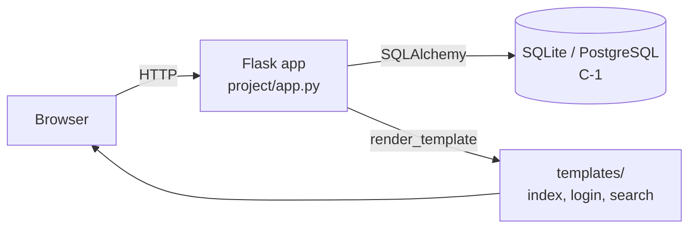
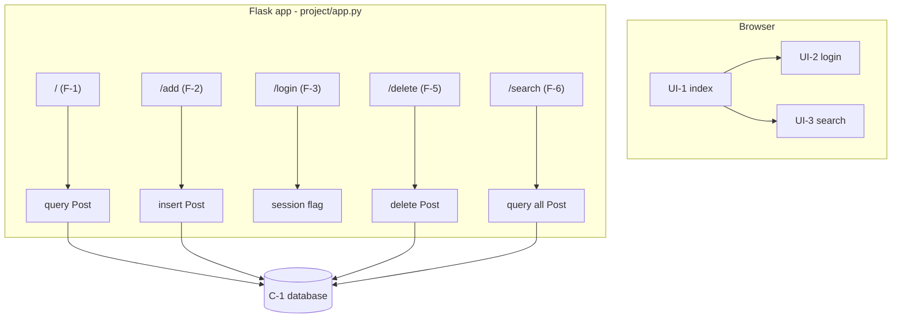
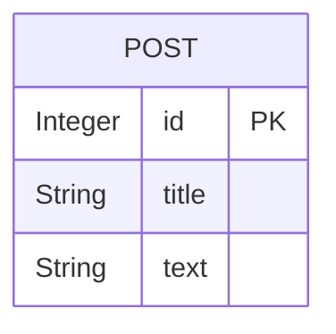

# Flaskr-TDD Documentation
<!-- appdoc:template 2.2 -->

**Target:** flaskr-tdd | **Commit:** 305122f48823d98fd7fe8de989af2821b3c5d46d | **Evidence date:** 2026-11-11

**How to read this document.** *Cited* claims carry a path-and-line Citation. **Inferred:** marks reasoning from cited evidence. *Unknown* items are listed in section 14 and must not be assumed. Secret values are never reproduced; their locations are cited with "value omitted". The Evidence Register (source-to-claim audit) is rendered as Appendix A.

## 1. Application Index

| Support need | Primary screen or file | Workflow |
|---|---|---|
| Log in or out | `project/templates/login.html` | [7.1 Log in](#71-log-in) |
| Post a new entry | `project/templates/index.html` | [7.2 Post an entry](#72-post-an-entry) |
| Delete an entry | `project/app.py:99` | [7.3 Delete an entry](#73-delete-an-entry) |
| Search entries | `project/templates/search.html` | [7.4 Search entries](#74-search-entries) |
| Create the database | `create_db.py` | [16.2 Data stores](#162-data-stores) |

## 2. Coverage and Overview

### 2.1 What was inspected

<!-- appdoc:generated scan-coverage -->
| Stack | Supported | Files read |
|---|---|---|
| python-flask | yes | 6 |

Files found: 29 = scanned 29 + pruned 0 + ignored by .appdocignore 0.

| Top folder | Files scanned |
|---|---|
| `project/` | 9 |
| `docs/` | 6 |
| `.github/` | 2 |
| `tests/` | 2 |

No folders were pruned.
<!-- /appdoc:generated scan-coverage -->

The `docs/` folder holds prior AppDoc artifacts (`docs/appdoc/`) and was not re-read as source. Binary files (`project/flaskr.db`, `test.db`, `flaskr-app.png`, `tdd.png`) were skipped by the extractor and not inspected. No unsupported Stacks were found; the `python-flask` Stack is supported.

### 2.2 Purpose and users

Flaskr is a minimal single-user message board: a user logs in with a hardcoded credential, posts titled text entries, deletes entries, and searches entries. The login page states the credential in plain text (`project/templates/login.html:53`). **Inferred:** the Target is a teaching example for test-driven development of a Flask app, given the TDD-oriented test suite (`tests/app_test.py:1`) and the long tutorial-style `README.md`. Overall risk posture: the most severe findings are V-1 (hardcoded credentials) and V-2 (weak session key), both exploitable in the default configuration.

### 2.3 System boundary

The Target is a self-contained Flask web application with a single SQLite (or PostgreSQL) database. It has no external service calls; the only outbound reference is a CDN stylesheet in the templates (`project/templates/index.html:8`).

## 3. Architecture

### 3.1 Components

- `project/app.py` — Flask app, all routes, the `login_required` decorator, and module-level configuration (`project/app.py:36-40`).
- `project/models.py` — the single SQLAlchemy model `Post` (`project/models.py:4`).
- `project/templates/` — three Jinja templates: `index.html`, `login.html`, `search.html` (`project/templates/index.html:1`).
- `project/static/` — `main.js` and `style.css` served by Flask's static route (`project/static/main.js:1`).
- `create_db.py` — one-off script that creates the database schema (`create_db.py:9`).
- `tests/app_test.py` — pytest suite with a `client` fixture that creates and drops the test database (`tests/app_test.py:11`).

### 3.2 Diagram

Caption: single-process Flask app rendering Jinja templates and reading/writing one database, per `project/app.py:36-40` and `project/models.py:4`.

### 3.3 Authentication and authorization

Authentication is a single hardcoded user: `login` compares the submitted form against `app.config["USERNAME"]` and `app.config["PASSWORD"]` and sets `session["logged_in"] = True` on success (`project/app.py:79-87`). The `login_required` decorator checks `session.get("logged_in")` and returns a 401 JSON body when absent (`project/app.py:45-50`). It is applied to `delete_entry` (`project/app.py:100`); `add_entry` performs the same session check inline (`project/app.py:66-67`). The `index`, `login`, and `search` routes have no check (`project/app.py:56`, `project/app.py:75`, `project/app.py:115`).

## 4. Functional Inventory

| ID | Area | Feature | Entry point | Inputs, outputs and rules | Dependencies | Status |
|---|---|---|---|---|---|---|
| F-1 | Posts | List all entries | `project/app.py:56` | GET `/`; renders all `Post` rows; empty state "No entries yet. Add some!" (`project/templates/index.html:77`) | C-1 | Cited |
| F-2 | Posts | Add an entry | `project/app.py:63` | POST `/add` with `title`, `text`; requires `session["logged_in"]` else 401 (`project/app.py:66-67`); redirects to index with flash (`project/app.py:71-72`) | C-1 | Cited |
| F-3 | Auth | Login | `project/app.py:75` | GET/POST `/login`; compares form to `USERNAME`/`PASSWORD` config (`project/app.py:79-83`); sets session flag on success (`project/app.py:85`) | — | Cited |
| F-4 | Auth | Logout | `project/app.py:91` | GET `/logout`; pops `logged_in` from session (`project/app.py:94`); redirects to index | — | Cited |
| F-5 | Posts | Delete an entry | `project/app.py:99` | GET `/delete/<int:post_id>`; `@login_required` (`project/app.py:100`); deletes by id, returns JSON status (`project/app.py:104-112`) | C-1 | Cited |
| F-6 | Posts | Search entries | `project/app.py:115` | GET `/search/?query=`; loads all entries, filters client-side in template (`project/templates/search.html:51-52`) | C-1 | Cited |

### 4.1 Subsystem inventory

| Subsystem | Files | Features | Primary data and dependencies | Purpose | Status |
|---|---|---|---|---|---|
| `project/` | 9 | F-1, F-2, F-3, F-4, F-5, F-6 | `Post` model, C-1 | Application code: routes, model, templates, static assets | Cited |
| `tests/` | 2 | — | test database `test.db` | pytest suite covering F-1, F-2, F-3, F-4, F-5 | Cited |
| `(root)` | 10 | — | `requirements.txt`, `create_db.py` | Project metadata, dependencies, DB bootstrap, docs | Cited |
| `docs/` | 6 | — | — | Prior AppDoc artifacts (not re-read) | Cited |
| `.github/` | 2 | — | — | CI workflow and funding metadata | Cited |

## 5. Roles and Access Model

### 5.1 Observed role concepts

No roles, groups, or scopes exist. There is a single hardcoded user (`USERNAME` at `project/app.py:23`) and a binary session flag `logged_in` (`project/app.py:85`).

### 5.2 Authorization enforcement

Enforcement is per-route, not middleware-based: the `login_required` decorator on `delete_entry` (`project/app.py:100`) and an inline `session.get("logged_in")` check in `add_entry` (`project/app.py:66-67`). Routes with no check: `/` (`project/app.py:56`), `/login` (`project/app.py:75`), `/logout` (`project/app.py:91`), `/search/` (`project/app.py:115`).

### 5.3 Role-to-capability matrix

| Area | Logged-in user | Anonymous |
|---|---|---|
| F-1 List entries | Y (`project/app.py:56`) | Y (`project/app.py:56`) |
| F-2 Add entry | Y (`project/app.py:66-67`) | — (401, `project/app.py:67`) |
| F-3 Login | — (already logged in) | Y (`project/app.py:75`) |
| F-4 Logout | Y (`project/app.py:91`) | Y (`project/app.py:91`) |
| F-5 Delete entry | Y (`project/app.py:100`) | — (401, `project/app.py:49-50`) |
| F-6 Search | Y (`project/app.py:115`) | Y (`project/app.py:115`) |

Restriction: do not infer a permission from a visible control — the add form is only rendered when `session.logged_in` (`project/templates/index.html:35`), but the route itself is the enforcement point.

## 6. UI Catalog

Source-only catalog; no screenshots or live session. All 3 screens catalogued, one per template in `project/templates/` (`project/templates/index.html:1`, `project/templates/login.html:1`, `project/templates/search.html:1`).

| ID | Page | Route or entry | Reached from | Visible controls and data | States and effects | Roles and evidence |
|---|---|---|---|---|---|---|
| UI-1 | Index / entry list | `project/app.py:56` | Direct, redirects from F-2/F-3/F-4 | Search and log in/out buttons (`project/templates/index.html:17-26`), add-entry form when logged in (`project/templates/index.html:36-65`), entry list with raw-HTML text (`project/templates/index.html:70-79`) | Flash messages shown (`project/templates/index.html:31-35`); empty state "No entries yet. Add some!" (`project/templates/index.html:77`) | All users; add form only when logged in (`project/templates/index.html:35`) |
| UI-2 | Login | `project/app.py:75` | Log-in link on UI-1/UI-3 | Username and password fields, Login button (`project/templates/login.html:31-51`), hint text with the credential (`project/templates/login.html:53`) | Error banner on bad credentials (`project/templates/login.html:25-29`); redirect to UI-1 on success (`project/app.py:87`) | Anonymous |
| UI-3 | Search | `project/app.py:115` | Search link on UI-1 | Query input and Search button (`project/templates/search.html:39-48`), filtered entry list (`project/templates/search.html:50-58`) | Client-side case-insensitive filter on title/text (`project/templates/search.html:51-52`) | All users |

## 7. Workflows

### 7.1 Log in

1. Anonymous user opens `/login` (GET) and sees the form (`project/app.py:75`, `project/templates/login.html:31`).
2. Submitting POSTs `username`/`password` to `/login` (`project/app.py:79`).
3. The handler compares the form values against `app.config["USERNAME"]` and `app.config["PASSWORD"]` (`project/app.py:79-83`); on mismatch it re-renders the form with `error` set (`project/app.py:81`, `project/app.py:83`).
4. On match it sets `session["logged_in"] = True`, flashes "You were logged in", and redirects to `/` (`project/app.py:85-87`).

Failure and escalation: wrong credentials re-render the form with "Invalid username" or "Invalid password" (`project/app.py:81-83`); there is no lockout or rate limiting, so repeated attempts are unthrottled (`project/app.py:75`).

### 7.2 Post an entry

1. Logged-in user fills the title/text form on `/` and submits to `/add` (POST) (`project/templates/index.html:36-65`).
2. `add_entry` checks `session.get("logged_in")` and aborts with 401 if absent (`project/app.py:66-67`).
3. It creates a `Post` from the form fields, adds and commits it (`project/app.py:68-70`), flashes "New entry was successfully posted", and redirects to `/` (`project/app.py:71-72`).

Failure and escalation: an unauthenticated POST gets a bare 401 with no body (`project/app.py:67`); a database error propagates as an unhandled 500 because `add_entry` has no try/except (`project/app.py:63-72`).

### 7.3 Delete an entry

1. A logged-in client issues GET `/delete/<int:post_id>` (`project/app.py:99`).
2. `@login_required` rejects unauthenticated calls with a 401 JSON body (`project/app.py:49-50`, `project/app.py:100`).
3. The handler deletes the `Post` row by id and commits inside a try/except (`project/app.py:104-107`), returning `{"status": 1, "message": "Post Deleted"}` on success (`project/app.py:108`).
4. On exception it returns `{"status": 0, "message": repr(e)}` (`project/app.py:110-111`).

Failure and escalation: the test suite asserts `status == 0` before login and `status == 1` after (`tests/app_test.py:80-88`); a database error is swallowed into the JSON response rather than raised (`project/app.py:110-111`).

### 7.4 Search entries

1. User opens `/search/` (GET), optionally with `?query=` (`project/app.py:115`).
2. The handler loads **all** `Post` rows regardless of the query (`project/app.py:118`).
3. The template filters client-side, case-insensitively, on title or text (`project/templates/search.html:51-52`).

Failure and escalation: **Inferred:** with a large table the full table is transferred to the browser on every search because no SQL filter is applied (`project/app.py:118`); there is no error path in the handler (`project/app.py:115-121`).

## 8. Data and Integrations

### 8.1 Connections

| ID | Name | Kind | Configured at | Used by |
|---|---|---|---|---|
| C-1 | flaskr.db (SQLite) or PostgreSQL via `DATABASE_URL` | relational database | `project/app.py:26-31` | `project/app.py` (all data access), `create_db.py:9` |

### 8.2 Stored procedures and SQL

None. All data access is through the SQLAlchemy ORM: `db.session.query(models.Post)` for reads (`project/app.py:59`, `project/app.py:118`) and `filter_by(id=...).delete()` for deletes (`project/app.py:106`).

### 8.3 External calls

| ID | Call | Direction | Caller | Notes |
|---|---|---|---|---|

None. No outbound HTTP, message-bus, or email calls exist in source; the only external reference is the CDN stylesheet link in templates (`project/templates/index.html:8`).

### 8.4 Data entities and sensitivity

| Entity | Key fields | Defined at | Sensitivity |
|---|---|---|---|
| Post | `id`, `title`, `text` | `project/models.py:4` | Public content; `text` is rendered as raw HTML (`project/templates/index.html:74`) |

Post fields:

| Field | Type | Null | Key/FK | Sensitivity | Citation |
|---|---|---|---|---|---|
| id | Integer | no | primary key | public | `project/models.py:5` |
| title | String | no | — | public | `project/models.py:6` |
| text | String | no | — | public, rendered unescaped | `project/models.py:7` |

### 8.5 Failure, fallback and observability

| ID | Timeout and retry | On failure | Observability |
|---|---|---|---|
| C-1 | none (SQLAlchemy default) | `delete_entry` catches and returns JSON status 0 (`project/app.py:110-111`); `index`/`add_entry`/`search` raise an unhandled 500 (`project/app.py:59`, `project/app.py:70`) | none; no logging is configured (`project/app.py:36-40`) |

## 9. Troubleshooting Matrix

| Symptom | Checks | Known response | Escalate when |
|---|---|---|---|
| "Invalid username" / "Invalid password" on login | Compare submitted values with `USERNAME`/`PASSWORD` config (`project/app.py:79-83`) | Re-render login form with error banner (`project/templates/login.html:25-29`) | If the correct credential from `project/templates/login.html:53` is rejected |
| 401 JSON `{"status": 0, "message": "Please log in."}` on delete | Session flag `logged_in` absent (`project/app.py:48-50`) | Log in first (`project/app.py:85`) | If it persists after a successful login |
| 401 with empty body on POST `/add` | `session.get("logged_in")` false (`project/app.py:66-67`) | Log in first | If it persists after a successful login |
| Delete returns `{"status": 0, "message": ...}` | Exception text in the JSON body (`project/app.py:110-111`) | Inspect the exception; typically a database error | If the database file is missing or corrupt (C-1) |
| Blank page / 500 on `/` or `/add` | Database unreachable or schema missing (`project/app.py:59`, `project/app.py:70`) | Run `create_db.py` (`create_db.py:9`) | If the schema exists and the error persists |

## 10. Security and Operational Risks

Findings below were observed directly in source; every Citation carries a line. The credential and key values are omitted; their locations are cited (`project/app.py:23-25`).

### 10.1 Verified findings

| ID | Severity | Finding | Evidence | Impact |
|---|---|---|---|---|
| V-1 | Critical | Login credentials are hardcoded in source and shown on the login page; value omitted | `project/app.py:23-24`, `project/templates/login.html:53` | Anyone reading the repo or the login page can authenticate; exploitable without any prior access in the default configuration |
| V-2 | High | `SECRET_KEY` is the placeholder string "change_me"; value omitted | `project/app.py:25` | Flask session cookies are signed with a publicly known key, so sessions can be forged to impersonate the logged-in user |
| V-3 | High | Entry `text` is rendered with the `safe` filter, so stored HTML is executed in readers' browsers | `project/templates/index.html:74`, `project/templates/search.html:55` | Stored XSS: a posted entry can run script in any user's browser; the test suite asserts raw HTML is preserved (`tests/app_test.py:76-77`) |
| V-4 | Medium | Delete is a state-changing GET route, so it can be triggered by links, prefetchers, or CSRF | `project/app.py:99` | An attacker page can delete entries of a logged-in victim via an auto-loaded image or link |
| V-5 | Low | Password comparison uses `!=` (timing side channel) and there is no lockout or rate limiting | `project/app.py:79-83` | Enables offline timing analysis and unlimited online guessing; low impact because the credential is already public (V-1) |

### 10.2 Unknowns that must not be treated as controls

| Control | Status | Where looked |
|---|---|---|
| TLS / HTTPS | Not established | **Inferred:** The deployment runs gunicorn without TLS (the Procfile at line 1 specifies `web: gunicorn ...`); no server or proxy config exists in the Target (`requirements.txt:1-8`) |
| CSRF protection | Verified absent | No CSRF token in any form (`project/templates/index.html:36`, `project/templates/login.html:31`) and no Flask-WTF dependency (`requirements.txt:1-8`) |
| MFA | Verified absent | Single username/password check only (`project/app.py:79-83`) |
| Secure/HttpOnly cookie flags | Not established | No `SESSION_COOKIE_*` config in `project/app.py:22-31`; Flask defaults apply |
| Rate limiting | Verified absent | No limiter dependency or per-route throttling (`requirements.txt:1-8`, `project/app.py:75`) |
| Audit-log integrity | Verified absent | No logging or audit trail is configured (`project/app.py:36-40`) |
| Backup and recovery | Verified absent | No backup script, job, or configuration in the Target; the only DB script creates the schema (`create_db.py:9`) |
| Production secret management | Verified absent | Credentials and `SECRET_KEY` are hardcoded module constants (`project/app.py:23-25`) |

## 11. Ownership and Maintenance

| Area | Evidence | Status |
|---|---|---|
| Application code | `project/app.py`, `project/models.py` | Cited |
| Test suite | `tests/app_test.py` covers F-1 (index, `tests/app_test.py:38`), F-3/F-4 (login/logout, `tests/app_test.py:55-64`), F-2 (post, `tests/app_test.py:67-77`), F-5 (delete, `tests/app_test.py:80-88`); F-6 has no test | Cited |
| CI | `.github/workflows/main.yml` runs flake8, black, and pytest on every push across Python 3.8-3.12 (`.github/workflows/main.yml:3`, `.github/workflows/main.yml:20-29`) | Cited |
| Ownership / maintainers | Git history is shallow; no appdoc-context.md exists in the Target | Unknown |

Recommended maintenance minimum: keep the pytest suite green on every push (`.github/workflows/main.yml:29`); rotate the hardcoded credential and `SECRET_KEY` out of source (V-1, V-2); add a backup step for C-1.

## 12. Architecture and Data-Flow Diagrams

Caption: data flow between the three screens, the five data-touching routes, and the single database, per `project/app.py:56-121`.

Caption: single-entity schema from `project/models.py:4-7`.

## 13. Glossary

| Term | Meaning | Citation |
|---|---|---|
| Flaskr | The name of this Flask message-board app | `project/templates/index.html:14` |
| Post | The single data entity: a titled text entry | `project/models.py:4` |
| `logged_in` | Session flag set on successful login | `project/app.py:85` |
| `login_required` | Decorator that 401s unauthenticated calls to a route | `project/app.py:45` |
| `DATABASE_URL` | Environment variable overriding the database connection string | `project/app.py:26` |
| `SECRET_KEY` | Key used to sign Flask session cookies | `project/app.py:25` |
| C-1 | The application database (SQLite by default, PostgreSQL via `DATABASE_URL`) | `project/app.py:26-31` |

## 14. Open Questions and Documentation Gaps

| ID | Question | Why it matters | How to close | Owner | Priority |
|---|---|---|---|---|---|
| Q-1 | What is the production deployment environment and how is the app served behind TLS? | TLS status (10.2) and the runbook (16.5) depend on it | Ask the operator; inspect any hosting config outside this repo | Unknown | Medium |
| Q-2 | Is the client-side-only search (F-6) intended, or should it filter in SQL? | Performance and data exposure at scale (`project/app.py:118`) | Confirm with the maintainer; add a SQL filter if intended | Unknown | Low |
| Q-3 | Who owns this codebase? | Git history is shallow, so ownership Facts are unavailable | Obtain full git history or owner notes (appdoc-context.md) | Unknown | Low |

## 15. Recommendations

| ID | Severity | Effort | Recommendation | Addresses |
|---|---|---|---|---|
| R-1 | Critical | S | Move `USERNAME`/`PASSWORD` to environment variables (as `DATABASE_URL` already is) and remove the credential hint from the login page | V-1 |
| R-2 | High | S | Set a strong, unique `SECRET_KEY` from the environment instead of the placeholder | V-2 |
| R-3 | High | M | Escape entry text (drop the `safe` filter) or sanitize it before rendering | V-3 |
| R-4 | Medium | S | Change delete to POST and add a CSRF token to all state-changing forms | V-4, 10.2 CSRF protection |
| R-5 | Medium | S | Add rate limiting or lockout to `/login` | V-5, 10.2 Rate limiting |
| R-6 | Medium | M | Add a scheduled backup of the database file and a documented restore step | 10.2 Backup and recovery |
| R-7 | Low | S | Decide whether search should filter in SQL; if so, add the filter and a test | Q-2 |
| R-8 | Medium | L | Terminate TLS at a reverse proxy or load balancer in front of gunicorn; document the topology | TLS / HTTPS, Q-1 |
| R-9 | Low | M | Add MFA (e.g. TOTP) to the login flow once the credential is moved out of source | MFA |
| R-10 | Medium | S | Set `SESSION_COOKIE_SECURE` and `SESSION_COOKIE_HTTPONLY` in the app config | Secure/HttpOnly cookie flags |
| R-11 | Medium | M | Add structured logging of auth and data-mutation events with tamper-evident storage | Audit-log integrity |
| R-12 | High | S | Load all secrets from the environment or a secret manager; remove hardcoded values from source | Production secret management, V-1, V-2 |

### 15.1 Coverage summary

This document verified the application source (`project/`), the test suite (`tests/`), the CI workflow (`.github/workflows/`), and the dependency and runtime pins. It did not inspect: the binary database files, the prior AppDoc artifacts under `docs/appdoc/`, or any deployment environment outside the repository. A reader must confirm the production environment (Q-1) and the intended search behavior (Q-2) before relying on sections 10 and 16.

## 16. Operations Runbook

### 16.1 Platform requirements

Python 3.12.0 per `runtime.txt:1`; CI additionally tests 3.8-3.11 (`.github/workflows/main.yml:11`). Pinned dependencies: Flask 3.0.0, Flask-SQLAlchemy 3.1.1, gunicorn 21.2.0, psycopg2-binary 2.9.9 (`requirements.txt:1-4`); dev tools black, flake8, pytest (`requirements.txt:6-8`).

### 16.2 Data stores

C-1 is a SQLite file `flaskr.db` next to the app by default, overridable with the `DATABASE_URL` environment variable (`project/app.py:22-26`). The schema is created by `db.create_all()` in `create_db.py:9`; there are no migrations or seed data. Tests use a separate `test.db` created and dropped per run (`tests/app_test.py:16-21`).

### 16.3 Session and authentication behavior

Sessions are Flask server-signed cookies using `SECRET_KEY` (`project/app.py:25`); the only session key is `logged_in` (`project/app.py:85`), cleared on logout (`project/app.py:94`). No session timeout or cookie flags are configured (`project/app.py:22-31`).

### 16.4 Known failure modes and operator responses

| Failure mode | Signal | Operator response |
|---|---|---|
| Database missing or corrupt | 500 on `/` or `/add`; delete JSON `status: 0` (`project/app.py:59`, `project/app.py:110-111`) | Re-run `create_db.py` (`create_db.py:9`); restore C-1 from backup (Unknown - see Open questions.) |
| Login rejected | "Invalid username"/"Invalid password" banner (`project/app.py:81-83`) | Verify the configured credential; no lockout to clear (`project/app.py:75`) |
| Delete fails | JSON `{"status": 0, "message": ...}` (`project/app.py:110-111`) | Read the exception text; check C-1 availability |

### 16.5 Deployment and change process

| Step | Procedure | Evidence |
|---|---|---|
| Build | `pip install -r requirements.txt` | `.github/workflows/main.yml:20-22` |
| Test | `python -m pytest` (plus flake8 and black checks) | `.github/workflows/main.yml:24-29` |
| Deploy | `gunicorn project.app:app` | `Procfile:1` |
| Upgrade | Update `requirements.txt` pins and re-run the CI build/test job | `requirements.txt:1-8`, `.github/workflows/main.yml:20-29` |
| Rollback | Unknown - no rollback procedure is defined in the repository | Unknown - see Open questions. |
| Backup | Unknown - no backup job or script is defined in the repository | Unknown - see Open questions. |
| Restore | Unknown - no restore procedure is defined in the repository | Unknown - see Open questions. |
| Secret rotation | Unknown - credentials are hardcoded, so rotation requires a code change and redeploy | `project/app.py:23-25` |

### 16.6 Configuration reference

<!-- appdoc:generated config-reference -->
| Key | Defined at | Secret location |
|---|---|---|
| DATABASE_URL | `project/app.py:26` | no |
| USERNAME | `project/app.py:80` | no |
| PASSWORD | `project/app.py:82` | yes |
<!-- /appdoc:generated config-reference -->

Effect notes: `DATABASE_URL` selects the database backend and is the only externally supplied setting (`project/app.py:26-28`); `USERNAME`/`PASSWORD` gate F-2, F-3, F-5 (`project/app.py:79-83`); `SECRET_KEY` signs all session cookies (`project/app.py:25`).
