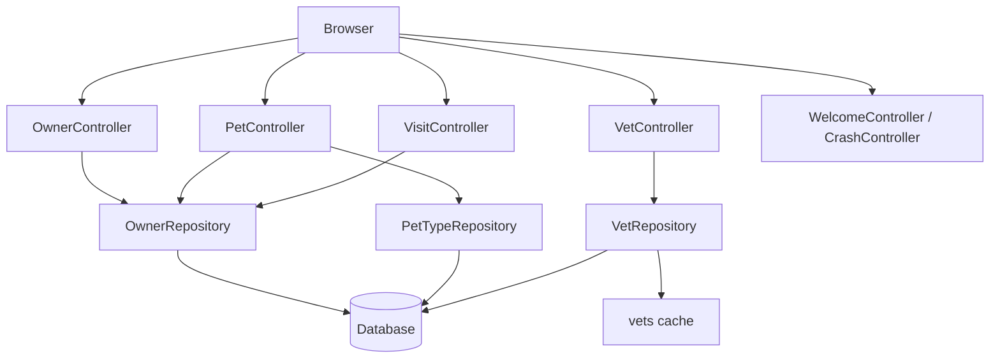
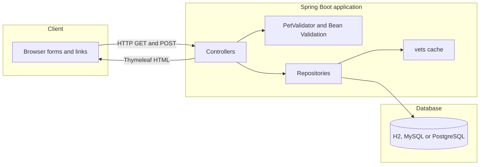
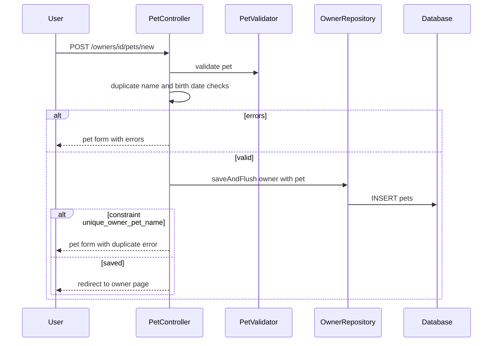
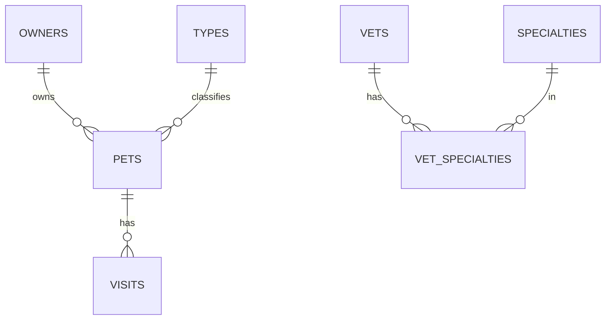

# Spring PetClinic Documentation
<!-- appdoc:template 2.2 -->

**Target:** spring-petclinic | **Commit:** 500158f732419217507c7656904b8e6aa1bcc0d6 | **Evidence date:** 2026-11-11

**How to read this document.** *Cited* claims carry a path-and-line Citation. **Inferred:** marks reasoning from cited evidence. *Unknown* items are listed in section 14 and must not be assumed. Secret values are never reproduced; their locations are cited with "value omitted". The Evidence Register (source-to-claim audit) is rendered as Appendix A.

## 1. Application Index

| Support need | Primary screen or file | Workflow |
|---|---|---|
| A user cannot find an owner | Find Owners page, `src/main/resources/templates/owners/findOwners.html:9`; search logic `src/main/java/org/springframework/samples/petclinic/owner/OwnerController.java:94-130` | [7.3 Find owners](#73-find-owners) |
| Owner address or telephone is wrong or is rejected | Owner form, `src/main/resources/templates/owners/createOrUpdateOwnerForm.html:8-14`; rules `src/main/java/org/springframework/samples/petclinic/owner/Owner.java:52-65` | [7.1 Create an owner](#71-create-an-owner), [7.2 Edit an owner](#72-edit-an-owner) |
| A pet name is rejected as a duplicate | `src/main/java/org/springframework/samples/petclinic/owner/PetController.java:111-113` and `src/main/java/org/springframework/samples/petclinic/owner/PetController.java:151-156` | [7.5 Add a pet to an owner](#75-add-a-pet-to-an-owner), [7.6 Edit a pet](#76-edit-a-pet) |
| A visit will not save ("must be in the future") | `src/main/java/org/springframework/samples/petclinic/owner/VisitController.java:100-102` | [7.7 Book a visit](#77-book-a-visit) |
| The error page or an HTTP 500 appears | `src/main/resources/templates/error.html:11-15` | [7.9 Trigger the demonstration error page](#79-trigger-the-demonstration-error-page) |
| The vets list looks stale or empty | `src/main/java/org/springframework/samples/petclinic/vet/VetRepository.java:44-55` | [7.8 Browse veterinarians](#78-browse-veterinarians) |
| The application does not start or cannot reach its database | `src/main/resources/application.properties:1-12`, profile files in section 8.1 | [16.4 Known failure modes](#164-known-failure-modes-and-operator-responses) |
| Someone asks whether data is protected | Section 10.1 and 10.2 | none (no access control exists) |

## 2. Coverage and Overview

### 2.1 What was inspected

<!-- appdoc:generated scan-coverage -->
| Stack | Supported | Files read |
|---|---|---|
| java-spring | yes | 53 |

Files found: 138 = scanned 138 + pruned 0 + ignored by .appdocignore 0.

| Top folder | Files scanned |
|---|---|
| `src/` | 107 |
| `docs/` | 6 |
| `.github/` | 4 |
| `.devcontainer/` | 2 |
| `gradle/` | 2 |
| `k8s/` | 2 |
| `.mvn/` | 1 |

No folders were pruned.
<!-- /appdoc:generated scan-coverage -->

The Target is a Java Spring Boot web application. One Stack, `java-spring`, was extracted (53 files read) with marker files `build.gradle` and `pom.xml` (`facts-summary.md`). The generic extractor scanned all 138 files in the Target (`facts-summary.md`). No unsupported Stack was detected.

Source reading covered the controllers, entities `Owner`, `Pet`, `Visit` and `Vet`, repositories, validator, formatter and configuration classes under `src/main/java/org/springframework/samples/petclinic/`; the base classes, `PetType`, `Specialty` and package info were checked by pattern search only. Also read: the Thymeleaf templates in `src/main/resources/templates/`, the three `application*.properties` files, the H2 and PostgreSQL schemas, the MySQL schema and user script, `k8s/`, `docker-compose.yml`, `.github/workflows/`, `.devcontainer/`, and the build files `pom.xml` and `build.gradle`.

Not inspected in detail: static assets (`src/main/resources/static/`, `src/main/scss/`), the ten non-default translation files in `src/main/resources/messages/`, the JMeter plan `src/test/jmeter/petclinic_test_plan.jmx`, the wrapper scripts, and test code beyond spot checks. No tests were run. The Target has no owner-context file (appdoc-context.md does not exist), and its Git history is shallow (`facts-summary.md`).

### 2.2 Purpose and users

Spring PetClinic describes itself as a "Spring PetClinic Sample Application" (`README.md:1`). From the controllers, it lets a user find and edit pet owners, add and edit their pets, book visits for a pet, and view the list of veterinarians (`src/main/java/org/springframework/samples/petclinic/owner/OwnerController.java:72-186`, `src/main/java/org/springframework/samples/petclinic/vet/VetController.java:45-78`).

**Inferred:** the audience is developers learning Spring Boot, because the README calls it a sample (`README.md:1`) and the code ships a deliberate crash page (`src/main/java/org/springframework/samples/petclinic/system/CrashController.java:31-34`). Real-world business users, clinic staff and any production use are Unknown - see Open questions.

Overall risk posture: the most severe findings are V-1 (no authentication or authorization) and V-3 (unauthenticated bulk listing of personal data) in section 10.1.

### 2.3 System boundary

Inside the boundary: one Spring Boot process serving server-rendered HTML pages and one JSON endpoint (`src/main/java/org/springframework/samples/petclinic/PetClinicApplication.java:28-34`, `src/main/java/org/springframework/samples/petclinic/vet/VetController.java:72-78`), plus an in-process cache (`src/main/java/org/springframework/samples/petclinic/system/CacheConfiguration.java:31-38`).

Outside the boundary: a relational database, H2 in memory by default, or MySQL or PostgreSQL through Spring profiles (`src/main/resources/application.properties:2-4`, `src/main/resources/application-mysql.properties:2-5`, `src/main/resources/application-postgres.properties:2-5`). No other outbound system is called from production code (see 8.3). Kubernetes and Docker Compose files describe how a database and the application can be run, not additional runtime dependencies (`k8s/petclinic.yml:1-64`, `docker-compose.yml:1-21`).

## 3. Architecture

### 3.1 Components

The application is a single Spring Boot service with a conventional layered design:

- **Application entry:** `PetClinicApplication` starts Spring Boot and registers native-image runtime hints (`src/main/java/org/springframework/samples/petclinic/PetClinicApplication.java:28-34`, `src/main/java/org/springframework/samples/petclinic/PetClinicRuntimeHints.java:25-36`).
- **Web controllers:** `OwnerController` (`src/main/java/org/springframework/samples/petclinic/owner/OwnerController.java:49`), `PetController` (`src/main/java/org/springframework/samples/petclinic/owner/PetController.java:48-49`), `VisitController` (`src/main/java/org/springframework/samples/petclinic/owner/VisitController.java:43`), `VetController` (`src/main/java/org/springframework/samples/petclinic/vet/VetController.java:37`), `WelcomeController` (`src/main/java/org/springframework/samples/petclinic/system/WelcomeController.java:23`) and `CrashController` (`src/main/java/org/springframework/samples/petclinic/system/CrashController.java:29`).
- **Domain entities:** `Owner`, `Pet`, `Visit` and `PetType` in the owner package, `Vet` and `Specialty` in the vet package, with base classes `BaseEntity`, `NamedEntity` and `Person` (`src/main/java/org/springframework/samples/petclinic/owner/Owner.java:48-50`, `src/main/java/org/springframework/samples/petclinic/owner/Pet.java:44-46`, `src/main/java/org/springframework/samples/petclinic/owner/Visit.java:35-37`, `src/main/java/org/springframework/samples/petclinic/owner/PetType.java:26-28`, `src/main/java/org/springframework/samples/petclinic/vet/Vet.java:43-45`, `src/main/java/org/springframework/samples/petclinic/vet/Specialty.java:28-30`, `src/main/java/org/springframework/samples/petclinic/model/Person.java:28-29`).
- **Data access:** Spring Data repositories `OwnerRepository` and `PetTypeRepository` extend `JpaRepository`; `VetRepository` extends the bare `Repository` interface with two read-only methods (`src/main/java/org/springframework/samples/petclinic/owner/OwnerRepository.java:36`, `src/main/java/org/springframework/samples/petclinic/owner/PetTypeRepository.java:30`, `src/main/java/org/springframework/samples/petclinic/vet/VetRepository.java:38-55`).
- **Validation and formatting:** `PetValidator` validates pet forms, and `PetTypeFormatter` converts a pet-type name to a `PetType` (`src/main/java/org/springframework/samples/petclinic/owner/PetValidator.java:32-59`, `src/main/java/org/springframework/samples/petclinic/owner/PetTypeFormatter.java:36-60`).
- **Cross-cutting configuration:** `CacheConfiguration` enables caching and creates a cache named `vets`; `WebConfiguration` sets a session-based locale and a `lang` request parameter (`src/main/java/org/springframework/samples/petclinic/system/CacheConfiguration.java:31-38`, `src/main/java/org/springframework/samples/petclinic/system/WebConfiguration.java:23-58`).
- **Views:** server-side Thymeleaf templates share a layout fragment (`src/main/resources/templates/fragments/layout.html:20-65`).

### 3.2 Diagram

Caption: component diagram of controllers, repositories, the `vets` cache and the database (`src/main/java/org/springframework/samples/petclinic/owner/OwnerController.java:49-57`, `src/main/java/org/springframework/samples/petclinic/vet/VetRepository.java:44-55`).

### 3.3 Authentication and authorization

The Target has no authentication or authorization. The declared dependencies include actuator, cache, JPA, Thymeleaf, validation and web MVC starters but no security starter (`pom.xml:40-65`, `build.gradle:34-41`). A search of the production Java source and templates for role, admin, principal, login and authentication terms found only an HTML `role="navigation"` attribute (`src/main/resources/templates/fragments/layout.html:20`). No `auth_check` Facts were extracted (`facts-summary.md`). Every route in section 4 is therefore reachable by any client that can reach the server.

## 4. Functional Inventory

The Target exposes 17 route-and-method combinations in five controllers. There is no delete handler: production source contains only `GetMapping`, `PostMapping` and one class-level `RequestMapping` (`src/main/java/org/springframework/samples/petclinic/owner/PetController.java:48`). The create and edit flows are documented in section 7.

| ID | Area | Feature | Entry point | Inputs, outputs and rules | Dependencies | Status |
|---|---|---|---|---|---|---|
| F-1 | System | Show welcome page | GET `/` (`src/main/java/org/springframework/samples/petclinic/system/WelcomeController.java:25-28`) | Returns the `welcome` view; no input | none | Cited |
| F-2 | Owner | Show owner creation form | GET `/owners/new` (`src/main/java/org/springframework/samples/petclinic/owner/OwnerController.java:72-75`) | Returns the owner form with a new empty `Owner` | `OwnerController.findOwner` | Cited |
| F-3 | Owner | Create owner | POST `/owners/new` (`src/main/java/org/springframework/samples/petclinic/owner/OwnerController.java:77-87`) | Inputs first name, last name, address, city, telephone; validated; saves and redirects to `/owners/{id}` | `OwnerRepository` | Cited |
| F-4 | Owner | Show owner search form | GET `/owners/find` (`src/main/java/org/springframework/samples/petclinic/owner/OwnerController.java:89-92`) | Returns the search form | none | Cited |
| F-5 | Owner | Search owners | GET `/owners` (`src/main/java/org/springframework/samples/petclinic/owner/OwnerController.java:94-130`) | Optional `lastName` prefix and `page`; 5 owners per page; one hit redirects to the owner; an empty term lists all owners | `OwnerRepository` | Cited |
| F-6 | Owner | Show owner edit form | GET `/owners/{ownerId}/edit` (`src/main/java/org/springframework/samples/petclinic/owner/OwnerController.java:148-151`) | Returns the owner form pre-filled from the loaded owner | `OwnerController.findOwner` | Cited |
| F-7 | Owner | Update owner | POST `/owners/{ownerId}/edit` (`src/main/java/org/springframework/samples/petclinic/owner/OwnerController.java:153-171`) | Validated owner fields; rejects an id that differs from the URL; saves and redirects to the owner page | `OwnerRepository` | Cited |
| F-8 | Owner | Show owner details | GET `/owners/{ownerId}` (`src/main/java/org/springframework/samples/petclinic/owner/OwnerController.java:178-186`) | Owner fields with pets and their visits; unknown id throws `IllegalArgumentException` | `OwnerRepository` | Cited |
| F-9 | Pet | Show pet creation form | GET `/owners/{ownerId}/pets/new` (`src/main/java/org/springframework/samples/petclinic/owner/PetController.java:100-105`) | Adds an empty `Pet` to the owner model and returns the pet form | `PetTypeRepository` | Cited |
| F-10 | Pet | Create pet | POST `/owners/{ownerId}/pets/new` (`src/main/java/org/springframework/samples/petclinic/owner/PetController.java:107-137`) | Name, type, birth date; rejects duplicate names per owner and future birth dates; saves owner with the new pet | `OwnerRepository` | Cited |
| F-11 | Pet | Show pet edit form | GET `/owners/{ownerId}/pets/{petId}/edit` (`src/main/java/org/springframework/samples/petclinic/owner/PetController.java:139-142`) | Returns the pet form for the pet loaded by `findPet` | `PetController.findPet` | Cited |
| F-12 | Pet | Update pet | POST `/owners/{ownerId}/pets/{petId}/edit` (`src/main/java/org/springframework/samples/petclinic/owner/PetController.java:144-179`) | Name, type, birth date; duplicate-name and birth-date rules; updates the existing pet and saves the owner | `OwnerRepository` | Cited |
| F-13 | Visit | Show visit form | GET `/owners/{ownerId}/pets/{petId}/visits/new` (`src/main/java/org/springframework/samples/petclinic/owner/VisitController.java:90-93`) | Returns the visit form with the pet and its earlier visits | `OwnerRepository` | Cited |
| F-14 | Visit | Book visit | POST `/owners/{ownerId}/pets/{petId}/visits/new` (`src/main/java/org/springframework/samples/petclinic/owner/VisitController.java:97-112`) | Date and description; date must be after today; saves through the owner | `OwnerRepository` | Cited |
| F-15 | Vet | List vets (HTML) | GET `/vets.html` (`src/main/java/org/springframework/samples/petclinic/vet/VetController.java:45-53`) | `page` parameter; 5 vets per page; an out-of-range page redirects to page 1 | `VetRepository` | Cited |
| F-16 | Vet | List vets (JSON) | GET `/vets` (`src/main/java/org/springframework/samples/petclinic/vet/VetController.java:72-78`) | Returns all vets as a `Vets` object | `VetRepository` | Cited |
| F-17 | System | Trigger demonstration error | GET `/oups` (`src/main/java/org/springframework/samples/petclinic/system/CrashController.java:31-34`) | Always throws `RuntimeException` | none | Cited |

### 4.1 Subsystem inventory

| Subsystem | Files | Features | Primary data and dependencies | Purpose | Status |
|---|---|---|---|---|---|
| `src/` | 107 | F-1 to F-17 | All application source, resources, and test code | Java source (30 files), resources (50 files), tests (21 files), checkstyle (2 files), SCSS (4 files) | Cited |
| `(root)` | 14 | — | Build scripts, README, compose file | Maven and Gradle builds, documentation, `docker-compose.yml` | Cited |
| `docs/` | 6 | — | Prior AppDoc output | Previous documentation artifacts | Cited |
| `.github/` | 4 | — | GitHub Actions | CI workflows and DCO configuration | Cited |
| `.devcontainer/` | 2 | — | Dev container | Developer environment | Cited |
| `gradle/` | 2 | — | Gradle wrapper | Build tool pin | Cited |
| `k8s/` | 2 | — | Kubernetes manifests, PostgreSQL | Demonstration deployment | Cited |
| `.mvn/` | 1 | — | Maven wrapper | Build tool pin (`.mvn/wrapper/maven-wrapper.properties:3`) | Cited |

## 5. Roles and Access Model

### 5.1 Observed role concepts

No role, group, scope, permission or client-identity concept was observed. A search of production Java, templates and properties for role, admin, principal, login and authentication terms found only `role="navigation"`, an HTML accessibility attribute (`src/main/resources/templates/fragments/layout.html:20`). The dependency list has no security starter (`pom.xml:40-65`). The only per-visitor state is the session-held locale (`src/main/java/org/springframework/samples/petclinic/system/WebConfiguration.java:33-37`).

### 5.2 Authorization enforcement

Authorization would normally be enforced by Spring Security configuration or method annotations; the Target has neither (`pom.xml:40-65`). The controllers perform no caller checks: each loads the owner purely from the URL id (`src/main/java/org/springframework/samples/petclinic/owner/OwnerController.java:64-70`, `src/main/java/org/springframework/samples/petclinic/owner/PetController.java:67-73`, `src/main/java/org/springframework/samples/petclinic/owner/VisitController.java:63-69`). The only request-level safeguard is a data binder that blocks form fields named `id` (`src/main/java/org/springframework/samples/petclinic/owner/OwnerController.java:59-62`, `src/main/java/org/springframework/samples/petclinic/owner/PetController.java:89-98`, `src/main/java/org/springframework/samples/petclinic/owner/VisitController.java:51-54`); that is input hygiene, not authorization. Routes with no check: all 17 routes in section 4.

### 5.3 Role-to-capability matrix

There are no roles (`pom.xml:40-65`), so the single column is an anonymous visitor. Y = allowed with no check (cited).

| Capability | Anonymous visitor | Evidence |
|---|---|---|
| View welcome page (F-1) | Y | `src/main/java/org/springframework/samples/petclinic/system/WelcomeController.java:25-28` |
| Create owner (F-2, F-3) | Y | `src/main/java/org/springframework/samples/petclinic/owner/OwnerController.java:72-87` |
| Search and list all owners (F-4, F-5) | Y | `src/main/java/org/springframework/samples/petclinic/owner/OwnerController.java:89-130` |
| Edit any owner (F-6, F-7) | Y | `src/main/java/org/springframework/samples/petclinic/owner/OwnerController.java:148-171` |
| View any owner with pets and visits (F-8) | Y | `src/main/java/org/springframework/samples/petclinic/owner/OwnerController.java:178-186` |
| Create and edit any pet (F-9 to F-12) | Y | `src/main/java/org/springframework/samples/petclinic/owner/PetController.java:100-179` |
| Book a visit for any pet (F-13, F-14) | Y | `src/main/java/org/springframework/samples/petclinic/owner/VisitController.java:90-112` |
| List vets in HTML or JSON (F-15, F-16) | Y | `src/main/java/org/springframework/samples/petclinic/vet/VetController.java:45-78` |
| Trigger the demonstration error (F-17) | Y | `src/main/java/org/springframework/samples/petclinic/system/CrashController.java:31-34` |
| Read actuator endpoints | Y by configuration (which endpoints exist is Unknown) | `src/main/resources/application.properties:19-21` |

**Restriction note:** do not infer a permission from a visible control; the absence of a security dependency means every capability is public (`pom.xml:40-65`).

## 6. UI Catalog

Source-only catalog; no screenshots or live session. All pages are server-rendered Thymeleaf templates (`src/main/resources/templates/fragments/layout.html:20-65`).

| ID | Page | Route or entry | Reached from | Visible controls and data | States and effects | Roles and evidence |
|---|---|---|---|---|---|---|
| UI-1 | Welcome | `/` | Direct URL | Heading and a picture; navigation bar with Find owners, Veterinarians and Error items | Static content | Public; `src/main/resources/templates/welcome.html:7-11`, `src/main/resources/templates/fragments/layout.html:46-59` |
| UI-2 | Find Owners | `/owners/find` | Navigation bar | Last-name text box (max 80), Find Owner button, Add Owner link | Submits GET `/owners`; shows "not found" errors from the search | Public; `src/main/resources/templates/owners/findOwners.html:9-29` |
| UI-3 | Owners list | `/owners` | Find Owners form | Table of name (link), address, city, telephone, pets; page links and first, previous, next, last arrows when more than one page | Appears only when two or more owners match | Public; `src/main/resources/templates/owners/ownersList.html:9-58` |
| UI-4 | Owner details | `/owners/{id}` | Owners list, redirect after save | Name, address, city, telephone; Edit Owner and Add New Pet buttons; per pet: name, birth date, type, visits table, Edit Pet and Add Visit links | Success and error flash messages are hidden by script after 3 seconds | Public; `src/main/resources/templates/owners/ownerDetails.html:9-91` |
| UI-5 | Owner form | `/owners/new`, `/owners/{id}/edit` | Find Owners page, owner details page | First name, last name, address, city, telephone; Add Owner or Update Owner button | Field errors beside each input; POST form | Public; `src/main/resources/templates/owners/createOrUpdateOwnerForm.html:8-21` |
| UI-6 | Pet form | `/owners/{id}/pets/new`, `/owners/{id}/pets/{petId}/edit` | Owner details page | Owner name (read-only), name, birth date, type drop-down, hidden id field; Add Pet or Update Pet button | Field errors; type list from `PetTypeRepository` | Public; `src/main/resources/templates/pets/createOrUpdatePetForm.html:11-30` |
| UI-7 | Visit form | `/owners/{id}/pets/{petId}/visits/new` | Owner details page | Pet summary table, date (minimum is tomorrow), description, hidden pet id; Add Visit button; list of previous visits | Date field enforces a minimum in the browser and again on the server | Public; `src/main/resources/templates/pets/createOrUpdateVisitForm.html:12-55`, `src/main/resources/templates/fragments/inputField.html:14` |
| UI-8 | Veterinarians | `/vets.html` | Navigation bar | Table of vet name and specialties; page links | Paginated, 5 per page | Public; `src/main/resources/templates/vets/vetList.html:9-54` |
| UI-9 | Error | any failing request | Any page on error | Heading, status-specific text (404, 500, other) and the exception message | The message may be empty by default (see 8.5) | Public; `src/main/resources/templates/error.html:8-18` |

## 7. Workflows

### 7.1 Create an owner

1. The user opens `/owners/new`; the controller returns the owner form and a new empty `Owner` is supplied because no `ownerId` is present (`src/main/java/org/springframework/samples/petclinic/owner/OwnerController.java:64-75`).
2. The user enters first name, last name, address, city and telephone (`src/main/resources/templates/owners/createOrUpdateOwnerForm.html:10-14`).
3. Bean Validation requires non-blank names up to 30 characters, address up to 255, city up to 80, and a telephone of exactly 10 digits (`src/main/java/org/springframework/samples/petclinic/model/Person.java:31-39`, `src/main/java/org/springframework/samples/petclinic/owner/Owner.java:52-65`).
4. If validation fails, the controller sets an error flash message and re-renders the form (`src/main/java/org/springframework/samples/petclinic/owner/OwnerController.java:79-82`).
5. Otherwise the owner is saved, a "New Owner Created" flash message is set, and the user is redirected to the owner page (`src/main/java/org/springframework/samples/petclinic/owner/OwnerController.java:84-86`).

Failure and escalation: a telephone that is not 10 digits shows "Telephone must be a 10-digit number" (`src/main/resources/messages/messages.properties:34`); a failing save is not caught in the controller, so **Inferred:** the generic error page appears (`src/main/java/org/springframework/samples/petclinic/owner/OwnerController.java:77-87`, `src/main/resources/templates/error.html:11-15`). Escalate to whoever runs the database if a valid submission still ends on the error page after one retry; the operator is Unknown.

### 7.2 Edit an owner

1. From the owner page the user clicks Edit Owner, which opens `/owners/{ownerId}/edit` (`src/main/resources/templates/owners/ownerDetails.html:36-37`).
2. The controller loads the owner by id, throwing `IllegalArgumentException` when it does not exist, and returns the pre-filled form (`src/main/java/org/springframework/samples/petclinic/owner/OwnerController.java:64-70`, `src/main/java/org/springframework/samples/petclinic/owner/OwnerController.java:148-151`).
3. On POST the same field rules as creation apply; validation errors produce an "error in updating the owner" flash message and the form is shown again (`src/main/java/org/springframework/samples/petclinic/owner/OwnerController.java:153-159`).
4. If the owner id bound from the form differs from the id in the URL, the request is redirected back to the edit form with an "Owner ID mismatch" message (`src/main/java/org/springframework/samples/petclinic/owner/OwnerController.java:161-165`).
5. Otherwise the id is set from the URL, the owner is saved, an "Owner Values Updated" message is set, and the user returns to the owner page (`src/main/java/org/springframework/samples/petclinic/owner/OwnerController.java:167-170`).

Failure and escalation: an unknown owner id throws `IllegalArgumentException` (`src/main/java/org/springframework/samples/petclinic/owner/OwnerController.java:68`), which **Inferred:** produces HTTP 500 and the error page, as the crash test shows for uncaught exceptions (`src/main/java/org/springframework/samples/petclinic/system/CrashController.java:33`, `src/test/java/org/springframework/samples/petclinic/system/CrashControllerIntegrationTests.java:68`). Escalate if a known-good owner id returns this error, since that indicates database or data loss; the receiving team is Unknown.

### 7.3 Find owners

1. The user opens `/owners/find` and enters a last-name prefix, or leaves it empty (`src/main/java/org/springframework/samples/petclinic/owner/OwnerController.java:89-92`, `src/main/resources/templates/owners/findOwners.html:9-14`).
2. The controller trims the term, treats null as empty (all owners), and queries 5 owners per page by last-name prefix (`src/main/java/org/springframework/samples/petclinic/owner/OwnerController.java:97-107`, `src/main/java/org/springframework/samples/petclinic/owner/OwnerController.java:141-146`, `src/main/java/org/springframework/samples/petclinic/owner/OwnerRepository.java:45`).
3. An out-of-range page number redirects to page 1 and keeps the search term (`src/main/java/org/springframework/samples/petclinic/owner/OwnerController.java:108-114`).
4. No match returns the form with a "not found" error on the last-name field (`src/main/java/org/springframework/samples/petclinic/owner/OwnerController.java:116-120`).
5. Exactly one match redirects straight to that owner; several matches render the paginated list (`src/main/java/org/springframework/samples/petclinic/owner/OwnerController.java:122-129`).

Failure and escalation: "has not been found" appears for a search with no results (`src/main/resources/messages/messages.properties:3`); this is a normal outcome, so escalate only if a search for an owner known to exist returns nothing after a retry, which points to the data store (`src/main/java/org/springframework/samples/petclinic/owner/OwnerController.java:116-120`).

### 7.4 View an owner

1. The user opens `/owners/{ownerId}` from a search result or after a save (`src/main/java/org/springframework/samples/petclinic/owner/OwnerController.java:178-186`).
2. The controller loads the owner and adds it to the `owners/ownerDetails` view, throwing `IllegalArgumentException` if absent (`src/main/java/org/springframework/samples/petclinic/owner/OwnerController.java:179-185`).
3. The page lists the owner's pets with their visits; pets and visits are fetched eagerly with the owner (`src/main/resources/templates/owners/ownerDetails.html:48-77`, `src/main/java/org/springframework/samples/petclinic/owner/Owner.java:67`, `src/main/java/org/springframework/samples/petclinic/owner/Pet.java:56`).

Failure and escalation: an unknown id throws `IllegalArgumentException` and ends on the error page (`src/main/java/org/springframework/samples/petclinic/owner/OwnerController.java:182-183`); escalate if a link generated by the application leads to this error, since that means the owner row was removed or the database was reset.

### 7.5 Add a pet to an owner

1. From the owner page the user clicks Add New Pet, which opens `/owners/{ownerId}/pets/new` (`src/main/resources/templates/owners/ownerDetails.html:38-39`, `src/main/java/org/springframework/samples/petclinic/owner/PetController.java:100-105`).
2. Model attributes load the owner and the pet-type list that fills the drop-down (`src/main/java/org/springframework/samples/petclinic/owner/PetController.java:62-73`).
3. The user enters name, birth date and type; `PetValidator` requires a name of at most 30 characters, a type for a new pet, and a birth date (`src/main/java/org/springframework/samples/petclinic/owner/PetValidator.java:41-58`).
4. The controller rejects a name already used by another pet of the same owner, compared ignoring case, and a birth date in the future (`src/main/java/org/springframework/samples/petclinic/owner/PetController.java:111-118`, `src/main/java/org/springframework/samples/petclinic/owner/Owner.java:147-157`).
5. The pet is added to the owner and saved with `saveAndFlush`; a database uniqueness violation whose message contains `unique_owner_pet_name` is turned into the same duplicate-name error, any other data integrity violation is rethrown (`src/main/java/org/springframework/samples/petclinic/owner/PetController.java:124-134`, `src/main/java/org/springframework/samples/petclinic/owner/PetController.java:202-205`).
6. On success a "New Pet has been Added" message is set and the user returns to the owner page (`src/main/java/org/springframework/samples/petclinic/owner/PetController.java:135-136`).

Failure and escalation: duplicate names show the `duplicate` error (default text "already exists", bundle text "is already in use") (`src/main/java/org/springframework/samples/petclinic/owner/PetController.java:112`, `src/main/resources/messages/messages.properties:4`); a different constraint failure is rethrown and ends on the error page (`src/main/java/org/springframework/samples/petclinic/owner/PetController.java:129-131`). Escalate when the error page appears for a name the user knows is unique, because the schema constraint may differ from what the code expects (see V-9 in section 10.1).

### 7.6 Edit a pet

1. From the owner page the user clicks Edit Pet, which opens `/owners/{ownerId}/pets/{petId}/edit` (`src/main/resources/templates/owners/ownerDetails.html:72`, `src/main/java/org/springframework/samples/petclinic/owner/PetController.java:139-142`).
2. The controller resolves the pet through `owner.getPet(petId)` on the loaded owner (`src/main/java/org/springframework/samples/petclinic/owner/PetController.java:75-87`, `src/main/java/org/springframework/samples/petclinic/owner/Owner.java:129-139`).
3. On POST the controller rejects a name that matches a different pet of the same owner and a birth date in the future (`src/main/java/org/springframework/samples/petclinic/owner/PetController.java:148-161`).
4. If there are errors, the form is shown again (`src/main/java/org/springframework/samples/petclinic/owner/PetController.java:163-165`).
5. `updatePetDetails` requires a non-null pet id, copies name, birth date and type onto the existing pet, and saves the owner with `saveAndFlush`; if the pet is not found on the owner it adds the submitted pet instead (`src/main/java/org/springframework/samples/petclinic/owner/PetController.java:186-200`).
6. A uniqueness violation naming `unique_owner_pet_name` becomes a duplicate-name error; success sets "Pet details has been edited" and returns to the owner page (`src/main/java/org/springframework/samples/petclinic/owner/PetController.java:167-178`).

Failure and escalation: duplicate names and invalid dates re-render the form (`src/main/java/org/springframework/samples/petclinic/owner/PetController.java:153-161`); a null pet id fails the assertion at `src/main/java/org/springframework/samples/petclinic/owner/PetController.java:188`. What the user sees when `petId` does not belong to the owner is Unknown - see Open questions; escalate if a link from the owner page leads to an error page.

### 7.7 Book a visit

1. From the owner page the user clicks Add Visit for a pet, which opens the visit form (`src/main/resources/templates/owners/ownerDetails.html:73`, `src/main/java/org/springframework/samples/petclinic/owner/VisitController.java:90-93`).
2. Before the handler runs, the controller loads the owner and the pet, failing if either is missing, and attaches a new `Visit` whose date defaults to tomorrow (`src/main/java/org/springframework/samples/petclinic/owner/VisitController.java:63-81`, `src/main/java/org/springframework/samples/petclinic/owner/Visit.java:50-52`).
3. The user enters a date and a description of at most 255 characters (`src/main/java/org/springframework/samples/petclinic/owner/Visit.java:39-45`).
4. The controller rejects a date that is not after today (`src/main/java/org/springframework/samples/petclinic/owner/VisitController.java:100-102`).
5. On success the visit is added to the pet through the owner, the owner is saved, "Your visit has been booked" is set, and the user returns to the owner page (`src/main/java/org/springframework/samples/petclinic/owner/VisitController.java:108-111`, `src/main/java/org/springframework/samples/petclinic/owner/Owner.java:176-186`).

Failure and escalation: a date today or earlier shows "Visit date must be in the future" (`src/main/resources/messages/messages.properties:9`); an unknown owner or pet throws `IllegalArgumentException` with the message "Pet with id ... not found for owner" (`src/main/java/org/springframework/samples/petclinic/owner/VisitController.java:67-73`). Escalate if the visit form for a pet listed on the owner page returns this error.

### 7.8 Browse veterinarians

1. The user opens `/vets.html`; the controller fetches 5 vets per page and redirects an out-of-range page to page 1 (`src/main/java/org/springframework/samples/petclinic/vet/VetController.java:45-53`, `src/main/java/org/springframework/samples/petclinic/vet/VetController.java:64-70`).
2. Both `findAll` methods are read-only transactions marked `@Cacheable("vets")`, so repeated calls are served from the `vets` cache (`src/main/java/org/springframework/samples/petclinic/vet/VetRepository.java:44-45`, `src/main/java/org/springframework/samples/petclinic/vet/VetRepository.java:54-55`, `src/main/java/org/springframework/samples/petclinic/system/CacheConfiguration.java:36-38`).
3. `/vets` returns all vets as a `Vets` object for JSON consumers (`src/main/java/org/springframework/samples/petclinic/vet/VetController.java:72-78`).

Failure and escalation: a database failure on the first, uncached call surfaces as the generic error page (**Inferred:** no handler exists in `src/main/java/org/springframework/samples/petclinic/vet/VetController.java:45-78`); the cache has no eviction in application code, so vet data changed directly in the database stays stale until restart (`src/main/java/org/springframework/samples/petclinic/vet/VetRepository.java:44-55`). Escalate if the list is empty after the seed script should have loaded it (`src/main/resources/db/h2/data.sql:1-6`).

### 7.9 Trigger the demonstration error page

1. The user selects the Error menu item or opens `/oups` (`src/main/resources/templates/fragments/layout.html:57`, `src/main/java/org/springframework/samples/petclinic/system/CrashController.java:31`).
2. The controller always throws `RuntimeException` (`src/main/java/org/springframework/samples/petclinic/system/CrashController.java:32-34`).
3. The integration test expects HTTP 500 with the exception message exposed only when `spring.web.error.include-message=ALWAYS` is set (`src/test/java/org/springframework/samples/petclinic/system/CrashControllerIntegrationTests.java:51`, `src/test/java/org/springframework/samples/petclinic/system/CrashControllerIntegrationTests.java:68-72`).

Failure and escalation: this page is expected to fail by design (`src/main/java/org/springframework/samples/petclinic/system/CrashController.java:33`); do not escalate unless other pages show the same error text, in which case follow 16.4.

### 7.10 Change the display language

1. The user adds `?lang=<code>` to any URL; a locale-change interceptor reads the `lang` parameter (`src/main/java/org/springframework/samples/petclinic/system/WebConfiguration.java:44-49`, `src/main/java/org/springframework/samples/petclinic/system/WebConfiguration.java:56-58`).
2. The chosen locale is stored in the HTTP session and defaults to English (`src/main/java/org/springframework/samples/petclinic/system/WebConfiguration.java:33-37`).
3. Message text comes from the messages bundle named in the configuration (`src/main/resources/application.properties:16`).

Failure and escalation: an unsupported code falls back to what the message source provides, which is Unknown - see Open questions; there is nothing to escalate for a missing translation because no error is raised in the Target (`src/main/java/org/springframework/samples/petclinic/system/WebConfiguration.java:33-58`).

## 8. Data and Integrations

### 8.1 Connections

| ID | Name | Kind | Configured at | Used by |
|---|---|---|---|---|
| C-1 | H2 in-memory database (default) | Embedded relational database | `src/main/resources/application.properties:2-4`, driver `pom.xml:76-80` | All repositories when no profile is active |
| C-2 | MySQL | External relational database, profile `mysql` | `src/main/resources/application-mysql.properties:2-7` (URL has a localhost default; user and password have defaults, value omitted) | All repositories when profile `mysql` is active |
| C-3 | PostgreSQL | External relational database, profile `postgres` | `src/main/resources/application-postgres.properties:2-7` (same pattern, value omitted) | All repositories when profile `postgres` is active |
| C-4 | PostgreSQL for the cluster demo | Kubernetes Deployment and Service | `k8s/db.yml:16-73`; credentials are in a Secret in the same file (value omitted) at `k8s/db.yml:7-14` | The application pod through a service binding (`k8s/petclinic.yml:35-38`, `k8s/petclinic.yml:55-64`) |
| C-5 | MySQL and PostgreSQL for local development | Docker Compose services | `docker-compose.yml:2-21` (credentials value omitted) | Developers (`README.md:85-95`) |
| C-6 | `vets` cache | In-process JCache cache | `src/main/java/org/springframework/samples/petclinic/system/CacheConfiguration.java:35-38` | `VetRepository` (`src/main/java/org/springframework/samples/petclinic/vet/VetRepository.java:44-55`) |

### 8.2 Stored procedures and SQL

No stored procedures are used; no procedure or function call appears in production source or the schema scripts (`src/main/resources/db/h2/schema.sql:1-65`, `src/main/resources/db/postgres/schema.sql:1-53`). Data access is Spring Data JPA: a derived query `findByLastNameStartingWith` (`src/main/java/org/springframework/samples/petclinic/owner/OwnerRepository.java:45`), one JPQL query ordering pet types by name (`src/main/java/org/springframework/samples/petclinic/owner/PetTypeRepository.java:36`), and inherited CRUD methods.

Schema scripts exist per database: H2 drops and recreates tables on every start (`src/main/resources/db/h2/schema.sql:1-7`), while MySQL and PostgreSQL use `CREATE TABLE IF NOT EXISTS` (`src/main/resources/db/mysql/schema.sql:1`, `src/main/resources/db/postgres/schema.sql:1`). Hibernate does not manage the schema (`src/main/resources/application.properties:10`). The pet-name uniqueness rule is a named constraint in H2, a named unique index in PostgreSQL, and an unnamed `UNIQUE` clause in MySQL (`src/main/resources/db/h2/schema.sql:55`, `src/main/resources/db/postgres/schema.sql:45`, `src/main/resources/db/mysql/schema.sql:47`).

### 8.3 External calls

| ID | Call | Direction | Caller | Notes |
|---|---|---|---|---|
| X-1 | None found in production code | none | `src/main/java/` (production source) | A search of production Java for HTTP clients, mail, messaging and web-service calls found nothing; the Facts list 11 external calls, all in test code (`facts-summary.md`) |
| X-2 | Requests to `/owners`, `/oups` and similar paths | Inbound to the application | Test classes such as `src/test/java/org/springframework/samples/petclinic/system/CrashControllerIntegrationTests.java:51` | Test-only; not application behavior |
| X-3 | Static CSS, fonts and icons | Served from the application's own classpath and webjars | `src/main/resources/templates/fragments/layout.html:11-14` | A search of the layout for `http` and `href`/`src` attributes found only local and webjar paths (`src/main/resources/templates/fragments/layout.html:84`) |

### 8.4 Data entities and sensitivity

| Entity | Key fields | Defined at | Sensitivity |
|---|---|---|---|
| `owners` | id, first_name, last_name, address, city, telephone | `src/main/java/org/springframework/samples/petclinic/owner/Owner.java:48-65`, `src/main/java/org/springframework/samples/petclinic/model/Person.java:31-39`, `src/main/resources/db/h2/schema.sql:36-44` | **PII**: name, home address, city and telephone identify a person and can be used to contact them |
| `pets` | id, name, birth_date, type_id, owner_id | `src/main/java/org/springframework/samples/petclinic/owner/Pet.java:44-58`, `src/main/resources/db/h2/schema.sql:46-56` | Personal-linked: not PII alone, but it reveals household information once joined to an owner |
| `visits` | id, pet_id, visit_date, description (free text up to 255) | `src/main/java/org/springframework/samples/petclinic/owner/Visit.java:35-45`, `src/main/resources/db/h2/schema.sql:58-65` | Personal-linked, potentially confidential: the free-text description may hold health or behavioral notes about a pet tied to an owner |
| `types` | id, name | `src/main/java/org/springframework/samples/petclinic/owner/PetType.java:26-28`, `src/main/resources/db/h2/schema.sql:30-34` | Public reference data |
| `vets` | id, first_name, last_name | `src/main/java/org/springframework/samples/petclinic/vet/Vet.java:43-50`, `src/main/resources/db/h2/schema.sql:10-15` | Business-contact names shown to every visitor; low |
| `specialties` and `vet_specialties` | id, name; vet_id, specialty_id | `src/main/java/org/springframework/samples/petclinic/vet/Specialty.java:28-30`, `src/main/resources/db/h2/schema.sql:17-28` | Public reference data |
| Database credentials | MySQL and PostgreSQL user and password settings | `src/main/resources/application-mysql.properties:4-5`, `src/main/resources/application-postgres.properties:4-5`, `k8s/db.yml:13-14` | Credentials (values omitted); see 10.1 |

**`owners` field table:**

| Field | Type | Null | Key/FK | Sensitivity | Citation |
|---|---|---|---|---|---|
| id | INTEGER | NOT NULL | PK | Public | `src/main/resources/db/h2/schema.sql:37` |
| first_name | VARCHAR(30) | NOT NULL | — | PII | `src/main/resources/db/h2/schema.sql:38` |
| last_name | VARCHAR_IGNORECASE(30) | NOT NULL | — | PII | `src/main/resources/db/h2/schema.sql:39` |
| address | VARCHAR(255) | NOT NULL | — | PII | `src/main/resources/db/h2/schema.sql:40` |
| city | VARCHAR(80) | NOT NULL | — | PII | `src/main/resources/db/h2/schema.sql:41` |
| telephone | VARCHAR(20) | NOT NULL | — | PII | `src/main/resources/db/h2/schema.sql:42` |

**`pets` field table:**

| Field | Type | Null | Key/FK | Sensitivity | Citation |
|---|---|---|---|---|---|
| id | INTEGER | NOT NULL | PK | Public | `src/main/resources/db/h2/schema.sql:47` |
| name | VARCHAR_IGNORECASE(30) | NOT NULL | — | Personal-linked | `src/main/resources/db/h2/schema.sql:48` |
| birth_date | DATE | NULL | — | Personal-linked | `src/main/resources/db/h2/schema.sql:49` |
| type_id | INTEGER | NOT NULL | FK → types.id | Public | `src/main/resources/db/h2/schema.sql:50` |
| owner_id | INTEGER | NULL | FK → owners.id | Personal-linked | `src/main/resources/db/h2/schema.sql:51` |

**`visits` field table:**

| Field | Type | Null | Key/FK | Sensitivity | Citation |
|---|---|---|---|---|---|
| id | INTEGER | NOT NULL | PK | Public | `src/main/resources/db/h2/schema.sql:59` |
| pet_id | INTEGER | NULL | FK → pets.id | Personal-linked | `src/main/resources/db/h2/schema.sql:60` |
| visit_date | DATE | NULL | — | Personal-linked | `src/main/resources/db/h2/schema.sql:61` |
| description | VARCHAR(255) | NULL | — | Potentially confidential | `src/main/resources/db/h2/schema.sql:62` |

**`vets` field table:**

| Field | Type | Null | Key/FK | Sensitivity | Citation |
|---|---|---|---|---|---|
| id | INTEGER | NOT NULL | PK | Public | `src/main/resources/db/h2/schema.sql:11` |
| first_name | VARCHAR(30) | NULL | — | Low | `src/main/resources/db/h2/schema.sql:12` |
| last_name | VARCHAR(30) | NULL | — | Low | `src/main/resources/db/h2/schema.sql:13` |

**`types` field table:**

| Field | Type | Null | Key/FK | Sensitivity | Citation |
|---|---|---|---|---|---|
| id | INTEGER | NOT NULL | PK | Public | `src/main/resources/db/h2/schema.sql:31` |
| name | VARCHAR(80) | NULL | — | Public | `src/main/resources/db/h2/schema.sql:32` |

**`specialties` field table:**

| Field | Type | Null | Key/FK | Sensitivity | Citation |
|---|---|---|---|---|---|
| id | INTEGER | NOT NULL | PK | Public | `src/main/resources/db/h2/schema.sql:18` |
| name | VARCHAR(80) | NULL | — | Public | `src/main/resources/db/h2/schema.sql:19` |

The seed script loads 10 owners, 13 pets and 4 visits (`src/main/resources/db/h2/data.sql:25-53`); this is sample data, but the owner rows are shaped like real personal records.

### 8.5 Failure, fallback and observability

| ID | Timeout and retry | On failure | Observability |
|---|---|---|---|
| C-1 | None configured (`src/main/resources/application.properties:1-29`) | Application does not start; H2 is in-memory so no persistent data loss (`README.md:64-66`) | Actuator endpoints exposed (`src/main/resources/application.properties:19-21`); logging at INFO (`src/main/resources/application.properties:24`) |
| C-2 | None configured (`src/main/resources/application-mysql.properties:1-7`) | Startup fails when init scripts cannot run (**Inferred**, `src/main/resources/application-mysql.properties:6-7`) | Actuator endpoints; no retry or fallback code in source |
| C-3 | None configured (`src/main/resources/application-postgres.properties:1-7`) | Startup fails when init scripts cannot run (**Inferred**, `src/main/resources/application-postgres.properties:6-7`) | Actuator endpoints; no retry or fallback code in source |
| C-4 | None in application code; Kubernetes probes on TCP 5432 (`k8s/db.yml:65-73`) | Pod not ready; CI waits 180 seconds (`.github/workflows/deploy-and-test-cluster.yml:27-30`) | Kubernetes liveness, readiness and startup probes (`k8s/db.yml:65-73`) |
| C-5 | None configured | Container does not start; developer must fix manually (`docker-compose.yml:2-21`) | Docker logs |
| C-6 | None; in-process cache with no eviction in code (`src/main/java/org/springframework/samples/petclinic/vet/VetRepository.java:44-55`) | Stale data until restart; no fallback to database on cache failure | JCache statistics enabled (`src/main/java/org/springframework/samples/petclinic/system/CacheConfiguration.java:37`) |
| X-1 | N/A (no production external calls found in `src/main/java/`) | N/A | N/A |
| X-2 | N/A (test-only; `src/test/java/org/springframework/samples/petclinic/system/CrashControllerIntegrationTests.java:51`) | N/A | N/A |
| X-3 | N/A (static assets served from classpath; `src/main/resources/templates/fragments/layout.html:11-14`) | 404 if asset missing | N/A |

## 9. Troubleshooting Matrix

| Symptom | Checks | Known response | Escalate when |
|---|---|---|---|
| "Owner not found with id: ..." | Confirm the owner id in the URL exists; look for the row in `owners` | `IllegalArgumentException` is thrown (`src/main/java/org/springframework/samples/petclinic/owner/OwnerController.java:68`, `src/main/java/org/springframework/samples/petclinic/owner/OwnerController.java:182`, `src/main/java/org/springframework/samples/petclinic/owner/PetController.java:70`, `src/main/java/org/springframework/samples/petclinic/owner/VisitController.java:67`) | The id was produced by a link in the application and the owner is gone, which suggests a database reset or loss |
| "Pet with id ... not found for owner with id ..." | Confirm the pet id belongs to that owner on the owner page | `IllegalArgumentException` from the visit form (`src/main/java/org/springframework/samples/petclinic/owner/VisitController.java:72`) | The pet is listed on the owner page but this error still appears |
| "type not found: ..." when saving a pet | Confirm the submitted type is one of the names in `types` | `PetTypeFormatter.parse` throws `ParseException` (`src/main/java/org/springframework/samples/petclinic/owner/PetTypeFormatter.java:53-59`) | The type drop-down shows a value that the formatter rejects |
| "Telephone must be a 10-digit number" | Count the digits; no spaces or dashes | Bean Validation rejects the form (`src/main/java/org/springframework/samples/petclinic/owner/Owner.java:62-65`, `src/main/resources/messages/messages.properties:34`) | A 10-digit number is still rejected |
| "Visit date must be in the future" | The date must be after today | Form is shown again (`src/main/java/org/springframework/samples/petclinic/owner/VisitController.java:100-102`, `src/main/resources/messages/messages.properties:9`) | The date is tomorrow or later and the error persists, which points to a server clock problem |
| Pet name "already exists" or "is already in use" | Check the owner's other pets, ignoring case | Duplicate-name error; the database constraint is the backstop (`src/main/java/org/springframework/samples/petclinic/owner/PetController.java:111-113`, `src/main/java/org/springframework/samples/petclinic/owner/PetController.java:151-156`, `src/main/resources/messages/messages.properties:4`) | The error page appears instead of the form message on MySQL (see V-9) |
| "invalid date" for a pet birth date | The date must be today or earlier | Field error `typeMismatch.birthDate` (`src/main/java/org/springframework/samples/petclinic/owner/PetController.java:116-117`, `src/main/resources/messages/messages.properties:8`) | The date is in the past and is still rejected |
| Pet name or birth date or type "is required", or name over 30 characters | Fill every field; keep names within 30 characters | `PetValidator` rejects the form (`src/main/java/org/springframework/samples/petclinic/owner/PetValidator.java:41-58`) | A filled form still reports "is required" |
| Owner search shows "has not been found" | Try fewer letters; the search is a last-name prefix | Form re-rendered with a field error (`src/main/java/org/springframework/samples/petclinic/owner/OwnerController.java:116-120`, `src/main/resources/messages/messages.properties:3`) | An owner known to exist is never found |
| "Owner ID mismatch. Please try again." | Reload the edit form and resubmit | Redirect back to the edit form (`src/main/java/org/springframework/samples/petclinic/owner/OwnerController.java:161-165`) | The mismatch recurs after a fresh page load |
| "'pet.getId()' must not be null" | The pet edit form must carry the pet in its model | `Assert.state` fails (`src/main/java/org/springframework/samples/petclinic/owner/PetController.java:188`) | It occurs from a link generated by the application |
| "Invalid Pet identifier!" or "Pet identifier must not be null!" | Confirm the pet id in the visit URL | `Assert.notNull` in `Owner.addVisit` (`src/main/java/org/springframework/samples/petclinic/owner/Owner.java:178-183`) | It occurs after the visit form loaded correctly |
| Error page after a page number outside the range | Open the first page | Search and vet lists redirect to page 1 instead of failing (`src/main/java/org/springframework/samples/petclinic/owner/OwnerController.java:108-114`, `src/main/java/org/springframework/samples/petclinic/vet/VetController.java:49-52`) | A redirect loop occurs |
| `/oups` returns "Expected: controller used to showcase..." | None; this is deliberate | A `RuntimeException` and HTTP 500 (`src/main/java/org/springframework/samples/petclinic/system/CrashController.java:33`, `src/test/java/org/springframework/samples/petclinic/system/CrashControllerIntegrationTests.java:68`) | The same error appears on other pages |
| "The requested page was not found." or "An internal server error occurred." | Check the URL; for 500 check the application log | Status-specific text on the error page (`src/main/resources/templates/error.html:11-15`) | A 500 recurs after one retry or appears with a database error in the log |
| Application will not start with profile `mysql` or `postgres` | Check the database is reachable and the URL, user and password settings are set | Startup fails when the init scripts cannot run (**Inferred**, `src/main/resources/application-mysql.properties:6-7`, `src/main/resources/application-postgres.properties:6-7`) | The database is reachable and startup still fails |

## 10. Security and Operational Risks

### 10.1 Verified findings

| ID | Severity | Finding | Evidence | Impact |
|---|---|---|---|---|
| V-1 | Critical | No authentication or authorization. The dependency list has no security starter and no controller checks the caller | `pom.xml:40-65`, `src/main/java/org/springframework/samples/petclinic/owner/OwnerController.java:64-70` | Anyone who can reach the server can read and change every owner, pet and visit |
| V-2 | Critical | Every record is addressable by guessable id. Owners, pets and visits are loaded purely from numeric ids in the URL | `src/main/java/org/springframework/samples/petclinic/owner/OwnerController.java:64-70`, `src/main/java/org/springframework/samples/petclinic/owner/PetController.java:67-73`, `src/main/java/org/springframework/samples/petclinic/owner/VisitController.java:63-69` | With no ownership model, changing an id in the URL opens another owner's record |
| V-3 | Critical | Unauthenticated bulk listing of personal data. An empty search term returns all owners, 5 per page, with name, address, city and telephone | `src/main/java/org/springframework/samples/petclinic/owner/OwnerController.java:97-107`, `src/main/resources/templates/owners/ownersList.html:20-27` | Personal data can be enumerated page by page |
| V-4 | High | All actuator endpoints exposed. `management.endpoints.web.exposure.include=*` is set, and the comment above it says not to do this in production | `src/main/resources/application.properties:19-21` | Management data is reachable without a login; which endpoints exist is Unknown |
| V-5 | High | Plaintext database password in a Kubernetes Secret. The Secret stores a password in `stringData` in the repository (value omitted) | `k8s/db.yml:7-14` | Anyone with repository access has the credential; documentation redaction does not remove it from the source |
| V-6 | High | Default database credentials in configuration and scripts. The MySQL and PostgreSQL profiles carry fallback user and password values (value omitted); Docker Compose repeats them (value omitted); `src/main/resources/db/mysql/user.sql:7` creates a database user with a password (value omitted) and `src/main/resources/db/mysql/user.sql:9` grants it all privileges on the `petclinic` database. The README commands also show credentials (value omitted) | `src/main/resources/application-mysql.properties:4-5`, `src/main/resources/application-postgres.properties:4-5`, `docker-compose.yml:9-10`, `docker-compose.yml:19-20`, `src/main/resources/db/mysql/user.sql:7-9`, `README.md:73`, `README.md:79` | A deployment that keeps the defaults is open to anyone who knows the sample project |
| V-7 | Medium | MySQL root password intentionally empty in Compose. The MySQL service sets an empty root password and allows empty passwords | `docker-compose.yml:7-8` | The local database accepts a root login without a secret; it is also published on port 3306 (`docker-compose.yml:4-5`) |
| V-8 | Medium | H2 console reported as exposed. The README states the H2 console is exposed at `/h2-console` in the default setup | `README.md:65-66` | Direct SQL access to the in-memory database; how it is enabled is Unknown, since no console setting is in `src/main/resources/application.properties:1-29` |
| V-9 | Medium | Duplicate-name backstop may not work on MySQL. The controller recognizes a duplicate only when the database message contains `unique_owner_pet_name`; the MySQL schema declares the uniqueness without that name, unlike H2 and PostgreSQL | `src/main/java/org/springframework/samples/petclinic/owner/PetController.java:202-205`, `src/main/resources/db/mysql/schema.sql:47`, `src/main/resources/db/h2/schema.sql:55`, `src/main/resources/db/postgres/schema.sql:45` | **Inferred:** on MySQL a concurrent duplicate insert is rethrown instead of shown as a form error (`src/main/java/org/springframework/samples/petclinic/owner/PetController.java:129-131`) |
| V-10 | Medium | Binding is not restricted to an allow-list. Binders only disallow `id` and `*.id`, despite a method named `setAllowedFields` | `src/main/java/org/springframework/samples/petclinic/owner/OwnerController.java:59-62`, `src/main/java/org/springframework/samples/petclinic/owner/VisitController.java:51-54` | **Inferred:** other bound properties are not limited by these binders |
| V-11 | Medium | No concurrency control. Entities carry only an id and saving an owner cascades to pets and visits | `src/main/java/org/springframework/samples/petclinic/model/BaseEntity.java:35-37`, `src/main/java/org/springframework/samples/petclinic/owner/Owner.java:67` | **Inferred:** two simultaneous edits overwrite each other without warning |
| V-12 | Low | Eager loading of the object graph. Owners load their pets, and pets load their visits, eagerly | `src/main/java/org/springframework/samples/petclinic/owner/Owner.java:67`, `src/main/java/org/springframework/samples/petclinic/owner/Pet.java:56` | **Inferred:** listing or viewing owners costs more queries as data grows |
| V-13 | Medium | Unreviewed container image in the cluster demo. The manifest uses the image dsyer/petclinic from an external registry owner, and no workflow in this repository builds or publishes an image | `k8s/petclinic.yml:33`, `.github/workflows/maven-build.yml:28-29`, `.github/workflows/gradle-build.yml:30-31`, `.github/workflows/deploy-and-test-cluster.yml:23-30` | The code running in that demo is not the code in this repository by construction |
| V-14 | Low | Mounted configuration folder is absent. The MySQL service mounts a local conf.d folder read-only, but no such folder is tracked in the repository | `docker-compose.yml:12-13` | The database configuration actually used is Unknown |

### 10.2 Unknowns that must not be treated as controls

| Control | Status | Where looked |
|---|---|---|
| TLS | Not established | No `server.ssl` setting in `src/main/resources/application.properties:1-29`; the cluster Service forwards plain port 80 to 8080 and no Ingress exists (`k8s/petclinic.yml:7-10`) |
| CSRF protection | Verified absent | The forms are plain POST forms with no token field (`src/main/resources/templates/owners/createOrUpdateOwnerForm.html:8`, `src/main/resources/templates/pets/createOrUpdatePetForm.html:11-12`) and no security dependency exists (`pom.xml:40-65`) |
| MFA and login | Verified absent | No security dependency in `pom.xml:40-65` |
| Cookie flags | Not established | The only session use is the locale (`src/main/java/org/springframework/samples/petclinic/system/WebConfiguration.java:33-37`); no `server.servlet.session.cookie` setting exists (`src/main/resources/application.properties:1-29`) |
| Rate limiting | Verified absent | No limiter in source; the search accepts unlimited requests (`src/main/java/org/springframework/samples/petclinic/owner/OwnerController.java:94-129`) |
| Audit-log integrity | Verified absent | No audit table or change log exists in the schema (`src/main/resources/db/h2/schema.sql:10-65`) and logging is limited to one INFO level setting (`src/main/resources/application.properties:24`) |
| Backup and recovery | Not established | The default database is in memory (`README.md:64-66`); the Compose services declare no data volume (`docker-compose.yml:2-21`) and the cluster database Deployment declares none either (`k8s/db.yml:43-73`) |
| Production secret management | Not established | Secrets reach the application through environment placeholders (`src/main/resources/application-postgres.properties:3-5`) and a cluster Secret held in the repository (`k8s/db.yml:7-14`) |
| HTTP security headers and error-detail policy | Verified absent | No header configuration exists in `src/main/java/org/springframework/samples/petclinic/system/WebConfiguration.java:23-58` |

## 11. Ownership and Maintenance

| Area | Evidence | Status |
|---|---|---|
| Code authorship | `@author` tags in file headers (`src/main/java/org/springframework/samples/petclinic/owner/OwnerController.java:42-46`, `src/main/java/org/springframework/samples/petclinic/PetClinicApplication.java:26`) | Cited |
| Git ownership Facts | Git history is shallow, so no ownership Facts were extracted (`facts-summary.md`) | Unknown |
| Issue tracking | The README points to an issue tracker (`README.md:60`) | Cited |
| License | Apache License text and headers (`LICENSE.txt:2`, `src/main/java/org/springframework/samples/petclinic/owner/OwnerController.java:3-14`) | Cited |
| Contribution policy | DCO configuration, members not exempt from sign-off (`.github/dco.yml:1-2`) | Cited |
| Code owners file | Only `dco.yml` and workflows exist in the folder (`.github/`) | Unknown |
| Dependency updates | Versions are pinned in the build files (`pom.xml:8`, `pom.xml:26-37`, `build.gradle:4-9`); no update automation was found in `.github/` | Unknown |
| Operational owner and on-call | Not stated in the Target | Unknown |

**Test suites:**

| Suite | Covers | F-IDs |
|---|---|---|
| `OwnerControllerTests` (`src/test/java/org/springframework/samples/petclinic/owner/OwnerControllerTests.java:55`) | Owner CRUD, search, pagination, validation errors | F-2 to F-8 |
| `PetControllerTests` (`src/test/java/org/springframework/samples/petclinic/owner/PetControllerTests.java:55`) | Pet creation, edit, duplicate name, birth date validation | F-9 to F-12 |
| `PetValidatorTests` (`src/test/java/org/springframework/samples/petclinic/owner/PetValidatorTests.java:1`) | PetValidator field rules | F-9, F-10 |
| `ClinicServiceTests` (`src/test/java/org/springframework/samples/petclinic/service/ClinicServiceTests.java:68`) | Repository integration: owner search, pet save, vet list | F-3, F-5, F-10, F-15 |
| `PetClinicConcurrencyTests` (`src/test/java/org/springframework/samples/petclinic/PetClinicConcurrencyTests.java:30`) | Concurrent duplicate pet name race condition | F-10 |
| `PostgresIntegrationTests` (`src/test/java/org/springframework/samples/petclinic/PostgresIntegrationTests.java:1`) | PostgreSQL dialect compatibility | F-3, F-5, F-10 |
| `I18nPropertiesSyncTest` (`src/test/java/org/springframework/samples/petclinic/system/I18nPropertiesSyncTest.java:1`) | Message bundle key synchronization across locales | F-1 to F-17 (message keys) |
| `CrashControllerIntegrationTests` (`src/test/java/org/springframework/samples/petclinic/system/CrashControllerIntegrationTests.java:1`) | Error page rendering, HTTP 500 | F-17 |

Recommended maintenance minimum:

- Name an operational owner and an escalation contact, and record them in an owner-context file (appdoc-context.md), which does not exist today.
- Decide whether the Target is a sample or a production system, and document it in `README.md`.
- Keep the Spring Boot version (`pom.xml:8`, `build.gradle:4`), the database image tags (`docker-compose.yml:3`, `docker-compose.yml:15`) and the JDK (`pom.xml:19`) on a reviewed update schedule.
- Re-run the CI workflows on every change (`.github/workflows/maven-build.yml:6-10`) and review failures.
- Re-run this documentation after each release so the line citations stay accurate.

## 12. Architecture and Data-Flow Diagrams

Caption: data flow from browser through controllers, validation and repositories to the database (`src/main/java/org/springframework/samples/petclinic/owner/PetController.java:107-137`).

Caption: sequence for adding a pet (`src/main/java/org/springframework/samples/petclinic/owner/PetController.java:107-137`).

Caption: relational model from the H2 schema (`src/main/resources/db/h2/schema.sql:10-65`).

## 13. Glossary

| Term | Meaning | Citation |
|---|---|---|
| Owner | A person who owns pets; has name, address, city and telephone | `src/main/java/org/springframework/samples/petclinic/owner/Owner.java:48-65` |
| Pet | An animal belonging to one owner, with name, birth date, type and visits | `src/main/java/org/springframework/samples/petclinic/owner/Pet.java:44-58` |
| Visit | A dated veterinary appointment record for a pet | `src/main/java/org/springframework/samples/petclinic/owner/Visit.java:35-45` |
| PetType | A category of pet such as cat or dog | `src/main/java/org/springframework/samples/petclinic/owner/PetType.java:26-28` |
| Vet | A veterinarian with zero or more specialties | `src/main/java/org/springframework/samples/petclinic/vet/Vet.java:43-50` |
| Specialty | A veterinary specialty such as radiology | `src/main/java/org/springframework/samples/petclinic/vet/Specialty.java:28-30` |
| Person, NamedEntity, BaseEntity | Base classes giving first and last name, a name, and an id | `src/main/java/org/springframework/samples/petclinic/model/Person.java:28-39` |
| Profile | A Spring configuration set (`mysql`, `postgres`) selected with `spring.profiles.active` | `README.md:68` |
| Flash attribute | A one-request message ("New Owner Created") carried across a redirect | `src/main/java/org/springframework/samples/petclinic/owner/OwnerController.java:85-86` |
| `unique_owner_pet_name` | Database uniqueness rule on owner and pet name | `src/main/resources/db/h2/schema.sql:55` |
| `minVisitDate` | Model attribute giving the earliest allowed visit date (tomorrow) | `src/main/java/org/springframework/samples/petclinic/owner/VisitController.java:83-86` |
| `ddl-auto` | Hibernate schema management mode, set to `none` | `src/main/resources/application.properties:10` |
| Actuator | Spring Boot management endpoints | `src/main/resources/application.properties:19-21` |
| `vets` cache | In-process cache holding vet query results | `src/main/java/org/springframework/samples/petclinic/system/CacheConfiguration.java:36-38` |
| Service binding | Kubernetes convention for injecting database connection details from a Secret | `k8s/petclinic.yml:37-38` |
| Layout fragment | Shared Thymeleaf page frame with the navigation bar | `src/main/resources/templates/fragments/layout.html:20-65` |
| RuntimeHints | Native-image registration of resources and types | `src/main/java/org/springframework/samples/petclinic/PetClinicRuntimeHints.java:25-36` |

## 14. Open Questions and Documentation Gaps

| ID | Question | Why it matters | How to close | Owner | Priority |
|---|---|---|---|---|---|
| Q-1 | Whether the Target is used beyond demonstration, and by whom | Determines whether the security findings are exploitable in practice | Ask the project maintainers; add an owner-context file | Unknown | High |
| Q-2 | Current maintainers, an operational owner and an escalation contact | Needed for incident response and change management | Check the GitHub repository contributors; add an owner-context file | Unknown | High |
| Q-3 | The target environment, hosting and release process for production | Determines deployment security requirements | Ask the team that deploys this; document in an owner-context file | Unknown | High |
| Q-4 | Who builds and publishes the dsyer/petclinic image used in the cluster demo | Image provenance affects supply-chain trust | Check the Docker Hub registry; document the build pipeline | Unknown | Medium |
| Q-5 | How the H2 console is enabled; the README says it is exposed but no setting was found | Determines whether direct SQL access is available by default | Run the application and check `/h2-console`; add the setting to `application.properties` if missing | Unknown | Medium |
| Q-6 | Which actuator endpoints exist at runtime, and what they return | Determines the data exposure surface of V-4 | Run the application and query `/actuator`; document the list | Unknown | Medium |
| Q-7 | The JCache provider behind the `vets` cache | Affects cache behavior and eviction semantics | Check the resolved dependency tree; document the provider | Unknown | Low |
| Q-8 | The response when `petId` does not belong to the owner in the pet edit form | Determines whether a null pet causes a 500 or a form error | Add a test case; fix `findPet` to throw a clear exception | Unknown | Medium |
| Q-9 | HTTP status of uncaught exceptions for each handler | Determines what the user sees on failure | Run the application and test each error path | Unknown | Low |
| Q-10 | The actual MySQL error text for the unnamed uniqueness rule | Determines whether V-9 is exploitable | Run the duplicate-name test against MySQL; capture the exception message | Unknown | Medium |
| Q-11 | The contents of the mounted conf.d folder in Docker Compose | Determines the actual MySQL configuration used | Create the folder or remove the volume line; document the intent | Unknown | Low |
| Q-12 | Which lifecycle phase runs each build plugin declared in `pom.xml:187-250` | Determines what `./mvnw -B verify` enforces | Run `./mvnw help:describe` for each plugin; document the phases | Unknown | Low |
| Q-13 | Test results and coverage | Determines whether the test suite actually passes | Run `./mvnw test` and `./mvnw jacoco:report`; document the results | Unknown | Medium |
| Q-14 | Unsupported language codes and missing message keys | Determines the fallback behavior for unknown locales | Run the application with each `?lang=` code; document the fallback | Unknown | Low |
| Q-15 | Backup, TLS, secrets, monitoring in production | Determines operational readiness | Establish a production environment; document the controls | Unknown | High |

## 15. Recommendations

| ID | Severity | Effort | Recommendation | Addresses |
|---|---|---|---|---|
| R-1 | Critical | M | Add authentication and role-based authorization (for example Spring Security) before any non-demonstration use | V-1, V-2, V-3 (`pom.xml:40-65`) |
| R-2 | High | S | Restrict actuator exposure to the endpoints needed and secure them outside development | V-4 (`src/main/resources/application.properties:19-21`) |
| R-3 | High | S | Remove the plaintext password from the Kubernetes Secret and create it at deploy time or through an external secret store; rotate the exposed value | V-5 (`k8s/db.yml:7-14`) |
| R-4 | High | S | Remove default credentials from profile files, Compose and scripts; require them from the environment | V-6 (`src/main/resources/application-mysql.properties:4-5`, `src/main/resources/application-postgres.properties:4-5`, `docker-compose.yml:9-10`) |
| R-5 | Medium | S | Disable the H2 console outside local development and document how it is enabled | V-8 (`README.md:65-66`) |
| R-6 | Medium | S | Name the MySQL unique constraint `unique_owner_pet_name` (or change the controller check) and test the duplicate path on MySQL | V-9 (`src/main/resources/db/mysql/schema.sql:47`) |
| R-7 | Medium | M | Add a bound-field allow-list or use form objects for owner, pet and visit binding | V-10 (`src/main/java/org/springframework/samples/petclinic/owner/OwnerController.java:59-62`) |
| R-8 | Medium | M | Add optimistic locking (a version field) to entities that can be edited | V-11 (`src/main/java/org/springframework/samples/petclinic/model/BaseEntity.java:35-37`) |
| R-9 | Medium | S | Build and publish the demonstration image from this repository, or document the source of the dsyer/petclinic image | V-13 (`k8s/petclinic.yml:33`) |
| R-10 | Low | S | Add the missing conf.d folder or remove the volume line | V-14 (`docker-compose.yml:12-13`) |
| R-11 | Medium | S | Set a non-empty root password for the MySQL Compose service and remove the `--mysql-init-connect` flag | V-7 (`docker-compose.yml:7-8`) |
| R-12 | Low | S | Change `FetchType.EAGER` to `LAZY` for the owner-pet and pet-visit relationships, or add pagination to the owner list | V-12 (`src/main/java/org/springframework/samples/petclinic/owner/Owner.java:67`) |
| R-13 | Medium | M | Document TLS, CSRF protection, MFA and login, Cookie flags, Rate limiting, Audit-log integrity, Backup and recovery, Production secret management, and HTTP security headers and error-detail policy, or state that they are out of scope | 10.2: TLS, CSRF protection, MFA and login, Cookie flags, Rate limiting, Audit-log integrity, Backup and recovery, Production secret management, HTTP security headers and error-detail policy (`src/main/resources/application.properties:1-29`) |
| R-14 | Low | S | Add an owner-context file with purpose, owners and environments | Q-1, Q-2, Q-3 (`README.md:1`) |

### 15.1 Coverage summary

Verified against source: the controllers, the `Owner`, `Pet`, `Visit` and `Vet` entities, repositories, validator, formatter and configuration classes, the Thymeleaf templates, the three properties files, the H2 and PostgreSQL schemas, the MySQL schema, `k8s/`, `docker-compose.yml`, and the three GitHub workflows (base classes, `PetType`, `Specialty` and the layout fragment by pattern search). Each route, workflow, connection and finding has an entry in the Evidence Register.

Not inspected: static assets, ten translation files, the JMeter plan, wrapper scripts, full test code, and anything that only exists at runtime. Tests were not run and the application was not started.

A reader must confirm before relying on this document: runtime behavior of error responses and the actuator, the MySQL duplicate-key path, how the H2 console is enabled, and anything in section 14. Line citations were verified on commit `500158f` and will drift with later changes.

## 16. Operations Runbook

### 16.1 Platform requirements

- **Java:** 17 or later; the build targets Java 17 (`pom.xml:19`, `build.gradle:19`, `README.md:17`); CI uses JDK 17 (`.github/workflows/maven-build.yml:18`).
- **Framework:** Spring Boot 4.1.0 (`pom.xml:8`, `build.gradle:4`).
- **Build tools:** Maven wrapper pinned to Maven 3.9.16 (`.mvn/wrapper/maven-wrapper.properties:3`); Gradle wrapper pinned to Gradle 9.5.1 (`gradle/wrapper/gradle-wrapper.properties:3`).
- **Databases:** MySQL 9.7 and PostgreSQL 18.4 in Compose (`docker-compose.yml:3`, `docker-compose.yml:15`); PostgreSQL 18.4 in the cluster demo (`k8s/db.yml:44`).
- **Dev container:** requests Java 21 (`.devcontainer/devcontainer.json:5-8`), while its Dockerfile, which a comment says is used by Gitpod and not by the dev container, pins Java 17 (`.devcontainer/Dockerfile:1-3`, `.devcontainer/Dockerfile:9`).

### 16.2 Data stores

- **H2 (default):** schema and seed data are loaded from the h2 script folder at each start; tables are dropped and recreated (`src/main/resources/application.properties:2-4`, `src/main/resources/db/h2/schema.sql:1-7`, `src/main/resources/db/h2/data.sql:1-53`).
- **MySQL:** activate profile `mysql`; schema and data scripts run at startup with `spring.sql.init.mode=always`, written to be idempotent per the file comment (`src/main/resources/application-mysql.properties:2-7`, `src/main/resources/db/mysql/schema.sql:1`). Manual setup notes and a user-creation script exist (`src/main/resources/db/mysql/petclinic_db_setup_mysql.txt`, `src/main/resources/db/mysql/user.sql:1-11`).
- **PostgreSQL:** activate profile `postgres`; same pattern (`src/main/resources/application-postgres.properties:2-7`, `src/main/resources/db/postgres/schema.sql:1`, `src/main/resources/db/postgres/petclinic_db_setup_postgres.txt`).
- **Local containers:** `docker compose up mysql` or `docker compose up postgres` starts a database named after the profile (`README.md:85-95`, `docker-compose.yml:2-21`).
- **Migrations:** no migration tool such as Flyway or Liquibase was found; the schema scripts are the only definition (`src/main/resources/application.properties:10`).

### 16.3 Session and authentication behavior

There is no authentication. The only session state is the locale chosen through `?lang=`, stored by a session locale resolver with English default (`src/main/java/org/springframework/samples/petclinic/system/WebConfiguration.java:33-37`, `src/main/java/org/springframework/samples/petclinic/system/WebConfiguration.java:44-49`). Session timeout and cookie settings are not configured in the Target (`src/main/resources/application.properties:1-29`); see 10.2.

### 16.4 Known failure modes and operator responses

| Failure mode | Signal | Operator response |
|---|---|---|
| Database unreachable at startup (`mysql` or `postgres` profile) | Application exits during startup (**Inferred**) | Verify URL and credentials, start the database, restart (`src/main/resources/application-mysql.properties:3-7`) |
| Schema does not match entities | Query errors on specific pages, not at startup (**Inferred**) | Re-run the schema script for the active database (`src/main/resources/application.properties:10`, `src/main/resources/db/postgres/schema.sql:1-53`) |
| H2 data lost after restart | Seed data only (10 owners) reappears | Expected for H2; use a profile with a persistent database (`README.md:64-68`, `src/main/resources/db/h2/data.sql:25-34`) |
| Duplicate pet name racing on MySQL | Error page instead of form message (**Inferred**) | Apply R-6 and retry (`src/main/java/org/springframework/samples/petclinic/owner/PetController.java:129-131`) |
| Cluster pod not ready | Probes on `/livez` or `/readyz` fail | Check the pod and database logs; the CI job waits 180 seconds for readiness (`k8s/petclinic.yml:47-54`, `.github/workflows/deploy-and-test-cluster.yml:27-30`) |
| Cluster database not ready | TCP probe on port 5432 fails | Check the `demo-db` pod and its Secret (`k8s/db.yml:65-73`) |
| Stale vet list | Changes made in the database do not appear | Restart the application; the cache has no eviction in code (`src/main/java/org/springframework/samples/petclinic/vet/VetRepository.java:44-55`) |

### 16.5 Deployment and change process

| Step | Procedure | Evidence |
|---|---|---|
| Build | `./mvnw -B verify` or `./gradlew build` on JDK 17 | `.github/workflows/maven-build.yml:23-29`, `.github/workflows/gradle-build.yml:28-31` |
| Test | Included in the build step; `./mvnw -B verify` runs unit and integration tests | `.github/workflows/maven-build.yml:23-29`, `.github/workflows/gradle-build.yml:28-31` |
| Deploy | `kubectl apply -f k8s/` to a Kind cluster (demonstration only); no production deploy script exists | `.github/workflows/deploy-and-test-cluster.yml:23-30` |
| Upgrade | Unknown - no upgrade procedure is documented in the repository | Unknown - see Open questions |
| Rollback | Unknown - no rollback procedure is documented in the repository | Unknown - see Open questions |
| Backup | Unknown - no backup script or job exists in the repository; the default H2 database is in-memory | Unknown - see Open questions |
| Restore | Unknown - no restore script or job exists in the repository | Unknown - see Open questions |
| Secret rotation | Unknown - no rotation procedure exists; the cluster Secret is in the repository (`k8s/db.yml:7-14`) and the profile files carry defaults (`src/main/resources/application-mysql.properties:4-5`) | Unknown - see Open questions |

### 16.6 Configuration reference

<!-- appdoc:generated config-reference -->
| Key | Defined at | Secret location |
|---|---|---|
| database | `src/main/resources/application-mysql.properties:2` | no |
| spring.datasource.url | `src/main/resources/application-mysql.properties:3` | no |
| spring.datasource.username | `src/main/resources/application-mysql.properties:4` | no |
| spring.datasource.password | `src/main/resources/application-mysql.properties:5` | yes |
| spring.sql.init.mode | `src/main/resources/application-mysql.properties:7` | no |
| database | `src/main/resources/application-postgres.properties:2` | no |
| spring.datasource.url | `src/main/resources/application-postgres.properties:3` | no |
| spring.datasource.username | `src/main/resources/application-postgres.properties:4` | no |
| spring.datasource.password | `src/main/resources/application-postgres.properties:5` | yes |
| spring.sql.init.mode | `src/main/resources/application-postgres.properties:7` | no |
| database | `src/main/resources/application.properties:2` | no |
| spring.sql.init.schema-locations | `src/main/resources/application.properties:3` | no |
| spring.sql.init.data-locations | `src/main/resources/application.properties:4` | no |
| spring.thymeleaf.mode | `src/main/resources/application.properties:7` | no |
| spring.jpa.hibernate.ddl-auto | `src/main/resources/application.properties:10` | no |
| spring.jpa.open-in-view | `src/main/resources/application.properties:11` | no |
| spring.jpa.hibernate.naming.physical-strategy | `src/main/resources/application.properties:12` | no |
| spring.jpa.properties.hibernate.default_batch_fetch_size | `src/main/resources/application.properties:13` | no |
| spring.messages.basename | `src/main/resources/application.properties:16` | no |
| management.endpoints.web.exposure.include | `src/main/resources/application.properties:21` | no |
| logging.level.org.springframework | `src/main/resources/application.properties:24` | no |
| spring.web.resources.cache.cachecontrol.max-age | `src/main/resources/application.properties:29` | no |
<!-- /appdoc:generated config-reference -->
